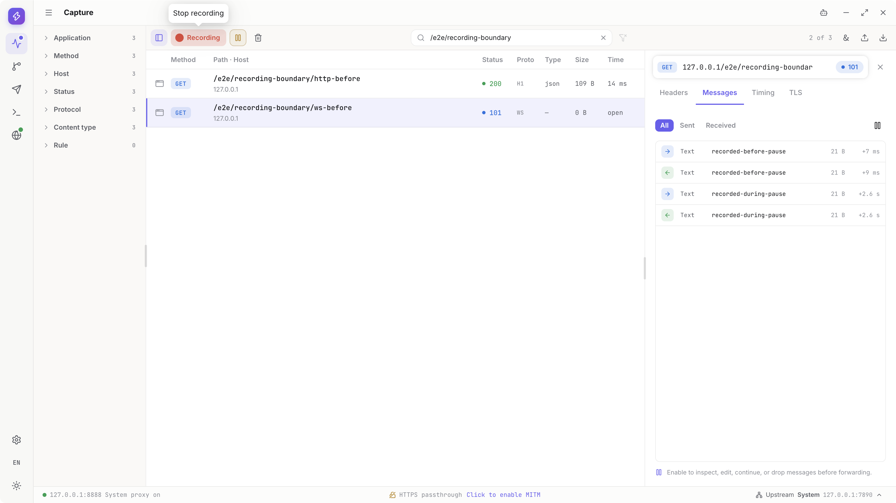
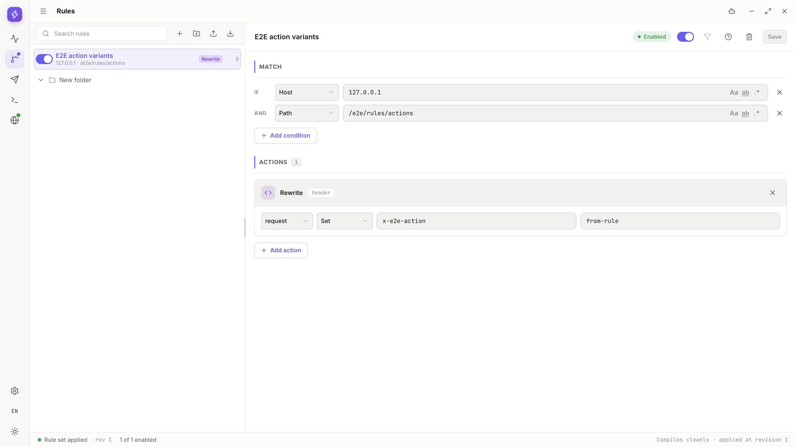
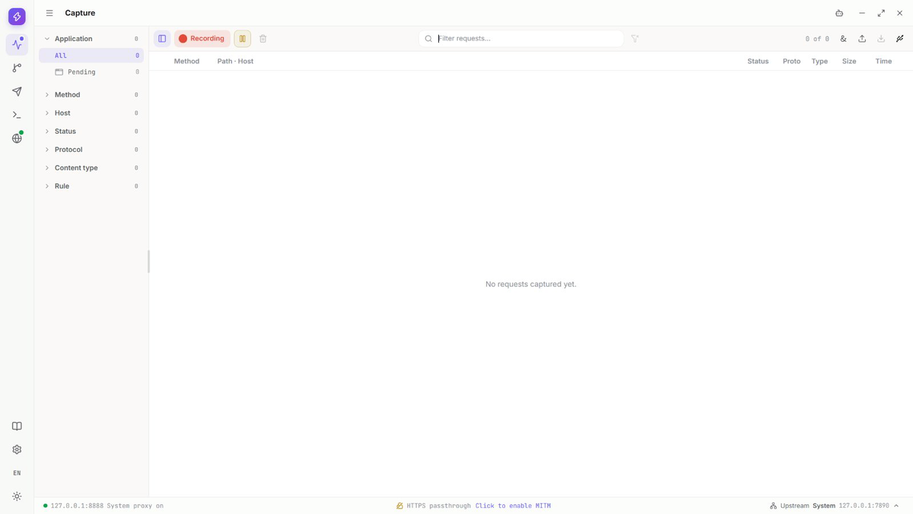
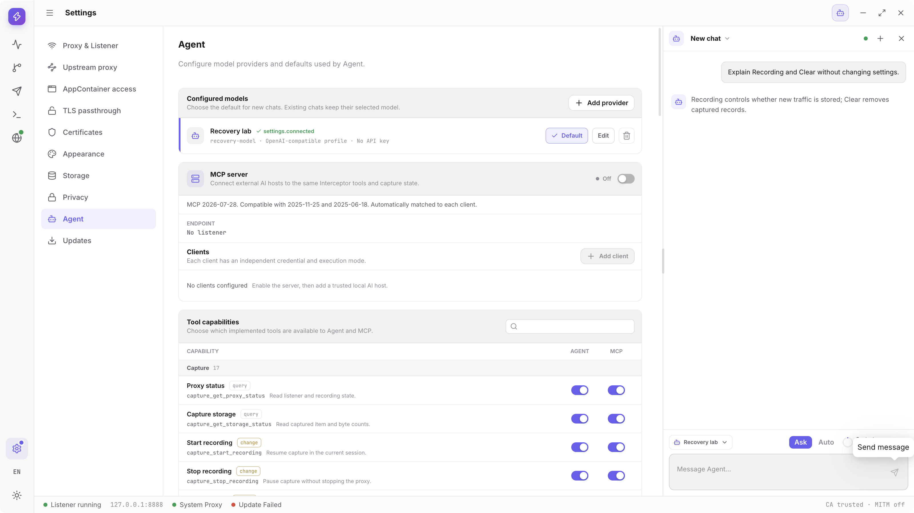
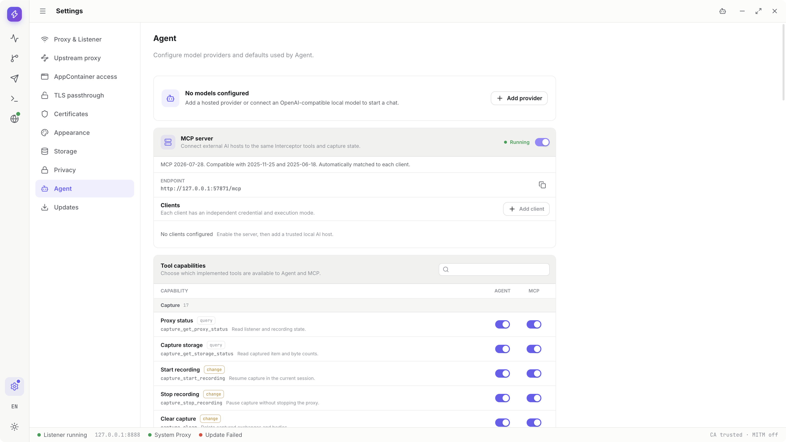

  

<h1 align="center">Interceptor</h1>

<b>Open-source HTTP(S) debugging proxy for Windows &amp; macOS</b> 
See what your app sends. Change what it receives.

  
  
  
  

  <a href="https://github.com/zhxmt-xm/Interceptor/releases/download/v0.1.1-alpha.1/Interceptor-0.1.1-alpha.1-win32-x64.exe"><b>Download for Windows</b></a> ·
  <a href="https://github.com/zhxmt-xm/Interceptor/releases/download/v0.1.1-alpha.1/Interceptor-0.1.1-alpha.1-darwin-arm64.dmg"><b>Download for macOS</b></a> 
  Alpha preview · Windows x64 · macOS Apple Silicon &amp; Intel · <a href="https://github.com/zhxmt-xm/Interceptor/releases">all builds and notes</a>

[简体中文](README.zh-CN.md) | [Website](https://www.interceptor.cn/) | [Quick Start](#quick-start) | [Features](#features) | [Illustrated Guide](https://www.interceptor.cn/en/guide) | [Feedback](https://github.com/zhxmt-xm/Interceptor/issues)

*Screenshots from v0.1.1-alpha.1 on macOS. [Source and limits](architecture/assets/readme-media.json).*

Interceptor is a desktop HTTP(S) debugging proxy for web/API developers and QA engineers on **Windows and macOS**. Inspect HTTP/1.1, HTTP/2, WebSocket and gRPC traffic, test a different response without changing the server, and replay requests from one workspace. Agent and MCP add optional AI assistance; ordinary debugging needs no model account.

## How it compares

| | Interceptor | Charles | Proxyman |
| --- | --- | --- | --- |
| License | Apache-2.0 | Proprietary | Proprietary |
| Price | Free | Paid | Paid |
| Breakpoints with edit and continue | Yes | Yes | Yes |
| Rules, mock and map | Yes | Yes | Yes |
| Built-in Composer | Yes | Yes | Yes |
| MCP and Agent | Yes | — | — |

Charles and Proxyman are mature commercial tools with their own strengths. Interceptor covers the same capture, breakpoint, rewrite and replay workflow with open-source code, Windows and macOS builds, and optional MCP/Agent access. If you have used Charles, Fiddler, Proxyman, Whistle or mitmproxy before, the core workflow will feel familiar. Summary as of October 2026; check vendor documentation for current features and pricing.

## Download

Alpha preview: [v0.1.1-alpha.1](https://github.com/zhxmt-xm/Interceptor/releases/tag/v0.1.1-alpha.1). Choose your OS and CPU below, or see [all releases and compatibility notes](https://github.com/zhxmt-xm/Interceptor/releases). Alpha builds may still change data formats and interface details.

| Platform | Downloads | Installation |
| --- | --- | --- |
| macOS · Apple Silicon (arm64) | [DMG](https://github.com/zhxmt-xm/Interceptor/releases/download/v0.1.1-alpha.1/Interceptor-0.1.1-alpha.1-darwin-arm64.dmg) · [ZIP](https://github.com/zhxmt-xm/Interceptor/releases/download/v0.1.1-alpha.1/Interceptor-0.1.1-alpha.1-darwin-arm64.zip) | Copy Interceptor to Applications before opening it. |
| macOS · Intel (x64) | [DMG](https://github.com/zhxmt-xm/Interceptor/releases/download/v0.1.1-alpha.1/Interceptor-0.1.1-alpha.1-darwin-x64.dmg) · [ZIP](https://github.com/zhxmt-xm/Interceptor/releases/download/v0.1.1-alpha.1/Interceptor-0.1.1-alpha.1-darwin-x64.zip) | Copy Interceptor to Applications before opening it. |
| Windows · x64 | [EXE](https://github.com/zhxmt-xm/Interceptor/releases/download/v0.1.1-alpha.1/Interceptor-0.1.1-alpha.1-win32-x64.exe) · [MSI](https://github.com/zhxmt-xm/Interceptor/releases/download/v0.1.1-alpha.1/Interceptor-0.1.1-alpha.1-win32-x64.msi) · [ZIP](https://github.com/zhxmt-xm/Interceptor/releases/download/v0.1.1-alpha.1/Interceptor-0.1.1-alpha.1-win32-x64.zip) | Run an installer, or extract the entire ZIP before launching the App. |

Installation permissions, signing and updates

- macOS packages use ad-hoc signing and are not notarized by Apple. After verifying the source and integrity of the download, use **System Settings → Privacy & Security → Open Anyway** if macOS offers it.
- Windows installers are unsigned. Follow the normal per-application approval process only for a download you trust. Managed devices may prohibit installation.
- Do not disable system-wide security protections. Helper installation, system proxy changes and CA trust have their own normal system authorization steps.
- Updates use GitHub Releases. Checks are anonymous; the App does not request a GitHub login or token. Downloading and opening an installer remain explicit user actions.

## Quick Start

1. **Launch and check readiness.** Interceptor starts a local proxy at `127.0.0.1:8888` and attempts to take over the system proxy. Complete any required system prompts, then confirm the listener is ready and Capture is recording.
2. **Route your test application.** Applications that follow the system proxy use it automatically. For other proxy-aware clients, explicitly configure `127.0.0.1:8888`.
3. **Reproduce one request.** Exercise an endpoint you are authorized to inspect. Select its row in Capture to read the request, response and timing. No AI setup is required.
4. **Enable HTTPS inspection only when needed.** Open Settings → Certificates and check the local CA. Generate or trust it only if needed, complete the OS authorization, then enable HTTPS decryption. Existing CA material does not need to be replaced.
5. **Save, then quit normally.** Export a HAR or native archive before closing: the current Capture session is temporary. Normal exit restores the system proxy settings Interceptor owns.

[Follow the illustrated first-request guide](https://www.interceptor.cn/en/guide/getting-started) · [Troubleshooting and proxy recovery](https://www.interceptor.cn/en/guide/troubleshooting)

Certificate pinning and separate trust stores can prevent decryption. TLS passthrough keeps a connection encrypted; it does not expose its HTTP content. Interceptor cannot capture a client that bypasses the proxy entirely. Pausing recording does not stop forwarding or disable Rules.

## Features

### Capture: find the request that explains the failure

- Filter traffic by application, host, method, status, protocol, content type and matched rule.
- Inspect headers, cookies, request/response bodies, timing and TLS details; switch between JSON trees, formatted text, raw content, images and hex.
- Read WebSocket frames and gRPC messages alongside HTTP/1.1 and HTTP/2 exchanges.

The opening screenshot shows a selected WebSocket connection and its messages. More real steps: [Capture](https://www.interceptor.cn/en/guide/capture) · [HTTP/2](https://www.interceptor.cn/en/guide/capture#walkthrough-capture-http2) · [WebSocket](https://www.interceptor.cn/en/guide/capture#walkthrough-capture-websocket-messages) · [gRPC](https://www.interceptor.cn/en/guide/capture#walkthrough-capture-grpc-messages)

### Rules: test a different outcome without changing the server

- Match requests or responses and rewrite headers, query parameters, bodies or status codes.
- Mock a response, map to a local file or another server, block traffic, or add a delay.
- Organize rules in folders and inspect their hits and recorded effects.

[Rules walkthrough: matching, rewriting, mocking and mapping](https://www.interceptor.cn/en/guide/rules)

### Breakpoints: review traffic before it continues

- Pause HTTP requests, responses or WebSocket frames that match a breakpoint rule.
- Continue unchanged, forward edited content or drop it; manage multiple paused items from the queue.
- HTTP pauses occur at the header stage, so the original body may not yet be available.

*Animated demo with Chinese and English subtitles.*

[Breakpoints walkthrough: pause, edit, continue and drop](https://www.interceptor.cn/en/guide/breakpoints)

### Composer: reproduce an API call on its own

- Send a captured request to Composer, or build one from scratch.
- Edit query parameters, headers, authentication and bodies; inspect the response and timing.
- Save reusable requests in collections, use request history, or probe a TLS connection.

Composer sends directly: its requests do not enter Capture or run through Rules. [Composer and collection walkthrough](https://www.interceptor.cn/en/guide/composer).

### Agent: ask for help inside the workspace

- Configure DeepSeek or an OpenAI-compatible endpoint with your own model settings and credentials when required.
- Discuss traffic and let the Agent use only the Tools you enable; review changes in `Ask` mode.
- Keep encrypted local conversation history, switch chats, stop a turn or retry.

*Local demonstration model, not a commercial model test.*

[Agent setup and conversation walkthrough](https://www.interceptor.cn/en/guide/agent)

### MCP: use Interceptor from a compatible AI client

- Enable the optional, loopback-only MCP server and create a separate client credential for each host.
- Copy the connection configuration to a host supporting the required Streamable HTTP protocol.
- Control MCP Tools independently of the built-in Agent; rotate or revoke client access in Settings.

*Local loopback configuration, not an external-host compatibility test.*

[MCP setup and compatibility guide](https://www.interceptor.cn/en/guide/mcp) · [Tool reference](https://www.interceptor.cn/en/guide/tool-reference)

### Save, configure and troubleshoot

| Feature | Why it is useful | Illustrated steps |
| --- | --- | --- |
| Import and export | Exchange HAR files, reopen native capture archives, save individual bodies, and share Rules or Composer collections. | [Files and export privacy](https://www.interceptor.cn/en/guide/transfer#walkthrough) |
| System and upstream proxy | Inspect proxy ownership and restore it; choose Direct, System, manual proxy or PAC routing. | [Proxy settings](https://www.interceptor.cn/en/guide/settings#walkthrough-settings-proxy-routing) · [Upstream](https://www.interceptor.cn/en/guide/settings#upstream) |
| HTTPS and TLS passthrough | Manage CA trust, enable decryption, or keep selected hosts encrypted. | [Certificates](https://www.interceptor.cn/en/guide/settings#https-decryption) · [Passthrough](https://www.interceptor.cn/en/guide/settings#tls-passthrough) |
| Diagnostics | Filter structured logs, inspect an operation and export redacted diagnostics for a bug report. | [Diagnostics walkthrough](https://www.interceptor.cn/en/guide/diagnostics#walkthrough) |
| Workspace | Resize panels and choose from four time-of-day themes and 15 interface languages. | [Navigation and preferences](https://www.interceptor.cn/en/guide/workspace) |

The [complete guide](https://www.interceptor.cn/en/guide) also covers storage, updates, Windows AppContainer prerequisites and recovery. Platform-specific or external-service steps retain their stated limits; macOS screenshots do not replace those checks.

## Agent and MCP Permissions

AI is optional. Model requests may incur provider charges. Agent and MCP have **separate per-Tool switches**, and an Agent chat's execution mode does not change an MCP client's mode.

| Operation | `Ask` | `Auto` |
| --- | --- | --- |
| Enabled query Tool | Runs without per-call approval | Runs without per-call approval |
| Enabled change Tool | Requires explicit App approval | Runs without per-call approval |
| Disabled Tool | Rejected | Rejected |
| Native file dialogs and OS authorization | Still required | Still required |

`Ask` is not read-only mode: queries can expose data. To allow inspection only, disable change Tools as described in the [permissions guide](https://www.interceptor.cn/en/guide/tool-permissions#read-only).

## Privacy and Safety

- **Capture storage is local.** Recordings, exported files and diagnostic logs can contain cookies, credentials and personal data. Inspect only traffic you are authorized to access.
- **Check exports before sharing.** HAR privacy options are not blanket anonymization; native archives preserve full data. Review bodies, URLs and other fields yourself.
- **AI can send data outside the App.** Agent sends conversation context and Tool results to the configured model provider. An authorized MCP client can receive data exposed by its enabled Tools. Review both permissions and the recipient's data policy.
- **CA trust outlives decryption and the App.** Turning off decryption or quitting does not uninstall the CA. Remove its trust through Settings when no longer needed; never share its private key.
- **Close normally to restore the proxy.** If another application changes the system proxy during a session, Interceptor avoids overwriting that application's settings. Use the [recovery guide](https://www.interceptor.cn/en/guide/troubleshooting) if cleanup is interrupted.

## Feedback and Contributing

Report reproducible problems or suggest improvements through [GitHub Issues](https://github.com/zhxmt-xm/Interceptor/issues). Include the app version, operating system, relevant protocol and reproduction steps, without private traffic, API keys or certificate material.

Code, documentation, translations and focused bug reports are welcome. Start with the [development guide (Chinese)](architecture/development.md) for source builds, setup, debugging and validation. The [architecture index (Chinese)](architecture/README.md) describes modules and feature contracts.

After setup, run `npm start` to choose Development, Test, Build or Release. Test offers normal E2E runs or step screenshots. See the [release guide (Chinese)](architecture/release-guide.md) before publishing a build.

## Platform support

- Windows x64 and macOS on Apple Silicon and Intel. Check each release's notes for the platform scope it was validated on.
- README screenshots come from the macOS build. Windows and Android have separate prerequisites and limits in the [guide](https://www.interceptor.cn/en/guide).
- This alpha preview may still change interfaces, data formats and behavior before a stable release.

## Acknowledgements

Interceptor builds on [Electron](https://www.electronjs.org/), [Mockttp](https://github.com/httptoolkit/mockttp), [React](https://react.dev/) and [Monaco Editor](https://microsoft.github.io/monaco-editor/), alongside the other libraries used in this repository.

## License

Interceptor's original code is licensed under [Apache-2.0](LICENSE), with attribution in [NOTICE](NOTICE). Third-party components retain their own licenses and notices; the application includes its license and dependency notices.
