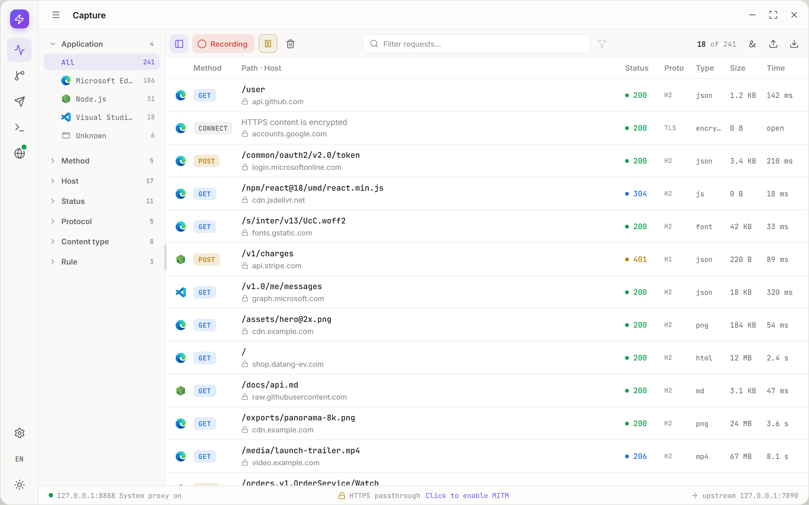

  

# Interceptor

[English](README.md) | [简体中文](README.zh-CN.md)

**A desktop HTTP(S) debugging proxy for Windows and macOS.**

Interceptor brings traffic inspection, request replay, response mocking and AI-assisted debugging into one workspace. Understand what an application sends, reproduce an API failure, or change a response without changing the server.

[Downloads](https://github.com/zhxmt-xm/Interceptor/releases) | [Features](#features) | [Quick Start](#quick-start) | [Feedback](https://github.com/zhxmt-xm/Interceptor/issues)

<picture>
  <source media="(prefers-color-scheme: dark)" srcset="design-vite/shots/dark/capture/framed.png">
  
</picture>

*Capture workspace design preview with sample traffic, not a screenshot of a released build.*

## Features

### Capture and Understand

- **HTTP and HTTPS inspection.** Capture HTTP/1.1 and HTTP/2 traffic; inspect headers, cookies, bodies, timing and TLS details. Filter by application, host, method, status and protocol.
- **Readable content.** Explore JSON trees, formatted text, images and hexadecimal data without leaving the request inspector.
- **WebSocket and gRPC inspection.** Inspect WebSocket frames and gRPC messages alongside HTTP exchanges.

### Modify and Reproduce

| Tool | What you can do |
| --- | --- |
| Rules | Match requests or responses; rewrite headers, query parameters, bodies and status codes. Mock a response, serve a local file, redirect to another server, block traffic or add a delay. |
| Breakpoints | Pause HTTP requests, responses or WebSocket frames, inspect and edit them, then decide whether to forward or drop them. |
| Composer | Build and resend requests, edit parameters, headers and bodies, and organize reusable requests into collections. |

### Save, Share and Extend

- **Import and export.** Exchange HAR files, save native capture archives, export individual bodies, and share Rules or Composer collections.
- **Agent and MCP.** Use an optional built-in Agent or connect a compatible external AI client, with explicit Tool permissions and approval modes.
- **Network controls.** Manage the system proxy, chain an upstream proxy, configure TLS passthrough and inspect diagnostic logs.
- **A configurable workspace.** Choose from four time-of-day themes and 15 interface languages, with resizable panels for detailed inspection.

## Get Interceptor

Published builds and their compatibility notes are listed in [GitHub Releases](https://github.com/zhxmt-xm/Interceptor/releases).

| Platform | Package | Installation |
| --- | --- | --- |
| macOS | DMG / ZIP | Use the build matching your Mac and copy the app to Applications before opening it. |

Availability is determined by the assets actually attached to each release. For a platform without a published build, see the [source build guide (Chinese)](architecture/development.md).

The macOS installers use ad-hoc signing and are not notarized by Apple. Gatekeeper may block the first launch. Only after verifying the source and integrity of the download, follow macOS **System Settings → Privacy & Security → Open Anyway** if that option is available. Managed devices may prohibit this; do not disable system-wide security protections. Helper installation and CA trust are separate permissions requested by Interceptor through normal system dialogs.

Application updates also come from GitHub Releases. You review the release notes, choose when to download, and open the installer when ready; downloads do not start automatically. Checks and downloads are anonymous. An unavailable release or failed request is shown as a failure, without a sign-in prompt.

## Quick Start

1. **Launch Interceptor.** The app starts a local proxy at `127.0.0.1:8888` and automatically takes over the system proxy.
2. **Route the application you want to inspect.** Applications that follow the system proxy use it automatically. For other proxy-aware clients, configure the same address explicitly.
3. **Enable HTTPS inspection when needed.** Open HTTPS Setup, generate a local CA, install and trust it through the operating system prompt, then enable decryption. Certificate trust requires administrator authorization.
4. **Reproduce the request.** Select an exchange in Capture to inspect it; use Composer to resend it, Rules to change future traffic, or Breakpoints to intervene before forwarding.
5. **Keep the evidence you need.** Export a HAR or native archive for later inspection. Close the app normally when finished so it can restore the system proxy settings it owns.

Applications with certificate pinning or their own trust store may need additional setup or TLS passthrough. Passthrough preserves the encrypted connection; it does not expose decrypted HTTP content. Interceptor cannot capture a client that bypasses the proxy entirely.

## Agent and MCP

AI is optional. Traffic capture, Rules, Breakpoints and Composer do not require a model API key.

| Entry point | Setup |
| --- | --- |
| Built-in Agent | Add a DeepSeek model and your own API key in Settings, then open the Agent side panel. Conversation history is stored locally with encryption. |
| External MCP client | Enable MCP in Settings, create a client, and copy its connection configuration to a compatible host. The listener is loopback-only and uses a separate Bearer token for each client. |
| Tool permissions | Agent and MCP have separate per-Tool switches. `Ask` requests approval before a Tool runs; `Auto` runs enabled Tools without per-call approval. Native file dialogs and OS authorization still apply. |

MCP is disabled by default. Client compatibility depends on the supported Streamable HTTP protocol version, not just the presence of an MCP option; see the [MCP compatibility reference](architecture/features/mcp.md).

## Privacy and Safety

- **Capture storage is local.** Treat recordings, exported files and diagnostic logs as sensitive: they can contain cookies, credentials or personal data.
- **AI introduces an external data boundary.** Using Agent sends conversation context and Tool results to the configured model provider; an authorized MCP client can receive the data exposed by its enabled Tools. Review permissions before connecting either.
- **Certificate trust affects the whole machine.** Turning off decryption or quitting does not uninstall the CA. Remove its trust through Settings when it is no longer needed.
- **System settings need orderly cleanup.** Close Interceptor normally. If another application changes the system proxy during a session, Interceptor avoids overwriting that application's settings.
- **Inspect only traffic you are authorized to access.** Review and redact exported material before sharing it in an issue or with another person.

## Feedback and Contributing

Report reproducible problems or suggest improvements through [GitHub Issues](https://github.com/zhxmt-xm/Interceptor/issues). Include the app version, operating system, relevant protocol and reproduction steps, without private traffic, API keys or certificate material.

Code, documentation, translations and focused bug reports are welcome. Start with the [development guide (Chinese)](architecture/development.md) for setup, module responsibilities, debugging, validation and packaging. The [architecture index (Chinese)](architecture/README.md) links to feature contracts and platform documentation.

After setup, run `npm start` and choose Development, Test, Build or Release. Desktop and Design start without build-mode questions; confirmation defaults to Yes but still waits for Enter. Release opens the existing `npm run release` wizard: confirm the source, version and targets before CI, then successful builds are verified and published automatically without another prompt. Existing commands remain available for direct use and CI.

Under Test, E2E offers normal validation or step screenshots with automatic output directories, without composing command-line arguments. Both modes use the same workflows; screenshots are test evidence, not an automatic website publication.

## Acknowledgements

Interceptor builds on [Electron](https://www.electronjs.org/), [Mockttp](https://github.com/httptoolkit/mockttp), [React](https://react.dev/) and [Monaco Editor](https://microsoft.github.io/monaco-editor/), alongside the other libraries used in this repository.

## License

Interceptor's original code is licensed under [Apache-2.0](LICENSE), with attribution in [NOTICE](NOTICE). Third-party components retain their own licenses and notices; the application includes its license and dependency notices. Using the software does not require sponsorship.
