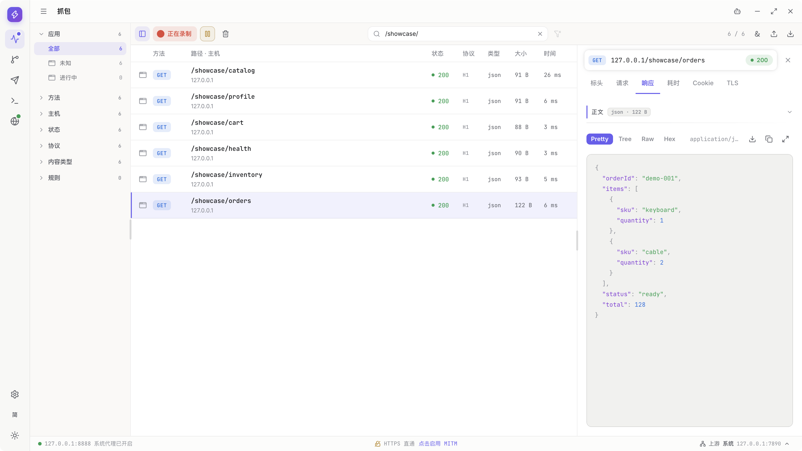
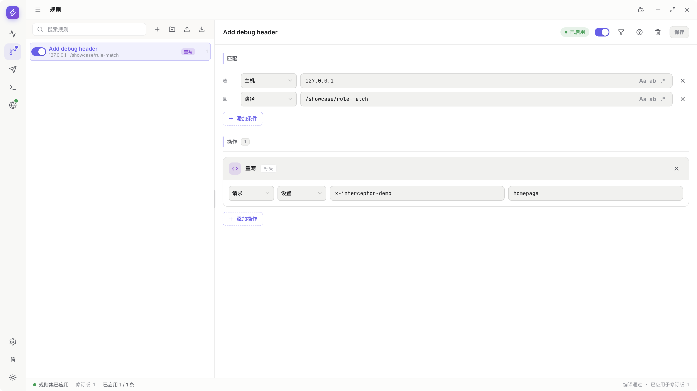
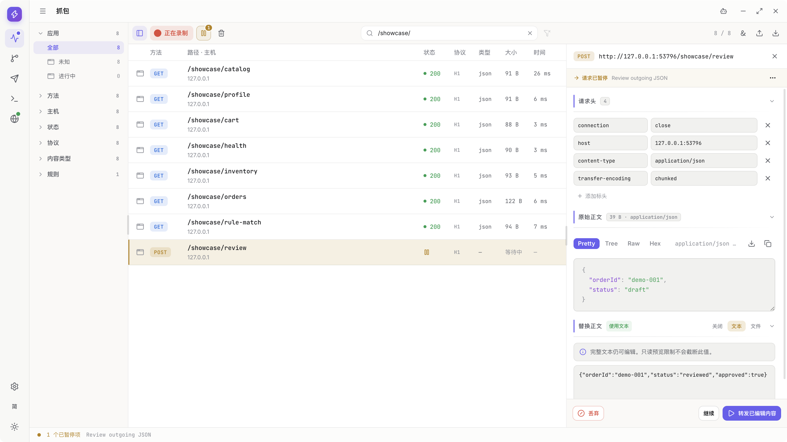
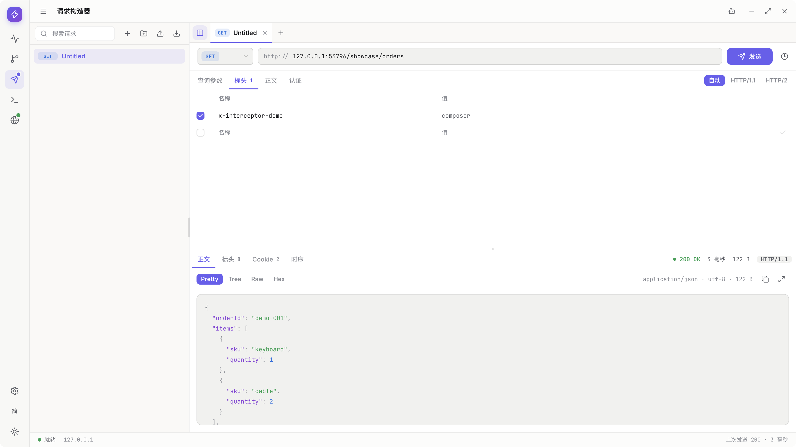
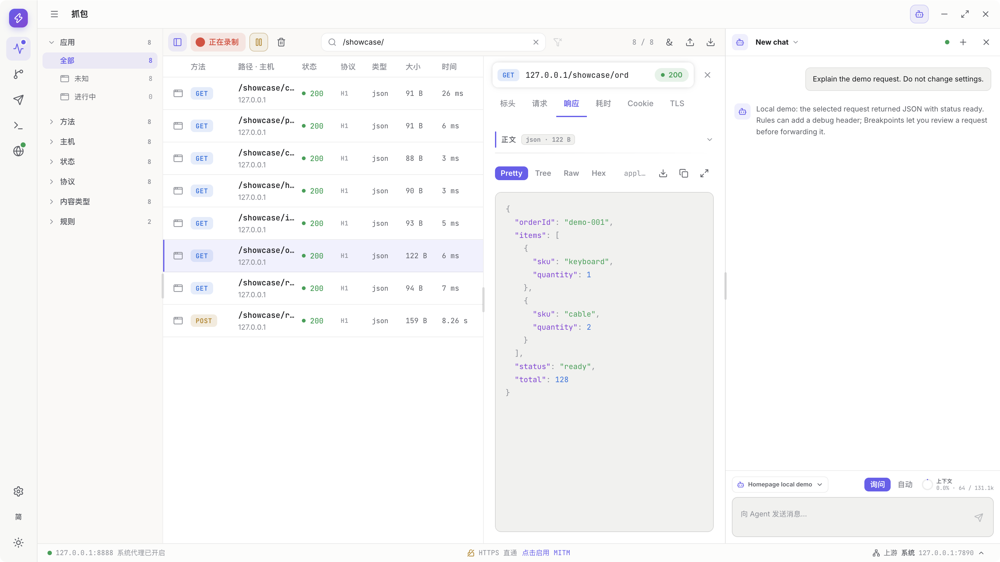
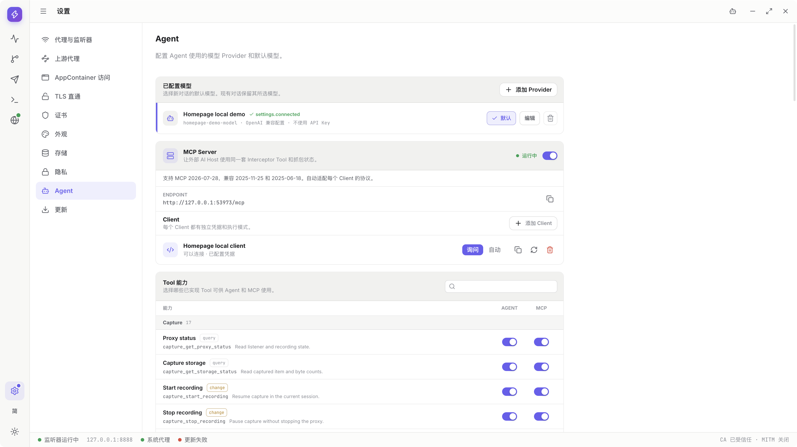

  

# Interceptor

[English](README.md) | [简体中文](README.zh-CN.md)

**看清应用发了什么，改变它收到什么，复现问题。**

Interceptor 是面向 Web/API 开发者和测试工程师的桌面 HTTP(S) 调试代理，运行于 **Windows 和 macOS**。在一个工作区检查 HTTP/1.1、HTTP/2、WebSocket 和 gRPC 流量，不改服务端即可测试不同响应、重放请求。Agent 与 MCP 提供可选的 AI 辅助，日常调试不需要模型账号。

[下载](#下载) | [快速上手](#快速上手) | [功能](#功能) | [图文使用指南](https://github.com/zhxmt-xm/Interceptor-Homepage/blob/main/guidebook/README.md) | [反馈](https://github.com/zhxmt-xm/Interceptor/issues)

<picture>
  <source media="(prefers-color-scheme: dark)" srcset="architecture/assets/readme-capture-dark.png">
  
</picture>

*截图来自 macOS 发布版的真实 App，保留中文界面，使用受控的本地流量，不是设计稿。浅色与深色图片使用 App 自身主题。[截图来源与演示边界](architecture/assets/readme-media.json)。*

## 下载

可下载的预发布版本：[v0.1.1-alpha.1](https://github.com/zhxmt-xm/Interceptor/releases/tag/v0.1.1-alpha.1)。按操作系统与 CPU 选择下列安装包，或查看[全部 Release 与兼容性说明](https://github.com/zhxmt-xm/Interceptor/releases)。

| 平台 | 下载 | 安装方式 |
| --- | --- | --- |
| macOS · Apple Silicon（arm64） | [DMG](https://github.com/zhxmt-xm/Interceptor/releases/download/v0.1.1-alpha.1/Interceptor-0.1.1-alpha.1-darwin-arm64.dmg) · [ZIP](https://github.com/zhxmt-xm/Interceptor/releases/download/v0.1.1-alpha.1/Interceptor-0.1.1-alpha.1-darwin-arm64.zip) | 先将 Interceptor 复制到 Applications，再打开应用。 |
| macOS · Intel（x64） | [DMG](https://github.com/zhxmt-xm/Interceptor/releases/download/v0.1.1-alpha.1/Interceptor-0.1.1-alpha.1-darwin-x64.dmg) · [ZIP](https://github.com/zhxmt-xm/Interceptor/releases/download/v0.1.1-alpha.1/Interceptor-0.1.1-alpha.1-darwin-x64.zip) | 先将 Interceptor 复制到 Applications，再打开应用。 |
| Windows · x64 | [EXE](https://github.com/zhxmt-xm/Interceptor/releases/download/v0.1.1-alpha.1/Interceptor-0.1.1-alpha.1-win32-x64.exe) · [MSI](https://github.com/zhxmt-xm/Interceptor/releases/download/v0.1.1-alpha.1/Interceptor-0.1.1-alpha.1-win32-x64.msi) · [ZIP](https://github.com/zhxmt-xm/Interceptor/releases/download/v0.1.1-alpha.1/Interceptor-0.1.1-alpha.1-win32-x64.zip) | 运行安装器，或完整解压 ZIP 后再启动 App。 |

**访问权限：** 产品仓库和独立 Guidebook 仓库目前均为私有。下载、Issue 与教程链接需要对应 GitHub 仓库的访问权限。出现 `404` 可能是未登录或没有权限；私有 Release 并不支持匿名下载。

安装权限、签名与更新

- macOS 安装包采用 ad-hoc 签名，未经 Apple 公证。确认下载来源可信且文件完整后，如果系统提供该选项，可通过“系统设置 → 隐私与安全性 → 仍要打开”放行。
- Windows 安装器未签名。只对可信下载使用系统正常的单应用授权流程；受管理设备可能禁止安装。
- 不要全局关闭系统安全保护。helper 安装、系统代理变更和 CA 信任分别保留正常的系统授权步骤。
- 更新来自 GitHub Releases。检查匿名进行，App 不要求 GitHub 登录或 token。仓库为私有时，应用内更新无法读取其 Release，请使用上方已获授权的浏览器下载入口。下载和打开安装器都由用户主动操作。

存在安装包不代表所有平台专项流程均已验收，请同时阅读 Release 的验证说明和教程中的平台前提。这些截图展示的是 macOS，不是 Windows 或 Android。

## 快速上手

1. **启动并确认就绪。** Interceptor 在 `127.0.0.1:8888` 启动本地代理，并尝试接管系统代理。完成必要的系统提示，再确认 listener 就绪、Capture 正在录制。
2. **让测试应用经过代理。** 遵循系统代理的应用会自动使用该地址；其他支持代理的客户端需显式配置 `127.0.0.1:8888`。
3. **复现一条请求。** 操作你有权检查的接口，在 Capture 中选中对应记录，查看请求、响应和耗时，无需配置 AI。
4. **按需启用 HTTPS 解密。** 打开 Settings → Certificates，检查本地 CA；只在需要时生成或信任，完成操作系统授权后再启用 HTTPS 解密。无需替换已有 CA 材料。
5. **先保存，再正常退出。** 当前 Capture 会话是临时数据，关闭前导出 HAR 或原生归档。正常退出会恢复 Interceptor 接管的系统代理设置。

[按图完成第一条请求](https://github.com/zhxmt-xm/Interceptor-Homepage/blob/main/guidebook/zh-CN/getting-started.md) · [常见问题与代理恢复](https://github.com/zhxmt-xm/Interceptor-Homepage/blob/main/guidebook/zh-CN/troubleshooting.md)

证书固定或独立信任库可能阻止解密。TLS 透传保持连接加密，不暴露 HTTP 内容；完全绕过代理的客户端流量不会被捕获。暂停录制不会停止转发，也不会停用 Rules。

## 功能

### Capture：找到能解释故障的请求

- 按应用、域名、方法、状态码、协议、内容类型和命中规则筛选流量。
- 检查请求头、Cookie、请求与响应正文、耗时和 TLS 信息；切换 JSON 树、格式化文本、原文、图片和十六进制视图。
- 在 HTTP/1.1、HTTP/2 请求之外查看 WebSocket 帧和 gRPC 消息。

开头截图展示了选中的订单响应。更多真实步骤：[Capture](https://github.com/zhxmt-xm/Interceptor-Homepage/blob/main/guidebook/zh-CN/capture.md) · [HTTP/2](https://github.com/zhxmt-xm/Interceptor-Homepage/blob/main/guidebook/zh-CN/capture.md#walkthrough-capture-http2) · [WebSocket](https://github.com/zhxmt-xm/Interceptor-Homepage/blob/main/guidebook/zh-CN/capture.md#walkthrough-capture-websocket-messages) · [gRPC](https://github.com/zhxmt-xm/Interceptor-Homepage/blob/main/guidebook/zh-CN/capture.md#walkthrough-capture-grpc-messages)

### Rules：不改服务端，测试不同结果

- 匹配请求或响应，改写请求头、查询参数、正文或状态码。
- 模拟响应、映射本地文件或其他服务、阻断流量，或添加延迟。
- 用文件夹组织规则，查看命中和已记录的修改效果。

<picture>
  <source media="(prefers-color-scheme: dark)" srcset="architecture/assets/readme-rules-dark.png">
  
</picture>

[Rules 图文教程：匹配、改写、模拟与映射](https://github.com/zhxmt-xm/Interceptor-Homepage/blob/main/guidebook/zh-CN/rules.md)

### Breakpoints：转发之前，先检查或修改

- 暂停命中断点规则的 HTTP 请求、响应或 WebSocket 帧。
- 原样继续、转发编辑后的内容或丢弃，也可从队列管理多个暂停项。
- HTTP 断点在头部阶段暂停，原始正文可能尚未到达。

<picture>
  <source media="(prefers-color-scheme: dark)" srcset="architecture/assets/readme-breakpoints-dark.png">
  
</picture>

[Breakpoints 图文教程：暂停、编辑、放行与丢弃](https://github.com/zhxmt-xm/Interceptor-Homepage/blob/main/guidebook/zh-CN/breakpoints.md)

### Composer：独立复现一条 API 调用

- 将抓到的请求发送到 Composer，或从头构造请求。
- 编辑查询参数、请求头、认证和正文，检查响应与耗时。
- 用 Collection 保存可复用请求，使用请求历史，或探测 TLS 连接。

<picture>
  <source media="(prefers-color-scheme: dark)" srcset="architecture/assets/readme-composer-dark.png">
  
</picture>

Composer 直接发送请求，不进入 Capture，也不经过 Rules。[Composer 与 Collection 图文教程](https://github.com/zhxmt-xm/Interceptor-Homepage/blob/main/guidebook/zh-CN/composer.md)。

### Agent：在工作区内获得 AI 辅助

- 配置 DeepSeek 或 OpenAI-compatible endpoint，填写自己的模型设置，并按服务要求提供凭据。
- 围绕流量提问，只让 Agent 使用你启用的 Tool；通过 `Ask` 审批变更。
- 会话历史在本地加密保存，支持切换对话、停止和重试。

<picture>
  <source media="(prefers-color-scheme: dark)" srcset="architecture/assets/readme-agent-dark.png">
  
</picture>

*截图使用无 Key、确定性回复的本地演示模型，不代表商业模型的效果或兼容性验收。*

[Agent 配置与对话图文教程](https://github.com/zhxmt-xm/Interceptor-Homepage/blob/main/guidebook/zh-CN/agent.md)

### MCP：从兼容的 AI 客户端使用 Interceptor

- 按需开启仅监听 loopback 的 MCP Server，为每个 Host 创建独立客户端凭据。
- 将连接配置复制到支持所需 Streamable HTTP 协议的 Host。
- 独立于内置 Agent 控制 MCP Tool，在 Settings 中轮换或撤销客户端接入。

<picture>
  <source media="(prefers-color-scheme: dark)" srcset="architecture/assets/readme-mcp-dark.png">
  
</picture>

*截图展示真实的本机服务与客户端配置，不代表某个外部 Host 已验收。MCP 默认关闭。*

[MCP 配置与兼容性指南](https://github.com/zhxmt-xm/Interceptor-Homepage/blob/main/guidebook/zh-CN/mcp.md) · [Tool 操作速查](https://github.com/zhxmt-xm/Interceptor-Homepage/blob/main/guidebook/zh-CN/tool-reference.md)

### 保存、配置与排查

| 功能 | 解决什么问题 | 图文步骤 |
| --- | --- | --- |
| 导入导出 | 交换 HAR、重新打开原生录制归档、保存单独正文，并共享 Rules 或 Composer Collection。 | [文件与导出隐私](https://github.com/zhxmt-xm/Interceptor-Homepage/blob/main/guidebook/zh-CN/transfer.md#walkthrough) |
| 系统与上游代理 | 查看代理接管状态并恢复，选择 Direct、System、手动代理或 PAC 路由。 | [代理设置](https://github.com/zhxmt-xm/Interceptor-Homepage/blob/main/guidebook/zh-CN/settings.md#walkthrough-settings-proxy-routing) · [上游代理](https://github.com/zhxmt-xm/Interceptor-Homepage/blob/main/guidebook/zh-CN/settings.md#upstream) |
| HTTPS 与 TLS 透传 | 管理 CA 信任、启用解密，或让选定域名保持加密。 | [证书](https://github.com/zhxmt-xm/Interceptor-Homepage/blob/main/guidebook/zh-CN/settings.md#https-decryption) · [透传](https://github.com/zhxmt-xm/Interceptor-Homepage/blob/main/guidebook/zh-CN/settings.md#tls-passthrough) |
| Diagnostics | 筛选结构化日志、检查操作链，导出脱敏诊断用于反馈问题。 | [Diagnostics 图文教程](https://github.com/zhxmt-xm/Interceptor-Homepage/blob/main/guidebook/zh-CN/diagnostics.md#walkthrough) |
| 工作区 | 拖拽调整面板，选择四种时段主题和 15 种界面语言。 | [导航与偏好](https://github.com/zhxmt-xm/Interceptor-Homepage/blob/main/guidebook/zh-CN/workspace.md) |

[完整指南](https://github.com/zhxmt-xm/Interceptor-Homepage/blob/main/guidebook/README.md)还包含存储、更新、Windows AppContainer 前提与恢复。平台专项和外部服务步骤仍遵守各自说明的边界，不能用 macOS 截图替代这些检查。

## Agent 与 MCP 权限

AI 是可选能力，模型请求可能产生服务商费用。Agent 与 MCP 提供**独立的逐 Tool 开关**；Agent 对话的执行模式不会改变 MCP 客户端的模式。

| 操作 | `Ask` | `Auto` |
| --- | --- | --- |
| 已启用的 query Tool | 无需逐次审批，直接查询 | 无需逐次审批，直接查询 |
| 已启用的 change Tool | 需要在 App 内明确批准 | 无需逐次审批，自动执行 |
| 已停用 Tool | 拒绝 | 拒绝 |
| 原生文件对话框与系统授权 | 仍需完成 | 仍需完成 |

`Ask` 不等于只读模式，查询也可能暴露数据。只允许检查时，按[权限指南](https://github.com/zhxmt-xm/Interceptor-Homepage/blob/main/guidebook/zh-CN/tool-permissions.md#read-only)停用 change Tool。

## 隐私与安全

- **录制数据存储在本地。** 录制、导出文件和诊断日志可能包含 Cookie、凭据与个人信息。仅检查获得授权的流量。
- **分享前检查导出内容。** HAR 隐私选项不等于全面匿名化，原生归档保留完整数据；正文、URL 等字段仍需自行检查。
- **AI 可能将数据传出 App。** Agent 会向配置的模型服务发送会话上下文和 Tool 结果；已授权的 MCP 客户端可以读取其启用 Tool 暴露的数据。请检查权限及接收方的数据政策。
- **关闭解密或退出不会移除 CA 信任。** 不再需要时，通过 Settings 移除信任；不要分享 CA 私钥。
- **正常关闭才能完成代理恢复。** 会话期间若其他应用修改了系统代理，Interceptor 会避免覆盖对方的设置。清理中断时，参考[恢复指南](https://github.com/zhxmt-xm/Interceptor-Homepage/blob/main/guidebook/zh-CN/troubleshooting.md)。

## 反馈与贡献

通过 [GitHub Issues](https://github.com/zhxmt-xm/Interceptor/issues) 报告可复现的问题或提出建议。请提供应用版本、操作系统、相关协议和复现步骤，不要附带私人流量、API Key 或证书材料。

欢迎代码、文档、翻译和具体的问题反馈。从源码构建、初始化、调试与验证见[中文开发指南](architecture/development.md)，模块职责和功能契约见[架构文档索引](architecture/README.md)。

完成初始化后，运行 `npm start`，选择 Development、Test、Build 或 Release。Test 提供普通 E2E 验收或逐步截图；截图保留为本地证据，不自动发布到官网。发布安装包前请阅读[发版指南](architecture/release-guide.md)。

## 致谢

Interceptor 基于 [Electron](https://www.electronjs.org/)、[Mockttp](https://github.com/httptoolkit/mockttp)、[React](https://react.dev/)、[Monaco Editor](https://microsoft.github.io/monaco-editor/) 及仓库使用的其他库构建。

## 许可证

Interceptor 自有代码采用 [Apache-2.0](LICENSE)，版权归属见 [NOTICE](NOTICE)。第三方组件保留各自的许可证和归属声明，应用安装包同时携带自有许可及依赖声明。使用软件不以赞助为前提。
