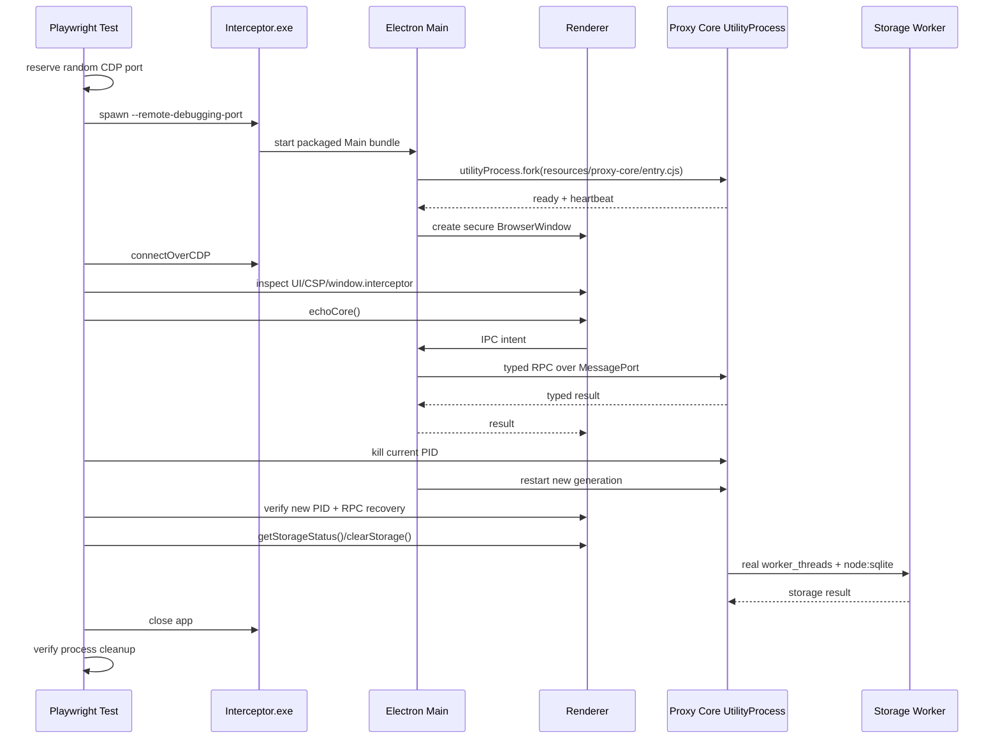

# Desktop Packaged Smoke

本目录验证 Interceptor 的真实 Electron 打包产物。测试不是在 Vite dev server、JSDOM 或 fake Electron 中运行，而是启动 `electron-forge package` 生成的最终 Windows 可执行文件，通过 Chrome DevTools Protocol（CDP）连接真实 Renderer，检查安全边界、Preload API、Proxy Core、Storage 和退出清理。

## 目录结构

```text
apps/desktop/tests/packaged-smoke/
├─ README.md       # 本文档
└─ startup.spec.ts # 真实 packaged app 启动与端到端 smoke
```

Playwright 配置位于：

```text
apps/desktop/playwright.config.ts
```

测试产物默认写入：

```text
apps/desktop/test-results/
```

## 测试目标

Packaged smoke 回答以下问题：

- Forge/Vite 是否成功生成可启动的最终应用？
- Main、Preload、Renderer 三个 production bundle 是否能协同运行？
- Renderer 是否保持 sandbox、context isolation 和严格 CSP？
- `window.interceptor` 是否只暴露预期的窄 API？
- Proxy Core UtilityProcess 是否从 packaged resources 启动并持续 heartbeat？
- Main 与 Core 的专用 MessagePort RPC 是否工作？
- Core 被强制终止后是否能以新 PID 自动重启？
- StorageService、Storage Worker、`node:sqlite` 和真实磁盘数据库是否可用？
- 主题与窗口尺寸切换是否仍能渲染？
- 应用退出后 Main/Core/Renderer 进程是否被清理？

它是发布产物级 smoke，不承担完整业务覆盖或逐像素设计比较。

## 运行前提

### 1. 安装依赖

从仓库根目录：

```powershell
npm install
```

### 2. Node/npm 版本

版本以根目录 `.nvmrc`、`.npmrc` 和 `package.json` 为准。

### 3. Windows package

当前 Windows smoke 查找：

```text
apps/desktop/out/Interceptor-win32-x64/Interceptor.exe
```

必须先执行 package。测试不会为了隐藏构建失败而自动打包。

## 推荐运行方式

从仓库根目录构建真实 package：

```powershell
$env:ELECTRON_MIRROR = 'https://npmmirror.com/mirrors/electron/'
npm run package
```

然后运行 smoke：

```powershell
npm run test:smoke --workspace @interceptor/desktop
```

也可以从 Desktop workspace 只列出测试，确认 Playwright discovery：

```powershell
npm exec --workspace @interceptor/desktop playwright test -- --list
```

预期能发现：

```text
packaged-smoke/startup.spec.ts
```

## 执行流程



## 当前覆盖内容

### UI 与窗口

- Renderer 页面成功加载；
- Interceptor 品牌、Workspace navigation 和 main 区域可见；
- 1280×800 light/dark 截图；
- 900×600 最小窗口截图；
- 主题切换通过真实 UI 操作完成。

### Renderer 安全隔离

测试确认：

- `window.process` 不存在；
- `window.require` 不存在；
- CSP 包含 `connect-src 'none'`；
- CSP 包含 `frame-src 'none'`；
- CSP 不依赖 HTML 无效的 `frame-ancestors` meta 指令；
- Renderer 只能访问 Preload 暴露的 `window.interceptor`。

### Preload API 白名单

测试对 `Object.keys(window.interceptor).sort()` 做精确断言。

新增、删除或重命名 Renderer 意图 API 时，必须同步：

1. `src/shared/desktop-api.ts`；
2. `src/preload/preload.ts`；
3. Main IPC handler；
4. Core protocol/handler（若跨 Core）；
5. `startup.spec.ts` 的 API keys 数组。

精确断言可以发现意外暴露的通用 IPC、Node 原语或敏感能力。

### Proxy Core 生命周期

- Core 状态最终进入 `running`；
- PID 可见且 Sidebar 显示对应 title；
- `echoCore` 通过 Main→Core MessagePort 往返；
- Trace 包含 action/command completion；
- 强制 kill 当前 Core PID；
- Main 检测退出并启动新 Core；
- 新 PID 与旧 PID 不同；
- 旧 PID 已结束；
- 重启后的 RPC 继续工作。

`running` 只表示 UtilityProcess heartbeat 正常，不代表代理 listener、Storage 等所有业务能力都健康。

### Storage 全链路

Smoke 使用 packaged Core 中的真实：

- `StorageService`；
- `worker_threads`；
- Storage Worker bundle；
- Electron 内置 `node:sqlite`；
- 用户数据目录中的 `capture.sqlite`；
- Blob Store 和配额状态。

测试确认：

- `getStorageStatus()` 返回非零 quota/database bytes；
- `clearStorage()` 后 session/exchange/body count 为 0。

### 退出清理

测试结束时会关闭 CDP/browser 和应用进程，并验证被测进程退出。失败路径也必须执行清理，避免残留 Electron/Core 影响下一次运行。

## Packaged 资源路径

生产 Core 入口：

```text
resources/proxy-core/entry.cjs
```

相关资源包括：

```text
resources/proxy-core/
├─ entry.cjs
├─ storage/worker/worker-entry.cjs
├─ diagnostics/worker/worker-entry.cjs
└─ node_modules/                  # Mockttp/WASM/native runtime closure
```

CoreRuntime 在 packaged 模式通过 `process.resourcesPath` 解析入口。修改以下内容后必须重跑 package + smoke：

- Forge `extraResource`；
- Proxy Core build entry/outdir；
- Worker bundle 路径；
- Mockttp external/依赖闭包；
- WASM 或 `.node` 原生资产；
- Main/Core 生命周期；
- Preload/API/CSP/Fuses。

## 输出与调试产物

失败时 Playwright 在 `apps/desktop/test-results/` 保存：

- `error-context.md`；
- trace zip；
- 测试截图；
- 其他 attachment。

查看 trace：

```powershell
npx playwright show-trace apps/desktop/test-results/<result>/trace.zip
```

测试还会捕获被启动应用的 stdout/stderr；若应用在 CDP ready 前退出，错误会包含进程输出。

## 常见失败

### Missing package

症状：

```text
Missing package: .../Interceptor.exe
```

处理：先运行根目录 `npm run package`，确认 Forge 输出目录存在。

### CDP endpoint did not start

含义：Main 或 Chromium 在 remote debugging endpoint 可用前阻塞/崩溃。

优先检查：

- Main 顶层 import 了应懒加载的 external 依赖；
- `@peculiar/x509` / `reflect-metadata` / `@vscode/sudo-prompt` 是否在启动路径同步加载；
- Main bundle 是否构建失败；
- 残留 Interceptor 进程是否占用资源；
- executable stderr。

手工诊断示例：

```powershell
$exe = 'apps/desktop/out/Interceptor-win32-x64/Interceptor.exe'
$stderr = Join-Path $env:TEMP 'interceptor-main-stderr.log'
Start-Process $exe `
  -ArgumentList '--remote-debugging-port=9333','--enable-logging=stderr' `
  -RedirectStandardError $stderr
Get-Content $stderr
```

### Core 一直处于 `starting`

含义：Renderer/Main 已启动，但 Core UtilityProcess 未发送 ready/heartbeat。

检查：

- `resources/proxy-core/entry.cjs` 是否存在；
- Core 是否因依赖加载失败立即退出；
- `resources/proxy-core/node_modules` 是否包含运行时闭包；
- Storage/Diagnostics worker entry 是否存在；
- UtilityProcess stdout/stderr；
- CoreRuntime 是否正在退避重启；
- 新引入依赖是否只存在于开发根 `node_modules`，未进入 packaged resources。

### Core restart 失败

检查：

- 旧 MessagePort pending request 是否被清理；
- 旧进程 listener 是否泄漏；
- restart backoff 是否启动；
- 新代 Core 是否收到新的 rpc-port；
- 旧 PID 是否确实结束。

### Storage status 不可用

检查：

- Storage Worker bundle 路径；
- Worker 内 `node:sqlite`；
- `--data-dir` 注入；
- 数据目录权限；
- capture migration；
- Core 是否只 heartbeat 正常但 Storage 初始化失败。

### 测试后残留进程

先确认 smoke 的 `finally` 清理是否执行，再检查应用 shutdown 路径。必要时手工结束仅由本次失败测试创建的 Interceptor 进程，然后重试；不要使用会终止无关用户进程的宽泛命令。

## 修改测试时的原则

- 只测试最终 package 可观察行为，不 import Main/Renderer 内部对象绕过边界。
- 通过 CDP 和 `window.interceptor` 使用真实 Renderer/Preload。
- 不把测试 fixture 或 DEV setter 加入产品代码。
- 不放宽 API keys 精确断言来隐藏意外 API。
- 不用固定 CDP 端口，避免并发/残留冲突。
- 所有进程和 browser handle 在成功/失败路径都必须清理。
- 对启动、重启和 worker 等异步状态使用 `expect.poll`，不要使用固定 sleep。
- 测试失败时保留足够 stdout/stderr/trace 上下文。
- Smoke 保持高信号：覆盖启动、安全、关键跨进程路径和清理，不扩成完整 E2E 业务套件。

## 何时必须运行

以下变化至少运行 package + smoke：

- Main、Preload、IPC；
- BrowserWindow 安全策略、CSP、Fuses；
- CoreRuntime、UtilityProcess、MessagePort；
- Proxy Core 入口或 Worker 构建；
- Forge/Vite/Electron 配置；
- packaged resources / native / WASM；
- `window.interceptor` API 面；
- 签名、安装器或更新启动路径。

常规纯函数或局部 Renderer 样式修改可先运行更便宜的 typecheck/unit/parity，在功能或阶段收尾再运行 packaged smoke。
