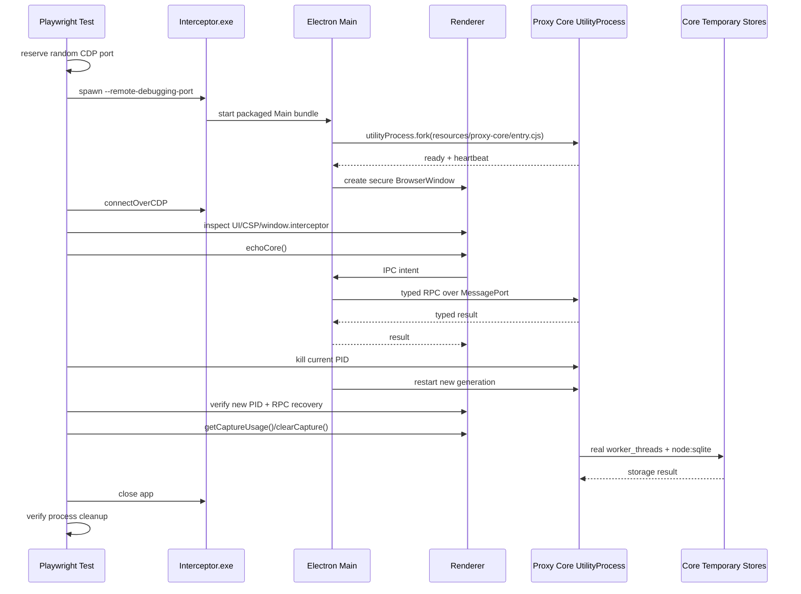

# Desktop Packaged Application E2E

本目录验证 Interceptor 的真实 Electron **production package**。目录名保留 `packaged-smoke`，但目标职责是生产包完整验收：启动 `electron-forge package` 生成的最终 Windows 可执行文件或 macOS `.app`，通过 Chrome DevTools Protocol（CDP）连接真实 Renderer，执行与 [`../e2e-workflow-tests/`](../e2e-workflow-tests/) 相同的应用生命周期、destroy 契约和全部 feature workflow，再追加 production package 特有的安全、资源和启动边界。

测试不在 Vite dev server、JSDOM 或 fake Electron 中运行。被测 Main、Preload、Renderer、Proxy Core UtilityProcess、Worker、ASAR、Fuses 与 extra resources 都来自最终 package。

## 零 Mock 硬性原则

生产包 workflow 与本地 E2E 遵守同一原则：所有业务操作都必须由 Playwright 通过真实 App UI 发起，随后经过真实 Preload、Main、Core、Storage、Proxy 和 Worker。禁止 fake Preload、状态注入、service mock、直接业务 API arrange、测试专用 Renderer setter 或隐藏 IPC。

测试侧只允许创建 loopback 协议 origin/客户端、输入文件与证据采集设施。Open/Save Dialog、UAC、macOS Authorization 等原生 UI必须由 package 真实发起；无法无人值守完成时应标记为需要本机人工操作或独立平台验收，不得用 mock 代替。

> 当前状态：现有 `startup.spec.ts` 已覆盖生产启动、安全边界、关键跨进程路径、真实 Capture、截图矩阵和退出清理，但仍是一条综合测试，尚未复用完整 workflow contract，也尚未做到每条 workflow 独立 trace。本文同时记录当前实现与目标架构；不得把目标清单误报为现有覆盖。

Capture暂停/恢复/Clear、Composer Send、Breakpoint开关与正常Close均操作公共automation ID及真实键盘；恢复Recording复用local workflow的readiness助手。Preload只用于原有白名单、安全与只读状态/协议断言，不通过直接业务API安排这些操作，不在轮询中暗中重启listener。

暂停在系统代理仍由App持有时操作，不能先Restore使UI回到readiness再把点击误认为Stop。暂停不减少已捕获数据，允许已接收的后台流量继续收尾；暂停后真实Clear验证Exchange/Body归零。最终退出前再经Settings恢复系统代理。

自建CDP Page的普通动作期限为15秒；控件缺失时及时进入既有宿主恢复，不让无期限的locator等待耗尽整个测试后遗留代理。启动、Core恢复和原生授权的专用等待保持各自期限。

## 目录结构

```text
apps/desktop/tests/packaged-smoke/
├─ README.md                    # 本文档
├─ startup.spec.ts              # 当前综合 production package 测试
├─ fixtures/                    # 目标：packaged CDP driver
│  └─ packaged-cdp-driver.ts
└─ packaged-boundaries.spec.ts  # 目标：package 特有安全/资源断言
```

Playwright 配置位于：

```text
apps/desktop/playwright.config.ts
```

测试产物默认写入：

```text
apps/desktop/test-results/
```

## 权威职责

本套件必须回答：

- Forge/Vite 是否成功生成可启动的最终应用？
- Main、Preload、Renderer 三个 production bundle 是否能协同运行？
- Renderer 是否保持 sandbox、context isolation 和严格 CSP？
- `window.interceptor` 是否只暴露预期的窄 API？
- Proxy Core UtilityProcess 是否从 packaged resources 启动并持续 heartbeat？
- Main 与 Core 的专用 MessagePort RPC 是否工作？
- Core 被强制终止后是否能以新 PID 自动重启？
- Core 临时 Capture/Body、持久 WorkspaceService（`workspace.sqlite`）、Diagnostics Worker 与按需 Archive Worker 是否可用？
- `e2e-workflow-tests` 登记的全部用户 workflow 是否在最终 package 上得到相同结果？
- 正常关闭、窗口关闭、Core 重启和失败清理是否符合生命周期约定？
- 应用退出后 Main/Core/Renderer/Worker 是否全部退出，listener 和临时 profile 是否释放？
- 每条 workflow 是否生成独立 trace、截图和进程日志供人工回放？

本目录不承担逐像素设计比较或安装器 lifecycle。前者属于 `visual-parity/`，后者属于 `installer/`。

## 与本地 Workflow E2E 的关系

[`../e2e-workflow-tests/`](../e2e-workflow-tests/) 是共享 workflow contract、manifest 和业务 specs 的所有者：

- local 目标用 Playwright `_electron.launch()` 启动未打包应用；
- packaged 目标用 `spawn()` 启动最终 `exe/.app`，再用 `chromium.connectOverCDP()` 获得标准 `Page`；
- 两个目标执行相同的 selector、用户操作和核心断言；
- Driver 只负责不同的启动、Main 能力、trace 和清理机制；
- 不允许在本目录复制一份独立业务 workflow。

生产 CDP 无法直接执行 Main `evaluate()`。Open/Save Dialog、提权窗口和外部程序等原生边界，按本 README 的“原生 OS UI 边界”处理，不得通过产品测试后门伪造。

## 运行前提

### 1. 安装依赖

从仓库根目录：

```powershell
npm install
```

### 2. Node/npm 版本

版本以根目录 `.nvmrc`、`.npmrc` 和 `package.json` 为准。

### 3. Windows package

当前 Windows smoke 查找：

```text
apps/desktop/out/Interceptor-win32-x64/Interceptor.exe
```

必须先执行 package。测试不会为了隐藏构建失败而自动打包。

### 4. macOS package

macOS 使用当前架构的 `out/Interceptor-darwin-<arch>/Interceptor.app/Contents/MacOS/Interceptor`，原生helper来自该App的Resources。宿主guard复用local workflow的macOS实现，保护完整多network service快照、用户级journal、进程代际和8888；不启动Windows PowerShell。Windows仍使用已有原生查询、WinINet guard及所有原断言。平台分支按命名明确的方法分派，不新增测试设施自身的测试。

验收下载并安装的Release时，复用workflow的`INTERCEPTOR_E2E_MACOS_APP_PATH`选择实际App，不覆盖本地`out/`。
`INTERCEPTOR_BUILD_VERSION`指定本轮应验收的版本，断言仍比较实际运行App的版本，不改产物或本地manifest：

```sh
INTERCEPTOR_E2E_MACOS_APP_PATH=/Applications/Interceptor.app \
INTERCEPTOR_BUILD_VERSION=0.1.1-alpha.0 \
npm run test:smoke --workspace @interceptor/desktop
```

两端smoke运行前必须通过正常产品启动完成共享CA初始化；测试入口只读检查材料和真实系统信任，缺少时在App启动前报错，不静默制造全机信任副作用。首次生成/授信与取消由证书专项覆盖，smoke保持既有CA基线，不删除共享CA。

macOS启动App前先只读检查登录桌面可用且未锁定；锁屏时明确要求解锁，保留失败结果但不启动App、不触发授权或代理接管。解锁后用同一命令重跑，不能将前置检查的拒绝记为smoke通过。

macOS Main的stdout/stderr继承测试profile内0600日志文件，父runner在spawn后关闭自己的句柄；失败保留App时不依赖runner的pipe，避免runner退出后Main写日志触发EPIPE。结果只附加最后8000个字符，完整日志随失败profile保留；Windows继续原pipe和进程清理路径。原业务断言错误与清理错误同时保留，不能被finally中的恢复失败覆盖。

### macOS直接分发验收

- macOS tag发行使用ad-hoc签名，不要求Developer ID或Apple公证。`codesign --verify --deep --strict`验证包与内嵌代码完整性，不代表Gatekeeper会直接放行。
- 托管Release CI精确检出用户选定的源码SHA，按所选原生目标执行构建、helper读取、CPU架构/签名完整性、许可/资源审计和安装包检查，不执行本套件所需的原生授权流程。CI通过后才创建指向该SHA的tag及draft，本套件的真实结果和安装证据齐全后才能确认Publish；所选包类型数量必须与本轮结果一致，不能用本地未提交文件或旧make输出冒充所选commit的产物。
- 从GitHub实际下载DMG/ZIP，将App复制到Applications，再按系统正常流程核对首次启动、单个可信应用放行、helper和CA授权。禁止删除quarantine属性或全局关闭Gatekeeper来制造通过结果；开发helper授权不能替代生产入口。
- 保存下载来源、版本、架构、SHA-256、系统提示及正常退出证据。确认Main/Core/Worker退出、8888释放、系统代理和证书状态符合基线；常驻helper的保留/卸载遵守现有独立授权范围。
- 默认配置不含Windows；向导选择Windows后仍须完成Windows smoke和安装器生命周期，未运行不能记为通过。具体配置和手动CI步骤见[发版指南](../../../../architecture/release-guide.md)。

## 推荐运行方式

从仓库根目录构建真实 package：

```powershell
$env:ELECTRON_MIRROR = 'https://npmmirror.com/mirrors/electron/'
npm run package
```

然后运行 smoke：

```powershell
npm run test:smoke --workspace @interceptor/desktop
```

也可以从 Desktop workspace 只列出测试，确认 Playwright discovery：

```powershell
npm exec --workspace @interceptor/desktop playwright test -- --list
```

预期能发现：

```text
packaged-smoke/startup.spec.ts
```

## 执行流程



## 当前已实现覆盖

### UI 与窗口

- Renderer 页面成功加载；
- Interceptor 品牌、Workspace navigation 和 main 区域可见；
- 1280×800 light/dark 截图；
- 900×600 最小窗口截图；
- 主题切换通过真实 UI 操作完成。

首窗可能仍在`ApplicationStartup`的组件/证书准备阶段；smoke与真实workflow一致，等待公共`app.root`就绪（120秒）后才执行主界面断言。准备阶段失败退出走正式Close，由Main等待已开始的准备操作并恢复代理，宿主guard仍验证完整基线；不提前调用被启动门禁拒绝的业务API，也不放宽门禁或白名单。Preload精确白名单包含正式`getStartupStage`和`onStartupStageChange`。

Core重启后，`running`只说明Core已就绪，不代表Renderer已完成listener启动及系统代理接管。smoke先等待公开Recording控件的`aria-pressed=true`，再通过Settings中的Restore按钮恢复路由；正常步骤和失败清理共用同一UI操作，不直接调用恢复API或反复重试冲突命令。产品仍立即拒绝与进行中Enable冲突的Restore，不为smoke保留队列。

macOS新Core发布`running`前还会等待上一代的原生代理恢复；该helper请求的产品期限为30秒，因此smoke等待新PID与running使用35秒，Windows保留15秒。这个等待不替代后续Recording/代理归属断言，不改产品请求期限或任何鉴权。

macOS截图矩阵通过真实Main PID和启动时间校验后，使用System Events调整该测试窗口的实际大小，并验证Renderer内容尺寸；不在1600×900原生窗口里仅模拟较小viewport。每张图附带inner/outer尺寸及deviceScaleFactor。Windows保留既有矩阵路径。该操作只影响本轮临时测试实例，不改产品默认1600×900尺寸；原生窗口调整需要测试宿主已具有辅助功能权限。

### Renderer 安全隔离

测试确认：

- `window.process` 不存在；
- `window.require` 不存在；
- CSP 包含 `connect-src 'none'`；
- CSP 包含 `frame-src 'none'`；
- CSP 不依赖 HTML 无效的 `frame-ancestors` meta 指令；
- Renderer 只能访问 Preload 暴露的 `window.interceptor`。

### Preload API 白名单

测试对 `Object.keys(window.interceptor).sort()` 做精确断言。

新增、删除或重命名 Renderer 意图 API 时，必须同步：

1. `src/shared/desktop-api.ts`；
2. `src/preload/preload.ts`；
3. Main IPC handler；
4. Core protocol/handler（若跨 Core）；
5. `startup.spec.ts` 的 API keys 数组。

精确断言可以发现意外暴露的通用 IPC、Node 原语或敏感能力。

### 匿名更新

API白名单不再包含GitHub登录、退出、授权页或账号状态接口。smoke通过真实UI进入Settings Updates，确认没有登录控件，等待匿名检查结束；失败或已是最新版本时再次点击Check并等待新终态。固定来源的404或请求失败应显示`failed`，不要求登录、不改源、不把失败计为下载或打开安装器成功。两代失败重试与重启的完整流程由[Updates workflow](../e2e-workflow-tests/workflows/settings/updates-check.workflow.ts)负责；真实下载/打开仍需要可匿名访问的有效Release。

### Proxy Core 生命周期

- Core 状态最终进入 `running`；
- PID 可见且 Sidebar 显示对应 title；
- `echoCore` 通过 Main→Core MessagePort 往返；
- Trace 包含 action/command completion；
- 强制 kill 当前 Core PID；
- Main 检测退出并启动新 Core；
- 新 PID 与旧 PID 不同；
- 旧 PID 已结束；
- 重启后的 RPC 继续工作。

`running` 只表示 UtilityProcess heartbeat 正常，不代表代理 listener、Storage 等所有业务能力都健康。

### 临时 Capture 全链路

Smoke 使用 packaged Core 中的真实：

- `CaptureService`；
- Core 内 `ExchangeStore`；
- 内存 + spill `BodyStore`；
- Core 直接管理的 `workspace.sqlite`；
- 按需 Archive Worker 与持续 Diagnostics Worker。

测试确认：

- `getCaptureUsage()` 返回完整临时存储用量且无 quota，Capture database bytes 为 0；
- Stop 暂停记录（监听器保持运行、listening 仍为 true、recording 置 false）但保持 session/exchange/body count；
- `clearCapture()` 后 session/exchange/body/spill 为 0。

### 退出清理

测试结束时会关闭 CDP/browser 和应用进程，并验证被测进程退出。失败路径也必须执行清理，避免残留 Electron/Core 影响下一次运行。

以上是当前 `startup.spec.ts` 已实现范围。完整 feature workflow 及逐用例 trace 以 `e2e-workflow-tests/README.md` 的 inventory 为目标台账，需后续逐项实现并在 local 与 packaged 两个目标上验收。

## Packaged 资源路径

生产 Core 入口：

```text
resources/proxy-core/entry.cjs
```

相关资源包括：

```text
resources/proxy-core/
├─ entry.cjs
├─ archive/worker/entry.cjs
├─ diagnostics/worker/entry.cjs
└─ node_modules/                  # Mockttp/WASM/native runtime closure
```

CoreRuntime 在 packaged 模式通过 `process.resourcesPath` 解析入口。修改以下内容后必须重跑 package + smoke：

- Forge `extraResource`；
- Proxy Core build entry/outdir；
- Worker bundle 路径；
- Mockttp external/依赖闭包；
- WASM 或 `.node` 原生资产；
- Main/Core 生命周期；
- Preload/API/CSP/Fuses。

## Trace 与人工回放

目标状态下，每条 shared workflow 都必须独立保存 trace，而不只在失败时保留：

```ts
await context.tracing.start({
  screenshots: true,
  snapshots: true,
  sources: true,
  title: testInfo.title,
});

await context.tracing.stop({
  path: testInfo.outputPath('trace.zip'),
});
```

CDP context 的 trace 必须由 packaged driver 显式启停；不能只依赖 Playwright config 中对 runner-owned context 的 `trace` 选项。

每个结果目录至少保留：

```text
trace.zip
final.png
renderer-console.log
process-output.log
metadata.json
```

当前综合测试已经通过 `testInfo.outputPath()` 留存截图，失败时 Playwright 可保存诊断附件；逐 workflow 的 always-retained trace 是后续实现项。

查看 trace：

```powershell
npx playwright show-trace apps/desktop/test-results/<result>/trace.zip
```

测试还会捕获被启动应用的 stdout/stderr；若应用在 CDP ready 前退出，错误会包含进程输出。

## 常见失败

### Missing package

症状：

```text
Missing package: .../Interceptor.exe
```

处理：先运行根目录 `npm run package`，确认 Forge 输出目录存在。

### CDP endpoint did not start

含义：Main 或 Chromium 在 remote debugging endpoint 可用前阻塞/崩溃。

优先检查：

- Main 顶层 import 了应懒加载的 external 依赖；
- `@peculiar/x509` / `reflect-metadata` / `@vscode/sudo-prompt` 是否在启动路径同步加载；
- Main bundle 是否构建失败；
- 残留 Interceptor 进程是否占用资源；
- executable stderr。

手工诊断示例：

```powershell
$exe = 'apps/desktop/out/Interceptor-win32-x64/Interceptor.exe'
$stderr = Join-Path $env:TEMP 'interceptor-main-stderr.log'
Start-Process $exe `
  -ArgumentList '--remote-debugging-port=9333','--enable-logging=stderr' `
  -RedirectStandardError $stderr
Get-Content $stderr
```

### Core 一直处于 `starting`

含义：Renderer/Main 已启动，但 Core UtilityProcess 未发送 ready/heartbeat。

检查：

- `resources/proxy-core/entry.cjs` 是否存在；
- Core 是否因依赖加载失败立即退出；
- `resources/proxy-core/node_modules` 是否包含运行时闭包；
- Storage/Diagnostics worker entry 是否存在；
- UtilityProcess stdout/stderr；
- CoreRuntime 是否正在退避重启；
- 新引入依赖是否只存在于开发根 `node_modules`，未进入 packaged resources。

### Core restart 失败

检查：

- 旧 MessagePort pending request 是否被清理；
- 旧进程 listener 是否泄漏；
- restart backoff 是否启动；
- 新代 Core 是否收到新的 rpc-port；
- 旧 PID 是否确实结束。

### Storage status 不可用

检查：

- Archive/Diagnostics Worker bundle 路径；
- Rule/Diagnostics SQLite 与 Archive snapshot；
- `--data-dir` 注入；
- 数据目录权限；
- 旧 RuleSet migration；
- Core 是否只 heartbeat 正常但 Storage 初始化失败。

### 测试后残留进程

先确认 smoke 的 `finally` 清理是否执行，再检查应用 shutdown 路径。必要时手工结束仅由本次失败测试创建的 Interceptor 进程，然后重试；不要使用会终止无关用户进程的宽泛命令。

## 修改测试时的原则

- 只测试最终 package 可观察行为，不 import Main/Renderer 内部对象绕过边界。
- 通过 CDP 获得标准 Playwright `Page`，核心 workflow 使用 selector、用户操作和 UI 断言。
- 不得直接调用 `window.interceptor` 完成业务 arrange/act；workflow 必须通过带 `data-automation-id` 的真实 UI 操作。
- 不把测试 fixture 或 DEV setter 加入产品代码。
- 不放宽 API keys 精确断言来隐藏意外 API。
- 不用固定 CDP 端口，避免并发/残留冲突。
- 所有进程和 browser handle 在成功/失败路径都必须清理。
- 对启动、重启和 worker 等异步状态使用 `expect.poll`，不要使用固定 sleep。
- 测试失败时保留足够 stdout/stderr/trace 上下文。
- shared workflow 必须从 `e2e-workflow-tests` 导入，不复制业务操作脚本。
- 每条 workflow 都必须验证 graceful destroy；强制 kill 只能作为 finally 兜底，不能掩盖退出失败。

## 原生 OS UI 边界

纯 CDP 无法控制 Electron Main 持有的 Open/Save Dialog、Windows UAC、macOS Authorization、系统证书管理器、Explorer/Finder 或安装器窗口。处理原则：

- Renderer 到 Main 的正式意图及取消路径必须在 package 上验证；
- 能通过真实文件结果观察的流程应使用平台测试 fixture 或独立 native harness；
- 系统代理与信任库测试只能在可恢复、隔离的本地环境运行；
- 不在 production API 中加入任意 path、测试开关或 E2E setter；
- local `_electron` 目标可以在测试侧安排 Main dialog，但这不替代 package 的安全边界断言。

## 何时必须运行

以下变化至少运行 package + smoke：

- Main、Preload、IPC；
- BrowserWindow 安全策略、CSP、Fuses；
- CoreRuntime、UtilityProcess、MessagePort；
- Proxy Core 入口或 Worker 构建；
- Forge/Vite/Electron 配置；
- packaged resources / native / WASM；
- `window.interceptor` API 面；
- 签名、安装器或更新启动路径。

常规纯函数或局部 Renderer 样式修改可先运行更便宜的 typecheck/unit/parity，在功能或阶段收尾再运行 packaged smoke。
