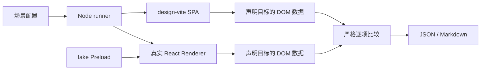

# Desktop Data Parity

独立运行的设计还原检查：Playwright 打开设计 SPA 和真实 React Renderer，按场景配置采集元素数据，由 Node 逐项严格比较并生成报告。

- 不需要 Agent、模型凭据或外部 MCP Host。Agent 可以读取报告，但不参与执行或判定。
- 不读取设计截图，不生成 Renderer 截图，不运行图片比较。
- 只验证声明的目标和字段，不代表整页绘制内容、原生窗口或业务 E2E 已通过。
- 使用前阅读 [ui-parity-check](../../../../.github/skills/ui-parity-check/SKILL.md)。设计方案制作仍使用 [ui-design-mockup](../../../../.github/skills/ui-design-mockup/SKILL.md)。

## 入口与运行前提

在仓库根目录的普通终端运行：

```sh
npm start
```

选择 `Test → Parity 设计还原检查 → 视图或全部视图 → 确认`。之后页面准备、场景操作、采集、比较、报告和资源退出均由命令完成，不需要先启动两个页面服务或运行截图脚本。

CI 和其他非交互调用使用同一 runner：

```sh
node apps/desktop/tests/visual-parity/parity.mjs
node apps/desktop/tests/visual-parity/parity.mjs --view=capture,capture-dark
node apps/desktop/tests/visual-parity/parity.mjs --help
```

- 需要已安装的项目依赖和系统 Microsoft Edge。开发依赖使用 Playwright 和 Vite，不需要 Desktop 的图片比较依赖。
- Edge 缺失时，按实际平台通过 `npx playwright install msedge` 安装；不能用其他浏览器的结果冒充同一环境。
- 浏览器使用 headless Edge 和 `--no-proxy-server`，不前置窗口、不操作系统键鼠、不修改宿主代理或证书。
- 父进程只准备一次Renderer Vite服务`5199`及设计preview，所有批次复用本次服务；浏览器仍按批次隔离。
- 设计侧由[design-preview.mjs](../../../../design-vite/tools/design-preview.mjs)构建到本次独占临时目录，再启动preview；退出时清理本次目录，不读写共享`design-vite/dist`，避免其他构建替换动态模块。
- 端口占用时明确失败，不静默换端口，不停止其他任务拥有的进程。

## 文件与职责

| 文件 | 职责 |
| --- | --- |
| [parity.mjs](parity.mjs) | 参数校验、页面生命周期、操作、数据采集、比较、分批汇总和报告 |
| [parity.config.mjs](parity.config.mjs) | 场景、主题、设计状态、Renderer 操作、唯一目标与比较字段 |
| [report.mjs](report.mjs) | 中文摘要、按文件整理的具体差异与位置；不改变比较或退出判定 |
| [fake-interceptor.mjs](fake-interceptor.mjs) | 完整 fake Preload API 和可序列化测试数据 |
| `../../test-results/visual-parity/report.json` | 完整机器可读结果，保留每个场景的覆盖计数与全部异常 |
| `../../test-results/visual-parity/report.md` | 中文结论、检查范围、相关文件及具体差异；完整原始记录与日志在JSON |

报告属于本地生成物，由 `test-results/` 忽略规则排除，不进入 Git。旧截图目录和旧的套件根级报告不再作为输入或输出。

## 执行流程



1. 校验视图、范围、输出路径和目标配置。空选择、未知视图、重复 ID/目标名不能成功。
2. 启动 Vite、Edge 和设计 preview。没有模型调用，也不启动真实 Electron Main/Core。
3. 设计侧通过 `window.__setState()` 和 `designActions` 建立状态。
4. Renderer 在导航前安装 fake `window.interceptor`，正常调用 Preload 契约，再通过导航、点击、填写、选择等 UI 操作建立状态。
5. 等待字体实际加载和场景操作完成，核对视口、内容画布、主题及配置声明的侧栏状态，再采集声明目标；在两秒内等待相邻帧数据稳定，不与设计值比较来挑选读数。仍不稳定记为`unstable`；测量请求超过五秒、字体任务超过三十秒明确报错。
6. 比较位置、尺寸、声明样式和状态，记录缺失、歧义、读取错误及全部字段差异。
7. 关闭本次 BrowserContext、Edge、Vite 和设计 preview，写报告并返回退出码。

超过五个视图时按每批五个视图异步运行同一脚本的子进程，限制内存峰值。父进程继续提供两个页面服务，不能同步阻塞等待子进程而使HTTP服务停顿。每批开始和结束都有明确进度；不重复构建设计稿或重启Vite。Renderer每个场景使用独立BrowserContext；设计页按现有重置规则复用，遇到场景错误则为下一场景重新准备设计页。

普通数据差异不会中止余下可运行批次。初始化、批次协议或进程失败导致无法继续时，报告保留已完成部分并列出 `unrun`，不能算通过。父进程使用本次唯一临时结果文件，不复用历史结果。

## 比较契约

### 相同逻辑元素

- 不比较整棵 DOM 树，不要求两边组件库、class 或内部层级一致。
- 字符串目标先查精确文本；设计侧确定 button/text 语义，Renderer 测量相同语义。没有文字候选时才按适用的精确 button role 定位。
- 候选 DOM 节点先去重，再要求唯一匹配。重复可见元素产生 `ambiguous`，不选择第一个掩盖歧义。
- 重复按钮、列表行或容器必须在配置中明确范围。Capture 列表的指定字段定位到实际选中的请求行，不把任意一行当成该行。
- Header name/value目标明确检查可见编辑列表的第一行，名称与selector都声明这一语义，不是采集器遇到歧义后自动选第一项。模型、更新、聊天菜单、断点管理器、Composer页签等按对应容器或控件标识定位；TLS host集合按三个具体host逐行检查。
- 默认目标应存在且可见；隐藏或不存在的预期必须显式声明。
- 空布局锚点可以声明 `visible: false`，仍按其实际布局盒测量；不能为了绕过真实 missing 临时把目标改成隐藏。

### 数据与精度

| 类别 | 内容 |
| --- | --- |
| `geometry` | 相对内容画布根的 `x/y/width/height`，单位为 CSS px |
| `style` | 默认 `fontFamily/fontSize/fontWeight/letterSpacing/color`，或目标指定的 `styleKeys` |
| `state` | `present/visible`，以及明确声明的 DOM/ARIA 状态或双方状态 selector |
| `text` | 声明 `compareText` 的文本内容 |
| `scroll` | 声明滚动检查的 `clientWidth/clientHeight/scrollWidth/scrollHeight/scrollLeft/scrollTop` |

- 使用浏览器实际布局和 `getComputedStyle()`，不比较 CSS 源代码表达形式。
- 正常验收两侧浏览器视口和内容画布都是`1600×900`；设计页去除画布外评审留白及额外卡片border/radius/shadow，画布从视口原点开始，不再额外扩大设计浏览器视口。两边坐标各自相对内容画布原点。
- 不计算或扣除全部目标的中位偏移，不按误差自动移动页面。
- 场景可用`captureSessionIds`限定fake Preload的初始请求及录制计数；未设置时保持完整fixture。`capture-request-menu-dismiss`使用5条请求匹配设计Application计数，保留POST菜单关闭操作，不通过修改按钮宽度消除数据差异。
- 原始数值严格相等才通过。没有 1px 容差或统一 epsilon，`0.25px` 等亚像素差异也失败。
- 显示和 JSON 保存不把非零小数差异四舍五入成 `0.0`。
- `lineHeight` 等字段只有配置明确声明时才比较，不虚构 `normal` 对应的 px。
- 不导出全部 CSS。布局容器、控件边框、背景、阴影等按相应目标的职责显式配置。
- 不同的字体族声明会作为真实数据差异报告，不自行认为字体或 fallback 列表等价。

### 覆盖边界

元素数据一致不能证明 SVG 路径、Canvas 绘制内容或字体栅格化一致。未声明的目标和字段不计入覆盖。原生窗口、协议、Main/Core 业务及系统恢复仍需真实 E2E。

数据差异不能自动归因为产品错误：先区分场景不一致、定位错误、实际设计差异与环境错误；不得用修改设计、产品样式、删除目标或放宽判定来隐藏结果。

### 场景前提

- 设计与Renderer分别核对实际视口、默认画布边界、主题及声明的侧栏状态；失败记录为`design-scene`或`renderer-scene`错误，不继续输出该场景的元素差异。
- 侧栏通过配置中的真实UI操作建立，不在采集器中自动切换来补救错误配置。
- 右键菜单定位到同一逻辑请求行，以相同的行内`position`触发；主菜单与子菜单使用现有`assertInsideViewport`明确检查可见区域。两侧均应完成定位后再比较，不把Ant离屏初始化位置当作有效布局，也不通过移动弹层或合成悬停掩盖问题。
- Tool能力开关和搜索操作可能自动滚动内容；对应场景在两侧真实点击同一标题，回到一致的阅读起点再测量，不根据差值反推或补偿滚动。
- 设计专用dock与评审留白不属于产品画布，采集前隐藏dock，避免其按钮拦截正文右下角的真实拖拽。gRPC拖拽场景使用`freshDesign`隔离上一个场景的手动高度；普通gRPC场景通过真实Hex控件恢复初始视图，不保留前一场景的Text状态。
- 场景错误保留原始日志，中文报告优先展示执行问题，指明失败侧和具体场景ID并链接配置；未比较的目标不计入`checked`，其余场景继续执行。

## 场景配置

```js
{
  id: 'capture',
  theme: 'light',
  designState: { view: 'capture', theme: 'light', sidebar: 'expanded', detail: 'open' },
  rendererActions: [
    { type: 'clickRole', role: 'button', name: 'Toggle sidebar' },
    { type: 'clickText', text: '/user', index: 0 },
  ],
  targets: [
    {
      name: 'Capture',
      designSelector: '.side [data-nav="capture"] > .txt',
      appSelector: '[data-automation-id="shell.workspace.capture"] :text-is("Capture")',
      compareText: true,
      stateSelectors: {
        selected: { design: '.nav.on > .txt', app: '[aria-current="page"] > span' },
      },
    },
  ],
}
```

- `id`：唯一场景 ID，用于完整 ID 过滤、报告和批次校验。
- `theme`：在导航前写入产品正常读取的主题配置；保留当前 `light/dark/warm/ember` 场景。
- `designState`：传给设计 SPA 的已有 typed state。
- `designActions`：需要真实交互才能进入的设计状态，复用操作实现。
- `rendererNav`：可选，通过 `Workspaces` navigation 的真实按钮进入功能；Capture 为默认页。
- `rendererActions`：正常页面 UI 操作，不提供产品测试 setter。
- `targets`：字符串，或有唯一 `name` 的对象。对象需要双方 selector 或共同 `parity` 标识；可以为其中一侧覆盖 selector。

### 目标选项

| 选项 | 含义 |
| --- | --- |
| `styleKeys` | 需要比较的 computed style 属性；未知或不可读取属性报错 |
| `measureText` | 用 DOM Range 测量文字范围，保留字体样式；不用于按钮命中区或替代 flex 对齐 |
| `compareText` | 比较实际文本；表单控件值使用`stateKeys: ['value']` |
| `present: false` | 明确期望两边都不存在该目标 |
| `visible: false` | 目标必须存在，但期望没有可见面积或处于隐藏状态 |
| `stateKeys` | 声明 `disabled/checked/selected/expanded/pressed/focused/value` 状态 |
| `stateSelectors` | 相同状态在 design/app 两侧对应的原生 CSS selector，由目标自身执行 `matches()` |
| `scroll: true` | 比较声明区域的内容、可视尺寸和滚动位置 |

`stateKeys` 优先读取适用的原生布尔属性，否则读取 ARIA；`value`只读取原生input、textarea、select的当前value，不使用空的textContent或初始value attribute。没有对应属性时明确报错，不能默认为 false；设计与产品使用不同状态标记时，显式提供 `stateSelectors`。状态 selector 是原生 CSS，不支持 Playwright 的 `:text-is()` 等扩展。

### 支持的操作

- `clickText/clickRole/clickSelector/clickAutomation`：按声明的文本、role、selector 或公共 automation ID 点击。
- `contextMenuText/contextMenuSelector`：右键。
- `hoverText/hoverSelector/mouseOverSelector`：对应已有 hover 或 mouseover 交互。
- `fillLabel/pressLabel/typeLabel/fillAutomation/selectLabel`：驱动真实输入与 Select；不改 Store。
- `resizeVertical`：用鼠标拖拽现有正文控件右下角，不改 DOM 高度。
- `assertTextHidden/assertSelectorVisible/assertInsideViewport`：检查现有状态；弹层视口断言同时采样可见性及四边范围，在五秒内等待稳定。
- `assertInputValue`：按唯一selector核对表单控件当前值，作为场景前提；两侧同时填入错误值也不能算通过。
- `emitTlsCompatibility/emitCaptureEvents`：仅从 fake Preload 的测试事件入口发送正常契约事件。

操作中的 `index` 保留原有明确顺序语义；它不是采集目标发生歧义时的自动回退。

### Rules标题编辑态

`rules-title-{idle,hover,focus,long-title,blur}-{light,dark,warm,ember}`直接测量标题input的border box，不使用`measureText`。场景分别通过正常点击、hover、填入长名称及Home/Tab失焦建立状态；输入值与焦点先作为前提核对，再比较几何、字体、内边距、边框、背景、圆角及原生滚动数据。

- 长名称使用测试自产的`api.example.test`地址，长度超过输入框可视宽度；不读取用户流量或缩短名称规避横向滚动。
- 同时比较标题栏及Enabled、开关、请求入口、说明、删除、Save的位置，避免只增大输入框却挤动相邻控件。Save禁用状态与实际草稿同步比较。
- 按确认后的标题式无框设计比较：默认、hover和focus均无边框、底色或阴影，保留28px点击区域和零水平内边距。每个标题场景使用独立设计页，避免前一个编辑值或当前树selection泄漏到后一个场景；不调整读数或放宽容差。
- 本层不替代真实Rules重命名、Save、reload持久化和退出恢复验收。
- 只改标题CSS且未改重命名、键盘事件或Save契约时，由本组parity和既有Rules Store基线覆盖，不为几何/颜色变化单独扩展E2E；交互、命令或持久化行为变化仍需对应真实workflow。

## Fixture 与状态隔离

- Renderer 不 import parity 文件，不加入 DEV fixture、通用命令或测试后门。
- fake API 覆盖完整 `InterceptorDesktopApi` 意图面。接口变化时同时更新产品正常链路与 fake，再验证受影响产品测试和 parity。
- 数据可序列化、ID/时间固定；字节由同一真实数据源构造，不能用几 KiB 正文伪造 MiB 长度。
- 保留 Core/Capture/Exchange、HTTP 正文、WebSocket、gRPC、Storage、Certificate、Rules、Composer、Breakpoint、Diagnostics、Probe 等现有 fixture。
- 不包含真实凭据、证书、个人路径或真实用户流量。
- HTTP 断点按头部挂起契约使用 `bodyAvailable: false`；Capture 原文可读不等于断点 snapshot 正文可用。WebSocket 完整 payload snapshot 仍使用 `bodyAvailable: true`。
- Tunnel 详情标题不能匹配到列表的重复文案；DeepSeek `Endpoint` 限定到双方 dialog。只修定位范围，不改产品或设计。
- MCP/Client、Tool 搜索、开关和弹窗状态在复用设计页前重置；显式场景值优先，不能遗留上一场景遮罩。
- `capture-message-*` 保留四主题 gRPC 长 Text 初始/拖矮与 WebSocket Pretty。`grpcMessageSource` 只替换消息字节及 envelope 偏移；不改产品探测、预览限制或复制行为。
- `breakpoint-readonly-*` 保留 Original/File/Text、手动格式化、截断与图片超限。`readonlyData` 使用设计侧 `readonlyBodyData.ts` 的字节描述，经 fake 正常 `readBody/pickBreakpointBodyFile` 返回。按真实点击、输入进入状态；需要隔离时使用 `freshDesign`。

## 输出与退出

```sh
node apps/desktop/tests/visual-parity/parity.mjs --view=capture \
  --out-dir=apps/desktop/test-results/visual-parity-local
```

- `--out-dir` 指定默认报告目录；`--report` 和 `--result-json` 可分别指定文件，不能指向同一文件。
- 每次只更新明确的报告文件，不递归清空输出目录。临时批次文件在读取后逐个清理。
- `--viewport=widthxheight` 保留对 Renderer viewport 的诊断覆盖；正常验收使用场景的默认 `1600×900`。改变 Renderer 尺寸不意味着修改已确认的设计画布。
- `--slice=start:end` 用于同一 runner 的分批执行，空范围和越界范围报错。
- 内部`--renderer-url/--design-url`由父进程成对传递，仅在带`--slice`的子批次接受无凭据、无额外路径或参数的HTTP loopback URL；普通用户与start菜单不需要提供，也不能用外部服务替代设计源码。
- `--inspect-popover/--inspect-select` 保留显式诊断输出，不改变正常比较。

JSON保留`version/startedAt/finishedAt/pid/platform/node/browser/viewport/selectedViews/views/errors/summary`。场景增加`feature`和已核对的`conditions.design/renderer`，记录实际视口、画布、主题及侧栏状态；浏览器控制台error/warning按场景写入`logs`，页面准备期间的日志保留在根级`logs`。异常保留原始值并附带`styleFiles/files`；`overview/locations`给出中文结论及文件分组。成功目标只计数，不重复存入异常列表。`summary.issues`是全部异常条数，`differences`只计数据差异，缺失、歧义、不稳定和错误另计。

异常保留 `view/theme/target/kind/property/expected/actual`，按需包含 `side/delta`。类别包括 `geometry/style/state/text/scroll/missing/ambiguous/unstable/error`。环境、场景与清理错误另保留 stage 和原始消息。

| 退出码 | 含义 |
| --- | --- |
| `0` | 所有选定场景及声明目标已检查，严格相等，无执行错误 |
| `1` | 有数据差异、缺失、歧义或不稳定测量 |
| `2` | 配置、测量读取、初始化、场景执行、资源清理、批次或报告生成错误 |
| `130` / `143` | SIGINT / SIGTERM中断；保留已取得的结果与未执行范围，关闭本次资源 |

终端和可读报告使用中文，说明检查范围、有没有问题、哪里有问题和相关文件。每条差异写清设计值与Renderer值；几何差异标明向哪边偏移、宽/窄或高/矮多少，不舍入亚像素差异。字体列表只多了相同前缀时直接说明额外声明的字体，不把声明差异说成实际选用了另一字体。

Markdown按文件分组，逐条列出“页面/控件/主题”和“具体差异”，不再只写“位置不一致”等笼统类别。只有文件、字段、原始期望值/实际值、差值及所属侧均一致时才合并位置；不同控件的数据不会混为一条。终端最多展示10条具体差异，其余见报告。路径和控件标识保留原文，完整场景ID、原始数据及日志仍在JSON中。

文件定位读取Renderer页面中Vite提供的CSS Modules来源，并匹配实际控件或最近容器的样式规则；库拥有的portal外壳可定位到最近的产品内容组件。状态和文本问题在同名组件确实存在时链接到TSX，否则保留样式文件。这里只提供关联文件作为定位入口，不自动认定根因。源码无法确定时明确显示“源码位置未确定”并链接场景配置，不猜测文件。
页面运行错误没有可确认的源码位置时，报告指明失败侧和场景ID，并链接场景配置；不把采集器文件误标成产品错误的来源。

构建警告原文保留在JSON的`warnings`中，避免终端出现大段第三方提示；构建错误仍进入`errors`并使检查失败，不隐藏错误。面向人的结论、问题类型和页面名称使用中文，文件路径、控件标识与原始日志不翻译。

Parity的Vite服务关闭浏览器日志向构建logger的重复转发，改由Playwright在所属页面采集。`console.error`可能是场景预期的业务失败提示，必须保留但不据此判断构建失败；未处理的JavaScript异常以及没有异常对象的浏览器`ErrorEvent`仍按所属侧记录页面错误并退出2，不忽略ResizeObserver错误。关闭页面前停止诊断采集，避免把正常退出的资源取消当作新页面故障。

子进程不重复打印报告。报告只在结束、错误或中断收尾时生成，不把正在运行的部分结果标记为已结束。报告不可写时输出明确错误并非零结束。

## 定位差异

- 大量相同方向的位置差可能是容器或状态问题，不能整体减掉差值。
- 后续元素的纵向差递增时，检查上游高度、gap 和文字换行。
- 宽度、字体声明或字距不同，检查实际字体及该控件布局，不自动接受亚像素差异。
- `ambiguous`：收窄到明确容器、逻辑控件或已选择的记录，不使用随机第一项。
- `missing`：核对文字/selector、数据、交互完成状态及可见性。
- `unstable`：核对布局、字体、异步内容或动画时刻，不挑更接近设计的读数。
- 字体错误：检查 Google Fonts 或本地字体资源和现有网络环境，不能用 fallback 证明一致。
- Preload 方法缺失、持续 Loading：修正 fake 与正式契约的一致性，不在产品增加回退分支。
- 只关闭本次拥有的服务；端口被其他任务占用时协调运行时间。
- Linux 的字体与布局结果只作为该环境的诊断；不能冒充 Windows/macOS 权威验收。

## 添加场景与验收

1. 先取得已确认的设计源码状态，不需要保存或提交 PNG 基准。
2. 复用/补充正式 API 所需的可序列化 fixture，声明设计状态与正常 Renderer 操作。
3. 配置稳定唯一的逻辑目标、字段与必要状态。
4. 运行该场景，读取数据报告；工具/配置问题在所属文件修正。
5. 真实产品或设计差异单列，未经授权不改 UI，不删除目标、不放宽严格判定。
6. 共享 harness 或配置规则变更后运行完整既有场景，覆盖四主题；不能用单个 Capture 结果替代全量。
7. 在旧截图目录不可用时验证实际运行和零 PNG 输出；保留本地原始资料，不建立额外 worktree。
8. 工具与 fixture 不新增 unit/integration/Browser“测试的测试”，直接运行既有场景；产品业务测试和真实 E2E 的要求不变。

设计源码、规范与手工设计评审工具继续保留。手工截图和两份设计图比较不是此命令的运行前提，也不能替代严格数据检查或真实 E2E。
