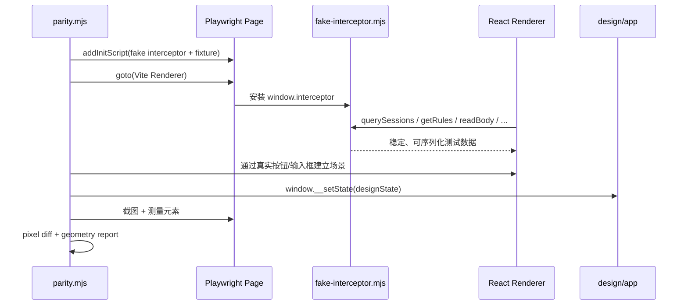
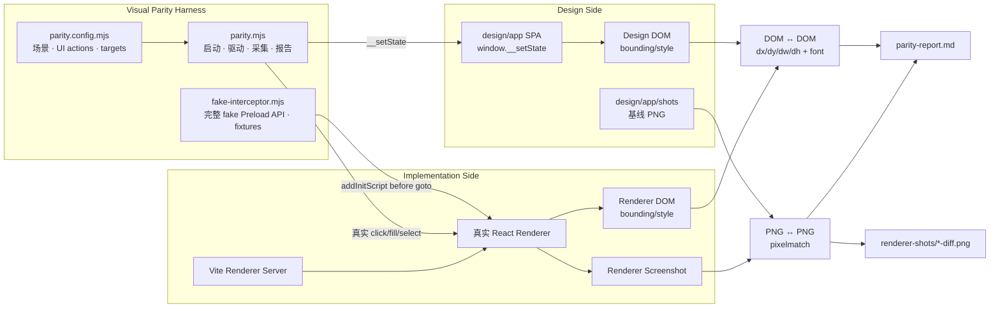
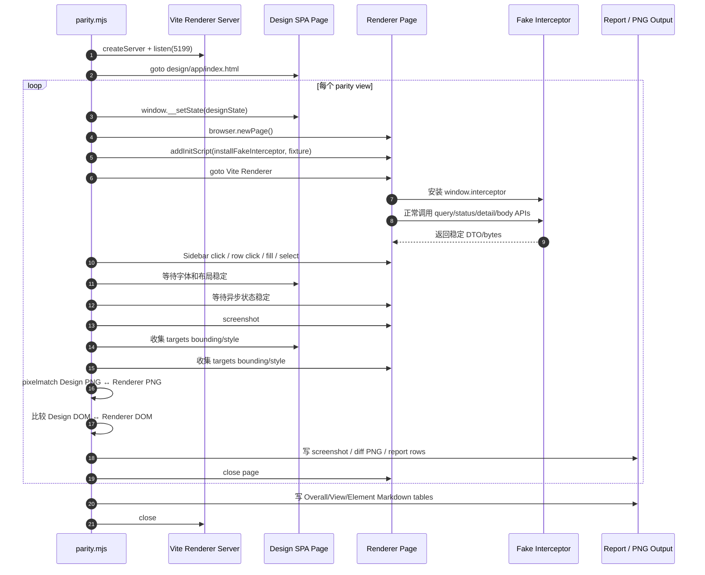

# Desktop Visual Parity

本目录包含 Interceptor Desktop Renderer 的设计一致性验证工具。它把真实 React Renderer 与 `design/app/` 设计 SPA 驱动到同一状态，生成截图、像素差异图和逐元素几何报告，用于定位布局、尺寸、字体和颜色偏差。

Parity 只负责视觉一致性，不替代行为、协议或运行时测试。

## 配套 Skills

开始创建、修改或排查 parity 场景前，Agent 必须先读取：

```text
.github/skills/ui-parity-check/SKILL.md
```

`ui-parity-check` Skill 定义：

- 何时必须运行 parity；
- fake Preload + 真实 UI 交互的强制边界；
- 禁止在业务 Renderer 注入 fixture / DEV setter；
- 几何与 pixel diff 的收敛流程；
- 新增场景时的配置约定。

本 README 则记录当前 harness 的具体实现、目录、配置 DSL、fixture 维护和故障排查。两者需要同步：工作流规则变化先更新 Skill，再更新本 README 和 harness。

若任务仍处于设计稿创建或视觉方案探索阶段，应使用：

```text
.github/skills/ui-design-mockup/SKILL.md
```

职责边界：

| 阶段 | Skill | 产物 |
| --- | --- | --- |
| 设计/改稿 | `ui-design-mockup` | `design/app/` 与设计 PNG |
| React 实现后的视觉验收 | `ui-parity-check` | Renderer PNG、diff PNG、`parity-report.md` |

不要用 parity harness 代替设计过程，也不要用设计 SPA 截图代替真实 Renderer 验收。

## 目录结构

```text
apps/desktop/tests/visual-parity/
├─ README.md                # 本文档
├─ parity.mjs               # Playwright/Vite parity harness
├─ parity.config.mjs        # 场景、交互和对比元素配置
├─ fake-interceptor.mjs     # 完整 fake window.interceptor + 测试夹具
├─ parity-report.md         # 最近一次运行生成的 Markdown 汇总
└─ renderer-shots/          # Renderer 截图和 pixel diff PNG
```

设计基准位于：

```text
design/app/
├─ index.html
├─ app.css
├─ app.js
└─ shots/<theme>/<feature>/*.png
```

## 为什么使用 Fake Preload

Renderer 在产品中只能通过 Preload 暴露的 `window.interceptor` 窄 API 获取数据。Parity 必须验证这条真实组件数据路径，不能在业务组件里加入：

- `import.meta.env.DEV` 测试数据分支；
- parity fixture import；
- `window.__setView`、`window.__setTheme` 等测试 setter；
- 只为截图存在的 React state 注入口。

Harness 在 `page.goto()` 之前使用 Playwright `addInitScript` 注入 fake `window.interceptor`。因此 Renderer 启动后仍执行正常的数据加载逻辑：



这种边界有三个好处：

1. 业务 Renderer 不知道 parity 的存在。
2. 测试覆盖正常的 Preload API 使用路径和加载状态。
3. Fixture、场景和生成产物都留在测试目录，删除 parity 不会影响产品代码。

## 整体架构



Harness 同时运行两条独立但互补的比较管线。它不会把 HTML element 的 bounding box 与 PNG 做比较。

## 对比原理

### 1. 图片对图片：PNG ↔ PNG

输入：

```text
Renderer 实际截图
        vs
design/app/shots/<theme>/<feature>/<variant>.png
```

Harness 使用 `pixelmatch` 逐像素比较：

- 输出不同像素数量和百分比；
- 生成紫色差异图 `renderer-shots/<view>-<theme>-diff.png`；
- 覆盖整个视图，包括未列入 targets 的背景、边框、阴影和内容。

Pixel diff 的优势是覆盖全面；限制是会受到以下因素影响：

- 字体抗锯齿；
- 操作系统字体 metrics；
- subpixel rendering；
- Design SPA 的 1px 画布边框；
- GPU/SwiftShader；
- 阴影和半透明混合。

因此 pixel diff 是全局诊断信号，不单独作为严格门禁。

### 2. 元素对元素：Design DOM ↔ Renderer DOM

Harness 同时打开两个实时页面：

```text
Design SPA DOM
       vs
React Renderer DOM
```

对 `parity.config.mjs` 中每个 target，在两边分别调用：

```js
element.getBoundingClientRect()
getComputedStyle(element)
```

比较字段：

| 字段 | 含义 |
| --- | --- |
| `dx` | 元素相对页面根节点的横向位置差 |
| `dy` | 元素相对页面根节点的纵向位置差 |
| `dw` | 元素宽度差 |
| `dh` | 元素高度差 |
| `fontSize` | 字号差异 |
| `fontWeight` | 字重差异 |
| `color` | 文本颜色差异 |

这里的 bounding box 是 **DOM 与 DOM** 比较，不与图片比较。Design PNG 只参与上一条 pixel pipeline。

### 系统性偏移扣除

Design SPA 是带边框的 1280×800 画布，内容通常从 `(1, 1)` 开始；真实 Renderer 填满 BrowserWindow，从 `(0, 0)` 开始。如果直接相减，所有元素都会得到相同的约 1px 偏差。

Harness 对全部匹配 target 的位置差求中位数：

$$
o_x = \operatorname{median}(x_{renderer} - x_{design})
$$

$$
o_y = \operatorname{median}(y_{renderer} - y_{design})
$$

然后计算每个元素的真实局部偏差：

$$
\Delta x = x_{renderer} - x_{design} - o_x
$$

$$
\Delta y = y_{renderer} - y_{design} - o_y
$$

宽高差无需扣除系统偏移：

$$
\Delta w = w_{renderer} - w_{design}, \qquad
\Delta h = h_{renderer} - h_{design}
$$

这能滤掉画布整体平移，同时保留单个组件真实的 spacing/size 偏差。

## 执行时序



每个 parity case 使用独立 Renderer page，避免 Zustand、React state、定时轮询、选中项或表单内容泄漏到下一场景。

## 与设计稿的关系

### Design SPA

`design/app/` 是视觉单一事实来源，用于设计和截图基线。它不是产品实现，也不访问 Core。

### Visual Parity

本目录启动 Vite Renderer，注入 fake Preload，通过正常 UI 交互建立状态，然后与 Design SPA 对比。

它回答：

- 实现是否与设计稿几何一致？
- 哪个元素偏了多少像素？
- 字号、字重或颜色是否漂移？
- 整张视图有多少像素不同？

## 运行前提

从仓库根目录执行命令。

需要：

- 已安装项目依赖；
- 系统 Microsoft Edge；
- `playwright-core`、`pixelmatch`、`pngjs`、`vite`（项目 dev dependencies）。

若 Edge 未安装到 Playwright 可识别位置：

```powershell
npx playwright install msedge
```

## 运行命令

运行全部配置场景：

```powershell
node apps/desktop/tests/visual-parity/parity.mjs
```

只运行一个场景：

```powershell
node apps/desktop/tests/visual-parity/parity.mjs --view=capture-websocket
```

当前场景 ID 由 `parity.config.mjs` 的 `views[].id` 定义。

## 一次运行做什么

1. 以 programmatic Vite server 启动 Desktop Renderer。
2. 启动系统 Edge。
3. 打开 `design/app/index.html`。
4. 对每个 parity case 创建独立 Renderer page，避免视图状态互相污染。
5. 在页面导航前注入 fake `window.interceptor` 与主题 localStorage。
6. 通过 Sidebar、列表行、按钮、Select 和 Input 等真实 UI 操作建立场景。
7. 用 `window.__setState()` 驱动 Design SPA 到对应状态。
8. 截取 Renderer PNG。
9. 与设计基准 PNG 做 pixel diff。
10. 对配置目标读取 `getBoundingClientRect()` 和字体样式。
11. 自动计算并扣除系统性画布偏移。
12. 在终端打印结果，并生成 `parity-report.md`。

## 配置文件

配置位于 `parity.config.mjs`。

基础结构：

```js
{
  id: 'capture-websocket',
  theme: 'light',
  designState: {
    view: 'capture',
    theme: 'light',
    sidebar: 'expanded',
    scene: 'websocket',
    tab: 'messages',
  },
  designShot: 'light/capture/inspector-websocket.png',
  rendererNav: 'Capture',
  rendererActions: [
    { type: 'clickText', text: 'realtime.example.com' },
    { type: 'clickText', text: '{"buildId":8431,"state":"running"}' },
  ],
  targets: [
    'realtime.example.com',
    'Connected',
    'Messages',
  ],
}
```

### `id`

场景唯一标识。用于：

- `--view=<id>` 过滤；
- Renderer 截图文件名；
- 报告中的 View 列。

### `theme`

Renderer 主题。Harness 在页面初始化前写入 `interceptor.theme` localStorage，产品代码按正常启动路径读取。

### `designState`

传给 Design SPA 的 `window.__setState()`。可包含 `view`、`theme`、`sidebar`、`tab`、`scene`、`overlay` 等设计状态。

### `designShot`

相对于 `design/app/shots/` 的基准 PNG。存在时启用 pixel diff；省略时仍会做逐元素几何比较。

### `rendererNav`

可选。通过 `Workspaces` navigation 内的真实按钮切换 Renderer view，例如：

```js
rendererNav: 'Rules & Map'
```

Capture 是默认 view，可省略。

### `rendererActions`

按顺序执行的 UI 动作。当前支持：

#### 点击精确文本

```js
{ type: 'clickText', text: 'realtime.example.com', index: 0 }
```

#### 点击 ARIA role

```js
{ type: 'clickRole', role: 'button', name: 'Send', index: 0 }
```

#### 填写 label 对应输入

```js
{
  type: 'fillLabel',
  label: 'Request URL',
  value: 'https://api.github.com/user/repos',
  index: 0,
}
```

#### 选择原生 Select

```js
{
  type: 'selectLabel',
  label: 'Method',
  value: 'POST',
  index: 0,
}
```

`index` 默认为 `0`，用于处理同名元素。

新增动作类型时，应扩展 `parity.mjs` 的 `applyRendererActions()`，不要在 Renderer 中增加测试 hook。

### `targets`

需要逐元素比较的可见文本列表。Harness 在 Design 和 Renderer 中分别执行精确文本定位。

目标应尽量：

- 可见且稳定；
- 在当前场景唯一；
- 覆盖页面关键锚点、列表行、工具条和详情内容；
- 避免时间、随机 ID、倒计时等动态文本。

文本不适合做唯一标识时，可在设计与产品两侧增加有产品语义的可访问名称。只有确实无法通过可访问语义定位时，才考虑相同的 `data-parity` 标识。

## Fake Interceptor

`fake-interceptor.mjs` 包含：

- `fakeInterceptorFixture`：所有数据驱动视图的稳定夹具；
- `installFakeInterceptor()`：导航前安装完整 fake API。

Fake 应覆盖 `InterceptorDesktopApi` 的完整意图面，即使某个场景只使用其中一部分。这避免出现“对象存在但方法缺失”导致视图挂载失败。

当前夹具覆盖：

- Core process status；
- Capture status、session page、exchange detail；
- WebSocket frame page、payload range 和 breakpoint toggle；
- Storage usage；
- Certificate status 和 insecure hosts；
- Rules / validation / hit counts；
- Composer response；
- Breakpoint queue / resolve / configure；
- Diagnostics records；
- Connection probe。

### Fixture 规则

- 必须是可序列化数据；`addInitScript` 参数会跨 Playwright 边界传输。
- `Uint8Array` 在 fixture 常量中建议存为 number array，fake 方法返回时再构造。
- 时间戳固定，避免截图和排序漂移。
- ID 固定，便于 detail/body/frame 关联。
- 大正文只提供 UI 所需的最小字节，不能把完整生产样本塞入 parity。
- 数据应接近设计稿内容，否则 pixel diff 会混入无意义文本差异。
- 不包含真实 token、证书、用户路径或其他敏感数据。

## 输出

### Renderer 截图

```text
renderer-shots/<view>-<theme>.png
```

Harness 每次运行前会清空并重建 `renderer-shots/`，因此已删除或重命名的场景不会留下陈旧 PNG。

### Pixel diff

```text
renderer-shots/<view>-<theme>-diff.png
```

紫色区域表示不同像素。Pixel diff 包含字体抗锯齿、平台字体渲染和设计画布 1px 边框造成的噪声，因此它适合观察整体，不应单独作为严格门禁。

### Markdown 报告

```text
parity-report.md
```

每次运行覆盖该文件，包含三部分。

#### Overall Summary

- 总体结论；
- 运行视图数；
- 平均 pixel diff；
- targets / matched / missing / flagged；
- 最大几何差；
- 最差 View / Element。

#### View Summary

每个场景的：

- Pixel diff；
- 目标数；
- 匹配数；
- 缺失数；
- Flagged 数；
- 最大 geometry delta。

#### Element Geometry

每个目标的：

- `dx`：横向位置差；
- `dy`：纵向位置差；
- `dw`：宽度差；
- `dh`：高度差；
- Max delta；
- 字体样式差异；
- `ok` / `flagged` / `app missing` / `design missing`。

## 如何解读几何差

Harness 先计算所有匹配目标的系统性中位偏移，再从每个元素的 `dx/dy` 中扣除。Design SPA 画布自带 1px 边框，而真实 Renderer 从 `(0, 0)` 开始，这种全局差异不应误报为布局错误。

Flag 条件：

- 任一 `|dx|`、`|dy|`、`|dw|`、`|dh| >= 1px`；或
- `fontSize`、`fontWeight`、`color` 任一不同。

常见判断：

- 大量元素 `dx/dy` 同方向相同数值：可能是未被系统偏移吸收的容器问题。
- 后续元素 `dy` 逐渐增大：通常是某个上游元素高度或 gap 不一致。
- 只有 `dw` 不同：优先检查字体宽度、padding、grid track。
- `dh` 约 1px：常见于字体 metrics 或 line-height。
- Pixel diff 高但几何基本一致：优先考虑字体抗锯齿、颜色或阴影。

## 添加一个场景

1. 先在 `design/app/` 完成并截图设计状态。
2. 在 `fake-interceptor.mjs` 加入真实 API 所需夹具。
3. 在 `parity.config.mjs` 添加 view case。
4. 用 `rendererNav` 和 `rendererActions` 通过正常 UI 建立状态。
5. 选择稳定、唯一、覆盖关键区域的 targets。
6. 运行单场景：

```powershell
node apps/desktop/tests/visual-parity/parity.mjs --view=<id>
```

7. 查看终端、`parity-report.md`、Renderer 截图与 diff PNG。
8. 修正产品 CSS/结构后重复运行，直到关键元素差异收敛。
9. 最后运行全部场景，防止共享组件回归。

## 更新 Preload API 时

当 `InterceptorDesktopApi` 增删方法：

1. 更新产品 `shared/desktop-api.ts`；
2. 更新 Preload / Main / Core 正常链路；
3. 更新 `fake-interceptor.mjs` 的同名方法；
4. 运行 Desktop typecheck、相关单测和 visual parity。

Parity fake 不应定义产品不存在的通用命令或后门。

## 故障排查

### `window.interceptor` 方法不存在

确认 `installFakeInterceptor` 实现了最新 `InterceptorDesktopApi`，并且 `addInitScript` 在 `goto` 之前调用。

### 页面一直显示 Loading

检查对应 fake 方法是否 resolve，以及返回 DTO 字段是否完整。不要在业务组件中增加 parity fallback。

### strict mode violation

Playwright locator 命中多个元素。优先：

- 限定到 navigation / main / panel；
- 使用 ARIA role + exact name；
- 在 action 中指定 `index`。

不要用脆弱的深层 CSS selector 规避。

### `app missing` / `design missing`

- 检查目标文本是否完全一致；
- 检查场景交互是否真正完成；
- 检查异步数据是否已加载；
- 检查文本是否重复并被 `.first()` 选错。

### Vite 端口 5199 被占用

停止残留 parity/Vite 进程后重试。Harness 使用 `strictPort: true`，不会静默换端口。

### Edge 启动失败

安装或更新 Edge：

```powershell
npx playwright install msedge
```

### Linux 输出与基线差异较大

Linux 字体渲染、字重、subpixel 和 SwiftShader 与 Windows/macOS 不同。Linux parity 用作诊断参考，权威视觉验收应在 Windows/macOS 运行。

## 维护边界

必须保持：

- Parity harness、配置、fake API、fixture、报告和截图只在本目录。
- 业务 Renderer 不 import 本目录任何文件。
- 不在产品代码中加入 parity 专用 DEV 分支或 setter。
- Renderer 场景通过正常 UI 交互建立。
- 数据通过 `window.interceptor` 意图 API 注入。
- 设计视觉仍以 `design/app/` 和 `design/design-system.md` 为准。
- Parity 报告是诊断输出，不自动掩盖已知差异，也不以 pixel diff 单值替代人工判断。

## 参考

- Parity Skill：`.github/skills/ui-parity-check/SKILL.md`
- Design Skill：`.github/skills/ui-design-mockup/SKILL.md`
- 设计系统：`design/design-system.md`
- 设计 SPA：`design/app/`
- Renderer API：`apps/desktop/src/shared/desktop-api.ts`
