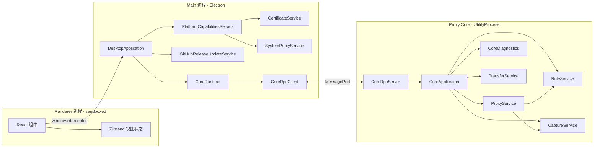
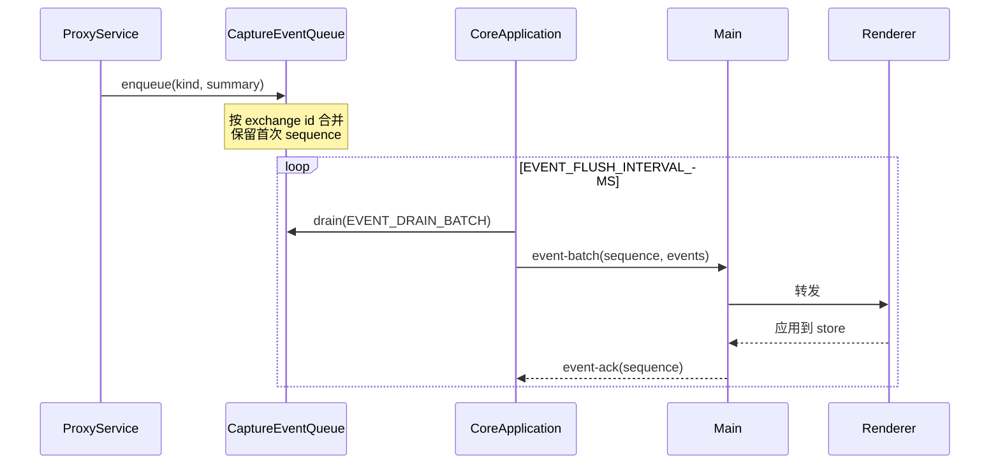

# Interceptor 架构设计索引

> 范围：本目录是源码开发与架构文档的入口，包含开发指南、功能契约、平台架构、交接状态与待办。

产品介绍见 [简体中文](../README.zh-CN.md) / [English](../README.md)。环境初始化、各模块开发、调试、验证和打包发布，从 [开发指南](development.md) 开始。

## 文档分工

| 文档 | 内容 |
| --- | --- |
| [development.md](development.md) | 初始化、模块分工、开发调试、验证、打包发布与常见问题 |
| [HANDOVER.md](HANDOVER.md) | 当前任务、进度、下一步、阻塞与必要验收结论 |
| `platform/` | 跨feature的进程、Renderer、存储、打包和测试架构 |
| `features/` | 功能职责、调用流程、数据契约、交互和限制 |
| [backlog/TODO.md](backlog/TODO.md) | 已确认问题的复现条件、影响和边界 |
| [backlog/idea.md](backlog/idea.md) | 候选需求与设计想法，截图与文档平级 |
| [backlog/research.md](backlog/research.md) | 技术调研、方案比较与未承诺的候选 |

**开工阅读**：新会话和子代理必须先读 [HANDOVER.md](HANDOVER.md)，其余文档按任务读取相关章节，条件见 [../AGENTS.md](../AGENTS.md) 的“按需阅读”。

Handover只列未完成任务、当前阻塞、有效验收结论和运行约束；完成项从任务列表删除，状态更新与所属item一并提交、push，不留未提交的交接尾项。功能文档保留必要的验证事实与证据索引，详细日志留在原证据中，不把排障流水复制到Handover。平台文档说明已实现的职责；候选方案不代表交付承诺。

### 文档整理验证

`15c80698`完成对`218295b0`之后22份非Handover文档的核对，实际修改14份，承接40组独有事实和11个有正文的旧锚点；DeepSeek调研、Agent、MCP的删除段均已核定。69项Tool/68项真实E2E、Manager原生专项排除及原失败记录保留，不回滚较新的产品契约，也不重新宣称历史产品验收。

证据位于session files的`item17-doc-facts.json`（`carryover`）、`item17-staged-manifest-20260929.json`和`item17-links-final-20260929.json`：历史承接时22份原有字节前缀保持；除随后独立新增的正文验收节外，14份文件匹配已审哈希。本地链接先212/212，连同Handover最终244/244通过。原文缺失的日期、trace、TEMP目录等7类元数据如实标注，不补造；没有重新打开或验收历史产物。

[同一份改动说明](../commit-changes/202609281939_docs_architecture_restore-evidence.html)在Edge的1280/390宽度、全部展开、无外联资源和窄表格键盘滚动检查通过。内嵌浏览器尺寸/键盘检查超时不计通过；`python`入口缺失时未执行文档检查，改用已有`python3`后通过，未新增工具。

## 平台索引

| 文档 | 覆盖范围 |
| --- | --- |
| [platform/processes.md](platform/processes.md) | 进程拓扑、parentPort 与 MessagePort 两条通道、故障分类与重启、Workflow 详细表、关键数据结构 |
| [platform/renderer.md](platform/renderer.md) | App shell、冷启动、窗口 chrome、共享组件库、automation 契约、主题与 15 语言 |
| [platform/storage.md](platform/storage.md) | Core 组合根与模块组织约定、三份存储的所有权、Recording 生命周期、正文边界 |
| [platform/release.md](platform/release.md) | Core 运行时依赖随包、Main external 与懒加载、安装器、Fuses、产物安全、发布 CI |
| [platform/testing.md](platform/testing.md) | 三层测试职责、Local E2E driver、执行约束与常用命令 |

## Feature 索引

| 文档 | 覆盖范围 | Core 模块 | Renderer 模块 |
| --- | --- | --- | --- |
| [features/capture.md](features/capture.md) | 流量捕获、Exchange 生命周期、正文存储与预览渲染矩阵、事件推送、客户端应用归属、筛选分栏 | `proxy/`、`capture/`、`client-app/` | `features/capture/`、`components/BodyViewer/` |
| [features/rules.md](features/rules.md) | 规则模型、编译、执行、证据采集、热更新 | `rules/` | `features/rules/` |
| [features/breakpoints.md](features/breakpoints.md) | 请求/响应/WebSocket 断点挂起与编辑 | `rules/internal/breakpoint-queue.ts` | `features/breakpoints/` |
| [features/composer.md](features/composer.md) | 手工构造请求、连接探测 | `composer/`、`tls-probe/` | `features/composer/` |
| [features/http-message-editing.md](features/http-message-editing.md) | Breakpoint、Rules、Composer 共用的 HTTP header/body 编辑契约 | `rules/`、`proxy/`、`composer/` | `features/breakpoints/`、`features/rules/`、`features/composer/` |
| [features/transfer.md](features/transfer.md) | HAR、Native Archive、Body 导出的异步文件任务 | `transfer/`、`har/`、`archive/` | Capture 导入导出菜单 |
| [features/diagnostics.md](features/diagnostics.md) | 三进程结构化日志、查询、导出 | `diagnostics/` | `features/diagnostics/` |
| [features/settings.md](features/settings.md) | 证书/MITM、系统代理与上游代理、更新、存储状态、语言主题 | `workspace/`、Main `platform-capabilities/`、`updates/` | `features/settings/` |
| [features/tool-capabilities.md](features/tool-capabilities.md) | Agent/MCP共用的Tool目录、Settings开关和`ask`/`auto`契约 | 复用既有command；共享registry位于`packages/interceptor-tools/` | Settings > Agent Tool capabilities |
| [features/mcp.md](features/mcp.md) | 对外 AI Host 接入、调用方认证、transport 与共享 Tool Catalog 消费 | 无新增 Core 业务；transport 已接入 Main `mcp/` | Settings > Agent MCP 配置 + App 级问询弹层 |
| [features/playground.md](features/playground.md) | Web人工验收工作台、Browser MCP/CORS、Traffic Lab与手工证据 | 复用正式MCP与Proxy入口；开发代码位于`apps/playground/` | 独立Browser UI，不进入产品包 |
| [features/agent.md](features/agent.md) | 内置持久化 Chat Agent、DeepSeek Model、Session History 与 Tool Loop | 复用既有 command；Runtime 位于 `packages/agent-runtime/` | `features/agent/` + Settings > Agent |

## 进程边界

**不可越界的约束：**

1. Renderer只能调用`window.interceptor`上的意图型方法，不能访问Node、Electron、MessagePort、私钥或任意本地文件。
2. Main 不搬运请求/响应正文。正文数据路径完整保留在 Core 内。
3. Core不暴露控制RPC监听端口，控制通信只使用UtilityProcess转交的专用`MessagePort`；代理listener属于业务流量入口。
4. `parentPort` 只用于 `ready`、`heartbeat`、`rpc-port` 转交、`shutdown`、`stopped`；业务消息一律走专用 port。
5. 操作系统级操作（信任库、系统代理、文件对话框）只在 Main。Core 不读写系统设置。

## 通信协议

### 请求/响应

Renderer 意图 → Main IPC → `CoreRpcClient.request()` → MessagePort → `CoreRpcServer` → `CoreApplication.executeCommand()`。

`packages/core-protocol/` 是唯一契约来源，定义 command/result 类型与信封校验。运行时只校验信封、协议版本与关联字段；payload 由 TypeScript 契约保证。

### 事件推送

Core 主动推送只有一条通道：`event-batch`。

背压规则：

- `inFlightEventBatches` 未 ack 数量达到 `EVENT_INFLIGHT_WINDOW_SIZE` 时暂停 drain。
- 队列按 exchange id 合并，不按容量淘汰。同一 Exchange 的多次更新在一个 flush 周期内压成一条。
- 取走前先确认连接存在；`sendEventBatch` 返回 `null` 时把事件放回队列。

### 大数据传输

| 数据 | 机制 |
| --- | --- |
| 列表分页 | 有限 metadata + opaque keyset cursor |
| 正文读取 | `body.read-range` 按 hash + offset + length |
| 文件导入导出 | `TransferService` 异步任务 + 轮询快照 |

单条消息不传输完整正文或完整列表。

## 共享约定

### 命名与结构

- Core 每个模块以 `entry.ts` 为门面，owning class 直接定义在 entry。
- 实现放`internal/`，模块内文件不重复module前缀；泛称类保留能说明职责的限定。
- 类型集中 `interfaces/index.ts`，无状态函数集中 `utils/index.ts`。
- 一个文件一个 class。每个属性和方法都有职责注释。

### 常量

模块常量位于`internal/constants.ts`，全局位于`proxy-core/constants.ts`。生产构造函数不接收仅测试用的注入参数。

### 失败分类

| 分类 | 处理 | 是否重启 Core |
| --- | --- | --- |
| 数据错误 | 丢弃该消息，记录诊断 | 否 |
| 请求错误 | 只失败该 request | 否 |
| 通道错误 | Core 退出码 1，Main 恢复 | 是 |
| 进程错误 | 按 startup deadline 与退避恢复 | 是 |

单条业务数据失败绝不升级为通道或进程故障。
