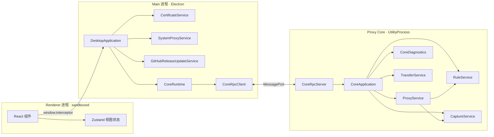
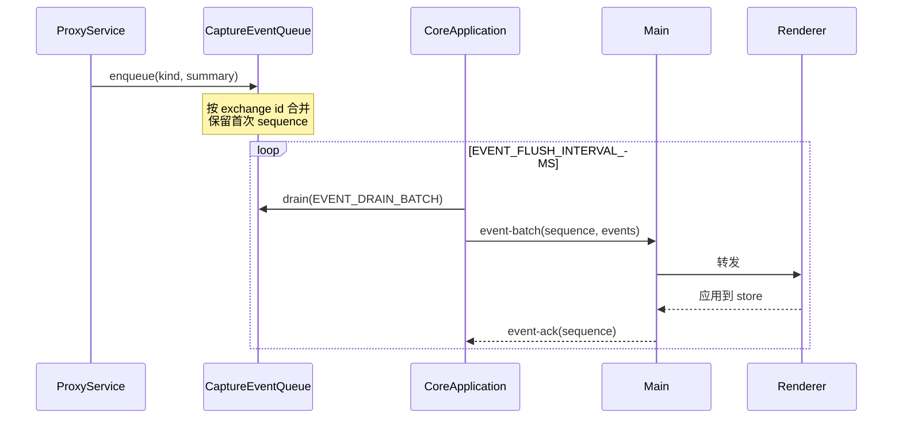

# Interceptor 架构设计索引

> 最后更新：2026-07-26
> 范围：按产品 feature 记录目标架构设计、进程边界、service 调用流程与 Client/Origin 交互步骤。

## 本目录与 `stages/` 的分工

| 文档 | 内容 | 时态 |
| --- | --- | --- |
| `architecture/feature-*.md` | 单个 feature 的完整架构设计、调用流程、数据契约 | 目标设计（含状态标记） |
| `stages/ARCHITECTURE.md` | 当前已落地并验证的进程边界与代码所有权总览 | 现状 |
| `stages/HANDOVER.md` | 工作树状态、剩余工作、精确恢复步骤 | 现状 |
| `stages/TODO.md` | 已确认的 BUG、实现限制与验收矩阵 | 待办 |

本目录描述**架构应该是什么样**。每个章节用状态标记区分：

- **[已实现]**：代码已落地并有测试覆盖。
- **[改造中]**：目标设计已确定，当前代码尚未完全达成，差异在文末「与当前实现的差异」列出。
- **[待定]**：需要产品决策后才能实现。
- **[阶段一] / [阶段二]**：尚未落地的 feature 内部的实现顺序，阶段一先做、阶段二按需追加。

## Feature 索引

| 文档 | 覆盖范围 | Core 模块 | Renderer 模块 |
| --- | --- | --- | --- |
| [feature-capture.md](feature-capture.md) | 流量捕获、Exchange 生命周期、正文存储、事件推送、客户端应用归属 | `proxy/`、`storage/`、`client-app/` | `features/capture/` |
| [feature-rules.md](feature-rules.md) | 规则模型、编译、执行、证据采集、热更新 | `rules/` | `features/rules/` |
| [feature-breakpoints.md](feature-breakpoints.md) | 请求/响应/WebSocket 断点挂起与编辑 | `rules/rule-breakpoint-queue.ts` | `features/breakpoints/` |
| [feature-composer.md](feature-composer.md) | 手工构造请求、连接探测 | `composer/`、`connection/` | `features/composer/` |
| [feature-transfer.md](feature-transfer.md) | HAR、Native Archive、Body 导出的异步文件任务 | `transfer/`、`har/`、`archive/` | Capture 导入导出菜单 |
| [feature-diagnostics.md](feature-diagnostics.md) | 三进程结构化日志、查询、导出 | `diagnostics/` | `features/diagnostics/` |
| [feature-settings.md](feature-settings.md) | 证书/MITM、系统代理、更新、存储状态、语言主题 | `storage/`、Main `certificates/`、`system-proxy/`、`updates/` | `features/settings/` |
| [feature-mcp.md](feature-mcp.md) | 对外 AI Host 暴露工具、调用方认证、工具分级与用户审批 | 无新增，复用既有 command；工具层在 `packages/mcp-server/`，transport 待接入 Main `mcp/` | `features/settings/` + App 级审批弹层 |

## 进程边界

**不可越界的约束：**

1. Renderer 只能调用 `window.interceptor` 上的意图型方法，拿不到 Node、Electron、MessagePort、文件路径、私钥。
2. Main 不搬运请求/响应正文。正文数据路径完整保留在 Core 内。
3. Core 没有对外监听端口，只通过 UtilityProcess 转交的专用 `MessagePort` 通信。
4. `parentPort` 只用于 `ready`、`heartbeat`、`rpc-port` 转交、`shutdown`、`stopped`；业务消息一律走专用 port。
5. 操作系统级操作（信任库、系统代理、文件对话框）只在 Main。Core 不读写系统设置。

## 通信协议

### 请求/响应

Renderer 意图 → Main IPC → `CoreRpcClient.request()` → MessagePort → `CoreRpcServer` → `CoreApplication.executeCommand()`。

`packages/core-protocol/` 是唯一契约来源，定义 command/result 类型与信封校验。运行时只校验信封、协议版本与关联字段；payload 由 TypeScript 契约保证。

### 事件推送

Core 主动推送只有一条通道：`event-batch`。

背压规则：

- `inFlightEventBatches` 未 ack 数量达到 `EVENT_INFLIGHT_WINDOW_SIZE` 时暂停 drain。
- 队列按 exchange id 合并，不按容量淘汰。同一 Exchange 的多次更新在一个 flush 周期内压成一条。
- 取走前先确认连接存在；`sendEventBatch` 返回 `null` 时把事件放回队列。

### 大数据传输

| 数据 | 机制 |
| --- | --- |
| 列表分页 | 有限 metadata + opaque keyset cursor |
| 正文读取 | `body.read-range` 按 hash + offset + length |
| 文件导入导出 | `TransferService` 异步任务 + 轮询快照 |

单条消息不传输完整正文或完整列表。

## 共享约定

### 命名与结构

- Core 每个模块以 `entry.ts` 为门面，owning class 直接定义在 entry。
- 模块内实现文件加模块名前缀（`storage-rule-store.ts`、`proxy-websocket-bridge.ts`）。
- 类型集中 `interfaces/index.ts`，无状态函数集中 `utils/index.ts`。
- 一个文件一个 class。每个属性和方法都有职责注释。

### 常量

模块常量位于 `<module>-constants.ts`，全局位于 `proxy-core/constants.ts`。生产构造函数不接收仅测试用的注入参数。

### 失败分类

| 分类 | 处理 | 是否重启 Core |
| --- | --- | --- |
| 数据错误 | 丢弃该消息，记录诊断 | 否 |
| 请求错误 | 只失败该 request | 否 |
| 通道错误 | Core 退出码 1，Main 恢复 | 是 |
| 进程错误 | 按 startup deadline 与退避恢复 | 是 |

单条业务数据失败绝不升级为通道或进程故障。
