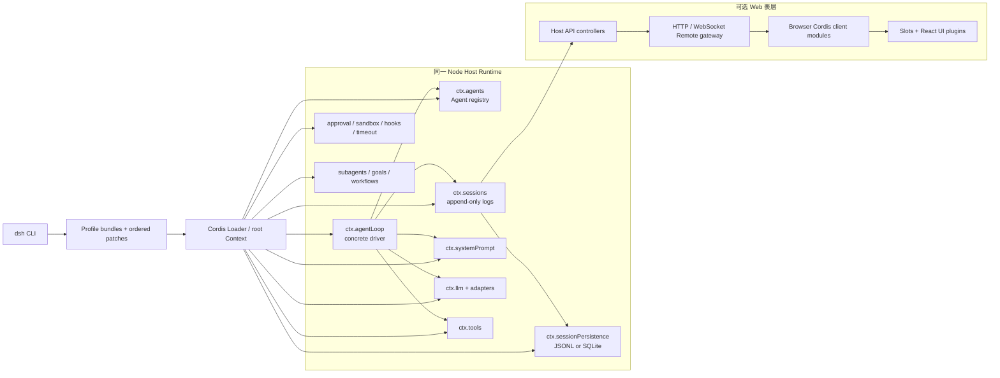
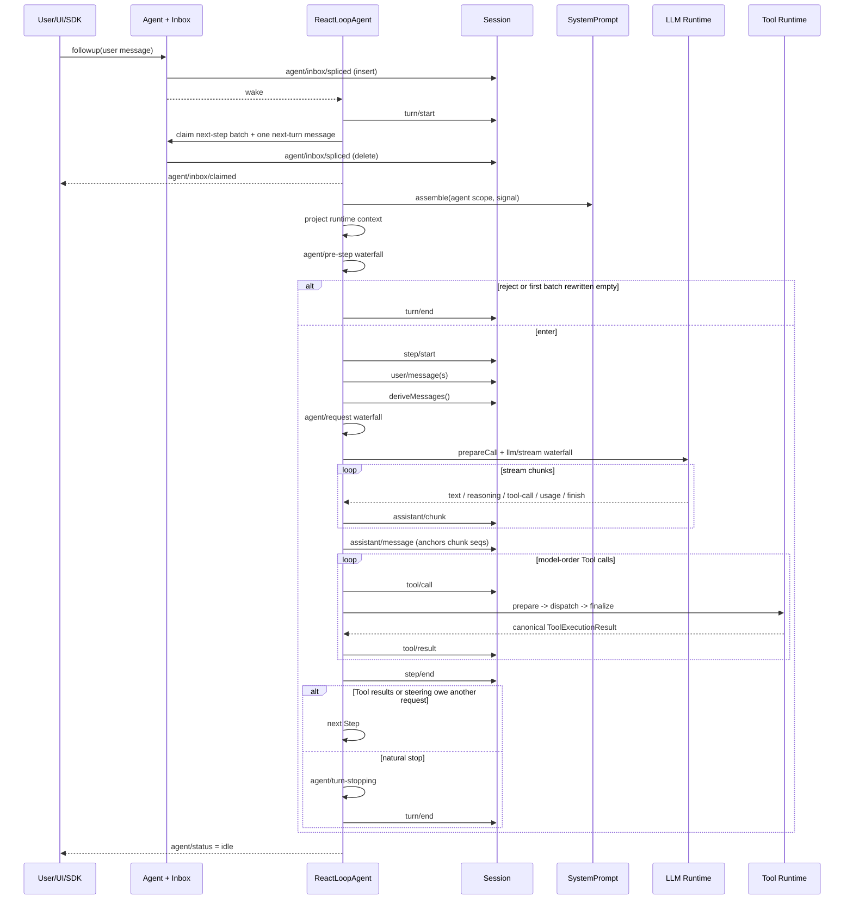
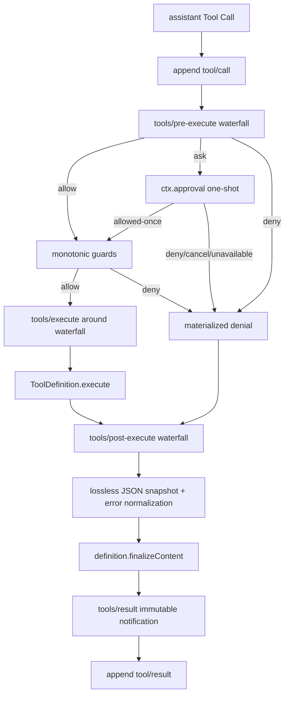
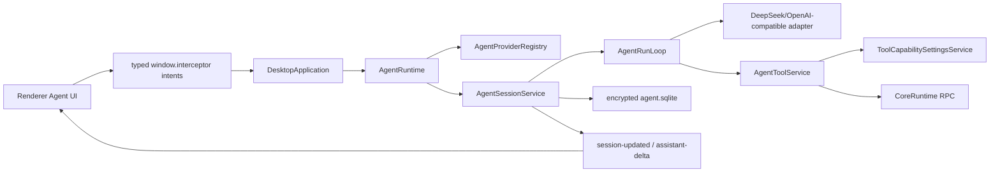

# DeepSeek Harness Agent Runtime 全流程与 Interceptor 对照研究

> 状态：外部架构研究文档，不是产品已实现架构真源。
>
> 调研日期：2026-08-31
>
> DeepSeek Harness 基线：`0.1.2-alpha.2`，commit [`0a53fb55bea101816fa226bb964ae2bed71c343b`](https://github.com/deepseek-ai/deepseek-harness/commit/0a53fb55bea101816fa226bb964ae2bed71c343b)
>
> Interceptor 基线：2026-08-31 的当前工作树；产品现状仍以 [`architecture/HANDOVER.md`](../HANDOVER.md) 和 [`architecture/features/agent.md`](../features/agent.md) 为准。

## 1. 调研目标与结论边界

本文回答五个问题：

1. DeepSeek Harness 的 Agent Runtime 到底由哪些包共同组成，而不是只看 `agent-loop`。
2. 一条用户消息怎样经过 Inbox、Session、Prompt、LLM、Tool、审批、持久化和 UI，最终回到 idle。
3. 它所称的 Session、Memory、Context、Tool、Runtime、Plugin 各自是什么，哪些概念容易混淆。
4. 第三方怎样扩展或宿主这套系统，哪些是官方边界，哪些只是社区项目的高耦合实践。
5. 哪些机制值得 Interceptor 吸收，哪些会破坏本仓已经建立的进程、安全和产品边界。

本文遵守以下证据规则：

- 已实现行为以当前 commit 的源码、包 README 和正式架构文档为准。
- `.agents/notes/implemented/` 只用于解释已实现设计；`proposed/`、`rejected/` 和 `archived/` 不当作当前产品事实。
- 社区项目只作为“第三方实际怎样接入”的证据，不反推官方稳定契约。
- DeepSeek Harness 仍是 alpha；任何可复用结论都必须区分“设计思想”与“可直接依赖的 API”。
- 本仓结论必须回到实际代码验证，不能把 DeepSeek 的通用 Harness 目标直接套到 Interceptor。

## 2. 一页结论

### 2.1 DeepSeek Harness 的本质

DeepSeek Harness 不是“一个 Agent 类加一个聊天 UI”，而是由 Cordis 组合出来的一棵运行时插件树：

- `dsh-agent` 提供公开 Agent 句柄、实时注册表、Inbox 与 `agent/*` 事件词汇；
- `dsh-agent-loop` 是唯一随产品交付的具体循环；
- `dsh-session` 的追加事件日志是所有模型可见事实的唯一真源；
- `dsh-system-prompt` 在每个 Step 组装系统提示词、运行时上下文和 Tool schema；
- `dsh-llm` 提供模型适配器注册与流式调用 seam；
- `dsh-tools` 提供作用域化 Tool 注册、策略、审批、执行、结果和展示元数据流水线；
- Session persistence、projection、compaction、instructions、skills、subagent、goal、workflow、Web UI 都是主干之外的可组合插件。

最重要的设计不是“插件多”，而是：**Agent Loop 很薄，所有可观察事实先进入 Session 日志；策略通过明确事件 seam 介入，不直接侵入循环状态机。**

### 2.2 对 Interceptor 最有价值的四点

1. **补齐 Renderer 对 durable sequence 的单调消费**：本仓已经坚持“先持久、再发事件”，但所有异步命令回包还没有共享同一个 sequence guard；扩展后台事件前应先锁定。
2. **把 Context 组装变成显式阶段**：当前 Interceptor 只有历史消息和 Tool capability index；未来的工作区上下文、Traffic 选择、用户附加上下文、压缩摘要不应继续塞进 `AgentRunLoop`。
3. **把 Tool 执行前后政策收敛为单一流水线**：开关、披露、query/change、审批、取消、Core RPC、结果脱敏和 UI 展示应共享一个不可绕过的顺序契约。
4. **把“完整事实”与“读取优化”分开**：DeepSeek 的 Session log 与 projection cache 分离思路值得吸收；本仓不必改成事件溯源，但应避免让 Renderer 快照、列表摘要或未来 Memory 索引成为第二真源。

### 2.3 不应照搬的部分

- 不应为了“插件化”把本仓编译期 24 项产品 Tool 变成任意运行时代码加载。
- 不应把 Renderer 变成通用 Cordis/Tool Host，或暴露 Node、MessagePort、Core RPC 原语。
- 不应直接引入 DeepSeek 的 Web UI 包；它不是 React 组件库，而是整棵浏览器插件应用。
- 不应现在把关系化 `agent.sqlite` 重写成通用追加事件日志；当前产品范围尚不足以抵消迁移和验证成本。
- 不应采用 DeepSeek 的默认“同进程任意插件”信任模型处理 Interceptor 的敏感抓包数据和系统代理能力。

## 3. 术语对齐

| 术语 | DeepSeek Harness | Interceptor 当前含义 | 不能混淆的点 |
| --- | --- | --- | --- |
| Runtime | 一个 `dsh --profile` 启动的 Cordis 插件树及其进程生命周期 | Main 内长期存活的 `AgentRuntime` 组合根 | DeepSeek Runtime 是整套应用组合，不是单个类 |
| Agent | `Agent` 句柄 + Agent scope + Session + 具体 driver | 一次 Session 中由 `AgentRunLoop` 执行的 Turn | DeepSeek 可同时存在多个 live Agent；本仓每 Session 至多一个活动 Turn |
| Turn | 一次输入触发、包含零到多个 Step 的持久执行边界 | 用户消息或 retry 对应的持久 `AgentTurnSnapshot` | 两边都允许一个 Turn 内多次模型调用 |
| Step | 一次模型响应加该响应请求的整批 Tool 调用 | `AgentRunLoop` 每轮 while 迭代 | 本仓没有单独持久 `step/start/end` 行 |
| Session | 类型化追加事件日志及其 Header/Surface | 关系化 Session/Turn/Item/ModelCall 聚合 | 两边的存储模型不同 |
| Memory | 没有单一核心 Memory；由历史、压缩、instructions、skills、引用与可选外部服务组成 | 当前只有完整历史、Provider Usage、Tool discovery 状态 | Context/历史不等于跨会话长期 Memory |
| Tool | 作用域注册的 schema、canonical output、执行器、策略与展示投影 | 共享 registry 中的 `query/change` Tool，经 Main 调 Core | DeepSeek Tool definition 自带更完整的结果和政策契约 |
| Projection | 从 Session event log 折叠出的当前值，可持久化缓存 | Renderer Session snapshot/summary 与本地 Zustand 状态 | Projection 只能是派生状态，不能成为第二真源 |
| Profile | 多个 bundle patch 与用户 patch 组合出的应用 | 本仓无对应产品概念 | 不要把 Provider profile 与 DSH profile 混为一谈 |

## 4. DeepSeek Harness 进程与组合拓扑



### 4.1 启动层级

1. 唯一 Node 启动器是 `apps/cli` 的 `dsh`。
2. `dsh --profile <name>` 找到 `$DSH_HOME/profiles/<name>`。
3. Profile manifest 的 `dsh.profile.bundles` 按顺序提供 bundle patch。
4. 再叠加 profile 自身 patch、home patch 和本次 `--patch`。
5. Cordis Loader 根据 `inject` 依赖激活插件，并把每个注册的副作用绑定到所属 fiber 生命周期。
6. `web`、`headless`、`sdk`、`acp` 只是同一 Runtime 主干上的不同应用组合。

### 4.2 核心包职责

| 包 | 职责 | 关键源码 |
| --- | --- | --- |
| `@deepseek-ai/dsh-agent` | `ctx.agents`、Agent contract、Inbox、作用域、`agent/*` events | `packages/core/agent/src/index.ts`、`inbox.ts`、`dispatch.ts` |
| `@deepseek-ai/dsh-agent-loop` | Agent factory、Turn/Step driver、Tool batch scheduler | `packages/core/agent-loop/src/index.ts`、`agent.ts`、`tool-calls.ts` |
| `@deepseek-ai/dsh-session` | Session event log、surface、`deriveMessages()`、内存 store | `packages/core/session/src/*` |
| `@deepseek-ai/dsh-system-prompt` | 有序 prompt section、变量、Tool schema 与 assembly | `packages/core/system-prompt/src/*` |
| `@deepseek-ai/dsh-llm` | Provider-neutral request/stream contract、adapter registry、BlockAssembler | `packages/llm/llm/src/*` |
| `@deepseek-ai/dsh-tools` | Tool layers、schema、执行 pipeline、PTC、presentation | `packages/core/tools/src/index.ts`、`schema.ts`、`ptc.ts` |

公开 contract 与具体实现刻意分离：第三方插件依赖 `dsh-agent` 的 `ctx.agents` 和事件，不依赖 `dsh-agent-loop`。替换 driver 的方式是实现 `Agent`/`AgentFactory` 并注册，不是在现有循环里加产品分支。

### 4.3 `web` Profile 的真实装配

当前 `web` Profile 不是一份单体配置，而是：

```text
@deepseek-ai/dsh-base
  -> @deepseek-ai/dsh-web-app
  -> $DSH_HOME/profiles/web/cordis.patch.yml
  -> $DSH_HOME/cordis.patch.yml
  -> invocation --patch files
```

后层按 row id 覆盖前层，`config` 是整段替换，不是深合并。行顺序只为阅读分组；激活顺序由 Cordis service availability 决定。

#### Base Host plane

`dsh-base` 为所有 base-backed 表层提供以下长期服务：

| 领域 | 默认实际装配 |
| --- | --- |
| Agent 主干 | `llm`、`session`、`agent`、`tools`、`system-prompt`、`agent-loop { agents: [] }`、`agent-default-model` |
| 模型 | `llm-deepseek` 注册 `deepseek-official`；`llm-pi-ai` 常驻但无用户 provider profile 时没有 route；`llm-retry` |
| 设置与凭据 | `$DSH_HOME/settings.yaml` 热更新；环境与托管 `$DSH_HOME/.credentials.yaml` 加 `.env` fallback；配置只携带 credential reference |
| Session | 默认 JSONL persistence 到 `$DSH_HOME/sessions`；projection registry；JSON storage-backed projection cache；checkpoint policy；title 与首条 prompt LLM title |
| Session query | service 常驻；SQLite search `openAt: never`，所以 exact read/lineage/export 能用，但正文全文搜索默认不打开数据库 |
| 附件 | 本地 content-addressed attachment store，Session 只保存引用 |
| 执行 | subprocess registry；平台 sandbox provider/policy；POSIX bash 或 Windows pwsh sandbox executor；filesystem sandbox 与 observation policy |
| 权限 | `user-approval`；`permission-presets`；默认 `workspace-write + ask`，显式 `danger-full-access + never` |
| Context | `agent-instructions { maxBytes: 65536 }`；Skill registry/provider/Tool；shell environment |
| Memory/压力 | Host token meter；按 Agent 组合的 compaction；Tool result pruner；spill policy `maxInlineBytes: 50000` |
| Tool/工作 | jobs registry；todo；goal domain/round driver；plan mode；web search/fetch provider；timeout/repeat guard |
| Subagent | process-global subagent registry、spawn/fork providers、continuation setup；Workflow provider |
| 遥测 | feedback-gated OpenTelemetry exporter；可由环境禁用 |

Base 自身的 model-facing tool rows适用于非 Web 的 process-wide Agent composition。它默认：

- spawn delegation 为 continuable；
- fork delegation 为 one-shot；
- `web_search` 开启、`web_fetch` 关闭；
- Tool registry 默认 native presentation；
- Tool Result pruner 为 `8192` code points，保留 head `4096`、tail `1024`；
- Agent Loop 并行安全调用采用默认上限，启动时不预创建 Agent。

#### Web Host/Client plane

`dsh-web-app`：

- 将 deployment persona 设为编码 Agent 文案；
- 保留 `session-query-sqlite openAt: never`；
- 加入 workspace、session-reference、file-reference、session-stats、message-feedback、code-runtime；
- 加入 Session/Settings/Workspace Controller、API Gateway、Web server、静态前端与 authenticated connection；
- 加入 Client module loader、Remote assembly、Slot/React renderer 及所有 shipped `ui-*` 插件；
- `ui-schedule` 默认 disabled，只有 Schedule overlay 同时启用 Host 与 Client 行；
- 把 base 中所有“一个 Agent 贡献的 Tool/Prompt/Compaction/Workflow”行显式 disabled；
- 保留 process-global registry、persistence、sandbox、approval、token meter、subagent provider 等 Host owner；
- 插入 `agent-presets { default: standard }`，让每个 Session 通过 scope parent 加入一个 standing preset。

这种切分遵循一条实际 ownership 规则：**跨 Session 查询或被 Host Controller 读取的 service 留在 Host plane；只改变一个 Agent 的 Tool、Prompt、Persona 或局部 workflow 的内容进入 Agent preset。**

#### `standard` preset

默认 Web Session 的 `standard` preset 提供：

- Persona 与 64 KiB workspace instructions；
- 平台 shell Tool、`read/write/edit/glob/grep`；
- background job 控制；
- 本地 Skill discovery 与 `skill`；
- Goal command/Tool；独立 realm 内的 Plan mode；
- 独立 realm 内的 Compaction + `/compact` + Tool Result pruner，复用 Host token meter；
- `ask_user_question`、`todo_write`；
- spawn 与 fork delegation、`send_message`、`interrupt_agent`、`list_agents`；
- worker-thread Workflow 与 Ralph；
- `web_search` 与 `web_fetch`。

当前 Web shipped composition E2E 固定的标准 Tool 名单为：

```text
ask_user_question, bash|pwsh, create_goal, edit, exit_plan_mode,
get_goal, glob, grep, interrupt_agent, job_kill, job_list, job_output,
list_agents, ralph, read, read_image, send_message, skill, subagent,
subagent_fork, todo_write, update_goal, web_fetch, web_search, workflow, write
```

其中 shell 名称按平台替换。Codex 和 Claude Code provider 的 delegation Tool 行随 preset 模板交付但默认 disabled；只有 Profile 安装相应 provider bundle、复制 preset 并启用 Tool 行后才可见。

#### 其他 shipped preset

| Preset | 与 `standard` 的差异 |
| --- | --- |
| `ptc` | 功能清单基本相同，额外用 `agent-tool-presentation { mode: ptc }` 让该 Agent 只看 `run_code` + 生成 TypeScript SDK；其他 native Session 可在同进程并存 |
| `cordis` | 在 standard 基础上增加 `tool-cordis` 与 composition-authoring Skill；可执行模型生成的 Host/Client 插件代码，等价于 shell 级信任 |
| `minimal` | 完整固定 Persona，禁止其他 Prompt section 与 runtime context；只有持久 shell 和 `str_replace_editor`；使用独立 PTY realm 与 bare local filesystem；无 instructions、web、subagent、goal、plan、compaction |

#### Fork 模式的表层差异

当前 commit 的配置不是全局一致的一种模式：

- base process-wide `tool-subagent-fork`：`backgroundMode: one-shot`；
- Web `standard`、`ptc`、`cordis` preset：`backgroundMode: continuable`；
- `minimal`：没有 Subagent Tool。

Web preset 的注释明确承认 continuable child 注入 `report` Tool/Prompt 会破坏 fork 继承前缀的 KV Cache；issue `#2124` 跟踪 cache-preserving 方案。因此“Fork 语义”与“Fork 是否 continuable”必须分开描述，不能从 provider capability 推断产品配置。

## 5. Agent 创建、作用域与生命周期

### 5.1 创建事务

`ctx.agents.create()` 或 `resume()` 委托当前注册的 Agent factory。默认 `AgentLoop` 以一个受回滚保护的事务执行：

1. 创建或准备 Session。
2. 创建 `ReactLoopAgent` 和它自己的 Agent scope Context。
3. 运行可选 `setup(agentCtx)`；此时可挂载只对该 Agent 生效的 Tool、Prompt section、listener 或限制。
4. Session 与 Agent 都准备成功后才进入 registry。
5. 发出 `session/created`、`agent/created` 和 `agent/session-start`。
6. 最后启动 driver。

任何 setup、commit 或发布失败都会回滚未发布对象。`AgentHandle.dispose()` 是唯一属于创建方的拆除能力；裸 `ctx.agents.get()` 只返回 Agent，不赋予拆除权。

### 5.2 Agent scope

- 全局 Tool/Prompt 对所有 Agent 可见。
- 通过 `agent.ctx` 注册的贡献只对该 Agent 可见。
- 邻近 scope 的注册会遮蔽全局同名贡献。
- scope dispose 后，相关 Tool、Prompt、listener 和限制一起撤销。
- `ctx.agents.withInitiator(agent, ...)` 用 `AsyncLocalStorage` 在同进程异步链中携带发起 Agent。
- initiator 只做归因，不是权限凭据；跨 worker、进程、HTTP 和持久化边界仍需显式身份。

### 5.3 Agent 可见控制面

| 操作 | Inbox 目标 | 是否唤醒 | 语义 |
| --- | --- | --- | --- |
| `followup(message)` | `next-turn` | 是 | 排队一个新 Turn 的普通用户输入 |
| `steer(message)` | `next-step` | 是 | 在当前 Turn 的下一个 Step 介入；空闲时也会启动工作 |
| `inject(message)` | `next-step` | 否 | 只注入上下文，等待其他 waking input |
| `cancel(cause, options)` | 当前活动 + 可选 Inbox | 是 | 中止当前活动；默认还清空待处理 Inbox |
| `whenIdle()` | 无 | 否 | 等待 Agent 完全停稳 |

## 6. 完整 Turn / Step / Loop 流程

### 6.1 权威时序



### 6.2 一次 Step 的精确含义

一个 Step 是：

1. 一次确定的 Prompt/Tool surface；
2. 一次模型请求及其完整 stream；
3. 模型产生的零到多个 Tool Call；
4. 这些 Tool Call 的全部持久结果；
5. `step/end`。

模型没有 Tool Call 时，Step 通常让 Turn 自然结束。模型有 Tool Call 时，Tool Result 会进入 Session 派生历史，下一 Step 重新组装 Prompt、重新解析模型 route，并重新计算当前可见 Tool。

### 6.3 Inbox 的持久语义

Inbox 不是普通内存队列：

- 状态由 Session 中的 `agent/inbox/spliced` 事件重放得到；
- `next-turn` 保存逐个新 Turn 消费的输入；
- `next-step` 保存当前或最近下一个 Step 要消费的 steering/context；
- claim 本身也是纯删除 splice，因此崩溃前“已领取还是仍排队”可以从日志判断；
- `pre-step` reject/throw 后，已领取批次不会自动放回；之后插入的消息不受影响；
- 运行中的 Tool 可以 `deferContext()`，这些上下文在整批结果按模型顺序落账后进入下一个 Step。

### 6.4 Prompt 与请求构造

在每个 proposed Step：

1. `ctx.systemPrompt.assemble(assembleContextFor(agent, signal))` 收集当前 Agent scope 的 section、变量和 Tool schema。
2. `renderContextSections()` 得到结构化 section。
3. `RuntimeContextProjection` 比较动态运行上下文，必要时形成持久 `request/context`。
4. `agent/pre-step` 决定哪些已领取消息真正进入。
5. 进入 Step 后才追加 `user/message`。
6. `session.deriveMessages()` 从完整事件日志和当前 Surface 派生模型历史。
7. `agent/request` waterfall 可以在分发前调整请求。
8. `ctx.llm.prepareCall()` 固定当前 adapter 和精确模型默认值。
9. `request/header` 记录 provider、model、reasoning、maxTokens、Prompt/Tool surface epoch 等可重建请求事实。
10. `llm/stream` waterfall 最终进入具体 adapter。

关键不变量是：**每个真实发出的 LLM request 都能从 Session 日志重建。** Retry 的失败 chunk 可以保留为诊断事实，但不会被成功 `assistant/message.sourceEventSeqs` 引用，因此不会进入后续模型历史。

### 6.5 流式响应

- 每个 provider `StreamChunk` 先追加为 `assistant/chunk`。
- `BlockAssembler` 是 chunk 到完整 ContentBlock/Message 的唯一组装算法。
- 成功 stream 恰好产生一个 `assistant/message` anchor，引用该请求全部 chunk seq。
- 即便响应无可见文本或因 max-tokens 结束，仍会有持久 `assistant/message`，Usage 和结束事实不会丢。
- 取消发生在 stream 中时，已经交付给用户的非空 text/reasoning 前缀会形成 `interrupted: true` 的 `assistant/message`；未开始执行的 Tool Call 不会被伪装成已执行。

### 6.6 Retry、失败与 Turn 结束

- 最终 adapter 选择失败、模型 request 失败或 stream 内协议失败先形成结构化 `LlmError`。
- `agent/request-error` waterfall 可以返回 retry action。
- Retry 在同一 Step 编号下重新构造请求，并保留可复用前缀；失败 attempt 的部分输出不进入模型历史。
- Tool、middleware 或其他扩展抛错会关闭当前 Turn，但不会销毁 Agent Loop。
- `agent/turn-stopping` 是自然结束前的 serial checkpoint；listener 可通过新增 steering 让 Turn 继续。
- `turn/end` 记录 completed、max-tokens、aborted、error 等明确原因，随后 `agent/status` 回到 idle。

## 7. Session：唯一真源、Surface 与派生历史

### 7.1 事件日志

DeepSeek Session 是 `SessionEvent[]` 追加日志。核心事件至少包括：

- `turn/start` / `turn/end`
- `step/start` / `step/end`
- `user/message`
- `assistant/chunk` / `assistant/message`
- `tool/call` / `tool/result`
- `request/header` / `request/context`
- `session/end-seed`
- `agent/inbox/spliced`

插件通过 TypeScript declaration merging 增加自己的事件，例如 compaction、todo、goal、hook、schedule、subagent 和 code-dispatch。扩展事件仍进入同一 Session 日志，不建立平行 transcript。

### 7.2 Surface 与 `deriveMessages()`

Session 保存的事实多于模型历史。`deriveMessages()` 只读取当前有效 Surface：

- `user/message`、成功或中断的 `assistant/message`、`tool/result` 等生成模型消息；
- 原始 chunk、边界、retry、统计和插件内部事件一般不直接成为消息；
- `assistant/message` 通过 `sourceEventSeqs` 关联精确 chunk；
- compaction 可以用 Surface replace/shadow 让摘要替代旧模型表面，但不删除历史事实；
- replay 就是对同一日志重新执行派生，而不是加载另一份 messages JSON。

### 7.3 Session Header

Header 保存 Session identity、创建时间、cwd、seed lineage 等不随 Turn 重写的元信息。模型 route 等会变化且影响请求的事实进入 Session event，而不是悄悄修改 Header。

## 8. Session Persistence、Checkpoint 与恢复

### 8.1 Persistence seam

`ctx.sessionPersistence` 定义：

- create / append / prepare / load / inspect；
- readFrom / list / listSnapshots；
- flush 与完全停稳 dispose；
- 可选 per-session artifact location。

持久单元仍是原始 `SessionEvent`，没有另一套 DTO。共享 `PersistenceCoordinator` 负责缓冲、串行写、materialization、repair、adoption 和 shutdown；后端只实现较小的存储原语。

### 8.2 后端

| 后端 | 形态 | 特点 |
| --- | --- | --- |
| JSONL | 每 Session 一份追加日志，可选 Zstandard | 可定位独立 transcript 文件，适合本地工件 |
| SQLite | 多 Session 共用数据库，逻辑事件可物理打包 | WAL、可查询、没有诚实的逐 Session 文件路径 |

### 8.3 Semantic checkpoint

`session-checkpoint-policy` 包装 LLM 与 Tool seam，在以下副作用前要求日志持久：

- 发起下一次模型请求前；
- 顶层 Tool 副作用前；
- 已完成 Step 进入下一项工作前。

目的不是“多写日志”，而是保证模型请求或副作用不会越过描述它们前因的 durable prefix。

### 8.4 崩溃恢复

- torn storage tail 会在后端边界丢弃；已完整持久的事件不删除。
- load/prepare 发现未闭合 Tool/Step/Turn 时，追加 synthetic `tool/result`、`step/end`、`turn/end { interrupted }` 使日志恢复结构平衡。
- 当前策略不会从崩溃点继续半个 Turn；它先明确关闭被中断 Turn，再允许后续新工作。
- Persistence seam 当前没有统一删除/retention API；`list()` 也不适合大规模远程存储。

## 9. Projection 与冷读

`ctx.sessionProjections` 让领域注册纯 fold unit：

```text
previous state + one committed SessionEvent -> next state
```

设计约束：

- 当前值是派生状态，不写回 Session log；
- Client-visible projection 必须可序列化并有 schema；
- Projection cache 行包含 unit version、observed seq 和 state；
- cache 最多过期，不得表达日志不存在的事实；
- 冷读使用“cache checkpoint + persistence tail replay”，避免每次列会话都解码全日志；
- `turn/end`、detach 等边界强制 checkpoint，稳态更新可节流。

Web Session Controller、Session list、todo、goal、schedule、subagent catalog 等都可消费 projection，而不各自重新扫描或维护第二份真相。

## 10. Memory 与 Context：实际有什么、没有什么

### 10.1 不是单一 Memory 模块

当前官方源码没有一个默认启用、统一命名为 Memory 的长期记忆核心。实际由不同生命周期的能力组成：

| 层 | 数据来源 | 生命周期 | 是否默认进入模型 |
| --- | --- | --- | --- |
| 当前对话历史 | Session Surface | Session 内持久 | 是 |
| Compaction 摘要 | `compaction/*` + Surface replacement | Session 内持久 | 是，遮蔽旧表面 |
| Runtime context | cwd、运行表层等动态 section | 逐 Step 投影并可持久 | 变化时进入 |
| Workspace instructions | `AGENTS.md` / `CLAUDE.md` 等 | 文件版本 + Session inbox 对账 | 是，有预算 |
| Skills | 本地/其他 provider 的 Skill catalog 与正文 | 运行时目录；加载事实进入 Session | catalog/按需正文 |
| Session reference | 对另一 Session 的有界快照 | 当前 Session 持久引用 | 显式引用时 |
| Session query | 历史日志搜索与读取 | 跨 Session 读取能力 | Tool 调用时 |
| 长期语义 Memory | 可选 MCP/第三方插件 | 外部服务定义 | 默认没有 |

因此“Session 持久化”“上下文压缩”“跨会话搜索”和“长期个性化记忆”是四件事。

### 10.2 Agent instructions

`dsh-agent-instructions`：

1. 在首个合格 `agent/pre-step` 搜索项目层级的 instructions 文件。
2. 按 byte budget 流式读取并渲染 baseline。
3. 以带来源和 digest 的 durable user message 进入 Inbox/Session。
4. 第一方 read/write/edit Tool 的成功结果会报告 touched path。
5. 外层 Step 持久后异步重新投影；新增、修改、删除 instructions 都通过 Inbox replace/remove 对账。
6. 路径与 digest 未变时不重复注入。

这比“每次请求重新把 AGENTS.md 拼进 system prompt”更可重放，也能明确说明模型当时看到哪个版本。

### 10.3 Compaction

Compaction 是独立 capability seam，Agent Loop 只暴露触发点。`CompactionEngine` 有三种入口：

- `compactIfNeeded(agent, 'pressure' | 'context-overflow', signal)`：自动压力或提供方确认的上下文溢出；
- `compactNow(agent, signal, sourceCommandId?)`：Agent idle 时由 `/compact` 等入口强制做一次有用压缩；
- `compactRegion(start, end, agent, signal?)`：显式选择一个按 Surface 位置计算的闭区间。

自动路径的精确顺序：

1. 在 `agent/pre-step`、请求历史派生之前读取最新 durable `request/header`；还没有成功路由请求时不猜测容量。
2. `ctx.llm.resolveModelInfo(provider, model)` 提供目标模型容量，`compaction-basic` 的 route policy 将 `thresholdRatio`、`retainRatio` 或 `retainTokens` 解析成阈值和保留尾部。
3. 可选 `ctx.toolResultPruner.pruneSession()` 先做无模型剪枝。
4. `ctx.tokenMeter.measure(session)` 重新测量；若剪枝已经降到阈值以下，直接返回，不发摘要请求。
5. `selectCompactableRange()` 从当前 Surface 头部选择可压缩范围；边界只要求 Tool Call/Result 配平，不要求完整 Turn，因此一个超大 Turn 的早期已闭合 Step 也可压缩。
6. Region transaction 验证范围和现有 lock，同步追加 `compaction/start { compactionId, turn }`。这个 durable marker 在首次异步摘要前即获得锁。
7. 以最后一次真实请求的 system、tools 和待压缩 messages 作为逐字节前缀，再追加 compaction instruction 作为最后一条 user message；这让摘要请求复用提供方 KV Cache 的已有前缀。
8. Summary target 优先来自显式 compaction config，再来自最新 durable route，最后回退 Agent options；独立 `maxTokens` 由 compaction policy 所有。
9. 摘要完成后重新测量并拒绝不缩小源范围的结果。
10. 自动调用要求整个 Surface generation 未变化；idle 手动调用只要求所选 span 仍然存在、连续、价格一致且边界配平，允许 span 之外追加 context。
11. 同一个同步 commit 段依次追加：
  - `compaction/summary`：log-only，保存安全 summary、可选 raw output、provider/model/maxTokens/usage、shadowed range/seq/token price；
  - `user/message`：`compactCheckpointSource(compactionId)`，并带 `surfaceOp: { op: 'replace', start, end }`；这是唯一 Surface mutation；
  - `compaction/end`：log-only，释放 lock。
12. `deriveMessages()` 此后得到 `[summary user message, ...retained tail]`，原事件仍保留在日志中。

失败语义：

- 每次已开始 transaction 对 `compaction/end` 只尝试一次；可恢复失败把 error 写进 end。
- 若 end 自身写失败，未配对的 start 留作可检测 blocking orphan；比最新 `session/end-seed` 更旧的 orphan 视为前一生命周期证据，不阻塞新运行。
- Summary、shrink、Surface changed、commit、flush 和 cancellation 是不同错误；手动入口转成 `ManualCompactionError` 的具名原因。
- 自动摘要失败不会撤销此前已经落地的 Tool Result pruning；后续请求从最新持久 Surface 继续。
- Provider context overflow 的失败 Step 先闭合，再从 `agent/request-error` 触发强制压缩；只有 `surface.replaceGeneration` 确实前进才返回 retry。
- `compactionRetries` 允许一次压力检查连续压缩多个头部区间；超过尝试后仍高于阈值则明确失败。

手动 `/compact` 与自动路径的差异：

- `/compact` 通过 `agent.runMaintenance()` 在 Turn 之间预留 admission；不会与普通 Turn 并行。
- 即使低于自动阈值，也尝试一次有用、配平的缩减；没有范围时无写入返回 `null`。
- marker 使用 `turn: null`，并携带可选 `sourceCommandId`；`command/done` 再通过 `sourceEventSeq` 关联 `compaction/summary`。
- 闭合 transaction 会先 flush，之后排队的 waking prompt 才能从新 Surface 派生请求。

### 10.4 Token Meter

`ctx.tokenMeter` 是独立于 Compaction 的 replay-aware 服务。每个 Session 有一个隔离 fold：

```text
consumed event cursor
+ latest canonical request/header
+ current positional Surface nodes
+ open Step boundary and pre-request Surface snapshot
+ latest successful-call measurement anchor
```

`measure(session, requestHeader?)` 先同步 fold 到当前 durable tail，再返回一份 detached、deep-frozen 的一致快照：

- `logRevision`：已消费事件数量，也是下一未读 seq；
- `baseline`：`none | estimated | usage`；
- `surfaceDeltaTokens`：相对匹配 Usage 锚点的有符号增减；
- `totalTokens`：当前 request + response 压力；
- `surfaceTokens`：仅当前 Surface 的 route-priced 总量；
- `nodes[]`：按当前 Surface 位置排列的每节点 token price 与 route-independent `heuristicTokens`。

计量策略不是盲信 Provider Usage：

1. Fold 记录 `step/start` 时的 Surface snapshot。
2. 成功 `assistant/message` 的 Usage anchor 必须匹配当前 Step 和 canonical request header。
3. Provider 输出从该 message 明确引用的 `assistant/chunk` seq 重新组装；空数组表示已知空 stream，老日志缺失引用时保守地把 durable assistant content 当作 provider output。
4. 只有当前测量 envelope 与 anchor 的 provider/model/system/tools/prefix/config 完全相同，且 Provider 报告总量不小于同一次调用的完整 route-priced 估算，才使用 `baseline.kind = usage`。
5. 任一 envelope 变化都对完整 header + Surface 启发式重算；后续成功请求替换旧 anchor。
6. Adapter 声明图片定价时使用对应视觉 token；否则文本采用固定启发式，当前实现约为四字符一 token 加 role/block overhead。
7. Surface replacement 会在同一路由下重定价 anchor Surface 与当前 Surface，再得出正或负 delta。

Token Meter 同时注册三个可缓存 Projection：

- `tokenUsage`：历史计费总量，不因 Surface compaction 擦除；
- `contextPressure`：当前上下文压力；
- `contextBreakdown`：`systemTokens / toolsTokens / messageTokens`。

代价与边界：每次 `measure()` 都复制当前 positional nodes，成本为 $O(\text{surface})$；它不是精确 tokenizer。畸形边界在 mutation 前抛错，cursor 不前进，因此同一坏日志每次都确定性失败，不静默产生漂移。

### 10.5 Tool Result Pruner

`ctx.toolResultPruner` 是无模型、单遍收敛的预处理：

1. 只遍历当前 Surface 中的 `tool/result`。
2. 只计算 text block 的 Unicode code point；图片与结构化 block 保持原顺序且不计字符预算。
3. 超过 `thresholdChars` 时保留固定 head、标记 `[...] tool result middle pruned [...]` 和固定 tail。
4. 先同步追加 `compaction/prune`，记录原节点的 range/seq 和由 Token Meter 估出的 shadow price。
5. 紧接着追加新的 `tool/result`，以 `surfaceOp: replace` 替换单个旧节点并通过 `sourceEventSeqs` 引用原结果。
6. 原始完整结果保留在日志；未来模型只看到剪枝后的一个副本。
7. 一次 pass 中前面已经成功的 replacement 不因后面的失败回滚。

`compaction/prune` 与 `compaction/summary` 都实现同一个 shadow-price 协议：计价事件必须与 replacement 同步相邻，使 O(1) projection 能在不保存全量节点的情况下减去旧价格。剪枝可能让后续 summary 完全不需要；若仍超阈值，摘要器读取已经剪枝的 Surface。

## 11. LLM Runtime 与 Provider Adapter

### 11.1 分层

- `ctx.llm` 是 provider-neutral registry 与 stream seam。
- 具体 adapter 注册 provider/model route。
- Agent request 只携带标准 messages、tools、provider、model、reasoning/maxTokens 等统一字段。
- adapter 在 `prepareCall()` 阶段解析精确模型支持、默认 reasoning、输出上限和凭据。
- 同一 prepared call 固定当前 adapter，避免请求构造与真正 stream 之间 provider 被热替换。

### 11.2 DeepSeek adapter

`@deepseek-ai/dsh-llm-deepseek`：

- 注册 `deepseek-official` route；
- 把 DeepSeek Chat Completions stream 转成统一 chunk；
- endpoint、credential、thinking 策略按请求解析，设置变更影响下一次请求；
- 配置只保存 CredentialRef/设置，不让 Secret 穿过 UI；
- provider-specific request extension 通过单独注册表扩展，不污染通用 LLM contract。

#### 配置与 route 冻结

1. `src/index.ts` 把 composition config 作为 base，再叠加当前 `llm-deepseek` Settings section。
2. 一次 `prepareCall(provider, model)` 只解析一次 connection snapshot：base URL、CredentialRef、thinking defaults、模型目录、Context/output 上限、图片/Files policy、idle timeout 与 retry policy。
3. API Key 从这个 connection snapshot 携带的 CredentialRef 按请求解析；endpoint 与 Secret 不可能来自两代配置。
4. Prepared call 只能 dispatch 一次；in-flight stream 永远使用启动时 snapshot，下一次 call 才读取新设置。
5. Retry policy 是 adapter registration 捕获的唯一动态配置；变化时以原子 registry replacement 重新注册 route。
6. 未列入 catalog 的 model id 仍原样发给 endpoint，但保守地只声明 text modality；只有显式 catalog model 可以宣称 image input。

当前默认值：

| 配置 | 默认 |
| --- | --- |
| `baseURL` | `https://api.deepseek.com`，`DEEPSEEK_BASE_URL` 优先 |
| `reasoningEffort` | `high`；支持 `off/low/high/max` |
| `maxTokens` | `256000` |
| `defaultContextWindow` | `1000000` |
| `streamIdleTimeoutMs` | `300000` |
| `maxRequestFilesBytes` | `128 MiB` |
| `maxInlineRequestImageBytes` | `20 MiB` |
| `filesApiTimeoutMs` | `60000` |

`purpose: session-title` 强制 `thinking: disabled`；部署把 thinking 锁为 disabled 后，非 `off` effort 在 Provider I/O 前失败。

#### 请求序列化

基础请求恒为：

```text
POST {baseURL}/chat/completions
Authorization: Bearer <resolved secret>
Accept: text/event-stream
stream: true
stream_options.include_usage: true
```

并按需加入 `thinking`、`reasoning_effort`、`tools`、`temperature`、`max_tokens`、`stop`。当前通用 contract 没有 `tool_choice`，因此 adapter 不映射它。

消息转换规则：

- System 保持单字符串。
- 纯文本 User 保持紧凑字符串；多模态 User 保持有序 text/file/image_url parts。
- Assistant `content` 永远是字符串；纯 Tool Call 或纯 Reasoning Turn 使用 `""`，不发送 `null`，避免网关拒绝和持久历史无法续聊。
- Assistant reasoning blocks 合并为 `reasoning_content`，每个带 reasoning 的历史 Turn 都 pass back；Thinking Tool Turn 因而保留上游 CoT continuation/signature。
- Assistant Tool Call 保留原始 arguments JSON 字符串。
- Harness user message 内的 Tool Result 展开为独立 `role: tool`；空文本使用字面量 `(no output)`。
- Tool Result 图片不能放进 `role: tool`，先发送字符串 Tool message，再用一条相邻 User image message 承载图片。
- 未被 adapter 认识的 declaration-merged ContentBlock 跳过；Core image 出现在不支持的 role/model 时明确拒绝，不静默丢失。

#### 图片与 Files API

1. Durable Session 只保存 attachment ref；请求前通过 attachment store 生成确定性 request image version。
2. 根据模型的 pixel/byte policy 正规化，最旧图片在总字节或数量超限时变成稳定文本 placeholder。
3. 默认优先 Files API id，并用 process-wide file store 复用上传记录。
4. Files resolution 受独立 60 秒 deadline；失败时该次 Chat request 全量降级为 inline base64。
5. Provider 报 file id expired/deleted/not found 时使对应映射失效并只重试一次 Files request。
6. Provider 拒绝已经正规化的图片时生成带 message/image ordinal、MIME、bit depth、尺寸的诊断，不回显 Secret。
7. Adapter 向 Token Meter 提供与真实请求一致的 V4 image pricing；Provider Usage 仍优先于估算。

#### Request extension

`ctx.deepseekLlmApiExtensions` 可准备额外顶层字段：

1. Extension 读取已经完成的基础 WireRequest。
2. 准备失败或字段与基础 request 冲突时，在 HTTP 前以 `REQUEST_EXTENSION` 失败。
3. 只有收到 2xx 后才调用每项 extension 的 `accept()`；网络或非 2xx 不确认交付。
4. 当前产品用它发送可选增量 Session log 和活跃插件包清单；这些字段不成为模型消息。

#### SSE framing 与 StreamChunk

`src/sse.ts` 使用 `eventsource-parser`：

- 网络 read 可以在任意字节甚至 UTF-8 字符中间切开；
- 正确处理 BOM、CRLF、comment、非 data 字段和多 `data:` join；
- comment 只给 idle watchdog pulse，不进入模型 payload；
- event 只有遇到空行终止符才 dispatch；EOF 的未终止 tail 视为截断；
- 字面量 `[DONE]` 也作为 payload 交给 translator，EOF 前没有它就是 `STREAM_CLOSED`。

`src/translate.ts` 的状态机：

1. 每个 reasoning、text 和 wire Tool Call index 各有一个 open block；分配统一递增 block index。
2. 同一 chunk 中先处理 `reasoning_content` 再处理 `content`；DeepSeek 首个空 reasoning string 不创建空 block。
3. 第一个非空 delta 发 `block-start`，随后发 `reasoning-delta` 或 `text-delta`。
4. Tool Call 以 wire `index` 聚合；首片记录 id/name，所有 `function.arguments` 片段原样串接并发 `tool-call-delta`。
5. `finish_reason` 和最新 Usage 先暂存，不立即发 finish，因为 Provider 还可能发送 trailing usage-only chunk。
6. 直到 `[DONE]` 才按 block 首次出现顺序发全部 `block-end`，然后发 Usage，最后恰好发一个 finish；finish 后没有任何 chunk。
7. 完成但没有任何 block 的 stop 响应改成 `EMPTY_RESPONSE` error，不生成成功空 Assistant。
8. JSON 解析失败为 `MALFORMED_RESPONSE`；payload iterable 无 `[DONE]` 为 `STREAM_CLOSED`。

Finish 映射：

| Wire | Harness |
| --- | --- |
| `stop` | `{ kind: 'stop' }` |
| `tool_calls` | `{ kind: 'tool-calls' }` |
| `length` | `{ kind: 'max-tokens' }` |
| 其他值 | `{ kind: 'error', code: UPPERCASE_REASON }` |

#### Usage 映射

DeepSeek `prompt_tokens` 已包含 cache hit，而 Harness 要求互斥桶，因此：

```text
cacheRead = prompt_tokens_details.cached_tokens
         ?? prompt_cache_hit_tokens
inputTokens = prompt_tokens - cacheRead
outputTokens = completion_tokens
reasoningTokens = completion_tokens_details.reasoning_tokens
totalTokens = prompt_tokens + completion_tokens
```

只有 prompt/completion 都是非负 safe integer，且可选 wire `total_tokens` 与求和一致时才保留 `totalTokens`。`prompt_cache_miss_tokens` 不单独进入 Harness TokenUsage；未缓存输入由相减后的 `inputTokens` 表达。

#### 超时、取消与错误

- 初始 fetch 与所有 body read 共享 caller signal。
- Idle watchdog 只包围等待下一 iterator result 的时间；每个 SSE comment/data pulse 重置计时。超时转 `TIMEOUT`，detail 含实际阈值。
- Caller abort 转 `ABORTED`；消费方提前停止会 abort 内部 controller 并等待 iterator return，teardown abort 不覆盖主结果。
- Fetch 抛错且 signal 未 abort 为 `TRANSPORT`。
- 2xx 无 body 为 `EMPTY_RESPONSE`。
- HTTP：401/403=`AUTH`，413=`INVALID_REQUEST`，429=`RATE_LIMIT`，400 中识别上下文溢出为 `CONTEXT_WINDOW_EXCEEDED`、识别配额为 `QUOTA_EXCEEDED`，其他 400=`INVALID_REQUEST`，5xx=`SERVER`，其余=`HTTP_<status>`。
- 非 2xx 同时保留 status、可解析的 `Retry-After`、`x-request-id/x-deepseek-request-id` 和原始响应作为 cause；用户消息优先使用 Provider error message。
- Provider 请求重试由 route-owning `llm-retry` policy 在 Agent `request-error` seam 决定，不由 adapter 内部偷偷循环；唯一 adapter 内 retry 是陈旧 Files id 的一次修复。
- Adapter 直接使用平台 `fetch`，当前不消费共享 HTTP proxy/interception service。

## 12. Tool 定义、披露、执行与持久结果

### 12.1 ToolDefinition

一个完整定义包含：

- 模型可见：`name`、`description`、`parameters`；
- Host-only：canonical output schema、`execute()`；
- Host-only：`timeoutMs`、`isConcurrencySafe()`；
- Host-only：`finalizeContent()`；
- UI-only pure projection：`presentCall()`、`presentResult()`、presentation metadata。

`schemas()` 使用显式 allowlist，执行器、策略、超时和 UI callback 绝不会泄漏到模型请求。

### 12.2 Scope 与可见性

- 全局注册是默认层；Agent scope 可添加或遮蔽同名 Tool。
- 同一层重复名称失败。
- 一个 visibility resolver 同时服务 schema presentation、lookup 和 dispatch，避免“模型看见 A、执行却命中 B”。
- `native`、`ptc`、`both` 决定 Tool 如何呈现给模型；per-Agent `presentAs()` 可以遮蔽部署默认值。

### 12.3 固定执行流水线



语义：

- `tools/pre-execute` 可以 allow/deny/ask，但不改已经记录和展示的 arguments。
- Monotonic guard 只能 deny/abstain，后续 listener 不能把既有拒绝改回允许。
- `tools/execute` 适合 timeout、metrics、retry 等环绕执行；即使 wrapper 替换 signal，registry 也重新融合原始 caller signal。
- `tools/post-execute` 可以检查/替换结果并附加后续 context。
- `finalizeContent` 是定义拥有的最后一层模型可见 content 不变量。
- `tools/result` 只能观察冻结后的最终事实。
- Tool body 返回 canonical JSON value；模型 content 与 UI presentation 都由纯投影生成，因此 replay 不需要重新执行 Tool。

### 12.4 并行调度

- 只有 `isConcurrencySafe(args) === true` 明确加入并行；缺失、异常、非法或未知都 fail closed 为 exclusive。
- Exclusive Tool 构成 barrier，独占运行。
- Parallel Tool 进入有界 rolling pool。
- 只有 dispatch/body 可以重叠；pre-policy、结果 commit、post-policy 与附加 context 仍保持模型顺序。
- 每个尚未启动的调用在真正启动前重新分类，因此前一个 exclusive Tool 动态替换注册表后，后续调用不会沿用陈旧分类。
- Abort 停止补充新调用，等待已启动工作 quiescent，并给未启动调用补 `ABORTED_BEFORE_DISPATCH`，使 call/result 关系仍可回放。

### 12.5 审批

Tool policy 返回 `ask` 才调用 `ctx.approval`，精确顺序如下：

1. `ToolRuntime.prepareExecution()` 物化并冻结 arguments，分配不可伪造的 execution token。
2. `tools/pre-execute` waterfall 返回 `ask { reason? }`。
3. 没有 `ctx.approval` 时直接 deny；没有 `exec.agent` 时也 deny，因为既无 Session 可审计，也无 UI owner 可路由。
4. `ApprovalService.request()` 要求 Agent 当前有 open Turn；否则在写审计前失败。
5. 同步追加 `approval/asked { id, toolName, callId?, reason? }`。
6. `approval/request` waterfall 寻找回答者。Web UI、ACP 或其他宿主只回答自己拥有的 Agent；无人回答得到 `unavailable`。
7. Web 的 scoped Remote event 到达 `ui-approval`；它把 `PendingApproval` 注册进该 Session 的 pending-interaction 聚合，Composer 原位接管为 Allow once / Reject。
8. 用户回答、调用取消、Session 切换委托或连接生命周期结束，使 pending resolve/delegate/cancel；late answer 被丢弃。
9. `ApprovalService` 追加 `approval/decided { id, outcome }` 后才返回。任一审计 append 失败会 reject，绝不返回未记录的授权。
10. `allowed-once` 继续进入 monotonic guards；`rejected`、`cancelled`、`unavailable` 映射为不同模型可见 denial。
11. 若 caller cancellation 在 approval 期间抢先，即使回答者稍后 allow，body 仍不执行并产生 `ABORTED_BEFORE_DISPATCH`。

允许值只有 `allowed-once`，不会由 Tool Runtime 隐式记住永久授权。`approval/asked` / `approval/decided` 是 turn-enclosed 的 log-only 审计事实；模型只看到最终 Tool outcome 和 runtime context 中的当前政策，不看到审批 UI 本身。

### 12.6 Permission preset 与 Sandbox escalation

默认产品路径把两个正交旋钮组合成用户可理解的 preset：

- Sandbox mode：`read-only | workspace-write | danger-full-access` 等执行约束；
- Approval policy：`ask | never`。

随附默认：

- `workspace-write` = 工作区内写入 + 越界时 ask；
- `danger-full-access` = 不限制执行 + never ask。

切换 preset 会在 Session 中分别记录 `permission/preset`、`sandbox/mode` 与 `approval/policy`，当前含义进入 runtime context。它不是对所有 Tool 的统一“危险等级”；真正的约束仍在各能力 owner：

- `dsh-bash-sandbox` / `dsh-fs-sandbox` 使用 `ctx.sandbox` 执行；
- read-before-edit 等文件不变量位于更低的 `fs/*` policy event；
- 通用 hook denial 位于 `tools/pre-execute`；
- 不可被重排序撤销的限制位于 monotonic guard。

一次 Sandbox escalation 的顺序：

1. Tool input 明确请求更宽 `sandbox_permissions` 并提供 justification。
2. Tool 在执行任何命令前验证目标确实比当前 mode 更宽；非 widening 请求直接失败且不打扰用户。
3. 通过 `ctx.approval.request()` 询问“将本次调用升级到某 mode”的一次性授权。
4. `allowed-once` 返回本次调用专属 mode；其余 outcome 以不同错误结束。
5. Executor 只为当前调用使用该 mode；grant 随调用结束消失，不修改 Session preset。

省略 Approval provider 时仍可保持 sandbox，但所有 escalation fail closed。部分组合如果有 permission preset 却缺 approval 或 confining executor，会在插件加载时 fail loud。

## 13. Subagent、Goal、Workflow 与后台任务

### 13.1 Subagent

`ctx.subagents` 是 provider registry，不把某一种子 Agent 实现写死：

- in-process spawn：在同一 `ctx.agents` 上创建 fresh child；
- in-process fork：以父 Session 的一个日志前缀创建 child；
- ACP/SDK/Claude Code/Codex：启动外部进程，由 provider adapter 统一成 SubagentRun；
- one-shot 与 continuable 是不同生命周期；
- parent/child lineage、状态与 completion 进入 Session/Projection，UI 只消费公开状态。

#### One-shot 流程

1. `tool-subagent` 从 `exec.agent` 取得真实 parent，并根据配置选择 provider。
2. `SubagentRuntime.start()` 校验 provider capability：`agentOptions`、`outputSchema`、`depthLimit`、`toolFilter`、`persona`。
3. 在 provider dispatch 前把 `{ mode: 'one-shot', provider, label? }` 固定为唯一 `subagent/descriptor`；发布后的失败不会再隐藏 child id。
4. Spawn provider 创建空历史 child；Fork provider 截取 parent 从 seq 0 到最后一个 `turn/end` 的配平前缀，排除当前尚未完成的 Tool Turn。
5. 进程内 shared driver 派生 child depth，写 Session parent/delegation metadata，捕获 parent 当前 model route 与 delegated policy，然后在 child 的未发布 setup window 应用 persona、Tool restriction、structured output。
6. Child 获得新的扁平 Agent scope，不继承 parent 注册；显式 Tool filter/persona 决定可见能力，权限 seed 由 delegation policy 明确写入。
7. Initial task 作为 child user message，等待 child idle，折叠最终 assistant/structured output 为 `SubagentResult`。
8. Foreground one-shot 的 parent Tool 等待结果；取消、拒绝、max-token 或基础设施失败成为该 Tool 的 error result。
9. 调用方最终通过 `SubagentRun.dispose()` 完全停稳地释放 child `AgentHandle`。

Spawn 与 Fork 的真正差异只有 seed：Fork 的 parent prefix 是一次性快照，后续 parent Turn 永远不会同步到 child。是否 one-shot 由调用它的 Tool/preset 决定；当前 base 表层选择 one-shot，而 Web 的完整 shipped presets 选择 continuable，并接受 child-scoped `report` 破坏继承前缀的 KV Cache。

#### Continuable 流程

1. `startContinuable()` 预先分配稳定 child Session id，并固定 versioned descriptor 与 composition。
2. Provider 只返回 detached `ContinuableCreateSpec`；Continuation manager 自己通过私有 activation-owner scope 创建 Agent，建立 direct-parent ownership，再提交初始 prompt。
3. 只有 Inbox 接受后才返回 `{ childId, messageId }`；在此之前任一失败都回滚 Activation、AgentHandle、parent ownership，并且调用方得不到半发布 id。
4. Child Session id 跨 Activation 保持稳定；一次后台运行的 Job id 只标识该次 Activation。
5. Residency 不是第二持久状态机，而从 live Agent、Inbox 和 owned children 推导：
  - `running`：正在 admission/Turn 或有 waking inbox；
  - `waiting`：自身 idle，但仍拥有未释放 child；
  - `settled`：自身 idle 且所有 owned child 已释放。
6. `followup()` 只允许 recorded direct parent：running 时入同一 Activation，waiting 时唤醒，未驻留时 cold-resume 新 Activation。
7. Caller signal 只拥有“直到 Inbox 接受”的 admission；消息一旦接受，后续取消不能撤销该 child Turn。
8. `interrupt()` 验证用户提供的 direct-parent address 或 live ancestor Agent，调用 `Agent.cancel(..., { keepInbox: true })`，发出后立即返回，不等待 child idle。
9. `send_message`、`interrupt_agent`、`list_agents` 是薄 Tool adapter；residency、cold resume 和 lineage authority 全在 SubagentRuntime。
10. `list_agents` 只列可继续 child；one-shot child 可出现在持久目录/UI，但不可接受消息。

持久枚举不能只看 `SessionHeader.parentSession`，因为普通 Session fork 也有 lineage；候选 child 必须在自己的 suffix 中恰好有一个有效 `subagent/descriptor`。第二个 descriptor 是损坏，而不是第二次 Activation。

### 13.2 Goal

Goal 是 Session-owned 的持久状态，不是 Agent Loop：

- objective、phase、round count、revision history 进入 Session log；
- mutation 使用 compare-and-set；
- round driver 决定什么时候继续；
- 默认 round cap 防止无限自动续跑；
- 普通聊天可完全不加载 Goal 插件。

### 13.3 Workflow 与 Jobs

- Workflow 是独立 orchestration seam，可在 worker thread 运行模型生成脚本，并通过显式 agent/subagent bridge 回到 Host。
- Jobs 是后台任务 registry，拥有 owner isolation、读取、取消和 completion 通知。
- Tool 只作为这些领域的模型适配器；领域状态和生命周期不由 Tool Call JSON 本身拥有。

## 14. Web UI 怎样消费 Agent Runtime

### 14.1 Host 到浏览器

```text
Session log / live agent state
  -> Host API controller
  -> generated Typert Remote method or logical stream
  -> HTTP POST / WebSocket mux
  -> Client model (React-free)
  -> UI adapter
  -> Conversation target projection
  -> Slot contribution
  -> React renderer
```

### 14.2 关键边界

- Host service 拥有真状态、mutation、访问策略和 stream。
- Client model 维护可重连的浏览器镜像，不复制业务 ownership。
- `ui-session` 把 Session model 适配为标准 hook/source。
- `ui-conversation` 对 Session event window 做一次绑定，并把事件关联成 Context。
- `ui-chat`、`ui-trajectory` 是同一日志的不同 target projection，不共享最终 display model。
- Tool UI 根据持久 `tool/call` / `tool/result` 和纯 presentation callback 重建，不读取活 Tool 对象。
- `ui-renderer` 是唯一把裸 observable 绑定成 React hook 并挂载 root 的包。

### 14.3 Session command 与 transport 细节

#### 创建与 Prompt

1. React component 只调用 Slot props/hook 取得的 Session action，不直接拿 transport。
2. `ClientSessions.create()` 调 generated `remote.session.create`；Promise 返回时，list store、Session binding 和 scope 已同步可寻址。
3. `Session.beginSubmission()` 在网络 await 前建立 request identity 与 optimistic echo；blank Session 同步进入 engaging 状态，避免首帧闪空。
4. `Session.prompt(content, mode, signal, requestId)` 调 `remote.session.prompt`：
  - 普通 Web Composer 当前只提交 `queue`；
  - Host/API 仍支持 `steer`，外部入口产生的 steering 可持久并在 replay 显示；
  - `queue` 进入 `next-turn`，`steer` 进入 `next-step`。
5. Host `SessionCommandController` 解析普通或 subagent address，必要时创建/恢复 Agent，再调用 `followup/steer`。
6. Prompt 的 request identity 随 MessageSource 进入 durable inbox/user event；Client 用它把 optimistic echo 转正。
7. RPC 只确认 accepted，不等待 Agent Turn 完成；后续状态完全由 event/control stream 回来。

#### Cancel 与 Queue

- `updateQueue(itemId, action)` 操作仍 pending 的 Inbox occurrence。
- `cancel()` 对普通 Session 调 Host cancel，并保留 pending Inbox；对 direct subagent address 走 `interruptByParent` 的持久 parent authority。
- Prompt/cancel 失败进入 Session snapshot 的 `promptError`，由统一错误条展示，不直接修改 Conversation 节点。

#### 两条独立流

1. **Durable history journal**：`session.follow(address)` 开场返回 header、cursor、message-aligned tail page、projection baseline，之后是 gap-free event；`session.page({ throughSeq })` 只读更早页或修 gap。
2. **Transient control snapshot stream**：每代先完整 baseline，再推 queue/job/projection 等 replacement frame；断线时可保留最后值，新 baseline 原子替换。

Chunk runs 在 wire 上可物理打包，但 Client 保留统一 `SessionEventLikeEntry` 逻辑窗口。分页边界按消息对齐，不切断一个 assistant 的 chunk/final anchor；tail 可包含当前 partial。

#### Client event window 与重连

- `SessionEventStream` 继承通用 `RemoteJournalStream`，cursor 初值 `-1`，要求下一段首 seq 恰好等于前一段末 seq + 1。
- 首次 `open()` 幂等，建立 generation；stale open 的回调不能覆盖新 generation。
- Opening snapshot 用 `replace(window)`，更早页用 `prepend(history)`，live frame 用 `append(entry)`。
- 发现 gap 时按缺口 cursor 读取 page 修复；更早历史只有显式 `loadOlder()` 才进入窗口。
- Connection 物理断开后按 generation 围栏指数退避重连；重连触发列表刷新和每个已打开 Session resync，而不是假设旧 WebSocket replay 全部通知。
- Client model 与 Conversation source 独立发布，组件不能依赖两者通知先后。

#### Conversation 组装

- 每个 `SessionBinding.eventSource` 只绑定一个 assembler。
- Event Definitions 将 inbox splice、user/steering/context、assistant Step、Tool tree、Compaction 等关联为稳定 Context identity。
- target builder 分别产生 Chat 与 Trajectory；它们解释同一 Event family，但不共享最终 display state。
- 只展示当前已加载窗口；加载更早页后才增加旧节点，既有节点 identity 保持。

### 14.4 UI 不是可嵌入组件库

官方 Web UI 的扩展方式是 Client Plugin：

1. npm 包根导出 Host `apply()`；纯 UI 包可为空实现。
2. `exports["./client"]` 指向已构建 browser bundle。
3. `package.json.dsh.client.platform` 为 `web`。
4. Browser `apply(ctx)` 通过 `ctx.slots.inject()` 等待语义 slot，再 `ctx.slots.register()`。
5. 包作为 bundle/配置行安装进 Web profile。

不能只 `import { Chat }` 到另一个 React 应用；组件依赖 Client Cordis services、Remote assembly、Slot props 和 Session Context。

当前官方表层是 Web UI；CLI 同时提供 headless、SDK 与 ACP Profile，但仓库没有官方 TUI。终端或编辑器界面需要第三方通过 SDK/ACP 自建，不能把 CLI prompt/output 误称为 TUI。

## 15. 第三方真实使用方式

### 15.1 作为完整 Runtime 子进程

- TypeScript SDK：`@deepseek-ai/dsh-sdk-client` 启动 `dsh --profile sdk`，通过 newline-delimited JSON-RPC stdio 驱动。
- Python SDK：`deepseek-harness-sdk` 安装同版本 runtime wheel，同样启动 `dsh --profile sdk`。
- ACP：标准 Agent Client Protocol，适合编辑器、自动化 controller 和跨产品 UI；传递标准语义更新，不传 DSH 私有展示数据。
- Headless：`dsh --profile headless "task"` 执行一次 fresh persistent Session，stdout 返回最终文本。

### 15.2 扩展 Runtime 与官方 Web UI

第三方 bundle 可同时提供：

- Host Tool/Service/HTTP/Session event；
- generated Remote 或 package-private JSON RPC；
- Browser Client plugin；
- Slot UI、Conversation Node 或 Tool card；
- `cordis.patch.yml` 组合层。

安装命令：

```sh
dsh plugin --profile web add <package-or-path>
```

真实例子 `@nanmicoder/dsh-agent-teams` 同时提供 Host team Tool、Session events、Browser activity panel 和 Conversation card，并明确锁定 DSH alpha 版本。

### 15.3 直接复用整套 UI

社区 Electron/Tauri 桌面端的主流做法不是调用 React component，而是：

```text
spawn bundled dsh web --no-open --host 127.0.0.1 --port <port>
  -> 捕获 dsh web: <tokenized URL>
  -> BrowserWindow/WebView 访问 URL 完成 cookie exchange
  -> 直接显示完整官方 Web UI
```

- `dataelement/dsh-desktop` 明确不维护第二套 runtime 或 frontend。
- Tauri 社区桌面端用外层安装/更新 UI 加 iframe/WebView 载入 DSH。
- Minke 同样启动 Web profile，但叠加产品 Host/Client bundle；缺少稳定 seam 时还维护上游 patch，因此耦合显著更高。

### 15.4 自建 UI

OpenDesign 一类产品不嵌官方 Web UI，而是：

- 检测用户安装的 `dsh`；
- 安装产品自有 Profile bundle；
- 每次任务启动 stdio Runtime；
- 自己呈现模型目录、stream、取消、resume 和产物；
- 不读取 DSH 保存的明文 Provider Secret。

这是 Interceptor 若复用 DSH runtime 时更接近的模式，但也意味着需要接受第二套 Session、Provider、Tool 和进程生命周期。

## 16. Interceptor 当前 Agent 全流程

### 16.1 组合根与进程边界



### 16.2 当前 Loop

[`packages/agent-runtime/src/agent/entry.ts`](../../packages/agent-runtime/src/agent/entry.ts) 的 `AgentRunLoop`：

1. 接收调用方已构造的 `messages` 与可选 `maxOutputTokens`。
2. 每次 while 迭代重新调用 `toolSource.snapshot(messages)`。
3. Snapshot 产生 system messages 和当前披露 Tool。
4. 以 bytes + 固定 overhead 估算输入 token，限制本次 max output。
5. 发出 `model-call-started`。
6. 请求 Model Adapter stream；首个可观察事件后禁止自动 retry。
7. 聚合 text、reasoning、tool call、usage，要求显式 `response-completed`。
8. 将完整 assistant message 加入内存 messages。
9. Tool Call 按模型顺序串行执行。
10. 每个 Tool Result 在继续前通过 `onRunEvent` 交给 Session owner 持久化，并加入 messages。
11. 无 Tool Call则 completed；否则进入下一次模型调用。
12. 独立 `run()/resume()` API 可按 10 Step checkpoint 返回 suspended；产品 Session flow 当前把 suspended 视为 unsupported error。

### 16.3 当前 Session 真源

本仓不是事件溯源，而是规范化关系模型：

- `agent_session`：加密 metadata、model binding、execution mode、sequence；
- `agent_item`：user/assistant/tool-call/tool-result；
- `agent_item_chunk`：assistant 流式增量；
- `agent_turn`：状态、retry lineage、error；
- `agent_model_call`：逐调用 Provider/Model/Usage/Context；
- `agent_state`：当前选中 Session。

[`packages/agent-runtime/src/sessions/internal/session-store.ts`](../../packages/agent-runtime/src/sessions/internal/session-store.ts) 通过 `BEGIN IMMEDIATE` 原子更新 metadata 和变化行。普通 mutation 使用 `replace/replaceMany`；流式正文用 append-only chunk 优化，但整体 Session 不是 append-only log。

`sequence` 的主要契约是：

- 每次持久 mutation 后递增；
- `appendAssistantDelta` 要求 `next === current + 1`；
- Main 事件携带 sequence；
- Renderer 丢弃陈旧事件、合并连续事件、发现 gap 时完整 reload。

它不是跨 writer 的 compare-and-swap API；Session Service 通过 Main 内单 owner 和“每 Session 一个 active Turn”避免并发写竞争。

### 16.4 当前一次 Send

1. Renderer 通过窄 `sendAgentMessage(sessionId, content)` intent 到 Main。
2. `AgentSessionService.sendMessage()` 校验命令门、Provider 稳定、消息长度、无 active Turn。
3. 从持久 Session 计算模型历史，加上新 user message，预先做 Context plan。
4. 在同一 Session commit 中追加 user item、running Turn，并更新 estimated Context usage。
5. 创建 AbortController、stream buffer、Provider-selected RunLoop 和 Session-owned Tool authorizer。
6. 后台执行；Main intent 立即得到 Turn snapshot。
7. 每个 Model event 由 Session Service 落账：
  - `model-call-started`：新建 partial Assistant Item；
  - text/reasoning：32ms 合并后先写加密 chunk，再广播 delta；
  - `tool-call`：先 flush 文本，再写 running Tool Call；
  - `tool-result`：同一事务写 Result 并终结 Call；
  - `usage`：只暂存在本次 stream buffer；
  - `response-completed`：flush 后把 Assistant 置为完整、写 ModelCall/Usage 与 Context usage。
8. Loop completed 后用另一次 commit 把 Turn 标记 completed；取消或错误先 flush，再用一次 commit 标记 cancelled/failed 并补齐未完成 Tool Result。

### 16.5 当前 Tool 披露

`AgentToolService` 已实现 capability index + `discover_tools` 的渐进披露：

- 初始模型只看到 capability index 和 discovery Tool；
- 成功 discovery 后才披露匹配的业务 schema；
- 当前已接入 Traffic query Tool 和首个 change Tool；
- 每次 Model Call 与真正执行前都读取最新 Tool settings；
- 本响应产生时披露的名称集合限制该响应，模型不能同一响应先 discover 再猜调用；
- 执行前关闭的 Tool 返回 `unknown_tool`，不触达 Core；
- `AbortSignal` 原样进入 Core RPC。

### 16.6 当前审批

- Session 持久 `toolExecutionMode: ask | auto`。
- query Tool 直接执行。
- change Tool 在 `ask` 下把 Tool Call approval 写成 pending，并把 Turn 标记 `waiting-for-tool-approval`。
- Allow/Deny 是两条独立 intent。
- Allow 后真正执行前再次获取 Tool snapshot，避免审批期间 Tool 被关闭。
- Deny 生成可回传模型的 `tool_denied` Result。
- mode 只影响后续调用，不自动裁决既有 pending。
- cancel/shutdown 会取消 pending、补失败结果并等待执行链完全退出。

### 16.7 当前恢复

- 启动时逐行解密并校验主键、row type、row id 与 session id 绑定。
- SQLite 或确定性 schema/关系损坏时隔离整个数据库后创建新库。
- safeStorage 暂时不可用时不把旧密文当损坏删除。
- running / waiting Turn 在启动恢复时变 failed。
- running Tool Call 补 `tool_interrupted` Result，pending approval 变 cancelled。
- 历史模型消息只包含关系完整的 user、非 partial assistant、call/result 对；不会重放未完成 Tool。

### 16.8 模型历史投影与 Retry

`#modelMessages()` 不是把 Transcript 逐项直接转给 Provider，而是从 durable Items 投影一个协议完整的 replay prefix：

1. 所有 User Item 都按持久顺序加入；它们不因原 Turn failed/cancelled 而消失。
2. partial Assistant 一律跳过，包括其 reasoning、Tool Call 和 Tool Result。
3. 对每个完整 Assistant，只读取它后面连续的、属于同一 Turn 的全部 Tool Call，再读取连续的同 Turn Tool Result。
4. 只要其中一个 Call 仍 running 或缺少 Result，整个 Assistant 段都不加入历史；不能只删半个 Tool pair。
5. 段完整时，Assistant 保留 text、非空 reasoning、Call id/name 和 structured-cloned arguments。
6. 随后只把已纳入 Assistant 的 call id 对应 Result 作为 `role: tool` 加入；内容是 canonical `ToolExecutionResult` 的 JSON。
7. failed Call 只要有匹配的失败 Result，仍是完整模型事实；`tool_denied`、`unknown_tool`、`tool_cancelled` 等可以让模型纠正或解释。
8. 无 Tool Call 的完整 Assistant 直接加入。

Store 在每次 replace/read 校验：Turn 间 Item 不交错，同一响应必须为 `Assistant -> Call* -> Result*`，Result 顺序与 Call 顺序一致，Call/Result 的 Turn、call id、name、status 和 `ok` 一致。因此投影依赖的“连续段”不是偶然插入顺序，而是持久化不变量。

Retry 的精确语义：

- 只接受 failed/cancelled Turn；
- 新 Turn 的 `retryOfTurnId` 指向原 Turn，并复用同一个 `userItemId`；
- 不追加第二份 User Item；
- 创建 Retry 前重新运行上述投影和 Context plan；
- 已可见但 partial 的失败 Assistant 留在 UI Transcript，却不会进入 Retry 请求；
- 如果失败发生在一个 Model Call 已完整、Tool Result 已持久之后，那个完整 Step 会保留，Retry 从其后继续；
- Provider/模型绑定在 Retry 启动时重新从当前 Session 配置冻结。

这比“从失败 Turn 起整段回滚”更精确：回滚单位是最后一个不完整的模型协议段，已持久且闭合的副作用不会重放。

### 16.9 Commit、Model Call 与事件 sequence

普通 `#commit()` 的固定顺序是：

```text
clone current aggregate
  -> mutate clone
  -> sequence += 1 / updatedAt = now
  -> SQLite replace transaction + relationship validation + encryption
  -> replace in-memory aggregate
  -> build detached snapshot
  -> emit session-updated
```

Listener 异常被隔离；任何 `session-updated` 都对应已经成功持久化的完整 snapshot。Assistant 增量是唯一专用路径：

```text
take 32ms buffered text/reasoning
  -> nextSequence = current + 1
  -> appendAssistantDelta transaction
  -> mutate in-memory Assistant/sequence/updatedAt
  -> emit assistant-delta
```

写失败会把 delta 放回 buffer 并中止 Turn，不会广播未持久数据。`appendAssistantDelta` 在事务里要求 Store 当前 sequence 恰为 `next - 1`，因此无法跳号追加。

一次 Turn 中每个动作是否产生 commit：

| 动作 | Durable mutation | 事件 |
| --- | --- | --- |
| Send | 同时追加 User、running Turn、estimated Context usage | full snapshot，`+1` |
| Retry | 只追加引用原 User 的 running Turn、重算 Context usage | full snapshot，`+1` |
| Model Call start | 追加空的 partial Assistant | full snapshot，`+1` |
| text/reasoning flush | 追加一组加密 chunk | delta，`+1` |
| Tool Call 出现 | 先可选 flush，再追加 running Call | 可选 delta 后 full snapshot，各自 `+1` |
| Usage event | 只替换内存 stream buffer 的 latest Usage | 无事件、不增 sequence |
| response completed | 先可选 flush；Assistant `partial=false`，追加 ModelCall，写 latest Context usage | 可选 delta 后 full snapshot，各自 `+1` |
| 请求 approval | Call 写 pending approval，Turn 变 waiting | full snapshot，`+1` |
| Allow/Deny | approval 变 allowed/denied，Turn 先恢复 running | full snapshot，`+1`；持久后才唤醒 Loop |
| Tool executor 完成 | Call 变 completed/failed，并原子追加匹配 Result | full snapshot，`+1` |
| 下一 Model Call | 重复 start/delta/complete 序列 | 每次 mutation 各 `+1` |
| Loop final answer | Turn 单独变 completed | full snapshot，`+1` |
| cancel/failure | 先可选 flush；Turn terminal；所有 running Call 失败、pending approval cancelled、各补一个失败 Result | 一个 full snapshot，`+1` |

关键边界：

- Session sequence 严格单调，但只在一个 Session 内有意义；不同 Session 的事件可以交错。
- `AgentRunLoop` await 每个 `onRunEvent`，因此持久 callback 未完成前不会进入下一协议阶段。
- `response-completed` 只表示一次 Model Call 闭合，不表示 Turn 闭合；有 Tool 时副作用发生在它之后。
- ModelCall/Usage 在 Tool executor 前已经持久，所以后续 Tool 或下一次 Model Call 失败不会抹掉已完成调用的 Usage。
- Tool Result callback 持久完成后，Loop 才把 Tool message 放入自己的 continuation history；checkpoint 也只能发生在 Result 之后。
- Model stream 若在 Tool Call 后、`response-completed` 前失败，Assistant 仍 partial；terminal commit 会配平 running Call，但下一次投影会跳过整个 partial 段。
- terminal durable commit 也失败时只在内存 clone 上 settle，明确不广播“看似 durable”的事件；此时 Store 故障才是主问题。

### 16.10 Renderer reconciliation 状态机

[`apps/desktop/src/renderer/features/agent/data/agentSessionStore.ts`](../../apps/desktop/src/renderer/features/agent/data/agentSessionStore.ts) 保存五类 UI 状态：Session selector snapshot、当前完整 Session、`loading`、全局 intent `busy` 和最后错误。

#### 订阅与初始加载

1. 先调用 `onAgentSessionEvent()`，再异步 `load()`，避免 list/get 窗口漏掉 durable event。
2. `load()` 增加 `selectionGeneration`，先取 selector list，再取其中的 current Session。
3. 任一步返回时 generation 已变化就丢弃结果和错误。
4. get 返回时还要求 Store 中 selector 的 current id 等于最初 list 的 id。
5. 已通过 event 得到同 Session 的更高 sequence 时保留新 snapshot，不让较旧 initial get 覆盖。

#### Event routing

一个事件只有在 `sessions.currentSessionId`、当前 snapshot id 或 `pendingSelectionId` 任一命中时才影响 Transcript。非当前 Session：

- full snapshot 只尝试更新 selector 中已存在 summary，不切换 Transcript；
- delta 直接忽略，因为该 Session 将来选中时会完整读取。

当前 Session 的处理规则：

| 条件 | 动作 |
| --- | --- |
| 本地无对应 snapshot + full | 安装完整 snapshot 并 merge summary |
| 本地无对应 snapshot + delta | 发起完整 gap reload |
| `event.sequence <= current.sequence` | 丢弃 stale/duplicate |
| `event.sequence === current.sequence + 1` + full | 原子替换当前 snapshot，merge summary |
| 连续 delta 且 Assistant id 存在 | append text/reasoning，更新 sequence 与 summary.updatedAt |
| 连续 delta 但 Assistant id 不存在 | 完整 gap reload |
| `event.sequence > current.sequence + 1` | 完整 gap reload |

#### 异步竞态门

- `selectionGeneration` 使旧 load、旧 select、旧 create/delete follow-up 和旧 gap reload 不能切回先前 Chat。
- `gapReloadGeneration` 只允许最新一次缺口回读落地。
- `pendingSelectionId` 让目标 Session 在 select/fallback get 尚未返回时就能接收 event。
- select、delete fallback 和 initial load 都比较 sequence，保留回包前已经到达的更高版本。
- gap reload 还要求 selector current id 未变，并拒绝低于本地版本的 snapshot；stale failure 同样不写 error。
- create 只有 create + refreshed list 全部成功才一起安装；delete 只有 list + fallback snapshot 全部成功才一起安装，避免半个本地状态。
- `busy` 串行化 Renderer 发起的命令，但不阻塞 Runtime event；`loading` 与 `busy` 是正交状态。

当前还有一个需要在扩展并发前锁定的边界：`rename/setModel/requireToolApproval/automaticallyExecuteTools/allow/deny` 的 IPC 回包会直接 `setCurrentSession()`，没有统一的 session-id/sequence guard。Main 当前先持久再 emit，通常提供正确顺序；但尤其 Allow/Deny 会在返回 snapshot 后立即唤醒 Loop，源码 contract 没有保证旧命令回包绝不会晚于后续 Tool/Model event。现有 unit tests覆盖 select/load/gap 的陈旧回包，不覆盖这六类 mutation。它应被视为待测试的竞态窗口，而不是已经证实的线上故障。

## 17. 两套架构逐项比较

| 维度 | DeepSeek Harness | Interceptor | 判断 |
| --- | --- | --- | --- |
| 产品目标 | 通用可组合 Agent 平台 | 抓包产品内置专家 Agent | 本仓不需要同等动态性 |
| Runtime owner | Profile + Cordis root Context | Electron Main `AgentRuntime` | 本仓更易控制安全与 shutdown |
| Loop | 薄 driver + event seams | 小型固定 while loop | DeepSeek 的阶段 seam 值得借鉴 |
| Session | append-only typed event log | encrypted relational aggregate | 不建议现在重写存储模型 |
| Inbox | durable next-turn/next-step queue | UI 同一 Session 一次只发一个 active Turn | steering/inject 将来可能需要独立设计 |
| Prompt | registry + ordered sections + variables | toolSource system messages + history | 本仓最明显的可扩展性缺口 |
| Memory | 多插件组合，无默认长期 Memory | 完整历史，无压缩/长期 Memory | 两边都不应宣称已有长期 Memory |
| Compaction | event + Surface replacement | 未实现，超窗直接拒绝 | 值得优先吸收原则 |
| Tool registry | scoped dynamic layers | 共享静态产品 registry | 保留本仓静态 registry |
| Tool policy | pre/guard/around/post/final/result | 开关 + query/change + authorizer + executor | 值得收敛为显式 pipeline |
| Tool concurrency | 明确安全才有界并行 | 模型顺序串行 | 现阶段串行更适合变更类产品命令 |
| Tool result | canonical JSON + model/UI pure projections | `ToolExecutionResult` JSON + Renderer 通用行 | 可吸收 canonical output/presentation 分离 |
| Checkpoint | 副作用前 durable prefix | 每个可见 event 先持久再广播，Tool result 后继续 | 本仓已有等价核心不变量 |
| Crash recovery | synthetic closer 平衡日志 | 修复 running Turn/Call/approval 关系 | 两边目标一致，表达不同 |
| Projection | typed fold + persisted cache | snapshot/summary + Renderer store | 暂不需要通用 projection framework |
| UI | Host Remote + Client models + Slot plugins | typed Preload intents + Zustand | 保留本仓窄 IPC，不引入通用 Remote |
| Plugin trust | Profile 可加载第三方 Host 代码 | 产品代码封闭，MCP 尚未接 Desktop | 不应开放任意 Host plugin |
| Subagent | 多 provider、in/out process | 未实现 | 等有真实产品 flow 再设计 |

## 18. 对 Interceptor 的可落地建议

### 18.1 优先级 P0：继续完成当前 Tool execution mode

不要因本次调研改变当前 work item。现有 ask/auto、Allow/Deny、执行前二次开关检查、取消与重启补结果，已经符合 DeepSeek Tool pipeline 的关键安全性质。

应补齐并固定：

- change call 必须先持久 pending 再等待；
- Allow 不等于绕过执行时 settings/权限检查；
- Deny 必须产生模型可见、持久且关联 call id 的 Result；
- query/change 的差异继续由 Tool 定义拥有；
- shutdown 等待 approval 和 Tool executor quiescent；
- E2E 继续走真实产品命令和真实副作用恢复。

### 18.2 优先级 P0：统一 Renderer Snapshot 单调安装

在增加 Steering、MCP 或并行后台事件前，先把所有 full snapshot 入口收敛到一个纯 reconciliation helper：

- 仅安装目标 Session 的 snapshot；
- 相同 Session 只接受 `incoming.sequence >= current.sequence`；
- selection-aware 操作继续校验 generation；
- summary 与 Transcript 在同一次 Zustand mutation 中更新；
- 为 mode、Allow/Deny 等命令补“新 event 先到、旧 response 后到”的 unit test；
- 用现有真实 Tool approval E2E 验证 pending → allowed/denied → result 不倒退。

这不是引入 DeepSeek 的 Remote model，而是补齐本仓已经选择的 sequence 协议。

### 18.3 优先级 P1：引入轻量 Prompt Assembly，不引入 Cordis

建议未来把 `toolSource.snapshot(messages)` 拆成明确但静态的请求组装阶段：

```ts
interface AgentRequestContextSource {
  readonly id: string;
  collect(input: AgentRequestContextInput): AgentRequestContextContribution;
}
```

第一批只需要：

- 固定 Agent persona；
- Capability index / discovered Tool schema；
- 当前 Capture/Workspace 的显式用户附加 Context；
- 未来 compaction summary。

约束：

- source 清单仍由产品编译期拥有；
- 每份 contribution 有稳定 id、顺序、预算和模型可见性测试；
- 每次 Model Call 重算；
- 组装结果或其 digest 必须进入 ModelCall 记录，保证诊断可解释；
- Renderer 不能注入任意 system prompt。

### 18.4 优先级 P1：设计 Context Compaction

当前 `AgentRunLoop.#requestMaxOutputTokens()` 用字节近似 token，超窗即抛错。建议借鉴的不是 DeepSeek 整套包，而是四条不变量：

1. 原始 Session 事实永不因压缩删除。
2. 后续模型只读取一个明确的新 Surface/History view。
3. Summary 请求本身有独立 ModelCall/Usage/Error 记录。
4. Tool Call/Result、未完成 Turn、审批和当前用户输入不能被切成非法历史。

本仓最简单的实现可以是关系化数据上的 `context-checkpoint` Item/表，而不是重写成事件日志。压缩前必须先写测试锁定“原始 Transcript 可见、模型历史被替换、重启一致、失败不切换”。

### 18.5 优先级 P2：统一 Tool Execution Pipeline

当前逻辑分散在 `AgentRunLoop`、`AgentToolService`、`ToolCapabilitySettingsService` 和具体 definition。随着 MCP 与更多 change Tool 接入，可建立内部固定阶段：

```text
resolve disclosed definition
  -> validate canonical input
  -> classify query/change
  -> check enabled
  -> authorize if required
  -> re-check enabled and product preconditions
  -> execute with AbortSignal
  -> normalize canonical result
  -> redact/project model content
  -> persist call/result
  -> project UI presentation
```

不建议提供任意 middleware 注册；阶段可由静态 owner 组合，确保一个控件仍对应一条语义单一命令。

### 18.6 优先级 P2：把 Tool canonical result 与 UI presentation 分开

可考虑给共享 Tool definition 增加纯展示投影：

- `presentPending(input)`；
- `presentResult(input, result)`；
- 只返回 Renderer-safe 的结构化 intent；
- replay 时纯计算，不访问 Core，不读取 Secret；
- schema 变化时失败回退通用 Tool 行。

这样新增 Tool 不必在 Agent Transcript 组件里继续堆名称分支，同时不会把 React 或 UI 字符串放进业务 executor。

### 18.7 优先级 P3：需要时再引入 steering/inject

DeepSeek 的 durable Inbox 很强，但本仓尚无对应用户 flow。只有出现以下需求才值得设计：

- 用户在模型/Tool 运行中追加指令；
- Traffic selection 作为不唤醒的下一 Step context；
- 后台事件要求当前 Turn 继续；
- 多入口向同一 Session 排队消息。

届时应增加语义独立 intent 和持久 queue，不要复用 `sendMessage()` 加布尔参数。

### 18.8 不采用：直接集成 DeepSeek Runtime

直接使用 SDK/ACP 会引入：

- 第二套 Provider/Credential/Session/Tool/approval 持久化；
- 独立 Node 子进程、profile、plugin 和升级生命周期；
- Interceptor Tool 需要再做一层进程协议 adapter；
- App shutdown、系统代理恢复和 Core UtilityProcess 销毁要协调第三个业务 runtime；
- DSH alpha 版本锁与协议变化；
- UI 仍需自建，或完整嵌入另一套 Web 产品。

当前本仓 Agent Runtime 已有 Streaming、持久化、Tool disclosure、审批和 Core RPC，替换成本远大于收益。更合理的做法是吸收经过验证的不变量。

### 18.9 建议的改动边界

以下是相对规模与 ownership 边界，不是工期承诺：

| 建议 | 相对规模 | 主要 owning 边界 | 必要验证 |
| --- | --- | --- | --- |
| Renderer snapshot 单调安装 | 小 | Renderer `agentSessionStore` + feature contract | Store unit + approval E2E |
| Prompt Assembly | 中 | Agent Runtime request contract/Loop、Main contribution source、ModelCall diagnostics | Unit + Session integration + Context E2E |
| Context Compaction | 大 | Agent feature contract、Session schema/store/projection、Runtime orchestration、Transcript 状态 | Unit + SQLite restart integration + 长 Chat E2E |
| 固定 Tool pipeline | 中 | Agent RunLoop、Main AgentToolService、shared Tool definitions | Pipeline unit + Core integration + ask/auto E2E |
| Tool presentation projection | 中 | shared Tool presentation contract、Renderer transcript components | Pure projection unit + Renderer unit/parity + Tool E2E |
| Steering/inject | 大 | Session durable queue、Runtime safe point、Main/Preload intents、Renderer composer | Queue unit + restart integration + 运行中追加 E2E |
| 直接嵌入 DSH | 超大且不建议 | 新子进程/Profile/ACP 或 SDK adapter、第二套 Session/Credential/Tool/UI 生命周期 | 跨 runtime 全矩阵 |

不应把这些建议合并成一个“大 Agent 重构”。顺序应是：先固定 Renderer 单调性与当前审批 flow，再独立引入 request assembly，随后才让 Compaction 消费这个明确入口；Tool pipeline/presentation 可按真实 Tool 增长独立推进。

## 19. 建议形成的验证矩阵

| 能力 | Unit | Integration | 真实 Electron E2E |
| --- | --- | --- | --- |
| Renderer snapshot 单调性 | stale event/response、selection generation、gap | Main event + IPC response 次序 | approval 流不回退 |
| Prompt assembly 顺序与预算 | 每 source / 冲突 / digest | Session + Model request | 用户附加 Context 真正进入请求 |
| Compaction | 合法切分、失败不切换 | SQLite 重启与原历史保留 | 长 Chat 压缩后继续并重启恢复 |
| Tool pipeline | 每阶段顺序、deny 单调性、cancel | Main Tool + Core RPC | ask/auto、Allow/Deny、真实副作用 |
| Tool presentation | pure projection / 老 schema fallback | replay snapshot | Transcript pending/settled parity |
| Steering/inject（若实现） | queue/claim/cancel | Session persistence | 运行中追加、跨导航和重启 |

## 20. 风险与适用条件

### 20.1 DeepSeek Harness 自身限制

- alpha 版本，包和 Client service 已出现过破坏性删除/改名。
- 插件依赖共享 Cordis/React runtime identity，peer version 不匹配会在启动或浏览器激活时失败。
- 任意 Host plugin 与 Runtime 同权限，Profile 是受信代码边界，不是沙箱。
- Persistence 的 synthetic closer 只关闭崩溃 Turn，不支持真正从中间指令继续。
- TypeScript SDK 当前没有逐提示词 wire cancel；ACP 有标准 cancel，但呈现信息更少。
- Web Host API 是产品内部 Remote，不是承诺给任意第三方的 REST API。

### 20.2 Interceptor 采用机制时的边界

- 所有业务 Tool 继续复用正式产品命令；不得建立 Agent 后门。
- Renderer 继续只走 typed `window.interceptor` intent。
- Agent Tool 的 Body/Traffic 数据继续按最小必要范围从 Core 读取，不把完整 Capture 搬入 Main/Renderer 全局状态。
- change Tool 的 Auto 仍不能绕过 OS 权限、原生 Dialog、UAC 或产品前置条件。
- 任何影响用户 flow 的改动继续遵守本仓文档 → Unit/Integration Red → E2E Red → 实现 → Green 门禁。

## 21. 源码与文档索引

### 21.1 DeepSeek Harness 官方

- [Architecture](https://github.com/deepseek-ai/deepseek-harness/blob/master/docs/architecture.md)
- [Agent lifecycle](https://github.com/deepseek-ai/deepseek-harness/blob/master/docs/agent-lifecycle.md)
- [Agent contract](https://github.com/deepseek-ai/deepseek-harness/tree/master/packages/core/agent)
- [Concrete Agent loop](https://github.com/deepseek-ai/deepseek-harness/tree/master/packages/core/agent-loop)
- [Session subsystem](https://github.com/deepseek-ai/deepseek-harness/blob/master/docs/subsystems/session.md)
- [Persistence subsystem](https://github.com/deepseek-ai/deepseek-harness/blob/master/docs/subsystems/persistence.md)
- [Tools subsystem](https://github.com/deepseek-ai/deepseek-harness/blob/master/docs/subsystems/tools.md)
- [Tool execution pipeline](https://github.com/deepseek-ai/deepseek-harness/blob/master/docs/tool-execution-pipeline.md)
- [Web client architecture](https://github.com/deepseek-ai/deepseek-harness/blob/master/docs/subsystems/web-client.md)
- [TypeScript SDK](https://github.com/deepseek-ai/deepseek-harness/tree/master/packages/sdk/client)
- [Python SDK](https://github.com/deepseek-ai/deepseek-harness/tree/master/python/sdk)
- [ACP server](https://github.com/deepseek-ai/deepseek-harness/tree/master/packages/acp/acp)
- [Plugin tutorial](https://github.com/deepseek-ai/deepseek-harness/tree/master/docs/user/develop/basic)

### 21.2 第三方实际接入

- [dataelement/dsh-desktop](https://github.com/dataelement/dsh-desktop)：Electron 启动并嵌入完整 Web UI。
- [dsh-tauri-desk/deepseek-harness-desktop](https://github.com/dsh-tauri-desk/deepseek-harness-desktop)：Tauri 外壳、Runtime 下载与 WebView。
- [lencx/Minke](https://github.com/lencx/Minke)：固定上游 Runtime、产品 overlay、Client slots 与少量 patch。
- [NanmiCoder/dsh-agent-teams](https://github.com/NanmiCoder/dsh-agent-teams)：Host + Client 双端 bundle 插件。
- [nexu-io/open-design](https://github.com/nexu-io/open-design)：自建 UI，通过产品自有 Profile/stdin Runtime adapter 使用 DSH。

### 21.3 Interceptor

- [`packages/agent-runtime/src/entry.ts`](../../packages/agent-runtime/src/entry.ts)
- [`packages/agent-runtime/src/agent/entry.ts`](../../packages/agent-runtime/src/agent/entry.ts)
- [`packages/agent-runtime/src/sessions/entry.ts`](../../packages/agent-runtime/src/sessions/entry.ts)
- [`packages/agent-runtime/src/sessions/internal/session-store.ts`](../../packages/agent-runtime/src/sessions/internal/session-store.ts)
- [`apps/desktop/src/main/agent/entry.ts`](../../apps/desktop/src/main/agent/entry.ts)
- [`apps/desktop/src/renderer/features/agent/data/agentSessionStore.ts`](../../apps/desktop/src/renderer/features/agent/data/agentSessionStore.ts)
- [`apps/desktop/src/main/tool-capabilities/entry.ts`](../../apps/desktop/src/main/tool-capabilities/entry.ts)
- [`packages/interceptor-tools/src/index.ts`](../../packages/interceptor-tools/src/index.ts)
- [`architecture/features/agent.md`](../features/agent.md)
- [`architecture/features/tool-capabilities.md`](../features/tool-capabilities.md)
- [`architecture/platform/processes.md`](../platform/processes.md)

## 22. 逐源码核对清单（已完成）

- [x] DeepSeek `compaction-basic` 的触发、请求、事件、Surface replacement、失败和恢复精确顺序。
- [x] `compaction-tool-result-pruner` 与基础 compaction 的组合优先级及模型可见效果。
- [x] `token-meter` 的 replay 计量、Usage anchor 与阈值职责。
- [x] 默认 `web` Profile 的 Agent preset、Tool、Persistence、Checkpoint、Compaction 实际装配清单。
- [x] `llm-deepseek` 的 SSE chunk、thinking continuation、Usage、cache 与错误映射。
- [x] Approval、permission preset、sandbox 三者从 UI 到 Tool body 的完整调用链。
- [x] Subagent fresh/fork/continuable 的 Session lineage、取消和完成边界。
- [x] Web Session Controller 的 prompt/queue/cancel/follow transport 与重连竞态。
- [x] Interceptor `#modelMessages()` 对 retry、partial assistant、缺失 Tool Result 的精确筛选。
- [x] Interceptor Tool Call/Result、approval、ModelCall 的每次 commit 与事件 sequence 精确顺序。
- [x] Interceptor Renderer 对 full snapshot、delta、selection generation、gap reload 的完整状态机。
- [x] 根据上述核对结果更新“可落地建议”的优先级与预估改动边界。

### 22.1 本仓可执行证据

- `npm test --workspace @interceptor/desktop -- src/renderer/features/agent/tests/unit/agent-session-store.test.ts`：1 个文件、13 个测试全部通过。
- `npm test --workspace @interceptor/agent-runtime -- tests/integration/session-runtime.test.ts -t "emits strictly ordered Streaming snapshots|cancels after a visible delta|keeps an Ask change Tool pending|cancels a pending change Tool approval"`：选中的 4 个集成测试全部通过，另 32 个按过滤器跳过。
- 文档诊断：无错误。

上述测试证明现有 sequence、gap reload、Retry、Deny 和 approval cancellation 行为；它们没有覆盖第 16.10 节指出的 mutation command response 竞态，因此该项仍按“待新增测试的风险窗口”记录，不按已复现 bug 记录。
