# TODO List

> 状态只允许三种：✅ 已完成；🔄 进行中；⏳ 未开始。详细阶段统一写在 Description 的 Steps 中。
>
> TDD 固定记录总体状态及 Code / Unit / Integration / E2E / Design/Parity；➖ 表示当前 work item 不适用。Parity、fake Preload 或普通 Renderer 测试不能替代真实 Electron E2E。
>
> 阶段词汇以 AGENTS.md 的基础集合为准，并可按真实 flow 增加具体、可验证的新阶段。已落地的 Breakpoint 交互重构见 <a href="../features/breakpoints.md">breakpoints feature</a>。

<table style="width: 1800px; min-width: 1800px;">
<colgroup>
  <col style="width: 150px;">
  <col style="width: 230px;">
  <col style="width: 400px;">
  <col style="width: 420px;">
  <col style="width: 280px;">
  <col style="width: 320px;">
</colgroup>
<thead>
<tr><th>Status</th><th>Name</th><th>Description</th><th>TDD</th><th>Root cause</th><th>Solution</th></tr>
</thead>
<tbody>

<tr>
  <td><strong>✅ 已完成</strong></td>
  <td>Detail sections collapse</td>
  <td><ul><li>Capture 与 Composer 的详情区支持独立折叠和正确 ARIA 语义。</li><li><strong>Steps:</strong><ul><li>设计完成</li><li>代码已完成</li><li>自动验证完成</li><li>已完成</li></ul></li><li>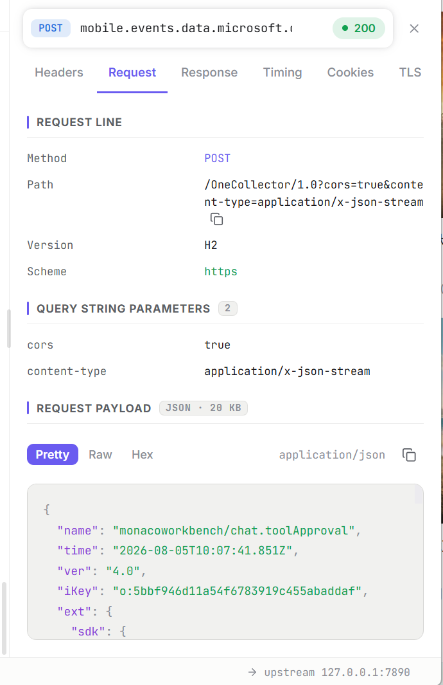</li></ul></td>
  <td><strong>✅ 完成</strong><ul><li><strong>Code:</strong> ✅ 完成</li><li><strong>Unit:</strong> ✅ Design interaction 2/2</li><li><strong>Integration:</strong> ➖ N/A</li><li><strong>E2E:</strong> ✅ 真实 Electron Red→Green 2/2，含销毁证据</li><li><strong>Design/Parity:</strong> ✅ 2/2 matched，0 missing，0 flagged，最大 0.7px</li></ul></td>
  <td><ul><li>Design fixture 已组件化，但产品 Capture 标题缺少 <code>aria-expanded</code>/<code>aria-controls</code>，Composer 响应详情仍是不可折叠静态标题。</li></ul></td>
  <td><ul><li>共享 <code>SectionHeader</code> 暴露 ARIA 关系，feature owner 传入语义 automation ID；正文保持挂载并用 <code>hidden</code> 切换，Composer <code>ResponseSection</code> 对齐 design-vite 样式。</li></ul></td>
</tr>

<tr>
  <td><strong>✅ 已完成</strong></td>
  <td>BodyViewer formatting</td>
  <td><ul><li>按正文语言提供自动与手动格式化，并保留失败回退。</li><li><strong>Steps:</strong><ul><li>设计完成</li><li>代码已完成</li><li>自动验证完成</li><li>已完成</li></ul></li><li>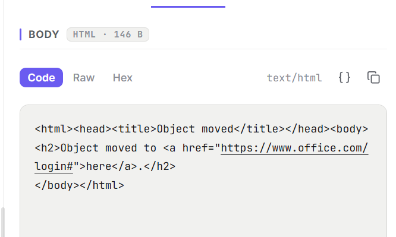</li></ul></td>
  <td><strong>✅ 完成</strong><ul><li><strong>Code:</strong> ✅ 完成</li><li><strong>Unit:</strong> ✅ BodyViewer/formatter 17/17；Store cache 9/9</li><li><strong>Integration:</strong> ➖ N/A</li><li><strong>E2E:</strong> ✅ 真实 Electron Red→Green 1/1，含销毁证据</li><li><strong>Design/Parity:</strong> ➖ N/A，未改变布局</li></ul></td>
  <td><ul><li>trimmed Monaco 只注册feature listener却缺HTML/CSS language definition，自动Format静默no-op；补editor action contribution又因缺少内部services产生page error；formatter异常继续向Renderer抛出，Copy也读取原始React文本而非当前model。</li></ul></td>
  <td><ul><li>HTML/CSS/JavaScript直接调用Monaco language worker，XML使用<code>xml-formatter</code>；edits在只读model外合并后一次替换，失败恢复原文，Copy读取当前model；Composer按request/current response缓存格式化视图且不改原始body。</li></ul></td>
</tr>

<tr>
  <td><strong>✅ 已完成</strong></td>
  <td>Composer Collection tree interactions</td>
  <td><ul><li>完成选择、重命名、三级目录、splitter 与节点菜单的统一交互。</li><li><strong>Steps:</strong><ul><li>设计完成</li><li>代码已完成</li><li>自动验证完成</li><li>已完成</li></ul></li><li>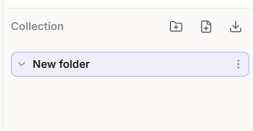 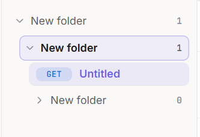</li></ul></td>
  <td><strong>✅ 完成</strong><ul><li><strong>Code:</strong> ✅ 完成</li><li><strong>Unit:</strong> ✅ Collection Store 8/8</li><li><strong>Integration:</strong> ➖ N/A</li><li><strong>E2E:</strong> ✅ 真实Electron Red→Green 1/1，含Core回载与销毁</li><li><strong>Design/Parity:</strong> ✅ 聚焦 parity 通过</li></ul></td>
  <td><ul><li>创建落点、选中项和已打开request曾混用同一状态；Collection同步hook又挂在会卸载的ComposerMain，快速切换workspace会取消600ms保存并被Core旧快照清空。</li></ul></td>
  <td><ul><li>拆分<code>targetFolderId</code>/<code>activeRequestId</code>，集中三级约束和菜单命令；将<code>useCollection</code>提升到常驻App shell。</li></ul></td>
</tr>

<tr>
  <td><strong>✅ 已完成</strong></td>
  <td>Rules hierarchy, menus and status</td>
  <td><ul><li>统一 Rules 层级、菜单、effect 导航、validation 与命中数布局。</li><li><strong>Steps:</strong><ul><li>设计完成</li><li>代码已完成</li><li>自动验证完成</li><li>已完成</li></ul></li><li>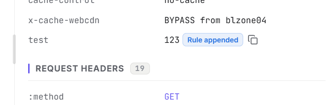  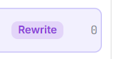</li></ul></td>
  <td><strong>✅ 完成</strong><ul><li><strong>Code:</strong> ✅ 完成</li><li><strong>Unit:</strong> ✅ Rules Store 19/19；Desktop 267/267</li><li><strong>Integration:</strong> ✅ Apply后Renderer reload从Core恢复revision/tree/rule</li><li><strong>E2E:</strong> ✅ 真实Electron Red→Green 1/1，含hit/navigation与销毁</li><li><strong>Design/Parity:</strong> ✅ 11/11 matched，0 missing，0 flagged，最大0.7px</li></ul></td>
  <td><ul><li>树组织状态与右侧打开项曾耦合，根/节点命令边界不清；validation虽标invalid，但Apply仍可把未填写RuleSet写入Core。</li></ul></td>
  <td><ul><li>拆分<code>selectedId</code>/<code>openRuleId</code>，节点菜单按owner分层，validation移入statusbar；共享<code>isRuleSetComplete</code>同时守住Apply按钮和命令入口。</li></ul></td>
</tr>

<tr>
  <td><strong>✅ 已完成</strong></td>
  <td>Rules root toolbar</td>
  <td><ul><li>恢复 New rule、New folder、Export 与冲突态 Reload，保留根右键菜单。</li><li><strong>Steps:</strong><ul><li>设计完成</li><li>代码已完成</li><li>自动验证完成</li><li>已完成</li></ul></li><li>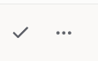</li></ul></td>
  <td><strong>✅ 完成</strong><ul><li><strong>Code:</strong> ✅ 完成</li><li><strong>Unit:</strong> ✅ Desktop 263/263</li><li><strong>Integration:</strong> ➖ N/A</li><li><strong>E2E:</strong> ✅ Red→Green 1/1</li><li><strong>Design/Parity:</strong> ✅ 11/11 matched</li></ul></td>
  <td><ul><li><code>f8f2f53</code> 将高频根命令全部移入右键菜单，导致可见入口消失。</li></ul></td>
  <td><ul><li>在 <code>RuleList</code> 恢复共享 <code>IconButton</code> 并复用既有 store/data 命令。</li></ul></td>
</tr>
<tr>
  <td><strong>✅ 已完成</strong></td>
  <td>Detail BodyViewer fill and nested scrolling</td>
  <td><ul><li>让正文 pane 占满 Inspector 剩余高度，并在内层滚动到边界后交接给外层。</li><li><strong>Steps:</strong><ul><li>设计完成</li><li>代码已完成</li><li>自动验证完成</li><li>已完成</li></ul></li></ul></td>
  <td><strong>✅ 完成</strong><ul><li><strong>Code:</strong> ✅ <code>Section grow</code>高度链与<code>alwaysConsumeMouseWheel: false</code></li><li><strong>Unit:</strong> ➖ 真实布局与wheel交接只由E2E验收</li><li><strong>Integration:</strong> ➖ N/A</li><li><strong>E2E:</strong> ✅ <code>039dd42</code> retrospective Red → current Green 1/1，含销毁与8888释放</li><li><strong>Design/Parity:</strong> ➖ Fake parity不作为该flow验收</li></ul></td>
  <td><ul><li>正文高度链已满足契约；实际缺陷是Monaco默认在滚动边界继续消费wheel，导致Inspector外层<code>scrollTop</code>不增长。</li></ul></td>
  <td><ul><li><code>BodySection</code>通过grow Section占满剩余高度；<code>CodeViewer</code>关闭边界wheel吞噬。真实Electron先将Monaco滚动条拖到底，再验证下一次wheel交给Inspector。</li></ul></td>
</tr>

<tr>
  <td><strong>✅ 已完成</strong></td>
  <td>Capture facet stable ordering</td>
  <td><ul><li>动态 facet 保持当前 Capture 中首次出现顺序，只实时更新计数。</li><li><strong>Steps:</strong><ul><li>设计完成</li><li>代码已完成</li><li>自动验证完成</li><li>已完成</li></ul></li></ul></td>
  <td><strong>✅ 完成</strong><ul><li><strong>Code:</strong> ✅ 完成</li><li><strong>Unit:</strong> ✅ Capture 21/21</li><li><strong>Integration:</strong> ➖ N/A</li><li><strong>E2E:</strong> ✅ <code>89d8dda</code> retrospective Red → current Green 1/1，含销毁与8888释放</li><li><strong>Design/Parity:</strong> ➖ N/A</li></ul></td>
  <td><ul><li><code>allFacetOptions</code> 按实时 count 重排普通 facet，计数反超会移动已有 option。</li></ul></td>
  <td><ul><li>保留 <code>Map</code> 首次插入顺序，只更新 count 文本。</li></ul></td>
</tr>

<tr>
  <td><strong>✅ 已完成</strong></td>
  <td>Bilibili login regression</td>
  <td><ul><li>确认开启Interceptor MITM后，真实Bilibili完整页面连续刷新仍保持登录。</li><li><strong>Steps:</strong><ul><li>设计完成</li><li>代码已完成</li><li>自动验证完成</li><li>已完成</li></ul></li></ul></td>
  <td><strong>✅ 完成</strong><ul><li><strong>Code:</strong> ✅ 仅新增Settings公开automation ID与真实workflow；转发业务代码无需修改</li><li><strong>Unit:</strong> ➖ 站点登录态由真实外部profile E2E验收</li><li><strong>Integration:</strong> ✅ 既有HTTPS MITM聚焦2/2</li><li><strong>E2E:</strong> ✅ 6次独立workflow / 18次完整刷新，含Capture、页头、销毁与副作用恢复证据</li><li><strong>Design/Parity:</strong> ➖ N/A，未改变UI</li></ul></td>
  <td><ul><li>当前实现未复现通用Cookie转发缺陷；主文档每轮均为H2 / 200并携带<code>DedeUserID</code>、<code>SESSDATA</code>与<code>bili_jct</code>。早期匿名观测发生在测试尚未等待Edge信任重载与页头稳定时，不能作为产品Red。</li></ul></td>
  <td><ul><li>保留真实Edge Default profile回归：所有产品状态经UI，原生刷新按钮连续三轮，语言无关UIA头像结构、MITM leaf与主文档身份Cookie共同判定；不注入Cookie、不改profile、不依赖私有登录API。</li></ul></td>
</tr>

<tr>
  <td><strong>✅ 已完成</strong></td>
  <td>Rules and Composer import/export</td>
  <td><ul><li>为两类树数据提供 JSON 文件导入导出与结果反馈；导入按纯新增处理。</li><li><strong>Steps:</strong><ul><li>设计完成</li><li>代码已完成</li><li>自动验证完成</li><li>已完成</li></ul></li></ul></td>
  <td><strong>✅ 完成</strong><ul><li><strong>Code:</strong> ✅ Rules / Composer 导入导出、逐项校验、部分导入、不可关闭 busy 遮罩与15种语言完成</li><li><strong>Unit:</strong> ✅ Core tree parser、Rules/Composer parser/store 与 JSON-only 边界 Red→Green；聚焦51/51</li><li><strong>Integration:</strong> ✅ 全workspace typecheck、Windows package、artifact audit、production audit与packaged smoke通过</li><li><strong>E2E:</strong> ✅ 两条真实Electron workflow均在884dcc4取得入口缺失Red，当前各1/1 Green；真实Save→Open、零seed、完整销毁</li><li><strong>Design/Parity:</strong> ✅ 12个明暗场景全部0 missing / 0 flagged，最大几何差0.5px</li></ul></td>
  <td><ul><li>导出链路已存在（<code>rules:export</code> / <code>collection:export</code>），导入从未实现；<code>features/rules.md</code> 曾误记根右键菜单已有 Import 入口。</li><li>冲突检测无可用唯一键：<code>id</code> 是本机生成的，跨机器永不碰撞；产品又允许同目录同名节点，<code>name</code> 也不唯一。</li></ul></td>
  <td><ul><li>导入按纯新增处理：节点与字段行<code>id</code>全部重新生成、<code>enabled</code>沿用文件值、<code>priority</code>重排到本地规则之后、保持文件内层级并追加到根末尾；合并交给既有树操作。</li><li>Main只通过原生Dialog读写JSON；Renderer拥有领域解析，文件级失败整体拒绝，节点级失败逐项跳过并报告路径与原因。</li><li>确认 Dialog 在写入前给出有效/启用/跳过计数；确认后复用整树<code>replace</code>原子持久化。Import/Export从点击到IO完成均有不可关闭遮罩，阻断鼠标与键盘穿透。</li></ul></td>
</tr>

<tr>
  <td><strong>✅ 已完成</strong></td>
  <td>Settings section persistence</td>
  <td><ul><li>普通返回 Settings 时保留最后 section，显式 TLS/Proxy 跳转仍覆盖目标。</li><li><strong>Steps:</strong><ul><li>设计完成</li><li>代码已完成</li><li>自动验证完成</li><li>已完成</li></ul></li></ul></td>
  <td><strong>✅ 完成</strong><ul><li><strong>Code:</strong> ✅ App shell 持有section，Settings rail暴露唯一<code>aria-current=page</code></li><li><strong>Unit:</strong> ➖ 当前页面语义与跨workspace生命周期由真实E2E验收</li><li><strong>Integration:</strong> ➖ N/A</li><li><strong>E2E:</strong> ✅ 公共语义缺失Red→当前1/1 Green，含四个workspace往返与完整销毁</li><li><strong>Design/Parity:</strong> ➖ 仅增加ARIA属性，无视觉变化</li></ul></td>
  <td><ul><li>Section 曾由页面局部状态持有，feature 卸载时丢失；提升到App shell后的剩余缺口是视觉active没有公共当前页面语义，也没有真实Electron验收。</li></ul></td>
  <td><ul><li>由App shell持有最后section，普通workspace切换不改值，显式TLS/Proxy入口先覆盖目标；Settings rail用<code>aria-current=page</code>表达唯一当前项，真实workflow覆盖八项导航与Capture/Rules/Composer/Diagnostics往返。</li></ul></td>
</tr>

<tr>
  <td><strong>✅ 已完成</strong></td>
  <td>AppContainer enabled-first ordering</td>
  <td><ul><li>Enabled/exempt 项稳定置顶，过滤不改变排序。</li><li><strong>Steps:</strong><ul><li>设计完成</li><li>代码已完成</li><li>自动验证完成</li><li>已完成</li></ul></li></ul></td>
  <td><strong>✅ 完成</strong><ul><li><strong>Code:</strong> ✅ native helper按SID去重；Renderer纯函数稳定分组后过滤；公共搜索/行状态探针完成</li><li><strong>Unit:</strong> ✅ Renderer 2/2、Main service 10/10</li><li><strong>Integration:</strong> ✅ 真实Windows helper Red于141/138→Green 138/138；package helper同样138/138</li><li><strong>E2E:</strong> ✅ 列表不可用Red→当前1/1 Green，覆盖1 enabled/137 disabled、搜索子序列、逐项恢复与完整销毁</li><li><strong>Design/Parity:</strong> ✅ 明暗各13/13 matched、0 missing；5个既有flagged，最大3.8px</li></ul></td>
  <td><ul><li>Renderer虽已有enabled-first代码但缺owning测试；真实Windows又会按用户返回重复AppContainer SID，Main正确拒绝重复快照，导致列表在进入排序前即完全不可用。</li></ul></td>
  <td><ul><li>native helper在枚举边界按SID保留一个稳定代表，Main继续保留重复拒绝；Renderer以<code>listVisibleAppContainers</code>稳定分组后再过滤，真实Electron只读验证排序、搜索与恢复，不触发UAC或修改exemption。</li></ul></td>
</tr>

<tr>
  <td><strong>✅ 已完成</strong></td>
  <td>AppContainer Enable/Disable all</td>
  <td><ul><li>一次确认批量启用或停用当前 AppContainer SID，双向操作都保留枚举外既有 exemption。</li><li><strong>Steps:</strong><ul><li>设计完成</li><li>代码已完成</li><li>自动验证完成</li><li>真实runas elevation验证完成（本机UAC策略自动批准）</li><li>已完成</li></ul></li></ul></td>
  <td><strong>✅ 完成</strong><ul><li><strong>Code:</strong> ✅ Enable/Disable各有Renderer→Preload→Main→native独立命令，helper执行SID并集/差集并读回</li><li><strong>Unit:</strong> ✅ Main service与i18n聚焦22/22；Desktop串行321/321</li><li><strong>Integration:</strong> ✅ Windows package、artifact audit、package helper与packaged smoke通过</li><li><strong>E2E:</strong> ✅ 真实Electron入口缺失Red→当前1/1 Green；OS集合1→138→0→1且最终hash精确恢复</li><li><strong>Design/Parity:</strong> ✅ 四个Dialog view均0 missing/0 flagged；主页面按钮不换行且几何在0.6px内</li></ul></td>
  <td><ul><li>只有Enable all会把批量操作变成不可逆能力；逐项启用又需要重复提权，且直接覆盖集合会破坏枚举外既有exemption。</li></ul></td>
  <td><ul><li>Renderer分别发送Enable all与Disable all语义命令；Main每次只启动一次helper。native层对当前SID做集合并集或差集并读回校验，两种操作都保留枚举外exemption；真实workflow先记录完整初始集合，再Enable/check、Disable/check，并通过正式单项UI恢复初始enabled SID后逐项复核。</li></ul></td>
</tr>
<tr>
  <td><strong>✅ 已完成</strong></td>
  <td>Capture filter option collapses group</td>
  <td><ul><li>选择 filter option 时保持分组展开，仅标题或 chevron 可折叠。</li><li><strong>Steps:</strong><ul><li>设计完成</li><li>代码已完成</li><li>自动验证完成</li><li>已完成</li></ul></li></ul></td>
  <td><strong>✅ 完成</strong><ul><li><strong>Code:</strong> ✅ 完成</li><li><strong>Unit:</strong> ✅ Capture Store 21/21</li><li><strong>Integration:</strong> ➖ N/A</li><li><strong>E2E:</strong> ✅ 真实 Electron 1/1，销毁通过</li><li><strong>Design/Parity:</strong> ✅ Interaction Red→Green 2/2；Capture 截图复跑 158/158 identical</li></ul></td>
  <td><ul><li><code>syncFixture</code> 在任意 design state 变化后重算 facet 展开态；option 点击更新 <code>hasFilter</code> 时会把用户手动展开的非 Application 分组重置。</li><li>真实 Renderer 的 Zustand 筛选值与 <code>expandedFacets</code> 已正交，不存在同一缺陷。</li></ul></td>
  <td><ul><li>把 design fixture 展开同步移入只依赖 owning scene 字段的 effect；普通 option 状态更新不再覆盖用户展开结果。</li><li>新增 design 交互 Red→Green、Capture Store 契约测试和真实 Electron workflow。</li></ul></td>
</tr>

<tr>
  <td><strong>✅ 已完成</strong></td>
  <td>Capture clear synchronizes facets</td>
  <td><ul><li>Clear 后列表、selection 与 facet snapshot 同一次推进到空状态。</li><li><strong>Steps:</strong><ul><li>设计完成</li><li>代码已完成</li><li>自动验证完成</li><li>已完成</li></ul></li><li>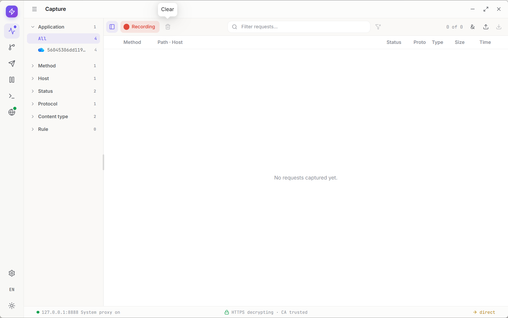</li></ul></td>
  <td><strong>✅ 完成</strong><ul><li><strong>Code:</strong> ✅ 完成</li><li><strong>Unit:</strong> ✅ owning hook/store 23/23</li><li><strong>Integration:</strong> ➖ N/A</li><li><strong>E2E:</strong> ✅ 89d8dda retrospective Red、当前1/1 Green与完整销毁证据</li><li><strong>Design/Parity:</strong> ➖ N/A，未改变UI</li></ul></td>
  <td><ul><li><code>useThrottledRows</code> 对空 rows 仍节流，filter 暂时渲染旧 snapshot。</li></ul></td>
  <td><ul><li>空 rows 作为同步边界立即清空 snapshot，只节流非空实时更新。</li></ul></td>
</tr>

<tr>
  <td><strong>✅ 已完成</strong></td>
  <td>Proxy and MITM persistence</td>
  <td><ul><li>跨进程恢复系统代理 ownership、MITM 意图与 TLS 配置。</li><li><strong>Steps:</strong><ul><li>设计完成</li><li>代码已完成</li><li>自动验证完成</li><li>已完成</li></ul></li></ul></td>
  <td><strong>✅ 完成</strong><ul><li><strong>Code:</strong> ✅ 完成</li><li><strong>Unit:</strong> ✅ 既有重启测试24/24；本轮聚焦回归41/41</li><li><strong>Integration:</strong> ✅ journal、workspace.sqlite与真实Core聚焦通过</li><li><strong>E2E:</strong> ✅ c978915 retrospective Red、当前1/1 Green、两代销毁与系统副作用恢复</li><li><strong>Design/Parity:</strong> ➖ N/A</li></ul></td>
  <td><ul><li>瞬时运行态曾代替用户意图与系统代理原始快照，重启后无法可靠恢复。</li></ul></td>
  <td><ul><li>持久化正交用户意图，以 ownership journal 保存 original/owned 快照。</li></ul></td>
</tr>

<tr>
  <td><strong>✅ 已完成</strong></td>
  <td>Breakpoint submenu lifecycle</td>
  <td><ul><li>Submenu 展开时保持一级菜单挂载，并统一 hover、翻转与 dismissal。</li><li><strong>Steps:</strong><ul><li>设计完成</li><li>代码已完成</li><li>自动验证完成</li><li>已完成</li></ul></li><li>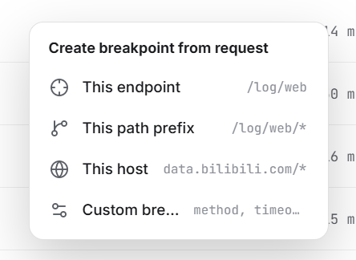</li></ul></td>
  <td><strong>✅ 完成</strong><ul><li><strong>Code:</strong> ✅ 既有Ant Menu树无需业务修改，仅补automation探针</li><li><strong>Unit:</strong> ➖ N/A，portal lifecycle由真实Electron验收</li><li><strong>Integration:</strong> ➖ N/A</li><li><strong>E2E:</strong> ✅ e5ca501 retrospective Red、当前1/1 Green与销毁证据</li><li><strong>Design/Parity:</strong> ✅ 8/8 matched</li></ul></td>
  <td><ul><li>旧<code>menuPage: root | breakpoint</code>用Breakpoint页替换根菜单，hover不能展开且父子无法共存。</li></ul></td>
  <td><ul><li>统一使用 Ant Menu <code>items[].children</code> 管理完整菜单树。</li></ul></td>
</tr>

<tr>
  <td><strong>✅ 已完成</strong></td>
  <td>Breakpoint timeout model（已移除）</td>
  <td><ul><li>删除HTTP与WebSocket断点的整个timeout状态维度，人工断点只由用户操作、客户端abort或Core/RPC生命周期关闭释放。</li><li><strong>Steps:</strong><ul><li>删除决策完成</li><li>协议与设计删除完成</li><li>Desktop/Core/MCP代码已完成</li><li>自动验证完成</li><li>已完成</li></ul></li></ul></td>
  <td><strong>✅ 完成</strong><ul><li><strong>Code:</strong> ✅ Protocol、Core timer、Rules/WS UI、导入专判、i18n、design场景与MCP schema/解析/payload均已删除，无兼容层</li><li><strong>Unit:</strong> ✅ Protocol 25/25、MCP 46/46、Rules import 11/11</li><li><strong>Integration:</strong> ✅ WebSocket保持pending直到用户操作</li><li><strong>E2E:</strong> ✅ lifecycle-release验证等待不自动释放且Close统一清理</li><li><strong>Design/Parity:</strong> ✅ 旧timeout场景删除，当前setup/Rules action场景0 missing / 0 flagged</li></ul></td>
  <td><ul><li>排队但尚未进入编辑状态的项会被deadline自行Continue/Drop，与人工逻辑队列语义冲突。</li></ul></td>
  <td><ul><li>删除整个timeout状态维度；pending只由用户命令、客户端abort或Core/RPC生命周期释放。</li></ul></td>
</tr>

<tr>
  <td><strong>✅ 已完成</strong></td>
  <td>Navigate to TLS passthrough item</td>
  <td><ul><li>从 Tunnel 信息跳转到对应 passthrough item，并短暂高亮。</li><li><strong>Steps:</strong><ul><li>设计完成</li><li>代码已完成</li><li>自动验证完成</li><li>已完成</li></ul></li><li>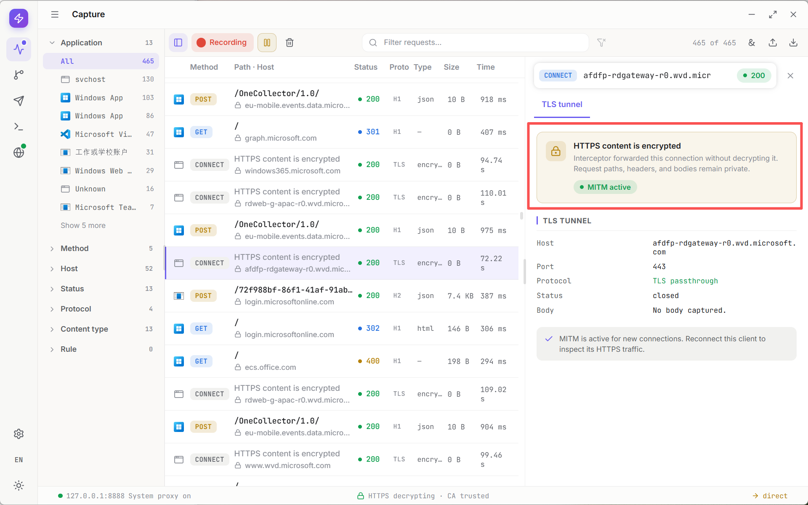</li></ul></td>
  <td><strong>✅ 完成</strong><ul><li><strong>Code:</strong> ✅ 完成</li><li><strong>Unit:</strong> ✅ Settings utility 17/17</li><li><strong>Integration:</strong> ➖ N/A</li><li><strong>E2E:</strong> ✅ 有效Red于公开导航入口缺失、当前1/1 Green与完整销毁证据</li><li><strong>Design/Parity:</strong> ✅ 新增4个明暗入口/目标view均0 missing / 0 flagged，最大0.1px</li></ul></td>
  <td><ul><li>Request 证据与 Settings 配置项之间没有可导航关联。</li></ul></td>
  <td><ul><li>App按当前host读取最新settings，exact优先并选择最长wildcard suffix；以瞬态pattern/sequence导航目标row、滚入视口并高亮3秒，重复导航重新计时。</li></ul></td>
</tr>

<tr>
  <td><strong>✅ 已完成</strong></td>
  <td>Breakpoint header edit Rule effect</td>
  <td><ul><li>将显式 header replace/add/remove 写入 Capture 并显示绑定 rule marker。</li><li><strong>Steps:</strong><ul><li>设计完成</li><li>代码已完成</li><li>自动验证完成</li><li>已完成</li></ul></li><li>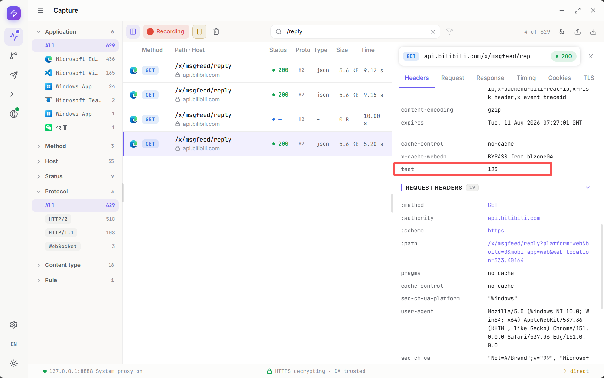</li></ul></td>
  <td><strong>✅ 完成</strong><ul><li><strong>Code:</strong> ✅ 完成</li><li><strong>Unit:</strong> ✅ RuleService/message-editing 28/28</li><li><strong>Integration:</strong> ✅ 真实 Proxy 验证通过</li><li><strong>E2E:</strong> ✅ 89d8dda retrospective Red、当前1/1 Green与完整销毁证据</li><li><strong>Design/Parity:</strong> ✅ Marker parity 通过</li></ul></td>
  <td><ul><li>Breakpoint resolve 直接 mutate state，没有向 <code>evaluation.headerEffects</code> 追加证据。</li></ul></td>
  <td><ul><li>按 <code>editedHeaderNames</code> 比较前后值，生成 <code>RuleHeaderEffect</code> 并入库。</li></ul></td>
</tr>

<tr>
  <td><strong>✅ 已完成</strong></td>
  <td>Body Rule effect evidence</td>
  <td><ul><li>为普通 Rule body action 与 Breakpoint replacement 建立独立正文证据和 marker。</li><li><strong>Steps:</strong><ul><li>协议设计完成</li><li>设计完成</li><li>代码已完成</li><li>自动验证完成</li><li>已完成</li></ul></li></ul></td>
  <td><strong>✅ 完成</strong><ul><li><strong>Code:</strong> ✅ 完成</li><li><strong>Unit:</strong> ✅ RuleService 27/27、Protocol 24/24</li><li><strong>Integration:</strong> ✅ Body三态2/2、Breakpoint File 2/2、Archive/HAR 9/9</li><li><strong>E2E:</strong> ✅ 有效Red于marker缺失、当前完整矩阵1/1 Green与完整销毁证据</li><li><strong>Design/Parity:</strong> ✅ 8个明暗Text/File view均0 missing / 0 flagged / 0px，interaction 13/13</li></ul></td>
  <td><ul><li>当前只有 rule hit，没有原始/最终、text/file、request/response 的 body effect 契约。</li></ul></td>
  <td><ul><li>公开协议记录最终writer与Original三态；Capture主ref恒为Final，Request保存Original，Response明确unavailable；Archive保真、HAR仅Final，Renderer提供marker与版本切换。</li></ul></td>
</tr>

<tr>
  <td><strong>✅ 已完成</strong></td>
  <td>Breakpoint final Rule state and marker</td>
  <td><ul><li>全部普通 actions 执行后再暂停，editor 显示最终 header 与最终写入者 marker。</li><li><strong>Steps:</strong><ul><li>设计完成</li><li>代码已完成</li><li>自动验证完成</li><li>已完成</li></ul></li></ul></td>
  <td><strong>✅ 完成</strong><ul><li><strong>Code:</strong> ✅ 完成</li><li><strong>Unit:</strong> ✅ RuleService/message-editing 28/28</li><li><strong>Integration:</strong> ✅ Proxy Core通过</li><li><strong>E2E:</strong> ✅ 89d8dda retrospective Red、当前1/1 Green与完整销毁证据</li><li><strong>Design/Parity:</strong> ✅ Interaction 3/3</li></ul></td>
  <td><ul><li>旧 priority loop 遇到 breakpoint 立即 await，且 pending headers 丢失 effect 来源。</li></ul></td>
  <td><ul><li>两阶段执行非-breakpoint action 与 suspension，并在协议中携带 <code>ruleEffect/ruleId</code>。</li></ul></td>
</tr>

<tr>
  <td><strong>✅ 已完成</strong></td>
  <td>Breakpoint context-menu hierarchy</td>
  <td><ul><li>让 Breakpoint 与 Block 同属 Control group，并对齐 icon、文字与 hint。</li><li><strong>Steps:</strong><ul><li>设计完成</li><li>代码已完成</li><li>自动验证完成</li><li>已完成</li></ul></li><li>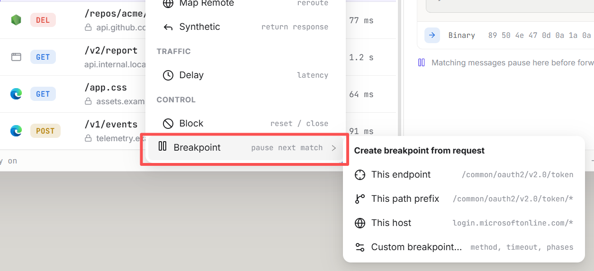</li></ul></td>
  <td><strong>✅ 完成</strong><ul><li><strong>Code:</strong> ✅ 完成</li><li><strong>Unit:</strong> ➖ N/A</li><li><strong>Integration:</strong> ➖ N/A</li><li><strong>E2E:</strong> ✅ 89d8dda几何Red、当前1/1 Green与完整销毁证据</li><li><strong>Design/Parity:</strong> ✅ 根4/4、二级8/8</li></ul></td>
  <td><ul><li>两种菜单项 DOM 层级不同，文本左缘相差 <code>7.4375px</code>。</li></ul></td>
  <td><ul><li>将 Breakpoint submenu 放回 Control group，以自有语义 label 组合内容。</li></ul></td>
</tr>

<tr>
  <td><strong>✅ 已完成</strong></td>
  <td>Breakpoint queue stepping and batch commands</td>
  <td><ul><li>让多个HTTP / WebSocket breakpoint以独立逻辑队列连续调试，同时保留Capture对普通请求的自由查看，提供语义明确的批量操作，并确保pending没有隐藏数量上限。</li><li><strong>Steps:</strong><ul><li>产品决策完成</li><li>设计完成</li><li>协议变更完成</li><li>Desktop/Core/MCP代码已完成</li><li>自动验证完成</li><li>已完成</li></ul></li></ul></td>
  <td><strong>✅ 完成</strong><ul><li><strong>Code:</strong> ✅ Protocol / Core / Main / Preload / Renderer / 15语言 / MCP完成；上限、autoContinued与queue-full状态删除</li><li><strong>Unit:</strong> ✅ Queue 25条无上限Red→Green、CoreApplication、Renderer queue/drafts/frame去重、Rules import</li><li><strong>Integration:</strong> ✅ HTTP身份、WebSocket sequence、Proxy/Capture/Archive及本item Core聚焦17项通过；全量仅余2项独立framing债务</li><li><strong>E2E:</strong> ✅ d854588 retrospective Red→当前4/4 Green；queue-stepping真实验证11条pending，含完整销毁证据</li><li><strong>Design/Parity:</strong> ✅ design interaction 14/14；head / Queued / menu / setup / Rules action明暗14 views均0 missing / 0 flagged，最大0.8px</li></ul></td>
  <td><ul><li>当前 Core 只有一个包含 HTTP 与 WebSocket pending 的注册表；Renderer 的 breakpoint selection 与 Capture exchange selection 又彼此独立。解除当前项后，Breakpoint Store 会把不可见 draft 回退到 pending 首项，但 Capture 仍选中旧 exchange，因此不会在 UI 中进入下一条。</li><li>当前只保存一个 draft；切去查看普通 Request 或其他 pending 项时，无法为每个 breakpoint 独立保留临时编辑。</li><li>现有 timeout 会让仍在排队、尚未进入编辑状态的项自行继续或丢弃，与人工断点队列语义冲突。</li></ul></td>
  <td><ul><li><strong>逻辑队列：</strong>Core使用一个pending registry，每项带<code>queueKey</code>。HTTP Request / Response / WebSocket Upgrade进入<code>http</code>逻辑队列；每条WebSocket连接使用独立<code>ws:&lt;exchangeId&gt;</code>队列，同一连接的双向message / ping / pong / close保持registry插入顺序。HTTP不阻塞WebSocket，不同WebSocket连接也互不阻塞；每个逻辑队列内部允许队首阻塞后续项。</li><li><strong>Capture与Detail：</strong>所有pending仍是普通Capture Request / WebSocket连接行，也可被现有filter隐藏；filter只影响行可见性，不改变队列。Capture selection保持独立，用户可查看任意普通Request。只有选中项是其逻辑队列当前队首时才显示可编辑Breakpoint Detail；非队首pending按普通Detail展示，并标记为<code>Queued</code>。</li><li><strong>队首推进：</strong>Continue / Forward edited / Drop后根据Core最新pending snapshot重新计算队首。用户仍停留在刚处理的队首exchange时才自动选择同队列新队首；已切去普通Request或其他队列时不得抢焦点。</li><li><strong>客户端断开：</strong>abort只移除对应pending breakpoint和临时draft；Capture行保留并进入普通终态。例如<code>A → B → C</code>中B断开后队列变为<code>A → C</code>，处理A后按最新snapshot进入C。</li><li><strong>删除timeout：</strong>移除HTTP与WebSocket breakpoint的finite / infinite timeout能力，包括协议字段、Core timer / <code>onTimeout</code>、Rules与WebSocket UI、导入专判、i18n、design场景和MCP schema/解析/payload，不保留兼容路径。pending只由用户Continue / Forward edited / Drop、客户端abort或Core / RPC生命周期关闭释放；生命周期关闭统一结算为aborted。</li><li><strong>草稿生命周期：</strong>草稿按<code>breakpointId</code>独立保存。切换Capture selection时保留；重新选中同一pending时恢复。只有Forward edited应用草稿；Continue unmodified忽略草稿。Continue、Forward edited、Drop、abort、pending消失或Core换代后删除对应临时内容，不写入Capture数据或持久化配置。</li><li><strong>非队首resolve：</strong>Core不强制FIFO，也不拒绝非队首ID。按ID Continue / Drop非队首项只移出目标，不改变当前队首；非队首没有编辑器时不产生edited payload。</li><li><strong>批量命令：</strong><code>Continue all</code>与<code>Drop all</code>作用于当前逻辑队列；<code>Continue all from this rule</code>按当前<code>ruleId</code>筛选全部pending。三种用户意图使用独立Protocol / Core / Main / Preload / Renderer命令，固定调用开始ID快照并在完成后按最新snapshot推进。</li><li><strong>计数与生命周期：</strong>全局pending badge汇总所有逻辑队列；registry没有隐藏数量上限或自动放行。每次命中都保持pending，客户端abort和Core shutdown仍执行精确清理。</li></ul></td>
</tr>

<tr>
  <td><strong>✅ 已完成</strong></td>
  <td>Rules action tag overflow</td>
  <td><ul><li>Rule row 最多显示两个 action tags，超出时显示可聚焦的省略入口，Tooltip 按原顺序展示完整 tags。</li><li><strong>Steps:</strong><ul><li>设计完成</li><li>代码已完成</li><li>自动验证完成</li><li>已完成</li></ul></li></ul></td>
  <td><strong>✅ 完成</strong><ul><li><strong>Code:</strong> ✅ 行内前两个tag、Ellipsis与完整有序Tooltip完成，selection/open/enabled/drag语义保持独立；tags保持约16–17px自然高度并与22px入口居中</li><li><strong>Unit:</strong> ✅ <code>deriveRuleRowChips</code> 2/2 Red→Green；Desktop 315/315</li><li><strong>Integration:</strong> ➖ N/A</li><li><strong>E2E:</strong> ✅ 入口缺失Red→Green；高度在<code>1be6920</code> retrospective Red为22px=22px，当前tag 16.2917px、按钮22px、中心差0px</li><li><strong>Design/Parity:</strong> ✅ design interaction 15/15；明暗18/18 targets、0 missing、0 flagged、最大0.3px</li></ul></td>
  <td><ul><li>Rule row 内联渲染全部 action tags，没有数量上限，会挤压 hit count 和可用宽度。</li></ul></td>
  <td><ul><li><code>deriveRuleRowChips</code>从同一完整有序列表派生前两个行内项；<code>RuleActionTags</code>使用独立sibling button与Ant Tooltip，避免按钮嵌套和selection串扰。</li><li>tags容器显式<code>align-items:center</code>，防止flex默认stretch把tag拉到22px；设计交互与真实Electron分别锁定正常高度和border-box中心。</li><li>design-vite与fake Renderer使用同一四action深层rule，明暗parity覆盖row、两个行内tag、22px入口、Tooltip与四个完整tag。</li></ul></td>
</tr>

<tr>
  <td><strong>🔄 进行中</strong></td>
  <td>Agent / MCP shared Tool capabilities</td>
  <td><ul>
    <li>用一份共享registry向内置Agent与外部MCP开放完整73项产品Tool目录，并由用户控制每项能力与change执行方式；当前代码42/73、完整自动验收38/73，TLS四项待最终清理E2E，另31项待实现。</li>
    <li><strong>Steps:</strong><ul>
      <li>架构与73项目标目录设计完成</li>
      <li>首批24项Tool按feature命名完成</li>
      <li>Settings授权开关与问询交互设计完成</li>
      <li>首批共享registry与MCP adapter 24/24完成</li>
      <li>Tool开关持久化完成</li>
      <li>首批Agent代码与已验收真实调用24/24完成</li>
      <li>首批owning executor正向unit 24/24完成</li>
      <li>Capture 10/17已完成，7项待实现</li>
      <li>Rules 5/5自动验证完成：Export/Import通过真实Agent/MCP，UI与Tool复用导入确认及原子追加</li>
      <li>Composer 6/6自动验证完成：Collection查询/替换及Export/Import均已通过真实Agent/MCP，原生选择与共享确认、自动保存协调和字段保真已验收</li>
      <li>Breakpoints 8/11已完成，3项待实现</li>
      <li>Diagnostics 1/4已完成，3项待实现</li>
      <li>Settings代码12/26、自动验收8/26：只读6项与系统代理2项已完成；TLS四项代码已完成，清理等待/profile保护已修，最终E2E blocked by 管理员移除残留测试CA</li>
      <li>Updates业务Tool 0/4</li>
      <li>用户要求继续并提交当前代码，以未闭环状态保存TLS进度；不依赖权限的独立任务持续执行</li>
      <li>Playground当前recipe 42/42完成，Developer人工结论0/42；新增Tool随交付扩充recipe</li>
      <li>Capture Lab integration 39/39完成，真实Electron 2/39</li>
      <li>Developer人工验收独立待办，不作为开发前置条件</li>
      <li>人工矩阵后待按六组收敛Capture真实Electron 39/39</li>
    </ul></li>
  </ul></td>
  <td><strong>🔄 部分完成</strong><ul>
    <li><strong>Code:</strong> 🔄 全量42/73；Collection导出/导入共用typed Main及App全局确认，结果只含公开计数；导入等待自动保存并重建全部node/字段row ID。Collection查询/替换共用Core保存态与Main正式写入，凭据脱敏/同身份保留，修复旧快照确认、首次载入时序和Monaco隐式Model重复销毁；首批registry/授权/Agent/MCP/Playground、Settings只读6项/系统代理2项/TLS4项、Rules原生导出及共享导入流程保持；另31项待实现。</li>
    <li><strong>Unit:</strong> 🔄 owner正向覆盖42/73；本轮transfer executor10/10、Main16/16、Renderer14/14、保存协调4/4、摘要28/28。Tools189/192、Desktop574/576、MCP31/32、Playground66/67旧目录断言修复后对应51/51、27/27、20/20、1/1通过。此前Desktop538/538、Tools174/174后Collection扩充20/20、MCP32/32、Runtime122/122、Protocol25/25，同步9/9、就绪2/2、编辑器生命周期1/1、摘要24/24，以及Tools162/162、Desktop516/516、Import10/10、Main15/15、Renderer13/13、摘要23/23、Dialog5/5、Export10/10、Main导出6/6、TLS32/32、profile9/9、Desktop492/494修复27/27、MCP31/32修复20/20、Desktop485/485、Proxy Composer1/1、Rules95/95、Mockttp2/2证据保持。</li>
    <li><strong>Integration:</strong> 🔄 Core TLS名单/revision12/12、Main查询/MCP撤权、系统代理49/49、H1/H2/TLS取消/连接释放8/8、H2 6/6、Browser5/5、Traffic Lab39/39均保持；本轮Core329/331仍仅两项既有chunked framing失败。</li>
    <li><strong>E2E:</strong> 🔄 完整自动验收38/73；Collection导出/导入真实discovery Red→Agent/MCP Green，原生Cancel/预览确认、三次追加、全部身份新生成、JSON/Form/Query/Auth/Header/URL凭据保真、Ask/Auto、两列撤权和重启零重放通过；八条关联8/8、14代正常销毁、完整WinINet/journal/8888恢复。Collection查询/替换的真实discovery Red→Green、凭据往返、Ask/Auto、stale拒绝、挂载UI同步、双列撤权/重启零重放与七条关联7/7、12代正常销毁保持。Rules Import/Export联合2/2、四代销毁，首轮五条/九代通过与Export焦点失败/guard紧急恢复原始证据均保留；Cancel回归后复跑Green，不将紧急恢复算graceful。此前Export、旧Import/权限/MCP4/4、Rules Agent1/1、系统代理/只读/权限3/3、MCP2/2、Composer/Breakpoints/Diagnostics与首批证据保持；TLS最终CA清理blocked，Capture Playground2/39。当前package/audit/smoke通过，不替代TLS E2E。</li>
    <li><strong>Design/Parity:</strong> 🔄 Collection传输18视图92/92、0 missing/flagged、最大0.5px，design interaction76/76；完整parity268 views / 1,848 targets / 1,814 matched / 34 missing / 305 flagged、平均2.27%，波动为旧TLS passthrough明暗各2项missing和旧DeepSeek深色Dialog1项flagged。468张出图归档，提交12张新图/两张discovery数量更新，454张旧基准按SHA256保持不变。查询/替换阶段六视图40/40、最大0.5px、design interaction74/74，以及完整256 views / 1,776 targets / 1,746 matched / 30 missing / 304 flagged、2.24%、456图归档/10图提交/446旧基准不变保持。Import56/56及行高1.23修复、73/73设计交互保持；上一完整250 views / 1,736 targets / 1,704 matched / 32 missing / 303 flagged、2.24%，450图归档/12图提交/438旧基准不变；Export36/36、TLS96/96、系统代理48/48、只读44/44、Diagnostics18/18和更早244/238视图报告保持，既有视觉债务不升级为通过。</li>
  </ul></td>
  <td><ul><li>此前将Traffic Lab 39项integration与真实Electron两项代表性纵向覆盖合并表述，掩盖了Capture仍为2/39。</li><li>首批24/24不等于完整73项完成，Settings里的授权开关不等于26项Settings业务Tool已开放。</li><li>Diagnostics原先未接入Agent且摘要退回原始JSON；当前已复用共享executor和结果组件闭环。</li><li>Tool旧名称没有feature所有权，Settings还把Composer与Diagnostics合并展示；当前已一次性切换五feature协议且不保留alias。</li><li>Composer已补审批前完整参数校验、响应脱敏、H1/H2/TLS真实socket取消、Capture隔离和双代零重放。</li><li>真实VS Code仍因旧协议在Tool发现前失败，产品决定不增加legacy。</li></ul></td>
  <td><ul>
    <li>完整目录、逐项测试与调用状态只在<a href="../features/tool-capabilities.md">Tool capabilities</a>维护；Agent与MCP共用<code>packages/interceptor-tools/</code>。</li>
    <li>open-world网络Tool必须先经Ask/Auto，再沿Core RPC AbortSignal关闭真实socket；结果统一经过共享redactor。</li>
    <li>TLS四项清理及权限依赖组保持blocked；继续Breakpoints3项、Diagnostics3项、Capture7项、Updates4项；Settings待实现14项按原计划保留，冷启动自动接管与完整TDD门禁不变。Breakpoints下一组契约与23项unit Red已准备，尚待真实E2E Red和实现，不纳入集合传输提交。</li>
    <li>唯一管理员操作为移除测试CA <code>8F5FD8BF6D49BE746862522F6AC616583ED152BB</code>，恢复命令与证据见Handover；不能删除其他旧CA。</li>
    <li><code>npm run playground</code>用于独立人工矩阵；新增Tool同步recipe，不能替Developer填写结论。Capture按六组收敛39/39是后续独立工作。</li>
    <li>VS Code canary等待Host升级；每个后续work item独立commit并立即push。</li>
  </ul></td>
</tr>

<tr>
  <td><strong>⏳ 未开始</strong></td>
  <td>Desktop application attribution</td>
  <td><ul><li>修复 Douyu 等桌面应用的 request 被错误归类到 Edge。</li><li><strong>Steps:</strong><ul><li>等待用户确认问题截图与可复现操作</li><li>待设计</li><li>代码待完成</li><li>待自动验证</li></ul></li><li></li></ul></td>
  <td><strong>❌ 未开始</strong><ul><li><strong>Code:</strong> ❌ 未开发</li><li><strong>Unit:</strong> ❌ 未开始</li><li><strong>Integration:</strong> ❌ 未开始</li><li><strong>E2E:</strong> ❌ 未开始</li><li><strong>Design/Parity:</strong> ➖ N/A</li></ul></td>
  <td><ul><li>未知；没有截图对应请求的进程与 socket 证据时不能猜测。</li></ul></td>
  <td><ul><li>用户确认截图与复现操作后，记录 request socket、PID、可执行路径与 client identity 匹配链，再定位 owner。</li></ul></td>
</tr>

<tr>
  <td><strong>⏳ 未开始</strong></td>
  <td>Duplicate application identities</td>
  <td><ul><li>消除 Capture filter 中看似相同的重复 Application。</li><li><strong>Steps:</strong><ul><li>待设计</li><li>代码待完成</li><li>待自动验证</li></ul></li><li></li></ul></td>
  <td><strong>❌ 未开始</strong><ul><li><strong>Code:</strong> ❌ 未开发</li><li><strong>Unit:</strong> ❌ 未开始</li><li><strong>Integration:</strong> ❌ 未开始</li><li><strong>E2E:</strong> ❌ 未开始</li><li><strong>Design/Parity:</strong> ➖ N/A</li></ul></td>
  <td><ul><li>未知；可能是 identity key 重复、显示名碰撞或 facet snapshot 重复。</li></ul></td>
  <td><ul><li>用带真实 id/path 的 fixture 复现并定义去重契约，不按显示名盲目合并。</li></ul></td>
</tr>

</tbody>
</table>

