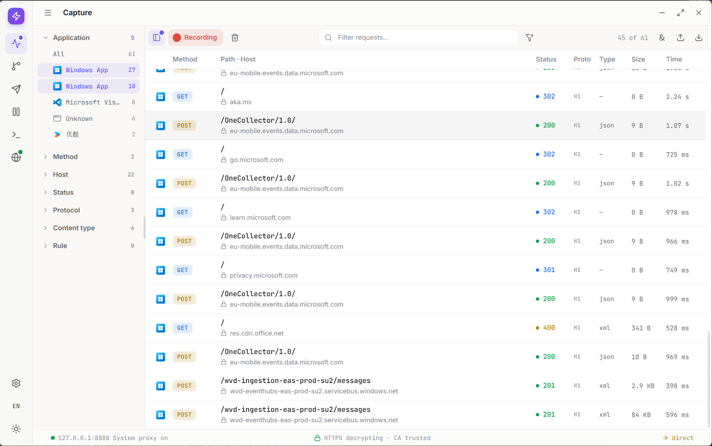

# TODO List

> 状态只允许三种：✅ 已完成；🔄 进行中；⏳ 未开始。详细阶段统一写在 Description 的 Steps 中。
>
> TDD 固定记录总体状态及 Code / Unit / Integration / E2E / Design/Parity；➖ 表示当前 work item 不适用。Parity、fake Preload 或普通 Renderer 测试不能替代真实 Electron E2E。
>
> 阶段词汇以 AGENTS.md 的基础集合为准，并可按真实 flow 增加具体、可验证的新阶段。已落地的 Breakpoint 交互重构见 <a href="../features/breakpoints.md">breakpoints feature</a>。

<table style="width: 1800px; min-width: 1800px;">
<colgroup>
  <col style="width: 150px;">
  <col style="width: 230px;">
  <col style="width: 400px;">
  <col style="width: 420px;">
  <col style="width: 280px;">
  <col style="width: 320px;">
</colgroup>
<thead>
<tr><th>Status</th><th>Name</th><th>Description</th><th>TDD</th><th>Root cause</th><th>Solution</th></tr>
</thead>
<tbody>

<tr>
  <td><strong>🔄 进行中</strong></td>
  <td>Agent / MCP shared Tool capabilities</td>
  <td><ul>
    <li>用一份共享registry向内置Agent与外部MCP开放69项产品Tool目录，并由用户控制每项能力与change执行方式；当前代码58/69、完整自动验收54/69，TLS四项待最终清理E2E，另11项待实现。Updates仅保留产品功能，不提供Tool；下方既有阶段证据中的73项为历史口径。</li>
    <li><strong>Steps:</strong><ul>
      <li>架构与69项目标目录设计完成</li>
      <li>首批24项Tool按feature命名完成</li>
      <li>Settings授权开关与问询交互设计完成</li>
      <li>首批共享registry与MCP adapter 24/24完成</li>
      <li>Tool开关持久化完成</li>
      <li>首批Agent代码与已验收真实调用24/24完成</li>
      <li>首批owning executor正向unit 24/24完成</li>
      <li>Capture 17/17自动验收完成，包含文件任务、Body、HAR与Archive导入/导出</li>
      <li>Rules 5/5自动验证完成：Export/Import通过真实Agent/MCP，UI与Tool复用导入确认及原子追加</li>
      <li>Composer 6/6自动验证完成：Collection查询/替换及Export/Import均已通过真实Agent/MCP，原生选择与共享确认、自动保存协调和字段保真已验收</li>
      <li>Breakpoints 11/11自动验证完成：三条批量Tool复用正式Core命令，Rule/queue隔离、原始数据面、Ask/Auto与空目标已验收</li>
      <li>Diagnostics 4/4自动验证完成：Current Trace/Recent静默查询和原生JSONL导出通过真实Agent/MCP，异步任务状态与脱敏边界已验收</li>
      <li>Settings代码15/26、自动验收11/26：只读6项、系统代理2项与偏好3项已完成；TLS四项代码已完成，清理等待/profile保护已修，最终E2E blocked by 管理员移除残留测试CA</li>
      <li>用户要求继续并提交当前代码，以未闭环状态保存TLS进度；不依赖权限的独立任务持续执行</li>
      <li>Playground当前recipe 58/58完成，Developer人工结论0/58；新增Tool随交付扩充recipe</li>
      <li>Capture Lab integration 39/39完成，真实Electron 2/39</li>
      <li>Developer人工验收独立待办，不作为开发前置条件</li>
      <li>人工矩阵后待按六组收敛Capture真实Electron 39/39</li>
    </ul></li>
  </ul></td>
  <td><strong>🔄 部分完成</strong><ul>
    <li>当前总体进度：Code与owner正向覆盖58/69，完整自动验收54/69；Capture文件能力和Settings偏好三项证据见<a href="../features/transfer.md">Transfer</a>及<a href="../features/settings.md#ui-preferences-acceptance">Settings</a>。以下保留此前阶段的测试矩阵与原始结果，不表示当前仍有Updates待实现项。</li>
    <li><strong>Code:</strong> 🔄 全量48/73；Diagnostics两项当前Core快照与原生JSONL导出复用正式owner，查询计数和状态优先的安全job摘要、15语言完成。三条Breakpoints批量命令、严格目标与取消、有限审批和本地化数量摘要完成，不新增queue或采用未提交草稿。Collection导出/导入共用typed Main及App全局确认，结果只含公开计数；导入等待自动保存并重建全部node/字段row ID。Collection查询/替换共用Core保存态与Main正式写入，凭据脱敏/同身份保留，修复旧快照确认、首次载入时序和Monaco隐式Model重复销毁；首批registry/授权/Agent/MCP/Playground、Settings只读6项/系统代理2项/TLS4项、Rules原生导出及共享导入流程保持；另25项待实现。</li>
    <li><strong>Unit:</strong> 🔄 owner正向覆盖48/73；Diagnostics executor28/28、Main6/6、摘要35/35，全workspace类型、Desktop592/592、Tools243/243、MCP32/32、Runtime122/122、Protocol25/25、Playground67/67通过。此前批量executor23/23、原Core queue17/17、摘要28/28，Desktop579/579、Tools215/215保持；上一组transfer executor10/10、Main16/16、Renderer14/14、保存协调4/4、摘要28/28，Tools189/192、Desktop574/576、MCP31/32、Playground66/67旧目录修复后对应51/51、27/27、20/20、1/1通过。此前Desktop538/538、Tools174/174后Collection扩充20/20、MCP32/32、Runtime122/122、Protocol25/25，同步9/9、就绪2/2、编辑器生命周期1/1、摘要24/24，以及Tools162/162、Desktop516/516、Import10/10、Main15/15、Renderer13/13、摘要23/23、Dialog5/5、Export10/10、Main导出6/6、TLS32/32、profile9/9、Desktop492/494修复27/27、MCP31/32修复20/20、Desktop485/485、Proxy Composer1/1、Rules95/95、Mockttp2/2证据保持。</li>
    <li><strong>Integration:</strong> 🔄 Core TLS名单/revision12/12、Main查询/MCP撤权、系统代理49/49、H1/H2/TLS取消/连接释放8/8、H2 6/6、Browser5/5、Traffic Lab39/39均保持；本轮Core329/331仍仅两项既有chunked framing失败。</li>
    <li><strong>E2E:</strong> 🔄 完整自动验收44/73；Diagnostics真实discovery/摘要Red→Green，五条流程十代正常销毁，Current查询静默与顺序、四个原子JSONL、Ask/Auto/Deny/Cancel、脱敏、撤权及重启零重放通过；首轮原生焦点失败独立留证，不算产品Red。批量Tool真实discovery及摘要Red→Green，六条关联/11代正常销毁，Rule/queue隔离、原始内容、草稿忽略、Ask/Auto、空目标、两列撤权和重启零重放通过。旧Agent首轮整组撤权集中于单Turn失败且触发敏感可见审计，分轮后同流程Green；原证据保留，未提升产品循环上限。Collection导出/导入真实discovery Red→Agent/MCP Green，原生Cancel/预览确认、三次追加、全部身份新生成、JSON/Form/Query/Auth/Header/URL凭据保真、Ask/Auto、两列撤权和重启零重放通过；八条关联8/8、14代正常销毁、完整WinINet/journal/8888恢复。Collection查询/替换的真实discovery Red→Green、凭据往返、Ask/Auto、stale拒绝、挂载UI同步、双列撤权/重启零重放与七条关联7/7、12代正常销毁保持。Rules Import/Export联合2/2、四代销毁，首轮五条/九代通过与Export焦点失败/guard紧急恢复原始证据均保留；Cancel回归后复跑Green，不将紧急恢复算graceful。此前Export、旧Import/权限/MCP4/4、Rules Agent1/1、系统代理/只读/权限3/3、MCP2/2、Composer/Breakpoints/Diagnostics与首批证据保持；TLS最终CA清理blocked，Capture Playground2/39。最终标准package/audit/smoke通过，不替代TLS E2E。</li>
    <li><strong>Design/Parity:</strong> 🔄 Diagnostics八视图62/62、0 missing/flagged、最大0.5px，design interaction82/82；完整286 views / 1,964 targets / 1,934 matched / 30 missing / 304 flagged、平均2.30%。状态优先摘要顺序另Red→Green，486图归档、提交六张新图/两张查询更新，478旧基准SHA256不变。此前批量12视图72/72、最大0.5px，design interaction81/81、discovery旧8项另Red→11项Green，完整280 views / 1,920 targets / 1,888 matched / 32 missing / 335 flagged、2.28%，其他Capture/TLS、文件弹窗与Settings几何波动未修复；480图归档、提交14图、466旧基准不变。Collection传输18视图92/92、0 missing/flagged、最大0.5px，design interaction76/76；完整parity268 views / 1,848 targets / 1,814 matched / 34 missing / 305 flagged、平均2.27%，波动为旧TLS passthrough明暗各2项missing和旧DeepSeek深色Dialog1项flagged。468张出图归档，提交12张新图/两张discovery数量更新，454张旧基准按SHA256保持不变。查询/替换阶段六视图40/40、最大0.5px、design interaction74/74，以及完整256 views / 1,776 targets / 1,746 matched / 30 missing / 304 flagged、2.24%、456图归档/10图提交/446旧基准不变保持。Import56/56及行高1.23修复、73/73设计交互保持；上一完整250 views / 1,736 targets / 1,704 matched / 32 missing / 303 flagged、2.24%，450图归档/12图提交/438旧基准不变；Export36/36、TLS96/96、系统代理48/48、只读44/44、Diagnostics18/18和更早244/238视图报告保持，既有视觉债务不升级为通过。</li>
  </ul></td>
  <td><ul><li>此前将Traffic Lab 39项integration与真实Electron两项代表性纵向覆盖合并表述，掩盖了Capture仍为2/39。</li><li>首批24/24不等于完整73项完成，Settings里的授权开关不等于26项Settings业务Tool已开放。</li><li>Diagnostics原先未接入Agent且摘要退回原始JSON；当前已复用共享executor和结果组件闭环。</li><li>Tool旧名称没有feature所有权，Settings还把Composer与Diagnostics合并展示；当前已一次性切换五feature协议且不保留alias。</li><li>Composer已补审批前完整参数校验、响应脱敏、H1/H2/TLS真实socket取消、Capture隔离和双代零重放。</li><li>真实VS Code仍因旧协议在Tool发现前失败，产品决定不增加legacy。</li></ul></td>
  <td><ul>
    <li>完整目录、逐项测试与调用状态只在<a href="../features/tool-capabilities.md">Tool capabilities</a>维护；Agent与MCP共用<code>packages/interceptor-tools/</code>。</li>
    <li>open-world网络Tool必须先经Ask/Auto，再沿Core RPC AbortSignal关闭真实socket；结果统一经过共享redactor。</li>
    <li>TLS四项清理及权限依赖组保持blocked；当前仅余Settings证书7项与AppContainer4项待实现，冷启动自动接管与完整TDD门禁不变。</li>
    <li>历史记录：Diagnostics提交时，Capture任务查询/取消17项unit Red、进度组件4项Red与未执行的workflow仅单独准备，未纳入该提交；后续Capture完整验收见Transfer文档。</li>
    <li>唯一管理员操作为移除测试CA <code>8F5FD8BF6D49BE746862522F6AC616583ED152BB</code>，恢复命令与证据见Handover；不能删除其他旧CA。</li>
    <li><code>npm run playground</code>用于独立人工矩阵；新增Tool同步recipe，不能替Developer填写结论。Capture按六组收敛39/39是后续独立工作。</li>
    <li>VS Code canary等待Host升级；每个后续work item独立commit并立即push。</li>
  </ul></td>
</tr>

<tr>
  <td><strong>⏳ 未开始</strong></td>
  <td>Desktop application attribution</td>
  <td><ul><li>修复 Douyu 等桌面应用的 request 被错误归类到 Edge。</li><li><strong>Steps:</strong><ul><li>等待用户确认问题截图与可复现操作</li><li>待设计</li><li>代码待完成</li><li>待自动验证</li></ul></li><li></li></ul></td>
  <td><strong>❌ 未开始</strong><ul><li><strong>Code:</strong> ❌ 未开发</li><li><strong>Unit:</strong> ❌ 未开始</li><li><strong>Integration:</strong> ❌ 未开始</li><li><strong>E2E:</strong> ❌ 未开始</li><li><strong>Design/Parity:</strong> ➖ N/A</li></ul></td>
  <td><ul><li>未知；没有截图对应请求的进程与 socket 证据时不能猜测。</li></ul></td>
  <td><ul><li>用户确认截图与复现操作后，记录 request socket、PID、可执行路径与 client identity 匹配链，再定位 owner。</li></ul></td>
</tr>

<tr>
  <td><strong>⏳ 未开始</strong></td>
  <td>Duplicate application identities</td>
  <td><ul><li>消除 Capture filter 中看似相同的重复 Application。</li><li><strong>Steps:</strong><ul><li>待设计</li><li>代码待完成</li><li>待自动验证</li></ul></li><li></li></ul></td>
  <td><strong>❌ 未开始</strong><ul><li><strong>Code:</strong> ❌ 未开发</li><li><strong>Unit:</strong> ❌ 未开始</li><li><strong>Integration:</strong> ❌ 未开始</li><li><strong>E2E:</strong> ❌ 未开始</li><li><strong>Design/Parity:</strong> ➖ N/A</li></ul></td>
  <td><ul><li>未知；可能是 identity key 重复、显示名碰撞或 facet snapshot 重复。</li></ul></td>
  <td><ul><li>用带真实 id/path 的 fixture 复现并定义去重契约，不按显示名盲目合并。</li></ul></td>
</tr>

</tbody>
</table>

