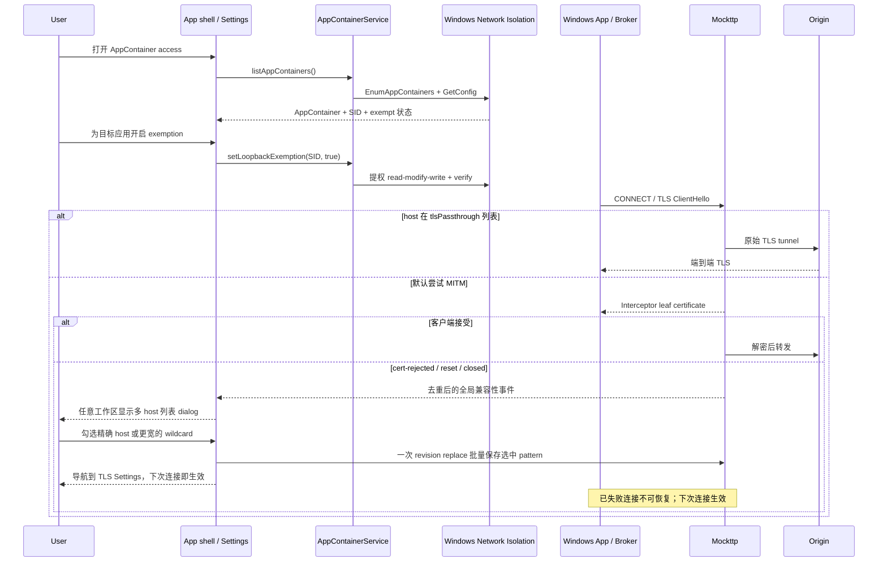

# 技术研究与长期候选

本文记录技术取舍和候选方案，不承诺实施，也不作为产品能力清单。功能契约见[架构索引](../README.md)，风险见[TODO](TODO.md)，执行安排只在[Handover](../HANDOVER.md)维护。

## 1. 能力边界

| 领域 | 技术边界 |
| --- | --- |
| HTTP/2观测 | streamId、GOAWAY、RST、SETTINGS与背压需要真实协议事件；HTTP摘要不能替代帧级事实 |
| WebSocket | Bridge使用RFC 6455的HTTP/1.1 Upgrade，不支持RFC 8441 Extended CONNECT |
| gRPC | 在途raw message读取不等于Protobuf descriptor、Server Reflection或message-level解码 |
| HTTP版本转换 | 下游H1与源站`allowHTTP1:false`的纯H2组合需单独定义；“支持HTTP/2”不代表所有双向转换组合 |
| 上游TLS元数据 | 按需`tls.probe`建立的是新连接，不能冒充某条历史Exchange实际使用的TLS metadata |
| 上游代理凭据 | URL可携带HTTP Basic凭据，但WinINet快照不提供用户凭据；系统设置恢复与凭据管理是不同职责 |
| 发布身份 | Authenticode、Developer ID与notarization依赖外部签名身份，不能用本地ad-hoc签名等同替代 |

## 2. 长期候选

以下是候选方向，不是产品功能或交付承诺。采用前需明确对应流程和安全边界。

- **Replay**：基于捕获会话重放请求。它不同于Composer手工发送，需要先定义复制哪个请求版本（wire还是规则改写后）、认证/Cookie如何处理、是否再次经过Rules及重放证据。
- **Reverse Proxy / Port Forwarding**：独立于显式代理的监听、路由和暴露面，需要单独的产品与安全设计。
- **带身份验证的局域网远程设备捕获**：技术上合理，但与当前 loopback-only 的安全边界冲突很大，必须重做认证、暴露面和威胁模型。
- **macOS透明捕获（Network Extension）/ Windows WFP透明捕获**：需要平台权限、原生组件部署及系统网络恢复设计，不能只替换显式代理入口。
- **RTL（从右到左）布局**：需要方向性布局、图标与双向文本规则，不能从翻译数量推断支持。
- **CA导出**：需明确公开证书与私钥的不同导出边界、格式和授权，不能通过文件路径暴露绕过Main。

## 3. 研究备忘

技术策略，不是产品路线图。

### 3.1 用 Node 原生模块自建数据面

- **动机**：吃透 HTTPS 代理的底层——TLS MITM、动态签发站点证书、HTTP/1.1 与 HTTP/2 双向转换、流控与背压。这些是本产品最核心的知识。
- **范围**：用 `node:http`、`node:http2`、`node:tls`、`node:net` 逐步替换 Mockttp 承担的拦截职责，规则/会话/存储/IPC 边界保持不变。
- **成本**：Capture/Rules围绕Mockttp事件模型及仓库patch构建，替换涉及完整数据面的协议行为，而不只是换一层调用接口。
- **与性能无关**：Mockttp 本身就是纯 TypeScript、构建在同样的 `node:*` 模块之上，自建不会带来数量级性能提升，两者上限都受 Node 运行时限制。自建的价值是掌控与理解。
- **真要做的方法**：以 Mockttp 的实际行为作为「正确性参照物」，一次只用原生实现一个子模块（先 HTTP/1.1，再 HTTP/2），与 Mockttp 对照验证。可用 LLM 辅助生成代码，但必须逐行读懂、自己 debug；MITM 的边界情况（Trailer、GOAWAY、畸形帧、ALPN、证书链、编码组合）需要主动补齐，LLM 默认只给 happy path。

### 3.2 Rust 数据面

- **触发条件**：真实遇到 Node 数据面无法通过的性能门槛，或想借项目系统学习 Rust。**当前没有任何性能基准证明需要它。**
- **技术选型**：Hudsucker 作 MITM 基础，Hyper/Tokio 负责 HTTP 与调度，rustls 负责 TLS，rcgen 负责动态证书。
- **现实成本**：Rust 语言 + Tokio 异步 + 系统级网络编程三重难度叠加；且如 3.1 所述，等于重写整个数据面，不是平滑替换。
- **可复用资产**：持久化格式、Archive 格式、规则模型和传输无关的 Command 语义可作为迁移基础；Electron MessagePort 与 TypeScript Schema 不直接复用，届时按真实约束新增跨语言 Transport 和编码层。

### 3.3 Windows AppContainer、WAM 与 TLS passthrough

#### 问题不是一层

Windows App / Dev Box 一次连接跨越多个安全主体，不能用一个域名 bypass 或一个 SID 概括：

| 环节 | 主体 | 与 Interceptor 的关系 |
| --- | --- | --- |
| 资源列表与主界面 | `Windows365.exe` + WebView2 | 普通 WinINet/WebView2 请求可进入 8888 |
| WAM token 获取 | `Microsoft.AAD.BrokerPlugin` AppContainer | 无 loopback exemption 时可能在 Windows 网络隔离层被拦，连接到不了 8888 |
| YubiKey / WebAuthN | 系统认证 provider | 产生认证断言；不等于负责 HTTP 转发或 token 缓存 |
| token / claims | AAD Broker | 网络请求成功后返回给 Windows App / RDP 客户端 |
| 远程桌面传输 | `msrdc.exe` → WVD gateway | 目标客户端拒绝 MITM 时，应走加密 TLS tunnel |

三个经常混淆的配置必须分开：

| 配置 | 生效位置 | 流量是否经过 8888 | 是否解密 |
| --- | --- | --- | --- |
| Windows `ProxyOverride` | system proxy | 否 | 否 |
| AppContainer loopback exemption | Windows 网络隔离 | 允许该容器连接本机 8888 | 不决定 |
| Mockttp `https.tlsPassthrough` | Core TLS 分流 | 是 | 否，只记录 CONNECT/tunnel 元数据 |

`insecureHosts` 不是第四种 passthrough：它仍执行 MITM，只是忽略 **Interceptor → 源站**
的证书错误，不能解决客户端拒绝 Interceptor leaf 证书的问题。

#### 故障分层

AAD Broker连接loopback代理受Windows网络隔离约束。exemption只允许网络连接，不验证YubiKey、不创建凭据，也不保证授权码兑换或token请求成功。

WAM的`0xCAA70004 The server or proxy was not found`需要检查Broker是否能访问代理；认证成功后gateway仍可能拒绝MITM。`tls.client-error: reset`只证明连接重置，不能单独认定pinning。HTTP错误、身份Cookie和远程桌面传输也应各自定位，不能从一次登录失败推断通用Cookie转发故障。

#### 连接与授权流程



#### AppContainer exemption manager

不复用 Capture 的“已安装应用索引”，直接采用 Fiddler WinConfig 与开源 Loopback Exemption
Manager 使用的 Windows 官方 Network Isolation API：

1. `NetworkIsolationEnumAppContainers` 枚举当前已创建的 AppContainer；每项直接返回
	 `appContainerSid`、`userSid`、Package Family Name、显示名、package full name、binaries、
	 capabilities 与 working directory。
2. `NetworkIsolationGetAppContainerConfig` 读取已允许 loopback 的 SID 集合。
3. UI 以 SID 为稳定主键，提供搜索、单项开关与刷新。AAD Broker 只能作为“Windows SSO”
	 推荐项，不能代表所有认证 plugin，也不应自动开启。
4. 修改操作在提权 helper 内重新读取完整集合，只增删目标 SID，再调用
	 `NetworkIsolationSetAppContainerConfig`；必须保留其他工具写入的未知 SID。
5. 调用后再次读取验证；枚举结果用 `NetworkIsolationFreeAppContainers` 释放，GetConfig 返回的
	 SID 内存按官方要求释放。

读取可用普通权限；修改需要 UAC。exemption 是持久 OS 配置，且允许目标容器访问 **全部**
loopback 服务而不只是 8888，因此不默认“豁免全部”。新安装或首次创建的容器不会出现在旧快照中，
每次打开面板与保存前都要重新枚举。用户显式开启的 exemption 不随 Interceptor 退出自动撤销，
否则每次启动都会再次弹 UAC；关闭开关时再显式移除。

Main通过`PlatformCapabilitiesService`调用AppContainer模块及其native helper，不把沙箱权限并入SystemProxy ownership。Renderer只经窄IPC调用，不接触SID配置API或提权命令行。

#### Mockttp TLS passthrough list

Mockttp 4.5.0提供静态pattern配置：

```ts
https: {
	key,
	cert,
	tlsPassthrough: [{ hostname: '*.example.com' }],
}
```

名单由用户在 Settings 维护，产品默认列表为空。兼容性事件由 App 壳按 host 去重累积，在任意工作区
显示一个全局列表 dialog；每个 host 提供精确值与逐级父域 wildcard 供用户勾选，选中项一次批量持久化
并导航到 TLS Settings。已挂载面板通过 settings change sequence 立即重读。WVD badge 仅推荐
`*.wvd.microsoft.com`，不会自动加入或预置。
不能把 Microsoft 登录全域名放进 system proxy bypass，因为共享域名会让 Edge、Office、Teams 等
所有应用的同域流量也完全绕过 Capture。

Mockttp公开API在listener启动时编译pattern；仓库patch允许`tlsPassthrough`接受getter，名单每连接求值。保存影响新连接，失败连接仍需客户端重试。passthrough tunnel使用仓库的
`passthroughProxyConfig` patch：无上游时直连，有上游时仍经上游 CONNECT，不需要针对 Clash 写分支。

Core 已能收到 `tls-client-error` 的 `destination` / SNI host 与
`cert-rejected | reset | closed | no-shared-cipher | handshake-timeout | unknown`。提示策略应：

- 按 `TLS generation + host` 去重，避免一次重试风暴弹几十次；
- `cert-rejected` 可给高置信提示；`reset` / `closed` 只能描述为“可能不兼容 MITM”，不能断言 pinning；
- 永不自动加入名单，由用户确认；
- 用户可在 Settings 删除/添加 wildcard，恢复解密尝试。

#### 持久化与契约

TLS passthrough是低频配置，由`WorkspaceService`按profile持久化；源站例外独立保存到`tls_insecure_hosts`。typed RPC / Desktop API分别表达两类设置：

- Core protocol：`tls-passthrough.get` / `tls-passthrough.replace` 以 revision 乐观锁承载名单读写；
	`tls.useCertificate` / `tls.startDecryption` / `tls.stopDecryption` 只管 CA 材料与 MITM 开关。
- Main：平台对象中的CertificateService协调CA与Core配置；Main转发TLS compatibility event。
- Preload：暴露 get/set passthrough hosts 与 AppContainer list/toggle 的窄 API。
- Renderer：App壳订阅全局TLS compatibility event并显示dialog；TLS passthrough与AppContainer access不能混成一个“bypass”开关。

#### 收益与代价

| 方案 | 收益 | 代价 / 风险 |
| --- | --- | --- |
| AppContainer 按应用授权 | 与 Fiddler 同类流程；覆盖任意当前容器；不靠 plugin 名单猜测 | 需要 UAC；用户要理解 loopback 权限；新容器需刷新 |
| Mockttp passthrough | 流量仍经过8888，可记录tunnel；不污染全局system bypass | 看不到HTTP path/header/body；名单只影响新连接 |
| TLS 失败提示而非自动降级 | 不会因偶发 reset 静默失去解密 | 首次失败不可恢复，用户需重试；reset 只能低置信提示 |
| 保留 system domain bypass | 实现最小、连接最稳 | 流量完全不可见；共享域名全局生效；名单持续漂移，不作为目标方案 |

#### “完整应用列表”与 Capture 归属

exemption manager 不需要“完整 Windows 应用列表”：`NetworkIsolationEnumAppContainers` 就是该功能
的权威候选集。Capture 的 `TCP source port → PID → 用户可见应用` 是另一个问题，Windows 没有一个
同时覆盖 Win32、MSI、便携应用、MSIX、系统组件和后台进程的统一 API。

当前 helper 中 `GetExtendedTcpTable`、`QueryFullProcessImageName`、Toolhelp process snapshot、
`GetProcessTimes` 与 Shell icon API 都是公开稳定 API，应保留。较脆弱的是
`CollectPackagedApps()` 直接读取内部 AppModel Package Repository 注册表；候选迁移是
`PackageManager.FindPackagesForUser("")`：

- 好处：官方强类型 API、非默认 PackageVolume、package identity/version/status 语义更稳定；
- 当前用户范围是有意的：机器上仅 staged/provisioned、或只为其他用户注册的包不能以当前用户身份
	启动，不应成为当前用户进程的普通归属候选；
- 代价：SYSTEM/其他用户真正运行的 packaged process 不能仅靠当前用户清单识别；全用户
	`FindPackages()` 需要管理员权限，不应放进抓包热路径；
- 因此不能盲目一换一。实施前先比较“当前 registry 索引 vs FindPackagesForUser vs 实际运行 PID”三组，
	确认 Windows App、AAD Broker、SystemApps、WebView2 祖先与 packaged services 的行为。

Win32 仍需组合 Uninstall、App Paths、开始菜单与 exe version resource；所谓“权威开源完整 app list”
最终也只是封装这些来源，不会消除 Windows 安装模型的多样性。
