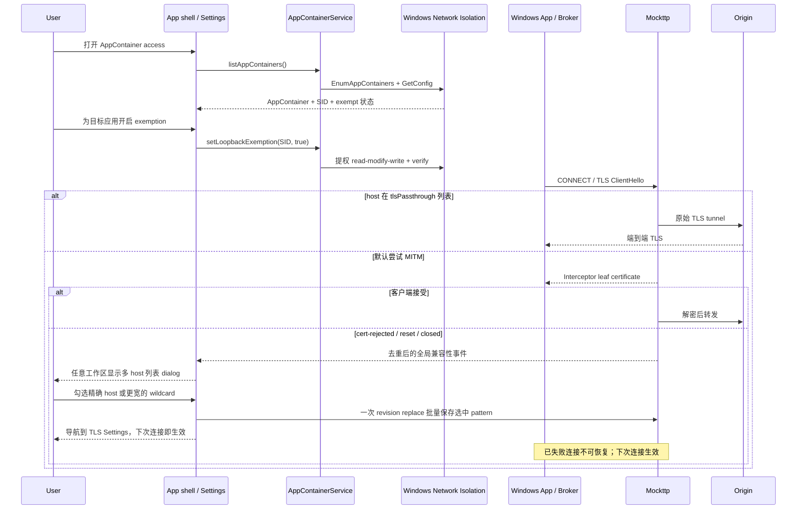

# 技术研究与长期候选

本文记录技术取舍和候选方案，不承诺实施，也不作为产品能力清单。功能契约见[架构索引](../README.md)，风险见[TODO](TODO.md)，执行安排只在[Handover](../HANDOVER.md)维护。

## 1. 能力边界

| 领域 | 技术边界 |
| --- | --- |
| HTTP/2观测 | streamId、GOAWAY、RST、SETTINGS与背压需要真实协议事件；HTTP摘要不能替代帧级事实 |
| WebSocket | Bridge使用RFC 6455的HTTP/1.1 Upgrade，不支持RFC 8441 Extended CONNECT |
| gRPC | 在途raw message读取不等于Protobuf descriptor、Server Reflection或message-level解码 |
| HTTP版本转换 | 下游H1与源站`allowHTTP1:false`的纯H2组合需单独定义；“支持HTTP/2”不代表所有双向转换组合 |
| 上游TLS元数据 | 按需`tls.probe`建立的是新连接，不能冒充某条历史Exchange实际使用的TLS metadata |
| 上游代理凭据 | URL可携带HTTP Basic凭据，但WinINet快照不提供用户凭据；系统设置恢复与凭据管理是不同职责 |
| 发布身份 | Authenticode、Developer ID与notarization依赖外部签名身份，不能用本地ad-hoc签名等同替代 |

## 2. 长期候选

以下是候选方向，不是产品功能或交付承诺。采用前需明确对应流程和安全边界。

- **Replay**：基于捕获会话重放请求。它不同于Composer手工发送，需要先定义复制哪个请求版本（wire还是规则改写后）、认证/Cookie如何处理、是否再次经过Rules及重放证据。
- **Reverse Proxy / Port Forwarding**：独立于显式代理的监听、路由和暴露面，需要单独的产品与安全设计。
- **带身份验证的局域网远程设备捕获**：技术上合理，但与当前 loopback-only 的安全边界冲突很大，必须重做认证、暴露面和威胁模型。
- **macOS透明捕获（Network Extension）/ Windows WFP透明捕获**：需要平台权限、原生组件部署及系统网络恢复设计，不能只替换显式代理入口。
- **RTL（从右到左）布局**：需要方向性布局、图标与双向文本规则，不能从翻译数量推断支持。
- **CA导出**：需明确公开证书与私钥的不同导出边界、格式和授权，不能通过文件路径暴露绕过Main。

## 3. 研究备忘

技术策略，不是产品路线图。

### 3.1 用 Node 原生模块自建数据面

- **动机**：吃透 HTTPS 代理的底层——TLS MITM、动态签发站点证书、HTTP/1.1 与 HTTP/2 双向转换、流控与背压。这些是本产品最核心的知识。
- **范围**：用 `node:http`、`node:http2`、`node:tls`、`node:net` 逐步替换 Mockttp 承担的拦截职责，规则/会话/存储/IPC 边界保持不变。
- **成本**：Capture/Rules围绕Mockttp事件模型及仓库patch构建，替换涉及完整数据面的协议行为，而不只是换一层调用接口。
- **与性能无关**：Mockttp 本身就是纯 TypeScript、构建在同样的 `node:*` 模块之上，自建不会带来数量级性能提升，两者上限都受 Node 运行时限制。自建的价值是掌控与理解。
- **真要做的方法**：以 Mockttp 的实际行为作为「正确性参照物」，一次只用原生实现一个子模块（先 HTTP/1.1，再 HTTP/2），与 Mockttp 对照验证。可用 LLM 辅助生成代码，但必须逐行读懂、自己 debug；MITM 的边界情况（Trailer、GOAWAY、畸形帧、ALPN、证书链、编码组合）需要主动补齐，LLM 默认只给 happy path。

### 3.2 Rust 数据面

- **触发条件**：真实遇到 Node 数据面无法通过的性能门槛，或想借项目系统学习 Rust。**当前没有任何性能基准证明需要它。**
- **技术选型**：Hudsucker 作 MITM 基础，Hyper/Tokio 负责 HTTP 与调度，rustls 负责 TLS，rcgen 负责动态证书。
- **现实成本**：Rust 语言 + Tokio 异步 + 系统级网络编程三重难度叠加；且如 3.1 所述，等于重写整个数据面，不是平滑替换。
- **可复用资产**：持久化格式、Archive 格式、规则模型和传输无关的 Command 语义可作为迁移基础；Electron MessagePort 与 TypeScript Schema 不直接复用，届时按真实约束新增跨语言 Transport 和编码层。

### 3.3 Windows AppContainer、WAM 与 TLS passthrough

#### 问题不是一层

Windows App / Dev Box 一次连接跨越多个安全主体，不能用一个域名 bypass 或一个 SID 概括：

| 环节 | 主体 | 与 Interceptor 的关系 |
| --- | --- | --- |
| 资源列表与主界面 | `Windows365.exe` + WebView2 | 普通 WinINet/WebView2 请求可进入 8888 |
| WAM token 获取 | `Microsoft.AAD.BrokerPlugin` AppContainer | 无 loopback exemption 时可能在 Windows 网络隔离层被拦，连接到不了 8888 |
| YubiKey / WebAuthN | 系统认证 provider | 产生认证断言；不等于负责 HTTP 转发或 token 缓存 |
| token / claims | AAD Broker | 网络请求成功后返回给 Windows App / RDP 客户端 |
| 远程桌面传输 | `msrdc.exe` → WVD gateway | 目标客户端拒绝 MITM 时，应走加密 TLS tunnel |

三个经常混淆的配置必须分开：

| 配置 | 生效位置 | 流量是否经过 8888 | 是否解密 |
| --- | --- | --- | --- |
| Windows `ProxyOverride` | system proxy | 否 | 否 |
| AppContainer loopback exemption | Windows 网络隔离 | 允许该容器连接本机 8888 | 不决定 |
| Mockttp `https.tlsPassthrough` | Core TLS 分流 | 是 | 否，只记录 CONNECT/tunnel 元数据 |

`insecureHosts` 不是第四种 passthrough：它仍执行 MITM，只是忽略 **Interceptor → 源站**
的证书错误，不能解决客户端拒绝 Interceptor leaf 证书的问题。

#### 故障分层

AAD Broker连接loopback代理受Windows网络隔离约束。exemption只允许网络连接，不验证YubiKey、不创建凭据，也不保证授权码兑换或token请求成功。

WAM的`0xCAA70004 The server or proxy was not found`需要检查Broker是否能访问代理；认证成功后gateway仍可能拒绝MITM。`tls.client-error: reset`只证明连接重置，不能单独认定pinning。HTTP错误、身份Cookie和远程桌面传输也应各自定位，不能从一次登录失败推断通用Cookie转发故障。

#### 连接与授权流程



#### AppContainer exemption manager

不复用 Capture 的“已安装应用索引”，直接采用 Fiddler WinConfig 与开源 Loopback Exemption
Manager 使用的 Windows 官方 Network Isolation API：

1. `NetworkIsolationEnumAppContainers` 枚举当前已创建的 AppContainer；每项直接返回
	 `appContainerSid`、`userSid`、Package Family Name、显示名、package full name、binaries、
	 capabilities 与 working directory。
2. `NetworkIsolationGetAppContainerConfig` 读取已允许 loopback 的 SID 集合。
3. UI 以 SID 为稳定主键，提供搜索、单项开关与刷新。AAD Broker 只能作为“Windows SSO”
	 推荐项，不能代表所有认证 plugin，也不应自动开启。
4. 修改操作在提权 helper 内重新读取完整集合，只增删目标 SID，再调用
	 `NetworkIsolationSetAppContainerConfig`；必须保留其他工具写入的未知 SID。
5. 调用后再次读取验证；枚举结果用 `NetworkIsolationFreeAppContainers` 释放，GetConfig 返回的
	 SID 内存按官方要求释放。

读取可用普通权限；修改需要 UAC。exemption 是持久 OS 配置，且允许目标容器访问 **全部**
loopback 服务而不只是 8888，因此不默认“豁免全部”。新安装或首次创建的容器不会出现在旧快照中，
每次打开面板与保存前都要重新枚举。用户显式开启的 exemption 不随 Interceptor 退出自动撤销，
否则每次启动都会再次弹 UAC；关闭开关时再显式移除。

Main通过`PlatformCapabilitiesService`调用AppContainer模块及其native helper，不把沙箱权限并入SystemProxy ownership。Renderer只经窄IPC调用，不接触SID配置API或提权命令行。

#### Mockttp TLS passthrough list

Mockttp 4.5.0提供静态pattern配置：

```ts
https: {
	key,
	cert,
	tlsPassthrough: [{ hostname: '*.example.com' }],
}
```

名单由用户在 Settings 维护，产品默认列表为空。兼容性事件由 App 壳按 host 去重累积，在任意工作区
显示一个全局列表 dialog；每个 host 提供精确值与逐级父域 wildcard 供用户勾选，选中项一次批量持久化
并导航到 TLS Settings。已挂载面板通过 settings change sequence 立即重读。WVD badge 仅推荐
`*.wvd.microsoft.com`，不会自动加入或预置。
不能把 Microsoft 登录全域名放进 system proxy bypass，因为共享域名会让 Edge、Office、Teams 等
所有应用的同域流量也完全绕过 Capture。

Mockttp公开API在listener启动时编译pattern；仓库patch允许`tlsPassthrough`接受getter，名单每连接求值。保存影响新连接，失败连接仍需客户端重试。passthrough tunnel使用仓库的
`passthroughProxyConfig` patch：无上游时直连，有上游时仍经上游 CONNECT，不需要针对 Clash 写分支。

Core 已能收到 `tls-client-error` 的 `destination` / SNI host 与
`cert-rejected | reset | closed | no-shared-cipher | handshake-timeout | unknown`。提示策略应：

- 按 `TLS generation + host` 去重，避免一次重试风暴弹几十次；
- `cert-rejected` 可给高置信提示；`reset` / `closed` 只能描述为“可能不兼容 MITM”，不能断言 pinning；
- 永不自动加入名单，由用户确认；
- 用户可在 Settings 删除/添加 wildcard，恢复解密尝试。

#### 持久化与契约

TLS passthrough是低频配置，由`WorkspaceService`按profile持久化；源站例外独立保存到`tls_insecure_hosts`。typed RPC / Desktop API分别表达两类设置：

- Core protocol：`tls-passthrough.get` / `tls-passthrough.replace` 以 revision 乐观锁承载名单读写；
	`tls.useCertificate` / `tls.startDecryption` / `tls.stopDecryption` 只管 CA 材料与 MITM 开关。
- Main：平台对象中的CertificateService协调CA与Core配置；Main转发TLS compatibility event。
- Preload：暴露 get/set passthrough hosts 与 AppContainer list/toggle 的窄 API。
- Renderer：App壳订阅全局TLS compatibility event并显示dialog；TLS passthrough与AppContainer access不能混成一个“bypass”开关。

#### 收益与代价

| 方案 | 收益 | 代价 / 风险 |
| --- | --- | --- |
| AppContainer 按应用授权 | 与 Fiddler 同类流程；覆盖任意当前容器；不靠 plugin 名单猜测 | 需要 UAC；用户要理解 loopback 权限；新容器需刷新 |
| Mockttp passthrough | 流量仍经过8888，可记录tunnel；不污染全局system bypass | 看不到HTTP path/header/body；名单只影响新连接 |
| TLS 失败提示而非自动降级 | 不会因偶发 reset 静默失去解密 | 首次失败不可恢复，用户需重试；reset 只能低置信提示 |
| 保留 system domain bypass | 实现最小、连接最稳 | 流量完全不可见；共享域名全局生效；名单持续漂移，不作为目标方案 |

#### “完整应用列表”与 Capture 归属

exemption manager 不需要“完整 Windows 应用列表”：`NetworkIsolationEnumAppContainers` 就是该功能
的权威候选集。Capture 的 `TCP source port → PID → 用户可见应用` 是另一个问题，Windows 没有一个
同时覆盖 Win32、MSI、便携应用、MSIX、系统组件和后台进程的统一 API。

当前 helper 中 `GetExtendedTcpTable`、`QueryFullProcessImageName`、Toolhelp process snapshot、
`GetProcessTimes` 与 Shell icon API 都是公开稳定 API，应保留。较脆弱的是
`CollectPackagedApps()` 直接读取内部 AppModel Package Repository 注册表；候选迁移是
`PackageManager.FindPackagesForUser("")`：

- 好处：官方强类型 API、非默认 PackageVolume、package identity/version/status 语义更稳定；
- 当前用户范围是有意的：机器上仅 staged/provisioned、或只为其他用户注册的包不能以当前用户身份
	启动，不应成为当前用户进程的普通归属候选；
- 代价：SYSTEM/其他用户真正运行的 packaged process 不能仅靠当前用户清单识别；全用户
	`FindPackages()` 需要管理员权限，不应放进抓包热路径；
- 因此不能盲目一换一。实施前先比较“当前 registry 索引 vs FindPackagesForUser vs 实际运行 PID”三组，
	确认 Windows App、AAD Broker、SystemApps、WebView2 祖先与 packaged services 的行为。

Win32 仍需组合 Uninstall、App Paths、开始菜单与 exe version resource；所谓“权威开源完整 app list”
最终也只是封装这些来源，不会消除 Windows 安装模型的多样性。

<a id="upstream-library-assessment"></a>
### 3.4 上游代理库替代评估（12/17）

#### 结论与范围

本节是2026-10-07的技术评估，不是迁移批准或产品验收。现有产品、第三方patch、仓库依赖与系统网络均未在本次评估中修改。
候选实验的精确版本和lockfile在会话目录隔离，不通过替换产品的`node_modules`取得结果。

当前决策约束：用户固定保留Mockttp，优先避免新增本地patch带来的维护与回归风险，宁愿评估正式代理库替代。
下列patch和发送层迁移方案保留作技术比较，不代表已选或已授权；不能仅因接入成本较低就恢复patch优先。
当前实施候选聚焦PAC/HTTP Agent层，不把Axios等整个sender接口的替代成本混作Agent替换成本。
不引入本地patch可以避免该项新增风险，但任何替换的总体零风险都未被证明。

- 当前item保留Mockttp，不为一个上游发送问题更换整个MITM数据面。
- 若要求保持原始header表示，局部修复现有链路的接入面小于换发送库；这仍需用户明确允许修改patch，不能称为零风险。
- 若允许不同字段之间的排列变化、同时保留全部值和同名字段内顺序，应先验证“现有发送链的多值输入适配”。
  它不是单值对象转换，也不是已经获准的行为变化；需要解决空值、大小写、Cookie等字段的具体语义。
- 确实存在可行替代发送库：Axios和libcurl在受控实验中通过了主要HTTP转发场景。
  “不是同接口”表示接入成本，而不是技术上不能采用。若决定迁移发送层，Axios是纯JS候选，libcurl是原生候选。
- Undici不能因flat-array入口丢值就被整体排除；正确的多值对象写法可用。其显式framing与H1 `Expect`限制才是当前契约下更重要的差异。
- 没有验证出一个“换包名、零接入改动、完整解决12/17”的候选；成熟度不等于行为完全相同，也不能保证100%没有回归。

评估扫描了43个相关npm包及Node原生、libcurl、mitmproxy、Hudsucker、GoProxy等候选。
来源包括npm关键词检索、官方版本元数据、公开类型/源码和维护仓库；同一底层的包装分别辨认后归类。
这覆盖了当前决策相关的主要实现、成熟工具及常见fork，不声称数学意义上穷尽全部npm包或所有语言生态。

#### 什么必须保留，什么需要单独决定

| 要求 | 判定 |
| --- | --- |
| 真实目标、端口、PAC输入协议及候选顺序正确 | 正确性要求，不能用默认443或静默DIRECT代替 |
| header值不丢失、重复字段的值与同名字段内顺序保留 | 正确性要求；不能用普通单值对象覆盖重复项 |
| 不同header字段之间的交错位置、每次出现的大小写完全不变 | 更严格的wire保真要求，不是HTTP普遍硬要求；不得与“字段值是否丢失”混为一谈 |
| 发送用户显式headers/body，保留错误而非提前纠正 | 继续遵守[消息编辑契约](../features/http-message-editing.md)，不能为了适配库删除用户TE/Expect或自动补CL |
| 源站响应、压缩字节、重定向、1xx、trailer与中止可观测 | 发送库的解压、redirect、retry默认值不能直接带入代理 |
| 正文头部阶段可决策，body流式通过、背压和取消有界 | 不允许全量缓冲上传/SSE，也不允许重放已经发送的正文 |
| 不支持CONNECT的标准HTTP上游仍能工作 | HTTP absolute-form与CONNECT是不同协议路径；后者不能被当成等价修复 |

#### 当前接入位置

```text
Core ProxyService
  -> Mockttp PassThroughStep
     -> getAgent(...protocol, hostname, port, proxySettingSource)
        -> PacProxyAgent.connect(req, opts)
           -> PAC规则求值
           -> HttpProxyAgent / HttpsProxyAgent / SocksProxyAgent / DIRECT
     -> http(s).request(options, responseCallback)
     -> ClientRequest写入、1xx、取消、响应stream、trailer、Capture和Rules事件
```

- `getAgent()`返回Node Agent；PAC内部硬编码创建具体agent，公开options没有替换HTTP agent工厂。
  替换顶层同名依赖不一定替换PAC实际加载的嵌套版本。
- Mockttp的`proxyConfig`/`passthroughProxyConfig`公开回调只收到hostname，返回代理URL，不是完整请求或自定义sender。
  单在Core提前按hostname解析PAC会遗漏协议、真实端口或路径，不能猜测。
- `PassThroughStep`需要的是`ClientRequest`能力：可写body、`flushHeaders`、`setNoDelay`、`socket`、
  `information`、`error`与中止；响应要保留raw headers、stream、trailers和错误语义。
  Undici Dispatcher、Axios Promise/stream和libcurl handle都不是这个接口的直接替代。
- 接入新sender可以修改现有Mockttp发送分支，也可以评估自有转发step，但后者需要自行维护该step的
  Rules/Capture、流、错误和取消流程。它可能减少第三方patch，却不会消除接入代码和维护成本；
  未做产品原型前，不能把“不是Agent”解释成技术上绝对不可替换。
- TLS passthrough、普通HTTP发送和WebSocket有不同接入点；更换明文HTTP sender不会自动修复TLS传给PAC的scheme。
- 同一个输出请求还经过Rules/Breakpoint。改sender必须回归第10项正文/framing，而不能只检查PAC请求返回200。
  具体边界见[Proxy module](../../apps/proxy-core/src/proxy-core/proxy/README.md)和[进程设计](../platform/processes.md)。

#### 证据等级

- **实测**：产品Electron 43.1.0内的Node 24.18.0；对照终端Node 24.21.0；候选使用其正式支持的API。
  系统curl调用libcurl 8.7.1的结果只证明该传输库的协议行为，不冒充`node-libcurl`接入验收。
- **源码/文档核对**：准确发布版本的npm依赖关系、官方类型与相关实现；未运行的候选不写成通过。
- **未验证**：候选接入Mockttp后的真实产品E2E、Windows/arm64、各候选完整HTTPS/SOCKS/H2/gRPC/WebSocket矩阵、
  正式包、长期负载及性能。DHCP-WPAD网络门禁不因发送库测试而完成。
- 共176个最终受控场景是能力对比记录，**不是176项产品测试全部Green**。
  初版无framing的stream输入、curl stdin自动追加TE的冲突均已修正后复跑，不计作产品或库的Red。
- 原始结果、官方版本清单与输入约束见[评估证据](/Users/zhxmt/.copilot/session-state/bda43480-2b1f-4f42-8883-5c58d667f62a/files/upstream-library-lab/assessment-summary.json)。

#### Agent与PAC候选

“低接入成本”只表示能保留Node请求对象，不代表已经解决缺陷；发布较早也不单独证明不安全或不可用。

| 候选/正式版本 | 实际作用与可替代性 | 接入成本与结论 |
| --- | --- | --- |
| [http-proxy-agent](https://github.com/TooTallNate/proxy-agents/tree/main/packages/http-proxy-agent) 9.1.0、[pac-proxy-agent](https://github.com/TooTallNate/proxy-agents/tree/main/packages/pac-proxy-agent) 9.1.0 | 与当前7.0.2/7.2.0同一实现家族；最新组合已在隔离实验执行。多值对象路径可用，raw数组路径仍出现错误目标、丢头/400；PAC非默认端口仍丢失 | 升级接入相对小，但不解决目标缺陷；QuickJS依赖/资源路径还发生变化，不能只换版本号 |
| [https-proxy-agent](https://github.com/TooTallNate/proxy-agents/tree/main/packages/https-proxy-agent) 9.1.0、[socks-proxy-agent](https://github.com/TooTallNate/proxy-agents/tree/main/packages/socks-proxy-agent) 10.1.0 | 各自负责CONNECT和SOCKS，不是标准明文HTTP forward sender | 可保留在所属协议路径；不能用全部CONNECT或改SOCKS替代17 |
| [hpagent](https://github.com/delvedor/hpagent) 1.2.0 | Node Agent；实测raw、多值、认证、binary、TE、Expect、流式与取消均可工作，但明文HTTP也走CONNECT | Agent接入较小，PAC工厂仍需调整；代理协议改变是实质兼容成本。仅在明确允许CONNECT的部署范围可考虑，不能作为通用修复 |
| [@postman/tunnel-agent](https://github.com/postmanlabs/tunnel-agent) 0.6.8 | 活跃应用使用的tunnel fork，实测结果同样通过CONNECT而非absolute-form | 结论同hpagent；比陈旧tunnel实现更值得考察，但不改变协议边界 |
| [tunnel](https://github.com/koichik/node-tunnel) 0.0.6、[tunnel-agent](https://github.com/mikeal/tunnel-agent) 0.6.0、[http2-wrapper](https://github.com/szmarczak/http2-wrapper) 2.2.1、[hagent](https://github.com/avwo/hagent) 0.9.3 | tunnel或协议/连接包装；HTTP2能力不等于普通HTTP代理原始头问题已修复 | 不作为17的标准forward替代。前两者最后正式发布分别为2018/2017，采用前还需维护/平台兼容复核 |
| [global-agent](https://github.com/gajus/global-agent) 4.1.3 | 有独立HTTP forward实现，但正式入口会替换进程级`http(s).request/globalAgent`。实测multi路径大部分可用，raw路径出现origin-form发给代理/认证错误，Expect也有差异 | 影响Core中其他请求和PAC下载，不能只影响选定Capture连接；不建议为17引入全局改写。抽内部class也增加非公开API依赖 |
| [global-tunnel-ng](https://github.com/np-maintain/global-tunnel) 2.7.1 | 全局代理配置及旧tunnel封装 | 同时有全局影响、旧依赖和CONNECT路径，不作为优先替代 |
| [proxy-agent](https://github.com/TooTallNate/proxy-agents/tree/main/packages/proxy-agent) 8.0.2、[@npmcli/agent](https://github.com/npm/agent) 5.0.2、[@pnpm/network.proxy-agent](https://github.com/pnpm/pnpm/tree/main/pnpm11/network/proxy-agent) 1100.0.1 | 代理选择、缓存、超时或应用集成，底层仍调用同族HTTP/HTTPS/SOCKS agents | 配置入口不同不等于换掉缺陷实现；不解决17的raw输入问题 |
| [@vscode/proxy-agent](https://github.com/microsoft/vscode-proxy-agent) 0.45.0 | 能接宿主解析器、证书及认证；其Node HTTP路径仍实例化`http-proxy-agent`，Undici路径使用Dispatcher | 不是天然绕开17。引入整个VS Code宿主封装会增加证书/全局patch接口与回调依赖，收益不匹配本项 |
| [@httptoolkit/proxy-agent](https://www.npmjs.com/package/@httptoolkit/proxy-agent) 5.0.1-socks-lookup-fix.0 | 旧版代理家族的SOCKS lookup修正fork，不是本问题专用修复 | 不能仅凭同属HTTP Toolkit就认定修好了raw headers；发布与依赖较旧，不优先 |
| [@openclaw/proxyline](https://github.com/openclaw/proxyline) 0.4.0 | 有独立Node代理实现和公开Agent，但也有全局安装入口；源码会清`req._header`再设置代理头，未证明raw兼容 | 正式包发布于2026-10-01，是新候选而非“更成熟”证明；仅源码核对，不能宣称不可用或已通过。可低优先级跟踪 |
| [agent-base](https://github.com/TooTallNate/proxy-agents/tree/main/packages/agent-base) 9.0.0 | 创建Node Agent的基础设施，不负责PAC或HTTP forward | 用它自建适配仍是自己维护协议衔接，不是一份现成修复 |

#### 请求发送层候选

| 候选/版本 | 实际能力 | 对本项目的可行性与成本 |
| --- | --- | --- |
| [Node原生`http.Agent({proxyEnv})`](https://nodejs.org/docs/latest-v24.x/api/http.html#built-in-proxy-support) | 24.18的multi路径可用，raw目标仍回退localhost；24.21已修正该目标且保留raw排列，但raw路径仍漏掉配置的代理认证。multi路径在两版均通过已测TE、Expect、上传、取消、1xx/trailer | **有条件可用**，非天然无缺陷。需要在创建ClientRequest前完成代理选择，不能把原生Agent直接塞进当前PAC的`connect()->Socket`调用。采用24.21还需升级Electron；原生proxy支持标记为Active development，不等于Node本体所有API都同等稳定 |
| [Undici](https://github.com/nodejs/undici) 7.28.0 / 8.11.2 | multi对象保留重复值，认证、binary、流式、取消、关闭redirect/解压、103和trailer均有可用结果。flat数组仍覆盖同名项。两版均拒绝显式`Transfer-Encoding`和H1 `Expect` header；`expectContinue`公开选项针对H2 | **可作为标准请求客户端，不宜直接承担当前任意headers编辑契约**。需换发送分支、重接流与事件；不能删除用户TE/Expect来宣称无损兼容。不是因为不同字段顺序改变才排除 |
| [Axios](https://github.com/axios/axios) 1.20.0 | 自身支持标准HTTP forward，不必经过问题HttpProxyAgent。multi头、认证、binary、显式TE/Expect、streaming/cancel、302/gzip不处理、trailer均有实测可用结果 | **纯JS发送层可行候选**。不是Node Agent：需重接request写入、早期响应、1xx、错误/407、DNS/TLS选项及PAC候选提交点；需关闭默认transform、redirect、decompress等。stream模式避免一次Buffer触发自动CL；用户显式删除framing的完整行为仍须验证 |
| [Got](https://github.com/sindresorhus/got) 16.0.0 | 正式stream API在配置后通过上述主要场景；本轮使用Node原生代理Agent。公开`request`事件/自定义request可用于进一步事件桥接 | **可以接入，但不是独立代理修复**：它仍需要Agent；换Got不会消除代理层问题，还带入重试、解压、header处理及H2选项。比直接保留Node发送层多一层，优先级低于Axios/局部适配 |
| [libcurl](https://curl.se/libcurl/) + [node-libcurl](https://github.com/JCMais/node-libcurl) 5.1.2 | libcurl具备成熟标准forward、CONNECT、认证和header列表API。系统libcurl8.7.1通过多值、认证、binary、TE/Expect、流式、取消、302/gzip、103/trailer及IPv6目标格式实验 | **原生发送层可行候选**，非Agent替换。要接upload/response回调、pause/resume、cancel、CA与TLS策略、连接缓存、PAC决策和所有平台原生产物。测试调用curl CLI，不代表node-libcurl绑定已验；正式产品不能每请求spawn curl |
| [SuperAgent](https://github.com/ladjs/superagent) 10.4.1、[node-fetch](https://github.com/node-fetch/node-fetch) 3.3.2、Node `fetch` | 高层请求API；前两者通常通过外部Agent解决代理，Node fetch使用Undici | 没有提供更小的独立HTTP forward替代；另有header规范化、自动解压/重定向及流接口适配，不优先 |
| [make-fetch-happen](https://github.com/npm/make-fetch-happen) 16.0.1 | npm场景的fetch、缓存、重试及`@npmcli/agent`组合 | 底层仍是已评估代理家族；缓存/重试不适合未经限制地引入透明转发，不优先 |
| [request](https://github.com/request/request) 2.88.2 | 官方已deprecated；包含较旧的tunnel、cookie、body等组合逻辑 | 不以新接入已弃用库作为长期修复 |

**更换sender时哪些代码不能漏掉：**

1. 在完整URL可用处解析PAC，并保留代理列表顺序、缓存、超时、取消及“未列DIRECT就不能回退”的约定。
2. 首个请求字节发送前才能选择/切换连接；收到407、发送部分POST或断流后不能自动重放。
3. headers-stage Rules和Breakpoint仍先于body，Capture仍订阅增量而非等待完整正文。
4. 桥接Node `ClientRequest`语义或改写所属发送分支；不能只把一个Promise/Dispatcher假扮成Agent。
5. 显式PAC、WPAD、System共用同一发送逻辑；TLS passthrough与WS/WSS保留各自入口并验证。
6. 重新构建随包依赖、原生资源和最终App，核对实际加载路径；切换库不等于可以省略package/smoke。

#### PAC与系统发现候选

| 候选 | 能替代什么 | 不能自动解决什么 |
| --- | --- | --- |
| [pac-resolver](https://github.com/TooTallNate/proxy-agents/tree/main/packages/pac-resolver) 9.0.1、现有`PacProxyAgent.getResolver()` | PAC脚本求值；现有QuickJS隔离能力可以复用 | 不负责下载/缓存全部策略之外的socket、认证、header序列化与代理候选失败切换；单换解释器不修17 |
| [node-pac](https://github.com/imweb/node-pac) 0.5.1、[pacparser](https://www.npmjs.com/package/pacparser) 0.0.6 | 其他PAC求值器 | 需另核对脚本隔离、DNS helper及取消；仍没有HTTP发送能力，不作为直接修复 |
| [原生Pacparser](https://github.com/manugarg/pacparser)、[libproxy](https://github.com/libproxy/libproxy) | 前者是C/Python的PAC解析库，后者负责系统代理/PAC/WPAD选择；不能与上行同名npm包混淆 | 是真实长期候选，但不负责17的HTTP发送。增加原生集成/资源以及LGPL-3.0、LGPL-2.1的分发合规核对；本轮未安装或做平台实测，不能用项目说明替代本机DHCP验收 |
| [@vscode/os-proxy-resolver](https://github.com/microsoft/os-proxy-resolver) 0.4.0 | 原生系统代理解析，平台包分发 | 不修发送时丢headers；也不能直接代替用户显式PAC、独立WPAD及原系统快照的全部产品约定 |
| [os-proxy-config](https://github.com/httptoolkit/os-proxy-config) 1.1.2 | 读操作系统配置 | 不执行完整PAC并发送业务请求；与现有helper读写边界不同 |
| [proxy-from-env](https://github.com/Rob--W/proxy-from-env) 2.1.0 | 环境变量代理/no_proxy选择 | 不执行PAC、不发请求，不解决12/17 |

#### 链式代理与整层替换

| 候选 | 已核实能力/边界 | 替代性与成本 |
| --- | --- | --- |
| [proxy-chain](https://github.com/apify/proxy-chain) 3.0.1 | 标准HTTP forward、CONNECT、SOCKS和Basic认证；源码直接将有效raw headers交给Node并构造absolute-form目标 | 有实际价值，但公开入口是代理Server，不是Agent。内部`forward`未从主入口导出；直接接会绕开Mockttp的响应Rules/Capture，另起本地代理则增加监听器/进程内hop和退出职责。不是最小修复 |
| [http-proxy](https://github.com/http-party/node-http-proxy) 1.18.1、[httpxy](https://github.com/unjs/httpxy) 0.5.5、[http-proxy-middleware](https://github.com/chimurai/http-proxy-middleware) 4.2.0 | HTTP/WS转发、反向代理及web框架中间件；新版HPM底层为httpxy，不应继续按旧http-proxy依赖判断 | 可用于转发服务，但不提供现有完整MITM/CA/H2/Capture/Breakpoint契约；不能只换一个Agent就解决。http-proxy正式版较旧，httpxy/HPM仍活跃，两者维护状态分开看 |
| [@fastify/http-proxy](https://github.com/fastify/fastify-http-proxy) 11.6.4 / [reply-from](https://github.com/fastify/fastify-reply-from) 12.6.5 | Fastify转发及Undici发送 | 引入服务框架和请求handler映射，底层Undici的header/framing边界仍需面对；不比直接接sender更小 |
| [http-mitm-proxy](https://github.com/joeferner/node-http-mitm-proxy) 1.1.0 | MITM、request/response data hooks、WS和Agent注入；源码用对象headers并在部分响应路径删除CL、设chunked | 能做同类工具，但现有H2/gRPC、header编辑、故障/退出契约未证实等价；最新正式版为2023年，不能因名字相近假定更成熟或更省改动 |
| [AnyProxy](https://github.com/alibaba/anyproxy) 4.1.3 | 完整代理工具与规则入口；公开源码会先收完请求正文、删CL/TE，并可能处理响应编码 | 与本项目流式及显式编辑约定差异大；不是可无损替换的发送器，当前不优先 |
| [Whistle](https://github.com/avwo/whistle) 2.10.10 | 活跃完整抓包工具，支持HTTP/HTTPS/H2/WS/TCP及插件 | 真正的整层候选，不是小库插槽；需映射规则、证书、Capture/Body、暂停、MCP、退出和打包，不能拿工具的功能清单冒充Interceptor迁移完成 |
| [mitmproxy](https://github.com/mitmproxy/mitmproxy) | 活跃完整MITM工具，支持上游代理、流式配置和可重复headers数据结构 | 值得长期数据面候选；Python/Rust组件与Node Core间新增协议、生命周期和分发，现有事件/Rules/证书存储不能原样套用 |
| [Hudsucker](https://github.com/omjadas/hudsucker)、[GoProxy](https://github.com/elazarl/goproxy) | Rust/Go可编程MITM库；Hudsucker公开H2/WS特性，GoProxy可定制Transport及头规范化 | 不是“库不行”，而是要重新实现数据面适配、跨语言IPC、CA/事件/流控制和多平台资源。为当前17采用，改动范围最大 |

本轮只对整层替换做官方API/源码和接入边界评估，没有安装或运行这些完整代理，更没有让它们改系统代理或CA。
仓库维护/许可证元数据不等于做过完整供应链或可利用漏洞审计。

#### 方案比较：patch并非只有一种

| 路线 | 需要改什么 | 成本/风险来源 | 本次判断 |
| --- | --- | --- | --- |
| 修现有依赖缺陷 | TLS的PAC地址、HTTP raw-header重建、PAC端口及必要的候选切换边界 | 改动集中，但涉及agent内部/Node请求缓存，升级需持续回归 | 保持现有wire行为时，接入面最小；需要明确patch授权 |
| 保留库，适配多值输入 | Mockttp在适用出站分支以数组值对象构造headers；修正/选择安全转换，不改用户值 | 仍需改Mockttp接入，不是零patch；字段跨名排列、大小写和Cookie等可能规范化，必须先约定 | 值得先做最小原型，不应像之前那样一概否定。当前只是独立发送实验通过，产品尚未接入 |
| 新Node原生代理 | Electron升级、创建请求前PAC决策、Agent选择与headers适配 | 原生raw认证缺口、全App runtime升级与重新打包 | 不是一键消除风险；不为17单独优先升级 |
| Axios发送分支 | 代理配置+Node请求/响应/取消/信息响应桥接+PAC候选逻辑 | 需要拆清高层默认行为与现有事件，不是替换`connect()` | 可行的纯JS迁移路线，但工程面大于局部适配 |
| libcurl发送分支 | native绑定、upload/response流、CA、cancel、认证、PAC、平台构建 | 原生分发与整个发送生命周期 | 若确定长期更换发送层，应优先认真比较；不建议仅为本次故障立即迁移 |
| Undici发送分支 | Dispatcher适配和上述生命周期；还需重新处理TE/Expect契约差异 | 不能通过删除用户输入掩盖不支持 | 保留为受限标准请求场景候选，不建议当前整体透明发送替换 |
| 全部HTTP改CONNECT | 在PAC分支换tunnel agent | 上游可能拒绝CONNECT或限制端口，改变线上协议 | 仅在明确限制部署范围后可选，不当作通用修复 |
| 替换整个Mockttp | 新数据面、事件、Rules/Breakpoints、CA、存储/IPC/退出映射 | 最大迁移面及验收欠账 | 独立长期项目，不与12/17混成一个“小修” |

#### 仍需验证的边界与下一步

- 现有Mockttp `rawHeadersToObjectPreservingCase()`把空字符串当“没有值”，会丢掉同名字段的第一个空值。
  不能直接调用这个helper就宣称所有headers无损；正确多值表示还需要大小写与特定字段用例。
- 当前/最新PAC agent在“首个HTTP代理TCP失败、脚本允许DIRECT”的实验中，会把已经改成absolute-form的请求继续交给源站；
  当实验显式配置代理认证headers时，该头也残留在DIRECT请求。该输入使用合成凭据，**不代表当前产品UI存在同样凭据配置或发生真实泄露**。
  这说明候选切换必须单独验收，不能把修好Host视作完整代理实现已正确。
- Node原生24.21的raw-header认证限制、Undici的TE/Expect拒绝、库的407处理方式都需要在采用前明确；
  不能把返回成功、HTTP错误、连接错误和无源站访问混成一种“失败”。
- 不同sender保留response 103/trailer的形式不同，有的是Node事件，有的是Dispatcher hook，有的是原生回调。
  回调适配可行不等于已验证，记录边界时不能写成库完全不支持。
- 本次没有确定性能优劣，没有修改正式设计/产品，不给“零风险”承诺。
  当前建议是先在既有消息编辑约定下选择是否允许多值表示的规范化，再决定局部输入适配或原始数组修复；
  只有明确希望长期替换发送层，才进入Axios/libcurl的产品集成原型。

<a id="mockttp-upstream-patch-boundaries"></a>
### 3.5 Mockttp上游适配patch的规则与边界

**当前实施范围以[Settings发送契约](../features/settings.md#upstream-request-adapter)为准。**
用户已批准先在Mockttp共用H1出站构造做小写字段名、多值数组适配，并修正TLS的PAC判断地址；
不修改两份Agent源码，不保留“后值覆盖”策略。下文曾提出“每行大小写必须完全不变”的候选，
与最终允许H1小写/归组的决定不同，不再作为本轮验收条件；源站字段值、正文和真实路线仍是基准。

本节回答“只改构造headers是否足够”和“哪些内容允许改变”。
下文保留此前候选与边界实验，不是当前实施规则的另一份副本；旧方案的原行保留要求已由上面的授权契约取代。
实验阶段的原版Node/Agent观察仍然保留，不冒充后续Mockttp适配后的产品结果。
最新实现和未完成验收以[Settings发送契约](../features/settings.md#upstream-request-adapter)及Handover为准，
不改变[HTTP消息编辑契约](../features/http-message-editing.md)。

#### A. patch范围与不能混淆的两件事

- **17的首选落点**：Mockttp在Rules/Breakpoint完成、已有H2→H1转换完成后，调用Node `http.request()`前，
  适配需要PAC Agent处理的HTTP/1.x出站请求。用户要求普通字段保留每行原始名字和大小写，
  因此不再把“所有headers转换成一个Node多值对象”作为既定实现；必须先证明适配不会覆盖大小写不同的同名行。
  不是修改捕获数据，也不是将用户重复值覆盖成一个值。
- **12的独立落点**：Mockttp TLS passthrough构造传给PAC Agent的最小请求对象时，提供真实HTTPS目标authority，
  保持原始TCP/TLS隧道语义。headers对象化不能代替这一步。
- **普通HTTP的PAC完整URL也是门禁**：PAC输入必须包含真实非默认端口和path/query。
  headers转换本身不会修复现有PAC Agent遗漏端口的行为；不能把TLS探针的通过套到普通HTTP。
- 首选目标是保持两份Agent源码不变，在现有Mockttp适配处解决；这不是已经证明完整可行的承诺。
  若最小实现不能同时满足本节规则，停止扩张并重新说明，不能偷偷改Agent、包装用户PAC或增加自建转发层。

拟议修改点仍限定于`patches/mockttp+4.5.0.patch`的H1请求/Agent适配和TLS隧道输入；
header表示方案必须满足下述原行保留规则，不以通用转换helper的方便程度决定用户数据怎么变化。
不复制替换整个Mockttp，不修改Node `_header`/`outputData`作为产品侧补救，不追加Axios或新的代理监听器。
若最终确实需要转换helper，其空值与普通对象原型属性问题必须处理；若修改共用helper，原有H2/WS调用方属于必需回归，
不能只测试新PAC调用。

| 路径/数据 | 本次规则 |
| --- | --- |
| PAC管理的明文HTTP出站请求 | 需要兼容Agent，但不能默认全部对象化；任何请求表示适配也可能影响PAC DIRECT/SOCKS分支，必须覆盖 |
| System/WPAD解析为PAC后的同类请求 | 与显式PAC共用一条实现，不按UI入口各修一份 |
| 普通Direct、固定HTTP/HTTPS/SOCKS代理 | 保留现有路径，不为了统一风格全部对象化，不强制将HTTP改为CONNECT |
| 普通已解密HTTPS、原生H2发送、WS/WSS | 不主动改变headers表示或协议策略；共享helper受影响的部分必须回归 |
| 未解密TLS passthrough | 不处理加密业务headers/body；只修用于PAC判断的目标地址，仍保持原始字节透传 |
| 非TLS raw passthrough | 不套用HTTPS地址；不扩大其协议识别、默认端口或转发能力 |
| Capture原始记录、编辑草稿、导入导出、Rules配置 | 保留原来的字段列表和值；只对最后提交给Node的副本做适配 |
| 响应headers及request/response trailers | 不因本次请求适配全局改变；`Set-Cookie`等现有多值路径必须回归 |

#### B. 默认保留规则：语义识别与原始行分开

HTTP规范把字段名视为不区分大小写，因此`X-Tag`与`x-tag`在协议上是同一个字段；
但这个事实不要求调试代理把原来的两行改名、合并或覆盖。判断是否为Host、Cookie或非法重复单值字段时
仍须忽略大小写；记录、编辑和本次H1转发表示则默认保留每行写法。两条规则不能相互替代。

1. 来源固定为现有规则处理后的**最终headers列表**。不重新推导用户意图，不回写输入数组或其成员。
2. 普通字段默认保留原始名字、大小写、每个值和原有行序，不统一小写、首字母大写或首次写法。
   下表以外不新增字段级重写规则。
3. 如果内部确需按原拼写分组，只将**拼写完全相同**的名字映射为有序多值数组；
   `X-Tag`和`x-tag`仍分别保留在原始行列表中。辅助索引不能代替原列表，也不能损失重新发送所需的行序。
4. “同名合并”仅指内部保存多个值，不是线上一律拼成逗号字符串；不去重、不取首尾、不覆盖。
   是否需要线上归并只由明确的协议规则及下表决定。
5. `''`是存在的空值，不是缺失；`['', 'two']`必须保留。字段不存在才表示缺失，
   不能用truthy判断，也不能用空字符串代替用户删除。
6. 字段值中的大小写、逗号、分号、引号、百分号编码不变；不trim、不拆业务值、不统一小写token。
   字段名/值的合法字符沿用Node和所属协议层的校验，不通过改名或替换控制字符掩盖错误。
7. 使用Map或无原型对象做辅助索引，避免把`__proto__`、`constructor`等合法token当作对象元数据。
8. 不配置`uniqueHeaders`任意折叠字段，不为了适配发送库改成单值字典。

例如必须保留以下三行的区别：

```text
X-Tag: one
x-tag:
X-Tag: two
```

内部可以另建按原拼写查询的索引`{ "X-Tag": ["one", "two"], "x-tag": [""] }`，
但这个索引**不能直接作为Node的headers参数**。产品Node会再次按不区分大小写的名字保存字段，
后设置的`x-tag`会覆盖前面的`X-Tag`，导致丢值；Node不会因为JS对象中是两个键就分别保留。
若改为一个`"X-Tag": ["one", "", "two"]`，虽保留值，却改变原始大小写，也不满足本轮要求。
所以“按原拼写分别建对象键”不是已验证修法；raw行保留与Agent兼容必须同时满足。

#### C. 明确列出的特殊字段：只处理所属职责，不通用合并

名单内也不意味着每一项都新增代码；已经由协议层正确处理的继续复用。匹配这些名字时忽略大小写，
但不能因此改写原始行的名字。未列出的字段执行B的默认保留规则。

| 字段/分组 | 必要的特殊处理 | 保持或禁止事项 |
| --- | --- | --- |
| `Host`；H2的`:authority` | 区分消息中的Host与最终连接目的地；Agent读取和目标URL构造必须正确 | 保留用户给定值/缺失。不补Host，不回退localhost，不因Host不同暗改目标；不同大小写的多个Host仍是重复Host，不能当作两个独立合法字段 |
| `Cookie` | 仅在协议转换或发送接口确需一行Cookie时，以`; `连接各原值，保持cookie-pair顺序 | 不用逗号，不按cookie名称去重，不改变value大小写；记录仍保留原行，不把任意非法/空Cookie“修好” |
| `Set-Cookie` | 明确保留多个独立值/行，响应多值路径不合并 | 不按逗号合并或拆开Expires日期，不只留最后一个；本次不重写响应处理 |
| `Content-Length`、`Transfer-Encoding`、`Trailer` | 保留已有framing和第10项正文替换流程；trailer仍由原发送层发送 | 此适配器不重算、不补回、不去重或纠正冲突；CL/TE冲突等不宣称合法，底层错误原样记录，不截断/填充正文 |
| `Connection`、`Keep-Alive`、`Upgrade`、`TE` | 由所属HTTP版本/连接层处理，沿用现有协议转换。`TE`不等于`Transfer-Encoding` | 本次不新增全局清洗或拼接策略，不把H1逐跳字段无条件带进H2 |
| Agent自动生成的`Proxy-Authorization`、`Proxy-Connection` | 按实际代理hop使用；切换候选或DIRECT时隔离自动注入的代理凭据 | 不与源站Authorization混用，不残留前一代理的凭据。用户显式输入字段与自动生成字段来源分开，不借patch新增凭据功能 |
| `WWW-Authenticate`、`Proxy-Authenticate` | 保留挑战列表的原值/多行，处理407与源站认证的职责分开 | 不用简单逗号split解析带引号的挑战值，不因有多个挑战就取最后一个；本次不实现新认证机制 |
| H2伪头`:method`、`:scheme`、`:path`及字段名小写 | 沿用已有H2控制数据和编码规则；正确目标传递不能从字段大小写推断 | 普通H1字段原样保留不意味着H2线上可以有大写字段名；不把伪头放进H1通用headers对象 |

以下字段**不因为名字常见就新增合并或修正逻辑**：
`Content-Type`、`Content-Encoding`、`Content-Disposition`、`Authorization`、
`Accept`、`Accept-Encoding`、`Accept-Language`、`Cache-Control`、`User-Agent`、`Referer`、`Origin`、
`ETag`、`Digest`、`Content-Digest`、`Repr-Digest`、`Signature`、`Signature-Input`及所有未知/自定义字段。
保留名字、每个值和空值；用户未要求时不解压、不重编码、不重算签名，不替单值语义字段挑选一个值。
保留非法调试输入与断言其符合HTTP规范是两件事；语法或底层发送错误必须明确呈现。

HTTP普通字段名不区分大小写；列表值的同名顺序需要保留，不同普通字段名之间的顺序无语义。
重复是否可发送由字段定义决定，见[RFC9110 §5.1–5.3](https://www.rfc-editor.org/rfc/rfc9110.html#section-5.3)；
Cookie的H2拆分/合并规则见[RFC9113 §8.2.3](https://www.rfc-editor.org/rfc/rfc9113.html#section-8.2.3)。
这些规则不等于授权修改前端为“所有字段禁止重复”，本次不改编辑器交互。

#### D. 不增加默认字段，不动正文

- H1继续传`setDefaultHeaders:false`。产品Node24.18将其同时用于默认Host、Connection、CL和TE控制，
  任何发送适配都不能丢掉这个选项。
- 不额外设置`setHost:true`，不生成User-Agent/Accept/Accept-Encoding等“方便调用”的默认值。
- 请求method、最终目标、path/query及正文content bytes不变；不因为header变成对象而改正文编码、缓冲完整上传、
  合并chunks或重放请求。
- 保留第10项headers-stage replacement的`write(rawBody)`再`end()`顺序，不恢复`end(buffer)`的自动framing选择。
  无body override继续使用原来的流与背压；取消、断流、early response、1xx和trailer生命周期不重写。
- 正常Direct/固定代理、原H2/WS路径的行为不得用新的“统一格式”改变。
  任何共用helper修订需要验证其全部相关调用方，而不是以作用域表为理由不测受影响代码。

#### E. PAC目标地址及代理切换规则

| 项目 | 固定规则 |
| --- | --- |
| 已知HTTP/解密后HTTPS目标 | 使用现有规则处理后的最终scheme、hostname、实际port、path与原query；不从随意修改的Host反向替换真实目的地 |
| 非默认端口 | 必须出现在PAC判断的目标里；标准默认端口可按URL规范省略，但不能丢掉非默认端口 |
| IPv6 | authority使用正确的方括号与端口；连接host保持所属API需要的形式，不双重包裹括号 |
| 未解密TLS | PAC目标为`https://authority/`；已知CONNECT目标端口优先。看不到业务path/query，不猜、不解密、不从加密正文推导 |
| SNI-only且没有端口 | 不新增端口猜测；既有默认443能力不能冒充已知道原非默认端口，超出目标信息的能力保持未覆盖 |
| TLS包装 | `secureEndpoint:false`继续表达原始隧道，不改成true去解决scheme，否则可能额外包装TLS |
| PAC脚本/缓存/DNS helper | 原脚本、DIRECT声明、候选顺序和既有解析能力保持，不包装用户脚本强制代理、不新增自动DIRECT |
| HTTP forward与HTTPS隧道 | 普通HTTP保持absolute-form给上游；HTTPS使用CONNECT。不能把所有HTTP改CONNECT绕开headers问题 |
| 候选失败切换 | 不携带上个候选的自动注入字段，不在正文已经发送后自动重放；失败要以真实错误结束，不能伪装成功 |
| Apply及在途流量 | 不改变保存/预检语义，不强断已建立的请求或长连接；header适配是每次发送的表示转换，不是配置保存操作 |

**不能采用的“一行补救”：**把所有普通HTTP的`request.path`直接改成完整URL以补PAC端口。
当前HTTP Agent在path已有`://`时会跳过`setRequestProps()`，连带跳过代理专用头注入；
PAC DIRECT路径也可能因此把absolute-form留给源站。正确实现必须分别保证PAC判断目标、实际上游请求行、
原业务path和认证，不靠改变一个字段让其他条件失效。

因此“统一对象化headers”虽然能处理17的部分已复现输入问题，却不满足本轮对原始大小写/行的保留要求，
也不是完整Host/目标地址/PAC候选兼容的实现。在保持Agent源码不变的前提下，
兼容原始行及完整目标输入的最小落点仍需原型验证；不能提前承诺只改某一行就满足本表。

#### F. 实验事实与放行标准

本轮80组原库/Node边界观察保存于[会话证据](/Users/zhxmt/.copilot/session-state/bda43480-2b1f-4f42-8883-5c58d667f62a/files/header-adapter-boundary-results-20261008.json)，
复现脚本在[同目录](/Users/zhxmt/.copilot/session-state/bda43480-2b1f-4f42-8883-5c58d667f62a/files/header-adapter-boundary-probe.cjs)。
它们是输入/线上结果对照，不是80项产品Green；初次连接清理导致的实验ECONNRESET已修正，不计作产品Red。

已确认：
- 正确的Map/无原型对象归组保留首个空字符串、混合大小写同名值及特殊对象属性名。
- 对象Cookie数组由Node以`; `合并；其他已测数组值仍发多行，名字使用该组首次写法。这是对象路径的事实，不代表本轮批准统一名字。
- `setDefaultHeaders:false`下，直接Node对象路径不会补回缺失Host/CL/TE；已测二进制和chunked输出与raw基线一致。
- 但原HTTP Agent仍会把缺失/空Host回退成localhost，或把不同于目的地的Host用于代理请求目标。
- 仅对象化不修PAC普通HTTP的非默认端口；简单absolute-path替代又会跳过代理头注入。
- 重复Host在对象路径可被Node直接拒绝，不能声称非法请求的失败位置与旧raw路径完全相同。
- [原始大小写专项证据](/Users/zhxmt/.copilot/session-state/bda43480-2b1f-4f42-8883-5c58d667f62a/files/header-case-preservation-20261008.json)
  确认：raw列表保留每行大小写/顺序/空值；`{ "X-Tag": ["one", ""], "x-tag": "two" }`交Node后只剩后一个字段值；
  统一成单键数组虽然保值，却统一了名字。初次实验缺少Host被服务端拒绝，已补合法Host后复核，不计作字段大小写缺陷。
- [实际浏览器对照](/Users/zhxmt/.copilot/session-state/bda43480-2b1f-4f42-8883-5c58d667f62a/files/browser-header-behavior-20261008.json)
  使用本机Edge/Chromium、同源HTTP/1.1、无Interceptor的回环服务器。
  `fetch`传入大小写不同的两个同名对象键、重复名字的pair列表、`Headers.append()`及XHR重复`setRequestHeader()`，
  服务器均收到`one, two`；`Headers.set()`才把已有值替换成`two`。
  JS对象的完全相同key连续赋值只剩`two`，则发生在调用浏览器API之前。
  HTTP/1.1线上字段名的写法也随API而不同，不能把内部小写索引等同于所有发送名字都小写。
  这是当前Chromium的实测，不冒充所有浏览器或HTTP版本验收。
- 浏览器[Headers.append](https://developer.mozilla.org/en-US/docs/Web/API/Headers/append)、
  [Headers.set](https://developer.mozilla.org/en-US/docs/Web/API/Headers/set)和
  [XHR setRequestHeader](https://developer.mozilla.org/en-US/docs/Web/API/XMLHttpRequest/setRequestHeader)
  的公开语义不同；Node `setHeader()`的替换语义不是HTTP转发的统一覆盖规则。
  统一“后值覆盖”会是另一个产品行为变更，不能与17的Agent兼容修复捆绑，也不能通过增加popup说明就视为没有兼容影响。
  当前popup尚未落地；规则确认前不把覆盖策略写成正式功能或改变既有透传。

正式实施前后需要分别取得目标Red/Green：
1. 原17 HTTP/PAC和12 HTTPS-scheme用例，均验证实际代理路径而非只看200。
2. 大小写不同的原始行、完全同拼写的重复值、交错同名、相同值、空值、引号内逗号、对象特殊键及不修改源数组。
3. Cookie/Set-Cookie、Host正常/缺失/空/不一致/重复，以及错误的明确呈现。
4. 非默认端口、IPv6、path/query保留、PROXY→PROXY、允许DIRECT与禁止DIRECT、自动代理认证隔离。
5. 第10项CL/TE/charset/content coding、binary/slow upload、正文开始后的断流、不重放、1xx和trailers。
6. 原Direct、固定HTTP/HTTPS/SOCKS、MITM on/off、H2及WS/WSS调用方。
7. 真实App的System/PAC/WPAD、正常与异常退出、package→artifact audit→packaged smoke。
   DHCP和Windows门禁仍按所属item执行，不因本地header实验而完成。

本轮不再允许为了对象化而统一普通H1字段名写法或重新排列原始行。
仅明确列出的协议转换可产生必要的表示变化，例如Cookie在需要时的`; `连接和H2字段名小写；
这不是通用合并许可。字段值丢失、真实目标错误、正文改变、代理认证残留和静默DIRECT都不在允许范围。

#### G. 源站结果是验收基准，不是某个客户端API的调用方式

用户明确要求：同一浏览器、同一请求，直接到源站与经过Interceptor到源站的结果应一致。
因此用源站实际观测的method、目标/path/query、原始header列表、解析后的header值和正文bytes作对照，
不能把浏览器控制台或`Headers`/`setHeader`的内存状态当作最终发送结果。
字段名小写索引、同名值追加只是一种候选内部表示，不自动授权全局合并或覆盖；popup也不能替代这个验收。

- 普通浏览器常把同名值组合后再发出，但这不是去重，也不能推导全部客户端都只有单行字段。
  Node收到请求后的`headers`是处理过的视图，`rawHeaders`仍用于观察实际字段行。
- Node出站API不只有`setHeader()`：`appendHeader()`可追加值，创建请求时`headers`也接受原始数组。
  当前Mockttp H1路径已经使用原始数组。产品Node24.18没有公开的`setRawHeader()`/`setRawHeaders()`；
  `getRawHeaderNames()`是读取接口，不会把原数组同步进Agent使用的字段表。
- 原17故障发生在后续HTTP Agent重建请求头，不是Mockttp没有使用raw输入。
  直接从`setHeader()`换成`appendHeader()`不能证明解决已有raw请求的重建问题。

[源站A/B对照](/Users/zhxmt/.copilot/session-state/bda43480-2b1f-4f42-8883-5c58d667f62a/files/browser-origin-equivalence-cold-20261008.json)
使用真实Edge请求与当前产品`ProxyService`，仅Capture持久化使用既有内存integration fixture；
不改系统代理、不绑定8888，不是Electron UI E2E。

- 浏览器直发、经过Core直连、经过Core固定上游：已测三种输入的method、path/query和正文bytes一致。
  源站解析headers的差异为直接浏览器含`Connection: keep-alive`、转发路径不含；原始header列表也不相同。
  全部差异均记录，未自动豁免，也不宣称原始报文完全一致。
- 首个目标请求实际使用PAC上游时，三种输入均返回HTTP400，源站未收到。
  上游实际看见错误的`http://localhost:<port>/echo...`目标，继续复现17，不是浏览器同名值丢失造成。
- [初轮对照](/Users/zhxmt/.copilot/session-state/bda43480-2b1f-4f42-8883-5c58d667f62a/files/browser-origin-equivalence-20261008.json)
  中PAC先为harness页面选择DIRECT，后续同源请求到达源站但没有目标上游记录。
  它不能作为PAC PROXY通过证据；复验先直接加载harness再选择被测上游，确保目标请求真的经过该路径。
  保留该观察，不以200掩盖实际路线。

以上只明确了当前行为与验收差异，没有修改产品或patch。是否允许某个逐跳字段差异要有明确依据，
不能为了使对照通过而宽泛忽略所有header差异。
