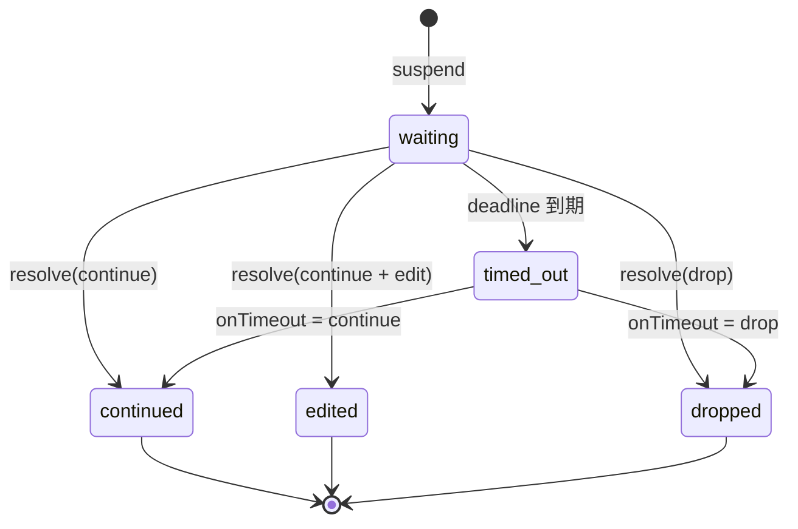
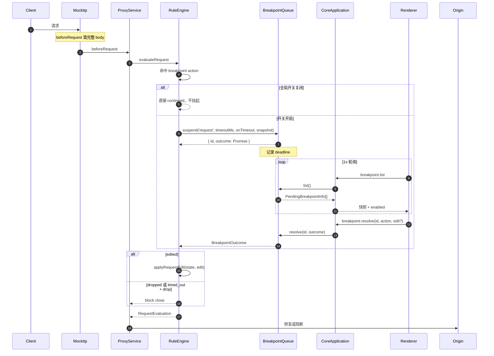
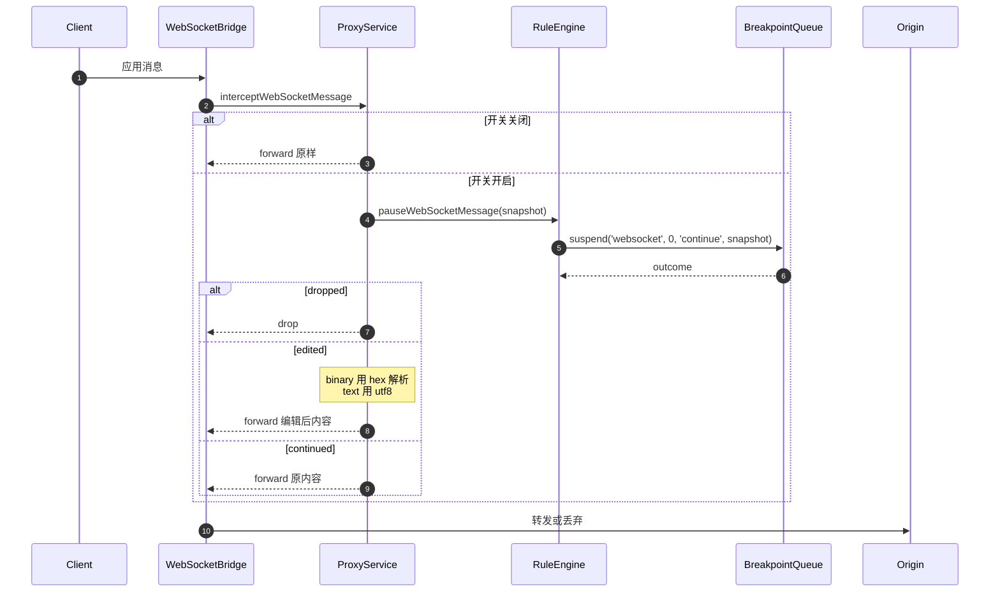

# Feature: Breakpoints

> 最后更新：2026-07-26
> Core 模块：`apps/proxy-core/src/proxy-core/rules/rule-breakpoint-queue.ts`
> Renderer 模块：`apps/desktop/src/renderer/features/breakpoints/`

## 1. 职责与边界

Breakpoints 在真实转发路径上**挂起**请求或响应，等待用户放行、编辑或丢弃。

| 归属 | 内容 |
| --- | --- |
| Breakpoints 负责 | 挂起状态机、超时策略、快照构造、用户编辑应用 |
| Breakpoints 不负责 | 匹配判定（属于 Rules）、记录（属于 Capture） |

断点由 `breakpoint` 类型的 Rule Action 触发，因此它是 Rules 的子系统，共享 `RuleEngine` 的执行上下文。

**代价明确**：断点必须看到完整内容才有意义，因此它是唯一**必须缓冲**的 action 类型。请求断点会等完整 request body，响应断点会等完整 response body。

## 2. 参与者

| 参与者 | 职责 |
| --- | --- |
| `RuleEngine` | 遇到 `breakpoint` action 时调用 `awaitBreakpoint` |
| `BreakpointQueue` | 持有等待中的断点，提供 suspend/resolve/list/closeAll |
| `WebSocketBridge` | WebSocket 消息转发前调用 `pauseWebSocketMessage` |
| `CoreApplication` | 路由 `breakpoint.*` 命令 |
| Renderer `useBreakpoints` | 1s 轮询列表，提交解决方案 |

## 3. 状态机



**强制超时**：每个断点携带 `timeoutMs` 与 `onTimeout` 策略，绝不允许无限期挂起真实流量。RPC 连接断开时 `closeAll()` 释放全部等待。

## 4. 调用流程

### 4.1 请求断点



### 4.2 响应断点

流程相同，区别在于：

- 触发点是 `beforeResponse`，此时已 `streamToBuffer` 完整响应。
- 快照来自 `buildResponseSnapshot(ruleName, state)`，包含 statusCode 与 headers。
- `dropped` 返回 `block close`，客户端收到连接关闭。

### 4.3 WebSocket 消息断点



WebSocket 断点开关独立于 HTTP 断点，通过 `websocket.breakpoint.configure` 控制。

## 5. 为什么用轮询而非推送

请求在 Core 侧 `await` 挂起，Renderer 只需感知"有断点在等"。1s 轮询延迟可接受，且避免为断点单独建立推送通道与 ack 机制。

`breakpointsStore` 在轮询期间**不覆盖用户正在编辑的草稿**，只更新列表与倒计时。

## 6. 数据契约

```ts
interface BreakpointSnapshot {
  ruleName: string;
  method?: string;
  url?: string;
  statusCode?: number;
  direction?: 'sent' | 'received';   // WebSocket
  opcode?: 1 | 2;                    // WebSocket
  bodyFormat: 'text' | 'hex';
  headers: readonly RuleHeaderPair[];
  body: string;
}

interface BreakpointOutcome {
  state: 'continued' | 'edited' | 'dropped' | 'timed_out';
  edit?: BreakpointEdit;
  timeoutPolicy?: 'continue' | 'drop';
}
```

命令：

| 命令 | 用途 |
| --- | --- |
| `breakpoint.list` | 返回等待中快照与全局开关状态 |
| `breakpoint.resolve` | continue / drop，可携带编辑 |
| `breakpoint.configure` | 设置 HTTP 断点全局开关 |
| `websocket.breakpoint.configure` | 设置 WebSocket 断点开关 |

## 7. 与当前实现的差异

| 项 | 当前 | 目标 |
| --- | --- | --- |
| 快照 body | `Mutable*State` 初始化不带原始 body，快照常为空 | 带入有限预览 |
| 大正文 | 无策略 | 有限预览 + 按需编辑，不制造第二份无界内存 |
| Binary body | 一律 UTF-8 replacement | text / hex 双模式，保留编码与长度 |
| 编辑后 framing | 未验证 | 校验 content-length、content-encoding、H2 framing |

## 8. 验收要点

- [ ] 断点快照包含真实原始 body，不是空字符串。
- [ ] 大正文断点有明确的预览上限与提示，不 OOM。
- [ ] Binary 消息可用 hex 编辑并正确还原。
- [ ] 超时按 `onTimeout` 策略正确 continue 或 drop。
- [ ] RPC 断开时全部等待被释放，不泄漏挂起请求。
- [ ] Execute edited 后 content-length 与 encoding 一致。
