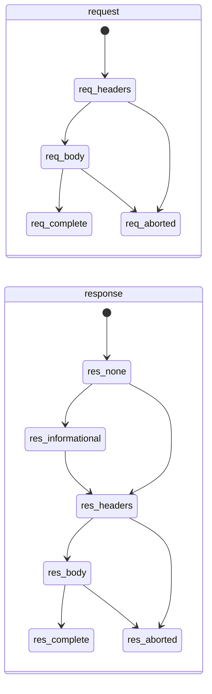
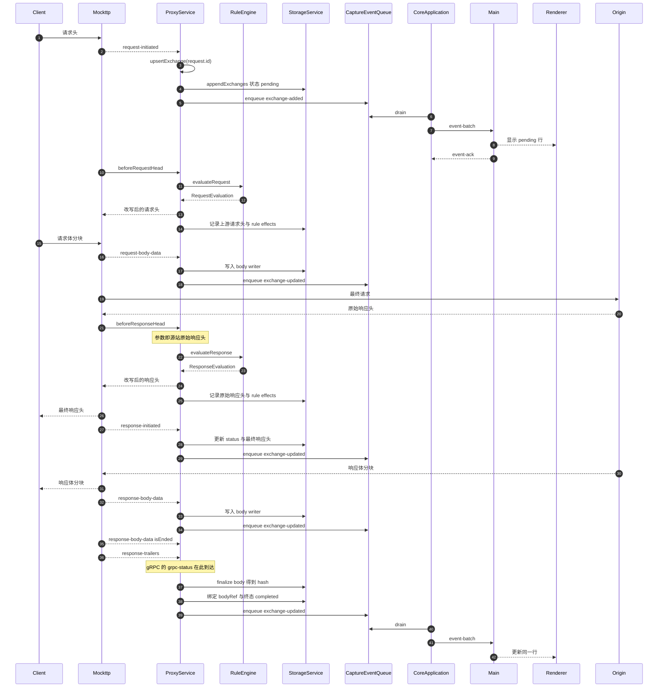
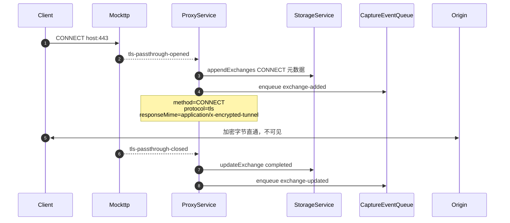
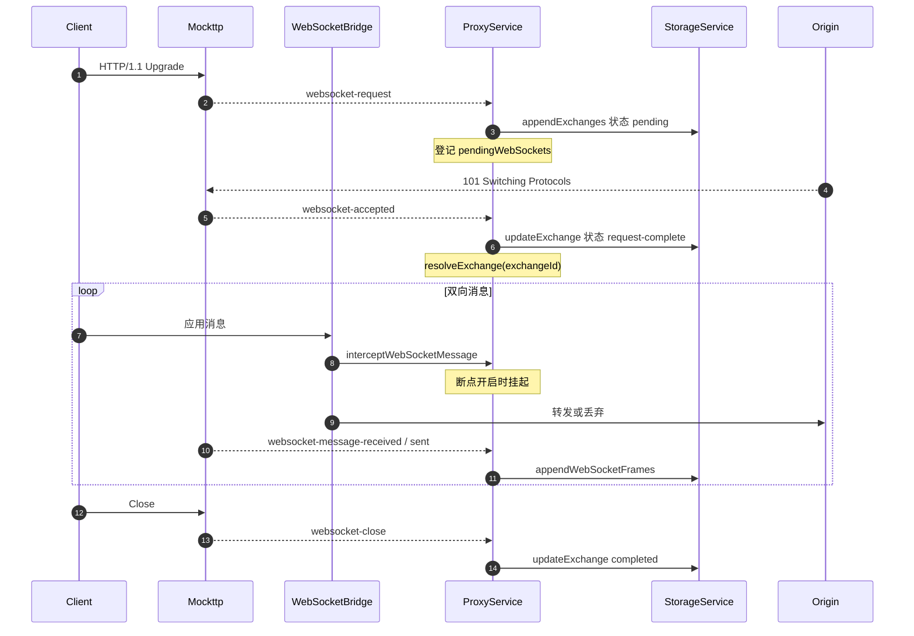
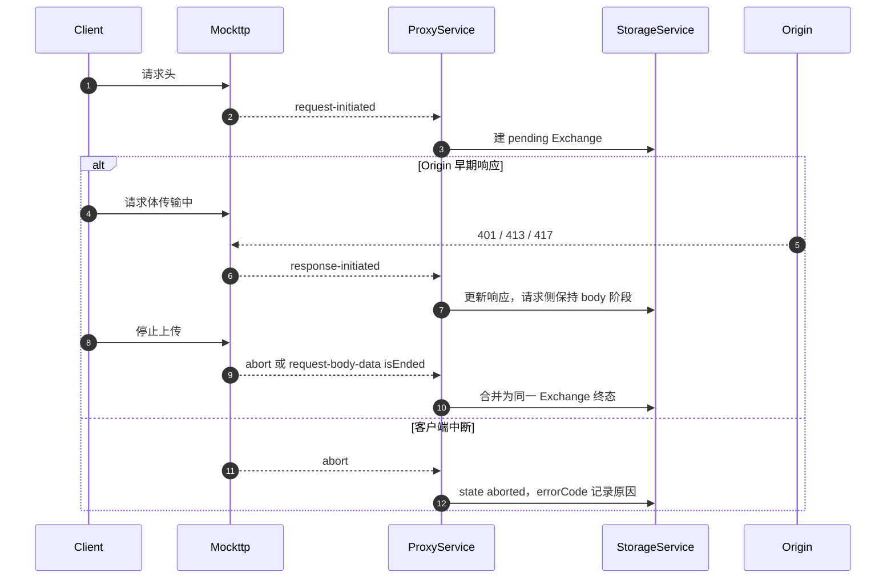
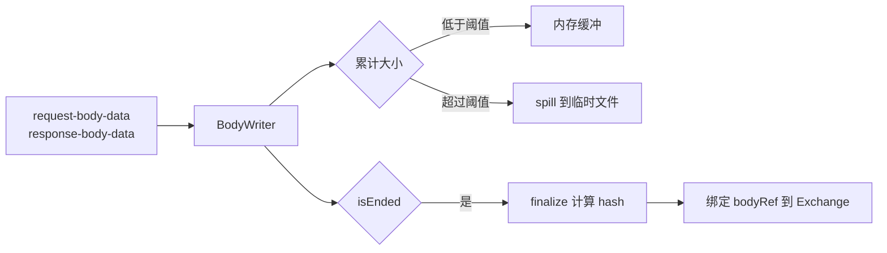
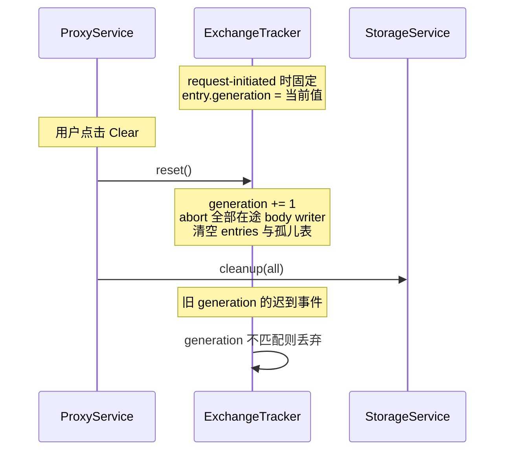

# Feature: Capture

> 最后更新：2026-07-26
> Core 模块：`apps/proxy-core/src/proxy-core/proxy/`、`apps/proxy-core/src/proxy-core/storage/`
> Renderer 模块：`apps/desktop/src/renderer/features/capture/`

## 1. 职责与边界

Capture 负责**观察并记录**经过代理的全部流量事实，不参与转发决策。

| 归属 | 内容 |
| --- | --- |
| Capture 负责 | Exchange 生命周期、正文落盘、WebSocket 帧、CONNECT 隧道元数据、事件推送 |
| Capture 不负责 | 转发、改写、阻断、断点挂起（属于 Rules） |

**核心原则 [已实现]**

> 收到 request headers 的瞬间就创建 Exchange、写入存储、推送 Renderer。此后的 request body、Rule 效果、response headers、response body、trailer、abort 全部是对**同一个 Exchange** 的增量更新。

Capture 绝不等待请求或响应完成才建立记录。实现位于 `proxy/proxy-exchange-tracker.ts` 的 `ExchangeTracker`。

## 2. 参与者

| 参与者 | 归属 | 职责 |
| --- | --- | --- |
| Client | 外部 | 浏览器或应用，经系统代理指向 `127.0.0.1:8888` |
| Mockttp | Core 内库 | 接入连接、TLS/H2 协商、上游转发、生命周期事件 |
| `ProxyService` | `proxy/entry.ts` | 拥有 Mockttp server，订阅事件，协调规则与存储 |
| `RuleEngine` | `rules/entry.ts` | 计算规则决策（详见 feature-rules） |
| `StorageService` | `storage/entry.ts` | Exchange 记录、正文内容寻址存储 |
| `CaptureEventQueue` | `proxy/proxy-capture-event-queue.ts` | 按 Exchange 合并的非阻塞事件队列 |
| `CoreApplication` | `core-application.ts` | 定时 drain 队列，按背压窗口推送 |
| Main | Desktop | 转发 event batch，不持有正文 |
| Renderer | Desktop | 应用事件到 Zustand，按需拉详情 |
| Origin | 外部 | 真实源站 |

**ProxyService 是每个请求的唯一协调者**，因为只有它同时处在事件订阅和规则执行两条路径上。

## 3. Mockttp 事件语义

这是整个 Capture 设计的事实基础。以下均已通过阅读 `node_modules/mockttp/dist/` 源码确认。

### 3.1 事件清单

| 事件 | 载荷 | 代表 | 已被规则改写 |
| --- | --- | --- | --- |
| `request-initiated` | `InitiatedRequest` | 客户端原始请求头 | 否 |
| `request-body-data` | `BodyData` | 客户端请求体增量 | 否 |
| `request` | `CompletedRequest` | 完整请求 | 否 |
| `response-initiated` | `InitiatedResponse` | 写回客户端的响应头 | **是** |
| `response-information` | `InformationalResponse` | 1xx 中间响应 | — |
| `response-body-data` | `BodyData` | 写回客户端的响应体增量 | **是** |
| `response` | `CompletedResponse` | 完整响应 | 是 |
| `abort` | `AbortedRequest` | 请求中断 | — |
| `request-trailers` / `response-trailers` | `TrailerData` | trailer（**本仓库 patch 新增**） | 响应侧为是 |
| `rule-event` | `RuleEvent<T>` | 转发过程内部细节（Mockttp 原生，**当前未订阅**） | 见 3.3 |
| `websocket-request` / `websocket-accepted` / `websocket-message-received` / `websocket-message-sent` / `websocket-close` | — | WebSocket 生命周期 | — |
| `tls-passthrough-opened` / `tls-passthrough-closed` | `TlsPassthroughEvent` | 未解密 CONNECT 隧道 | — |
| `tls-client-error` / `client-error` | — | 握手与协议错误 | — |

### 3.2 completed 事件会强制全量缓冲 [必须规避]

`mockttp-server.js` 的 `handleRequest`：

```js
const hasResponseListener = emitter.listenerCount('response') > 0;
if (hasResponseListener) {
    // Start buffering response body if there's somebody who might want to hear about it later
    response.body.asBuffer().catch(() => { });
}
```

`announceCompletedRequestAsync` 同理调用 `waitForCompletedRequest(request)`。

**结论：只要订阅 `request` 或 `response`，Mockttp 就会无条件把完整正文缓冲进内存。** Mockttp 默认 `maxBodySize = Infinity`，因此 67 MB 视频会完整驻留内存。

Capture 必须**退订这两个事件**，改用 initiated + body-data 组合。

### 3.2.1 trailer 需要 patch [已实现]

**什么是 trailer**：HTTP 允许在 chunked 正文**结束之后**再发一组 header，叫 trailer。它存在的
理由是有些值只有传完正文才知道——校验和、签名、以及最重要的 **gRPC 状态**。

gRPC 的调用结果不在响应头里，而在 trailer：

```text
:status: 200
content-type: application/grpc+proto
<...gRPC 消息帧...>
grpc-status: 0        ← trailer，正文之后才发出
grpc-message: OK
```

也就是说，**没有 trailer 就读不到 gRPC 的成功/失败状态**。请求侧 trailer 在实践中极少使用
（客户端上传完再附校验和），但响应侧 trailer 是 gRPC 的必需品。

**为什么需要 patch**：Mockttp 只在 `CompletedRequest.rawTrailers` / `CompletedResponse.rawTrailers`
暴露 trailer，而拿到 completed 对象就意味着全量缓冲正文（见 3.2）。阶段一退订 completed 事件后，
trailer 会随之丢失，gRPC 面板的状态列会坏掉。

因此仓库维护 patch（`patches/mockttp+4.5.0.patch`）给 Mockttp 增加独立的
`request-trailers` / `response-trailers` 事件，让 trailer 与正文缓冲解耦：

- `request-utils.js` 的 `rawTrailers` setter 与 `addTrailers` override 中回调 `options.onTrailers`
- `mockttp-server.js` 增加 `announceTrailersAsync`，仅在有 listener 时启用
- `mockttp.d.ts` / `types.d.ts` 补齐 `TrailerData` 与事件签名

代理转发上游 trailer 时走的正是 `clientRes.addTrailers()`，而 `trackResponse` 已经 override 了
该方法，因此这个 patch 点能覆盖 H1 与 H2 两条路径。

patch 经 `patch-package` + 根 `postinstall` 自动重放，升级 Mockttp 时若不适用会直接报错。

### 3.3 `rule-event`：Mockttp 原生能力，当前未使用

`rule-event` 是 Mockttp **自带**的公开事件（不是本仓库 patch 新增的），`request-step-impls.js`
在转发过程中发出：

| `eventType` | 内容 | 位置 |
| --- | --- | --- |
| `passthrough-request-head` | 发往 Origin 的**最终** wire 请求头 | L922 |
| `passthrough-request-body` | `{ overridden, rawBody? }` | L931 |
| `passthrough-response-head` | Origin **原始**响应头 | L562 |
| `passthrough-response-body` | `{ overridden, rawBody? }` | L682/762/769 |
| `passthrough-abort` | 上游中断 | L847 |

设计早期曾打算用它采集四组 headers，**因为那时假设规则改写由 Mockttp 内部的
`transformResponse` 执行，我们看不到执行过程**，只能靠对比前后快照反推。

阶段二引入 `beforeRequestHead` / `beforeResponseHead` 后这个前提不成立了：规则改写回到
`RuleEngine` 自己手中，所以**不再需要 `rule-event`**，当前代码也没有订阅它。

仍然只有 `rule-event` 能提供、但当前不需要的两项：

- **wire 级精确的上游请求头**。钩子返回值之后，Mockttp 还会自己调整 host 与 content-length，因此 `passthrough-request-head` 与钩子返回值可能有细微差异。
- **区分上游中断与客户端中断**。`abort` 事件只代表客户端侧。

如果将来需要这两项，再订阅即可；启用成本为零：

```js
emitEventCallback: (emitter.listenerCount('rule-event') !== 0) ? ... : undefined
```

### 3.4 四组 headers 全部零缓冲 [已实现]

| Evidence | 来源 |
| --- | --- |
| 客户端原始请求头 | `request-initiated` |
| 发往 Origin 的最终请求头 | `beforeRequestHead` 返回值（由 RuleEngine 构造） |
| Origin 原始响应头 | `beforeResponseHead` 参数 |
| 回客户端的最终响应头 | `response-initiated` |

四者均不缓冲正文。Rule 效果 marker（生效值、被替代旧值、被删除值）由 `RuleEngine` 在
执行每个 header action 时直接记录 `previousValues` 产出，不需要从前后快照反推。

### 3.5 顺序不保证

`handleRequest` 内部：

```js
this.announceInitialRequestAsync(emitter, request);          // L527，setImmediate
let nextRulePromise = this.findMatchingRule(...);            // L553，matcher
await nextRule.handle(request, response, {...});             // L566，beforeRequest
```

`announceInitialRequestAsync`、`announceBodyDataAsync`、`announceRuleEventAsync` 全部用 `setImmediate` 延迟 emit，而规则执行走独立 Promise 链。

**因此所有 Capture 逻辑必须按 `request.id` 做幂等 upsert，谁先到谁创建记录，不得假定顺序。**

### 3.6 body-data 是旁路且自带攒批

`trackResponse` 建立独立 `PassThrough` 复制数据，`emitBodyDataEvents` 按 `CHUNK_BUFFER_INTERVAL_MS` 合并 chunk 后回调。

```js
bodyStream.on('data', (d) => {
    pendingContent = pendingContent ? Buffer.concat([pendingContent, d]) : d;
    if (!pendingContentTimer) {
        pendingContentTimer = setTimeout(() => flushPendingContent(false), CHUNK_BUFFER_INTERVAL_MS);
    }
});
```

Mockttp **不等待**我们处理完成，因此背压责任在 Capture 侧。

## 4. Exchange 状态机

请求侧与响应侧独立推进，因为 Origin 可能在请求体传完前就返回（401/413/417）。



对外暴露的聚合状态：

| `state` | 含义 |
| --- | --- |
| `pending` | 已收到请求头，尚无响应头 |
| `request-complete` | 请求已完整，等待响应（WebSocket 101 后也用此值） |
| `response-streaming` | 已收到响应头，正文传输中 |
| `completed` | 双向完成 |
| `aborted` | 客户端或 Origin 中断 |
| `failed` | Capture 持久化失败或协议错误 |

**迁移规则：**

1. 终态（`completed`/`aborted`/`failed`）不可回退。
2. 迟到或重复事件不得重复累加 bytes，使用 observed 计数覆盖而非累加。
3. `abort` 可以从任意非终态直接进入。

## 5. 调用流程

### 5.1 HTTP/HTTPS 常规请求（主路径）



**逐步说明：**

1. **请求头到达**：`ProxyService` 在 `request-initiated` 回调内检查 `recording` 与 capture generation，通过后分配 `exchangeId`，写入 `ExchangeInput{ state: 'pending' }`，立即 enqueue `exchange-added`。UI 在一个 flush 周期内看到该行。
2. **请求规则**：`beforeRequestHead` 与步骤 1 并行，不保证先后。`ProxyService` 用同一 `request.id` 找到（或暂存到孤儿表等待）Exchange 记录，附加 `ruleIds` 与 header effects。钩子**不等请求正文**。
3. **请求体**：每个 `request-body-data` 把 `content` 追加进该 Exchange 的 request body writer，更新 `requestBytes`。`isEnded` 时 finalize 得到 hash 并绑定 `requestBodyId`。
4. **源站响应头**：`beforeResponseHead` 的参数就是 Origin 原始响应头，作为 response Rule 效果的对照。钩子**不缓冲响应正文**。
5. **最终响应头**：`response-initiated` 提供实际写回客户端的值，更新 `statusCode`、`responseMime`、`responseStartedAt`，状态转 `response-streaming`。
6. **响应体**：同请求体，写入 response body writer。
7. **trailer**：`response-trailers` 追加记录；gRPC 的 `grpc-status` 由此路径获得。
8. **终态**：响应体 `isEnded` 后写入 `completedAt` 与 `state: 'completed'`。

### 5.2 CONNECT 隧道（未解密）[已实现]

未配置 CA 或用户未开启解密时，HTTPS 走字节直通，只记录有限元数据。



`pendingTunnels` 保存 `Promise<PendingTunnelCapture | null>`，确保 closed 事件等待 opened 落库后才更新。隧道内不读取任何 header 或 body。

### 5.3 WebSocket [已实现]

101 Exchange 由 `websocket-accepted` 完成。不能依赖 completed `response`，因为订阅它会
触发全量正文缓冲（见 3.2）。



约束：

- 消息按 `streamId` 串行 `writeTail` Promise 链，保证顺序且等待 101 Exchange 先落库。
- payload 复用 `TemporaryBodyStore`，按 hash 去重。
- 仅支持 HTTP/1.1 Upgrade，H2 Extended CONNECT 未实现。

### 5.4 中断与早期响应



**关键修复点**：当前实现只在 completed `request` 事件建立 `pending` 映射，若 `response` 先到会找不到请求而**直接丢弃整条记录**。改用 `request-initiated` 后，Exchange 在请求头阶段就已存在，早期响应可以正常合并。

## 6. 正文存储

### 6.1 增量写入 [已实现]



**内容寻址的必然约束**：`TemporaryBodyStore` 按内容 hash 去重，因此 **hash 只有写完才能确定**。传输过程中 Exchange 只能记录 observed bytes，`requestBodyId` / `responseBodyId` 必须在 `isEnded` 后绑定。

UI 表现为：大小实时增长，但预览与保存要等传输完成。

### 6.2 阈值语义 [已实现]

| | 改造前 | 现在 |
| --- | --- | --- |
| 判断依据 | 完整 buffer 的总大小 | 累计写入字节数 |
| spill 时机 | 拿到完整 buffer 后 | 累计跨过阈值立即 |

差别关键：增量场景下每个 chunk 都小于阈值，只有累计后才跨过。若仍按完整大小判断，
67 MB 视频会先在内存里攒满再 spill，改造就失去意义。

### 6.3 背压

Mockttp 不等待 Capture 落盘，因此限制责任在我们这侧：

1. [已实现] 每个 body writer 维护有界待写队列，上限为 `BODY_WRITER_PENDING_LIMIT_BYTES`。
2. [已实现] 队列超限时降级：停止保存内容，仅累计 observed bytes，`finalize()` 返回 `null` 不绑定 bodyRef。
3. [待做] 降级状态必须在 UI 明示，不得让用户误以为正文为空。

磁盘写入失败只跳过该正文，绝不影响转发、RPC 或进程状态。

## 7. Recording、Pause 与 Clear

### 7.1 三种状态

| 操作 | 命令 | 效果 |
| --- | --- | --- |
| Start | `proxy.start` | 启动 listener（若未启动），`recording = true` |
| Stop | `proxy.setRecording{false}` | **只暂停记录**。listener 与系统代理保持运行，流量继续转发 |
| Clear | `storage.cleanup{all}` | 推进 cutoff，删除全部 Exchange 与正文 |

Stop 不停止转发，也不恢复系统代理。系统代理只在应用退出、Core 故障恢复、用户显式 Restore 或紧急修复时恢复。

### 7.2 Capture generation [已实现]



**判定规则：以请求开始时的状态为准。**

- 录制中开始、暂停后完成的长请求：继续完整记录。
- 暂停期间开始、恢复后完成的请求：始终不记录。
- Clear 后旧 generation 的所有 request/body/response/trailer/rule hit 全部拒绝，不得重新创建行。

## 8. 数据契约

### 8.1 Core 内部接口

`CaptureSink`（`proxy/interfaces/index.ts`）[已实现]：

```ts
interface CaptureSink {
  ensureSession(session: CaptureSessionInput): Promise<void>;
  appendExchanges(exchanges: ExchangeInput[]): Promise<{ id: string; seq: number }[]>;
  updateExchange(patch: ExchangePatch): Promise<void>;
  writeBody(source: AsyncIterable<Uint8Array>): Promise<BlobWriteResult>;
  createBodyWriter(): BodyWriter;
  appendRuleHits(exchangeId: string, hits: readonly RuleHitRecord[]): Promise<void>;
  appendWebSocketFrames(exchangeId: string, frames: readonly WebSocketFrameInput[]): Promise<void>;
}
```

`ExchangePatch` 除 `id` 外全部可选，未提供的字段保持原值，覆盖：

- 请求侧：`requestBytes`、`requestBodyId`、`requestMime`、`requestSentAt`、`requestBody`
- 响应侧：`statusCode`、`statusText`、`responseMime`、`responseStartedAt`、`responseBytes`、`responseBodyId`、`responseBody`
- 通用：`headers`（追加）、`ruleIds`（去重合并）、`errorCode`、`state`、`completedAt`

`writeBody` 是 pull 式、可背压，用于 WebSocket 单条消息；`createBodyWriter` 是 push 式、
不可阻塞，用于 HTTP 正文的 body-data 事件。两者语义不同，不能互相替代。

### 8.2 事件契约

```ts
interface CaptureEventSink {
  enqueue(kind: CaptureExchangeEventKind, summary: CaptureExchangeSummary): void;
}
```

`CaptureExchangeSummary` 需支持 pending 表达：`statusCode` 与 `durationMs` 可缺省，Renderer 据此渲染进行中状态。

队列合并行为：同 id 事件就地合并，**保留首次 sequence、摘要取最新、kind 不更新**。因此 `exchange-added` 尚未 drain 时到来的 `exchange-updated` 会被正确压成一条 added。

### 8.3 Renderer 命令

| 命令 | 用途 |
| --- | --- |
| `sessions.query` | keyset 分页拉取 summary |
| `sessions.detail` | 单条完整 headers 与 body 引用 |
| `body.read-range` | 按 hash + offset + length 读取正文片段 |
| `websocket.frames` | WebSocket 帧分页 |
| `grpc.messages` | gRPC envelope 分页 |
| `proxy.start` / `proxy.stop` / `proxy.status` / `proxy.setRecording` | 生命周期 |
| `storage.cleanup` | Clear |

## 9. Renderer 数据层


**分层规则：**

- Zustand 只保存全部 `CaptureExchangeSummary` 与视图状态（filter、selection、scrollTop、tab、宽度）。
- 完整 headers、body、WebSocket/gRPC payload **不进入全局状态**，按需拉取。
- `useCaptureData` 常驻 App，跨 feature 持续接收事件。
- 列表用固定 52px 行的 TanStack Virtual 虚拟化。
- 过滤完全在 Renderer 派生。

**预览上限：**

| 内容 | 上限 |
| --- | --- |
| 文本 / HTML / JSON | 1 MiB |
| WebSocket / gRPC payload | 1 MiB |
| CodeMirror / Hex viewport | 320px |
| `video/*` / `audio/*` | 零读取，仅经 Save Dialog 导出 |

## 10. 与当前实现的差异

阶段一已落地：

| 项 | 改造前 | 现在 |
| --- | --- | --- |
| Exchange 创建时机 | completed `request` + `response` 配对后 | `request-initiated` 立即 |
| completed 事件订阅 | 已订阅，触发全量缓冲 | 已退订 |
| 正文写入 | 拿到完整 buffer 后一次写 | body-data 增量写 |
| 早期响应 | `response` 先到会丢弃记录 | 按 request.id 合并 |
| WebSocket 101 | 依赖 completed `response` | 改用 `websocket-accepted` |
| trailer | 来自 completed 事件 | 专用 trailer 事件（patch） |
| `updateExchange` | `{id, completedAt, state}` | 全字段 patch |
| body 阈值 | 按总大小 | 按累计字节 |
| generation | 仅 `captureCutoff` 时间切面 | 显式 generation |

阶段二已落地：

| 项 | 改造前 | 现在 |
| --- | --- | --- |
| 请求规则预筛选 | `.matching(callback)` 等完整 body | `beforeRequestHead` 头部阶段判定 |
| 响应规则执行 | 一律 `beforeResponse` 全量缓冲 | `beforeResponseHead` 流式 |
| Rule evidence | 需要从前后快照反推 | `RuleEngine` 执行时直接记录 `previousValues` |

仍待完成：

| 项 | 当前 | 目标 |
| --- | --- | --- |
| Breakpoint 正文 | 快照不带正文 | 带入 Capture 已接收的增量片段 |
| Clear 与文件任务 | 无 lease 保护 | snapshot / lease 语义 |
| 进行中状态展示 | Renderer 仅按状态码占位 | 明示 pending / streaming 与已接收字节 |

## 11. 验收要点

- [x] 规则命中时的慢上传：Origin 在第二块正文发出前收到 headers。
- [x] 规则命中时的下载：响应头先于源站正文结束到达客户端。
- [x] 早期 401/413/417：Exchange 完整保留。
- [x] Clear 后旧 generation 的迟到事件被全部丢弃。
- [x] WebSocket 捕获在退订 completed 事件后仍完整。
- [x] gRPC `grpc-status` trailer 在退订 completed 事件后仍可读。
- [ ] 67 MB Range 视频：全程流式，Core 内存峰值不随文件大小线性增长。
- [ ] SSE 与无限 chunked 响应：行立即出现，字节持续增长。
- [ ] Pause 前开始、Pause 后完成的请求继续记录。
- [ ] 四组 headers 在 Inspector 中可区分展示。
