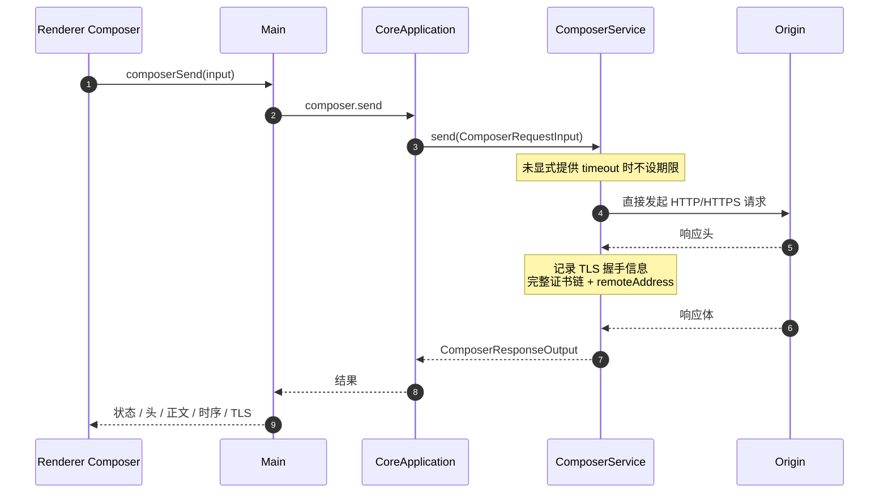
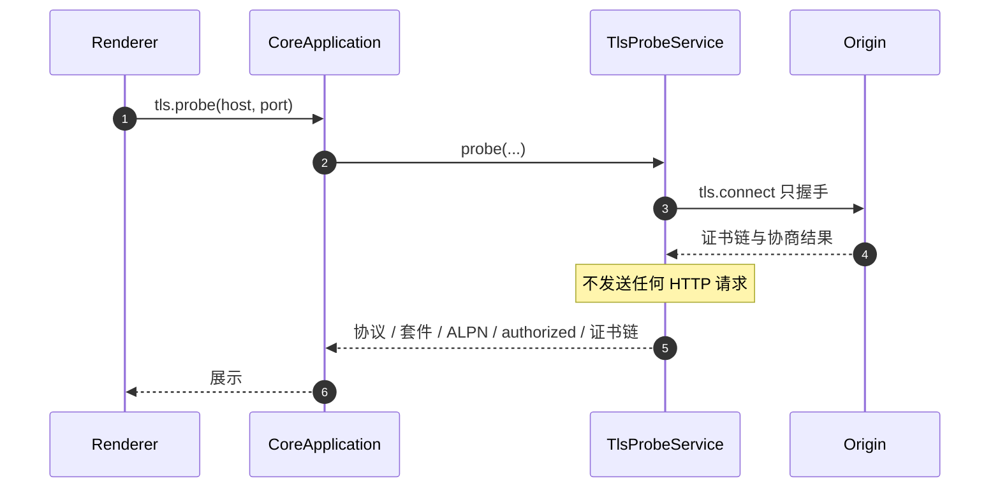
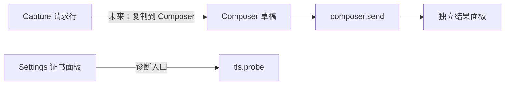

# Feature: Composer

> 最后更新：2026-08-04
> Core 模块：`apps/proxy-core/src/proxy-core/composer/`、`apps/proxy-core/src/proxy-core/tls-probe/`
> Renderer 模块：`apps/desktop/src/renderer/features/composer/`
> UI 设计：`design/app/` 的 composer 视图（34 张截图）与 `design/design-system.md` 的「Composer 工作区」一节，**设计已定稿、尚未落地**。

## 1. 职责与边界

Composer 让用户手工构造并发送请求，Connection 提供独立的 TLS 握手探测。

| 归属 | 内容 |
| --- | --- |
| Composer 负责 | 构造请求、直接发出、采集完整响应与时序 |
| Connection 负责 | 只握手不发请求，读取协议/套件/ALPN/证书链 |
| 两者都不负责 | 经过代理监听端口、写入 Capture、应用 Rules |

**关键边界：Composer 请求不经过代理数据面。** 它由 `ComposerService` 直接发起，因此：

- 不出现在 Capture 列表中。
- 不受 Rules 影响。
- 不受 Recording 开关影响。

这是刻意设计：Composer 是调试工具，需要可预期的纯净行为。

## 2. 调用流程

### 2.1 发送请求



采集内容：

| 类别 | 字段 |
| --- | --- |
| 响应 | statusCode、statusText、headers、body |
| 时序 | DNS、连接、TLS 握手、首字节、完成 |
| TLS | protocol、cipher、ALPN、authorized、完整去重证书链 |
| 网络 | remoteAddress、remotePort |

Renderer 历史记录不淘汰。

### 2.2 连接探测



用于诊断 MITM 兼容性、证书链问题、ALPN 协商结果。

## 3. 数据契约

```ts
interface ComposerRequestInput {
  method: string;
  url: string;
  headers: readonly RuleHeaderPair[];
  body?: string;
  timeoutMs?: number;          // 缺省时不设期限
  ignoreCertificateErrors?: boolean;
}
```

命令：

| 命令 | 用途 |
| --- | --- |
| `composer.send` | 发送构造的请求 |
| `tls.probe` | TLS 握手探测 |

## 4. 与其他 feature 的关系



当前 Composer 与 Capture 之间没有直接联动。若未来支持"从 Capture 复制到 Composer"，必须明确复制的是客户端原始请求还是发往 Origin 的最终请求。

## 5. UI 重构与 Collection [设计已定稿，未实现]

设计稿把 Composer 从「左请求 / 右响应」改成 **`Collection 分栏 / splitter / 工作区`**，工作区纵向为 `文档标签条 · URL 行 · 请求编辑区 · splitter · 响应区`。这带来一块**当前完全不存在的能力：请求集合的持久化**。

### 5.1 Collection 需要新增的东西

| 层 | 新增内容 |
| --- | --- |
| Core | `workspace/entry.ts` 的 `WorkspaceService.loadCollection` / `saveCollection`，与 RuleSet 完全同构：`collection_tree` 单行表 + 整棵树存一个 JSON + 乐观锁 revision |
| Protocol | 只有 `collection.get` 与 `collection.replace` 两条命令 |
| Preload | `getCollection()` / `replaceCollection(expectedRevision, tree)` |
| Renderer | 目录树、行内重命名、选中目录作为新建目标、多请求文档 tab |

**为什么不做树形表和增量命令**：Collection 只有几十到几百条，整棵树序列化成 JSON 的开销可以忽略。做成 `collection_tree` 单行表后，父子关系、排序字段、`upsert`/`remove`/`move` 三条增量命令与它们各自的并发语义全部不需要存在，读写只有"读整棵树"和"写整棵树"两条路径。

**编辑即生效**：文档 tab 就是 Collection 里的条目，改动直接写回，没有保存动作、没有未保存标记、没有 Save 按钮；Send 用的就是当前状态。`+` 新建时直接在选中目录下创建一条 `Untitled`。写入由 Renderer 节流，避免每次按键都落库。

### 5.2 Recent sends [设计已定稿，未实现]

URL 行的 `Recent sends` 是**重放记录**，与 Collection 是两件独立的事，不互相写入：列出最近发送的 method / URL / 状态码 / 相对时间，点击恢复为请求。是否持久化待定；只存内存即可满足设计稿表达。

### 5.3 请求 Body 的四档 [设计已定稿，未实现]

| 档位 | 形态 | 协议影响 |
| --- | --- | --- |
| None | 占位文案，无编辑器 | `body` 不传 |
| JSON | 可编辑 Monaco，Format 调 Monaco 自带格式化 | 无 |
| Text | 同上，语言为 plaintext，Format 禁用 | 无 |
| Form | 第三张 KV 表 | Renderer 编码成 `a=1&b=2` 字符串，**协议不变** |

**`multipart/form-data` 传文件不在本轮范围**：`ComposerRequestInput.body` 只接受 `string`，要传二进制必须先扩协议。

### 5.4 与现状的差距

现有 Renderer 只有单请求 + `RequestBuilder` / `ResponsePanel` 左右分栏，没有 Collection、没有多 tab、没有 Body 类型、没有响应 Timing 页。Core 侧 `composer.send` 已经采集了完整 timing 与 TLS，但 UI 从未展示——设计稿的 `Timing` 页用的就是这批既有数据，不需要扩协议。

## 6. 验收要点

- [ ] Composer 请求不出现在 Capture 列表。
- [ ] Composer 请求不受启用的 Rules 影响。
- [ ] 未设 timeout 的长请求不被强制中断。
- [ ] TLS 证书链完整且已去重。
- [ ] `tls.probe` 不产生任何 HTTP 流量。
