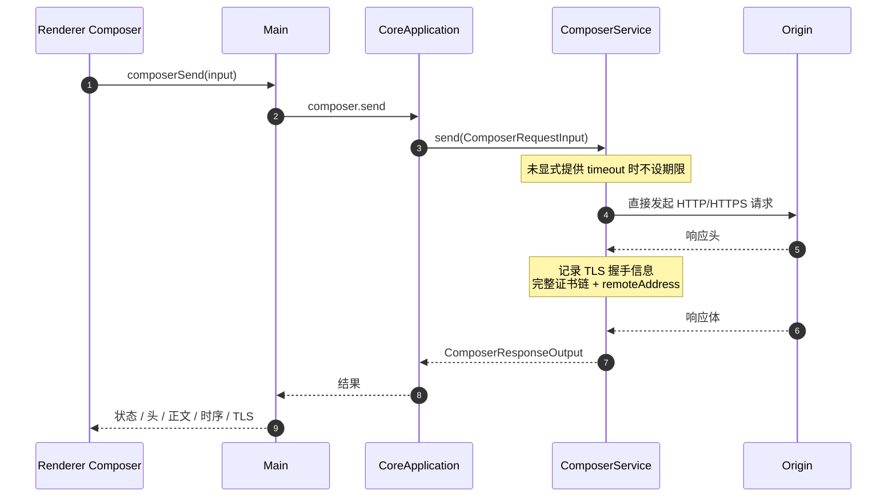
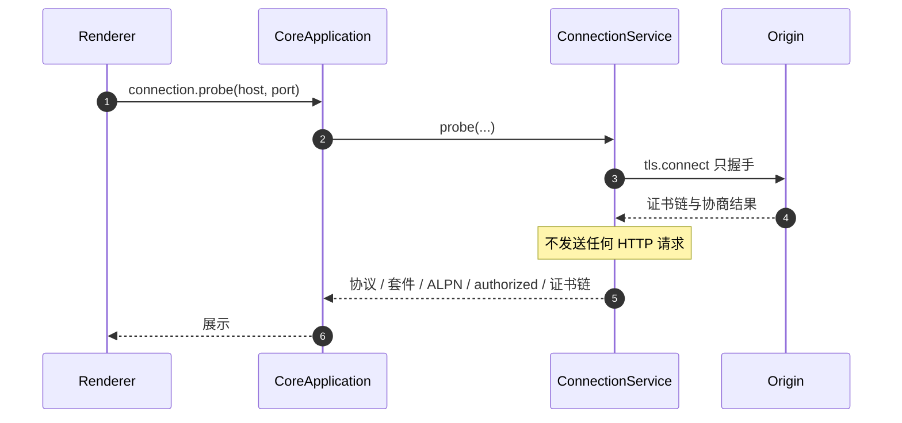
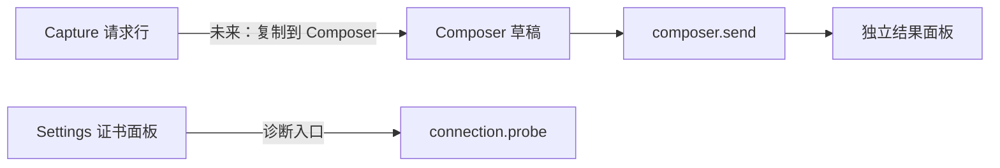

# Feature: Composer

> 最后更新：2026-07-26
> Core 模块：`apps/proxy-core/src/proxy-core/composer/`、`apps/proxy-core/src/proxy-core/connection/`
> Renderer 模块：`apps/desktop/src/renderer/features/composer/`

## 1. 职责与边界

Composer 让用户手工构造并发送请求，Connection 提供独立的 TLS 握手探测。

| 归属 | 内容 |
| --- | --- |
| Composer 负责 | 构造请求、直接发出、采集完整响应与时序 |
| Connection 负责 | 只握手不发请求，读取协议/套件/ALPN/证书链 |
| 两者都不负责 | 经过代理监听端口、写入 Capture、应用 Rules |

**关键边界：Composer 请求不经过代理数据面。** 它由 `ComposerService` 直接发起，因此：

- 不出现在 Capture 列表中。
- 不受 Rules 影响。
- 不受 Recording 开关影响。

这是刻意设计：Composer 是调试工具，需要可预期的纯净行为。

## 2. 调用流程

### 2.1 发送请求



采集内容：

| 类别 | 字段 |
| --- | --- |
| 响应 | statusCode、statusText、headers、body |
| 时序 | DNS、连接、TLS 握手、首字节、完成 |
| TLS | protocol、cipher、ALPN、authorized、完整去重证书链 |
| 网络 | remoteAddress、remotePort |

Renderer 历史记录不淘汰。

### 2.2 连接探测



用于诊断 MITM 兼容性、证书链问题、ALPN 协商结果。

## 3. 数据契约

```ts
interface ComposerRequestInput {
  method: string;
  url: string;
  headers: readonly RuleHeaderPair[];
  body?: string;
  timeoutMs?: number;          // 缺省时不设期限
  ignoreCertificateErrors?: boolean;
}
```

命令：

| 命令 | 用途 |
| --- | --- |
| `composer.send` | 发送构造的请求 |
| `connection.probe` | TLS 握手探测 |

## 4. 与其他 feature 的关系



当前 Composer 与 Capture 之间没有直接联动。若未来支持"从 Capture 复制到 Composer"，必须明确复制的是客户端原始请求还是发往 Origin 的最终请求。

## 5. 验收要点

- [ ] Composer 请求不出现在 Capture 列表。
- [ ] Composer 请求不受启用的 Rules 影响。
- [ ] 未设 timeout 的长请求不被强制中断。
- [ ] TLS 证书链完整且已去重。
- [ ] `connection.probe` 不产生任何 HTTP 流量。
