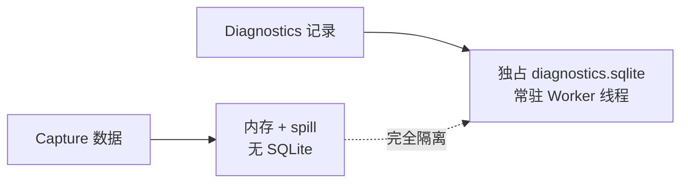
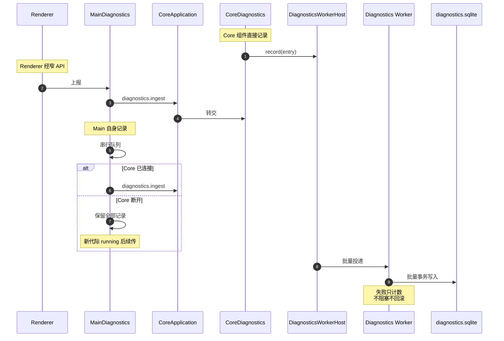
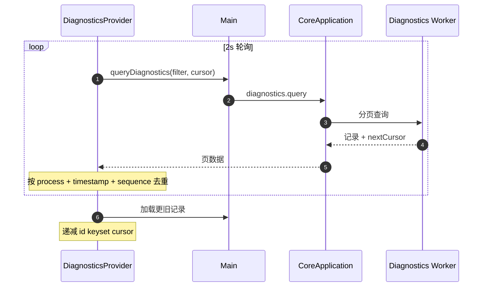
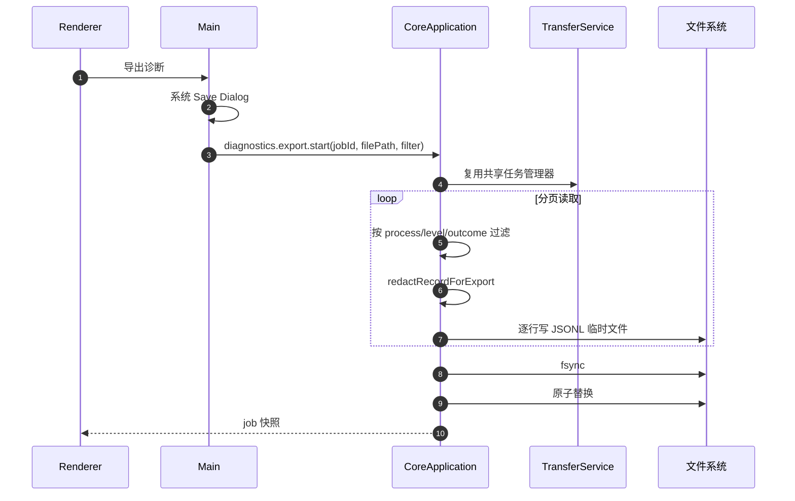

# Feature: Diagnostics

> 最后更新：2026-07-26
> Core 模块：`apps/proxy-core/src/proxy-core/core-diagnostics.ts`、`apps/proxy-core/src/proxy-core/diagnostics/`
> Renderer 模块：`apps/desktop/src/renderer/features/diagnostics/`

## 1. 职责与边界

Diagnostics 把 Core、Main、Renderer 三个进程的结构化记录汇入同一持久化存储，提供查询、分析与脱敏导出。

| 归属 | 内容 |
| --- | --- |
| Diagnostics 负责 | Trace/Action 结构化记录、持久化、分页查询、脱敏导出 |
| Diagnostics 不负责 | 业务正确性判断、告警、远程上报 |

**硬约束：日志失败绝不阻塞业务。** Diagnostics 写入失败只计数，不阻塞或回滚 Capture 写入，也不递归回灌同一 sink。

## 2. 存储隔离



Capture 与 Diagnostics 使用完全独立的存储路径与线程，互不影响。

## 3. 三进程汇入



`MainDiagnostics` 是完整串行队列。Core 断开期间不丢弃记录，等新代际 Core 进入 running 后续传。

## 4. 记录模型

### 4.1 DiagnosticsRecorder

各组件通过注入的 `DiagnosticsRecorder` 记录关键节点，`CoreDiagnostics` 是唯一实现：

```ts
interface DiagnosticsRecorder {
  info(phase: string, fields?: DiagnosticsFields): void;
  warn(phase: string, fields?: DiagnosticsFields): void;
  error(phase: string, fields?: DiagnosticsFields): void;
}
```

未注入时降为 no-op，便于单测直接 `new`。

### 4.2 关键节点

| 组件 | phase |
| --- | --- |
| `CoreRpcServer` | `rpc.connected`、`rpc.connection-failed`、每命令一条 `command.completed` |
| `CoreApplication` | `core.started`、`core.stopping`、`storage.ready`、`diagnostics.ready` |
| `ProxyService` | `proxy.listening`、`proxy.stopped`、`tls.reconfigured`、`tls.client-error`、`capture.persist-failed`、`exchange.aborted`、`exchange.server-error` |
| `CaptureService` | `storage.ready`、`storage.error` |

命令级精简为单条 `command.completed`。`diagnostics.recent` 与 `diagnostics.query` 本身静默，避免轮询自污染。

### 4.3 Trace 与 Action

`CoreDiagnostics` 用 `AsyncLocalStorage` 维护当前 Trace 上下文，命令执行期间的 Action 自动归属该 Trace，形成可展开的时间线。

## 5. 查询流程



支持的过滤条件：`process`（core/main/renderer）、`trace`、`command`、`level`、`outcome`、`duration`。

默认拉取 200 条，过滤变化时重查首页。

## 6. 保留策略

**不按数量、字节或时长淘汰。** Core 内存、待写队列与 SQLite 均无淘汰逻辑。

这是刻意选择：调试工具的日志一旦被淘汰就失去排障价值。容量管理交给用户显式清理。

## 7. 脱敏

双层脱敏：


脱敏对象：敏感键名、凭据片段、URL query。

**绝不序列化完整 Command payload 或 Body 到日志。**

## 8. 导出



Renderer 只拿到 job 快照，没有路径。

## 9. 性能约束

- 结构化日志的对象分配与 IPC 批次有成本，必须限制 attributes 数量。
- 低优先级记录可采样。
- 记录必须非阻塞。

## 10. 验收要点

- [ ] Core 断开期间 Main 记录不丢，恢复后完整续传。
- [ ] Diagnostics 写入失败不影响 Capture。
- [ ] 敏感 attribute 与 URL query 在库中与导出文件中均已脱敏。
- [ ] 轮询查询自身不产生新记录。
- [ ] keyset 分页在大数据量下稳定，无重复无遗漏。
