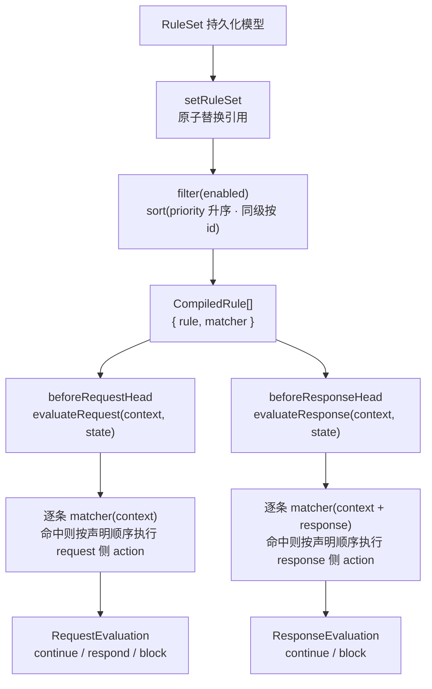
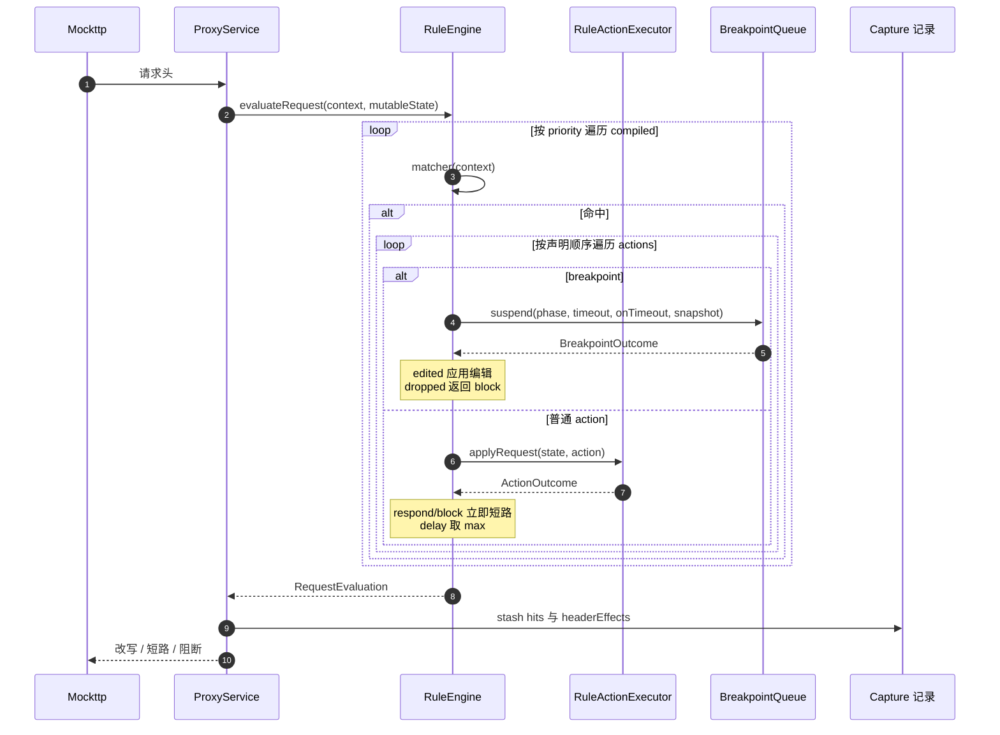
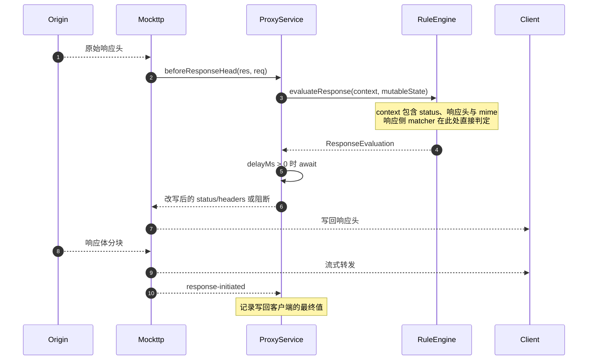
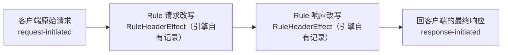
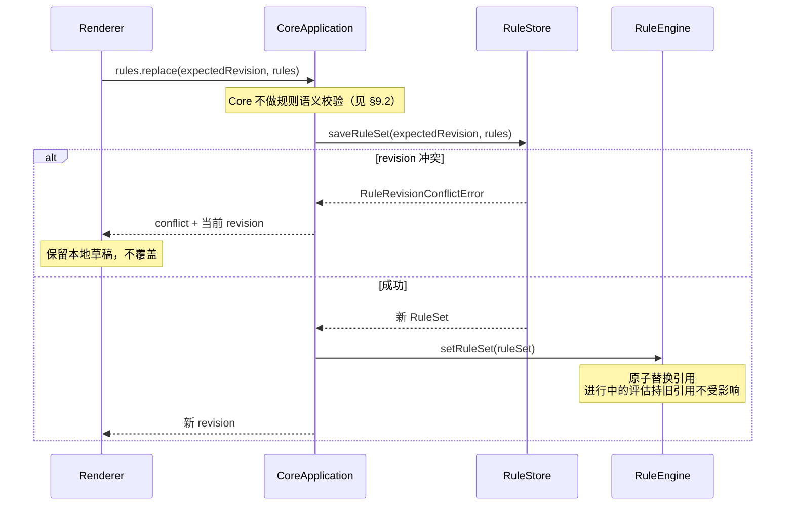
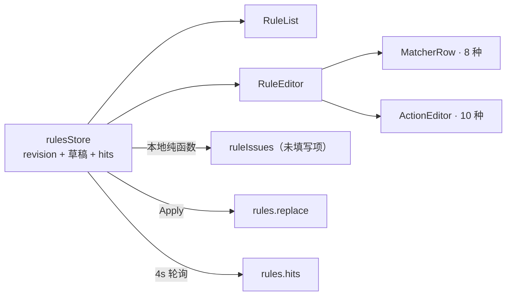

# Feature: Rules

> 最后更新：2026-07-28
> Core 模块：`apps/proxy-core/src/proxy-core/rules/`
> 协议模型：`packages/core-protocol/src/rules.ts`
> Renderer 模块：`apps/desktop/src/renderer/features/rules/`

## 1. 职责与边界

Rules 负责在真实转发路径上**干预**流量，并向 Capture 提供可审计证据。

| 归属 | 内容 |
| --- | --- |
| Rules 负责 | 匹配判定、改写、短路、阻断、延迟、断点挂起、证据产出 |
| Rules 不负责 | 网络 I/O、Exchange 生命周期、正文落盘、事件推送 |

**关键边界：**

- `RuleEngine` 只计算决策，返回 `RequestEvaluation` / `ResponseEvaluation`，**不发起任何网络操作**（唯一的本地 I/O 是 `map-local` 读取磁盘文件）。
- `ProxyService` 是唯一执行者，把决策转换为 Mockttp 的转发行为，包括 `delay` 的实际 await。
- Rules 的执行**不受 Recording 开关影响**。暂停记录时规则依然作用于真实流量，只是不产生 Capture 记录。
- 限速（throttle）已从协议、引擎与 UI 整体移除：规则全在头部阶段执行，真限速必须介入正文流；浏览器 DevTools 已自带该能力。

## 2. 领域模型

`RuleSet` 是可序列化纯数据，绝不包含 callback 或运行时句柄。

```ts
interface RuleSet {
  revision: number;
  rules: readonly RuleDefinition[];
}

interface RuleDefinition {
  id: string;
  name: string;
  enabled: boolean;
  priority: number;
  matchers: readonly RuleMatcher[];   // AND 关系
  actions: readonly RuleAction[];     // 按声明顺序执行
}
```

### 2.1 Matcher（8 种）

| type | 判定阶段 | 说明 |
| --- | --- | --- |
| `method` | 请求 | 精确方法名 |
| `host` | 请求 | contains / exact / regex，可选大小写敏感 |
| `path` | 请求 | 同上 |
| `url` | 请求 | 同上 |
| `query` | 请求 | key + 可选 value |
| `header` `phase: 'request'` | 请求 | name + 可选 value |
| `header` `phase: 'response'` | **响应** | 需要响应头才能判定 |
| `status` | **响应** | min/max 区间 |
| `mime` `phase: 'request'` | 请求 | 精确或 `*` 通配，大小写不敏感 |
| `mime` `phase: 'response'` | **响应** | 需要响应头才能判定 |

三种只能在响应阶段判定的 matcher（`status`、`header` response、`mime` response）在请求阶段一律返回 false，由引擎按阶段调度；它们**不会**导致正文缓冲，见第 5 节。

### 2.2 Action（10 种 type）

`RuleActionType` 共 10 个；`header` 的三种 `op` 与 `query` 的两种 `op` 是同一 type 下的字段。

| type | 阶段 | 头部阶段能否完整执行 |
| --- | --- | --- |
| `header` (`set`) | 双向 | 能 |
| `header` (`remove`) | 双向 | 能（旧值在头部即可见） |
| `header` (`append`) | 双向 | 能（头部即可读到原值拼接） |
| `query` | 请求 | 能 |
| `body` | 双向 | 能（整体替换，`content` 为固定字符串） |
| `status` | 响应 | 能 |
| `synthetic` | 请求 | 能（短路） |
| `map-local` | 请求 | 能（短路，读本地文件） |
| `map-remote` | 请求 | 能（改写目标） |
| `block` | 请求 | 能（短路） |
| `delay` | 双向 | 能（由 ProxyService await） |
| `breakpoint` | 双向 | 能挂起，但**看不到正文**（见 §11） |

**重要事实**：`body` action 是整体替换，不依赖源站原文：

```ts
{ type: 'body'; phase: RulePhase; format: 'text' | 'json'; content: string }
```

因此它可以流式执行，**不需要缓冲**。同理 `header append` 在 `beforeRequestHead` / `beforeResponseHead`
里已经拿到了完整头部，也不需要缓冲正文。

## 3. 与 Mockttp Rule 的关系

两者表面相似，但语义不同，**不能直接用 Mockttp Rule 替代产品 Rule 模型**。

| 能力 | Mockttp Rule | 产品 Rule |
| --- | --- | --- |
| 基础 matcher | 有 | 有 |
| 多条规则累积执行 | **首个匹配胜出** | **按 priority 执行全部匹配** |
| 响应侧 matcher | 只能进 callback 后判断 | 原生模型 |
| 持久化与 revision | 无 | `rules.sqlite` 单行 JSON |
| UI 草稿与语义诊断 | 无 | 有 |
| Rule hit 与历史证据 | 极有限 | 产品核心能力 |
| 断点与用户编辑 | 无 | 有状态机 |
| Archive 保真 | 无 | 有 |

**分层结论**：产品 `RuleDefinition` 是控制面、持久化与 UI 的唯一来源；全部 matcher 判定与 action 执行都在
`RuleEngine` 内完成，Mockttp **只提供头部阶段的两个钩子与转发能力**，不承担任何规则语义。
产品规则**不会**被编译成 Mockttp Rule 或 `transformRequest` / `transformResponse` 下推。

## 4. 执行路径

Mockttp 提供四种介入形态，代价差异极大。

| 路径 | 机制 | 是否等 request body | 是否等 response body |
| --- | --- | --- | --- |
| A 纯 passthrough | 无 hook | 否 | 否 |
| B 静态转换 | `transformRequest` / `transformResponse` | 否 | 否 |
| C headers 钩子 | `beforeRequestHead` / `beforeResponseHead`（**本仓库 patch**） | 否 | 否 |
| D 完整回调 | `beforeRequest` / `beforeResponse` | **是** | **是** |

**当前实现只用路径 C。** 单一 `forAnyRequest().thenPassThrough({ beforeRequestHead, beforeResponseHead })`，
既不使用 `.matching(callback)`（CallbackMatcher 会 `waitForCompletedRequest`），也不使用
`beforeRequest` / `beforeResponse`（分别等待完整请求与响应正文），**也不使用路径 B**。
所有规则在头部阶段执行，正文始终流式。下面 §4.1 / §4.2 是选型背景，不描述当前代码路径。

### 4.1 为什么路径 D 昂贵

`request-step-impls.js`：

```js
else if (this.beforeResponse) {
    originalBody = await streamToBuffer(serverRes);   // 等 Origin 响应体全部下载
    modifiedRes = await this.beforeResponse({ ... });
}
```

顺序是：源站正文全部落内存 → 调回调 → `writeHead` 写回客户端。**客户端自身也在等**，不只是 UI 延迟。

`beforeRequest` 与 `.matching(callback)` 同理会 `waitForCompletedRequest()`，阻塞所有上传。

### 4.2 路径 B 的边界

`ResponseTransform` 字段代价分两类：

| 字段 | 等完整 body |
| --- | --- |
| `replaceStatus` | 否 |
| `updateHeaders` | 否 |
| `replaceHeaders` | 否 |
| `replaceBody` | 否 |
| `replaceBodyFromFile` | 否 |
| `updateJsonBody` | 是 |
| `patchJsonBody` | 是 |
| `matchReplaceBody` | 是 |

`replaceBody` 的写回逻辑证明它完全不等：

```js
if (resBodyOverride) {
    clientRes.end(resBodyOverride);
    serverRes.resume();      // 源站数据直接倒掉，不缓冲
    resolve();
}
```

**限制**：`updateHeaders` 是 merge/replace 语义（`undefined` 表示删除），**无法表达 append**，因为请求阶段拿不到源站响应原值。这正是本仓库选择路径 C 而非路径 B 的原因之一。

## 5. 评估流水线



编译产物只有一件事：把 `RuleMatcher[]` 变成 `CompiledMatcher`（正则预构建，非法正则退化为恒不匹配）。
**没有任何规则被下推到 Mockttp**，也没有任何"能否流式"的判定。

### 5.1 为什么当前不存在降级路径

每一类曾被认为"必须缓冲"的能力都在头部阶段解决了：

| 能力 | 为什么不需要缓冲 |
| --- | --- |
| `status` / response `header` / response `mime` matcher | `beforeResponseHead` 已拿到 status 与完整响应头，直接判定 |
| `header append` | 头部阶段即可读到原值再拼接 |
| `header remove` / `set` | 需要的旧值就在头部 |
| `body` 替换 | 整体替换，patch 支持不读原文直接写回 |
| `delay` | 只返回 `delayMs`，由 `ProxyService` await，不碰正文流 |
| `breakpoint` | 在头部阶段挂起，快照 `bodyAvailable: false` 如实告知正文未到；**不为它缓冲正文** |

因此代码里**没有** `requiresResponseBuffering` 之类的判定函数，也没有"整个请求进入缓冲路径"的分支。
唯一的取舍是断点看不到正文，记在 §11 待做。

### 5.2 多规则按序执行，不折叠

`evaluateRequest` / `evaluateResponse` 直接 `for` 遍历 `compiled`（已按 priority 升序、同级按 id 稳定排序），
命中则按 action 声明顺序改写同一份 `MutableRequestState` / `MutableResponseState`：

| 语义 | 实现 |
| --- | --- |
| 后写覆盖先写 | 顺序改写同一份 state 的自然结果，无需折叠声明 |
| 短路 | `respond` / `block` 立即 return，后续规则不再执行 |
| `delay` | `Math.max` 累积，最后由 `ProxyService` 一次 await |
| 证据 | 每次生效的 header action 追加 `RuleHeaderEffect`，带具体 `ruleId` |

## 6. 调用流程

### 6.1 请求阶段



`RequestEvaluation` 的三种形态：

| `kind` | 含义 | Mockttp 行为 |
| --- | --- | --- |
| `continue` | 继续转发 | 返回改写后的 method/url/headers/body |
| `respond` | 短路 | 返回合成响应 |
| `block` | 阻断 | 返回 `'close'` 或 `'reset'` |

### 6.2 响应阶段

只有一条路径：`beforeResponseHead` 在响应头到达时同步求值，正文从不进入代理内存。



## 7. Evidence 采集

### 7.1 当前实际覆盖的层次



因为改写完全由 `RuleEngine` 自己执行，每一步的新旧值都在引擎内可见，**不需要反推**。

**尚未覆盖 [改造中]**：“发往 Origin 的最终请求头”与“Origin 原始响应头”两组真实 wire headers
未入库。Mockttp 会通过 `rule-event` 发出 `passthrough-request-head` / `passthrough-response-head`，
但 `ProxyService.registerCaptureListeners` **目前没有订阅 `rule-event`**，所以实际证据只有上图四步。

### 7.2 Header effect

`RuleEngine` 在每个真实生效的 header action 后产出（`rules/interfaces/index.ts`）：

```ts
interface RuleHeaderEffect {
  ruleId: string;
  phase: 'request' | 'response';
  effect: 'set' | 'append' | 'replace' | 'remove';
  name: string;
  value: string;
}
```

**一次 action 可能展开成多条记录**（`buildHeaderEffects`），旧值不是挂在同一条上的数组：

| `op` | 产出 |
| --- | --- |
| `set` | 每个旧值一条 `effect:'replace'`，再加一条 `effect:'set'` 新值 |
| `append` | 一条 `effect:'append'` 新值 |
| `remove` | 每个被删旧值一条 `effect:'remove'` |

Renderer marker 语义（`RequestInspector.module.css`）：

| 颜色 | 含义 |
| --- | --- |
| 绿 | `set` 新增 |
| 蓝 | `append` 追加 |
| 黄 | `replace` 替代（旧值加删除线） |
| 红 | `remove` 删除（旧值加删除线） |

`headersWithRuleEffects` 合并 wire header 与 effect 行：request wire 是规则前原值，response wire 是规则后终值，
精确重复的行从 wire 集合移除。

### 7.3 Rule hit

```ts
interface RuleHitRecord {
  ruleId: string;
  ruleRevision: number;      // 命中时版本，非当前版本
  phase: 'request' | 'response';
  action: string;
  summary: string;
}
```

**计数语义 [已实现]**：命中数按 `Rule × Exchange` 去重，语义是“这条规则拦到了多少个请求”，
而不是“执行了多少个 action”。`TemporaryCaptureStore.appendRuleHits` 用
`ruleHitsByExchange: Map<exchangeId, Set<ruleId>>` 去重，`countRuleHits` 按 ruleId 聚合。
回归测试：`rules/tests/rule-hit-count.integration.test.ts`（一条规则 3 个 action × 2 个请求 = count 2）。

**尚未实现 [改造中]**：`RuleHitCount` 只有单一 `count`。分开展示 `executed actions`（实际执行的
action 次数）与 `blocked`（短路或阻断次数）需要扩展协议与 Store。

## 8. 热更新与 revision



**revision 一致性 [改造中]**：`evaluateRequest` 与 `evaluateResponse` 各自读 `this.compiled`，`toHit`
每次读 `this.ruleSet.revision`，因此同一请求的两个阶段可能落在不同 revision（热更新窗口内）。

实现路径是在 `beforeRequestHead` 一次性取快照（`compiled` + `revision`）并随 Exchange 传给
`beforeResponseHead`，而不是依靠 `transformResponse` 在请求阶段预先声明——当前代码根本不使用路径 B。

## 9. 持久化与校验

### 9.1 存储

`RuleStore` 使用 `rules.sqlite` 单行表：`revision` + `rules_json`。乐观并发通过 `expectedRevision` 比对实现。

Capture 数据完全不使用 SQLite，两者强隔离。

### 9.2 未填写的规则 [已实现]

Core 信任 Main/Renderer 传递的数据，**不做规则语义校验**（历史上的 `rules.validate` 命令固定返回 valid，已连同协议/Main/Preload 链路一并删除）。“刚新建、还没填完”的规则不能影响真实流量，靠三道边界保证：

| 边界 | 位置 | 行为 |
| --- | --- | --- |
| 未填写的条件恒不匹配 | `rules/utils/index.ts` 的 `compileStringMatch` / `compileRuleMatchers` | 空值条件与空条件集编译为恒 false，而不是 `includes('')` / 空 regex 的恒 true |
| 不完整的规则不能启用 | Renderer `rulesStore.toggleRule` + `RuleRow` 开关 | 字段未填完时开关置灰并拒绝启用；已启用的规则任何时候都可关掉 |
| 引擎只执行已启用规则 | `RuleEngine.setRuleSet` | `filter(rule => rule.enabled)` 后才编译 |

未填写项的提示由 Renderer 本地纯函数 `ruleIssues(rule)` 即时派生（不入状态、不往返 Core），驱动 RuleEditor 的问题列表、Statusbar 计数和启用开关的可用性。新建规则与 Capture 右键草稿都默认 `enabled: false`。

**尚未覆盖**：非空但无法编译的 regex（`safeRegExp` 退化为恒不匹配，但 UI 无提示）、不可解析的 JSON body、
不存在的 Map Local 文件仍会静默失效，见 §11 待做。

## 10. Renderer 交互



**与 Capture 的双向联动：**

| 方向 | 交互 |
| --- | --- |
| Capture → Rules | 请求行右键，按 10 种 action 创建当前完整 URL 的 exact matcher 草稿，只打开 Rules 不自动 Apply |
| Rules → Capture | 漏斗按钮清空旧条件，过滤该规则命中的请求 |
| Capture Inspector → Rules | Header marker 点击跳转仍存在的规则详情 |

`useRulesData` 常驻 App，`ensureRulesLoaded()` 防止并发初始加载覆盖新草稿。

**冲突处理 [已实现]**：Apply 遇 conflict 时 `applyRules` 调用 `saveFailed(message, true)`，**保留本地草稿
与 conflict 提示，不自动 reload**；用户看到提示后可显式 Reload 放弃草稿、取回最新规则集。
当前是“二选一”，尚未提供 base/local/remote 三份对比合并。

## 11. 与当前实现的差异

已落地：

| 项 | 改造前 | 现在 |
| --- | --- | --- |
| 路由方式 | 四档 `.matching(callback)` 预筛选 | 单一 `forAnyRequest`，无 callback matcher |
| request body | callback matcher 强制等完整 body | 请求头阶段判定 |
| response 改写 | 一律 `beforeResponse` 全量缓冲 | `beforeResponseHead` 流式 |
| 响应侧 matcher | 必须缓冲 | 头部阶段直接判定 |
| `header` `append` | 需原值因而缓冲 | 头部阶段可见原值 |
| hit 计数 | 按 action 次数累加 | 按 `Rule × Exchange` 去重 |
| 冲突处理 | 立即 reload 覆盖草稿 | 保留草稿 + conflict 提示，用户显式 Reload |
| throttle | 协议/引擎/UI 均有 | 已全链路删除（规则在头部阶段无法限速） |
| `rules.validate` | 固定返回 valid 的假命令 | 已从协议/Main/Preload/Renderer 删除 |
| 预筛选残留 API | `mightHandle*`、`compileRequestPhaseMatchers`、`isRequestAction` 等 | 已连同对应单测删除 |

待做：

| 项 | 当前 | 目标 |
| --- | --- | --- |
| breakpoint body | `Mutable*State` 不带原始 body，快照 `bodyAvailable: false` | 带入 Capture 已接收片段 |
| revision | request/response 可能跨版本 | 请求阶段固定快照并随 Exchange 传递 |
| hit 指标粒度 | 只有 matched requests 一个数 | 分开 executed actions / blocked |
| Evidence 四组 headers | 只有客户端原始请求、最终响应与引擎自有记录 | 订阅 `rule-event` 补齐上游 wire headers |
| 非空但无效的配置 | 无法编译的 regex、不可解析 JSON body、不存在的 Map Local 文件静默失效 | 至少在 Renderer 给出可见提示 |

## 12. 验收要点

- [ ] 无规则、request-only、response-only、request+response 四条路径均不阻塞上传。
- [ ] 只改 status/header 的规则命中大响应时全程流式。
- [ ] SSE 与无限响应在命中 header 规则时仍有首字节。
- [ ] 未填写条件与空条件集恒不匹配；不完整的规则无法在 UI 启用。
- [ ] 8 种 matcher × 10 种 action 的合法组合矩阵有测试覆盖。
- [ ] priority 顺序、短路行为、多规则改同一 header 的最终值可审计。
- [ ] 一条规则多个 action 命中同一请求时，hit 只计 1。
- [ ] 同一请求的 request 与 response 阶段使用同一 revision。
- [ ] 双实例并发 Apply 产生 conflict 且本地草稿不丢。
- [ ] 暂停 Recording 时规则仍作用于真实流量。
- [ ] Rule 删除后历史 Capture 的 marker 显示只读历史提示。
