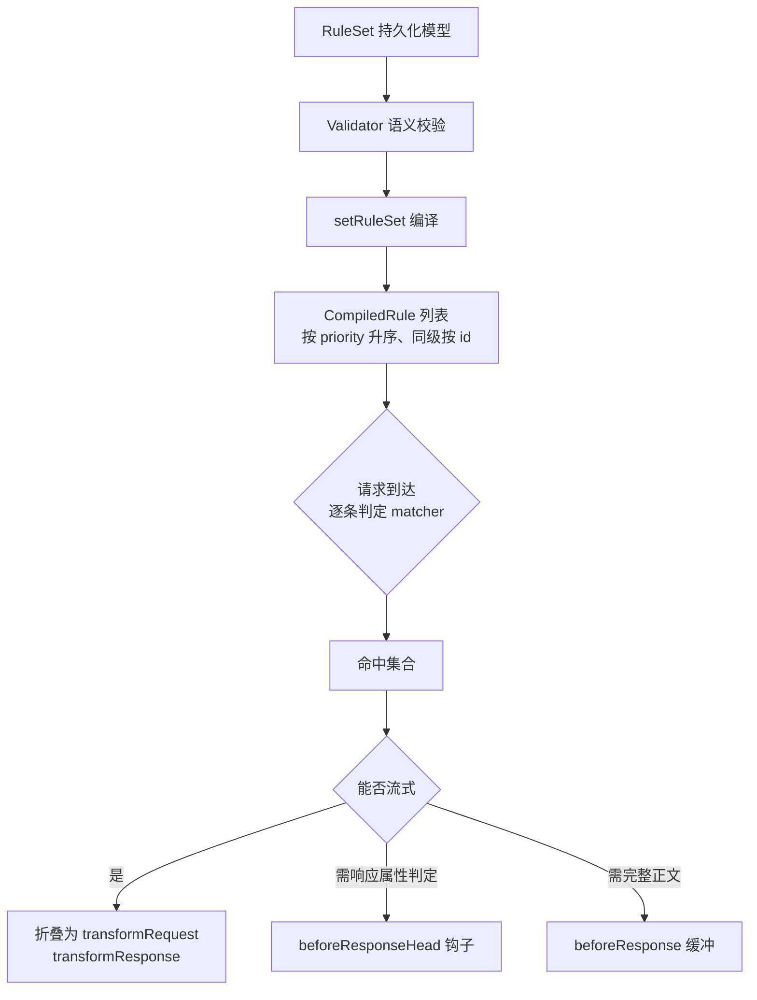
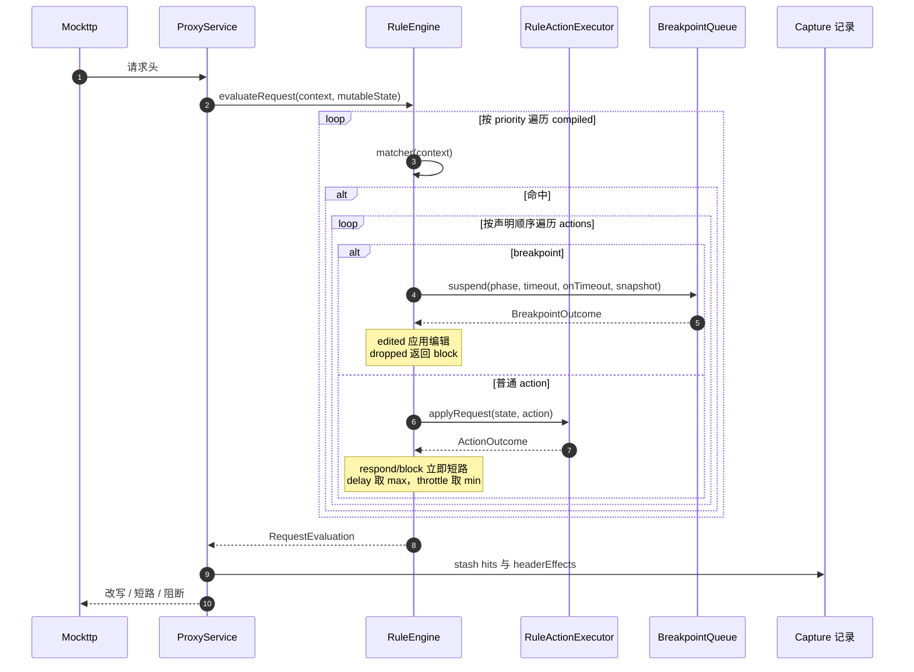
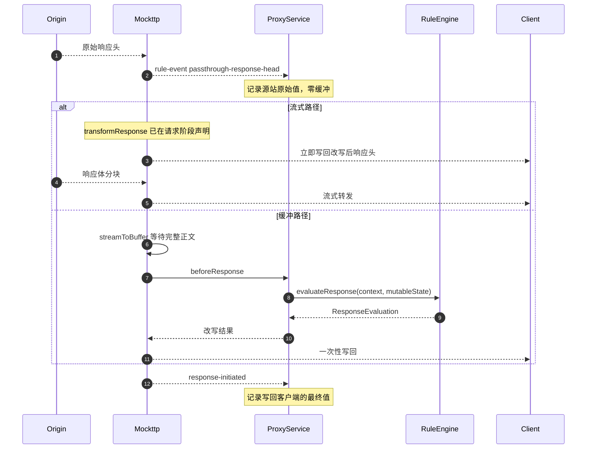
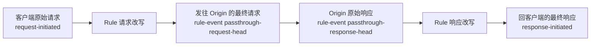
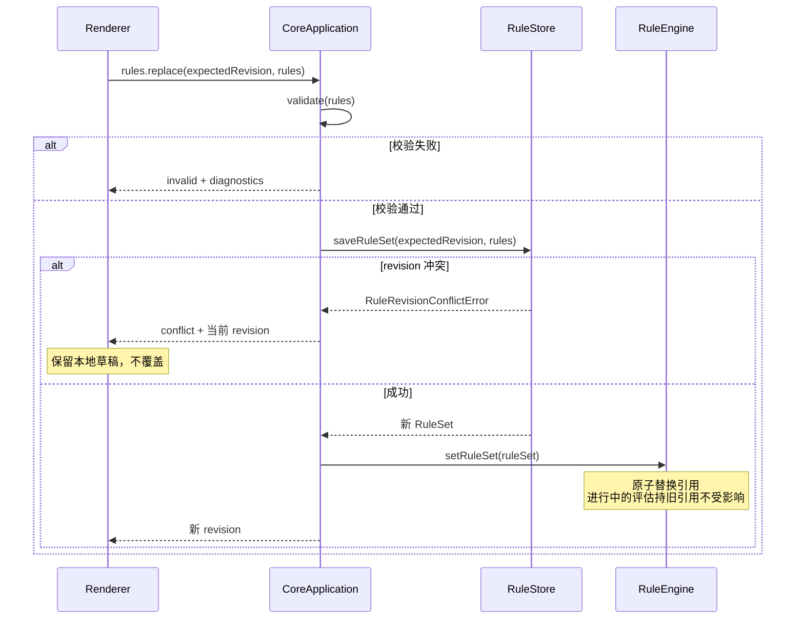
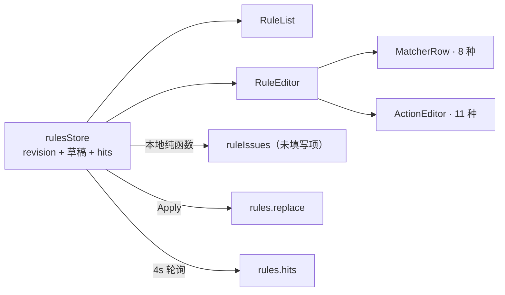

# Feature: Rules

> 最后更新：2026-07-26
> Core 模块：`apps/proxy-core/src/proxy-core/rules/`
> 协议模型：`packages/core-protocol/src/rules.ts`
> Renderer 模块：`apps/desktop/src/renderer/features/rules/`

## 1. 职责与边界

Rules 负责在真实转发路径上**干预**流量，并向 Capture 提供可审计证据。

| 归属 | 内容 |
| --- | --- |
| Rules 负责 | 匹配判定、改写、短路、阻断、延迟、限速、断点挂起、证据产出 |
| Rules 不负责 | 网络 I/O、Exchange 生命周期、正文落盘、事件推送 |

**关键边界：**

- `RuleEngine` 只计算决策，返回 `RequestEvaluation` / `ResponseEvaluation`，**不发起任何网络操作**。
- `ProxyService` 是唯一执行者，把决策转换为 Mockttp 的转发行为。
- Rules 的执行**不受 Recording 开关影响**。暂停记录时规则依然作用于真实流量，只是不产生 Capture 记录。

## 2. 领域模型

`RuleSet` 是可序列化纯数据，绝不包含 callback 或运行时句柄。

```ts
interface RuleSet {
  revision: number;
  rules: readonly RuleDefinition[];
}

interface RuleDefinition {
  id: string;
  name: string;
  enabled: boolean;
  priority: number;
  matchers: readonly RuleMatcher[];   // AND 关系
  actions: readonly RuleAction[];     // 按声明顺序执行
}
```

### 2.1 Matcher（8 种）

| type | 判定阶段 | 说明 |
| --- | --- | --- |
| `method` | 请求 | 精确方法名 |
| `host` | 请求 | contains / exact / regex，可选大小写敏感 |
| `path` | 请求 | 同上 |
| `url` | 请求 | 同上 |
| `query` | 请求 | key + 可选 value |
| `header` `phase: 'request'` | 请求 | name + 可选 value |
| `header` `phase: 'response'` | **响应** | 需要响应头才能判定 |
| `status` | **响应** | min/max 区间 |
| `mime` `phase: 'response'` | **响应** | 需要响应头才能判定 |

**三种响应侧 matcher 决定了规则能否走流式路径**，见第 5 节。

### 2.2 Action（11 种）

| type | 阶段 | 是否需要原文 |
| --- | --- | --- |
| `header` (`set`) | 双向 | 否 |
| `header` (`remove`) | 双向 | 否 |
| `header` (`append`) | 双向 | **是**（需原值拼接） |
| `query` | 请求 | 否 |
| `body` | 双向 | 否（整体替换，`content` 为固定字符串） |
| `status` | 响应 | 否 |
| `synthetic` | 请求 | 否（短路） |
| `map-local` | 请求 | 否（短路） |
| `map-remote` | 请求 | 否（改写目标） |
| `block` | 请求 | 否（短路） |
| `delay` | 双向 | 否（但需 await） |
| `breakpoint` | 双向 | **是**（需给用户看完整内容） |

**重要事实**：`body` action 是整体替换，不依赖源站原文：

```ts
{ type: 'body'; phase: RulePhase; format: 'text' | 'json'; content: string }
```

因此它可以流式执行，**不需要缓冲**。

## 3. 与 Mockttp Rule 的关系

两者表面相似，但语义不同，**不能直接用 Mockttp Rule 替代产品 Rule 模型**。

| 能力 | Mockttp Rule | 产品 Rule |
| --- | --- | --- |
| 基础 matcher | 有 | 有 |
| 多条规则累积执行 | **首个匹配胜出** | **按 priority 执行全部匹配** |
| 响应侧 matcher | 只能进 callback 后判断 | 原生模型 |
| 持久化与 revision | 无 | `rules.sqlite` 单行 JSON |
| UI 草稿与语义诊断 | 无 | 有 |
| Rule hit 与历史证据 | 极有限 | 产品核心能力 |
| 断点与用户编辑 | 无 | 有状态机 |
| Archive 保真 | 无 | 有 |

**分层结论**：产品 `RuleDefinition` 继续作为控制面、持久化与 UI 的唯一来源；Mockttp 只作为**执行后端**，通过编译器把可表达的部分下推。

## 4. 执行路径

Mockttp 提供四种介入形态，代价差异极大。

| 路径 | 机制 | 是否等 request body | 是否等 response body |
| --- | --- | --- | --- |
| A 纯 passthrough | 无 hook | 否 | 否 |
| B 静态转换 | `transformRequest` / `transformResponse` | 否 | 否 |
| C headers 钩子 | `beforeRequestHead` / `beforeResponseHead`（**本仓库 patch**） | 否 | 否 |
| D 完整回调 | `beforeRequest` / `beforeResponse` | **是** | **是** |

**当前实现只用路径 C。** 单一 `forAnyRequest().thenPassThrough({ beforeRequestHead, beforeResponseHead })`，
既不使用 `.matching(callback)`（CallbackMatcher 会 `waitForCompletedRequest`），也不使用
`beforeRequest` / `beforeResponse`（分别等待完整请求与响应正文）。所有规则在头部阶段执行，
正文始终流式。

### 4.1 为什么路径 D 昂贵

`request-step-impls.js`：

```js
else if (this.beforeResponse) {
    originalBody = await streamToBuffer(serverRes);   // 等 Origin 响应体全部下载
    modifiedRes = await this.beforeResponse({ ... });
}
```

顺序是：源站正文全部落内存 → 调回调 → `writeHead` 写回客户端。**客户端自身也在等**，不只是 UI 延迟。

`beforeRequest` 与 `.matching(callback)` 同理会 `waitForCompletedRequest()`，阻塞所有上传。

### 4.2 路径 B 的边界

`ResponseTransform` 字段代价分两类：

| 字段 | 等完整 body |
| --- | --- |
| `replaceStatus` | 否 |
| `updateHeaders` | 否 |
| `replaceHeaders` | 否 |
| `replaceBody` | 否 |
| `replaceBodyFromFile` | 否 |
| `updateJsonBody` | 是 |
| `patchJsonBody` | 是 |
| `matchReplaceBody` | 是 |

`replaceBody` 的写回逻辑证明它完全不等：

```js
if (resBodyOverride) {
    clientRes.end(resBodyOverride);
    serverRes.resume();      // 源站数据直接倒掉，不缓冲
    resolve();
}
```

**限制**：`updateHeaders` 是 merge/replace 语义（`undefined` 表示删除），**无法表达 append**，因为请求阶段拿不到源站响应原值。

## 5. 编译流水线



### 5.1 降级判定

```ts
function requiresResponseBuffering(rule: RuleDefinition): boolean {
  const hasResponsePhaseMatcher = rule.matchers.some(m =>
    m.type === 'status' ||
    (m.type === 'header' && m.phase === 'response') ||
    (m.type === 'mime' && m.phase === 'response'));

  const hasBufferingAction = rule.actions.some(a =>
    (a.type === 'header' && a.phase === 'response' && a.op === 'append') ||
    (a.type === 'delay' && a.phase === 'response') ||
    (a.type === 'breakpoint' && a.phase === 'response'));

  return hasResponsePhaseMatcher || hasBufferingAction;
}
```

**降级是请求级别、全有全无的**：命中集合中任意一条需要缓冲，整个请求进入缓冲路径。

阶段划分：

- **阶段一（不打 patch）**：路径 C 暂时合并到 D。只有"matcher 全为请求侧 + action 全为 set/remove/status/body"的规则走流式。
- **阶段二（引入 patch）**：路径 C 独立，把响应侧 matcher、`append`、response `delay` 从缓冲中解放。只剩 `breakpoint` 必须缓冲。

### 5.2 多规则折叠

产品语义是"按 priority 执行全部匹配规则"，而 `transformResponse` 是单份声明，需要折叠：

| Action | 折叠方式 |
| --- | --- |
| `header` `set` / `remove` | 按执行顺序合并进 `updateHeaders`，后者覆盖 |
| `status` | 后者覆盖 |
| `body` | 后者覆盖 |

折叠必须保留执行顺序，且记录每条规则的贡献，用于证据。

## 6. 调用流程

### 6.1 请求阶段



`RequestEvaluation` 的三种形态：

| `kind` | 含义 | Mockttp 行为 |
| --- | --- | --- |
| `continue` | 继续转发 | 返回改写后的 method/url/headers/body |
| `respond` | 短路 | 返回合成响应 |
| `block` | 阻断 | 返回 `'close'` 或 `'reset'` |

### 6.2 响应阶段



## 7. Evidence 采集

Capture Inspector 需要区分四个层次，全部零缓冲获取：



### 7.1 Header effect

`RuleEngine` 在每个真实生效的 header action 后产出：

```ts
interface RuleHeaderEffect {
  ruleId: string;
  phase: 'request' | 'response';
  op: 'set' | 'append' | 'replace' | 'remove';
  name: string;
  value?: string;
  previousValues: readonly string[];
}
```

Renderer marker 语义：

| 颜色 | 含义 |
| --- | --- |
| 绿 | `set` 新增 |
| 蓝 | `append` 追加 |
| 黄 | `replace` 替代（旧值加删除线） |
| 红 | `remove` 删除（旧值加删除线） |

**流式路径下的证据来源**：改写由 Mockttp 执行，`RuleEngine` 无法观察执行过程。此时通过对比 `passthrough-response-head`（原始）与 `response-initiated`（最终）反推净效果，配合编译时记录的规则贡献还原 marker。

### 7.2 Rule hit

```ts
interface RuleHitRecord {
  ruleId: string;
  ruleRevision: number;      // 命中时版本，非当前版本
  phase: 'request' | 'response';
  action: string;
  summary: string;
}
```

**语义修正 [改造中]**：当前每个生效 action 追加一条 hit，导致"一个规则 3 个 action"的单次请求计为 3。目标按 `Rule × Exchange` 去重，并分开展示：

- `matched requests`：命中该规则的请求数
- `executed actions`：实际执行的 action 次数
- `blocked`：短路或阻断次数

## 8. 热更新与 revision



**revision 一致性 [改造中]**：请求阶段固定 RuleSet 快照，响应阶段复用同一份。当前实现中 request 与 response 可能落在不同 revision（热更新窗口内），必须消除。

编译成 `transformResponse` 后这个竞态天然消失，因为响应转换在请求阶段就已确定。

## 9. 持久化与校验

### 9.1 存储

`RuleStore` 使用 `rules.sqlite` 单行表：`revision` + `rules_json`。乐观并发通过 `expectedRevision` 比对实现。

Capture 数据完全不使用 SQLite，两者强隔离。

### 9.2 未填写的规则 [已实现]

Core 信任 Main/Renderer 传递的数据，**不做规则语义校验**（历史上的 `rules.validate` 命令固定返回 valid，已连同协议/Main/Preload 链路一并删除）。“刚新建、还没填完”的规则不能影响真实流量，靠三道边界保证：

| 边界 | 位置 | 行为 |
| --- | --- | --- |
| 未填写的条件恒不匹配 | `rules/utils/index.ts` 的 `compileStringMatch` / `compileRuleMatchers` | 空值条件与空条件集编译为恒 false，而不是 `includes('')` / 空 regex 的恒 true |
| 不完整的规则不能启用 | Renderer `rulesStore.toggleRule` + `RuleRow` 开关 | 字段未填完时开关置灰并拒绝启用；已启用的规则任何时候都可关掉 |
| 引擎只执行已启用规则 | `RuleEngine.setRuleSet` | `filter(rule => rule.enabled)` 后才编译 |

未填写项的提示由 Renderer 本地纯函数 `ruleIssues(rule)` 即时派生（不入状态、不往返 Core），驱动 RuleEditor 的问题列表、Statusbar 计数和启用开关的可用性。新建规则与 Capture 右键草稿都默认 `enabled: false`。

**尚未覆盖**：非空但无法编译的 regex、不可解析的 JSON body、不存在的 Map Local 文件仍会静默失效。

## 10. Renderer 交互



**与 Capture 的双向联动：**

| 方向 | 交互 |
| --- | --- |
| Capture → Rules | 请求行右键，按 11 种 action 创建当前完整 URL 的 exact matcher 草稿，只打开 Rules 不自动 Apply |
| Rules → Capture | 漏斗按钮清空旧条件，过滤该规则命中的请求 |
| Capture Inspector → Rules | Header marker 点击跳转仍存在的规则详情 |

`useRulesData` 常驻 App，`ensureRulesLoaded()` 防止并发初始加载覆盖新草稿。

**已知缺陷 [改造中]**：Apply 冲突后立即 `loadRules()` 会覆盖本地草稿并清掉 conflict 状态，必须改为保留 base/local/remote 三份供用户选择。

## 11. 与当前实现的差异

已落地：

| 项 | 改造前 | 现在 |
| --- | --- | --- |
| 路由方式 | 四档 `.matching(callback)` 预筛选 | 单一 `forAnyRequest`，无 callback matcher |
| request body | callback matcher 强制等完整 body | 请求头阶段判定 |
| response 改写 | 一律 `beforeResponse` 全量缓冲 | `beforeResponseHead` 流式 |
| 响应侧 matcher | 必须缓冲 | 头部阶段直接判定 |
| `header` `append` | 需原值因而缓冲 | 头部阶段可见原值 |

待做：

| 项 | 当前 | 目标 |
| --- | --- | --- |
| breakpoint body | `Mutable*State` 不带原始 body | 带入 Capture 已接收片段 |
| hit 计数 | 按 action 次数 | 按 Rule × Exchange 去重 |
| revision | request/response 可能跨版本 | 请求阶段固定快照 |
| 冲突处理 | 立即 reload 覆盖草稿 | 保留三份供选择 |
| Evidence 四组 headers | 仅自有执行记录 | 叠加 `rule-event` |

## 12. 验收要点

- [ ] 无规则、request-only、response-only、request+response 四条路径均不阻塞上传。
- [ ] 只改 status/header 的规则命中大响应时全程流式。
- [ ] SSE 与无限响应在命中 header 规则时仍有首字节。
- [ ] 非法规则被 `validate` 与 `replace` 双重拒绝，不进入 `rules.sqlite`。
- [ ] 8 种 matcher × 11 种 action 的合法组合矩阵有测试覆盖。
- [ ] priority 顺序、短路行为、多规则改同一 header 的最终值可审计。
- [ ] 同一请求的 request 与 response 阶段使用同一 revision。
- [ ] 双实例并发 Apply 产生 conflict 且本地草稿不丢。
- [ ] Rule 删除后历史 Capture 的 marker 显示只读历史提示。
