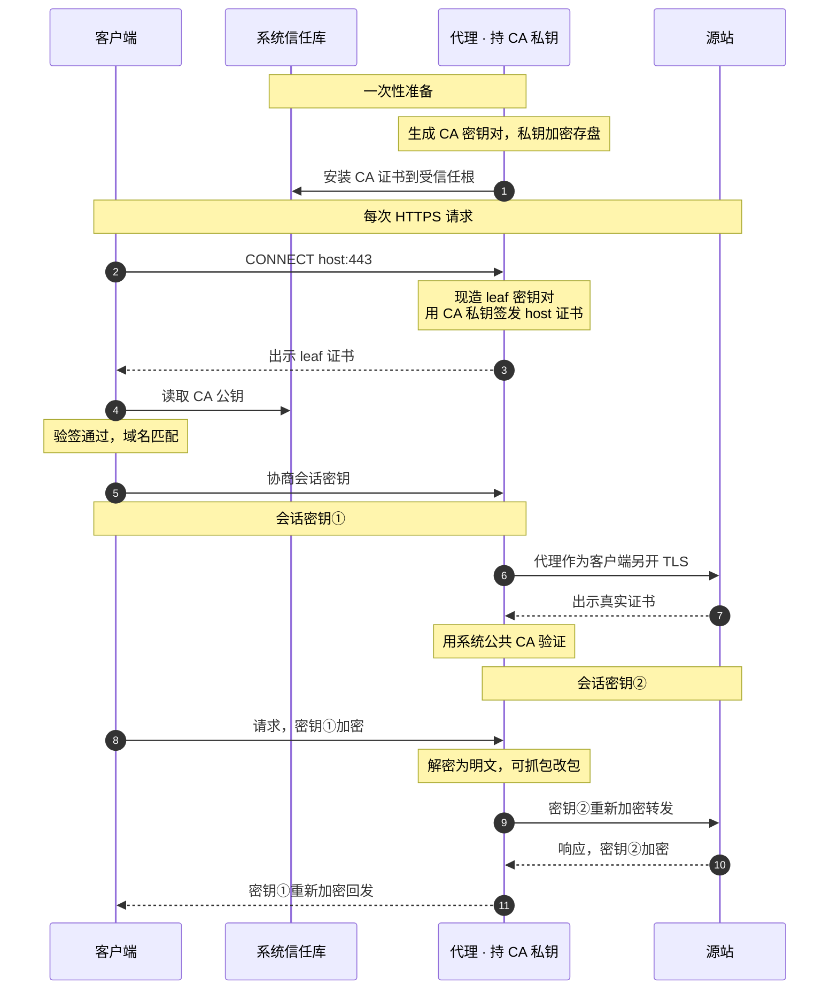
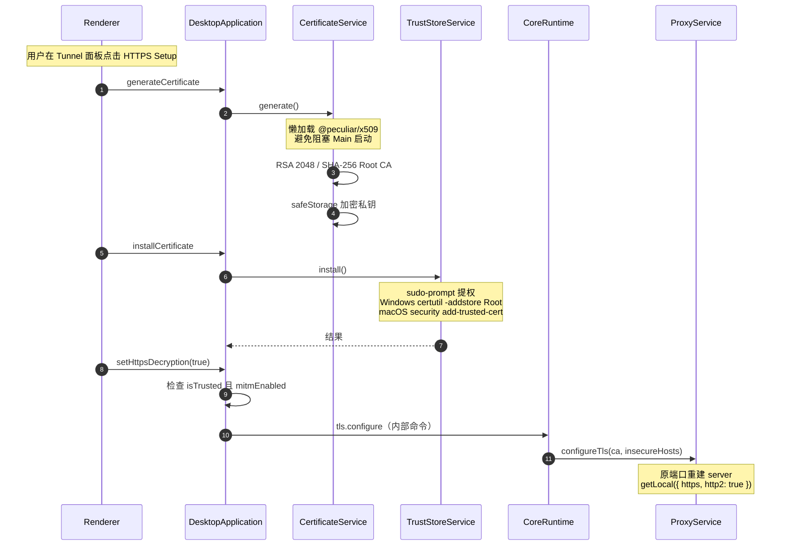
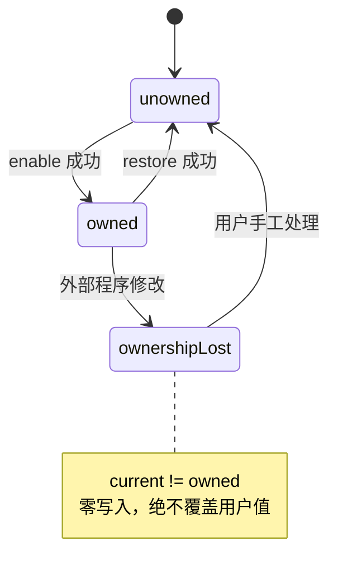
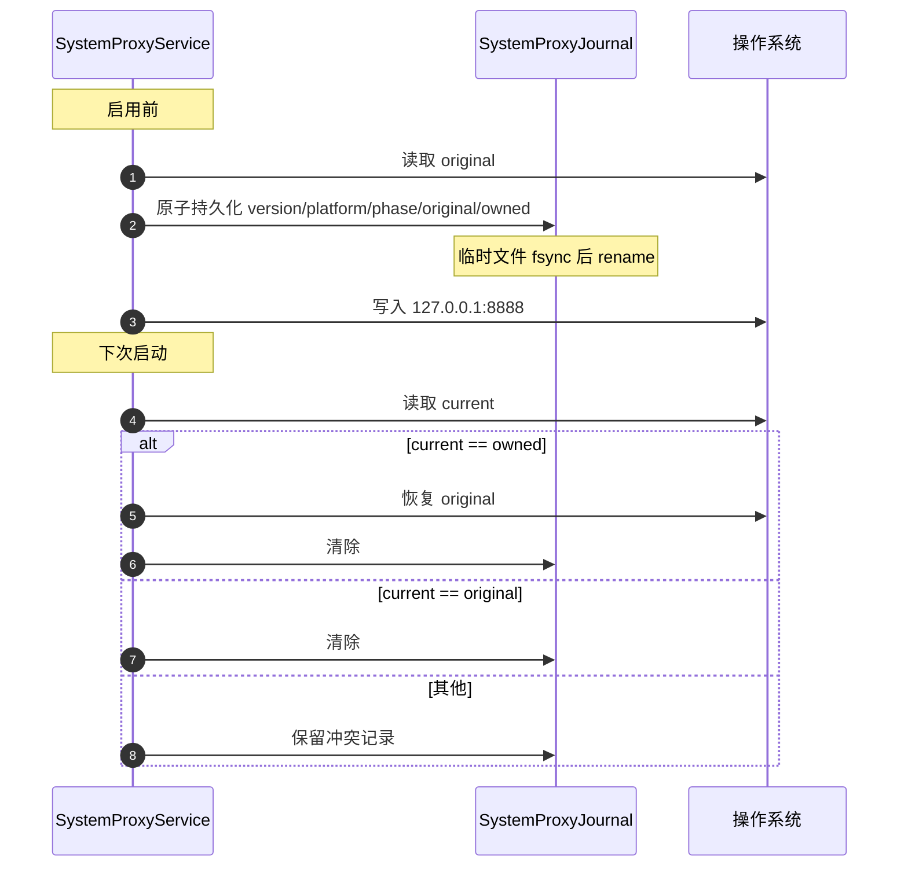
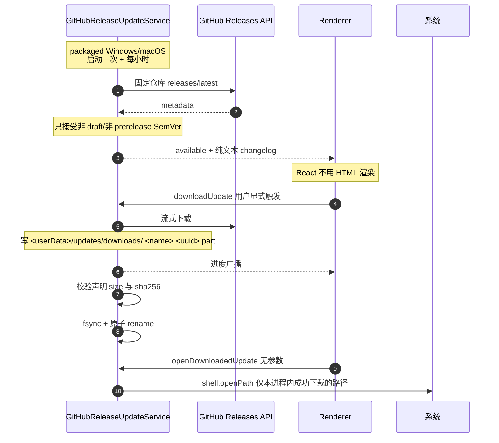
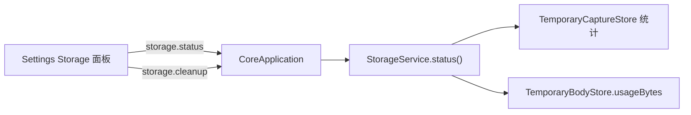

# Feature: Settings

> 最后更新：2026-07-26
> Main 模块：`apps/desktop/src/main/certificates/`、`system-proxy/`、`updates/`
> Core 模块：`apps/proxy-core/src/proxy-core/storage/entry.ts`
> Renderer 模块：`apps/desktop/src/renderer/features/settings/`

## 1. 职责与边界

Settings 聚合所有需要**操作系统权限**或**跨会话持久化**的配置。

| 子域 | 归属进程 | 内容 |
| --- | --- | --- |
| 证书与 MITM | Main | CA 生成、信任库安装、解密开关、不安全例外 |
| 系统代理 | Main | 接管、恢复、紧急修复、ownership 展示 |
| 更新 | Main | 检查、changelog、手动下载、打开安装器 |
| 存储 | Core | 用量状态、清理 |
| 语言与主题 | Renderer | 15 种语言、4 套主题 |

**核心边界：所有 OS 级操作只在 Main。** Core 不读写系统设置，Renderer 只表达意图。

## 2. 证书与 HTTPS MITM

### 2.1 三对密钥

| 密钥对 | 持有者 | 用途 |
| --- | --- | --- |
| CA 密钥对 | 本应用生成 | 私钥签发 leaf，公钥装信任库验签 |
| leaf 密钥对 | Mockttp 按 host 现造并缓存 | 与客户端的会话 |
| 源站真实密钥对 | 真实网站 | 代理与源站的会话 |

**CA 私钥经 `safeStorage`（DPAPI/Keychain）加密存盘，只在 Main 与 Core 内存中流转，绝不进 Renderer、日志或导出。**

### 2.2 握手时序

### 2.3 启用流程

**信任与 MITM 解耦**：只有 CA 已安装信任**且** `mitmEnabled` 开启时才下发 CA material。否则下发 `null`，CONNECT 走字节直通。

Main 每次进程启动都从 `mitmEnabled = false` 开始。

### 2.4 窄 API

`getCertificateStatus`、`generateCertificate`、`installCertificate`、`uninstallCertificate`、`deleteCertificate`、`revealCertificate`、`viewCertificate`、`openCertificateManager`、`getInsecureHosts`、`setInsecureHosts`、`setHttpsDecryption`。

Main 组装的 `CertificateInfo` 含 `path` 与 `mitmEnabled`，**私钥不出 Main**。

## 3. 系统代理

### 3.1 Guarded ownership

**判定规则**：enable 前读取 original 并计算 owned；restore/repair 时重新读取 current，只有 `current == owned` 才写回 original。

### 3.2 Startup journal

同一 guarded decision 复用于：Core 从 running 进入 unresponsive/restarting、停止 Capture、应用退出。

### 3.3 平台实现

| 平台 | 机制 |
| --- | --- |
| Windows | `windows-helper.cs`，当前用户 WinINet per-connection API，读写 flags/Proxy Server/Bypass/PAC URL/Auto Detect，广播 settings changed |
| macOS | `macos-helper.swift`，Authorization Services + SystemConfiguration，枚举当前 Network Set 全部活动 service，单 session 内 set/commit/apply |

只允许 loopback listener。

### 3.4 已知兼容风险 [改造中]

Windows Enable 当前**清除**原 PAC、Auto Detect、Proxy Server 与 bypass，写入 `127.0.0.1:8888`，而 Proxy Core 只直连源站。

对必须经公司 PAC、VPN proxy、认证 proxy 或本机上游才能联网的环境，启用期间可能**完全断网**。需支持 upstream proxy / PAC chaining，或在 Enable 前检测并阻止覆盖。

覆盖范围限制：Windows 只接管 WinINet，自带网络栈、WinHTTP、Java、curl、容器、WSL 可能不走 Capture。`<local>` bypass 会让 localhost 绕过。

## 4. 更新

**安全校验**：SemVer、draft/prerelease、仓库 URL/tag/asset basename、平台扩展名、显式架构、声明 size、SHA-256。拒绝凭据/query/hash、路径编码逃逸、外域、重复候选。

**Renderer 永远拿不到 URL 或 path。**

七态：`unsupported` / `idle` / `checking` / `available` / `downloading` / `downloaded` / `up-to-date` / `failed`。

## 5. 存储状态

报表字段：`sessionCount`、`exchangeCount`、`bodyCount`、`databaseBytes`（Capture 无 SQLite 恒为 0）、`blobBytes`、`totalBytes`。

**已知缺口 [改造中]**：当前没有内存、磁盘与 session 生命周期策略。大量小于阈值的正文全部驻内存，事件队列未 ack 时无上限。需提供用量观测与明确的清理建议，且不得静默丢数据。

## 6. 语言与主题

| 项 | 实现 |
| --- | --- |
| 语言 | 15 种完整本地 catalog，英语默认与回退 |
| 同步范围 | Ant Design `ConfigProvider.locale`、`html lang`、`localStorage`、`Intl` 格式 |
| Main 同步 | 受限 `setUiLanguage` 意图，Main 仅用内存状态本地化自己的文件对话框 |
| 主题 | light / warm / dark / ember 四套时段主题 |
| 驱动 | `theme/theme.ts` ConfigProvider token + `:root[data-theme]` CSS 变量 |

Main 不因语言暴露路径或通用 IPC。

## 7. 安全边界汇总

| 边界 | 保证 |
| --- | --- |
| CA 私钥 | 只在 Main 与 Core 内存，safeStorage 加密存盘 |
| 文件路径 | 只在 Main 与 Core 之间，Renderer 无 path/readFile/writeFile |
| 更新 URL | 只在 Main，Renderer 无法提交任意 URL |
| 系统代理 | 只在 Main，guarded 写入，日志不含 snapshot |
| Renderer origin | 生产固定 `interceptor://app/index.html` |
| Fuses | Electron 九项 strict 锁定 |

## 8. 已知风险

- Root CA 安装到 local-machine 信任库会影响本机全部用户与进程，安装提示必须明确范围。
- 证书 pinning、mTLS、独立 trust store 的应用会拒绝 MITM，需要 per-host passthrough。
- QUIC/HTTP3 不在当前捕获范围。
- Start/Stop decrypting 会重启 listener，可能中断活动下载、WebSocket、SSE、gRPC。
- `ignoreHostHttpsErrors` 会关闭指定 origin 的证书校验，必须逐 host 明示且避免通配。
- 强杀或 OS crash 会让系统代理暂时停在 8888，直到 journal recovery 或紧急修复。

## 9. 验收要点

- [ ] CA 私钥不出现在 Renderer、日志、导出、packaged smoke 的 API 白名单中。
- [ ] 外部修改代理后 ownership lost，零写入且不覆盖用户值。
- [ ] 强杀后重启能按 journal 正确恢复或保留冲突。
- [ ] 更新下载的 SHA-256 与 size 校验失败时不保留文件。
- [ ] 15 种语言切换后无页面溢出，持久化生效。
- [ ] 存在 PAC 或上游代理时 Enable 有明确提示而非静默断网。
