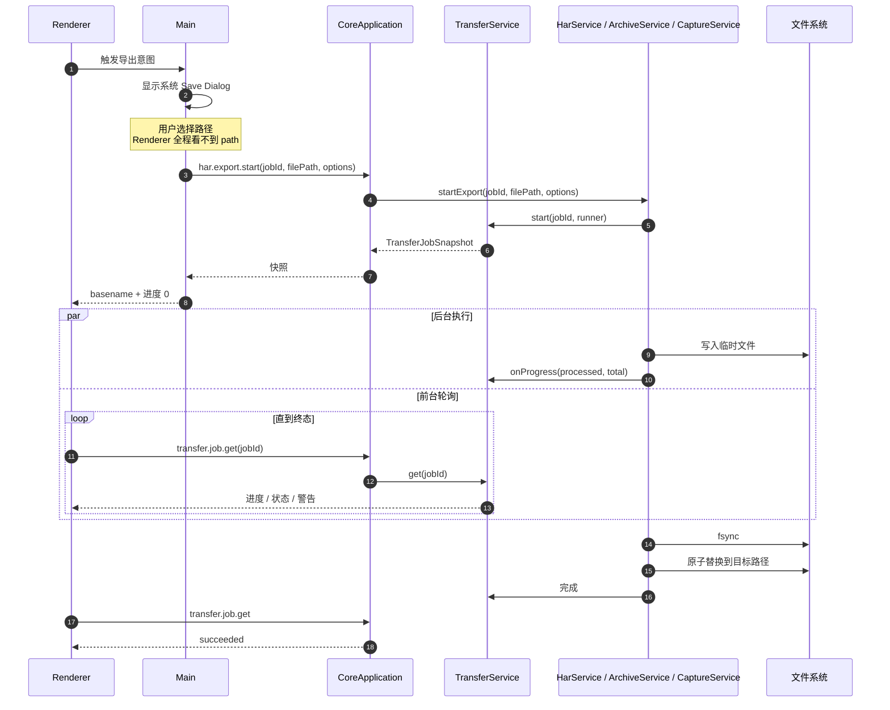
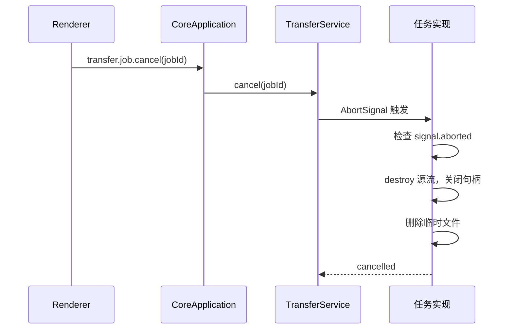
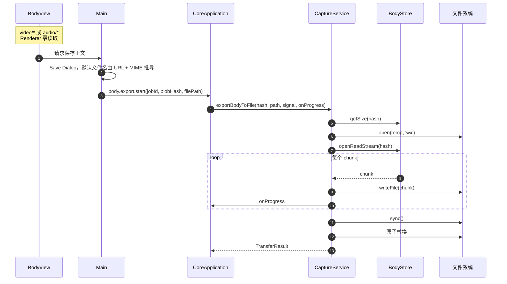
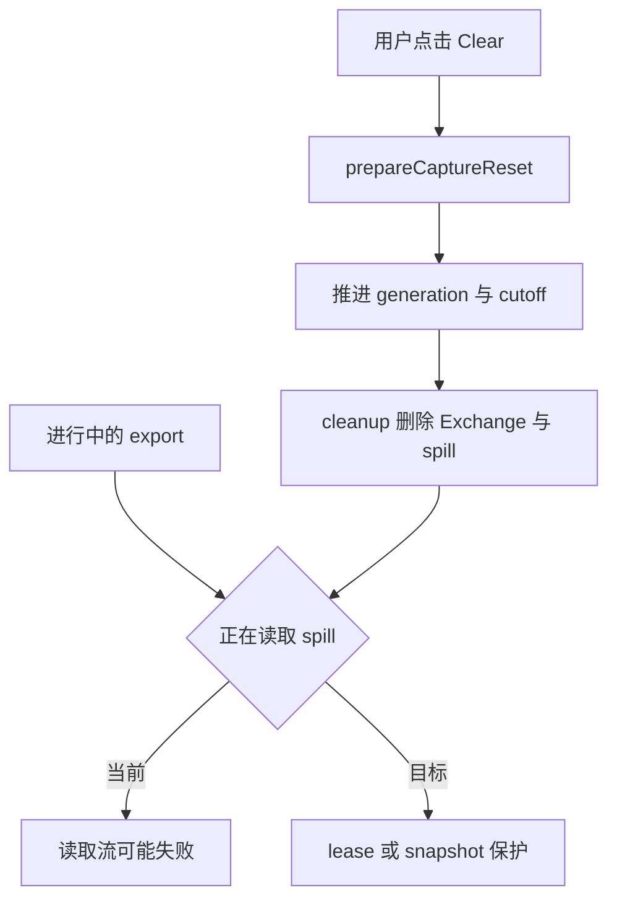

# Feature: Transfer

> 最后更新：2026-07-26
> Core 模块：`apps/proxy-core/src/proxy-core/transfer/`、`har/`、`archive/`、`capture/entry.ts`
> Renderer 入口：Capture 工作栏的 Import / Export 菜单

## 1. 职责与边界

Transfer 统一承载所有**异步文件任务**：HAR 交换、Native Archive 全保真存档、单个正文导出。

| 归属 | 内容 |
| --- | --- |
| Main 负责 | 系统 Save/Open Dialog，持有真实文件路径 |
| Core 负责 | 流式读写、进度上报、取消、原子替换 |
| Renderer 负责 | 触发意图、轮询快照、展示进度与取消 |

**路径边界**：真实文件路径**只在 Main 与 Core 之间流转**。Renderer 只拿到 basename、进度、状态、警告，永远没有 `path` / `readFile` / `writeFile`。

## 2. 四类任务

| 任务 | 命令 | 用途 |
| --- | --- | --- |
| HAR 导出 | `har.export.start` | 跨工具交换，标准 HAR 1.2 |
| HAR 导入 | `har.import.start` | 载入外部抓包 |
| Archive 导出 | `archive.export.start` | Interceptor 全保真存档 |
| Archive 导入 | `archive.import.start` | 恢复存档 |
| Body 导出 | `body.export.start` | 保存单个正文（大媒体主路径） |

统一由 `TransferService` 管理，共享 `transfer.job.get` / `transfer.job.cancel`。

## 3. 调用流程

### 3.1 通用任务生命周期



### 3.2 取消



**提交点语义 [改造中]**：Cancel 与最终 `fsync` + `rename` 之间存在竞态。必须定义提交点——一旦 rename 成功，任务不得再显示为 Cancelled。

### 3.3 Body 导出（大媒体主路径）



## 4. 原子写入

所有导出遵循同一模式：

```text
1. 写入同目录临时文件（唯一后缀，'wx' 独占创建）
2. 全部写完后 fsync
3. 原子替换到目标路径
4. 失败时销毁流、关闭句柄、删除临时文件
```

**已修复**：四处导出（body / HAR / diagnostics / archive）均改为写临时文件 + `fsync` + **直接 `rename` 覆盖**。之前先 `rm(filePath)` 再 `rename(temp, filePath)` 会留下旧文件已删、新文件未就位的窗口，一旦 rename 因权限/磁盘/杀软失败，用户原文件就不可恢复。

## 5. 格式约定

### 5.1 HAR

| 项 | 策略 |
| --- | --- |
| 版本 | HAR 1.2 |
| 导出范围 | all / 当前 filter / 选中项 |
| 敏感数据 | 可选遮罩 Authorization、Cookie |
| 正文 | 可选 strip bodies |
| Headers | 只导出最终 wire headers，不含 Rule marker |
| 限制 | 不限制文件、entries、header、URL、body 大小 |

**已知风险 [改造中]**：导出当前按 chunk 读取后 `Buffer.concat` 成完整 body 再 base64 编码，大正文会造成 Core OOM。需改为流式编码写入。

### 5.2 Native Archive

| 项 | 策略 |
| --- | --- |
| 容器 | 固定格式 ZIP |
| 内容 | 当前 `capture.sqlite` schema 的完整快照 |
| 保真 | `exchange.rule_ids`、`message_headers.rule_id` 完整 round-trip |
| Worker | 按需创建 `archive/worker/entry.cjs`，完成即退出 |
| 批次 | 100 条 Exchange 一批 |
| 校验 | 格式、路径、CRC、size、hash、SQLite 完整性 |

**限制**：不支持 ZIP64；不限制 entry 数、解压总量、压缩比（zip bomb 风险）；不保存完整历史 `RuleDefinition`。

### 5.3 快照语义

`createArchiveSnapshot(batchSize)` 在点击时捕获 Exchange 与 body hash 的时间切面。导出期间新增流量不进入本次存档。

## 6. 数据契约

```ts
interface TransferJobSnapshot {
  jobId: string;
  kind: 'har-export' | 'har-import' | 'archive-export' | 'archive-import' | 'body-export';
  fileName: string;              // 仅 basename
  state: 'running' | 'succeeded' | 'failed' | 'cancelled';
  processed: number;
  total: number | null;
  warnings: readonly string[];
  errorMessage?: string;
}
```

Renderer 全屏 Loading 在运行期间只提供 Cancel。

## 7. 与 Capture 的竞态



**已知缺陷 [改造中]**：Body save 不阻塞 Clear，Clear 删除 spill 时正在读取的 export stream 可能失败。需要建立 lease 或 snapshot 语义。

## 8. 与当前实现的差异

| 项 | 当前 | 目标 |
| --- | --- | --- |
| Body 原子替换 | `rm` + `rename` | 直接 `rename` 覆盖 |
| Cancel 提交点 | 无定义 | rename 成功后不可 cancel |
| Clear 与 export | 无保护 | lease 或 snapshot |
| HAR 导出正文 | `Buffer.concat` 完整 body | 流式编码 |
| Job 保留 | 永久保留所有终态 | UI 确认后清理或有限历史 |
| BodyView 反馈 | 只有 loading | 完整 Transfer UI（进度 / 取消 / 结果） |

## 9. 验收要点

- [ ] 目标文件已存在、被占用、只读目录、磁盘满时旧文件永不丢失。
- [ ] rename 失败后临时文件可回收。
- [ ] Cancel 在提交点前后行为明确且一致。
- [ ] 超大正文 HAR 导出不 OOM。
- [ ] 恶意 Archive（zip bomb、超多 entry）有明确拒绝策略。
- [ ] Clear 与进行中导出并发时有确定结果，不静默损坏文件。
- [ ] Renderer 全程无法获得绝对路径。
