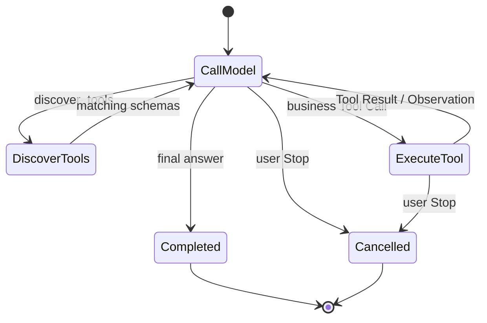
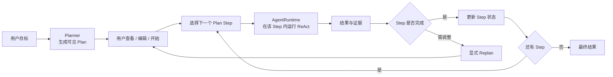
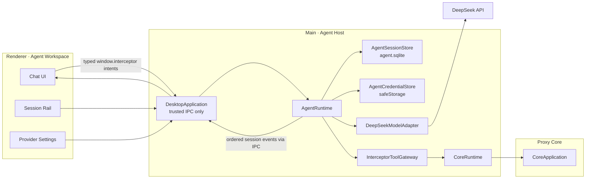
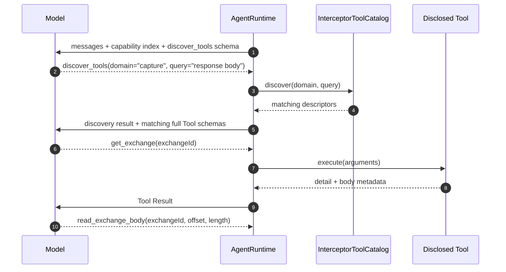
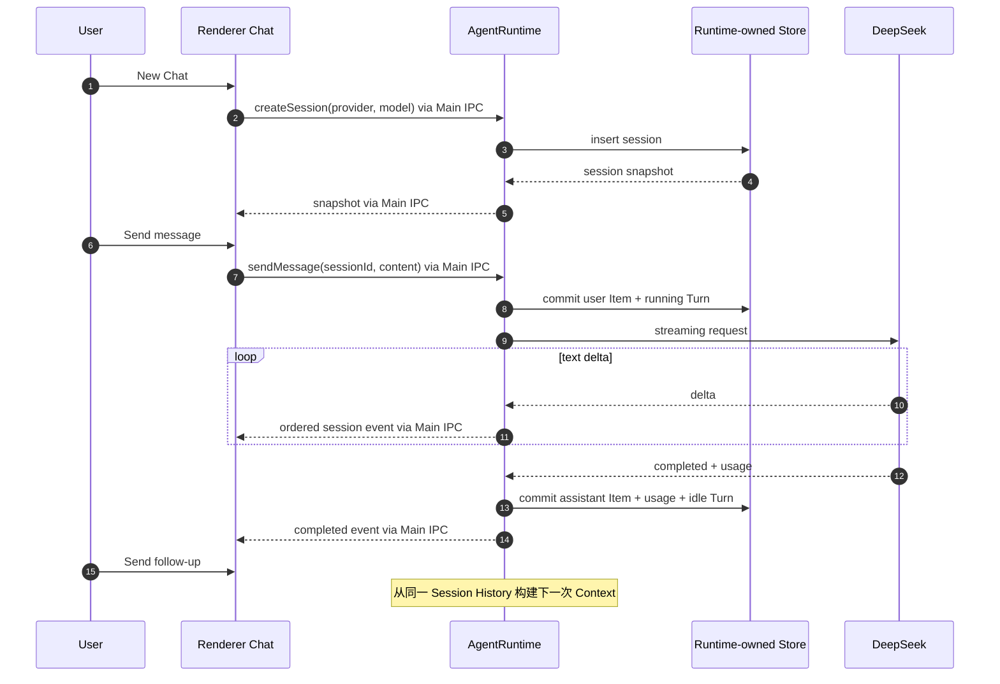

# Feature: 内置 Agent

> 最后更新：2026-08-25
> Runtime package：`packages/agent-runtime/`
> 主类：`AgentRuntime`
> 首个 Model Provider：DeepSeek
> 状态：**[改造中] 目标是完整的内置 Chat Agent 产品；当前只有未接线的 Runtime 脚手架。**

## 术语与关系

以下定义是官方文档或原始论文的中文归纳；没有统一行业定义的名称会明确标成“本项目约定”。

### 基础组件

- **Model / LLM**：接收 Context 并生成文本或结构化 Tool Call 的模型。DeepSeek 是首个 Model Provider，
  不是 Agent Runtime。
- **Agent**：Anthropic 将 Agent 与 Workflow 区分为：Agent 由 LLM 动态决定自身过程和 Tool 使用方式，
  并持续从环境反馈中取得 ground truth，直到完成、需要用户判断或被停止。
  来源：[Anthropic · Building effective agents](https://www.anthropic.com/research/building-effective-agents)。
- **Agent Loop**：调用 Model，检查结果；若是最终输出则结束，若有 Tool Call 则执行 Tool、追加结果并再次调用 Model。
  来源：[OpenAI Agents SDK · Agent loop](https://openai.github.io/openai-agents-js/guides/running-agents/#the-agent-loop)。
- **Harness**：Microsoft 将 Agent Harness 定义为协调 Agent 的软件：运行 Agent Loop、管理 Session、
  调用 Tool，并把 Tool Result 返回 Model，直到任务完成或需要用户输入。
  来源：[VS Code · Agent harnesses](https://code.visualstudio.com/docs/agents/concepts/agent-harnesses)。
- **Agent Host / Runtime**：没有统一规范定义。Microsoft 的 Agent Host 是一种生产架构：Host 独立承载
  Session，并通过 Adapter 接入不同 Agent Runtime。本项目的 `AgentRuntime` 是 Agent domain 的唯一组合根。
- **Workflow**：Anthropic 将 Workflow 定义为由预先确定的代码路径编排 LLM 和 Tool 的系统；
  Agent 则动态决定执行过程。来源同上。

### Tool 与执行结果

- **Tool**：让 Model 与外部系统交互的能力，例如查询数据库、调用 API 或执行计算。Tool 定义至少包含名称、
  描述和参数 JSON Schema。来源：[MCP Tools](https://modelcontextprotocol.io/specification/2025-06-18/server/tools)。
- **Tool Call**：Model 生成的结构化调用请求，包含 Tool 名、`callId` 和 arguments；它是请求，不是执行结果。
- **Tool Result**：应用执行 Tool 后产生并回传给 Model 的结果。MCP 允许文本、结构化内容、媒体或 Resource Link。
- **Observation**：ReAct 对 Action 执行后环境反馈的称呼；在本项目里通常对应 Tool Result。
- **Zod**：官方定义为 TypeScript-first schema validation library；用于验证不可信的 Tool arguments，
  并可将同一 schema 转成 JSON Schema 发给 Model。来源：[Zod](https://zod.dev/)。
- **Strict Tool Call**：Provider 按 JSON Schema 约束 Model 输出。DeepSeek 的 strict mode 当前是 Beta；
  Provider 校验不能替代本地 Zod 校验。来源：[DeepSeek Tool Calls](https://api-docs.deepseek.com/guides/tool_calls)。

### 执行模式

- **ReAct**：原始论文提出让 Model 交错生成 reasoning traces 与 task-specific actions；Action 从环境取得新信息，
  Observation 再影响后续 reasoning 和 Action。来源：[ReAct paper](https://arxiv.org/abs/2210.03629)。
- **Plan-and-Execute**：行业架构模式，没有协议级标准定义。本项目用它表示 Planner 先把任务拆成子任务，
  Executor 再按 Plan 执行，并可根据结果 Replan；其“先规划、再执行子任务”与 Plan-and-Solve 研究一致。
  来源：[Plan-and-Solve paper](https://arxiv.org/abs/2305.04091)。
- **Progressive Disclosure / 渐进式披露**：不是统一协议名。本项目借用 OpenAI 官方的 Deferred Tool Loading / Tool Search
  思路：运行时只加载当前需要的 Tool 定义，而不是一次发送所有 schema。
  来源：[OpenAI Agents SDK · Deferred tool loading](https://openai.github.io/openai-agents-js/guides/tools/#deferred-tool-loading-with-tool-search)。
- **`discover_tools`**：本项目实现渐进式披露的普通 Function Tool。DeepSeek Chat Completions 没有原生
  `tool_search`，因此由 `AgentRuntime` 在本地搜索 Tool Catalog 并在下一次 Model Call 披露 schema。

### 状态、Context 与知识

- **Session / Thread / Conversation**：官方 SDK 对持久对话容器使用不同名称。本项目统一叫 Session，
  表示可跨应用重启恢复的一段 Chat。
- **Turn**：OpenAI Agents SDK 将一次 `run()` 视为应用会话中的一个 Turn。本项目对应一条用户消息触发的完整执行。
- **Step**：本项目约定为一次 Model Call，加上该响应触发的 Tool Call / Tool Result；不是跨 Provider 标准术语。
- **Item**：本项目持久化顺序中的 user message、assistant message、Tool Call、Tool Result 或 notice。
- **Context**：某次 Model Call 实际收到的输入视图，可由 History、Tool schema、检索结果和当前状态组成。
- **Context Window**：Model 单次调用可处理的有限输入/输出范围；它不是 Session History 的存储上限。
- **Token**：DeepSeek 将 Token 定义为 Model 表示自然语言文本和计费的基本单位；实际数量以 API Usage 为准。
  来源：[DeepSeek · Token & Token Usage](https://api-docs.deepseek.com/quick_start/token_usage)。
- **Tokenizer / Tokenization**：Tokenizer 把文字、数字、标点和协议内容切分并映射为整数 Token ID 序列；
  Model 实际处理的是 Token ID，不是 JavaScript 字符串。不同 Model 的切分结果可能不同。
- **Working Set**：本项目对“本次 Model Call 实际从完整 History 选入 Context 的内容集合”的称呼；
  不是行业协议术语。未进入 Working Set、summary 或检索结果的内容，Model 本次无法知道。
- **Model-visible Session Memory**：本项目用于解释 Model 视角的说法，不是独立存储。它等于当前 Model Call
  中 Working Set 里来自该 Session 的内容；Model 不会直接读取 Runtime 保存的完整 Session History。
- **KV Cache / Prompt Cache**：Provider 对已经计算过的相同输入 Token prefix 复用 Attention Key / Value 状态的
  推理优化。它不替 Runtime 保存 Session，不让 Model 看见未发送的信息，也不扩大 Context Window。
  DeepSeek 将产品能力称为 [Context Caching](https://api-docs.deepseek.com/guides/kv_cache)。
- **Context Compaction**：Anthropic 将其定义为：当 Conversation 接近 Context Window 上限时总结内容，
  再用 Summary 重新开始一个 Context Window。它压缩 Model 可见 History，不等于删除产品的完整 History。
  来源：[Anthropic · Effective context engineering](https://www.anthropic.com/engineering/effective-context-engineering-for-ai-agents)。
- **Compaction Checkpoint**：没有跨厂商统一 Schema。OpenAI Codex 用该概念表示一个 History Replacement
  Boundary：记录哪份 live History 被哪份 replacement History 取代。本项目沿用这一含义。
- **Execution Checkpoint**：保存 Agent 执行状态，以便在审批、崩溃或重启后继续；它可以包含当前 Turn、
  active Tool Call 和 continuation state，不等于 Conversation Summary。
- **Workspace Checkpoint**：保存外部工作区状态以支持回滚。例如 VS Code Checkpoint 是请求前的文件快照；
  它与 Context Compaction 无关。
- **Usage**：一次 Model Call 实际处理的 input、output 与 total token 计数；Provider 返回值是事实来源。
- **Session Usage**：本项目指标，累计当前 Session 全部 Model Call 的 input / output tokens；它描述总消耗。
- **Current Context Window Usage**：本项目指标，表示当前或最近一次 Model Call 实际装入的 input tokens
  占该 Model Context Window 的比例；它会因渐进式披露或 compaction 降低，不累计历史调用。
- **Short-term Memory**：本项目采用行业常见含义，指单个 Session 内可恢复的 Message History 与执行状态。
- **Long-term Memory**：跨 Session 保存并可在其他 Session 调用的事实、经验或规则。CoALA 将 Language Agent
  描述为包含模块化 Memory、结构化 Action Space 和 Action Selection 的认知架构。
  来源：[CoALA paper](https://arxiv.org/abs/2309.02427)。
- **RAG**：原始论文定义为将预训练 Model 的 parametric memory 与可检索的 non-parametric memory 结合用于生成。
  来源：[Retrieval-Augmented Generation paper](https://arxiv.org/abs/2005.11401)。
- **`reasoning_content`**：DeepSeek Thinking Mode 返回的 Provider 字段，不是 Plan。请求携带 `tools` 时，
  官方要求在后续请求中完整回传，否则会返回 `400`。
  来源：[DeepSeek Thinking Mode](https://api-docs.deepseek.com/guides/thinking_mode#tool-calls)。

### 协议、Framework 与多 Agent

- **MCP**：连接 AI 应用与外部系统的开放标准；采用 Host–Client–Server 架构。Host 协调 LLM 与 Context，
  Client 与一个 Server 保持一对一 Session，Server 暴露 Tools、Resources 和 Prompts。
  来源：[MCP Architecture](https://modelcontextprotocol.io/specification/2025-06-18/architecture)。
- **Agent Framework / Orchestration Framework**：复用 Model、Tool、Loop、持久化或图编排能力的实现库；
  LangChain、LangGraph 等是实现选项，不是本项目术语的权威定义来源，当前也不依赖它们。
- **Subagent**：由另一个 Agent 作为 Tool 调用或通过 Handoff 接管任务的独立 Agent。
- **Multi-agent**：多个 Agent 通过 Tool、Handoff 或 Orchestrator 协作的系统；Plan-and-Execute 不要求 Multi-agent。
- **Model Provider**：本项目对 DeepSeek、Qwen、Ollama 等模型服务来源的称呼。
- **ModelAdapter**：本项目的协议适配边界，把 Provider wire format 转为 `AgentRuntime` 的统一事件。

### 关系速览

- Agent 系统由 Model、Harness / Runtime、Tools、State / Context 和执行策略共同组成；Model 本身不等于 Agent。
- `Agent Loop = Model Call → Tool Call → 应用执行 → Tool Result / Observation → 下一次 Model Call`。
- `ReAct` 决定下一步 Action；`Plan-and-Execute` 先产生 Plan，再让 Executor 执行每一步。
- `Plan-and-Execute` 的 Executor 可以继续使用 ReAct；二者不是互斥实现。
- `Session → Turn → Step → Item`；Session History 是 Short-term Memory，Context 是从 History 派生的调用视图。
- `Session History → Working Set → Provider Chat Template / Tokenizer → Model Context Token Sequence`；
  对 LLM 而言，可感知的 Session Memory 只等于这次 Context 中来自 Session 的部分。
- Prompt Cache 只复用已发送 Token prefix 的计算结果；它不是 Session Memory，也不会把未发送的 History 隐式补回。
- `Session Usage = Σ Model Call Usage`；Current Context Window Usage 只表示当前调用的 Context。
- 渐进式披露影响 Context：Capability → Tool schema → Resource summary → Resource detail。
- Zod schema 一端转换为 JSON Schema供 Model 生成 Tool Call，另一端校验 Model 返回的 arguments。
- MCP 服务外部 Agent；内置 Agent 直接消费同一 Tool Catalog，不经过本机 MCP transport。
- RAG 可以表现为 ReAct 中的检索 Tool，但普通业务查询 Tool 不自动等于 RAG。
- Subagent / Multi-agent 是 Agent 组合方式，与 ReAct、Plan-and-Execute、MCP 都不是同一层概念。

## 1. 产品目标

Interceptor 内置 Agent 是一个长期存在的产品工作区，不是一次性演示程序。用户应当能够：

1. 配置自己的 Model Provider 凭据；
2. 创建、恢复、重命名和删除 Chat Session；
3. 进行流式多轮对话；
4. 让 Agent 查询当前代理状态和已捕获流量；
5. 在清楚看到参数和影响后，批准或拒绝写操作；
6. 随时停止当前 Turn，并在受控停止后继续；
7. 关闭并重新打开应用后继续历史 Session。
8. 查看当前 Context Window 已用与剩余 Tokens，以及当前 Session 累计 Token Usage；
9. 按 Model Call 和 Session 查看 cache hit / miss Token、Rate 与统计覆盖率。

产品从简单到复杂逐层交付，但每个产品阶段都必须形成可使用、可验证的完整纵向流程。

### 1.1 产品原则

- **用户拥有最终控制权**：本产品面向本机单用户，不设置隐藏的 Model Call、Tool Call、Turn 时长、
  Session 数量或数据条数配额；用户可以随时 Stop，也可以选择允许 Agent 连续执行。
- **渐进式披露，不是能力阉割**：所有已实现 Tool 始终可发现、可调用，但 Model 起初只看到能力目录，
  再按任务需要加载完整 Tool schema 和数据详情，避免无关信息占满 Context。
- **正确性边界不是产品限制**：Zod 参数验证、`callId` 幂等、API Key 隔离、原生文件 Dialog、UAC 和
  系统权限仍必须保留；这些边界防止错误执行，不剥夺用户已有操作能力。
- **不做永久 denylist**：只要是产品真实提供的操作，就可以逐阶段成为 Tool。副作用决定 Permission
  Mode 和展示方式，不决定该操作永远不可达。
底层 Runtime 单测只是产品实现的第一层，不代表最终范围。

## 2. 本项目数据模型

- 一个 Session 包含多个 Turn；一个 Turn 包含多个 Step；每个 Step 按顺序追加 Item。
- Session History 是必须持久化的 Short-term Memory；Long-term Memory 当前不做。
- Context 从 Session History 派生，不等同于完整 History，也不改变本地保存的数据。
- Working Set 是 `AgentRuntime` 为一次调用选择的 Provider-neutral Item 集合；Model Context 是 Provider 再加入
  system instructions、Tool schemas 和协议字段并模板化、Tokenize 后的最终输入。
- 因此从 Runtime 视角看 `Session Memory ≠ Working Set`；从 LLM 单次调用视角看，所谓“记得的 Session”只来自
  Working Set 中进入 Model Context 的 Session 内容。
- 用户可见 Transcript 保存消息和 Tool 轨迹；Provider continuation state 单独加密保存。
- DeepSeek `reasoning_content` 属于 continuation state。它必须按官方协议回传，可在 UI 中折叠展示，
  但不作为可编辑 Plan、Tool Result 或稳定业务证据。

## 3. 当前路线不包含

- 不使用 LangChain、LangGraph 或其他 Agent framework；
- 不实现 Subagent 或 Multi-agent；
- 不实现跨 Session 的 Long-term Memory；
- 不在没有明确知识检索需求前引入 RAG、Embedding 或 Vector Database；
- 不在短任务已经可控前引入显式 Plan；
- 不让内置 Agent 通过本机 MCP transport 绕回自身；
- 不让 Model、Renderer 或 Preload 直接访问 Core、Node、文件系统或 API Key；
- 不把 Provider reasoning 自动提升为 Plan、Memory 或业务证据。

Plan、RAG 和 Long-term Memory 是相互独立的产品能力。以后只有出现可验证需求时才分别设计，
不作为“完整 Agent”套餐一起引入。

## 4. 执行模型：ReAct 优先，Plan-and-Execute 按需叠加

### 4.1 当前选择：ReAct

阶段 0 到阶段 4 使用 ReAct 形态的动态循环：

```text
Model 决定下一步 Action
→ AgentRuntime 执行 Tool Call
→ Tool Result 成为 Observation
→ Model 基于新 Observation 决定继续调用 Tool 或给出最终回答
```

选择 ReAct 的原因：

- Chat 中用户目标经常在对话中逐步明确，不适合先强制生成完整 Plan；
- Traffic 分析依赖实时 Observation，下一步通常要看前一个 Tool Result 才能决定；
- 用户可以随时追问、纠正或 Stop，ReAct 与交互式 Session 自然一致；
- 首批 Tool 数量少，直接循环比 Planner / Executor 状态机更容易测试和解释；
- 渐进式披露天然属于 ReAct：`discover_tools`、读取 summary、读取 detail 都是 Action，返回内容是 Observation。

这里的 Reason 不等于产品自己推导隐藏 Chain-of-Thought。DeepSeek 明确返回的 `reasoning_content` 由
`DeepSeekModelAdapter` 作为 continuation state 处理：加密持久化、按协议回传，并与可编辑 Plan 分离。



### 4.2 后续选择：Plan-and-Execute

Plan-and-Execute 只在任务本身需要一个用户可见、可编辑、可恢复的多步骤交付物时加入，例如：

- 对一批 Exchange 做分类、逐项分析并生成汇总报告；
- 分析问题后创建多条 Rule，再分别验证实际效果；
- 用户希望在执行前审阅步骤，或应用重启后从某一步继续。

Plan-and-Execute 不替换 `AgentRuntime`。它在 Session 层增加一个结构化 Plan，Executor 对每个 Plan Step
仍调用同一个 ReAct Runtime：



抉择规则：

| 场景 | 执行模型 |
| --- | --- |
| 普通 Chat、单次查询、探索式 Traffic 分析 | ReAct |
| 步骤无法预先可靠列举 | ReAct |
| 用户明确要求先给方案再执行 | Plan-and-Execute |
| 需要跨重启跟踪多个可验收步骤 | Plan-and-Execute |
| 固定、完全可预测的产品流程 | 普通 deterministic workflow，不使用 Agent Plan |

第一版不做自动模式判断。Chat 默认 ReAct；未来提供显式 `Plan` 模式，由用户选择或 Agent 提议，
用户确认后才创建 Plan。Planner 和 Executor 可以使用同一个 Model，不需要 Subagent 或 Multi-agent。

## 5. 进程与所有权

第一版云端 Model 调用是异步网络 I/O，不引入新的 UtilityProcess。`AgentRuntime` 实例运行在 Main 进程，
是 Agent domain 的唯一组合根；Main 只负责可信 IPC 和注入 `userData`、`safeStorage`、`CoreRuntime`、`fetch`
等平台能力，不拥有任何 Agent Session 状态。所有 Agent 异常必须收敛为单个 Turn 失败，不得影响抓包、
系统代理恢复或 Core 生命周期。



| 组件 | 所有权与职责 |
| --- | --- |
| `AgentRuntime` | 唯一组合根；拥有 Provider、Credential、Session、Turn、History、Context、Usage、Tool disclosure、执行循环与事件 |
| `AgentSessionStore` | Runtime 内部协作者；`<userData>/agent/agent.sqlite` 持久化 Session、Turn、Item 与 Model Call Usage |
| `AgentCredentialStore` | Runtime 内部协作者；使用注入的 `safeStorage` 加密 Provider API Key |
| `DeepSeekModelAdapter` | Runtime 拥有的 Provider Adapter；映射 DeepSeek Streaming wire contract 与内部 event |
| `InterceptorToolGateway` | Runtime 拥有的 Tool 协作者；负责发现、Zod、Permission Mode 和 Core command 调用 |
| Renderer | Session rail、Transcript、Composer、流式状态和 Permission UI；不运行 Agent Loop |

`packages/agent-runtime/` 不引用 Renderer 或 Electron API。`AgentRuntime` 接收窄平台能力并拥有其生命周期：
数据目录、`SecureStore`、`AgentCoreBridge` 和 `fetch`。Main 创建一次长期存活的 `agentRuntime`，所有 IPC
只转发语义单一的 intent。测试以 fake platform capability 构造完整 Runtime，不另造第二个 Session owner。

## 6. Session History

### 6.1 持久化模型

`AgentSessionStore` 保存 Provider-neutral Item，不保存 DeepSeek 原始 response：

```ts
type AgentItem =
  | { kind: 'user-message'; itemId: string; content: string }
  | { kind: 'assistant-message'; itemId: string; content: string; partial: boolean; providerStateId?: string }
  | { kind: 'tool-call'; itemId: string; callId: string; name: string; arguments: unknown; status: ToolCallStatus }
  | { kind: 'tool-result'; itemId: string; callId: string; content: unknown; ok: boolean }
  | { kind: 'notice'; itemId: string; reason: AgentNoticeReason; message: string };
```

- Session metadata包含 `sessionId`、标题、Provider、Model、创建和更新时间；
- 一个 Session 同时只有一个 active Turn，保证该 Session 的消息顺序；这属于会话一致性约束；
- 不同 Session 可以并行运行，不设置产品级全局并发配额；实际吞吐由 Provider 和本机资源决定；
- Item payload 使用现有 SecureStore 抽象加密后写入 SQLite BLOB；API Key 不进入 Session Store；
- Provider continuation state 作为独立加密记录保存；DeepSeek adapter 用它恢复 `reasoning_content` 等 wire 字段；
- 删除 Session 必须删除其全部 Turn 和 Item，不保留隐藏副本；
- Renderer 重新挂载或事件 sequence 缺口时重新读取 Main 快照，不依赖事件重放恢复状态。

### 6.2 Context 构建与渐进式披露

Session History 完整保留在本地；Context 是某一次 Model 调用从 History、Tool Catalog 和产品数据中
按需构建的视图。渐进式披露分四层：

单个 Session 与 1M Context Window 的关系：

- Session History 是 Runtime 本地保存的 append-only 完整日志，可以超过 1M tokens；
- 1M Context Window 是 DeepSeek **每一次 request** 的上限，不是 Session 生命周期配额；
- API 收到结构化 messages 和 tools 后，先按 Provider 的 Chat Template 组装模型输入；它不是简单地把 HTTP JSON
  原样交给 Model；
- Tokenizer 再把 role 边界、content、Tool schema、Tool Call / Result 等输入切成 token pieces，并映射为
  input token IDs；
- Model 基于全部 input token IDs 逐个预测新的 output token IDs；
- 普通文本 output 由 Tokenizer 解码为 JavaScript 字符串；Tool Call output 则由 Provider 协议层解析成
  `name / arguments / callId` 等结构化字段；
- 每次 request 的硬约束是 `inputTokens + generatedOutputTokens <= contextLength`；
- 可生成上限是 `min(requestedMaxOutput, modelMaxOutput, contextLength - inputTokens)`；
- 例如 input 为 900k，Context Length 为 1M，即使 Model 最大支持 384k output，本次理论上也最多生成 100k；
- History 尚小时全部按顺序重放，不做选择或 summary；
- 只有接近物理上限后，Working Set 才改为 system instructions + 旧 History summary + 最近原文
  + 当前未完成 Tool 轨迹 + 按需检索的旧 Item；
- 已完成的原始 History 不因 summary 或 compaction 删除，用户仍能查看，Agent 也可按需重新读取；
- 若某条旧信息既不在 Working Set、也没进入 summary、也没有被重新读取，Model 本次确实会忘记它；
- 为降低遗忘，Runtime 保存可追溯 summary、允许用户 pin 重要 Item，并提供 `search_session_history` /
  `read_session_items` 让 Agent 按稳定 Item ID 取回原文；
- Tool Call 与对应 Tool Result 必须成对保留，不能只压缩其中一边；
- Tool schema、Tool Call、Tool Result、system instructions、附件与 DeepSeek 要求回传的
  `reasoning_content` 都计入 input context；
- Prompt Cache 只降低重复前缀的成本或延迟，不增加 1M Context Window。

#### 6.2.1 四层状态边界

| 层级 | Owner | 是否持久化 | Model 是否直接可见 |
| --- | --- | --- | --- |
| Session History / Short-term Memory | `AgentRuntime.SessionStore` | 是，保存完整原始 Item | 否 |
| Working Set | `AgentRuntime.ContextBuilder` | 由 generation / checkpoint 可重建 | 只有被选中并继续进入 Context 的部分 |
| Model Context | `ProviderAdapter` + Provider | 每次 request 临时构建 | 是，本次推理的全部输入 |
| Provider KV Cache | DeepSeek | Provider best-effort、短期持有 | 不增加任何内容，只复用已发送 prefix 的计算 |

严格关系是：

```text
Session History
  → ContextBuilder 选择 / 检索 / Compaction replacement
  → Working Set
  → Provider 加入 instructions / tools / wire-required state
  → Chat Template + Tokenizer
  → Model Context Token Sequence
```

因此“LLM 的 Session Memory”只能作为视角性简称：它是 Model Context 中来自 Session 的那一部分，
不是 DeepSeek 端另有一份可恢复 Session。KV Cache 也不能让 Model 读取未进入这条链的 History。

#### 6.2.2 谁决定保留什么

| 决策者 | 决策范围 |
| --- | --- |
| `AgentRuntime.ContextBuilder` | 计算 Token、确定必须原样保留的 Item、选择可压缩的连续旧 Turn、组装最终 Working Set |
| `ProviderAdapter` | 声明 Context Window、最大输出和 `reasoning_content` 等 Provider 协议必须项 |
| Compaction Model | 只把 Runtime 指定的候选旧 Turn 压缩为结构化 Summary，不决定删除原始 History |
| 用户 | Pin / Unpin 任意 Item；Pin 的内容优先原样进入 Working Set |
| 测试与 Eval | 验证旧约束、决策、未完成任务和引用事实在 compaction 后仍可回答 |

Runtime 不让 Model 自由决定“哪些历史可以忘记”。流程是：

1. ContextBuilder 先按目标 Model 构建完整候选 Context，并为本次最大 output 留出空间；
2. 低于 background 阈值时直接使用完整候选，不做无收益的 Summary 调用；
3. 到达 background 阈值时只在 Turn 边界冻结 source generation，并构建 Mandatory Set；
4. 从最旧的已完成 Turn 开始，选择不含 Pin、active Turn 或协议必须项的连续区间；
5. Compaction Model 把该区间输出为结构化 Summary，Runtime 将这次调用记为 `purpose: 'compaction'`；
6. Runtime 用 Zod 校验 Summary，并在同一事务保存 Summary、`coveredItemIds` 和 checkpoint；
7. 只有 `previousWorkingSetHash` 仍匹配时才原子安装 replacement generation；不匹配则丢弃结果并按新状态重算；
8. 若下一次 request 已到 blocking 阈值，则等待有效 replacement；失败时保留旧 generation 并报告 Compaction 错误，
  不发送一个已知超出 Context Window 的请求；
9. Agent 后续可通过 `search_session_history` / `read_session_items` 取回 Summary 引用的原文。

#### 6.2.3 必须原样保留

- System instructions 与当前 Permission Mode；
- 当前 User message；
- 当前 active Turn 的全部 Item；
- 未完成 Tool Call 及其后续 Tool Result；
- Provider 声明必须回传的 continuation state；
- 用户 Pin 的 Item；
- 当前已披露且下一步仍可能调用的 Tool schema；
- Summary 自身及其 `coveredItemIds`。

Tool Call 与 Tool Result 作为原子组处理：一起保留、一起压缩或一起按 ID 取回，不允许拆开。

#### 6.2.4 Summary 应保留

- 当前目标、成功标准和用户明确要求；
- 用户修正过的错误假设与稳定偏好；
- 已确认决策及其理由；
- 已验证事实、关键数值、稳定业务 ID 和证据 Item ID；
- 已完成结果与产生的系统副作用；
- 未完成任务、阻塞、待确认问题和下一步；
- 失败尝试及失败原因，但不保留无意义的重复日志；
- 被压缩区间的完整 `coveredItemIds`。

```ts
interface AgentHistorySummary {
  summaryId: string;
  goal: string;
  constraints: readonly string[];
  decisions: readonly { text: string; sourceItemIds: readonly string[] }[];
  verifiedFacts: readonly { text: string; sourceItemIds: readonly string[] }[];
  completedWork: readonly string[];
  openWork: readonly string[];
  failedApproaches: readonly string[];
  coveredItemIds: readonly string[];
}
```

#### 6.2.5 可以退出当前 Working Set

- 已被新结论取代的中间推测；
- 已完成 Turn 中冗长、重复的自然语言；
- 已提取关键事实的超大 Tool Result 原文；
- 重复日志、进度动画和临时状态通知；
- 与当前目标无关且未被 Pin 的旧讨论。

“退出 Working Set”不等于删除：原始 Item 仍在 Session Store，可由用户查看或由 Agent 按需读取。

#### 6.2.6 Context Compaction 与 CompactionCheckpoint

Context Compaction 已是长运行 Agent 的主流工程做法，而 `checkpoint` 的名称和数据结构仍由产品定义：

- Anthropic 把 Compaction、结构化记笔记和 Multi-agent 列为跨 Context Window 长任务的主要技术；
- GitHub Copilot SDK 默认启用 Infinite Sessions，在 Context Usage 约 80% 时后台 compaction，约 95% 时
  等待 compaction 完成；事件包含 Summary、压缩前后 Tokens、移除消息数和 checkpoint snapshot；
- OpenAI Agents SDK 提供自动和手动 history compaction，用较短的等价 Item 列表替换活动 History；
- OpenAI Codex 提供 `thread/compact/start`，并持久化 input history、replacement history 与安装边界；
- 多次 compaction 都可能累积语义损失，因此完整原始 History 和可追溯来源仍必须保留。

本项目采用下面的 `CompactionCheckpoint`，不把 Summary 本身叫 checkpoint：

```ts
interface AgentCompactionCheckpoint {
  checkpointId: string;
  sessionId: string;
  sequence: number;
  trigger: 'background' | 'blocking' | 'manual' | 'model-switch';
  compactionModelCallId: string;
  coveredItemIds: readonly string[];
  summaryItemId: string;
  replacementItemIds: readonly string[];
  previousWorkingSetHash: string;
  preCompactionTokens: number;
  postCompactionTokens: number;
  modelId: string;
  createdAt: string;
}
```

字段关系：

- `coveredItemIds`：被 Summary 代表的原始 History 区间；
- `summaryItemId`：LLM 生成并通过 Zod 校验的结构化 Summary；
- `compactionModelCallId`：生成该 Summary 的真实 Model Call，用于追溯 Token、cache split 和计费；
- `replacementItemIds`：下一次 Model Call 使用的 Summary、最近 Item、Pin 与协议必须项；
- `previousWorkingSetHash`：确认 checkpoint 安装时没有覆盖已变化的 Working Set；
- `pre/postCompactionTokens`：解释 compaction 实际释放了多少 Context；
- 原始 `coveredItemIds` 仍可读取；checkpoint 只改变 active Working Set generation。

触发方式：

- `background`：Context Usage 到达可配置阈值后，在 Turn 之间异步生成 Summary；
- `blocking`：下一次 request 已无法为 input + output 留出合法空间时，先完成 compaction；
- `manual`：用户主动点击 Compact，可附加“重点保留什么”的说明；
- `model-switch`：切换到更小 Context Window 的 Model 时，按目标窗口重新 compaction；
- 阈值属于物理 Context 管理，不是 Session Token 配额或用户操作限制；UI 必须显示 compaction 状态。

第一版可采用 GitHub Copilot SDK 的成熟默认值作为起点：80% 后台启动、95% 前阻塞等待；最终数值必须
通过我们自己的长 Session Eval 调整，不能仅因为其他产品这样实现就视为正确。

Compaction 的成本与长期行为：

- Summary 由 Model 生成，因此 Compaction 本身也消耗 input / output tokens，并计入该 Session Usage；
- `preCompactionTokens - postCompactionTokens` 只表示后续每次调用可能减少的 input，不退还已经发生的 Usage；
- replacement 改变 Token prefix，安装后的第一次普通调用可能 cache miss；后续保持 replacement 稳定才可能命中新 prefix；
- 长 Session 允许新 Summary 覆盖旧 Summary 与后续已完成 Turn，但必须把来源扁平化到原始 `coveredItemIds`，
  live Working Set 不形成无法追溯的嵌套 Summary 链；
- 每次递归 Compaction 都可能损失语义；Pin、结构化字段、History retrieval 和“新建 Session”入口始终保留；
- Summary 生成、Zod 校验、事务保存或 hash compare 任一失败，都不得安装半成品 checkpoint。

Prompt Cache 与 Compaction 是正交机制：

| 机制 | Model 看到的内容 | Current Context / input tokens | Provider 计算与计费 | 信息损失风险 |
| --- | --- | --- | --- | --- |
| Prompt Cache | 不变，仍发送完整 Working Set | 不减少 | 重复 prefix 可复用 KV，并按 cache-hit input 计价 | 无 |
| Context Compaction | 旧区间被 Summary replacement 代替 | 后续调用减少 | 先支付一次 Summary 调用，之后按更短 input 计价 | 有，必须可追溯与检索 |

具体示例（Token 切分和 ID 仅用于解释，**不是 DeepSeek 的真实 Tokenizer 输出**）：

1. 用户输入的是人类可读字符串：

   ```text
   请计算 2 + 3
   ```

2. Runtime 发给 API 的结构化请求包含消息和 Tool schema：

   ```json
   {
     "messages": [
       { "role": "user", "content": "请计算 2 + 3" }
     ],
     "tools": [
       {
         "name": "add",
         "parameters": {
           "type": "object",
           "properties": {
             "left": { "type": "number" },
             "right": { "type": "number" }
           },
           "required": ["left", "right"]
         }
       }
     ]
   }
   ```

3. Provider 内部先应用 Chat Template，再由 Tokenizer 切分。概念上可能类似：

   ```text
   token pieces: [USER, 请, 计算, 2, +, 3, TOOL, add, left, number, right, number]
   token IDs:    [101, 4821, 907, 22, 19, 23, 205, 731, 880, 64, 991, 64]
   ```

   Token ID 只是 Model 词表中某个 token piece 的整数索引，不是 Unicode 编码、加密结果或业务 ID。
   一个 Token 可能对应一个汉字、多个字符、半个英文单词或一个标点，不能用字符数精确替代。

4. 这些 ID 都属于本次调用的 input。Model 随后生成 Tool Call；概念上的 output 是：

   ```json
   {
     "callId": "call_1",
     "name": "add",
     "arguments": { "left": 2, "right": 3 }
   }
   ```

   Tool 名、JSON key、数字和标点同样由 output token IDs 生成，Provider 再把它们解析成 Tool Call 对象。

5. Model 不会执行加法。Runtime 用 Zod 校验 arguments，执行 `add`，把结果追加到本地 History：

   ```json
   {
     "role": "tool",
     "tool_call_id": "call_1",
     "content": "{\"value\":5}"
   }
   ```

6. 第二次 API request 的 input 包含：原 user message、assistant Tool Call、Tool Result 和 Tool schema。
   Model 再生成新的 output token IDs，例如概念上的 `[314, 92, 23]`，Tokenizer 解码后得到 UI 显示的字符串：

   ```text
   结果是 5。
   ```

因此，同一段内容会在不同阶段改变身份：本轮 Model 生成的 output，追加到 History 后，会成为下一次 Model Call
的 input。`input` / `output` 描述的是**单次 Model Call 的方向**，不是内容永久不变的类型。

Model Input 中各类内容的具体形态：

- **System message**：应用提供的稳定行为说明，例如 Agent 身份、如何使用 Tool、产品术语和当前 Permission Mode。

  ```json
  {
    "role": "system",
    "content": "You are Interceptor's traffic analysis agent. Use tools to inspect live capture data."
  }
  ```

- **User message**：用户本轮提交给 Model 的内容。第一版只有文本；后续视觉 Model 可扩展为文本和附件 content parts。

  ```json
  {
    "role": "user",
    "content": "找出最近一个返回 500 的请求并分析原因"
  }
  ```

- **Previous assistant message**：Model 之前生成的可见回答。它在生成当时是 output，后续重放时成为 input。

  ```json
  {
    "role": "assistant",
    "content": "我先查询最近的 500 响应。"
  }
  ```

- **Assistant Tool Call message**：Model 之前提出的 Tool 请求。它必须保留 `callId`、Tool 名和原始 arguments；
  在 DeepSeek Thinking Mode 下还要保留官方要求回传的 `reasoning_content`。

  ```json
  {
    "role": "assistant",
    "content": "",
    "reasoning_content": "I need the latest failed exchange.",
    "tool_calls": [
      {
        "id": "call_42",
        "type": "function",
        "function": {
          "name": "list_exchanges",
          "arguments": "{\"statusCode\":500,\"limit\":1}"
        }
      }
    ]
  }
  ```

- **Tool Result message**：Runtime 执行 Tool 后返回给 Model 的 Observation。`tool_call_id` 必须对应前面的 Tool Call；
  Chat Completions wire format 中 `content` 是字符串，结构化结果先序列化为 JSON 字符串。

  ```json
  {
    "role": "tool",
    "tool_call_id": "call_42",
    "content": "{\"ok\":true,\"exchanges\":[{\"exchangeId\":\"ex_9\",\"method\":\"GET\",\"url\":\"https://api.example.test/orders\",\"statusCode\":500}]}"
  }
  ```

- **Tool Error Result**：可恢复的参数或执行错误也作为 Tool Result 返回，让 Model 能调整下一步，而不是伪装成成功。

  ```json
  {
    "role": "tool",
    "tool_call_id": "call_42",
    "content": "{\"ok\":false,\"error\":{\"code\":\"invalid_arguments\",\"message\":\"limit must be positive\"}}"
  }
  ```

- **Tool definitions**：不在 `messages` 中，而是 request 顶层独立的 `tools` 数组。它告诉 Model 当前可以调用什么，
  但不会执行任何业务逻辑。渐进式披露时这里只包含当前 active Tools。

  ```json
  {
    "tools": [
      {
        "type": "function",
        "function": {
          "name": "list_exchanges",
          "description": "List captured exchanges matching a query.",
          "parameters": {
            "type": "object",
            "properties": {
              "statusCode": { "type": "integer" },
              "limit": { "type": "integer" }
            },
            "required": ["statusCode", "limit"],
            "additionalProperties": false
          }
        }
      }
    ]
  }
  ```

本地 Session 中保存、但默认不发送给 Model 的内容：

- `sessionId`、`turnId`、`itemId`、标题、创建时间和 UI selection；
- API Key、加密材料、SQLite 主键和绝对文件路径；
- Session Usage、Context 圆环值、事件 sequence 和 Diagnostics；
- Permission UI 的展示状态与内部审计字段；若用户拒绝 Tool，只把必要的拒绝结果返回 Model；
- 未被 Context Builder 选入 Working Set 的原始旧 History。

一次含 Tool Call 的第二次 DeepSeek request，`messages` 顺序必须是：

```text
system
→ previous user / assistant messages
→ current user message
→ assistant Tool Call
→ matching Tool Result
```

Tool Call 与 Tool Result 是一对协议记录：不能只发送 Result，也不能改变 `callId` 后再回传。

示例：三个 Model Call 的 input 分别是 20k、35k、50k，output 分别是 2k、3k、4k：

- Session input Usage 是 `20k + 35k + 50k = 105k`；
- Session output Usage 是 `2k + 3k + 4k = 9k`；
- 当前 Context Window Usage 只看最后一次 input，即 `50k / 1M = 5%`；
- 三者继续对话时，Session 累计 Usage 可以超过 1M，但每一次 Context 仍必须小于 1M。

| 层级 | Model 初始可见内容 | 如何进入下一层 |
| --- | --- | --- |
| Capability | Capture、Rules、Composer、Diagnostics 等能力域的简短说明 | 调用常驻的 `discover_tools` |
| Tool | 与当前任务相关的 Tool 名称、说明和完整 JSON Schema | Runtime 将匹配 Tool 加入下一次 Model request |
| Resource summary | Exchange 列表、Rule 列表等轻量 summary 与稳定 ID | 调用具体 `get_*` Tool |
| Resource detail | 单条 detail、headers、body metadata 和可继续读取的位置 | 按需读取正文 range 或关联资源 |



渐进式披露不得制造死路：

- `discover_tools` 可搜索全部已实现 Tool，不维护隐藏 allowlist；
- discovery result 明确返回为何匹配、完整 Tool 名和能力域；
- 列表和 range response 必须返回总量、当前位置和继续读取方式，不静默截断；
- Model 可以继续读取直到取得全部数据，用户也可在 UI 中直接要求加载指定资源；
- 已披露 Tool 可在当前 Session 保持 active，用户开始新 Chat 时重新从 Capability 层开始；
- Provider Context 逼近物理上限时才做 deterministic compaction；它只改变发送视图，不删除 History。

### 6.3 Session Usage 与 Context Window Usage

第一版不把 Token 自动换算为金额，但必须保留 Provider 计费所需的 hit / miss / output 三个 Token bucket。
DeepSeek 每次 response 的 `usage` 是 Token 事实来源；Runtime 按 Model Call 持久化：

```ts
interface AgentModelCallUsage {
  modelCallId: string;
  purpose: 'turn' | 'compaction';
  providerId: string;
  modelId: string;
  inputTokens?: number;
  cacheHitInputTokens?: number;
  cacheMissInputTokens?: number;
  outputTokens?: number;
  totalTokens?: number;
  contextWindowTokens?: number;
  currentContextTokens?: number;
  remainingContextTokens?: number;
  source: 'provider' | 'estimated' | 'unavailable';
}
```

- `Session Usage` 分别累计 Session 中全部 Model Call 的 input、output 和 total tokens；
- `purpose: 'compaction'` 的 Model Call 也是真实 Provider 消耗，进入 Session Usage，并在 Usage detail 单独标记；
- `cacheHitInputTokens` 和 `cacheMissInputTokens` 都是 input tokens 的子集，不能再次加进 total；
- Provider 同时返回两者时，`inputTokens = cacheHitInputTokens + cacheMissInputTokens`；
- `Current Context` 是当前或最近一次 request 实际发送的 input tokens，不是 Session 累计 Usage；
- `Context Window Usage = currentContextTokens / contextWindowTokens`；
- `remainingContextTokens = contextWindowTokens - currentContextTokens` 是生成前理论剩余；Model 输出也会占用它；
- DeepSeek 规定 input 与 generated tokens 总和受 Context Length 限制，所以圆环 tooltip 同时显示请求的
  `max_tokens` / `max_output_tokens`，不把理论 remaining 冒充为保证可输出量；
- 请求发出前可用官方 tokenizer 做 estimated；response 到达后以 Provider Usage 覆盖为 exact；
- Usage 和圆环只用于观察，不触发默认预算或自动停止。

Cache Rate 不单独持久化，由 Provider 返回的 Token 事实派生：

```text
cacheReportedInputTokens = cacheHitInputTokens + cacheMissInputTokens
cacheHitRate = cacheHitInputTokens / cacheReportedInputTokens
cacheMissRate = cacheMissInputTokens / cacheReportedInputTokens
```

- 当前 Model Call 的 hit / miss Rate 使用该调用自己的 Token；
- Session Rate 使用 `sum(cacheHitInputTokens) / sum(cacheReportedInputTokens)` 加权计算，禁止对每次调用的百分比求平均；
- 未提供 hit / miss 拆分的调用不进入 Rate 分母，并显示
  `cacheMetricsCoverage = sum(cacheReportedInputTokens) / Session inputTokens`；
- `cacheReportedInputTokens = 0` 时 Rate 显示 `—`，不显示误导性的 `0%`；
- Token 紧凑显示为 `22k`，tooltip 和 Usage detail 保留 Provider 返回的精确整数；
- Streaming 期间不估算 Cache Rate，只在收到该 Model Call 的最终 Usage 后更新。

DeepSeek 的 [Models & Pricing](https://api-docs.deepseek.com/quick_start/pricing) 按 Model、调用时段和三类 Token
给出单价。若未来展示金额，单次调用必须按调用发生时的价格分别计算，不能用 `inputTokens × 一个统一输入价`：

```text
inputCharge = cacheHitInputTokens × cacheHitInputUnitPrice
            + cacheMissInputTokens × cacheMissInputUnitPrice
totalCharge = inputCharge + outputTokens × outputUnitPrice
```

- DeepSeek 计费的是 cache-hit input tokens、cache-miss input tokens 和 output tokens，不是 KV 对象数量或字节数；
- 当前公开价格表没有单列 KV Cache 构建、磁盘占用或保存时长费用；所谓“KV 计费”实际是命中 input 使用更低单价；
- 价格会随 Model 与 peak / off-peak 时段变化，Runtime 不硬编码一份长期不变的金额；第一版显示可核对的 Token bucket；
- `Session totalTokens` 继续等于全部 input + output，不因为 hit token 更便宜而减少。

#### 6.3.1 DeepSeek Prompt Cache

DeepSeek 的 [Context Caching](https://api-docs.deepseek.com/guides/kv_cache) 默认启用。它缓存已经处理过的
**完全相同输入前缀**对应的 KV，不缓存语义相似内容，也不缓存最终回答：

1. Runtime 每次仍发送完整的当前 Context；
2. DeepSeek 按 Chat Template 和 Tokenizer 得到 input token sequence；
3. 只有完整匹配某个已持久化 cache prefix unit 的前缀才能命中；
4. 命中的 prefix 复用 KV，未命中的 suffix 重新做 prefill；
5. output 仍逐 token 生成，可能因 sampling 参数产生不同结果。

KV 是 Transformer Attention 在处理 prefix tokens 时产生的内部 Key / Value 状态。这里的 prefix 是
**最终模型输入 Token Sequence 从第一个 Token 开始的连续前段**，不是只比较 `content`，也不是比较 HTTP JSON 原始字节：

- `role` 会被 Chat Template 编码为角色边界或控制 Token，因此 `user` 改成 `assistant` 会改变 prefix；
- Message 顺序、`content` 的文字/空白/标点都会影响后续 Token；
- Tool schema、Tool Call / Result、`reasoning_content` 等只要进入模型输入，也会影响 prefix；
- HTTP envelope 的 JSON 缩进不是模型输入；但 Tool schema、arguments 等结构一旦被 Provider 序列化进 Prompt，
  其数组顺序、字符串内容以及 Provider 的序列化结果就可能改变 Token Sequence，Runtime 因此保持 deterministic serialization；
- Model 和 cache isolation scope 必须兼容；它们约束查找范围，但不属于这段 Token prefix 本身；
- Prefix 必须从输入开头连续匹配，不能跳过中间一条不同的 Message 后继续累计 hit。

DeepSeek 不是对任意相同片段即时命中，而是先持久化完整 `cache prefix unit`：

1. 每次 request 在 user input 结束位置和 model output 结束位置各产生一个候选 prefix unit；
2. 多次请求出现共同 prefix 后，DeepSeek 可把该共同部分持久化为独立 unit；
3. 长 input / output 会按固定 Token 间隔切出 unit；
4. 后续输入必须完整匹配某个已经持久化的 unit 才能命中；只有相同片段但 unit 尚未写入时仍可能 miss。

多轮 Chat 示例：

```text
Call 1 input:  system + user₁
Call 1 output: assistant₁

Call 2 input:  system + user₁ + assistant₁ + user₂
               └──── eligible cache-hit prefix ────┘ └ miss suffix ┘
```

- `assistant₁` 在 Call 1 是 output；Runtime 保存后，它在 Call 2 变成 input；
- Call 2 必须把 `assistant₁` 及其真实 `role` 原样放回 `messages`，DeepSeek 是 stateless，缓存不能代替传输；
- 因 DeepSeek 会在 model output 结束位置形成 prefix unit，`system + user₁ + assistant₁` 可以整体命中；
- 普通文本要保留 `assistant.content`；Thinking / Tool 场景还要保留协议要求的 `reasoning_content`、
  `tool_calls`、`tool_call_id` 和匹配的 Tool Result；
- 把旧消息放回 `messages` 只是必要条件；还要求相同 Model、兼容的 cache isolation scope、unit 已持久化且未过期；
- DeepSeek 自动启用缓存，不需要 Client 发送 cache key；命中是 best-effort，唯一事实来源是 response `usage`；
- cache 构建可能需要数秒，不再使用时通常在数小时到数天内清理，因此连续请求也不保证 100% 命中。

DeepSeek 在 response `usage` 中分别返回：

- `prompt_cache_hit_tokens` → `cacheHitInputTokens`；
- `prompt_cache_miss_tokens` → `cacheMissInputTokens`；
- 二者相加仍是本次完整 `inputTokens`。

| 维度 | Cache hit 是否节省 |
| --- | --- |
| Context Window 占用 | 否；hit tokens 仍在 Model Context 中 |
| Session input Usage | 否；每次 request 的完整 input 仍累计 |
| HTTP 传输 | 否；Client 仍发送完整 Context |
| input 计费 | 是；hit 与 miss 使用不同单价 |
| prefix prefill 计算与延迟 | 通常是；Provider 直接读取已缓存 KV |
| output 生成与计费 | 否；回答仍重新生成 |

示例：

- 第一次调用：`20k input miss + 2k output`；
- 第二次调用在原对话后追加 `1k` 新内容，因此发送 `23k input`；
- 若前 `22k` 已形成并命中 cache unit，则 Usage 是 `22k hit + 1k miss = 23k input`；
- 第二次 Current Context 仍是 `23k`，两次 Session input Usage 仍是 `20k + 23k = 43k`；
- 只有第二次 input 费用按 `22k × cache-hit unit price + 1k × cache-miss unit price` 计算。

若每轮固定新增约 `t` tokens 且始终全量重放，第 `n` 次 input 约为 `n × t`，前 `n` 次累计 input 约为
`t × n × (n + 1) / 2`。Prompt Cache 降低重复 prefix 的计算和单价，但不会改变这个 Context 与 Usage 计数。

Runtime 采用以下策略提高自然命中率，同时不把 cache 当成正确性依赖：

- system instructions、旧 messages 和 Tool schemas 使用 deterministic serialization 与稳定顺序；
- 已发送的旧 messages 只追加、不原地改写，不在稳定 prefix 中注入时间戳或随机 ID；
- Tool schema 集合发生真实变化时接受 cache boundary 改变，不为命中率隐藏 Model 必需能力；
- Compaction 生成 replacement History 后一次性安装并保持稳定；首次可能 miss，后续调用可命中新 prefix；
- 只信 Provider 返回的 hit / miss Usage，不预测命中；DeepSeek cache 是 best-effort，通常数小时到数天后清理；
- Cache 不可用时行为必须完全正确，只允许成本与延迟不同。

Chat 顶栏提供类似 VS Code 的展示：

- 圆环：`Current context 62k / 1M · 6.2%`；
- 圆环 tooltip：current、theoretical remaining、requested max output、source；
- `Session usage`：累计 input / output / total tokens；
- `Cache hit 95.7%`：显示最近完成 Model Call 的 hit Rate；tooltip 显示 `22k hit · 1k miss · 23k reported`；
- 点击后按 Turn / Model Call 展示 Model、Usage、cache 和时间。

Usage detail 同时提供两个层级：

- Model Call：`Hit 22,000 · 95.7%`、`Miss 1,000 · 4.3%`；
- Session：`Hit 120,000 · 80.0%`、`Miss 30,000 · 20.0%`、`Coverage 150,000 / 160,000 · 93.8%`；
- DeepSeek 未返回 cache split 或其他 Provider 不支持时显示 `Cache metrics unavailable`，不把全部 input 推断成 miss。

### 6.4 Interceptor Session 与 DeepSeek API 的关系

- DeepSeek 官方明确说明 Chat Completions 与 Responses API 都是 stateless；服务端不保存 Conversation；
- 一个 Interceptor Session 对应零到多次 DeepSeek API request，不对应 DeepSeek Session；
- 每次 request 都由 `AgentRuntime` 从本地 Session History 构建并发送完整当前 Context；
- “完整当前 Context”不保证等于全部原始 History；它可以包含 summary、最近原文和按需披露的数据；
- DeepSeek response `id` 只关联单次调用，不承担本地 Session ID；
- 可选 `user_id` / `user` 只用于 Provider 安全审查、KV cache 和调度隔离，不用于恢复会话或查询账单；
- DeepSeek `/user/balance` 只能查询 API Key 所属账号当前余额，不返回本地 Session Usage；
- 未发现公开的按自定义 Session 查询历史 Usage API，因此每次 response 的 Usage 必须由 Runtime 自己累计；
- DeepSeek 控制台显示的 API Key Usage 可用于总账核对，不能替代本地 Session ledger；
- Prompt Cache 命中只表示重复前缀可能复用缓存，不表示 DeepSeek 持有可恢复的 Chat Session。

## 7. `AgentRuntime` 契约

`AgentRuntime` 是 package 唯一主类和 Agent domain 组合根：

```ts
interface AgentRuntimeOptions {
  dataDirectory: string;
  secureStore: SecureStore;
  coreBridge: AgentCoreBridge;
  fetch: typeof globalThis.fetch;
}

class AgentRuntime {
  constructor(options: AgentRuntimeOptions);
  start(): Promise<void>;
  stop(): Promise<void>;
  createSession(options: AgentSessionOptions): Promise<AgentSessionSnapshot>;
  listSessions(): Promise<readonly AgentSessionSummary[]>;
  getSession(sessionId: string): Promise<AgentSessionSnapshot>;
  sendMessage(sessionId: string, content: string): Promise<AgentTurnSnapshot>;
  cancelTurn(turnId: string): Promise<AgentTurnSnapshot>;
  subscribe(listener: (event: AgentRuntimeEvent) => void): () => void;
}
```

Runtime 内部驱动 Streaming `ModelAdapter`，把 text delta、完整 Tool Call、Tool Result、Usage 和状态变化
转成 Provider-neutral event，并自行维护 Store、Context 和 Session aggregate。第一版使用原生 `fetch`
展示 DeepSeek SSE 与 Tool Call wire contract，不引入完整 Agent SDK。

运行不变量：

- 输入 History 与 Runtime event 都是 append-only；
- 初始 Model request 只携带能力索引和 `discover_tools`，完整 Tool schema 按需披露；
- Tool arguments 始终按 `unknown` 处理，通过 Zod 后才能执行；
- 未知 Tool、非法 arguments 和可恢复的 Tool 错误作为 Tool Result 返回 Model；
- Model 只能提出 Tool Call，不能直接执行 Tool 或越过当前 Permission Mode；
- 调用方取消后不再发起新的 Model 或 Tool 调用；
- Usage 只记录 Provider 实际返回的字段，缺失字段保持未知；
- Runtime 不修改调用方数组，也不知道 Electron IPC；但它拥有 Agent 数据持久化和所有 Agent 状态。

## 8. 停止、失败与继续

目标实现不设置默认 `maxSteps`、Model Call 总数、Tool Call 总数或 Turn 总时长。Runtime 持续执行，直到：

- Model 返回没有 Tool Call 的最终回答；
- 用户点击 Stop；
- 应用退出；
- Provider 明确拒绝、断线或返回不可恢复错误；
- Tool 返回错误后 Model 选择结束。

UI 始终显示当前 Model Call、正在执行的 Tool、Current Context、Session Usage 和 Stop。检测到连续重复的相同 Tool Call 时，
Runtime只发出可见 warning，不擅自停止。以后可以提供由用户主动设置的可选预算，但默认关闭，且不是隐藏策略。

Stop 的语义是：取消当前可取消操作、保存已经完成的 Item、把 Turn 标记为 `cancelled`，Session 继续存在。
用户下一条消息可以直接要求继续。已经完成的 Tool Call 按 `callId` 幂等记录，任何重试或恢复都不得重复副作用。

Model request timeout 只描述单次网络故障，Tool timeout 只适用于 Tool 自身声明可取消的操作；二者都不是
产品用量限制。只有程序缺陷和无法归类的内部错误才 reject，用户取消、Provider 拒绝和普通 Tool 失败都是
可持久化、可展示的 Turn outcome。

## 9. Chat 产品流程

### 9.1 普通多轮对话



### 9.2 必需的 Chat 操作

每个用户交互对应一条语义单一的 Preload/Main intent：

| Intent | 语义 |
| --- | --- |
| `getAgentProviderStatus()` | 读取是否已配置 Provider，不返回 API Key |
| `saveDeepSeekProvider(config)` | 保存 DeepSeek Key 与 Model |
| `removeDeepSeekProvider()` | 删除凭据并阻止新 Turn |
| `listAgentSessions()` | Session rail 快照 |
| `createAgentSession(options)` | 新建空 Chat |
| `getAgentSession(sessionId)` | 读取完整 Transcript 快照 |
| `renameAgentSession(sessionId, title)` | 显式改名 |
| `deleteAgentSession(sessionId)` | 删除完整历史；active 时先取消 |
| `sendAgentMessage(sessionId, content)` | 创建一个新 Turn |
| `cancelAgentTurn(turnId)` | 停止当前 Turn，不删除 Session |
| `onAgentSessionEvent(listener)` | 接收带 `sessionId / turnId / sequence` 的有序事件 |

第一版 Chat UI 必须提供 Session rail、Transcript、Composer、Send、Stop、New Chat、Rename、Delete、
Provider 未配置状态、失败状态、Context 圆环、Session Usage 和恢复入口。Tool 加入后，Transcript 继续显示 Tool Call 与结果摘要；
Provider 明确返回的 reasoning 可折叠查看，但不与 Plan 或最终回答混合。

## 10. Tool、渐进式披露与 MCP

MCP Server 是供外部 Agent Host 调用的协议入口；内置 Agent 是同进程调用方。两者最终共用 Tool Catalog
与安全策略，但不共用 transport。

目标结构：

```text
packages/agent-runtime/       AgentRuntime + ModelAdapter
packages/interceptor-tools/   Capability index + Tool catalog + Zod + Permission policy
packages/mcp-server/          MCP auth + JSON-RPC protocol adapter
apps/desktop/src/main/agent/  IPC host 与 Electron/Core 平台能力适配
```

当前 `McpToolRegistry` 混合了通用 Tool 与 MCP identity。增加第一个 Interceptor Tool 前，必须先把
与 transport 无关的 Capability Index / Tool Catalog / Policy 抽到 `packages/interceptor-tools/`，MCP 与内置 Agent 都消费它。
不允许复制十八份 MCP Tool 形成第二套行为。

抓包正文是完全不可信的数据，可能包含 Prompt Injection。Tool Gateway 必须区分“Model 请求了什么”和
“用户允许什么”，但不维护永久能力 denylist。Permission Mode 由用户按 Session 选择：

| Mode | 行为 |
| --- | --- |
| `ask` | 每次有副作用的 Tool Call 都展示完整参数并询问 |
| `auto` | 已实现 Tool 自动执行；仍保留原生 Dialog、UAC 和 OS 权限确认 |

用户可随时在 Session 中切换 Mode。`auto` 不跳过 Zod、`callId` 幂等、产品业务校验或操作系统安全边界。

## 11. 凭据、隐私与故障隔离

- DeepSeek API Key 只在 Main 使用 `safeStorage` 加密，Renderer 只见 `configured` 和脱敏尾号；
- Session Item payload 加密后写入 `agent.sqlite`，数据库不保存 API Key；
- 用户输入和发送给 Model 的 Tool Result 都视为已经离开本机，UI 必须明确当前是远程 Model；
- Authorization、Cookie、Set-Cookie、凭据 query 和已知 secret 字段默认遮罩；
- 默认发送脱敏内容；用户可以为当前 Session 明确选择发送原始内容，选择后不再逐次阻止；
- Agent 失败、数据库失败或 DeepSeek 不可用只影响 Agent 工作区，不停止 listener、不修改系统代理；
- Diagnostics 默认不记录 Prompt、正文、API Key、完整 Tool arguments 或 Model response；
- 应用退出先取消 active Turn、持久化 outcome，再进入既有系统代理恢复与 Core shutdown 流程。

## 12. 分阶段交付

### [阶段 0] Runtime 基础层

目标：建立后续产品共用的可测试内核，不作为独立产品验收。

- 主类统一为 `AgentRuntime`，删除 `AgentRunner` 旧名称；
- `FakeModelAdapter` 锁定文本回答、Tool 循环、取消、重复调用 warning 和自然结束；
- Zod 锁定 Tool descriptor 与 `unknown` arguments 校验；
- Tool Catalog unit test 锁定 Capability → discovery → schema 披露流程；
- `DeepSeekModelAdapter` 使用 fake `fetch` 锁定 Streaming、Tool Call、hit / miss Usage、Context capability 和错误映射；
- 不访问真实网络，不依赖开发者 API Key。

### [阶段 1] 可用的持久化 Chat

目标：第一个用户可见版本就是完整 Chat，而不是命令行 demo。

- 先在 `design-vite/` 完成 Agent workspace、Session rail、Provider Settings 与各状态设计；
- `AgentRuntime` 实现并拥有 Credential Store、Session Store、Context Builder 与 Usage ledger；
- Main 只创建 `agentRuntime`、注册可信 IPC，并注入 `safeStorage`、数据目录与 Core bridge；
- Renderer 实现多轮 Streaming Chat、New / Rename / Delete / Stop / Retry、Context 圆环、Session Usage，
  以及 Model Call / Session 两层 cache hit / miss Token、加权 Rate 与 coverage；
- DeepSeek 为默认 preset；同时提供正式的 Custom OpenAI-compatible endpoint，以支持本地模型和
  无真实凭据的确定性 E2E lab；
- 应用重启后 Session History 与 Transcript 完整恢复；
- 此阶段没有 Interceptor Tool，产品仍是可用的多轮 Chat。

真实 E2E 使用产品 Settings 配置 workflow 启动的本地 OpenAI-compatible lab，经真实
Renderer → Preload → Main → HTTP → Streaming 全链路发送消息；不得注入 Session 或替换 Dialog 返回值。

### [阶段 2] Tool 基础与只读 Traffic Agent

目标：Agent 开始理解 Interceptor 当前状态，但不能改变任何业务状态。

- 抽出 `packages/interceptor-tools/`，先完成 Capability Index 与 `discover_tools`；
- 首批只提供 `get_proxy_status`、`list_exchanges`、`get_exchange`；
- Transcript 显示 Tool Call、参数与结果摘要；
- 列表通过 summary → detail 渐进披露；分页只服务传输与 Context，提供完整遍历能力；
- 真实 E2E 先由产品 UI 产生流量，再让 Agent 查询，不 seed Capture。

### [阶段 3] 正文分析与数据外发控制

目标：Agent 可以分析选定 Exchange 的 headers/body，同时不把整个 Capture 无界发送给 Model。

- 增加可连续 range 读取的正文、WebSocket 与 gRPC Tool；每次结果明确 total / offset / nextOffset；
- 默认遮罩敏感 headers/query；用户可在当前 Session 选择发送原始内容；
- UI 清楚显示本次发送给远程 Model 的 Exchange 范围；
- Prompt Injection、超大正文、二进制和截断场景必须有独立测试。

### [阶段 4] 操作 Tool 与 Permission Mode

目标：开放有明确产品价值的写 Tool，每次都由用户裁决。

- 产品已实现的用户操作逐步映射为 Tool，不设永久写操作 denylist；
- `ask` 下先持久化 `pending-permission`，显示完整参数和影响；`auto` 下直接执行；
- 允许、拒绝和执行结果都写入 Session 轨迹；
- 已批准并完成的 `callId` 绝不因继续、重试或应用恢复而重复执行；
- CA、MITM、系统代理和文件操作复用产品正式命令与原生确认，不增加后门或测试专用入口。

### [阶段 5] 长 Session 与恢复

目标：在真实使用数据证明上下文变长后，增加可靠性而非增加自主性。

- Context 渐进披露效果评估与 deterministic compaction；
- 保留完整本地 History，只压缩发给 Model 的 Context；
- 增加可追溯 summary、用户 pin、`search_session_history` 与 `read_session_items`；
- Compaction Model Call 以 `purpose: 'compaction'` 进入 Session Usage；checkpoint 通过 Zod、事务和
  `previousWorkingSetHash` 原子安装，失败不覆盖 active generation；
- 验证 replacement 首次 cache miss、后续稳定 prefix 可命中，以及递归 Summary 的原始 `coveredItemIds` 可追溯；
- 用户取消、Provider rate limit、应用退出和异常中断后的继续；
- 重复 Tool Call 检测、历史 Usage 明细和 Session 导出删除策略。

### [阶段 6] Provider 扩展

目标：在 DeepSeek 路径稳定后，通过同一 ModelAdapter conformance suite 接入 Qwen、Token Plan、
Ollama 或其他 OpenAI-compatible Provider。Provider 差异通过 capability 描述，不复制 Agent Loop。

### [待定] Plan-and-Execute、RAG 与 Long-term Memory

- Plan-and-Execute：按第 4.2 节的触发条件设计可见结构化 Plan，每个 Step 内复用 ReAct；
- RAG：只有当“搜索大量产品文档或历史知识”成为明确需求时，引入 retrieval pipeline；
- Long-term Memory：只有用户明确选择保存跨 Session 偏好时设计，默认不从聊天中自动提取；
- Subagent / Multi-agent：当前无产品需求，不在路线内。

## 13. 测试与完成门禁

每一产品阶段都遵循文档契约 → unit/integration Red → 真实 E2E Red → 实现 → 同序 Green：

| 层 | 主要证据 |
| --- | --- |
| Runtime unit | Fake Model、Zod、自然 Tool Loop、取消、重复 warning、hit / miss 加权 Rate、Compaction 选择与事件顺序 |
| Provider integration | 本地 OpenAI-compatible lab、Streaming、断线、HTTP 错误、DeepSeek cache Usage / capability 映射 |
| AgentRuntime integration | safeStorage adapter、SQLite、Session CRUD、三桶 Usage 聚合、Context 圆环、checkpoint 原子安装、重启恢复、事件 sequence |
| Renderer unit | Session store、Transcript event reducer、Context / Session Usage、cache Token / Rate / coverage 展示、Composer 状态 |
| 真实 E2E | 真实 Electron Chat flow、Provider 配置、两轮 cache split 展示、重启恢复、Tool、Compaction 与审批 |
| Design/Parity | Agent workspace 全部明暗状态、长文本、窄窗口和错误状态 |
| Package/Smoke | 触及 Main / Preload / IPC / safeStorage / SQLite 后完整运行 |

没有 Session History、真实 Streaming Chat 和重启恢复证据时，不能把阶段 1 标记为完成；只有 Runtime unit Green
只能记为“基础层完成”，不能宣称内置 Agent 产品可用。

## 14. 与当前实现的差异

- 当前脚手架主类仍名为 `AgentRunner`，目标名称是 `AgentRuntime`，不保留旧别名；
- 当前 `complete()` 是一次性 response，目标为 Streaming Model event；
- 当前 `maxSteps` 抛出 `AgentMaxStepsError`，目标实现删除默认硬 Step 上限；
- 当前 Runtime 只返回内存 messages，还没有 Runtime-owned Credential/Session Store、Usage ledger 或重启恢复；
- 当前 Runtime 一次性发送全部 Tool descriptor，目标为 Capability → discovery → schema 渐进披露；
- `DeepSeekModelAdapter`、Provider Settings、Chat workspace 与 Preload intents 尚未实现；
- 当前 MCP Tool 仍绑定 MCP identity，通用 Tool package 尚未抽出；
- 当前没有 Agent 真实 E2E、销毁证据或 Design/Parity 基线。
