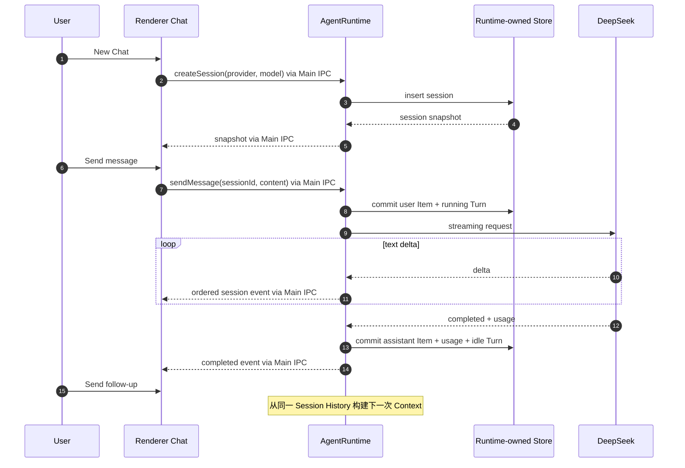

> 返回 [Agent 索引](README.md)

## 9. Chat 产品流程

### 9.0 UI 所有权与布局

- 产品、Design PNG、Design DOM 与 visual parity 使用唯一 `1600 × 900` 基准尺寸；真实窗口初始尺寸在
  Application Shell 层按该值实现。更小窗口是响应式运行能力，不维护第二套主设计基线。
- Header 右侧、窗口控制左边提供全局 Agent icon button。关闭态使用中性色；打开态使用
  `--accent-soft` 背景、`--accent` 图标与轻 accent 描边。
- Agent 打开后在 `1600 × 900` 基线成为 `.app` 的 `440px` 右侧 grid column，Main workspace 同步缩窄。
  窗口变窄时 Grid 优先为 main 保留 `440px`，Agent track 从 `440px` 响应式收缩；Panel 不使用 overlay，
  不得覆盖 Capture Inspector、Rules Editor 或其他 Workspace 内容。
- `agentPanel: open | closed` 是用户显式拥有的 Shell 状态。切换 Workspace、进入 Settings > Agent、打开
  Provider Dialog 或切换 Chat 都不得自动关闭；只有用户点击全局 toggle 或 Panel 内 Close 才能关闭。
- Workspace导航不得隐式修改Chat、Session History或Model input，也不自动把选中的Exchange/Rule注入Context；资源附件必须由用户显式添加并可移除。
- Panel Header 使用 Chat selector 访问 Session，避免在 `440px` Panel 内常驻第二条 Session rail。New Chat 与 Close
  是独立图标命令；未配置 Provider 时 New Chat disabled，并显示 `Configure Agent` 出口。
- Composer 上方左侧是有边框、Provider Logo、模型名和 chevron 的 Model Select；右侧用圆形 Progress 显示
  `Current Context Window Usage` 与精确 `current / max` Token。圆环固定为`18px`；整个Context入口支持hover和
  键盘focus，并在上方显示当前Session的Token/cache详情，不再显示独立`Session usage`按钮。这里的 Context只表示
  本次Model Context使用量，不表示当前页面或选中业务对象。
- Send 按钮相对 Composer 整体垂直居中；Transcript、Composer 与 Panel 分别拥有正确的 `min-height: 0` 和滚动边界。

### 9.0.1 Settings > Agent

- Provider 与模型配置只归全局 `Settings > Agent`，不把 API Key 表单塞进 Chat Panel。
- `Configured models` 是唯一列表；每行同时显示 Provider 品牌、Model ID、连接状态、脱敏凭据摘要、
  非交互 `Default` 状态或 `Set default` 命令，以及 `Edit`。默认行只增加左侧 `3px` accent 竖条，
  不改变 Logo、文字或整行底色。
- DeepSeek 是首个正式 preset；Custom OpenAI-compatible 是正式配置入口。设计稿里的 Qwen3 Max 用于验证
  Custom profile 与品牌映射，不代表当前产品已经实现独立 Qwen Adapter。
- DeepSeek Dialog 固定官方 endpoint，编辑 API Key 与 Model ID；Custom Dialog提供Profile name、Base URL、
  可选API Key、Model ID、Context Window与Maximum Output。所有FieldControl统一为`34px`高，必须先Test connection，
  成功后才允许Save。
- Provider Logo 使用可枚举map。已知品牌使用Simple Icons提供的原始品牌path与推荐色；Custom / unknown回退Lucide Bot。
  Logo仅作来源标识，不暗示品牌合作；新增品牌前复核对应brand guideline。
- 当前 Chat 的 Model Select 只列已配置模型；选中项品牌 Logo 着色，未选中项同形状置灰；菜单末尾
  `Agent settings…` 深链到 Settings > Agent，且保持 Panel 打开。
- `Tool capabilities`始终显示在模型配置之后，即使尚未配置Provider；目录从Main返回的共享registry投影渲染，
  六个Settings feature组与Model使用的六个Capability一一对应。搜索只过滤当前可见行，不改写Agent/MCP开关。
- 每行Agent与MCP开关分别调用`disableAgentTool` / `enableAgentTool`和`disableMcpTool` / `enableMcpTool`；
  fresh profile全部开启，关闭项跨Settings往返和重启恢复。Agent在Capability Index、discovery、schema和执行前检查授权；MCP在每次`tools/list`和`tools/call`前检查对应授权。

Provider 配置使用以下公开契约，API Key 不进入 snapshot：

```ts
type AgentProviderDraft =
  | {
      providerId: string | null;
      kind: 'deepseek';
      profileName: string;
      modelId: string;
      credential: AgentCredentialChange;
    }
  | {
      providerId: string | null;
      kind: 'openai-compatible';
      profileName: string;
      baseUrl: string;
      modelId: string;
      contextWindowTokens: number;
      maximumOutputTokens: number;
      credential: AgentCredentialChange;
    };

type AgentCredentialChange =
  | { action: 'keep' }
  | { action: 'replace'; apiKey: string }
  | { action: 'remove' };
```

- `keep` 只允许编辑已有 Provider；新增 Provider 必须明确 `replace` 或（仅 Custom）`remove`；DeepSeek 必须有 Key；
- Test connection 在 Main/Runtime 解析并规范化 draft、解析凭据动作，再向 Chat Completions endpoint 发最小请求；
- Custom远端Base URL必须使用HTTPS；HTTP只允许`localhost`或数值loopback地址，避免API Key与Prompt经远端明文传输；
- Model请求禁止自动跟随HTTP redirect，避免已验证的安全endpoint把请求正文转发到未校验地址；
- Test 成功返回不含 Key 的 model preview 与一次性 `verificationId`。Runtime 内存保存该次已验证的完整 draft；
  Save 只提交 `verificationId`，因此字段或凭据变化后旧 verification不能保存；发起新Test立即撤销旧verification并取消旧请求，
  Provider配置revision变化也会撤销verification。Test发送`max_tokens: 8`，有15秒attempt timeout与1MiB响应上限，
  Runtime stop会取消并等待在途Test清理；普通Model attempt另有32MiB流式响应上限；
- Provider registry、default model ID 与 API Key 作为一个当前固定schema的record经`safeStorage`加密并原子替换
  `<userData>/agent/providers.enc`。所有Save/default/remove mutation在Runtime内串行，Renderer snapshot只含
  `credentialConfigured`和`credentialLastFour`；读写使用同一256KiB密文上限，瞬时文件系统或无法分类的解密错误
  保留已有密文并让启动失败，只有确定损坏的record才清理；secureStorage暂不可用时保留已有密文、阻断空基线修改，
  恢复后要求重新启动并读取原记录，不降级、不删除也不覆盖；
- 编辑Custom Provider时必须能显式选择保留、替换或移除已存Key；DeepSeek不提供移除Key；
- 新增首个 model 自动成为 default；Set default 不重排列表；删除 default 后按现有稳定顺序选择下一项；
  删除最后一项后回到 unconfigured；
- 启动读取拒绝 symlink、非普通文件、超限、无法解密或 schema 非法的 record，并清理为诚实未配置态；
  OS secure storage 不可用时拒绝 Test/Save，不把明文降级写盘。

### 9.1 普通多轮对话



### 9.2 必需的 Chat 操作

每个用户交互对应一条语义单一的 Preload/Main intent：

| Intent | 语义 |
| --- | --- |
| `getAgentModels()` | 读取稳定有序的脱敏 model snapshot 与 default model ID |
| `testAgentProviderConnection(draft)` | 测试完整 draft，成功后返回一次性 verification，不持久化 |
| `saveVerifiedAgentProvider(verificationId)` | 原子保存刚验证的 draft；字段变化必须重新 Test |
| `removeAgentProvider(providerId)` | 删除目标 Provider；必要时确定性选择新 default |
| `setDefaultAgentModel(providerId)` | 只切换新 Chat 默认 model，不改变列表顺序 |
| `listAgentSessions()` | Chat selector 的 Session 列表快照 |
| `createAgentSession(options)` | 新建空 Chat |
| `getAgentSession(sessionId)` | 读取完整 Transcript 快照 |
| `renameAgentSession(sessionId, title)` | 显式改名 |
| `deleteAgentSession(sessionId)` | 删除完整历史；active 时先取消 |
| `sendAgentMessage(sessionId, content)` | 创建一个新 Turn |
| `cancelAgentTurn(turnId)` | 停止当前 Turn，不删除 Session |
| `onAgentSessionEvent(listener)` | 接收带 `sessionId / turnId / sequence` 的有序事件 |

Chat UI提供全局Side Panel、Chat selector、Transcript、Composer、Send、Stop、New Chat、Rename、Delete、
Provider 未配置状态、失败状态、Context 圆环、Session Usage 和恢复入口。Tool 加入后，Transcript 继续显示 Tool Call 与结果摘要；
Provider 明确返回的 reasoning 可折叠查看，但不与 Plan 或最终回答混合。
