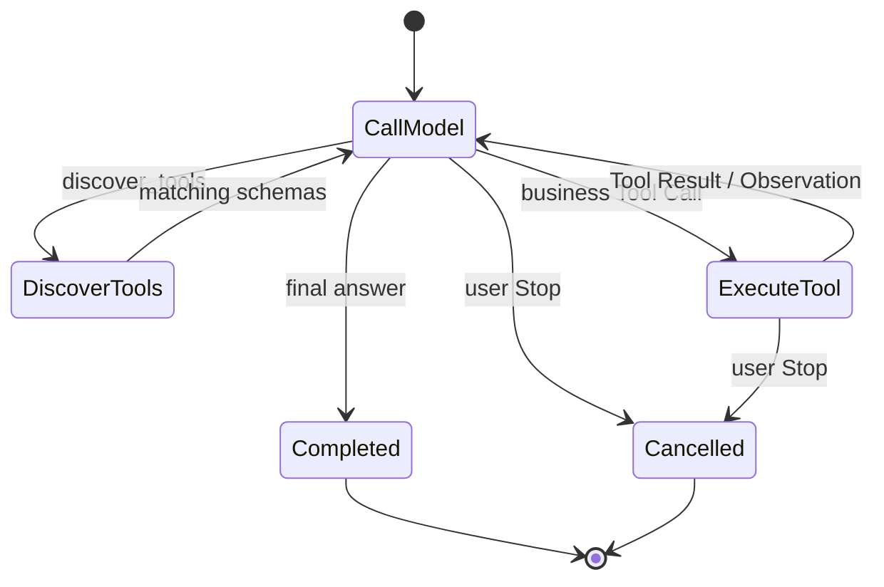
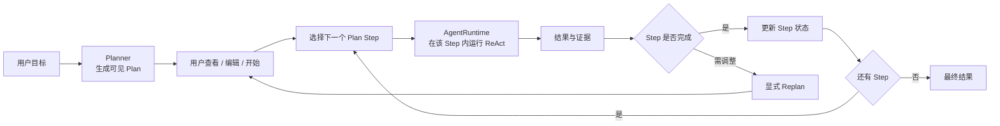

> 返回 [Agent 索引](README.md)

## 4. 执行模型：ReAct 优先，Plan-and-Execute 按需叠加

### 4.1 ReAct

Chat使用ReAct形态的动态循环：

```text
Model 决定下一步 Action
→ AgentRuntime 执行 Tool Call
→ Tool Result 成为 Observation
→ Model 基于新 Observation 决定继续调用 Tool 或给出最终回答
```

选择 ReAct 的原因：

- Chat 中用户目标经常在对话中逐步明确，不适合先强制生成完整 Plan；
- Traffic 分析依赖实时 Observation，下一步通常要看前一个 Tool Result 才能决定；
- 用户可以随时追问、纠正或 Stop，ReAct 与交互式 Session 自然一致；
- 探索式任务不需要额外的Planner / Executor状态机；
- 渐进式披露天然属于 ReAct：`discover_tools`、读取 summary、读取 detail 都是 Action，返回内容是 Observation。

这里的 Reason 不等于产品自己推导隐藏 Chain-of-Thought。DeepSeek 明确返回的 `reasoning_content` 由
`DeepSeekModelAdapter` 作为 continuation state 处理：加密持久化、按协议回传，并与可编辑 Plan 分离。



### 4.2 Plan-and-Execute候选

Plan-and-Execute 只在任务本身需要一个用户可见、可编辑、可恢复的多步骤交付物时加入，例如：

- 对一批 Exchange 做分类、逐项分析并生成汇总报告；
- 分析问题后创建多条 Rule，再分别验证实际效果；
- 用户希望在执行前审阅步骤，或应用重启后从某一步继续。

Plan-and-Execute 不替换 `AgentRuntime`。它在 Session 层增加一个结构化 Plan，Executor 对每个 Plan Step
仍调用同一个 ReAct Runtime：



抉择规则：

| 场景 | 执行模型 |
| --- | --- |
| 普通 Chat、单次查询、探索式 Traffic 分析 | ReAct |
| 步骤无法预先可靠列举 | ReAct |
| 用户明确要求先给方案再执行 | Plan-and-Execute |
| 需要跨重启跟踪多个可验收步骤 | Plan-and-Execute |
| 固定、完全可预测的产品流程 | 普通 deterministic workflow，不使用 Agent Plan |

该候选不自动切换执行模式。Chat默认ReAct；显式Plan由用户选择或确认后创建。Planner与Executor可以使用同一个Model，不要求Subagent或Multi-agent。
