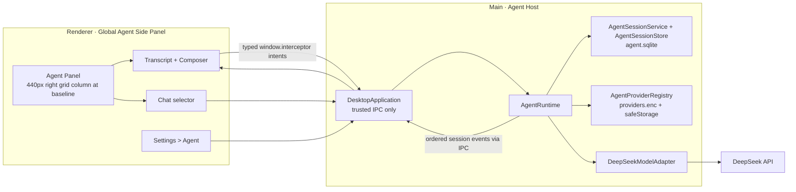

> 返回 [Agent 索引](README.md)

## 5. 进程与所有权

云端Model调用是异步网络I/O，不引入新的UtilityProcess。`AgentRuntime`实例运行在Main进程，
是 Agent domain 的唯一组合根；Main 只负责可信 IPC，并注入 `userData`、`safeStorage` 与 `fetch`，不拥有任何
Agent Session状态。所有Agent异常必须收敛为单个Turn失败，
不得影响抓包、系统代理恢复或 Core 生命周期。

共享Tool registry、开关和Core调用见
[tool-capabilities.md](../tool-capabilities.md)。

| 组件 | 所有权与职责 |
| --- | --- |
| `AgentRuntime` | 唯一组合根；拥有 Provider、Credential、Session、Turn、History、Context、Usage、执行循环与事件 |
| `AgentSessionService` | Runtime 内部协作者；拥有 Session CRUD、Turn、Provider协调、事件与关闭准备 |
| `AgentSessionStore` | Runtime 内部协作者；`<userData>/agent/agent.sqlite` 持久化 Session、Turn、Item 与 Model Call Usage |
| `AgentProviderRegistry` | Runtime 内部协作者；使用注入的 `safeStorage` 加密 Provider registry 与 API Key |
| `DeepSeekModelAdapter` | Runtime 拥有的 Provider Adapter；映射 DeepSeek Streaming wire contract 与内部 event |
| `ToolCapabilitySettingsService` | Main中的全局设置owner；从共享registry投影Settings目录，只持久化Agent/MCP关闭项 |
| Renderer | 全局 Agent toggle、右侧Panel、Chat selector、Transcript、Composer、Context Window Usage 与 Settings > Agent；不运行Agent Loop |

`packages/agent-runtime/` 不引用 Renderer 或 Electron API。`AgentRuntime` 接收窄平台能力并拥有其生命周期：
数据目录、`AgentSecureStore`、动态`AgentToolSource`和可选`fetcher`。Main创建一次长期存活的`agentRuntime`，
所有IPC只转发语义单一intent。`AgentToolService`在Main中适配共享registry、Settings和`CoreRuntime.request()`；
Runtime只消费transport-neutral snapshot，不接触Electron或Core bridge；业务分组见[Tool能力目录](../tool-capabilities.md)。

共享Tool协议按feature所有权命名：`capture_*`、`rules_*`、`composer_*`、`breakpoints_*`、`diagnostics_*`、`settings_*`。
Capability ID与前缀一致；不保留此前无前缀名称或`traffic`/`requests` Capability alias。旧Session中的Tool名称只作为
历史Transcript文本保留，不重新披露或执行。

Agent通过`discover_tools(capabilityId:'breakpoints')`披露共享schema。
`breakpoints_list`直接执行；change服从Session的`ask`/`auto`。Ask影响由当前pending动态生成，Deny不解除客户端，
Allow/Auto只调用正式Core命令。`breakpointId`无revision且只在当前Core代际有效；审批前已知stale返回
`invalid_arguments`，描述后才失效的执行竞态由Core返回`conflict`。Forward edited按phase只开放request的
method/URL/body、response的status/body与WebSocket文本body，不允许Model提交跨phase字段或文件路径。关闭Tool后
discovery与执行立即返回不可用，Agent重启不重放已完成或等待中的resolution。
