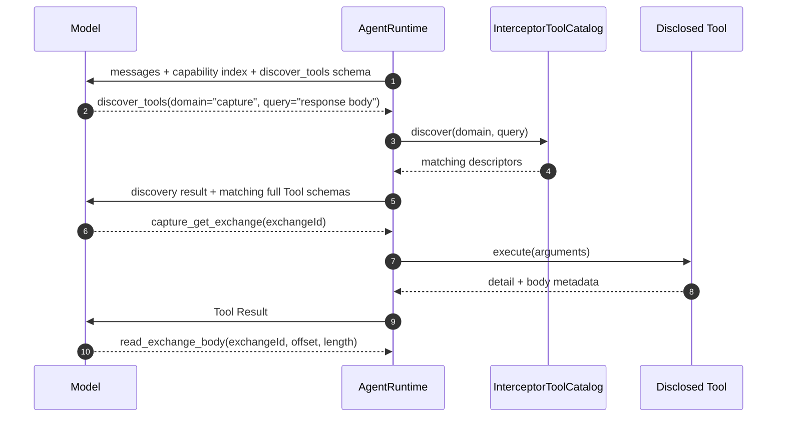

> 返回 [Agent 索引](README.md)

### 6.2 Context 构建与渐进式披露

基本调用路径按顺序发送完整Provider-neutral History，并渐进披露已开启Tool。发送前以消息字节数和固定开销保守估算输入，可用output取Model上限与剩余Context的较小值。估算输入已占满Context时，拒绝请求且不持久化running Turn。

下述Working Set、Pin、History检索与compaction是长Session的候选设计，不能作为基本调用路径已提供这些能力的依据。无论采用何种Context策略，完整History都保留在本地。

单个 Session 与 1M Context Window 的关系：

- Session History 是 Runtime 本地保存的 append-only 完整日志，可以超过 1M tokens；
- 1M Context Window 是 DeepSeek **每一次 request** 的上限，不是 Session 生命周期配额；
- API 收到结构化 messages 和 tools 后，先按 Provider 的 Chat Template 组装模型输入；它不是简单地把 HTTP JSON
  原样交给 Model；
- Tokenizer 再把 role 边界、content、Tool schema、Tool Call / Result 等输入切成 token pieces，并映射为
  input token IDs；
- Model 基于全部 input token IDs 逐个预测新的 output token IDs；
- 普通文本 output 由 Tokenizer 解码为 JavaScript 字符串；Tool Call output 则由 Provider 协议层解析成
  `name / arguments / callId` 等结构化字段；
- 每次 request 的硬约束是 `inputTokens + generatedOutputTokens <= contextLength`；
- 可生成上限是 `min(requestedMaxOutput, modelMaxOutput, contextLength - inputTokens)`；
- 例如 input 为 900k，Context Length 为 1M，即使 Model 最大支持 384k output，本次理论上也最多生成 100k；
- History 尚小时全部按顺序重放，不做选择或 summary；
- 只有接近物理上限后，Working Set 才改为 system instructions + 旧 History summary + 最近原文
  + 当前未完成 Tool 轨迹 + 按需检索的旧 Item；
- 已完成的原始 History 不因 summary 或 compaction 删除，用户仍能查看，Agent 也可按需重新读取；
- 若某条旧信息既不在 Working Set、也没进入 summary、也没有被重新读取，Model 本次确实会忘记它；
- 为降低遗忘，Runtime 保存可追溯 summary、允许用户 pin 重要 Item，并提供 `search_session_history` /
  `read_session_items` 让 Agent 按稳定 Item ID 取回原文；
- Tool Call 与对应 Tool Result 必须成对保留，不能只压缩其中一边；
- Tool schema、Tool Call、Tool Result、system instructions、附件与 DeepSeek 要求回传的
  `reasoning_content` 都计入 input context；
- Prompt Cache 只降低重复前缀的成本或延迟，不增加 1M Context Window。

#### 6.2.1 四层状态边界

| 层级 | Owner | 是否持久化 | Model 是否直接可见 |
| --- | --- | --- | --- |
| Session History / Short-term Memory | `AgentRuntime.SessionStore` | 是，保存完整原始 Item | 否 |
| Working Set | `AgentRuntime.ContextBuilder` | 由 generation / checkpoint 可重建 | 只有被选中并继续进入 Context 的部分 |
| Model Context | `ProviderAdapter` + Provider | 每次 request 临时构建 | 是，本次推理的全部输入 |
| Provider KV Cache | DeepSeek | Provider best-effort、短期持有 | 不增加任何内容，只复用已发送 prefix 的计算 |

严格关系是：

```text
Session History
  → ContextBuilder 选择 / 检索 / Compaction replacement
  → Working Set
  → Provider 加入 instructions / tools / wire-required state
  → Chat Template + Tokenizer
  → Model Context Token Sequence
```

因此“LLM 的 Session Memory”只能作为视角性简称：它是 Model Context 中来自 Session 的那一部分，
不是 DeepSeek 端另有一份可恢复 Session。KV Cache 也不能让 Model 读取未进入这条链的 History。

#### 6.2.2 谁决定保留什么

| 决策者 | 决策范围 |
| --- | --- |
| `AgentRuntime.ContextBuilder` | 计算 Token、确定必须原样保留的 Item、选择可压缩的连续旧 Turn、组装最终 Working Set |
| `ProviderAdapter` | 声明 Context Window、最大输出和 `reasoning_content` 等 Provider 协议必须项 |
| Compaction Model | 只把 Runtime 指定的候选旧 Turn 压缩为结构化 Summary，不决定删除原始 History |
| 用户 | Pin / Unpin 任意 Item；Pin 的内容优先原样进入 Working Set |
| 测试与 Eval | 验证旧约束、决策、未完成任务和引用事实在 compaction 后仍可回答 |

Runtime 不让 Model 自由决定“哪些历史可以忘记”。流程是：

1. ContextBuilder 先按目标 Model 构建完整候选 Context，并为本次最大 output 留出空间；
2. 低于 background 阈值时直接使用完整候选，不做无收益的 Summary 调用；
3. 到达 background 阈值时只在 Turn 边界冻结 source generation，并构建 Mandatory Set；
4. 从最旧的已完成 Turn 开始，选择不含 Pin、active Turn 或协议必须项的连续区间；
5. Compaction Model 把该区间输出为结构化 Summary，Runtime 将这次调用记为 `purpose: 'compaction'`；
6. Runtime 用 Zod 校验 Summary，并在同一事务保存 Summary、`coveredItemIds` 和 checkpoint；
7. 只有 `previousWorkingSetHash` 仍匹配时才原子安装 replacement generation；不匹配则丢弃结果并按新状态重算；
8. 若下一次 request 已到 blocking 阈值，则等待有效 replacement；失败时保留旧 generation 并报告 Compaction 错误，
  不发送一个已知超出 Context Window 的请求；
9. Agent 后续可通过 `search_session_history` / `read_session_items` 取回 Summary 引用的原文。

#### 6.2.3 必须原样保留

- System instructions 与当前 Permission Mode；
- 当前 User message；
- 当前 active Turn 的全部 Item；
- 未完成 Tool Call 及其后续 Tool Result；
- Provider 声明必须回传的 continuation state；
- 用户 Pin 的 Item；
- 当前已披露且下一步仍可能调用的 Tool schema；
- Summary 自身及其 `coveredItemIds`。

Tool Call 与 Tool Result 作为原子组处理：一起保留、一起压缩或一起按 ID 取回，不允许拆开。

#### 6.2.4 Summary 应保留

- 当前目标、成功标准和用户明确要求；
- 用户修正过的错误假设与稳定偏好；
- 已确认决策及其理由；
- 已验证事实、关键数值、稳定业务 ID 和证据 Item ID；
- 已完成结果与产生的系统副作用；
- 未完成任务、阻塞、待确认问题和下一步；
- 失败尝试及失败原因，但不保留无意义的重复日志；
- 被压缩区间的完整 `coveredItemIds`。

```ts
interface AgentHistorySummary {
  summaryId: string;
  goal: string;
  constraints: readonly string[];
  decisions: readonly { text: string; sourceItemIds: readonly string[] }[];
  verifiedFacts: readonly { text: string; sourceItemIds: readonly string[] }[];
  completedWork: readonly string[];
  openWork: readonly string[];
  failedApproaches: readonly string[];
  coveredItemIds: readonly string[];
}
```

#### 6.2.5 可以退出当前 Working Set

- 已被新结论取代的中间推测；
- 已完成 Turn 中冗长、重复的自然语言；
- 已提取关键事实的超大 Tool Result 原文；
- 重复日志、进度动画和临时状态通知；
- 与当前目标无关且未被 Pin 的旧讨论。

“退出 Working Set”不等于删除：原始 Item 仍在 Session Store，可由用户查看或由 Agent 按需读取。

#### 6.2.6 Context Compaction 与 CompactionCheckpoint

Context Compaction 已是长运行 Agent 的主流工程做法，而 `checkpoint` 的名称和数据结构仍由产品定义：

- Anthropic 把 Compaction、结构化记笔记和 Multi-agent 列为跨 Context Window 长任务的主要技术；
- GitHub Copilot SDK 默认启用 Infinite Sessions，在 Context Usage 约 80% 时后台 compaction，约 95% 时
  等待 compaction 完成；事件包含 Summary、压缩前后 Tokens、移除消息数和 checkpoint snapshot；
- OpenAI Agents SDK 提供自动和手动 history compaction，用较短的等价 Item 列表替换活动 History；
- OpenAI Codex 提供 `thread/compact/start`，并持久化 input history、replacement history 与安装边界；
- 多次 compaction 都可能累积语义损失，因此完整原始 History 和可追溯来源仍必须保留。

候选`CompactionCheckpoint`描述替换边界，不把Summary本身称为checkpoint：

```ts
interface AgentCompactionCheckpoint {
  checkpointId: string;
  sessionId: string;
  sequence: number;
  trigger: 'background' | 'blocking' | 'manual' | 'model-switch';
  compactionModelCallId: string;
  coveredItemIds: readonly string[];
  summaryItemId: string;
  replacementItemIds: readonly string[];
  previousWorkingSetHash: string;
  preCompactionTokens: number;
  postCompactionTokens: number;
  modelId: string;
  createdAt: string;
}
```

字段关系：

- `coveredItemIds`：被 Summary 代表的原始 History 区间；
- `summaryItemId`：LLM 生成并通过 Zod 校验的结构化 Summary；
- `compactionModelCallId`：生成该 Summary 的真实 Model Call，用于追溯 Token、cache split 和计费；
- `replacementItemIds`：下一次 Model Call 使用的 Summary、最近 Item、Pin 与协议必须项；
- `previousWorkingSetHash`：确认 checkpoint 安装时没有覆盖已变化的 Working Set；
- `pre/postCompactionTokens`：解释 compaction 实际释放了多少 Context；
- 原始 `coveredItemIds` 仍可读取；checkpoint 只改变 active Working Set generation。

触发方式：

- `background`：Context Usage 到达可配置阈值后，在 Turn 之间异步生成 Summary；
- `blocking`：下一次 request 已无法为 input + output 留出合法空间时，先完成 compaction；
- `manual`：用户主动点击 Compact，可附加“重点保留什么”的说明；
- `model-switch`：切换到更小 Context Window 的 Model 时，按目标窗口重新 compaction；
- 阈值属于物理 Context 管理，不是 Session Token 配额或用户操作限制；UI 必须显示 compaction 状态。

候选阈值可参考80%后台启动、95%阻塞等待；阈值需要长Session评估，不能将其他产品的默认值当作本项目保证。

Compaction 的成本与长期行为：

- Summary 由 Model 生成，因此 Compaction 本身也消耗 input / output tokens，并计入该 Session Usage；
- `preCompactionTokens - postCompactionTokens` 只表示后续每次调用可能减少的 input，不退还已经发生的 Usage；
- replacement 改变 Token prefix，安装后的第一次普通调用可能 cache miss；后续保持 replacement 稳定才可能命中新 prefix；
- 长 Session 允许新 Summary 覆盖旧 Summary 与后续已完成 Turn，但必须把来源扁平化到原始 `coveredItemIds`，
  live Working Set 不形成无法追溯的嵌套 Summary 链；
- 每次递归 Compaction 都可能损失语义；Pin、结构化字段、History retrieval 和“新建 Session”入口始终保留；
- Summary 生成、Zod 校验、事务保存或 hash compare 任一失败，都不得安装半成品 checkpoint。

Prompt Cache 与 Compaction 是正交机制：

| 机制 | Model 看到的内容 | Current Context / input tokens | Provider 计算与计费 | 信息损失风险 |
| --- | --- | --- | --- | --- |
| Prompt Cache | 不变，仍发送完整 Working Set | 不减少 | 重复 prefix 可复用 KV，并按 cache-hit input 计价 | 无 |
| Context Compaction | 旧区间被 Summary replacement 代替 | 后续调用减少 | 先支付一次 Summary 调用，之后按更短 input 计价 | 有，必须可追溯与检索 |

具体示例（Token 切分和 ID 仅用于解释，**不是 DeepSeek 的真实 Tokenizer 输出**）：

1. 用户输入的是人类可读字符串：

   ```text
   请计算 2 + 3
   ```

2. Runtime 发给 API 的结构化请求包含消息和 Tool schema：

   ```json
   {
     "messages": [
       { "role": "user", "content": "请计算 2 + 3" }
     ],
     "tools": [
       {
         "name": "add",
         "parameters": {
           "type": "object",
           "properties": {
             "left": { "type": "number" },
             "right": { "type": "number" }
           },
           "required": ["left", "right"]
         }
       }
     ]
   }
   ```

3. Provider 内部先应用 Chat Template，再由 Tokenizer 切分。概念上可能类似：

   ```text
   token pieces: [USER, 请, 计算, 2, +, 3, TOOL, add, left, number, right, number]
   token IDs:    [101, 4821, 907, 22, 19, 23, 205, 731, 880, 64, 991, 64]
   ```

   Token ID 只是 Model 词表中某个 token piece 的整数索引，不是 Unicode 编码、加密结果或业务 ID。
   一个 Token 可能对应一个汉字、多个字符、半个英文单词或一个标点，不能用字符数精确替代。

4. 这些 ID 都属于本次调用的 input。Model 随后生成 Tool Call；概念上的 output 是：

   ```json
   {
     "callId": "call_1",
     "name": "add",
     "arguments": { "left": 2, "right": 3 }
   }
   ```

   Tool 名、JSON key、数字和标点同样由 output token IDs 生成，Provider 再把它们解析成 Tool Call 对象。

5. Model 不会执行加法。Runtime 用 Zod 校验 arguments，执行 `add`，把结果追加到本地 History：

   ```json
   {
     "role": "tool",
     "tool_call_id": "call_1",
     "content": "{\"value\":5}"
   }
   ```

6. 第二次 API request 的 input 包含：原 user message、assistant Tool Call、Tool Result 和 Tool schema。
   Model 再生成新的 output token IDs，例如概念上的 `[314, 92, 23]`，Tokenizer 解码后得到 UI 显示的字符串：

   ```text
   结果是 5。
   ```

因此，同一段内容会在不同阶段改变身份：本轮 Model 生成的 output，追加到 History 后，会成为下一次 Model Call
的 input。`input` / `output` 描述的是**单次 Model Call 的方向**，不是内容永久不变的类型。

Model Input 中各类内容的具体形态：

- **System message**：应用提供的稳定行为说明，例如 Agent 身份、如何使用 Tool、产品术语和当前 Permission Mode。

  ```json
  {
    "role": "system",
    "content": "You are Interceptor's traffic analysis agent. Use tools to inspect live capture data."
  }
  ```

- **User message**：用户提交给Model的内容。文本与视觉附件需要各自明确的content part契约，不能由普通文本字段暗示附件。

  ```json
  {
    "role": "user",
    "content": "找出最近一个返回 500 的请求并分析原因"
  }
  ```

- **Previous assistant message**：Model 之前生成的可见回答。它在生成当时是 output，后续重放时成为 input。

  ```json
  {
    "role": "assistant",
    "content": "我先查询最近的 500 响应。"
  }
  ```

- **Assistant Tool Call message**：Model 之前提出的 Tool 请求。它必须保留 `callId`、Tool 名和原始 arguments；
  在 DeepSeek Thinking Mode 下还要保留官方要求回传的 `reasoning_content`。

  ```json
  {
    "role": "assistant",
    "content": "",
    "reasoning_content": "I need the latest failed exchange.",
    "tool_calls": [
      {
        "id": "call_42",
        "type": "function",
        "function": {
          "name": "capture_list_exchanges",
          "arguments": "{\"statusCode\":500,\"limit\":1}"
        }
      }
    ]
  }
  ```

- **Tool Result message**：Runtime 执行 Tool 后返回给 Model 的 Observation。`tool_call_id` 必须对应前面的 Tool Call；
  Chat Completions wire format 中 `content` 是字符串，结构化结果先序列化为 JSON 字符串。

  ```json
  {
    "role": "tool",
    "tool_call_id": "call_42",
    "content": "{\"ok\":true,\"exchanges\":[{\"exchangeId\":\"ex_9\",\"method\":\"GET\",\"url\":\"https://api.example.test/orders\",\"statusCode\":500}]}"
  }
  ```

- **Tool Error Result**：可恢复的参数或执行错误也作为 Tool Result 返回，让 Model 能调整下一步，而不是伪装成成功。

  ```json
  {
    "role": "tool",
    "tool_call_id": "call_42",
    "content": "{\"ok\":false,\"error\":{\"code\":\"invalid_arguments\",\"message\":\"limit must be positive\"}}"
  }
  ```

- **Tool definitions**：不在 `messages` 中，而是 request 顶层独立的 `tools` 数组。它告诉 Model 当前可以调用什么，
  但不会执行任何业务逻辑。渐进式披露时这里只包含当前 active Tools。

  ```json
  {
    "tools": [
      {
        "type": "function",
        "function": {
          "name": "capture_list_exchanges",
          "description": "List captured exchanges matching a query.",
          "parameters": {
            "type": "object",
            "properties": {
              "statusCode": { "type": "integer" },
              "limit": { "type": "integer" }
            },
            "required": ["statusCode", "limit"],
            "additionalProperties": false
          }
        }
      }
    ]
  }
  ```

本地 Session 中保存、但默认不发送给 Model 的内容：

- `sessionId`、`turnId`、`itemId`、标题、创建时间和 UI selection；
- API Key、加密材料、SQLite 主键和绝对文件路径；
- Session Usage、Context 圆环值、事件 sequence 和 Diagnostics；
- Permission UI 的展示状态与内部审计字段；若用户拒绝 Tool，只把必要的拒绝结果返回 Model；
- 未被 Context Builder 选入 Working Set 的原始旧 History。

一次含 Tool Call 的第二次 DeepSeek request，`messages` 顺序必须是：

```text
system
→ previous user / assistant messages
→ current user message
→ assistant Tool Call
→ matching Tool Result
```

Tool Call 与 Tool Result 是一对协议记录：不能只发送 Result，也不能改变 `callId` 后再回传。

示例：三个 Model Call 的 input 分别是 20k、35k、50k，output 分别是 2k、3k、4k：

- Session input Usage 是 `20k + 35k + 50k = 105k`；
- Session output Usage 是 `2k + 3k + 4k = 9k`；
- 当前 Context Window Usage 只看最后一次 input，即 `50k / 1M = 5%`；
- 三者继续对话时，Session 累计 Usage 可以超过 1M，但每一次 Context 仍必须小于 1M。

| 层级 | Model 初始可见内容 | 如何进入下一层 |
| --- | --- | --- |
| Capability | Capture、Rules、Composer、Diagnostics 等能力域的简短说明 | 调用常驻的 `discover_tools` |
| Tool | 与当前任务相关的 Tool 名称、说明和完整 JSON Schema | Runtime 将匹配 Tool 加入下一次 Model request |
| Resource summary | Exchange 列表、Rule 列表等轻量 summary 与稳定 ID | 调用具体 `get_*` Tool |
| Resource detail | 单条 detail、headers、body metadata 和可继续读取的位置 | 按需读取正文 range 或关联资源 |



渐进式披露不得制造死路：

- `discover_tools` 可搜索全部已实现 Tool，不维护隐藏 allowlist；
- discovery result 明确返回为何匹配、完整 Tool 名和能力域；
- 列表和 range response 必须返回总量、当前位置和继续读取方式，不静默截断；
- Model 可以继续读取直到取得全部数据，用户也可在 UI 中直接要求加载指定资源；
- 已披露 Tool 可在当前 Session 保持 active，用户开始新 Chat 时重新从 Capability 层开始；
- compaction候选仅在Context接近物理上限时压缩发送视图，不删除History；基本调用路径超限时拒绝请求。
