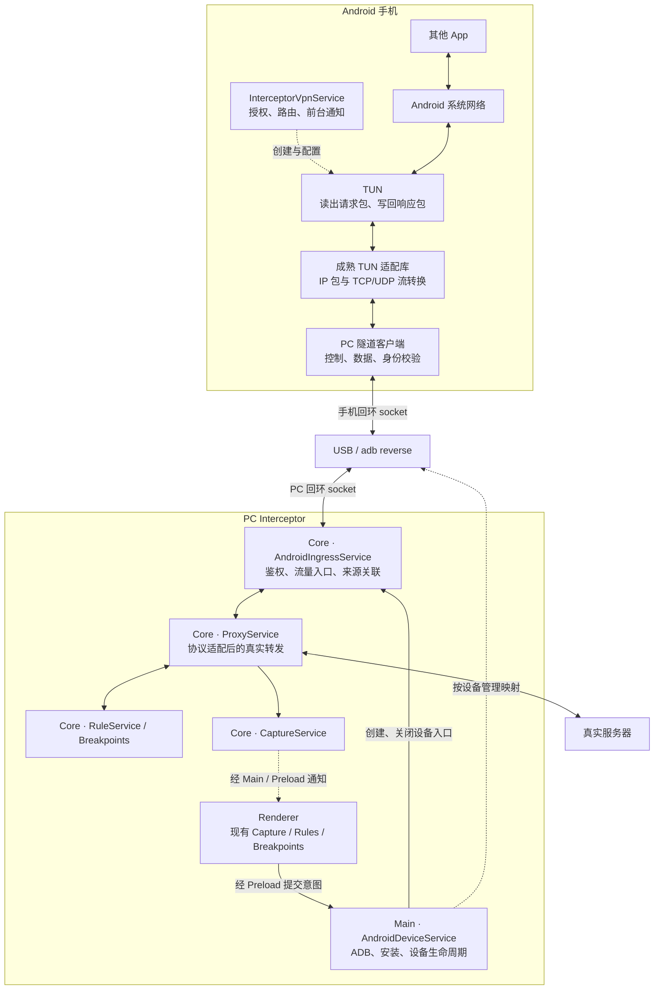
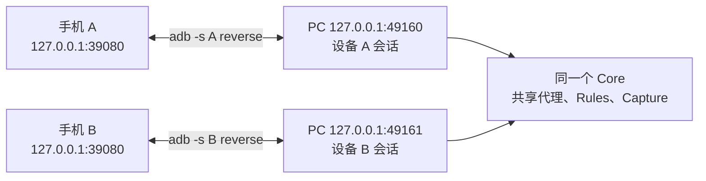
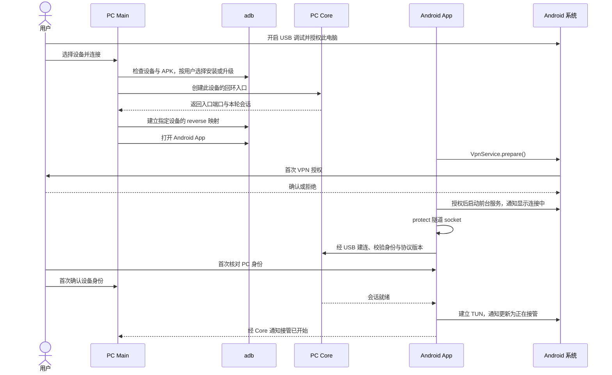
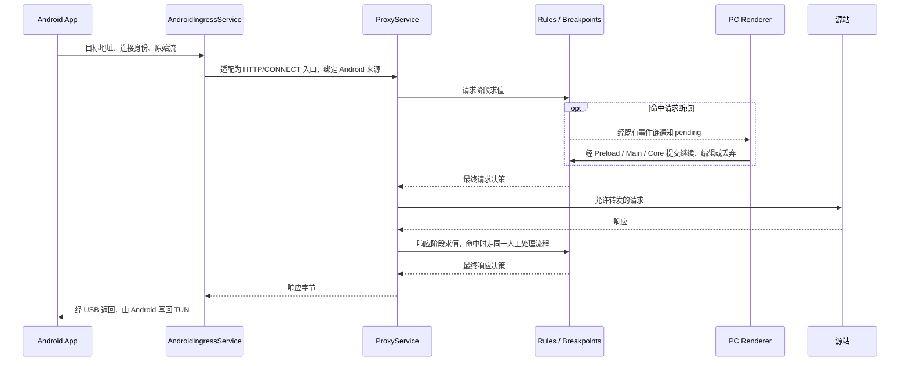

# Feature: Android USB 接入

> 状态：架构方案，未实现、未进行真机验收。
> 已确定方向：`VpnService` + TUN 接管手机流量，经 USB / adb 交给 PC。
> 本轮只制定文档；产品实现、依赖引入和具体 UI 尚未授权。

## 1. 当前实现

- [ProxyService](../../apps/proxy-core/src/proxy-core/proxy/README.md)：现有 HTTP/CONNECT 显式代理，不直接接收 TUN 的 IP 包。
- [Rules](rules.md)、[Breakpoints](breakpoints.md)：已在 PC Core 的真实转发路径上执行。
- [Capture](capture.md)：已有应用名称、图标和筛选；当前应用身份按本机进程定义。
- [进程边界](../platform/processes.md)：Renderer → Preload → Main → Core，正文不经过 Renderer/Main。
- 当前没有 Android App、ADB 设备管理、移动端隧道或 Android 来源契约。

## 2. 与当前实现的差异

以下均为待实现设计，不代表现有产品能力；未决选型和行为见末节。

### 2.1 方案边界

| 项目 | 方案 |
| --- | --- |
| 手机流量接管 | Android App 使用 `VpnService` 配置路由、创建并读写 TUN |
| 双端连接 | 仅 USB + `adb reverse`；不做局域网、无线 adb 或云中继 |
| 桌面显示 | 每台手机作为一个虚拟 App，使用 Android 图标 |
| 业务执行 | Rules、Breakpoints、Capture、Composer、导入导出、Agent/MCP 继续由 PC 拥有 |
| 网络出口 | PC 连接源站，沿用 PC 上游配置；不保留手机移动网络出口 |
| 手机职责 | 接管、流量适配、USB 隧道、状态和系统授权；不复制 PC 规则引擎 |
| 不包含 | 无 VPN 的显式代理模式、root、证书固定绕过、手机脱离 PC 独立执行规则 |

**`VpnService` 创建 TUN；TUN 是实际读写流量的接口。不是先做 VPN，再选择是否添加 TUN。**

### 2.2 总体架构



| 所属位置 | 拟新增或调整 | 不承担 |
| --- | --- | --- |
| `apps/android/` | Kotlin App、`InterceptorVpnService`、TUN 库适配、隧道客户端 | HTTP 规则、断点队列、PC 配置副本 |
| Desktop Main | `AndroidDeviceService`：发现设备、安装、建立连接、断开、恢复映射 | HTTP 正文转发 |
| Core `android-ingress/` | `AndroidIngressService`：设备会话、流量入口、DNS 转发、连接关闭 | 第二套 Rules / Capture |
| Core `proxy/` | 将远程连接接入现有代理；在规则求值和记录前关联来源 | 根据 PC 本机端口反查 Android 应用 |
| Renderer | 复用应用列、筛选、详情与断点；增加设备连接入口 | 直接调用 adb、连接手机或读取密钥 |

- 新 Core module 遵循 [现有模块结构](../platform/storage.md)：`entry.ts` 直接定义唯一 Service。
- Main 的安装、连接、断开分别使用独立业务方法；状态由 Main/Core 广播，不靠弹窗局部刷新。
- 不把安装、配对、设备凭据管理自动注册为 Agent/MCP Tool。

### 2.3 USB 端口与设备隔离



- Android 主动连接本机回环端口；`reverse` 将连接送到 PC，不使用方向相反的 `forward`。
- 每台设备使用独立 PC 入口端口；PC 绑定 `127.0.0.1`，实际端口由系统分配。
- 手机端可使用同一固定端口；上图数值仅为示例。
- 所有 adb 操作明确指定 USB 设备；`unauthorized`、`offline` 与 App 已连接是不同状态。
- 创建映射使用 `--no-rebind`；冲突显式报错，不覆盖其他工具的映射。
- Main 记录本轮设备、映射和 Core 代际；清理前核对实际目标，只删除自己拥有的映射。
- 不执行 `adb kill-server`、`reverse --remove-all`、`adb tcpip`，不修改手机全局 HTTP 代理。

```sh
# 方向示例，不是当前产品可执行的接入流程。
adb -s DEVICE_SERIAL reverse --no-rebind tcp:39080 tcp:49160
adb -s DEVICE_SERIAL reverse --list
adb -s DEVICE_SERIAL reverse --remove tcp:39080
```

### 2.4 建连与授权



- USB 调试授权、应用层配对、VPN 授权、抓包 CA 信任相互独立，不互相替代。
- 首次配对核对双方公钥指纹；后续固定已确认身份。未确认前不发送被捕获流量。
- 使用 TLS 保护应用层通道；传输身份与 HTTPS MITM CA 分开，不关闭证书校验。
- Main 持有授权设备记录；Android 私钥保存在 Android Keystore，PC 私钥使用既有安全存储能力。
- `adbSerial` / `transportId` 仅用于选择 ADB 设备，不作为认证凭据。
- VPN 授权拒绝、身份不符、版本不兼容均终止本次启动并清理入口，不显示为已连接。
- Android 的全部隧道 socket 都需 `protect()`；实际流量接管以 TUN 建立成功为准。

### 2.5 双端协议

| 通道 | 首版形式 | 内容 |
| --- | --- | --- |
| 控制 | 独立 WSS，结构化小消息 | 身份、版本、能力、VPN 状态、心跳、停止接管及确认 |
| TCP 数据 | 每条被接管 TCP 连接一条独立数据 WSS | 原始目标、连接标识、二进制数据、半关闭、取消 |
| DNS | 独立 WSS，使用有界的请求/响应消息，不与正文混排 | 查询 ID、原始 DNS 消息、响应或明确错误 |

- 三类通道共用此设备的回环入口，经同一条 adb 映射；不自行实现单连接多路复用。
- `adb reverse` 不直接转发 UDP；TUN 中的 DNS 数据报需封装到上述通道，PC 再执行查询或转发。
- 数据通道在打开时鉴权并绑定控制会话；不能仅凭客户端提交的 `deviceId` 接入。
- 首次握手协商 `protocolVersion`、双端版本和 `capabilities`；不要求补丁版本完全相同。
- `flow.open` 包含 `sessionId`、`flowId`、传输类型、目标 IP、目标端口及可用的域名信息。
- 原始字节使用二进制帧；`FIN` 表达单向结束，`RESET` 表达失败；WSS 关闭不能冒充正常响应结束。
- 控制消息、帧长、并发连接和发送窗口均有上限；窗口耗尽时背压，不完整缓存上传或下载。
- 心跳只判断设备连接；断点等待期间继续心跳，不因此自动放行请求。
- 不暴露 `CoreRuntime` 内部 RPC，不接受任意 Main 命令、文件路径或脚本。

### 2.6 请求、断点与响应



- TUN 产出的是 IP 包；成熟适配库负责 TCP 状态与重组，不能把包直接写入现有代理端口。
- 入口适配不提前向源站发送业务请求；先上传副本、手机自行直连无法实现真实断点。
- HTTP/CONNECT 适配、原始目标地址保留、半关闭及 Mockttp 公开入口是实施前的技术准入验证项。
- Rules、Map Local、请求/响应编辑、WebSocket 断点只在现有 Core 路径执行；Android 不另存规则树或 pending 队列。
- 保留现有“断点无自动超时”语义；手机客户端主动超时、断开时，只取消对应连接的 pending。
- HTTP/2 的断点仍按请求处理，不能把整个 TCP 连接暂停等同于暂停其中一个请求。
- Capture 的停止录制不停止 VPN、不关闭隧道，也不关闭规则；设备断开使用独立操作。

### 2.7 手机作为虚拟 App

| 字段或状态 | 归属与用途 |
| --- | --- |
| `deviceId` | Android 安装级随机身份，与配对公钥绑定；不使用名称、IP 或硬件隐私标识 |
| `sessionId` | 每次设备建连生成；重连、Core 重启后换新 |
| `flowId` | 会话内的单条连接；不能代替 HTTP/2 请求 ID |
| `appId` | PC 从已认证设备生成 `android:<deviceId>`，不信任客户端自报应用身份 |
| `appName` | 例如 `Android · Pixel 8`；同设备重连保留身份 |
| `sourceKind` | 显式区分 `local-app` 与 `android-device`；Android 分支没有本机可执行文件路径 |
| `transportState` / `vpnState` | USB 通道与手机接管状态分别记录；不从 PC 的 Recording 状态推断 |

- 请求列表、Application 筛选、详情和断点显示同一个 Android 来源及内置 Android 图标。
- 手机内各 App 首版归为同一设备来源；不增加逐包名识别、应用图标上传。
- 不根据 PC 回环源地址或 adb 进程反查手机来源，不把设备身份塞进发给源站的 HTTP Header。
- 来源元数据随 Exchange 和 Native Archive 保留；手机离线后仍可展示，HAR 不承诺保存标准之外的来源字段。
- 现有规则仍按原有语义生效；Application 筛选不是规则作用范围。按设备匹配规则需要另行确认，不在本轮追加。

### 2.8 协议与证书边界

| 流量 | 接入目标 | 能力边界 |
| --- | --- | --- |
| HTTP/1.1、HTTP/2 | 适配后进入现有代理 | 复用 Core 已支持的 Rules、Breakpoints、Capture |
| HTTPS | PC 使用现有 CA 做 MITM | 手机目标 App 必须信任该 CA；私钥不下发 Android |
| WebSocket、gRPC | 进入现有协议处理链路 | 不扩展当前消息编辑、帧断点和解析能力 |
| 不解密 TLS、普通 TCP | 明确的字节透传路径 | 只提供对应连接信息；不能伪装成已解密 HTTP |
| DNS | 查询经 USB 交 PC 解析或转发 | 保留查询 ID 与地址族；不按“一个 IP 对应一个域名”猜来源 |
| 其他 UDP / QUIC | 首版不提供内容解析、HTTP/3 规则或断点 | 转发或阻断策略须在实施前确认；不能默默走手机网络 |

- IPv4 / IPv6 路由、DNS、原始目标 IP/端口必须一起验证；不只接管 IPv4 却宣称全量。
- 未识别流量不能盲目进入 HTTP MITM；透明流量适配不代表现有显式代理已经支持任意协议。
- Android 目标 App 不信任用户 CA、证书固定、私有协议，均不能由 TUN 或 adb 自动解决。
- 同一用户/资料通常只能运行一个 VPN；不承诺跨资料、热点共享或所有绕过 VPN 的流量。
- USB 可达不代表所有 App 在 Wi-Fi/移动网络均关闭时仍愿意发请求；需按目标 App 真机验证。
- PC 访问不了的手机专属内网不会自动可达；不改变 PC 既有源站证书验证和上游策略。

### 2.9 断线、停止与恢复

| 事件 | 必须处理 |
| --- | --- |
| USB 拔出、设备离线、隧道失效 | 终止该会话流量；Core 取消对应断点并记录中断，不影响其他设备 |
| 重新连接 | 新会话、新连接；不恢复旧 TCP/H2 流，不自动重放 POST |
| Core 重启 | 旧入口失效；Main 核对并重建自己拥有的映射，不沿用旧会话凭据 |
| 用户停止手机接管 | Android 关闭 TUN、流量适配器和前台服务；完成后报告停止 |
| 桌面主动断开或正常退出 | 先请求 Android 停止并等待结果，再释放会话、入口和本轮映射 |
| Android 取消 VPN 或服务被系统结束 | 关闭接口、取消连接并通知 PC；不能继续显示正在接管 |
| 无法确认远端停止 | 明确显示失败与手机端停止方法，不能报告恢复成功 |

- 异常断线后的手机联网策略尚待确认。
  - 建议：保留 VPN，阻断当前接管范围并显示断线通知；用户明确停止后恢复普通联网。
  - 不自动把本来暂停或受规则限制的请求绕过 PC 发出去。
- 普通断开不卸载 APK、不删除配对记录或用户安装的 CA；撤销授权与卸载使用独立操作。
- 退出验收保留其他工具的 ADB Server、其他设备映射，以及测试前已有的系统设置。

### 2.10 安装、分发与开发工具

| 项目 | 方案 |
| --- | --- |
| 桌面安装 | 用户选择设备后，Main 校验 APK 的签名、版本和摘要，再执行指定设备的 `adb install -r` |
| 官网下载 | 同一签名 APK；手动安装后仍通过 USB 接入，不引入局域网模式 |
| 升级 | 同一 `applicationId` 与签名身份、递增 `versionCode`；签名不符或降级显式失败，不自动卸载用户数据 |
| ADB 工具 | 不要求用户安装 Android Studio；固定验证版本，明确随包或下载方式及第三方许可 |
| Windows | 部分设备需要 OEM USB 驱动；未授权、驱动缺失、仅充电线分别提示 |
| 开发 | Kotlin、Android SDK、Gradle Wrapper、adb；原生适配库按需使用 NDK；Android Studio 可选 |
| 权限 | 安装 APK 不等于授权 VPN 或信任 CA；保留真实系统确认，不用 adb 绕过 |

### 2.11 实施顺序与验收

| 顺序 | 交付边界 | 必须证明 |
| --- | --- | --- |
| 1. 技术准入 | 选择成熟 TUN 库，核对许可证与公开接口，验证 HTTP/CONNECT 适配 | 真机请求经 TUN、USB、现有代理往返；不是抓包副本或假 Preload |
| 2. 单设备闭环 | APK 安装、系统授权、鉴权会话、Android 来源 | 来源稳定；规则改写对手机实际响应生效；请求/响应断点真实挂起 |
| 3. 协议与生命周期 | DNS、IPv6、H2、WebSocket、gRPC、流式正文、退出 | 半关闭不截断、背压有界、断点不阻塞控制、拔线不重放请求 |
| 4. 多设备与交付 | 映射隔离、归档来源、版本协商、正式包 | 不串设备、不清其他映射；最终包包含所需 runtime 与许可 |

- 产品实现前补对应 workflow 规格；按 [测试分层](../platform/testing.md) 取得所需前置 Red，再实施并复跑。
- 业务单元/集成 → 真实 Electron + Android 真机 E2E；系统授权不以隐藏 API 或修改权限数据库代替。
- UI 先按 `design-vite/` 提供方案并确认，再实现和验证 parity；本文件不批准具体页面布局。
- 引入 adb/native runtime 后执行 package → artifact audit → packaged smoke；这些检查不能代替 Android 真机 E2E。
- 最终证据包括手机实际响应、源站收到的内容、断点状态、来源归属和退出恢复。
- PC Main/Core/Worker、8888、设备入口、Android TUN/服务、本轮 adb 映射均需核对；缺项保持待验收。

### 2.12 实施前待确认

- TUN 库、最低 Android 版本、ABI 与原生依赖许可；不自研 TCP/IP 栈。
- 异常断线后保留 VPN 阻断，还是停止 VPN 恢复普通联网。
- 非 DNS UDP / QUIC：首版显式阻断，还是增加有界的数据报转发；不能承诺客户端自动回退。
- adb 二进制的交付方式，以及帧长、并发、缓冲窗口的具体上限。
- 设备入口、手机状态与授权引导的 UI；需要单独设计确认。

## 3. 官方依据

- [Android VpnService：授权、TUN、路由、protect 与前台服务](https://developer.android.com/develop/connectivity/vpn)
- [ADB 命令：设备选择、reverse、定向清理与 APK 安装](https://android.googlesource.com/platform/packages/modules/adb/+/refs/heads/main/docs/user/adb.1.md)
- [Android 真机 USB 调试与驱动](https://developer.android.com/studio/run/device)
- [Android CA 信任配置](https://developer.android.com/privacy-and-security/security-config)
- [APK 签名](https://developer.android.com/studio/publish/app-signing)、[官网分发](https://developer.android.com/distribute/marketing-tools/alternative-distribution)、[命令行构建](https://developer.android.com/build/building-cmdline)
