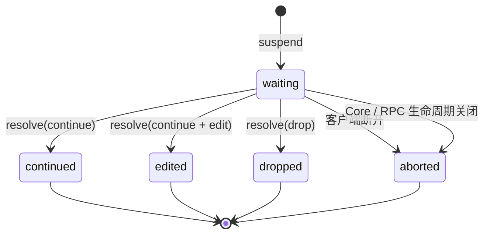
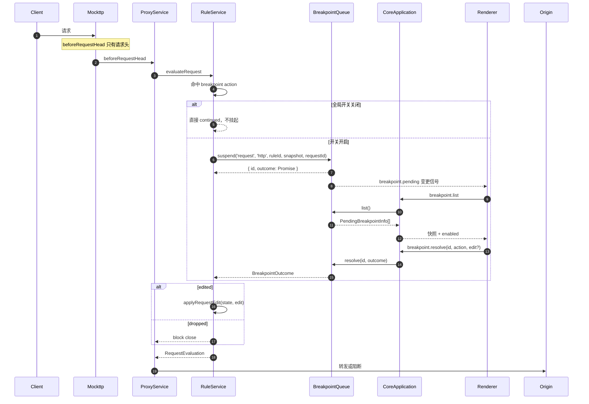
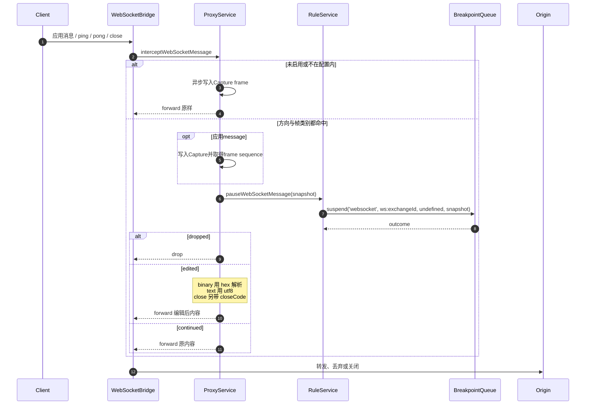

# Feature: Breakpoints

> 最后更新：2026-08-25
> Core 模块：`apps/proxy-core/src/proxy-core/rules/internal/breakpoint-queue.ts`
> Renderer 模块：`apps/desktop/src/renderer/features/breakpoints/`（数据层）
>       `apps/desktop/src/renderer/features/capture/BreakpointManager|BreakpointInspector/`（UI）
>
> 当前状态：断点已从独立 workspace 合并进 Capture（提交 `941e40a`）。
> 第 1–6 节描述已实现产品；第 7 节记录本阶段证据与仍未验证的差异。

## 1. 职责与边界

Breakpoints 在真实转发路径上**挂起**请求或响应，等待用户放行、编辑或丢弃。

| 归属 | 内容 |
| --- | --- |
| Breakpoints 负责 | 挂起状态机、逻辑队列、快照构造、用户编辑与批量解决 |
| Breakpoints 不负责 | 匹配判定（属于 Rules）、记录（属于 Capture） |

断点由 `breakpoint` 类型的 Rule Action 触发，因此它是 Rules 的子系统，共享 `RuleService` 的执行上下文。

**正文可见性边界（已实现）**：HTTP 断点在**头部阶段**（`beforeRequestHead` / `beforeResponseHead`）挂起，此时正文尚未到达，所以快照的 `bodyAvailable` 为 `false` 且不带 `body`。UI 因此把正文区域展示为“Replace body / 原文尚未到达”，留空即原样转发。WebSocket 消息断点持有完整 payload，`bodyAvailable` 为 `true`。**当前实现不为断点引入正文缓冲，也不制造第二份无界内存。**

## 2. 参与者

| 参与者 | 职责 |
| --- | --- |
| `RuleService` | 遇到 `breakpoint` action 时调用 `awaitBreakpoint` |
| `BreakpointQueue` | 持有 pending registry，提供 suspend/resolve/三条批量命令/list/closeAll |
| `WebSocketBridge` | WebSocket 帧转发前调用 `pauseWebSocketMessage`，覆盖 message / ping / pong / close |
| `CoreApplication` | 路由 `breakpoint.*` 命令 |
| Renderer `useBreakpoints` | 订阅 `breakpoint.pending` 变更信号，刷新列表并提交解决方案 |

## 3. 状态机



**人工等待模式**：产品没有 Breakpoint timeout。pending 只由用户 Continue / Forward edited / Drop、
客户端 abort 或 Core / RPC 生命周期关闭释放。HTTP客户端断开时Proxy按Mockttp request ID只解除对应
suspension；WebSocket异常断开时解除该连接`ws:<exchangeId>`队列的全部pending，已收到的graceful close
frame仍保留给用户编辑。`closeAll()` 将当前进程的全部等待结果结算为 `aborted`。Rules、
WebSocket setup、Protocol、导入校验与MCP工具均不包含 timeout 字段，也不存在旧格式识别或迁移路径。

## 4. 调用流程

### 4.1 请求断点



RuleService 先按 priority / action 声明顺序完成全部非-breakpoint action，再以最终 mutable state 构造
暂停快照；`respond` / `block` 已短路的流量不会进入断点。多个 breakpoint 按其原 encounter 顺序执行。
因此用户看到的是准备转发的最终 request / response，Forward edited 后也没有后续 Rule 再覆盖草稿。
最终仍存在且由普通 Rule `set` / `append` 的 header 行随 snapshot 携带 `ruleEffect` / `ruleId`，暂停编辑器
使用与普通 Inspector 相同的 marker 语义；replace / remove 的旧值不放回可编辑表单，避免放行时复活。

`Execute edited` 只为 `BreakpointEdit.editedHeaderNames` 中用户显式改过的字段生成
`RuleHeaderEffect`，并绑定当前 breakpoint rule 的 `ruleId`；完整最终 headers 只是转发结果，不能据此把
未触碰字段误报为 effect。replace / add / remove 沿用 Rules 的 Header effect 语义，body-only 编辑不生成
header marker；重复同名值只标实际变化的实例。

Body replacement使用[Rules Body effect](rules.md#73-body-effect-已实现)的同一最终写入者模型：`edit.body`生成`source:'text'`，`edit.bodyFilePath`生成`source:'file'`，effect绑定承载当前breakpoint action的ruleId。Request保留入站Original并另存Final；Response只保存Final并明确Original unavailable。Off或只编辑header时不制造body effect。

2026-08-20 TDD证据：最终`breakpoints.execute-edited`源码在`89d8dda`仅回植后续公开automation ID与driver helper后，暂停快照精确缺失priority更晚的`x-e2e-before-breakpoint`，Execute edited后的Capture也缺少绑定breakpoint ruleId的`set x-edit-stage` marker；当前同一workflow`1/1` Green。Red/Green metadata分别记录Main/Core PID `31404/3812`与`46424/29380`，均`gracefulDestroyVerified=true`且8888释放、系统代理恢复。该证据只闭环final Rule state与header effect；HTTP framing矩阵仍由[HTTP消息编辑](http-message-editing.md)单独验收。

### 4.2 响应断点

流程相同，区别在于：

- 触发点是 `beforeResponseHead`，只持有 statusCode 与 response headers，正文尚不可见。
- 快照来自 `buildResponseSnapshot(ruleName, context.request, state)`，除 status / response headers 外保留同一请求的 method / URL，当前 `bodyAvailable=false`。
- `dropped` 返回 `block close`，客户端收到连接关闭。

### 4.3 WebSocket 帧断点



WebSocket 断点是**当前连接的临时开关**，与 HTTP 的 break-on-match 正交：`pauseWebSocketMessage`
不再检查 `breakpointsEnabled`，开关完全归 `ProxyService.webSocketBreakpointSettings`。
配置里的 `exchangeId` 把断点锁在发起它的那条连接上，UI 说的 “Pause messages on this connection”
就是字面意思；其他连接的帧不受影响，`websocket.frames` 也只在 exchangeId 匹配时才报告该配置。
启用必须给出完整配置（`exchangeId` / `direction` / `frames`），因此不存在“开了但不知道拦什么”的中间态。
ping / pong / close 与应用消息走同一条方向内串行链，断点 await 不会打乱到达顺序。

Renderer 不把 WebSocket pause 替换成另一套全屏 Inspector。pending 到达后自动切到该连接的 Messages tab，
保留已转发帧并为每个 pending 追加 head / queued row；只有队首下方挂载 Original / Replacement message
编辑器。应用消息在挂起前先写入 Capture 并把 `webSocketFrameSequence` 带入 snapshot，pending row 暂时代替
该 sequence 的历史行；解除后 pending 消失，历史行自然恢复，因此同一帧不会重复显示。Original 直接消费
snapshot 的 text / hex 字节并复用 `BodyViewer`，Replacement 默认 Off，设置摘要来自同一连接的
`WebSocketBreakpointSettings`，不会把 Core 的帧类别 `ruleName` 冒充成方向。

## 5. 当前感知方式

请求在 Core 侧 `await` 挂起；队列集合变化复用既有 event-batch 发出 `breakpoint.pending` 信号，App 级
`useBreakpoints` 收到后调用 `breakpoint.list` 刷新。它不传大快照、不建第二条推送通道，也不依赖
Capture 页面是否挂载。Core 重启时先清空本地 pending，恢复 running 后重新拉取。Pending count只显示在
Capture workbar的Breakpoint入口；所有feature的Sidebar导航均不显示业务badge。

Core 使用一个全局 registry，每项都有逻辑 `queueKey`：HTTP request / response / WebSocket
Upgrade 使用 `http`，每条 WebSocket 连接使用 `ws:<exchangeId>`。registry 的 Map 插入顺序就是
pending / request 到达顺序；每个逻辑队列只按 `queueKey` 过滤并保留该顺序，不按wall clock或ID重排。
队首是默认编辑目标，不是 Core FIFO 锁；非队首按 ID 仍可被批量命令解除。

Capture selection 是唯一可见选择。只有选中项是其逻辑队列队首时才挂载编辑器；非队首显示普通 Detail
与 `Queued`。单项或批量命令完成后，Renderer 只拉取一次最新 snapshot：用户仍停留在已解决队首时才推进到
同一 `queueKey` 的新队首；用户已查看普通流量或其他队列时不抢焦点。草稿由 Renderer 以 `breakpointId`
独立保存在内存中，切换 selection 后可恢复，pending 消失、abort、resolve 或 Core 换代时精确删除。

## 6. 数据契约

```ts
interface BreakpointSnapshot {
  ruleName: string;
  /** 挂起流量所属的 Capture Exchange；未 Recording 时缺省。 */
  exchangeId?: string;
    /** HTTP request / response 快照都保留所属请求身份。 */
  method?: string;
  url?: string;
  statusCode?: number;
  direction?: 'client-to-server' | 'server-to-client';   // WebSocket
  frame?: 'message' | 'ping' | 'pong' | 'close';         // WebSocket
    webSocketFrameSequence?: number;                        // 已写入Capture的应用帧
  opcode?: 1 | 2;                                        // 仅 message 帧
  bodyFormat: 'text' | 'hex';
  headers: readonly RuleHeaderPair[];
  /** 挂起时是否能看到原始正文；HTTP 头部阶段断点为 false。 */
  bodyAvailable: boolean;
  body?: string;
  /** 仅 close 帧：对端给出的 close code。 */
  closeCode?: number;
}

interface WebSocketBreakpointSettings {
  /** 断点只作用于这条连接的 Capture Exchange。 */
  exchangeId: string;
  direction: 'both' | 'client-to-server' | 'server-to-client';
  frames: readonly ('message' | 'ping' | 'pong' | 'close')[];
}

interface RuleBreakpointAction {
    type: 'breakpoint';
    phase: 'request' | 'response';
}

interface BreakpointOutcome {
    state: 'continued' | 'edited' | 'dropped' | 'aborted';
  edit?: BreakpointEdit;
}
```

`exchangeId` 由 `ExchangeTracker.exchangeIdFor` 提供：规则钩子可能先于 `request-initiated` 到达，
因此**首次询问就预留** ID 给 `beginRequest` 复用，保证挂起的断点与随后出现的 Capture 行是同一个。

命令：

| 命令 | 用途 |
| --- | --- |
| `breakpoint.list` | 返回等待中快照与全局开关 |
| `breakpoint.resolve` | continue / drop，可携带编辑 |
| `breakpoint.continueQueue` | 原样放行命令开始时指定 `queueKey` 的全部 pending，返回 `resolvedCount` |
| `breakpoint.dropQueue` | 丢弃命令开始时指定 `queueKey` 的全部 pending，返回 `resolvedCount` |
| `breakpoint.continueRule` | 原样放行命令开始时指定 `ruleId` 的全部 pending，返回 `resolvedCount` |
| `breakpoint.configure` | 设置 HTTP 断点全局开关 |
| `websocket.breakpoint.enable` | 用完整配置启用 WebSocket 帧断点 |
| `websocket.breakpoint.disable` | 停用 WebSocket 帧断点 |

历史 request 右键菜单中，Breakpoint submenu 与 Block 同属于 Control group，并使用同一 icon / label
起点；submenu 箭头与 hover 展开仍由 Ant Menu 原生管理。不能把 Breakpoint 作为 group 外的顶层 item，
否则 Ant 的 group child 与 submenu title 两套 DOM 会产生不同水平缩进。

2026-08-20 TDD证据：专用`capture.breakpoint-menu-hierarchy`最终源码在`89d8dda`仅回植真实Recording与driver helper后，Block/Breakpoint语义label左缘差`7.43621826171875px`取得精确Red；当前同一workflow差值为0并成功hover打开endpoint二级项。Red/Green Main/Core PID分别为`21056/39980`与`21380/20632`，两边`gracefulDestroyVerified=true`且8888释放、系统代理恢复。该证据只验收DOM层级与对齐，不代替独立submenu lifecycle验收。

独立submenu lifecycle契约验证同一Ant Menu树的运行期行为：根菜单与二级菜单必须同时挂载；hover离开二级后只关闭二级；右边界空间不足时二级向左翻转；Escape与outside click销毁整棵菜单。历史边界为`32867ff^`的`menuPage: 'root' | 'breakpoint'`换页实现，hover不能打开Breakpoint页，点击后根菜单会被第二页替换；`32867ff`迁移到Ant `items[].children`后才具备父子菜单共存语义。

2026-08-21 TDD证据：最终`capture.breakpoint-submenu-lifecycle`在`e5ca501`仅回植automation探针后精确Red于hover不产生submenu；当前`1/1` Green。右边界trigger与endpoint横坐标分别为`1030`与`628.126`，二级菜单向左翻转；父子共存、hover close/reopen、Escape与outside click均通过。Red/Green Main/Core PID为`21308/28948`与`46880/33620`，两边`gracefulDestroyVerified=true`且8888、系统代理与profile均恢复。

pending registry不设隐藏上限。每次命中都由`suspend`创建等待项，不会因全局数量自动放行；用户可通过
单项命令、按逻辑队列批量处理或按Rule批量Continue显式解除。大量断点可能占满站点连接，这是用户启用
人工断点后的可见结果，产品不能用静默放行改变规则语义。

## 7. 逻辑队列阶段证据与剩余差异

结构、感知、关联、逻辑队列、批量命令、独立草稿、HTTP Original / Replacement body 与
当前连接临时 WebSocket 断点均已实现。真实未验证项仍为：

- HTTP `Execute edited` 后的 `Content-Length`、`content-encoding`、transfer-encoding 与 H2 framing
    尚未建立 wire-level 回归；产品不能仅凭 UI 状态宣称正确。
- WebSocket 单 frame 仍会整体进入 snapshot；超大帧的预览与内存边界尚未定义。
- Binary 未编辑保真与 hex **编辑后**的字节还原均已有真实 socket 回归。

### 7.1 逻辑队列、连续调试与批量命令（已实现）

本阶段完整替换了单队列选择、单草稿与 timeout 契约，没有保留旧字段、兼容命令或迁移路径。

#### 逻辑队列与展示

- Core 继续以一个 pending registry 保存全部等待项；每个 pending 增加稳定的 `queueKey`。
- HTTP request、HTTP response 与 WebSocket upgrade 使用 `queueKey: 'http'`；WebSocket message、ping、pong、
    close 使用 <code>queueKey: `ws:${exchangeId}`</code>。不同 `queueKey` 互不阻塞；同一 WebSocket 连接的
    双向帧保留registry插入顺序。
- 同一逻辑队列只过滤`queueKey`，不重排Core snapshot。第一项是队首和默认编辑目标，但不是协议锁；Core
    仍允许按 ID Continue 或 Drop 非队首项。
- pending 始终附着在普通 Capture request / connection 行上。filter 只影响行是否可见，不改变队列成员或
    顺序。全局 badge 汇总所有逻辑队列。
- WebSocket应用帧的pending row在同一`webSocketFrameSequence`位置替代历史行，不统一追加到列表尾部；
    Sent / Received筛选同时约束历史帧与pending row，但`data-queue-position`仍表达未筛选逻辑队列的位置。
- 只有选中的 pending 是其逻辑队列当前队首时才显示可编辑 Breakpoint Detail。非队首 pending 使用普通
    Request / connection Detail，并以 `Queued` 表达等待前序断点，而不是复用网络 `loading`。

#### 选择、推进与 abort

- Capture selection 是唯一可见选择；不再维护会与 Capture 行分离的隐藏 breakpoint selection。
- Continue unmodified、Forward edited 或 Drop 完成后，Renderer 必须先取得 Core 最新 pending snapshot，
    再计算原 `queueKey` 的新队首，不得使用旧数组下标。
- 若用户仍选中刚处理的队首 exchange，自动选择同一逻辑队列的新队首；若用户已切换到普通 request、
    非队首 pending 或其他逻辑队列，不得抢焦点。
- HTTP客户端abort只移除对应request pending与草稿；WebSocket异常断开移除该连接的全部pending与草稿。
    Capture行保留并进入普通`aborted` / `failed`终态。中间项消失后，后续推进同样基于最新snapshot。
- 按 ID resolve 非队首只移除目标，不改变当前队首。非队首没有编辑器，因此不能产生 edited payload。

#### 草稿生命周期

- Renderer 以 `breakpointId` 保存独立草稿。同一 HTTP exchange 的 request / response，以及同一 WebSocket
    连接的不同帧不得共享草稿。
- 切换 Capture selection 时保留草稿；重新选中同一 pending 时恢复。只有 Forward edited 应用草稿，
    Continue unmodified 明确忽略草稿。
- Continue、Forward edited、Drop、abort、pending 从最新 snapshot 消失或 Core 换代时删除对应草稿。
    草稿只存在于 Renderer 内存，不写入 Capture 数据、Rules 配置或 workspace storage。

#### 命令契约

保留 `breakpoint.resolve` 处理单项 Continue / Forward edited / Drop；新增三条用户意图单一的命令：

| 命令 | 作用域 | 语义 |
| --- | --- | --- |
| `breakpoint.continueQueue` | 显式 `queueKey` | Continue 调用开始时该逻辑队列中已存在的全部 pending |
| `breakpoint.dropQueue` | 显式 `queueKey` | Drop 调用开始时该逻辑队列中已存在的全部 pending |
| `breakpoint.continueRule` | 显式 `ruleId` | Continue 调用开始时所有逻辑队列中属于该 Rule 的 pending |

- 三条命令必须分别贯穿 Protocol、Core、Main、Preload 与 Renderer；不得以布尔参数、空 ID、可选字段或魔法值
    合并语义。
- Core 在命令开始时固定目标 `breakpointId` 快照。执行期间新进入的 pending 不属于本次操作，避免命令持续
    吸收新命中。
- 目标在执行前已经消失视为未解决，不使整条命令失败。结果返回 `resolvedCount`，Renderer 完成后统一拉取
    最新 snapshot，并分别推进所有受影响逻辑队列。
- 批量 Continue 一律原样放行，不读取或复制任一 Renderer 草稿；批量 Drop 一律丢弃目标。批量命令不提供
    edited 变体。

#### 已删除 timeout

- 删除 HTTP Rule breakpoint 与 WebSocket breakpoint 的 finite / infinite timeout 产品能力，包括协议字段、
    Core timer / `onTimeout`、Rules 与 WebSocket UI、导入专判、i18n、MCP参数和既有 timeout 设计场景。
- pending 只由用户 Continue / Forward edited / Drop、客户端 abort 或 Core / RPC 生命周期
    关闭释放。生命周期关闭返回明确的 `aborted`，不得继续制造 `timed_out` 或 timeout policy。
- pending registry不设数量上限，不存在`autoContinued`协议状态、queue-full诊断或对应UI。逻辑分组不能绕过
    客户端 abort 或`closeAll()`清理。

#### TDD 与验收证据

- Unit：Protocol command/result、`BreakpointQueue` 排序/非队首 resolve/批量调用开始快照、Renderer 多草稿、
    最新 snapshot 推进与精确 WebSocket frame sequence 均先取得目标缺口 Red，再实现 Green。
- Integration：真实 Proxy 锁定 HTTP `queueKey/ruleId`、WebSocket pending sequence 与 Capture sequence 一致；
    Capture/Archive frame 回归保持 Green。
- E2E：`queue-stepping`、`queue-isolation`、`queue-commands` 与 `lifecycle-release` 经过真实
    Renderer → Preload → Main → Core → Proxy → client/origin，覆盖中间 abort、不抢焦点、独立草稿、HTTP/WS
    隔离、三条批量命令、调用开始快照和生命周期关闭。
- Design/Parity：design-vite 先定稿 head / Queued / 批量菜单 / 无 timeout；视觉几何只由 design interaction
    与 visual parity 验证，不混入业务 E2E。

2026-08-25阶段证据：最终四条workflow源码在修复前`d854588`分别取得有效retrospective Red：
`queue-stepping`与`queue-commands`已经通过真实Rules UI形成paused请求，但Capture行没有`data-queue-*`；
`queue-isolation`的HTTP已真实pending但缺`queueKey`；`lifecycle-release`在真实WebSocket setup中仍找到1个
timeout控件。Red Main/Core PID依次为`34028/1940`、`32556/29092`、`31380/12648`、`14964/31472`，
四组`gracefulDestroyVerified=true`。当前同一组workflow合并`4/4` Green；Green Main/Core PID依次为
`24768/21248`、`30096/30308`、`18196/12256`、`36720/2084`，四组同样
`gracefulDestroyVerified=true`且8888释放。

2026-08-25无上限补充TDD：`BreakpointQueue`先以25条连续命中在第11条返回`null`取得精确Red；删除
`BREAKPOINT_QUEUE_LIMIT`、nullable suspension和queue-full状态后，同一测试25条全部pending并保持插入顺序。
MCP无timeout调用先Red于未发出Core命令，删除工具schema、解析和payload字段后Green；MCP全量`46/46`
与typecheck通过。最终全仓门禁与最新parity数字见`architecture/HANDOVER.md`。

## 8. 验收要点

- [x] 快照如实告知正文是否可见，不把空输入框冒充原文；只改 header 放行不会抹掉真实正文。
- [x] 独立 Breakpoints 导航删除；在任意 workspace 命中时用户立即可感知。
- [x] paused exchange 在 Capture 原行编辑，Continue 后选择节奏明确。
- [x] manager 可查看/启停规则并精确跳到 Rules；历史 request 快捷创建后给出可撤销反馈。
- [x] Original/Replacement 在 Request/Response 对称，Text/File 空态不会误覆盖原文。
- [ ] 大正文断点有明确的预览上限与提示，不 OOM。
- [x] Binary 消息可用 hex 编辑并正确还原。
- [x] HTTP / WebSocket 没有 timeout 产品能力，等待只由用户、客户端或生命周期释放。
- [x] 客户端 abort 时立即释放对应断点，不影响其他等待请求。
- [x] pending registry 无隐藏数量上限，每次命中都保持等待直到显式或生命周期释放。
- [x] RPC 断开时全部等待被释放，不泄漏挂起请求。
- [ ] Execute edited 后 content-length 与 encoding 一致。
- [x] HTTP 与每条 WebSocket 连接按独立 `queueKey` 推进，互不阻塞。
- [x] 仅队首可编辑；非队首显示 `Queued` 普通 Detail，filter 不改变队列。
- [x] 单项处理按最新 snapshot 推进，查看普通 request 或其他队列时不抢焦点。
- [x] 草稿按 `breakpointId` 独立保存，并在 resolve / abort / 消失 / Core 换代后精确清理。
- [x] `Continue all`、`Drop all` 与 `Continue all from this rule` 分别走独立命令并只处理调用开始快照。
- [x] HTTP / WebSocket timeout 产品能力及 `timed_out` 结果全部删除，生命周期释放使用 `aborted`。
