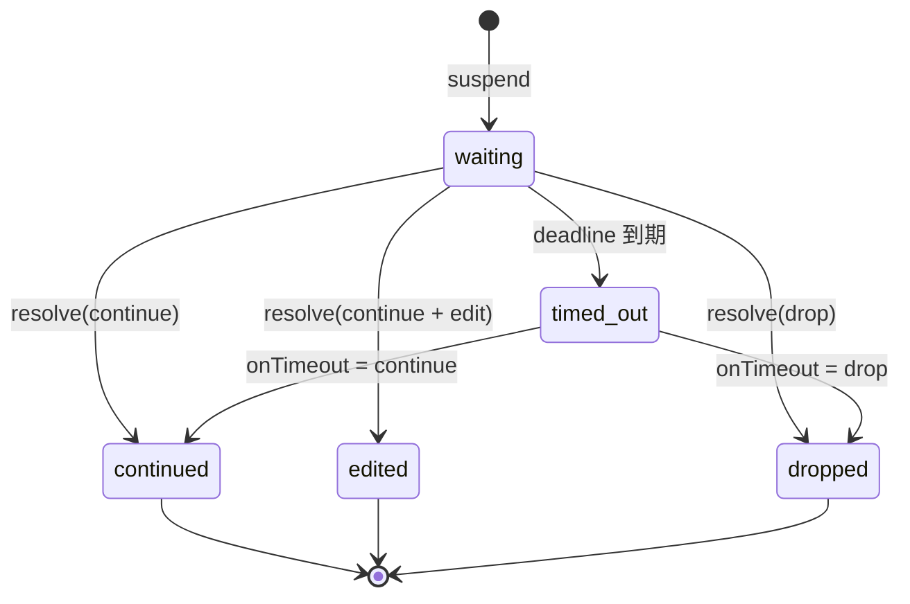
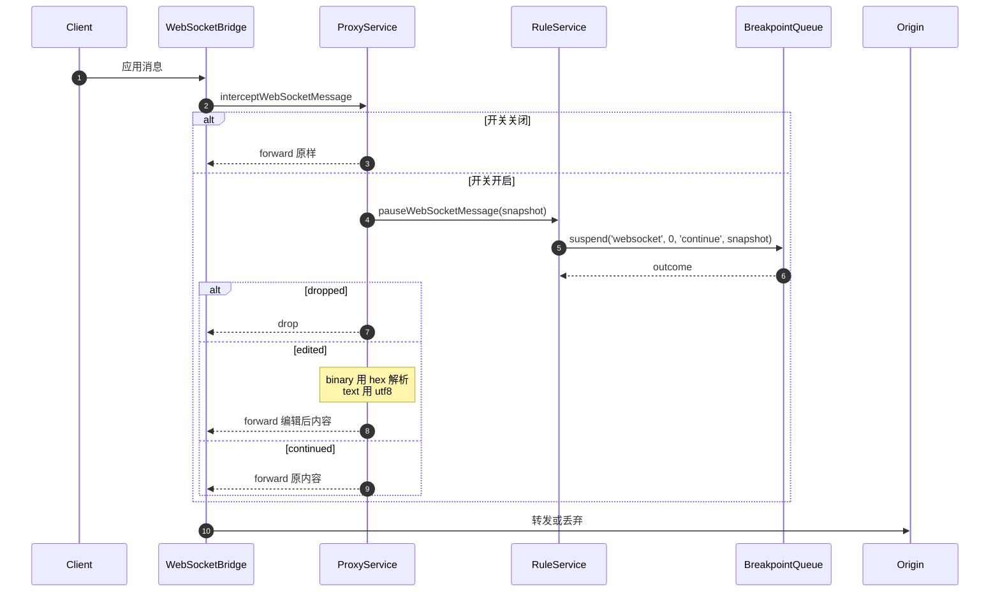

# Feature: Breakpoints

> 最后更新：2026-08-06
> Core 模块：`apps/proxy-core/src/proxy-core/rules/internal/breakpoint-queue.ts`
> Renderer 模块：`apps/desktop/src/renderer/features/breakpoints/`

> 当前状态：本文件第 1–6 节描述已实现产品；第 7 节描述已在 `design/app/` 确认、但尚未落地到产品的目标设计。两者不得混写。

## 1. 职责与边界

Breakpoints 在真实转发路径上**挂起**请求或响应，等待用户放行、编辑或丢弃。

| 归属 | 内容 |
| --- | --- |
| Breakpoints 负责 | 挂起状态机、超时策略、快照构造、用户编辑应用 |
| Breakpoints 不负责 | 匹配判定（属于 Rules）、记录（属于 Capture） |

断点由 `breakpoint` 类型的 Rule Action 触发，因此它是 Rules 的子系统，共享 `RuleService` 的执行上下文。

**正文可见性边界（已实现）**：HTTP 断点在**头部阶段**（`beforeRequestHead` / `beforeResponseHead`）挂起，此时正文尚未到达，所以快照的 `bodyAvailable` 为 `false` 且不带 `body`。UI 因此把正文区域展示为“Replace body / 原文尚未到达”，留空即原样转发。WebSocket 消息断点持有完整 payload，`bodyAvailable` 为 `true`。**当前实现不为断点引入正文缓冲，也不制造第二份无界内存。**

## 2. 参与者

| 参与者 | 职责 |
| --- | --- |
| `RuleService` | 遇到 `breakpoint` action 时调用 `awaitBreakpoint` |
| `BreakpointQueue` | 持有等待中的断点，提供 suspend/resolve/list/closeAll |
| `WebSocketBridge` | WebSocket 消息转发前调用 `pauseWebSocketMessage` |
| `CoreApplication` | 路由 `breakpoint.*` 命令 |
| Renderer `useBreakpoints` | 1s 轮询列表，提交解决方案 |

## 3. 状态机



**强制超时**：每个断点携带 `timeoutMs` 与 `onTimeout` 策略，绝不允许无限期挂起真实流量。RPC 连接断开时 `closeAll()` 释放全部等待。

## 4. 调用流程

### 4.1 请求断点


### 4.2 响应断点

流程相同，区别在于：

- 触发点是 `beforeResponseHead`，只持有 statusCode 与 response headers，正文尚不可见。
- 快照来自 `buildResponseSnapshot(ruleName, state)`，当前 `bodyAvailable=false`。
- `dropped` 返回 `block close`，客户端收到连接关闭。

### 4.3 WebSocket 消息断点



WebSocket 断点开关独立于 HTTP 断点，通过 `websocket.breakpoint.configure` 控制。

## 5. 当前实现为什么用轮询

请求在 Core 侧 `await` 挂起，Renderer 只需感知"有断点在等"。1s 轮询延迟可接受，且避免为断点单独建立推送通道与 ack 机制。

`breakpointsStore` 在轮询期间**不覆盖用户正在编辑的草稿**，只更新列表与倒计时。目标设计不再展示倒计时，且需要把感知提升到 App 级；这属于第 7 节的产品改造，不代表当前轮询已经删除。

## 6. 数据契约

```ts
interface BreakpointSnapshot {
  ruleName: string;
  method?: string;
  url?: string;
  statusCode?: number;
  direction?: 'sent' | 'received';   // WebSocket
  opcode?: 1 | 2;                    // WebSocket
  bodyFormat: 'text' | 'hex';
  headers: readonly RuleHeaderPair[];
  /** 挂起时是否能看到原始正文；HTTP 头部阶段断点为 false。 */
  bodyAvailable: boolean;
  body?: string;
}

interface BreakpointOutcome {
  state: 'continued' | 'edited' | 'dropped' | 'timed_out';
  edit?: BreakpointEdit;
  timeoutPolicy?: 'continue' | 'drop';
}
```

命令：

| 命令 | 用途 |
| --- | --- |
| `breakpoint.list` | 返回等待中快照与全局开关状态 |
| `breakpoint.resolve` | continue / drop，可携带编辑 |
| `breakpoint.configure` | 设置 HTTP 断点全局开关 |
| `websocket.breakpoint.configure` | 设置 WebSocket 断点开关 |

## 7. 目标设计（已确认，产品未实现）

### 7.1 Breakpoint 是 Capture 流量状态

- 删除目标设计中的独立 Breakpoints navigation/workspace；引擎层仍保留 `breakpoint` RuleAction 与 `BreakpointQueue`。
- Capture workbar 在 Recording 旁放唯一 Breakpoint 图标；pending 数用 badge，点击打开 manager。
- paused exchange 在 Capture 列表原地显示黄色 pause icon；Request/Response 使用同一颜色且不显示倒计时。
- 选择 paused 行后，Capture Inspector 切换为 Request/Response 编辑器；底部固定 `Drop` / `Continue` / `Forward edited`。
- Breakpoint Inspector 的 Headers、Response status、Original body、Replacement body 都复用共享 SectionHeader（与 TLS tunnel 完全相同）并可独立折叠。
- WebSocket 不再有独立的 `Pause on message` 总开关，只展示全局 Breakpoints 状态。

### 7.2 Breakpoint manager 与规则入口

- manager 宽 520px；Header 同行放 `Break on match` 总开关、`SlidersVertical + Advanced rules` 和关闭按钮。
- 每条规则只展示名称、matcher 摘要、`View rule` 和 enable switch；`View rule` 精确跳到 Rules 对应 rule。
- 不展示没有直接编辑入口的 `Armed` / `Once` / `Always` / `Request + response` 标签。
- 从已完成 request 创建 breakpoint 时，当前 exchange 不会 retroactively pause；一次性通知明确写 `Breakpoint enabled for future traffic`，并提供 Undo / View manager。
- Capture 行右键的快速粒度为 `This endpoint` / `This path prefix` / `This host` / `Custom…`；`Custom…` 进入 Rules 编辑器。

### 7.3 Original 与 Replacement body

- Request/Response 对称拆成只读 `Original body` 与可选 `Replacement body`。
- Original body 有 loading/loaded 状态；设计稿用 3 秒自动完成只为演示，产品必须由 Core body 事件驱动。
- Replacement 始终显示 `Off | Text | File`：
    - Off：绿色 `Using original` tag + 完整 original-forwarded info。
    - Text 空：Lucide `CircleAlert + Using original`，tooltip 说明不能为空；有内容时 `Using text`。
    - File 未选：Lucide `CircleAlert + Using original`，正文区域显示居中 Upload；上传后 `Using file`，显示文件名、大小与有限预览；删除后仍停在 File 空态。
- `Content-Type` 只通过 Headers 编辑；上传文件不得静默修改。格式不匹配只警告，仍允许发送 raw bytes。
- 实现必须自动重算 `Content-Length`，并正确处理 `content-encoding` 与 H2 framing。

### 7.4 感知、关联与保护

- pending 感知必须提升到 App 级，不能依赖独立页面挂载后的 1s 轮询。
- `PendingBreakpoint` 必须增加 `exchangeId`，使 paused 状态与 Capture 行、Request/Response 两阶段关联。
- pending queue 必须有上限；超限的新命中自动 continue，并在 Statusbar/Diagnostics 记录数量。
- Core 继续保留 timeout + `onTimeout` 安全策略，但 UI 不展示倒计时；超时结果只在 Statusbar/Diagnostics 留痕。

### 7.5 与当前实现的差异

| 项 | 当前产品 | 目标 |
| --- | --- | --- |
| 导航 | 独立 Breakpoints workspace | 合并到 Capture，删除独立入口 |
| 感知 | `useBreakpoints` 只在页面挂载时 1s 轮询 | App 级感知 + workbar badge + paused row |
| 关联 | `PendingBreakpoint` 无 `exchangeId` | 与 Capture exchange、request/response phase 精确关联 |
| HTTP body | 头部阶段 `bodyAvailable=false` | Original body 事件驱动加载 + 独立 Replacement |
| 文件 replacement | 无 | Main 文件选择 + 窄 Preload API + 有限预览；Renderer 不拿绝对路径 |
| 超时 | 页面显示倒计时 | Core 保留 timeout，UI 不显示倒计时，只记录结果 |
| 队列 | 无上限 | 有上限，溢出自动 continue 并留痕 |
| WS 开关 | 独立 `websocket.breakpoint.configure` UI | 单一全局 Breakpoints 控制面 |

## 8. 验收要点

- [x] 快照如实告知正文是否可见，不把空输入框冒充原文；只改 header 放行不会抹掉真实正文。
- [ ] 独立 Breakpoints 导航删除；在任意 workspace 命中时用户立即可感知。
- [ ] paused exchange 在 Capture 原行编辑，Continue 后选择节奏明确。
- [ ] manager 可查看/启停规则并精确跳到 Rules；历史 request 快捷创建明确只影响未来流量。
- [ ] Original/Replacement 在 Request/Response 对称，Text/File 空态不会误覆盖原文。
- [ ] 大正文断点有明确的预览上限与提示，不 OOM。
- [ ] Binary 消息可用 hex 编辑并正确还原。
- [ ] 超时按 `onTimeout` 策略正确 continue 或 drop。
- [ ] pending queue 超限自动 continue 并记录数量。
- [ ] RPC 断开时全部等待被释放，不泄漏挂起请求。
- [ ] Execute edited 后 content-length 与 encoding 一致。
