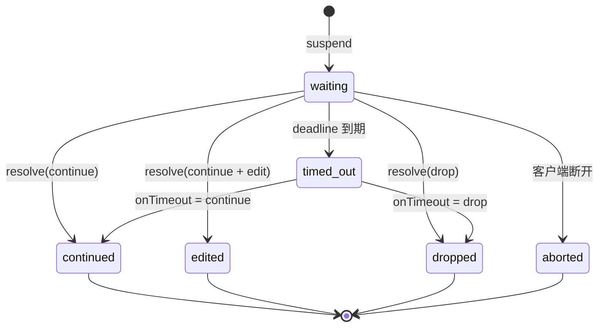
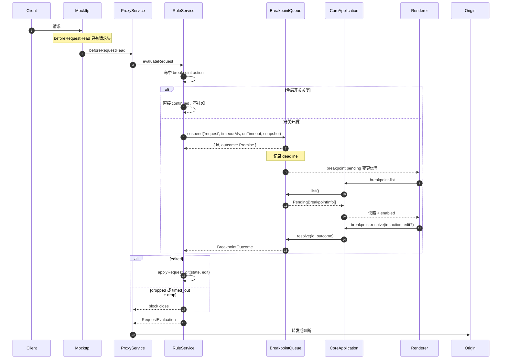
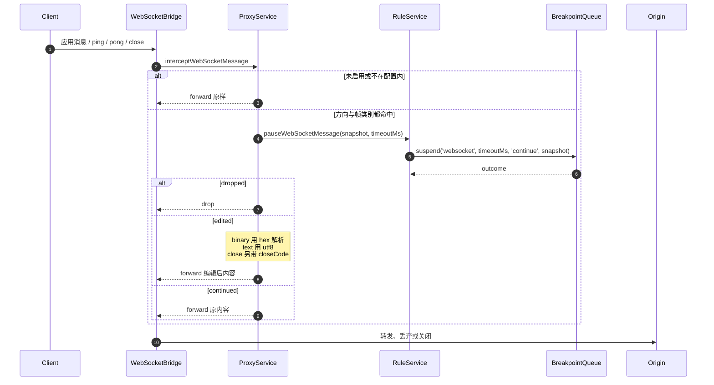

# Feature: Breakpoints

> 最后更新：2026-08-12
> Core 模块：`apps/proxy-core/src/proxy-core/rules/internal/breakpoint-queue.ts`
> Renderer 模块：`apps/desktop/src/renderer/features/breakpoints/`（数据层）
>       `apps/desktop/src/renderer/features/capture/BreakpointManager|BreakpointInspector/`（UI）
>
> 当前状态：断点已从独立 workspace 合并进 Capture（提交 `941e40a`）。
> 第 1–6 节描述已实现产品；第 7 节只保留仍未验证的差异。两者不得混写。

## 1. 职责与边界

Breakpoints 在真实转发路径上**挂起**请求或响应，等待用户放行、编辑或丢弃。

| 归属 | 内容 |
| --- | --- |
| Breakpoints 负责 | 挂起状态机、超时策略、快照构造、用户编辑应用 |
| Breakpoints 不负责 | 匹配判定（属于 Rules）、记录（属于 Capture） |

断点由 `breakpoint` 类型的 Rule Action 触发，因此它是 Rules 的子系统，共享 `RuleService` 的执行上下文。

**正文可见性边界（已实现）**：HTTP 断点在**头部阶段**（`beforeRequestHead` / `beforeResponseHead`）挂起，此时正文尚未到达，所以快照的 `bodyAvailable` 为 `false` 且不带 `body`。UI 因此把正文区域展示为“Replace body / 原文尚未到达”，留空即原样转发。WebSocket 消息断点持有完整 payload，`bodyAvailable` 为 `true`。**当前实现不为断点引入正文缓冲，也不制造第二份无界内存。**

## 2. 参与者

| 参与者 | 职责 |
| --- | --- |
| `RuleService` | 遇到 `breakpoint` action 时调用 `awaitBreakpoint` |
| `BreakpointQueue` | 持有等待中的断点，提供 suspend/resolve/list/closeAll |
| `WebSocketBridge` | WebSocket 帧转发前调用 `pauseWebSocketMessage`，覆盖 message / ping / pong / close |
| `CoreApplication` | 路由 `breakpoint.*` 命令 |
| Renderer `useBreakpoints` | 订阅 `breakpoint.pending` 变更信号，刷新列表并提交解决方案 |

## 3. 状态机



**强制超时**：每个断点携带 `timeoutMs` 与 `onTimeout` 策略，绝不允许无限期挂起真实流量。它是 Core 允许等待的上限，不会覆盖客户端自己的超时；客户端更早断开时，Proxy 按 Mockttp request ID 立即把对应 suspension 结束为 `aborted`，不会把 stale breakpoint 留到 deadline。RPC 连接断开时 `closeAll()` 释放全部等待。

## 4. 调用流程

### 4.1 请求断点



### 4.2 响应断点

流程相同，区别在于：

- 触发点是 `beforeResponseHead`，只持有 statusCode 与 response headers，正文尚不可见。
- 快照来自 `buildResponseSnapshot(ruleName, context.request, state)`，除 status / response headers 外保留同一请求的 method / URL，当前 `bodyAvailable=false`。
- `dropped` 返回 `block close`，客户端收到连接关闭。

### 4.3 WebSocket 帧断点



WebSocket 断点是**当前连接的临时开关**，与 HTTP 的 break-on-match 正交：`pauseWebSocketMessage`
不再检查 `breakpointsEnabled`，开关完全归 `ProxyService.webSocketBreakpointSettings`。
配置里的 `exchangeId` 把断点锁在发起它的那条连接上，UI 说的 “Pause messages on this connection”
就是字面意思；其他连接的帧不受影响，`websocket.frames` 也只在 exchangeId 匹配时才报告该配置。
启用必须给出完整配置（`exchangeId` / `direction` / `frames` / `timeoutMs`），因此不存在“开了但不知道拦什么”的中间态。
ping / pong / close 与应用消息走同一条方向内串行链，断点 await 不会打乱到达顺序。

Renderer 不把 WebSocket pause 替换成另一套全屏 Inspector。pending 到达后自动切到该连接的 Messages tab，
保留已转发帧并追加一条 paused row；下方内嵌 Original / Replacement message 编辑器。Original 直接消费
snapshot 的 text / hex 字节并复用 `BodyViewer`，Replacement 默认 Off，设置摘要来自同一连接的
`WebSocketBreakpointSettings`，不会把 Core 的帧类别 `ruleName` 冒充成方向或超时。

## 5. 当前感知方式

请求在 Core 侧 `await` 挂起；队列集合变化复用既有 event-batch 发出 `breakpoint.pending` 信号，App 级
`useBreakpoints` 收到后调用 `breakpoint.list` 刷新。它不传大快照、不建第二条推送通道，也不依赖
Capture 页面是否挂载。Core 重启时先清空本地 pending，恢复 running 后重新拉取。

## 6. 数据契约

```ts
interface BreakpointSnapshot {
  ruleName: string;
  /** 挂起流量所属的 Capture Exchange；未 Recording 时缺省。 */
  exchangeId?: string;
    /** HTTP request / response 快照都保留所属请求身份。 */
  method?: string;
  url?: string;
  statusCode?: number;
  direction?: 'client-to-server' | 'server-to-client';   // WebSocket
  frame?: 'message' | 'ping' | 'pong' | 'close';         // WebSocket
  opcode?: 1 | 2;                                        // 仅 message 帧
  bodyFormat: 'text' | 'hex';
  headers: readonly RuleHeaderPair[];
  /** 挂起时是否能看到原始正文；HTTP 头部阶段断点为 false。 */
  bodyAvailable: boolean;
  body?: string;
  /** 仅 close 帧：对端给出的 close code。 */
  closeCode?: number;
}

interface WebSocketBreakpointSettings {
  /** 断点只作用于这条连接的 Capture Exchange。 */
  exchangeId: string;
  direction: 'both' | 'client-to-server' | 'server-to-client';
  frames: readonly ('message' | 'ping' | 'pong' | 'close')[];
  /** Core 允许挂起的上限；0 表示不设超时。 */
  timeoutMs: number;
}

interface BreakpointOutcome {
    state: 'continued' | 'edited' | 'dropped' | 'timed_out' | 'aborted';
  edit?: BreakpointEdit;
  timeoutPolicy?: 'continue' | 'drop';
}
```

`exchangeId` 由 `ExchangeTracker.exchangeIdFor` 提供：规则钩子可能先于 `request-initiated` 到达，
因此**首次询问就预留** ID 给 `beginRequest` 复用，保证挂起的断点与随后出现的 Capture 行是同一个。

命令：

| 命令 | 用途 |
| --- | --- |
| `breakpoint.list` | 返回等待中快照、全局开关与 `autoContinued` 累计溢出数 |
| `breakpoint.resolve` | continue / drop，可携带编辑 |
| `breakpoint.configure` | 设置 HTTP 断点全局开关 |
| `websocket.breakpoint.enable` | 用完整配置启用 WebSocket 帧断点 |
| `websocket.breakpoint.disable` | 停用 WebSocket 帧断点 |

队列上限：`BREAKPOINT_QUEUE_LIMIT = 10`。`suspend` 满时返回 `null`，调用方必须原样放行——
浏览器对每个 host 只有 6 条 HTTP/1.1 连接，挂满之后第 7 个请求根本发不出去，用户看到的是整站卡死。
溢出计数经 `breakpoint.pending` 上报并在 Capture 状态栏展示，Core 侧记 `breakpoint.queue-full`。

## 7. 与当前实现的差异

结构、感知、关联、队列保护、HTTP Original / Replacement body 与当前连接临时 WebSocket 断点均已实现。
剩余差异只保留真实未验证项：

- HTTP `Execute edited` 后的 `Content-Length`、`content-encoding`、transfer-encoding 与 H2 framing
    尚未建立 wire-level 回归；产品不能仅凭 UI 状态宣称正确。
- WebSocket 单 frame 仍会整体进入 snapshot；超大帧的预览与内存边界尚未定义。
- Binary 未编辑保真与 hex **编辑后**的字节还原均已有真实 socket 回归。
- WebSocket deadline 固定 continue，已有真实 wire 回归；HTTP 的 `onTimeout: continue | drop` 虽已由
    `BreakpointQueue` 锁定 policy 传播，但两种策略的真实 proxy wire 结果尚未分别建立集成测试。

## 8. 验收要点

- [x] 快照如实告知正文是否可见，不把空输入框冒充原文；只改 header 放行不会抹掉真实正文。
- [x] 独立 Breakpoints 导航删除；在任意 workspace 命中时用户立即可感知。
- [x] paused exchange 在 Capture 原行编辑，Continue 后选择节奏明确。
- [x] manager 可查看/启停规则并精确跳到 Rules；历史 request 快捷创建后给出可撤销反馈。
- [x] Original/Replacement 在 Request/Response 对称，Text/File 空态不会误覆盖原文。
- [ ] 大正文断点有明确的预览上限与提示，不 OOM。
- [x] Binary 消息可用 hex 编辑并正确还原。
- [x] WebSocket deadline 到期后按固定 continue 策略原样转发。
- [ ] HTTP 超时按 `onTimeout` 策略正确 continue 或 drop。
- [x] 客户端在 deadline 前 abort 时立即释放对应断点，不影响其他等待请求。
- [x] pending queue 超限自动 continue 并记录数量。
- [x] RPC 断开时全部等待被释放，不泄漏挂起请求。
- [ ] Execute edited 后 content-length 与 encoding 一致。
