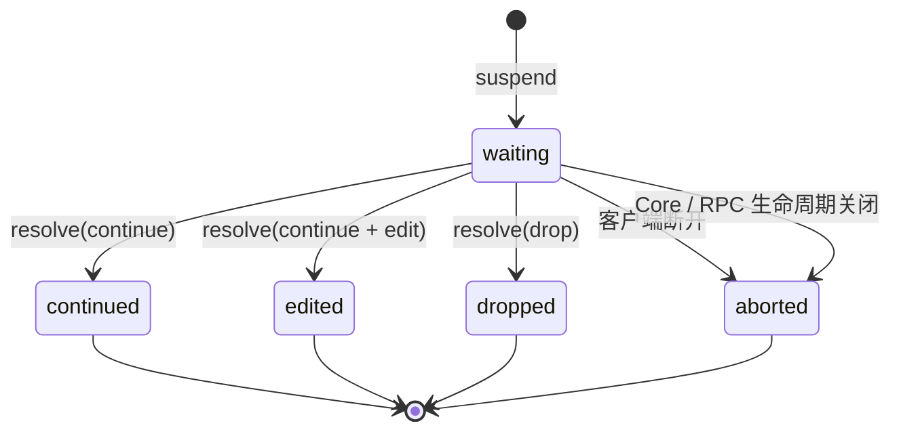
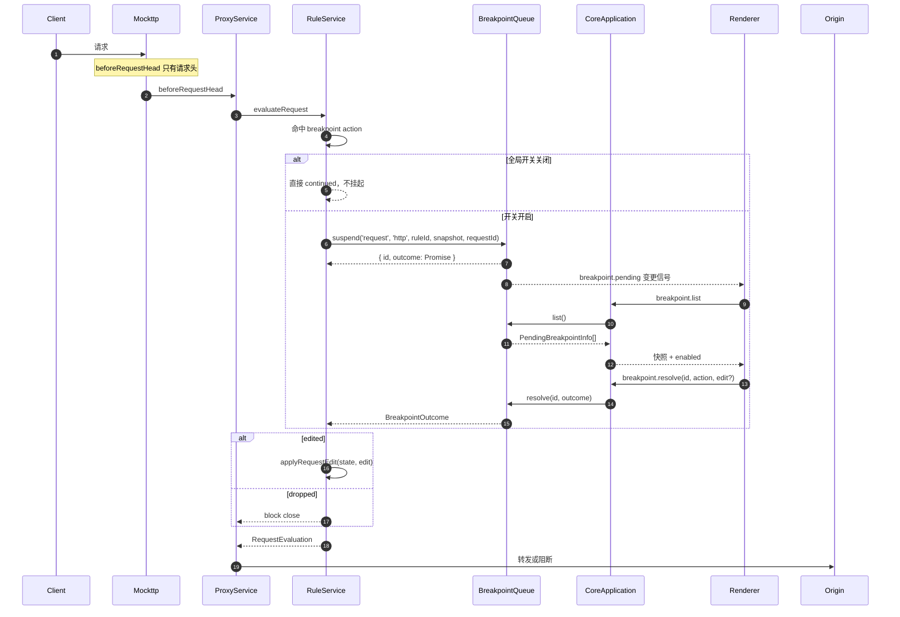
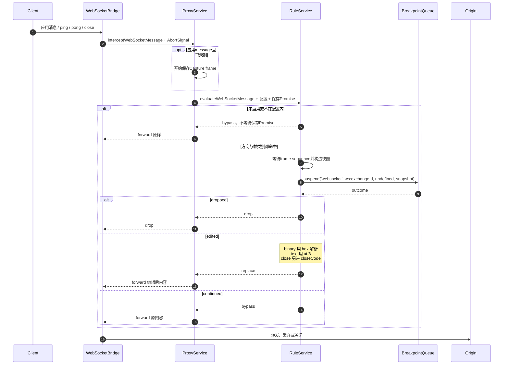

# Feature: Breakpoints

> Core 模块：`apps/proxy-core/src/proxy-core/rules/internal/breakpoint-queue.ts`
> Renderer 模块：`apps/desktop/src/renderer/features/breakpoints/`（数据层）
>       `apps/desktop/src/renderer/features/capture/BreakpointManager|BreakpointInspector/`（UI）

## 1. 职责与边界

Breakpoints 在真实转发路径上**挂起**请求或响应，等待用户放行、编辑或丢弃。

| 归属 | 内容 |
| --- | --- |
| Breakpoints 负责 | 挂起状态机、逻辑队列、快照构造、用户编辑与批量解决 |
| Breakpoints 不负责 | 匹配判定（属于 Rules）、记录（属于 Capture） |

断点由 `breakpoint` 类型的 Rule Action 触发，因此它是 Rules 的子系统，共享 `RuleService` 的执行上下文。

**正文可见性边界**：HTTP断点在头部阶段（`beforeRequestHead`/`beforeResponseHead`）挂起，不等待原始正文；原文未到时快照`bodyAvailable=false`且不带body，空Text保持原样转发。WebSocket消息快照持有完整payload，`bodyAvailable=true`。快照已有正文与Inspector能够读取Capture预览是不同事实。

## 2. 参与者

| 参与者 | 职责 |
| --- | --- |
| `RuleService` | HTTP调用`awaitBreakpoint`；`evaluateWebSocketMessage`统一WS匹配、快照、编辑与取消 |
| `BreakpointQueue` | 持有 pending registry，提供 suspend/resolve/三条批量命令/list/closeAll |
| `WebSocketBridge` | 拥有每对socket的AbortSignal，经Proxy调用共享决定后转发message / ping / pong / close |
| `CoreApplication` | 路由 `breakpoint.*` 命令 |
| Renderer `useBreakpoints` | 订阅 `breakpoint.pending` 变更信号，刷新列表并提交解决方案 |

## 3. 状态机



**人工等待模式**：产品没有 Breakpoint timeout。pending 只由用户 Continue / Forward edited / Drop、
客户端 abort 或 Core / RPC 生命周期关闭释放。HTTP客户端断开时Proxy按Mockttp request ID只解除对应
suspension；WebSocket异常断开时解除该连接`ws:<exchangeId>`队列的全部pending，已收到的graceful close
frame仍保留给用户编辑。`closeAll()` 将当前进程的全部等待结果结算为 `aborted`。Rules、
WebSocket setup、Protocol、导入校验与MCP工具均不包含 timeout 字段，也不存在旧格式识别或迁移路径。

Android的HTTP协议副本已接CoreApplication与Capture；其请求/响应决定复用同一HTTP队列，但每次求值使用独立内部ID，
不能用设备自报ID取消本机或其他设备的请求。取消既要释放已有pending，也要阻止当前请求或响应
求值在异步继续后创建下一个断点；Android实际网络取消仍需双端cancel/ack，Core队列释放不等于手机已停止。

WS共享求值的`aborted`表示该次suspension已释放，不能自行推断整条连接已取消。连接仍active时，
Android HttpChannel与Proxy将该条消息映射为drop；连接owner发起取消后则停止后续决定，继续各自的关闭/取消协议。
Android正式WS capability与native/TLS双端lab已验证；这不代表系统VpnService或完整手机UI流程，边界仍受Android Handover约束。

## 4. 调用流程

### 4.1 请求断点



RuleService 先按 priority / action 声明顺序完成全部非-breakpoint action，再以最终 mutable state 构造
暂停快照；`respond` / `block` 已短路的流量不会进入断点。多个 breakpoint 按其原 encounter 顺序执行。
因此用户看到的是准备转发的最终 request / response，Forward edited 后也没有后续 Rule 再覆盖草稿。
最终仍存在且由普通 Rule `set` / `append` 的 header 行随 snapshot 携带 `ruleEffect` / `ruleId`，暂停编辑器
使用与普通 Inspector 相同的 marker 语义；replace / remove 的旧值不放回可编辑表单，避免放行时复活。

`Execute edited` 只为 `BreakpointEdit.editedHeaderNames` 中用户显式改过的字段生成
`RuleHeaderEffect`，并绑定当前 breakpoint rule 的 `ruleId`；完整最终 headers 只是转发结果，不能据此把
未触碰字段误报为 effect。replace / add / remove 沿用 Rules 的 Header effect 语义，body-only 编辑不生成
header marker；重复同名值只标实际变化的实例。

Body replacement使用[Rules Body effect](rules.md#73-body-effect)的同一最终写入者模型：`edit.body`生成`source:'text'`，`edit.bodyFilePath`生成`source:'file'`，effect绑定承载当前breakpoint action的ruleId。Request保留入站Original并另存Final；Response只保存Final并明确Original unavailable。Off或只编辑header时不制造body effect。

File模式未选文件时显示112px最小高度的居中容器和32px高的Upload按钮，按钮不横向拉满；文字11.5px、`--text-2`。未选文件显示带警告图标的Using original，分组折叠图标为13px，不撑高标题。文件只能经原生Open Dialog选择，选中后显示预览卡。

断点面板使用局部normal行高；Header行内gap为6px，行组与Add header间距8px，页脚三个按钮横向padding均为9px。`replacesBody()`依据快照的`bodyAvailable`和输入内容判断，[空Text语义](#空text替换语义)不受Inspector原文预览影响。Header effect的[布局](#74-header-effect下置布局)与实际HTTP framing分别遵守各自契约。

### 4.2 响应断点

流程相同，区别在于：

- 触发点是 `beforeResponseHead`，只持有 statusCode 与 response headers，正文尚不可见。
- 快照来自 `buildResponseSnapshot(ruleName, context.request, state)`，除 status / response headers 外保留同一请求的 method / URL，当前 `bodyAvailable=false`。
- `dropped` 返回 `block close`，客户端收到连接关闭。

### 4.3 WebSocket 帧断点

- 暂停说明、方向和队列按钮由同一层flex容器设置`align-items: center`；phase内图标和文字使用相同规则，不使用baseline或像素位移。
- WebSocket Replacement标题按既有PayloadEditor设计为36px，模式控件28px加标题下padding8px；折叠图标使用13px控件规格，不用30px的sm按钮撑到38px。
- 暂停上下文使用normal行高、126px队首滚动区和38px消息分隔；queued及普通列表不套用队首高度，Tree/MIME/Save功能保持。
- 消息断点入口按已有设计保持30×30px、1px透明边框、默认`--text`；默认hover取Ant Button的`colorFillTertiary`，启用后hover保留黄色。`IconButton`只增加可选hover CSS变量，未提供时默认值不变；不提高选择器特异性覆盖共享样式。



WebSocket 断点是**当前连接的临时开关**，与 HTTP 的 break-on-match 正交：`evaluateWebSocketMessage`
不再检查 `breakpointsEnabled`，开关完全归 `ProxyService.webSocketBreakpointSettings`。
配置里的 `exchangeId` 把断点锁在发起它的那条连接上，UI 说的 “Pause messages on this connection”
就是字面意思；其他连接的帧不受影响，`websocket.frames` 也只在 exchangeId 匹配时才报告该配置。
启用必须给出完整配置（`exchangeId` / `direction` / `frames`），因此不存在“开了但不知道拦什么”的中间态。
ping / pong / close 与应用消息走同一条方向内串行链，断点 await 不会打乱到达顺序。

每对真实socket拥有一个AbortController，异常断开、bridge停止或双端都结束时解除当前等待；
已排队但未处理的帧不再创建断点。共享决定在等待Capture时也能立即取消，并在Continue之后再次
核对signal，不把迟到继续当作可转发结果。Android WS已通过正式通道复用同一业务方法，
native/TLS双端组件已有证据，但仍不代表VpnService、Main设备管理或手机UI用户流程已完成。

Renderer 不把 WebSocket pause 替换成另一套全屏 Inspector。pending 到达后自动切到该连接的 Messages tab，
保留已转发帧并为每个 pending 追加 head / queued row；只有队首下方挂载 Original / Replacement message
编辑器。应用消息在挂起前先写入 Capture 并把 `webSocketFrameSequence` 带入 snapshot，pending row 暂时代替
该 sequence 的历史行；解除后 pending 消失，历史行自然恢复，因此同一帧不会重复显示。Original 直接消费
snapshot 的 text / hex 字节并复用 `BodyViewer`，Replacement 默认 Off，设置摘要来自同一连接的
`WebSocketBreakpointSettings`，不会把 Core 的帧类别 `ruleName` 冒充成方向。

## 5. 事件与选择

请求在 Core 侧 `await` 挂起；队列集合变化复用既有 event-batch 发出 `breakpoint.pending` 信号，App 级
`useBreakpoints` 收到后调用 `breakpoint.list` 刷新。它不传大快照、不建第二条推送通道，也不依赖
Capture 页面是否挂载。Core 重启时先清空本地 pending，恢复 running 后重新拉取。Pending count只显示在
Capture workbar的Breakpoint入口；所有feature的Sidebar导航均不显示业务badge。

Core 使用一个全局 registry，每项都有逻辑 `queueKey`：HTTP request / response / WebSocket
Upgrade 使用 `http`，每条 WebSocket 连接使用 `ws:<exchangeId>`。registry 的 Map 插入顺序就是
pending / request 到达顺序；每个逻辑队列只按 `queueKey` 过滤并保留该顺序，不按wall clock或ID重排。
队首是默认编辑目标，不是 Core FIFO 锁；非队首按 ID 仍可被批量命令解除。

Capture selection 是唯一可见选择。只有选中项是其逻辑队列队首时才挂载编辑器；非队首显示普通 Detail
与 `Queued`。单项或批量命令完成后，Renderer 只拉取一次最新 snapshot：用户仍停留在已解决队首时才推进到
同一 `queueKey` 的新队首；用户已查看普通流量或其他队列时不抢焦点。草稿由 Renderer 以 `breakpointId`
独立保存在内存中，切换 selection 后可恢复，pending 消失、abort、resolve 或 Core 换代时精确删除。

## 6. 数据契约

```ts
interface BreakpointSnapshot {
  ruleName: string;
  /** 挂起流量所属的 Capture Exchange；未 Recording 时缺省。 */
  exchangeId?: string;
    /** HTTP request / response 快照都保留所属请求身份。 */
  method?: string;
  url?: string;
  statusCode?: number;
  direction?: 'client-to-server' | 'server-to-client';   // WebSocket
  frame?: 'message' | 'ping' | 'pong' | 'close';         // WebSocket
    webSocketFrameSequence?: number;                        // 已写入Capture的应用帧
  opcode?: 1 | 2;                                        // 仅 message 帧
  bodyFormat: 'text' | 'hex';
  headers: readonly RuleHeaderPair[];
  /** 挂起时是否能看到原始正文；HTTP 头部阶段断点为 false。 */
  bodyAvailable: boolean;
  body?: string;
  /** 仅 close 帧：对端给出的 close code。 */
  closeCode?: number;
}

interface WebSocketBreakpointSettings {
  /** 断点只作用于这条连接的 Capture Exchange。 */
  exchangeId: string;
  direction: 'both' | 'client-to-server' | 'server-to-client';
  frames: readonly ('message' | 'ping' | 'pong' | 'close')[];
}

interface RuleBreakpointAction {
    type: 'breakpoint';
    phase: 'request' | 'response';
}

interface BreakpointOutcome {
    state: 'continued' | 'edited' | 'dropped' | 'aborted';
  edit?: BreakpointEdit;
}
```

`exchangeId` 由 `ExchangeTracker.exchangeIdFor` 提供：规则钩子可能先于 `request-initiated` 到达，
因此**首次询问就预留** ID 给 `beginRequest` 复用，保证挂起的断点与随后出现的 Capture 行是同一个。

命令：

| 命令 | 用途 |
| --- | --- |
| `breakpoint.list` | 返回等待中快照与全局开关 |
| `breakpoint.resolve` | continue / drop，可携带编辑 |
| `breakpoint.continueQueue` | 原样放行命令开始时指定 `queueKey` 的全部 pending，返回 `resolvedCount` |
| `breakpoint.dropQueue` | 丢弃命令开始时指定 `queueKey` 的全部 pending，返回 `resolvedCount` |
| `breakpoint.continueRule` | 原样放行命令开始时指定 `ruleId` 的全部 pending，返回 `resolvedCount` |
| `breakpoint.configure` | 设置 HTTP 断点全局开关 |
| `websocket.breakpoint.enable` | 用完整配置启用 WebSocket 帧断点 |
| `websocket.breakpoint.disable` | 停用 WebSocket 帧断点 |

### 6.1 Agent / MCP Tool入口

共享registry定义`breakpoints_list`、HTTP启停、WebSocket启停以及单项Continue、Forward edited、Drop。
Tool不拥有第二套queue：所有执行仍进入上表正式Core命令，Renderer与Agent/MCP看到同一pending集合。

- `breakpointId`只标识当前Core pending；客户端abort、其他入口resolve或Core重启后即stale。审批前已知stale返回
    参数错误，描述后才失效的执行竞态返回Core `conflict`；两者都不得按列表位置改动另一个pending。
- Ask摘要先读取目标pending，只展示phase、queue、URL/frame等必要影响，不回传完整敏感正文；Allow/Auto执行时
    Core再次按ID判定。
- `breakpoints_forward_edited`按pending phase收窄字段：request只接受method、URL和文本body；response只接受status和
    文本body；WebSocket只接受文本body。跨phase字段在审批和执行前均拒绝；不接受headers、文件路径或close code。
- HTTP与WebSocket pending都必须由正式UI配置和真实客户端流量产生。Tool测试不得直接构造queue成员。
- Agent/MCP开关只决定Tool是否可发现/调用，不改变产品HTTP全局开关或当前WebSocket连接配置。

### 6.2 Agent / MCP批量Tool契约

`breakpoints_continue_queue`、`breakpoints_drop_queue`分别接受严格的`queueKey`，
`breakpoints_continue_rule`只接受`ruleId`，各自复用同名正式Core命令，不合并用户意图。
`queueKey`沿用`http`或`ws:<exchangeId>`，Rule身份来自真实Rules/待处理快照；不接受列表位置、
任意目标数组、编辑正文或文件路径。

- 三项均为change，共用Agent/MCP独立授权及Ask/Auto。Drop明确声明丢弃后果；Deny、预取消或撤权不触达
    mutation命令。取消信号原样进入Core RPC，不新增Tool专用队列。
- 审批前读取`breakpoint.list`并只披露目标键及当前匹配数量，不把URL、Header、正文或Token写入影响摘要。
    审批数量是当时的说明，不锁定成员；执行复用Core在命令开始时取得的成员快照，返回实际`resolvedCount`。
- queue命令只作用于同一逻辑队列；rule命令只作用于相同Rule身份，不解除其他Rule或WebSocket队列。
    目标已清空/客户端中止时返回0，不能按旧列表位置误操作其他目标。重复执行仍遵循同一正式空目标语义。
- Transcript结果复用已有本地化“已放行/已丢弃”并显示实际数量（包括0），不退回原始JSON；公共摘要状态和
    数量属性允许真实workflow在当前语言下验证结果，设计稿与Renderer使用相同紧凑布局。
- Continue原样转发，Drop丢弃原目标，不隐式采用Renderer未提交草稿。新来的pending及其他队列保持自身状态；
    Renderer通过既有`breakpoint.pending`刷新，不为Agent/MCP新增同步通道。
- WebSocket继续只保存一份当前活动配置；验证多队列时先在连接A挂起帧，再通过正式UI切到连接B并挂起帧。
    旧pending保持等待，由目标批量命令解除；不为测试新增多配置能力或后门。

Capture request右键菜单中，Breakpoint submenu与Block同属于Control group，并使用同一icon/label
起点；submenu 箭头与 hover 展开仍由 Ant Menu 原生管理。不能把 Breakpoint 作为 group 外的顶层 item，
否则 Ant 的 group child 与 submenu title 两套 DOM 会产生不同水平缩进。

根菜单与二级菜单必须同时挂载；hover离开二级只关闭二级，右边界空间不足时二级向左翻转，Escape和outside click销毁整棵菜单。

pending registry不设隐藏上限。每次命中都由`suspend`创建等待项，不会因全局数量自动放行；用户可通过
单项命令、按逻辑队列批量处理或按Rule批量Continue显式解除。大量断点可能占满站点连接，这是用户启用
人工断点后的可见结果，产品不能用静默放行改变规则语义。

## 7. 队列与编辑契约

Original与File预览按可用空间限高并可拖拽；File使用12px/20px正文和完整文件说明，Text保持完整受控值。Main的`readBreakpointBodyFile()`最多读取2 MiB文本或16 MiB完整图片，返回`{ path, name, size, mediaType, preview?: { bytes: Uint8Array, truncated: boolean } }`；不再返回可误作编辑值的`text`。Renderer不把预览写回File或Text草稿，Forward edited仍只传完整文件路径。JSON/XML等结构化MIME可以预览，未知二进制、音视频及超限图片只给原因；UTF-8截断不影响完整文件。选择失败明确报告，空Text/Using original语义不变。

Manager使用自然行高；Advanced rules复用28px高、7px gap的`Button size="sm"`。WebSocket单帧整体进入snapshot，预览上限不能代替快照内存边界；HTTP编辑后的线上字节遵守[消息编辑契约](http-message-editing.md)。

### 空Text替换语义

- UI标签与`buildEdit()`都由`replacesBody(draft)`决定。Off始终不替换；Text仅在`draft.bodyAvailable`为true或输入严格非空时替换，空格也是正文，不能trim后当作空输入。
- `bodyAvailable`来自断点快照，并不随Inspector的Capture正文预览加载而改变。普通HTTP头部断点为false，因此空Text显示`Using original`且编辑参数不带body；不能因为旁边显示了Original body，就推断空Text会清空正文。
- 快照已有正文时（如WebSocket消息或前序规则已经提供body），Text清空会发送`body: ''`，当前标签为`Using text`。这与HTTP快照无正文时的空输入是两种情况，不新增`Empty body`标签或改变产品转发逻辑。

### 7.1 逻辑队列、连续调试与批量命令

#### 逻辑队列与展示

- Core以一个pending registry保存全部等待项，每项带稳定的`queueKey`。
- HTTP request、HTTP response 与 WebSocket upgrade 使用 `queueKey: 'http'`；WebSocket message、ping、pong、
    close 使用 <code>queueKey: `ws:${exchangeId}`</code>。不同 `queueKey` 互不阻塞；同一 WebSocket 连接的
    双向帧保留registry插入顺序。
- 同一逻辑队列只过滤`queueKey`，不重排Core snapshot。第一项是队首和默认编辑目标，但不是协议锁；Core
    仍允许按 ID Continue 或 Drop 非队首项。
- pending 始终附着在普通 Capture request / connection 行上。filter 只影响行是否可见，不改变队列成员或
    顺序。全局 badge 汇总所有逻辑队列。
- WebSocket应用帧的pending row在同一`webSocketFrameSequence`位置替代历史行，不统一追加到列表尾部；
    Sent / Received筛选同时约束历史帧与pending row，但`data-queue-position`仍表达未筛选逻辑队列的位置。
- 只有选中的 pending 是其逻辑队列当前队首时才显示可编辑 Breakpoint Detail。非队首 pending 使用普通
    Request / connection Detail，并以 `Queued` 表达等待前序断点，而不是复用网络 `loading`。

#### 选择、推进与 abort

- Capture selection 是唯一可见选择；不再维护会与 Capture 行分离的隐藏 breakpoint selection。
- Continue unmodified、Forward edited 或 Drop 完成后，Renderer 必须先取得 Core 最新 pending snapshot，
    再计算原 `queueKey` 的新队首，不得使用旧数组下标。
- 若用户仍选中刚处理的队首 exchange，自动选择同一逻辑队列的新队首；若用户已切换到普通 request、
    非队首 pending 或其他逻辑队列，不得抢焦点。
- HTTP客户端abort只移除对应request pending与草稿；WebSocket异常断开移除该连接的全部pending与草稿。
    Capture行保留并进入普通`aborted` / `failed`终态。中间项消失后，后续推进同样基于最新snapshot。
- 按 ID resolve 非队首只移除目标，不改变当前队首。非队首没有编辑器，因此不能产生 edited payload。

#### 草稿生命周期

- Renderer 以 `breakpointId` 保存独立草稿。同一 HTTP exchange 的 request / response，以及同一 WebSocket
    连接的不同帧不得共享草稿。
- 切换 Capture selection 时保留草稿；重新选中同一 pending 时恢复。只有 Forward edited 应用草稿，
    Continue unmodified 明确忽略草稿。
- Continue、Forward edited、Drop、abort、pending 从最新 snapshot 消失或 Core 换代时删除对应草稿。
    草稿只存在于 Renderer 内存，不写入 Capture 数据、Rules 配置或 workspace storage。

#### 命令契约

`breakpoint.resolve`处理单项Continue / Forward edited / Drop；批量操作使用三条独立命令：

| 命令 | 作用域 | 语义 |
| --- | --- | --- |
| `breakpoint.continueQueue` | 显式 `queueKey` | Continue 调用开始时该逻辑队列中已存在的全部 pending |
| `breakpoint.dropQueue` | 显式 `queueKey` | Drop 调用开始时该逻辑队列中已存在的全部 pending |
| `breakpoint.continueRule` | 显式 `ruleId` | Continue 调用开始时所有逻辑队列中属于该 Rule 的 pending |

- 三条命令必须分别贯穿 Protocol、Core、Main、Preload 与 Renderer；不得以布尔参数、空 ID、可选字段或魔法值
    合并语义。
- Core 在命令开始时固定目标 `breakpointId` 快照。执行期间新进入的 pending 不属于本次操作，避免命令持续
    吸收新命中。
- 目标在执行前已经消失视为未解决，不使整条命令失败。结果返回 `resolvedCount`，Renderer 完成后统一拉取
    最新 snapshot，并分别推进所有受影响逻辑队列。
- 批量 Continue 一律原样放行，不读取或复制任一 Renderer 草稿；批量 Drop 一律丢弃目标。批量命令不提供
    edited 变体。

#### 释放边界

- HTTP与WebSocket断点没有finite/infinite timeout能力；协议、UI和Tool参数都不接受timeout。
- pending 只由用户 Continue / Forward edited / Drop、客户端 abort 或 Core / RPC 生命周期
    关闭释放。生命周期关闭返回明确的 `aborted`，不得继续制造 `timed_out` 或 timeout policy。
- pending registry不设数量上限，不存在`autoContinued`协议状态、queue-full诊断或对应UI。逻辑分组不能绕过
    客户端 abort 或`closeAll()`清理。

<a id="74-header-effect下置布局"></a>
### 7.2 Header effect布局

- name/value两列在所有行保持等宽。`Rule set`/`Rule appended`位于对应value输入框下方2px并右对齐，字号9px、行高12px，无边框或底色。
- 普通行30px、行间距6px；只有带effect的行增加14px，无effect不预留说明空行。HTTP使用`effectPlacement="below"`，WebSocket握手保留inline。

## 8. 验收要点

- 快照如实告知正文是否可见，不把空输入框冒充原文；只改 header 放行不会抹掉真实正文。
- 断点显示于Capture；任意workspace命中时用户均可感知。
- paused exchange 在 Capture 原行编辑，Continue 后选择节奏明确。
- manager 可查看/启停规则并精确跳到 Rules；历史 request 快捷创建后给出可撤销反馈。
- Original/Replacement 在 Request/Response 对称，Text/File 空态不会误覆盖原文。
- 大正文预览与完整WebSocket帧快照的内存边界分别检查，不能将预览截断等同于完整数据有界。
- Binary 消息可用 hex 编辑并正确还原。
- HTTP / WebSocket 没有 timeout 产品能力，等待只由用户、客户端或生命周期释放。
- 客户端 abort 时立即释放对应断点，不影响其他等待请求。
- pending registry 无隐藏数量上限，每次命中都保持等待直到显式或生命周期释放。
- RPC 断开时全部等待被释放，不泄漏挂起请求。
- Execute edited 后 content-length 与 encoding 一致。
- HTTP 与每条 WebSocket 连接按独立 `queueKey` 推进，互不阻塞。
- 仅队首可编辑；非队首显示 `Queued` 普通 Detail，filter 不改变队列。
- 单项处理按最新 snapshot 推进，查看普通 request 或其他队列时不抢焦点。
- 草稿按 `breakpointId` 独立保存，并在 resolve / abort / 消失 / Core 换代后精确清理。
- `Continue all`、`Drop all` 与 `Continue all from this rule` 分别走独立命令并只处理调用开始快照。
- HTTP/WebSocket不产生`timed_out`结果，生命周期释放使用`aborted`。
