# Feature: Capture

> 最后更新：2026-08-17
> Core 模块：`apps/proxy-core/src/proxy-core/proxy/`、`apps/proxy-core/src/proxy-core/capture/`、`apps/proxy-core/src/proxy-core/client-app/`
> Renderer 模块：`apps/desktop/src/renderer/features/capture/`；正文查看器内核 `apps/desktop/src/renderer/components/BodyViewer/`

## 1. 职责与边界

Capture 负责**观察并记录**经过代理的全部流量事实，不参与转发决策。

| 归属 | 内容 |
| --- | --- |
| Capture 负责 | Exchange 生命周期、正文落盘、WebSocket 帧、CONNECT 隧道元数据、事件推送 |
| Capture 不负责 | 转发、改写、阻断、断点挂起（属于 Rules） |

**核心原则 [已实现]**

> 收到 request headers 的瞬间就创建 Exchange、写入存储、推送 Renderer。此后的 request body、Rule 效果、response headers、response body、trailer、abort 全部是对**同一个 Exchange** 的增量更新。

Capture 绝不等待请求或响应完成才建立记录。实现位于 `proxy/internal/exchange-tracker.ts` 的 `ExchangeTracker`。

## 2. 参与者

| 参与者 | 归属 | 职责 |
| --- | --- | --- |
| Client | 外部 | 浏览器或应用，经系统代理指向 `127.0.0.1:8888` |
| Mockttp | Core 内库 | 接入连接、TLS/H2 协商、上游转发、生命周期事件 |
| `ProxyService` | `proxy/entry.ts` | 拥有 Mockttp server，订阅事件，协调规则与存储 |
| `RuleService` | `rules/entry.ts` | 计算规则决策（详见 feature-rules） |
| `CaptureService` | `capture/entry.ts` | Exchange 记录、正文内容寻址存储 |
| `ClientAppService` | `client-app/entry.ts` | 把客户端源端口反查成发起流量的本机应用（见 8） |
| `CaptureEventQueue` | `proxy/internal/capture-event-queue.ts` | 按 Exchange 合并的非阻塞事件队列 |
| `CoreApplication` | `core-application.ts` | 定时 drain 队列，按背压窗口推送 |
| Main | Desktop | 转发 event batch，不持有正文 |
| Renderer | Desktop | 应用事件到 Zustand，按需拉详情 |
| Origin | 外部 | 真实源站 |

**ProxyService 是每个请求的唯一协调者**，因为只有它同时处在事件订阅和规则执行两条路径上。

`ProxyService` 用 `mockttp` 的 `getLocal()` 作显式代理，**只绑 loopback**，由 `proxy.start` / `proxy.stop` / `proxy.status` 三个命令显式控制；Renderer 的 Capture bootstrap 在 Core running 后自动调用 `proxy.start(8888)`。未配置解密时 CONNECT 走字节直通（见 5.2）。Core 运行时依赖（Mockttp 的 WASM / 原生插件、`ws`）不内联进 bundle，随包策略见 [../platform/release.md](../platform/release.md)。

## 3. Mockttp 事件语义

这是整个 Capture 设计的事实基础。以下均已通过阅读 `node_modules/mockttp/dist/` 源码确认。

### 3.1 事件清单

| 事件 | 载荷 | 代表 | 已被规则改写 |
| --- | --- | --- | --- |
| `request-initiated` | `InitiatedRequest` | 客户端原始请求头 | 否 |
| `request-body-data` | `BodyData` | 客户端请求体增量 | 否 |
| `request` | `CompletedRequest` | 完整请求 | 否 |
| `response-initiated` | `InitiatedResponse` | 写回客户端的响应头 | **是** |
| `response-information` | `InformationalResponse` | 1xx 中间响应 | — |
| `response-body-data` | `BodyData` | 写回客户端的响应体增量 | **是** |
| `response` | `CompletedResponse` | 完整响应 | 是 |
| `abort` | `AbortedRequest` | 请求中断 | — |
| `request-trailers` / `response-trailers` | `TrailerData` | trailer（**本仓库 patch 新增**） | 响应侧为是 |
| `rule-event` | `RuleEvent<T>` | 转发过程内部细节（Mockttp 原生，**当前未订阅**） | 见 3.3 |
| `websocket-request` / `websocket-accepted` / `websocket-message-received` / `websocket-message-sent` / `websocket-close` | — | WebSocket 生命周期 | — |
| `tls-passthrough-opened` / `tls-passthrough-closed` | `TlsPassthroughEvent` | 未解密 CONNECT 隧道 | — |
| `tls-client-error` / `client-error` | — | 握手与协议错误 | — |

### 3.2 completed 事件会强制全量缓冲 [必须规避]

`mockttp-server.js` 的 `handleRequest`：

```js
const hasResponseListener = emitter.listenerCount('response') > 0;
if (hasResponseListener) {
    // Start buffering response body if there's somebody who might want to hear about it later
    response.body.asBuffer().catch(() => { });
}
```

`announceCompletedRequestAsync` 同理调用 `waitForCompletedRequest(request)`。

**结论：只要订阅 `request` 或 `response`，Mockttp 就会无条件把完整正文缓冲进内存。** Mockttp 默认 `maxBodySize = Infinity`，因此 67 MB 视频会完整驻留内存。

Capture 必须**退订这两个事件**，改用 initiated + body-data 组合。

### 3.2.1 trailer 需要 patch [已实现]

**什么是 trailer**：HTTP 允许在 chunked 正文**结束之后**再发一组 header，叫 trailer。它存在的
理由是有些值只有传完正文才知道——校验和、签名、以及最重要的 **gRPC 状态**。

gRPC 的调用结果不在响应头里，而在 trailer：

```text
:status: 200
content-type: application/grpc+proto
<...gRPC 消息帧...>
grpc-status: 0        ← trailer，正文之后才发出
grpc-message: OK
```

也就是说，**没有 trailer 就读不到 gRPC 的成功/失败状态**。请求侧 trailer 在实践中极少使用
（客户端上传完再附校验和），但响应侧 trailer 是 gRPC 的必需品。

**为什么需要 patch**：Mockttp 只在 `CompletedRequest.rawTrailers` / `CompletedResponse.rawTrailers`
暴露 trailer，而拿到 completed 对象就意味着全量缓冲正文（见 3.2）。阶段一退订 completed 事件后，
trailer 会随之丢失，gRPC 面板的状态列会坏掉。

因此仓库维护 patch（`patches/mockttp+4.5.0.patch`）给 Mockttp 增加独立的
`request-trailers` / `response-trailers` 事件，让 trailer 与正文缓冲解耦：

- `request-utils.js` 的 `rawTrailers` setter 与 `addTrailers` override 中回调 `options.onTrailers`
- `mockttp-server.js` 增加 `announceTrailersAsync`，仅在有 listener 时启用
- `mockttp.d.ts` / `types.d.ts` 补齐 `TrailerData` 与事件签名

代理转发上游 trailer 时走的正是 `clientRes.addTrailers()`，而 `trackResponse` 已经 override 了
该方法，因此这个 patch 点能覆盖 H1 与 H2 两条路径。

patch 经 `patch-package` + 根 `postinstall` 自动重放，升级 Mockttp 时若不适用会直接报错。

### 3.3 `rule-event`：Mockttp 原生能力，当前未使用

`rule-event` 是 Mockttp **自带**的公开事件（不是本仓库 patch 新增的），`request-step-impls.js`
在转发过程中发出：

| `eventType` | 内容 | 位置 |
| --- | --- | --- |
| `passthrough-request-head` | 发往 Origin 的**最终** wire 请求头 | L922 |
| `passthrough-request-body` | `{ overridden, rawBody? }` | L931 |
| `passthrough-response-head` | Origin **原始**响应头 | L562 |
| `passthrough-response-body` | `{ overridden, rawBody? }` | L682/762/769 |
| `passthrough-abort` | 上游中断 | L847 |

设计早期曾打算用它采集四组 headers，**因为那时假设规则改写由 Mockttp 内部的
`transformResponse` 执行，我们看不到执行过程**，只能靠对比前后快照反推。

阶段二引入 `beforeRequestHead` / `beforeResponseHead` 后这个前提不成立了：规则改写回到
`RuleService` 自己手中，所以**不再需要 `rule-event`**，当前代码也没有订阅它。

仍然只有 `rule-event` 能提供、但当前不需要的两项：

- **wire 级精确的上游请求头**。钩子返回值之后，Mockttp 还会自己调整 host 与 content-length，因此 `passthrough-request-head` 与钩子返回值可能有细微差异。
- **区分上游中断与客户端中断**。`abort` 事件只代表客户端侧。

如果将来需要这两项，再订阅即可；启用成本为零：

```js
emitEventCallback: (emitter.listenerCount('rule-event') !== 0) ? ... : undefined
```

### 3.4 四组 headers 全部零缓冲 [已实现]

| Evidence | 来源 |
| --- | --- |
| 客户端原始请求头 | `request-initiated` |
| 发往 Origin 的最终请求头 | `beforeRequestHead` 返回值（由 RuleService 构造） |
| Origin 原始响应头 | `beforeResponseHead` 参数 |
| 回客户端的最终响应头 | `response-initiated` |

四者均不缓冲正文。Rule 效果 marker（生效值、被替代旧值、被删除值）由 `RuleService` 在
执行每个 header action 时直接记录 `previousValues` 产出，不需要从前后快照反推。

### 3.5 顺序不保证

`handleRequest` 内部：

```js
this.announceInitialRequestAsync(emitter, request);          // L527，setImmediate
let nextRulePromise = this.findMatchingRule(...);            // L553，matcher
await nextRule.handle(request, response, {...});             // L566，beforeRequest
```

`announceInitialRequestAsync`、`announceBodyDataAsync`、`announceRuleEventAsync` 全部用 `setImmediate` 延迟 emit，而规则执行走独立 Promise 链。

**因此所有 Capture 逻辑必须按 `request.id` 做幂等 upsert，谁先到谁创建记录，不得假定顺序。**

### 3.6 body-data 是旁路且自带攒批

`trackResponse` 建立独立 `PassThrough` 复制数据，`emitBodyDataEvents` 按 `CHUNK_BUFFER_INTERVAL_MS`（20ms，Mockttp 内置）合并 chunk 后回调。

```js
bodyStream.on('data', (d) => {
    pendingContent = pendingContent ? Buffer.concat([pendingContent, d]) : d;
    if (!pendingContentTimer) {
        pendingContentTimer = setTimeout(() => flushPendingContent(false), CHUNK_BUFFER_INTERVAL_MS);
    }
});
```

Mockttp **不等待**我们处理完成，因此背压责任在 Capture 侧。

### 3.7 HTTP/2 与 ALPN [已实现]

有 CA（MITM）时使用 Mockttp `http2:true`，双协议浏览器与 H2-only / gRPC 客户端均可协商 H2；**上游按源站 ALPN 独立协商 h2/h1**，下游用什么协议不决定上游用什么。

Mockttp 4.5 的 `beforeRequest` / `beforeResponse` 会分别等待完整请求与 `streamToBuffer` 完整响应，因此 Proxy 改用 patch 提供的 `beforeRequestHead` / `beforeResponseHead`——**全部规则在头部阶段执行，正文任何情况下都不缓冲**。这样 67 MB Range 视频被取消时不会全量缓冲，也不会污染复用的 H2 session，同时保留浏览器的 H2 pseudo-header 与 trailer。

覆盖证据：真实站点 MITM 下两个页面各首载 + 连续两次刷新，以及双协议 / H2-only / gRPC 集成测试。stream 级健壮性（streamId、GOAWAY、RST、settings、背压）Mockttp 未暴露，见 [../backlog/research.md](../backlog/research.md)。

## 4. Exchange 状态机

请求侧与响应侧独立推进，因为 Origin 可能在请求体传完前就返回（401/413/417）。

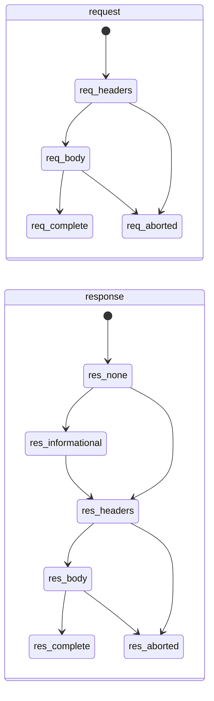

对外暴露的聚合状态：

| `state` | 含义 |
| --- | --- |
| `pending` | 已收到请求头，尚无响应头 |
| `request-complete` | 请求已完整，等待响应（WebSocket 101 后也用此值） |
| `response-streaming` | 已收到响应头，正文传输中 |
| `completed` | 双向完成；413拒绝上传时，完整响应结束后保存当时已捕获正文并收尾记录 |
| `aborted` | 客户端中断，或上游连接失败（DNS/TCP/TLS）被镜像为客户端连接错误 |
| `failed` | Capture 持久化失败或协议错误 |

**迁移规则：**

1. 终态（`completed`/`aborted`/`failed`）不可回退。
2. 迟到或重复事件不得重复累加 bytes，使用 observed 计数覆盖而非累加。
3. `abort` 可以从任意非终态直接进入。
4. 413仅在`response-body-data.isEnded`后结束Capture记录，不在响应头到达时结束，不关闭真实请求或连接；此后迟到的上传/中断事件不再改写该记录。其他状态码保持双向结束规则。
5. 应用归属异步解析可以补充已结束记录的应用信息，但必须保留原终态和耗时；不得将413完成记录推回`response-streaming`或丢失正常/中断请求的耗时。

### 4.1 多协议产品E2E覆盖

- 使用Playground已有流量库，经真实8888进入Capture，从产品UI验证结果；不是为测试工具补测试。2026-09-09最终8条workflow、39个场景及额外413边界合跑Green，HTTP收尾的Proxy module102/102通过。
- 按item交付：`6617961c`交付Body/Encoding，`fadcda96`交付WebSocket，`135c4ba7`交付H2/gRPC/TLS；最后HTTP item补齐四个H1场景与Core early response修复，现有39种场景全部取得产品UI和退出恢复证据。

| 组 | 场景数 | Workflow | 当前结果 |
| --- | ---: | --- | --- |
| HTTP/H1 | 5 | `capture.scenarios.http` | Green，完整上传、流式、提前200、普通中断及额外413收尾边界 |
| HTTP/H2 | 1 | `capture.scenarios.http2` | Green，Headers/trailer/正文及CA恢复 |
| Body | 16 | `capture.scenarios.bodies`、`capture.scenarios.body-media` | Green，模式、图片、Hex及媒体原生保存 |
| Encoding | 5 | `capture.scenarios.encoding` | Green，解压及损坏数据保留 |
| WebSocket | 4 | `capture.scenarios.websocket` | Green，方向/载荷与控制连接 |
| gRPC | 5 | `capture.scenarios.grpc` | Green，原始载荷、压缩、错误trailer与截断 |
| TLS | 3 | `capture.scenarios.tls` | Green，tunnel与解密H1/H2 |

- 最新证据：TEMP下`interceptor-capture-http-final-green-20260909-201525.zip`，SHA256 `2A4274974D3C90F087ED7236C6866613CDDF617485CF2143DE8BD53F253201DD`；8条workflow/8代Main/Core正常退出，8888、WinINet/journal及CA恢复，Mockttp与patch的SHA256和开工基线一致。Core/Desktop typecheck与Proxy module102/102通过；本item未改运行时依赖、打包或进程边界，不新增package门禁。
- 前次场景矩阵证据`interceptor-capture-39-green-20260909-161253.zip`继续保留，SHA256 `959F4804CCCB10BFFE42A178D6ED072600D0C3DC6351A916C30D5D82882718CB`；该次HTTP额外owner失败不算最终Green，以上述最新结果为准。
- 操作与证据契约见[Capture场景规格](../../apps/desktop/tests/e2e-workflow-tests/docs/capture.md)。本统计只覆盖39个现有场景，不把它当所有协议边界已验证。

#### HTTP流式进行中验证

- 2026-09-14沿用`capture.scenarios.http`，通过workflow拥有的真实SSE origin/client控制响应时机；响应头发出前Capture已有唯一请求行，收到`text/event-stream`响应头后同一行显示200，两段事件分别到达时Size按实际正文累计字节增长。
- 两次进行中断言均要求origin尚未结束响应、client尚未收到完整响应；通过真实Headers页核对MIME，不以流结束后的正文代替进行中证据。正常结束后读取完整Text正文，并保留同一Exchange身份。
- 正常结束首轮Green：HTTP workflow1/1（11.4s），36/72/108 B与同一行身份均符合预期；Main/Core `23796/33716`正常销毁及宿主guard通过，Desktop typecheck通过。TEMP `interceptor-streaming-20260914-e2e-default`保存JSON、截图、trace和metadata；此前Raw及不存在的`bodyMode.text`选择器失败不算产品Red，两代`34340/35384`、`47124/20812`均正常销毁。
- SSE三种结束方式Green：同一HTTP workflow1/1（27.6s），正常结束、客户端取消与origin reset分别保存JSON；取消/reset均确认client响应不完整、origin关闭、Capture保留72 B及同一行且Time不再停留在进行中占位。状态码200仍是已收到的真实响应头，不能要求改成伪造错误码。Main/Core `43696/44828`正常销毁及宿主guard通过，TEMP `interceptor-streaming-20260914-e2e-exits`保留证据。
- 6 MiB上传三种场景Green：未知长度chunked、Content-Length和Expect: 100-continue均在client结束上传前让origin接收2/4 MiB，Capture同一行显示2/4 MB；最终6 MiB正文SHA-256一致，产品显示200及真实`upload-ok`响应。公共Keyword输入定位自产行，不依赖虚拟列表恰好把目标行挂载。HTTP1/1（15.0s）、Desktop类型通过，Main/Core `26896/44072`正常销毁及宿主guard通过；TEMP `interceptor-streaming-20260914-e2e-uploads`保留三组上传和三组SSE证据。
- 三个6 MiB长下载Green：正常结束、跨Pause/Resume、首段后Clear分别验证。正常/暂停场景在连接未结束时显示2/4 MB，最终保留同一行与6 MB；暂停不阻断原流量或捕获。Clear后余下4 MiB仍完整转发，旧行不恢复，新请求可正常录制；client完整正文SHA-256一致。九个新增场景与原HTTP场景同跑1/1（17.4s），Main/Core `33400/12300`正常销毁及宿主guard通过；Desktop类型通过，TEMP `interceptor-streaming-20260914-e2e-downloads`保存逐场景JSON/截图/trace。
- 本轮不改变产品UI、命令、数据格式或第三方。现有下载/SSE跨Pause/Resume集成基线4/4；该步骤归Handover长期item，不代表Rule命中、无限chunked、H2大Range或gRPC streaming已验收。

#### H2 Range与多stream集成

- 复用现有`proxy/tests/integration/h2.test.ts`和真实ProxyService/CaptureService，不启动Electron或修改系统代理。同一H2客户端连接同时请求两个6 MiB Range，响应规则仅追加header；源站尚未结束时，两流均收到2 MiB并在Capture显示独立的206及进行中字节，Range/Content-Range/Content-Length保持，最终逐流SHA256一致。
- 正常完成后两条正文均保存且末尾range可读；Clear在两流首段后推进正式capture generation并清空记录，剩余正文仍完整转发，旧行不恢复，同连接新请求仍可录制。单流`NGHTTP2_CANCEL`只取消首条，源站对应stream关闭，Capture保留2 MiB及`aborted`，另一条完整保存6 MiB。
- 2026-09-14同组9/9、Core typecheck通过，未修改转发实现。TEMP `interceptor-h2-ranges-20260914-{baseline,final,types-final}.log`保存结果；首次取消检查误把关闭后的`writableEnded`当作原文完整性、helper曾丢失数字status类型，均为测试缺陷且已修复，不算产品Red。2026-09-15既有H2 Headers/trailer/正文真实workflow1/1（14.2s）、Main/Core `9532/45140`正常退出及CA/宿主恢复；不将普通H2流程当作Range/多stream的真实UI覆盖，压力容量及更广帧矩阵仍未验证。
- 2026-09-15同一H2 workflow已加入双Range正常/Clear/单流取消并最终1/1（19.9s）：`TlsTrafficRunner`复用同一origin及CONNECT路径，只增加可共享session/受控响应；每种客户端stream ID均为1/3。两条各到2 MiB时真实列表和Headers保持独立，正常/Clear最终各6 MiB，取消首条为2 MiB、另一条6 MiB，hash一致；Clear按钮清空后旧行不复活，同连接新请求仍能录制。证据TEMP `interceptor-h2-multistream-20260915-e2e-green`，保存三份`h2-ranges-*.json`、前后截图与trace；Main/Core `47824/13880`正常退出及CA/Root和宿主guard恢复。
- 首轮同一workflow已通过正常与Clear，但受控Readable被二次包装，客户端取消后源流未销毁；改为直接交给pipeline后通过，失败代`33216/9300`正常退出，原证据保留在同前缀`-e2e`，不是产品Red。HTTP draft在异步闭包里失去类型收窄，改用已校验的局部常量后Desktop/Playground类型通过（`-types-green.log`）；共享gRPC流程1/1（2.8m，`40592/35964`）与CA/宿主恢复通过（`-grpc-regression`）。没有新增测试工具自身的测试，也未修改产品或第三方；更广H2矩阵和容量策略仍未完成。

H2 session续验沿用同一双Range流程，不新增协议事件采集或UI。两条响应各到2 MiB后，SETTINGS用ACK确认`initialWindowSize: 32768`、`headerTableSize: 0`、`maxFrameSize: 32768`；既有流各收到完整6 MiB并保持原Capture行。客户端正常关闭session发送GOAWAY时，已开始的流继续完整接收；排空后连接结束，另开连接的新请求录制为H2/200。Core集成同时检查客户端及origin各自SETTINGS，真实Electron检查客户端SETTINGS和正常GOAWAY。

- 2026-09-15五种双Range场景集成5/5，包含原H2、编码、H1上游和gRPC的整个文件11/11；Core/Desktop类型通过。真实H2 workflow 1/1（27.3s），同跑原Headers/trailer及五种Range场景，Main/Core `22300/13000`正常退出、CA/Root与宿主guard恢复。SETTINGS ACK为32 KiB/0/32 KiB，GOAWAY发送后closed=true但destroyed=false，完整收尾后destroyed=true；逐流字节、hash、原行和重连新行均符合断言。
- 证据TEMP前缀`interceptor-h2-session-20260915-`保存`baseline/integration-final/types.log`与`e2e`目录，后者含五份`h2-ranges-<action>.json`、前后截图、trace和metadata；`interceptor-capture-ready-20260915-evidence.json`核对新H2/Body退出及Core/worker与已验收package字节一致。产品和第三方代码未改，记录当前行为Green基线，不制造Red；源站GOAWAY、错误GOAWAY及新增协议事件展示不属于本轮覆盖。

#### gRPC streaming目标与当前差异

- 当前Capture按Exchange/side提供正文快照与有限range读取，复用BodyWriter的内存/spill及串行队列，不额外缓存完整stream或伪造在途hash。Final正文优先；等待writer快照期间绑定Final或删除Exchange时重新读取当前状态，显式空Final也不得退回原文。原writer继续保留清理所有权。
- `grpc.messages`通过`GrpcService.query()`只以5-byte header跳读，独立返回`bodyAvailable`、`bodyComplete`和可读`bodySize`。未结束的半个header/payload等待补齐，结束后才报告真实malformed/truncated；不把HTTP200当gRPC成功或提前制造trailers。Renderer经既有Preload入口每350ms沿游标续读，按`grpc.read-range`预览/Copy已有完整消息，切换方向后忽略旧结果。
- 游标offset可等于当前`bodySize`，在途保留该游标，结束后停止续读；超过可读长度抛`InvalidGrpcCursorError`，Core映射为不可重试的`invalid-message`。正文提交失败时BodyWriter快照结束且不可读，保留observed计数并抛出原错误；ExchangeTracker将请求提交、响应提交和终态写入分开排入现有队列，逐次记录失败而不跳过成功正文或实际终态。
- `ExchangeTracker`以待完成写入集合承担排空，不因终态记录移出活动Map或reset而漏等；`settle()`只等待调用时已接受的操作。`ProxyService.stop()`及`prepareCaptureReset()`都先排空Exchange存储，再让后续关闭/Clear清理正文；正常Recording暂停及网络转发保持。
- 2026-09-14续作取得越界游标2 Red、Final绑定快照2 Red、spill提交状态1 Red、Exchange终态收尾3 Red、终态排空2 Red及HTTP Clear排空1 Red；最终Capture/gRPC/Proxy与Core命令21文件198/198、Core typecheck通过，包含新增H2三种场景。收尾首次修复后仅剩测试误用内部`completedAt`，改为公开summary的`durationMs`后通过，原失败日志保留而不计新的产品Red。TEMP前缀`interceptor-grpc-cursor-20260914-*`、`interceptor-capture-snapshot-20260914-*`、`interceptor-body-commit-state-20260914-*`、`interceptor-exchange-finalization-20260914-*`、`interceptor-exchange-drain-20260914-*`及`interceptor-http-clear-drain-20260914-*`保存Red/Green；当前汇总为`interceptor-streaming-lifecycle-20260914-clear-{regression,types}.log`。本次修复仍缺暂停后的真实E2E与产物复验。
- 2026-09-14有效前置Red：GrpcService新增3例失败、原3例通过；真实H2在完整31 B首条envelope到达且client/origin均未结束时，Response消息预期1、实际0。TEMP `interceptor-grpc-streaming-20260914-e2e-red-valid`保存JSON、截图、trace和metadata，Main/Core `10432/37368`正常销毁，CA/Root与宿主guard通过。之前`-e2e-red`仅被背景TLS提示挡点击，保留为环境干扰，不计目标Red。
- 续作前的最终HTTP/gRPC真实workflow2/2（2.6m）保留在TEMP `interceptor-capture-streaming-20260914-final`及同名日志；gRPC Main/Core `47348/39892`、HTTP `13232/7896`均正常销毁。包含server/bidi streaming、半header/payload、消息Copy、Pause/Resume、Clear和长上传取消，原场景与UTF-8边界同跑；不外推为H2 Range、多stream或压力矩阵通过，也不替代本次修复后的验收。
- 2026-09-15当前代码最终复验：HTTP1/1（33.9s，`32564/47456`）、gRPC1/1（2.5m，`34820/45124`），覆盖上述流式、双向、Pause/Clear、完整Copy、半消息及原场景/UTF-8；两代正常退出、gRPC本轮CA/Root和宿主guard恢复通过。与H2及四条文件任务合计七条逐条通过、十一代正常退出，TEMP `interceptor-streaming-acceptance-20260915-evidence.json`列明各自目录和trace，不称单次合跑。
- gRPC首轮在正文检查完成后的CA清理阶段触及180秒总时限，`27752/46236`正常退出且保留profile的CA材料已删除；单步断言无超时。仅该workflow改300秒总预算并保留全部检查，旧失败为`interceptor-streaming-acceptance-20260915-grpc`，最终为同前缀`-grpc-green`。当前Desktop类型通过；已验收package/audit/smoke由37份产品文件hash及Core/Worker随包字节一致证明适用，依据同前缀`-artifact-applicability.json`；历史前置缺口不补造。

#### 正文修复

- BodyViewer按模式给CodeViewer独立身份，Code自动格式化不能污染Raw；CodeViewer仅调用`editor.dispose()`，不提前销毁仍绑定的隐式模型。正文/格式化/生命周期owner22/22 Green，真实Body两条workflow16场景通过且Renderer无page error。
- 有效owner及真实Red分别保存于TEMP下`interceptor-body-mode-red-20260909-153356.zip`、`interceptor-viewer-lifecycle-red-20260909-154133.zip`；最终Body归档`interceptor-bodies-sixteen-green-20260909-154736.zip`，两代Main/Core `18540/48608`、`5084/16272`正常销毁。
- 九个既有Capture正文parity视图与仓库旧报告逐项核对一致，保留11个flagged和1个missing、未增加最大几何偏差；报告为TEMP下`interceptor-body-viewer-parity-20260909.json`及同名`.md`，不覆盖设计基准或完整报告。
- 真实Monaco通过全选/复制核对当前模型，只有Windows剪贴板CRLF归一；每场景关闭Inspector，下一条先等正文长度和radio选中状态，避免旧正文控件竞态。

#### TLS流量与恢复

- `TlsTrafficRunner`的HTTPS/H1原先用`agent:false`导致Node忽略已有隧道的`createConnection`并另开直连；改用Node HTTP客户端在已握手的同一个TLSSocket中发送HTTP字节。直接跑受影响真实TLS场景，不为流量工具新增测试。
- TLS兼容提示会遮住Settings导航，CA清理须先真实点击dismiss。首次失败遗留的本轮CA `F924C643186525C49881EFB8B337C261C3968ECB`已通过保留profile和正式UI卸载/删除，恢复1/1 Green；归档`interceptor-tls-profile-recovery-green-20260909-160512.zip`，Main/Core `20160/40716`正常退出。
- TLS最终三场景Green，归档`interceptor-tls-green-20260909-160714.zip`，Main/Core `15424/31980`正常退出；不调用MMC、不修改系统权限、不覆盖用户已有CA。

#### HTTP收尾与验证

- 2026-09-09真实HTTP场景发现：early response已结束但上传仍在继续时，旧`ExchangeTracker.completeExchange()`提前移除在途记录，导致后续请求正文丢失，取消也可能被错误保留为`completed`。现已拆开两侧正文finalize，正常提前响应正文可立即读取，记录等待双向结束；收到实际中断事件则保留已捕获正文并进入`aborted`。
- 用户确认413例外：完整接收413响应后保存当时已捕获的上传片段并以`completed`收尾Capture记录，状态码仍为413，不再等待上传结束或中断；收尾后的上传片段不再追加，不声称其为完整上传。只调整Core记录，不修改Mockttp、连接或转发行为。
- 原有效owner及真实UI Red为`interceptor-capture-early-response-red-20260909-151821.zip`，SHA256 `DEDFC9DDE26C61A7FC4CC29F96362C90FEA9ECC73932CC91B2FF93086F56EB3D`，Main/Core `39388/23176`正常退出；新413 owner及真实UI Red为`interceptor-http413-valid-red-20260909-200057.zip`，SHA256 `361B8326A92250C93CA2D55CC55923F70C8A8230336D9032D207314341226FE3`，Main/Core `31460/48696`正常退出。
- 同一真实HTTP流程还暴露迟到应用归属更新丢失耗时、413终态回退；owner三项及UI Red归档`interceptor-capture-terminal-summary-red-20260909-200755.zip`，SHA256 `5EEA9E45C7CF18E4FAE4FB2E35C6A562C77527C7D6813605827D409B6E681510`。`TrackedExchange.completedAt`保留收尾时间，后续摘要沿用终态/耗时，不再显示等待。
- 最终owner early-response7/7、应用归属9/9、整个Proxy module102/102，HTTP真实workflow1/1（19.4s）、完整矩阵8/8。HTTP单项证据`interceptor-http-item-green-20260909-201206.zip`，SHA256 `A805FCAD46DA468F5FA02A8528A0A54041C6E4EB4EAB19724B9BBC6548F3AF1A`，Main/Core `45688/44448`正常退出；其他协议共用收尾以上方八条矩阵验证，不将413规则扩大到其他状态码。

#### WebSocket消息状态

- WebSocket Messages原先引用不存在的`styles.empty`，导致加载、空结果和错误信息采用默认字号/颜色并贴边；当前为116px最小高度的flex居中状态区、12px字体和`--text-3`，长信息可换行。帧采集、方向筛选、payload及断点行为不变；只有控制帧时0条数据消息是预期结果。
- 设计补齐loading/empty/error三态的明暗六张PNG；`websocketMessagesState`默认ready且由页面切换和截图流程重置，356张旧图SHA256保持不变。产品只增加局部CSS及状态元素的parity标记，没有测试数据或隐藏API。
- 前置真实UI与parity Red归档为TEMP下`interceptor-websocket-message-state-red-20260909-203133.zip`，SHA256 `93B60A04F592A71A870F0677078A27818E95A29701CE9BDB8BDB97D814E74DA7`，Main/Core `45156/49560`正常退出；原状态区少100px高度、字号13px且颜色不符。
- 最终真实WebSocket四场景1/1（19.2s）、现有历史/方向unit3/3、Desktop/design typecheck通过；Main/Core `31728/34944`正常退出，8888及WinINet/journal恢复。明暗三态6/6状态区matched、最大0.6px且无字号/颜色差异；同页Inspector host保留既有1.6px高度差，不作为本项新修复或全页parity全绿。
- 最终trace/metadata、parity JSON与截图归档`interceptor-websocket-message-state-green-20260909-203912.zip`，SHA256 `09AABB44F67EF585F11DB3D9A454ABD5870C16881C314B220464C58C6E1D8835`。未新增设计/fixture工具测试，验收对象为真实产品显示与消息行为。

#### WebSocket载荷标题

- 消息行字体已还原：设计`.wsrow`使用mono10.5px与自然行高，产品`.frame`原误继承Shell 1.23，导致Binary行盒差1.1px。修复只由消息行自身指定自然行高，保留38px行、五列、padding/gap、选择及正文。历史/标题7/7基线及修复后Green、Desktop类型通过；真实Red为12.915px而非normal（`21904/26272`正常退出），最终WebSocket workflow1/1（54.7s），Sent/Received的38px行、10.5px字号与列宽不变，原Tree/Copy/UTF-8同跑，`42520/15276`正常退出且宿主guard通过。TEMP `interceptor-websocket-row-20260914-{unit-baseline,unit-green,types,prepare,e2e-red,e2e-green}`保留记录，默认/暂停明暗四场景42目标0 missing/flagged，设计PNG不变；原UI报告新增同一真实消息行前后图，117图/115原图保持，证据TEMP `interceptor-header-copy-20260914-final/websocket-row-report`。
- 2026-09-14共享Compact Tree修复：`BodyViewer`仅在`compact && !fullscreen`时让`JsonTreeView`按内容定高，普通/全屏保持填充容器，22px行、padding/边框和滚动不变。unit3项Red/9项Green后12/12；真实binary JSON的五行110px内容但可见0取得有效Red（`20372/19832`），最终同一WebSocket workflow1/1（54.8s）展开110px/折叠22px/全屏返回110px、原文Copy、原四场景与5MiB通过，`2252/34812`正常销毁/宿主恢复。首轮text帧明确文本MIME无Tree，失败不算高度Red（`20096/36492`正常销毁）；未改Core/MIME，使用原通用二进制JSON探测。Renderer48文件432/432与Desktop/design-vite类型通过；TEMP `interceptor-compact-tree-20260914-*`保存日志、真实截图/JSON/trace/metadata。
- 当前16态直接对照：Tree Copy与Raw均为原文，Pretty为格式化JSON，Hex Copy为完整16字节dump；设计Hex显示按容器/实际1ch动态排字节，48px窗口保留滚动。全屏保留MIME/Save，Pretty/Raw按内容高度、Tree填充；Tree行内容/折叠槽/数量与产品相同。明暗16态几何/动作/Copy一致、Hex16组宽度逐行一致，正文像素14/16为0，内联Tree浅/深0.08652%/0.00911%保留，不改字体或行高。TEMP `interceptor-ws-state-parity-20260914-final/evidence.json`及PNG/diff为最终证据；前置16态与临时Tree探针保留在同前缀原目录及`-compact-tree`。报告只补一组共享Tree真实前后图与四张最终设计态，原105图保持，共111图。
- 完整parity证据入口：2026-09-14 16:46 +08:00的TEMP `interceptor-ui-approved-20260914-full.{json,md,log}`按顺序覆盖398场景，2825目标/2823 matched/2 missing/29 flagged，平均2.52%；先于Tree修复。后续WebSocket、gRPC和规则正文分别使用`interceptor-ws-state-parity-20260914-{canonical,neighbor-grpc,neighbor-rules}`，不相加冒充全量。111图报告的105原图保护与1320/390排版结果在`interceptor-ui-websocket-states-20260914-report/evidence.json`。原Handover完整历史记录已归档TEMP `interceptor-handover-before-cleanup-20260914-181426.zip`，SHA256 `1D065702923CE3C1A358E958E70EB238FD89CFC794B2A29278B7083D7C15EAC4`，仅供追溯，不作为当前状态或新的完成条件。
- 长内容直接检查：200字段JSON、明暗两主题，真实滚轮可到末字段且末行完整可见；202行内容高4462px、消息视口约273px，pageErrors=0。600/440px窗口的外层Inspector均无滚动空间，接续不适用，前两次脚本的错误假定不算产品失败。TEMP `interceptor-ws-state-parity-20260914-scroll`保存JSON/截图，未新增测试工具的测试或扩大产品功能；真实协议/退出证据仍以上述workflow为准。
- 2026-09-14用户确认WebSocket正文采用已展示的产品结构：保留`Received text`、54 B/message序号和Copy元数据行，设计去掉其内层CollapsibleSection的装饰线、计数chip与独立折叠箭头；消息仍由外层消息行展开/收起。设计工具栏补Tree/MIME/Save，复用BodyViewerDesign；当前产品、消息内容与数据面不变。仅message预设镜像产品当前compact的10px外框预留，不借此调整独立Compact高度方案。
- 已批准设计的明暗八种档位、Tree展开/收起、Copy/下载、同消息全屏Raw复制及Hex关闭后档位保持通过，pageErrors=0。全屏复用BodyFullscreenDesign与IconButton，其他场景仍使用既有overlay；设计Monaco的codelens/inlay/treeDnD/suggest/actionWidget服务在首次创建前注册，解决模式切换后editor重建的UNKNOWN service，不改第三方和语言集合。证据为TEMP `interceptor-ws-design-approved-20260914/evidence.json`与`-check-fullscreen-verified.log`。首轮剪贴板CRLF、Vite创建顺序、错误的Modal名称定位等验收失败保留，不计产品Red；缓存重建未解决服务错误，也不作为修复结论。
- WebSocket设计初次同步两张PNG、其他455张hash保持，清单TEMP `interceptor-ws-approved-20260914-shots-synced.json`；源码再次生成同两图hash一致（`interceptor-ws-state-parity-20260914-final-shots`）。当时标题差异已消除，明暗仍有2个Binary行盒flag；它们已由上方消息行字体修复消除，不改设计基准或阈值。旧398场景29 flagged快照与相邻gRPC/规则正文结果仍保留，当前全量入口见Header记录。
- FramePayload与相邻FrameRow复用已有`breakpoints.replacementText`，展开标题使用本地化方向和Text/Binary类型，不再引用未定义的`capture.text`；消息内容、Copy、样式和帧选择不变。
- 2026-09-11前置渲染unit的两个文本标题Red，二进制/历史队列5项Green；首次Monaco/Node环境错误不算产品Red。真实WebSocket在当前中文环境复现资源键泄漏，Main/Core `42540/1756`正常销毁，保存trace与标题截图后才改产品。
- 最终同组unit7/7、加i18n catalog共16/16、Desktop typecheck通过；真实`capture.scenarios.websocket`1/1（56.9s），文本、二进制、双向、控制帧及5MiB边界/Copy同时通过，Main/Core `35356/9584`正常销毁，fixture验证8888、WinINet/journal与登记进程恢复。
- WebSocket旧parity明确为collapsed/open状态，标题用DOM Range、断点入口按真实图标按钮配对；保留`Received text`目标并补深色。已有设计场景缺失的明暗`inspector-websocket.png`各生成1张，392张旧PNG逐张SHA256不变，设计源码未改。
- 最终明暗14 matched、0 missing、6 flagged，平均像素差2.73%；每主题仍有断点按钮颜色/边框、载荷标题字号/位置、Binary行位置三个既有样式差异，最大25.6px，未算整页通过。TEMP前缀`interceptor-websocket-title-20260911`与`interceptor-websocket-scene-20260911`保存前置/最终证据；[报告](../../commit-changes/202609111558_ui_parity_progress.html#websocket-title)内嵌真实Electron同场景标题前后图。

#### gRPC消息行高

- `GrpcMessages.message`局部使用`line-height: normal`，保持38px行高、10.5px字号、字体、列宽、消息选择与Copy不变。原`Message 2`和`gzip compressed`文字盒因继承Shell行高比设计少1.1px，前置parity已复现；修复后两目标宽高与位置差均0。
- gRPC验收场景明确collapsed/open与默认passthrough状态，补深色；从已有未修改的设计场景生成明暗`inspector-grpc.png`各1张，394张旧PNG逐张SHA256不变。最终16/16目标matched、0 missing/flagged、最大0.6px；像素差2.72%/2.93%，不把目标匹配当整张图逐像素相同。
- 2026-09-11既有row-format/Capture Store unit33/33、Desktop typecheck通过，真实`capture.scenarios.grpc`1/1（2.1m）；原五类gRPC与多消息5MiB边界/Copy同跑，Main/Core `36412/33540`正常销毁，本轮CA/Root集合、8888、WinINet/journal恢复。未改用户流程或补造历史E2E Red。
- TEMP前缀`interceptor-grpc-rows-20260911`与`interceptor-protocol-scenes-20260911-grpc-*`保留前后parity、截图、旧图hash及真实trace/metadata；[报告](../../commit-changes/202609111558_ui_parity_progress.html#grpc-rows)内嵌同一Renderer场景的消息行前后图。Tunnel配置与剩余差异仍在同一UI parity item中分步处理，不另拆commit或报告。

#### HTTPS设置连接示意

- 当前实现：补齐已有设计中的Client apps、Interceptor、Internet三个节点、流向箭头及TLS锁。新增`HttpsConnectionChain`子组件位于说明段落前，恢复缺失的71px示意与16px间距，不移动标题；Generate、Install、Start decrypting的命令和可用状态不变。
- 锁颜色和图标由弹窗已读取的有效MITM状态决定，没有新业务调用或按钮；15种现有语言补齐两个节点标签。图标复用Lucide，节点/标签/图标分别以Grid和Flex居中，不使用文字基线或位移补偿。
- 渲染单测先因缺少Client apps而Red；最终组件4项与i18n9项共13/13，Desktop typecheck通过。parity三场景24 matched、0 missing，标题及连接示意全部匹配；浅色Cancel仍有约1px的原有字体度量flag，不能写整组全绿。新旧画面像素差平均0.44%，设计源码与基准未改。
- 非E2E直接预览覆盖明暗两主题与en/zh-CN/ja/fr四语言，8组节点/标签/图标中心差小于0.1px、无标签越界和Renderer异常；Cancel正常关闭。临时全局禁动画曾导致Modal退出/截图异常，最终改用Playwright截图动画处理后复跑通过，错误截图已从报告替换，未改产品动画。
- 同一[工作项报告](../../commit-changes/202609111558_ui_parity_progress.html#https-connection-chain-images)内嵌明暗前后图，去掉已撤回的Timing图组，保留其他34张原图，共38图；1320/390排版与最终画面检查通过。TEMP `interceptor-https-chain-20260911-review/`保存逐节点度量、中文截图和报告原稿，原始DOM见`interceptor-https-title-20260911-dom/`。
- 2026-09-12恢复E2E后组件/i18n13/13、Desktop类型通过；`capture.scenarios.tls`与真实正文流程联合2/2（45.7s），本workflow Main/Core13768/41652正常退出，新增连接示意/Generate可用/Install及Start禁用/Cancel检查通过，后续真实CA、H1/H2、Root集合和宿主恢复均通过。TEMP `interceptor-update-button-centering-20260912-e2e/`保留trace、截图和metadata。暂停期缺少实现前E2E Red仍是历史缺口，不把当前Green当成前置证据。

#### Timing正文行高

- 2026-09-13当前实现：由`RequestInspector.timelineRow`负责一维flex排列，标签150px、时长58px、比例条占剩余宽度，父行自然排版及align-items:center；12px gap、7px内容间距、6px条高和真实时间段计算不变。仅Capture设计Timing行同步，Diagnostics的独立时间线不改。现有section-collapse流程保留独立折叠、ARIA和真实时间段检查，新增父行flex/normal、固定两列与弹性比例条断言，不使用下方历史矩形中心方法。
- 前置row-format14/14；真实section-collapse在`display:grid`而非flex处Red，Main/Core `24104/1252`正常销毁。修改后同组14/14、Desktop/design-vite类型、明暗parity8/8通过，8个目标的原始几何差均0；TEMP前缀`interceptor-ui-parity-20260913-timing-flex-*`保留原始结果。
- 当前两主题设计图已同步，`timing-flex-design-synced.json`保存同尺寸图源及前后hash；同步后8/8目标保持几何差0，整页像素差2.0543%/2.1201%单独报告。唯一[工作项报告](../../commit-changes/202609111558_ui_parity_progress.html#timing-flex-layout-images)追加一组同主题同尺寸Renderer + fake Preload组件近景，原95图保持，97图加载、红框和1320/390排版已检查；未将无窗口截图标为真实Electron。
- 2026-09-13失败尝试在8888 listener ready前退出，未进入Timing断言，随后tracing.stop因页面已关闭失败；`timing-flex-e2e-green`只是目录名，Main/Core `10840/27480`的graceful/abrupt均false，不能算Green。当时用户暂停所有Electron E2E，仅继续headless与Node检查；相关进程0、8888无listener、共享journal不存在、WinINet未指向8888不替代该次缺失的完整退出证据。
- 2026-09-14用户恢复真实E2E后，同一`capture.inspector.section-collapse`最终1/1（20.2s），Main/Core `47500/17304`正常销毁，fixture宿主恢复通过，trace与Timing截图齐全；另只读核验进程0、8888无listener、共享journal不存在。独立折叠/ARIA、父flex/center/normal、150px/58px文字列、12px gap和6px弹性比例条断言全部通过，未改用户语言、产品命令或测试断言。row-format14/14及Desktop类型通过，证据为TEMP `interceptor-ui-parity-20260914-timing-{unit.log,prepare.log,e2e.log,e2e/}`和`interceptor-ui-parity-20260914-desktop-types.log`；692份UI/验证源码hash与完整398场景headless结果保持一致，不再把旧Green用于替代本次布局。

- 2026-09-11历史阶段：曾撤回新增的`--interceptor-line-height`并恢复当时Grid布局；该token仍未重新引入。文字仍为原字号，列宽、12px列间距、7px上下padding、6px进度条和时序计算均未变。
- 用户反馈后的复核：加入token曾将行高28.140625px增至32.5625px，但改前/当时外框中心差均小于0.01px，不能将行高匹配称为居中改善；临时两层flex还会把可见文字下移约1px，已弃用。未使用基线、裁剪、位移或额外padding方案，原始证据在TEMP `interceptor-centering-audit-20260911/`。
- 原token版unit8/8、类型、字体parity明暗8/8和E2E Red/Green（42888/42628、26812/19300）仅为当时结果，不能代表当前Timing与设计无差异；深色既有设计补图仍保留，404张旧图hash未变。历史产物位于TEMP `interceptor-timing-20260911*`，报告不再展示被撤回的行高改动作为改善。
- 该历史阶段真实Inspector曾检查同排标签框、数值框和进度条的中心差，不强制某个token；此方法已由当前父行flex契约取代。撤回前后同一检查1/1（18.3s/20.1s），Main/Core46032/4400、32356/33148均正常销毁及宿主恢复，row-format8/8、Desktop类型通过；这些结果不能代替当前布局的最终E2E。TEMP `interceptor-timing-alignment-review-20260911-*`保留当时截图和trace，不据外框检查宣称用户视觉认可。

#### 请求正文分组的计数标签

- 2026-09-11实时设计的计数标签保留MIME/单位大小写与normal字距；共享`SectionHeader.count`原先继承标题uppercase与0.05em字距，使`json · 63 B`宽出6.3px。组件已补normal字距和`text-transform:none`，该宽差归零，标题、按钮尺寸、折叠及正文行为不变。
- `capture-request-json`已修正侧栏/detail/MITM场景状态，并定位到实时`CollapsibleSection`，不再使用被替换的`.sh`节点。前置数据记录计数宽差6.3px、空Query提示少4.8px；后者独立处理，不用一起修改多个高度凑数。
- 正文unit前后25/25，Desktop类型通过；真实Request计数字距Expected normal/Received0.575px取得Red后，正文/Inspector折叠/Composer响应折叠三条workflow 3/3（38.9s）。Main/Core39052/10868、22468/42288、20096/42056均正常销毁并通过宿主guard；TEMP `interceptor-section-count-20260911*`保留证据。不新增设计或验收工具自身的测试。
- 空Query提示的高度差单独修复：设计继承Ant Design正文token，产品原先继承Shell1.23，当前字体下相差4.8px。`KvSection.empty`已直接采用现有`--interceptor-line-height`，不扩大padding；同一真实Request流程先取得20.1923px/15.375px的Red再Green，空提示高度差归零。
- 最后的正文高度差约1px来自共享标题继承Shell数值行高，设计实时标题显式normal；按设计明确`SectionHeader.header`字体行高，保留24px最小高度、8px下padding和12px分组间距。现有Request/Response流程先加标题行高断言取得Red，再改CSS，不对正文容器追加高度补偿。
- 最终三处样式各自取得真实Red：计数字距0.575px（Main/Core33788/32076）、空Query行高15.375px而非token对应20.1923px（26456/35356）、标题14.145px而非normal（14552/20908），全部正常销毁。空Query中间Green18716/39004也保留，不冒充最终版本。
- 最终正文unit25/25、Desktop typecheck通过；正文全屏/Inspector折叠/Composer响应折叠3/3（36.2s），Main/Core17844/13592、11620/20908、3812/17672均正常退出并通过宿主guard。标题、计数、空Query与正文模式/Copy断言全部保留，TEMP `interceptor-section-typography-20260911*`保存最终结果。
- 明暗Request八项目标各8/8、0 missing/flagged、最大0.5px，标题/计数/空Query几何均0px，正文高差-0.4px；十个相邻视图148 matched，仅保留普通Capture共8个既有Header Copy flag。既有收起态PNG不适用于展开侧栏，新增明暗`inspector-request-expanded`两图，402张旧图SHA256不变；对应像素差2.43%/2.47%，正文工具栏能力差异不冒充逐像素相同。
- [同一工作项报告](../../commit-changes/202609111558_ui_parity_progress.html#request-typography-images)加入浅色同请求前后图，红框定位空Query与正文标题/起点，原32张内嵌图保持；34张图在1320/390宽度正常显示，无折叠或横向溢出。临时报告脚本已删除，原始裁切数据在TEMP `interceptor-section-typography-20260911-review/`。

#### 受限正文提示行高

- `BodyViewer.note`的11.5px文字原先继承Shell紧行高，两行提示少8.8px，正文起点相应提前。只补`line-height: var(--interceptor-line-height)`；9px/11px padding、8px gap、图标居中、预览范围与Copy/Save保持。
- 旧parity把设计13px的`.bpane`外壳与12px产品编辑器比较。现在分别检查实际编辑器外框、Monaco第一行及提示条；真实文字两边均为12px/21px，不修改代码字号来迎合无文字外壳。
- 2026-09-12前置parity复现8.8px提示差；修改后正文行为unit9/9、Desktop typecheck通过。明暗两场景6/6 matched、0 missing/flagged、最大0.4px，提示和代码行位置差0px；像素差2.73%/2.75%，不宣称整页像素相同。只新增缺失深色`body-limited.png`，407张已有设计PNG的hash不变。
- 受限与解码失败两种提示在明暗、1600x900及1000x700窗口共八组检查通过；小窗口经真实splitter达到360px Inspector，文字换行无溢出，提示图标中心差0px。切换Hex后提示保持；未触发Save或真实网络E2E。
- 同一item报告52张图片，原50张原样保持；新前后图只裁切提示条和正文上边框，排除异步格式化阶段不同的代码内容。1320/390宽度图片加载、全部展开且无横溢出。初次浏览器检查因嵌套`:scope`定位超时，改用完整body-view直接子节点选择器后通过，不算产品Red；预留workflow同步修正，临时脚本已删除。
- 非E2E证据位于TEMP `interceptor-limited-body-20260912-{before.md,after.md,unit-green.log,typecheck.log,final.md,final.json,design-hashes.json,review/evidence.json}`。暂停期间缺失的本次布局前置E2E继续保留，不回滚补造。
- 2026-09-12恢复授权后`body-scenarios.workflow.ts`与媒体/TLS导航/AppContainer同组4/4（52.7s），相关unit33/33；真实5MiB UTF-8、提示行高/间距/图标、Raw/Copy及完整Save断言通过。该workflow Main/Core1952/18392正常销毁，8888/WinINet/journal恢复，trace/metadata及同名log位于TEMP `interceptor-e2e-resumed-20260912-body-settings`；最终Green不代表前置门禁齐全。

非E2E复验命令：

```powershell
npm run test --workspace @interceptor/desktop -- src/renderer/components/tests/unit/body-viewer-mode.test.ts
npm run typecheck --workspace @interceptor/desktop
node apps/desktop/tests/visual-parity/parity.mjs --view=capture-body-preview-limited --out-dir="$env:TEMP/interceptor-limited-body-review-shots" --report="$env:TEMP/interceptor-limited-body-review.md" --result-json="$env:TEMP/interceptor-limited-body-review.json"
```

深色使用`--view=capture-body-preview-limited-dark`及独立输出名。真实E2E复验：

```powershell
npm run e2e:prepare-local --workspace @interceptor/desktop
node node_modules/@playwright/test/cli.js test --config=apps/desktop/tests/e2e-workflow-tests/playwright.config.ts apps/desktop/tests/e2e-workflow-tests/workflows/capture/body-scenarios.workflow.ts --reporter=line --output="$env:TEMP/interceptor-limited-body-e2e"
```

#### 媒体正文占位布局

- `UnavailableBody`沿用既有设计的40px图标框、13px MIME、11.5px大小、12px说明和28px `Button sm`。内容按`content/details`两层flex分组：图标到详情10px、详情内7px、说明到Save 13px；MIME为自然行高，大小复用正文token。没有用margin、transform或调用方CSS移动按钮。
- 前置六项直接测量确认MIME/大小行高与间距不足；保存/loading行为先补入现有`body-viewer-mode`测试并取得9/9基线，修改后同组9/9、Desktop typecheck通过。原格式、Raw、Hex、Copy及Save回调保持。
- 2026-09-12明暗两场景12/12 matched、0 missing/flagged、最大0.4px；六项内部元素位置均匹配，Save纵向差0px。新增既有`body-media`场景的两张缺失PNG，405张旧图hash不变；像素差2.15%/2.27%，不宣称整页像素相同。
- 浏览器检查音频、视频、超限图片、损坏图片四类正文，明暗与1600x900/1000x700共16组；1000px窗口经真实splitter操作达到现有Inspector最小360px、正文324px。文字换行和Save完整可见、无横溢出，最大水平中心差0.0078125px。音视频与超限图片readBody均0次，损坏图片实际尝试读取并显示不可预览原因；没有创建播放器或触发保存。
- 同一item报告增加相同67 MB视频的浅色前后图与红框；50张图片、原48张原样保留，1320/390宽度图片加载、全部展开且无横溢出。证据在TEMP `interceptor-media-body-20260911-{before,unit-baseline}*`及`interceptor-media-body-20260912-{unit-green.log,typecheck.log,final.md,final.json,design-hashes.json,review/evidence.json}`。
- 一次性检查初次错误假定正文宽度不超过320px，随后错误限定损坏图片只读取一次；按产品360px Inspector下限及实际读取边界更正后通过，两次属于检查假设失败，不算产品Red。脚本已删除，未新增验收工具自身测试。
- 2026-09-12恢复授权后[媒体workflow](../../apps/desktop/tests/e2e-workflow-tests/workflows/capture/body-media-scenarios.workflow.ts)与正文/TLS导航/AppContainer同组4/4（52.7s），相关unit33/33；真实PNG/Hex、WAV/MP4完整Save及gap/行高/居中断言通过。Main/Core3880/18464正常销毁，8888/WinINet/journal恢复，trace/metadata及同名log位于TEMP `interceptor-e2e-resumed-20260912-body-settings`。
- 暂停期布局前置E2E缺口仍保留。2026-09-12相邻encoding、普通WebSocket、queue-isolation三条真实3/3（1.4m），encoding Main/Core19740/5544正常销毁及宿主恢复，损坏/压缩正文与完整保存路径已单独复验；TEMP `interceptor-ui-adjacent-20260912-e2e`及同名log保留trace/metadata，不以媒体workflow外推该结果。

非E2E复验命令：

```powershell
npm run test --workspace @interceptor/desktop -- src/renderer/components/tests/unit/body-viewer-mode.test.ts
npm run typecheck --workspace @interceptor/desktop
node apps/desktop/tests/visual-parity/parity.mjs --view=capture-body-media-save --out-dir="$env:TEMP/interceptor-media-body-review-shots" --report="$env:TEMP/interceptor-media-body-review.md" --result-json="$env:TEMP/interceptor-media-body-review.json"
```

深色使用`--view=capture-body-media-save-dark`及独立输出名。真实E2E复验：

```powershell
npm run e2e:prepare-local --workspace @interceptor/desktop
node node_modules/@playwright/test/cli.js test --config=apps/desktop/tests/e2e-workflow-tests/playwright.config.ts apps/desktop/tests/e2e-workflow-tests/workflows/capture/body-media-scenarios.workflow.ts --reporter=line --output="$env:TEMP/interceptor-media-body-e2e"
```

#### TLS Tunnel元数据与方法标签

- `TlsTunnelPanel.rows`使用设计已有的18px行高，避免五行元数据累计过矮、底部说明提前约18.5px；`RequestInspector.methodChip`局部使用normal，消除CONNECT文字盒1.1px高度差。不改字号、padding、内容或TLS行为。
- 行距结论：TLS与普通Inspector `Kv.key/value`均为11.5px mono、18px单行高度、9px行间距，单行内容起点相隔27px。此次只补TLS遗漏的行高，`gap:9px 16px`没有增加；长值换行或带控件的详情行按实际内容增高，不与gRPC的38px消息列表行混为同一规格。
- 2026-09-11普通/深色/MITM两态及入口共五个常驻parity场景33/33 matched、0 missing/flagged、最大0.8px，平均像素差2.32%；HTTP/WebSocket/gRPC方法标签的几何亦已检查，后续POST配色验证见下文，不把行高验证当作配色证据。
- 配置明确collapsed/open状态并补齐深色目标；从未修改的已有设计场景生成四张缺失的`inspector-tunnel`/`inspector-tunnel-mitm-active`明暗PNG，396张旧图逐张SHA256保持不变。没有调整几何阈值或覆盖完整parity报告。
- 相关row-format/Capture Store unit33/33、Desktop typecheck通过；真实`capture.scenarios.tls`1/1（25.2s），未解密Tunnel、解密H1/H2、正文读取和本轮CA清理保持，Main/Core `24704/21152`正常退出，Root集合、8888、WinINet/journal及登记进程恢复。
- TEMP前缀`interceptor-tunnel-item-20260911`保存五场景报告、标签邻近检查、旧图hash、unit/types及真实trace/metadata；改前元数据截图为`interceptor-protocol-scenes-20260911-tunnel-aligned-shots/capture-tunnel-light.png`。变化追加到同一[UI parity报告](../../commit-changes/202609111558_ui_parity_progress.html#tls-tunnel)，不单独新建commit或HTML。

#### Inspector POST配色

- `RequestInspector`根据实际method给POST标签附加局部class，使用设计既有的`--yellow`与14%黄色背景；GET/CONNECT及其他现有方法仍保留原样。不复用列表徽标的16%底色，不改字体、字号、行高、padding或请求行为。
- 2026-09-11前置gRPC parity确认POST文字/背景为蓝色；修改后HTTP/WebSocket/gRPC/Tunnel明暗八个方法目标均无样式或尺寸差异，gRPC明暗18/18 matched、0 missing/flagged。其余HTTP Header marker与WebSocket正文差异未纳入本步，设计源码和PNG均未改。
- `row-format`/Capture Store unit33/33、Desktop typecheck通过；已有真实`capture.scenarios.grpc`1/1（2.2m），原五场景、消息选择/Copy与多消息5MiB边界同跑，Main/Core `23260/34540`正常退出，CA/Root集合、8888、WinINet/journal和登记进程恢复。
- TEMP前缀`interceptor-method-colour-20260911`保存前置/最终parity、单测/类型和真实trace/metadata；改动与同主题前后图继续追加在[同一UI parity报告](../../commit-changes/202609111558_ui_parity_progress.html#inspector-post)。没有新增item、commit或HTML。

#### Request Method详情值

- General中的Request Method按现有设计显示完整大写协议值和accent文字，不是方法标签；Copy仍复制完整大写值。列表、筛选、断点和Composer中的方法标签继续复用`MethodBadge`。
- 2026-09-11使用flex组件时定位到产品在这个普通文字字段误用标签：原20px背景画在18px行外，inline-flex后该行增加2px。前置General method value目标记录dh2px及颜色不符；按原设计恢复文字后，明暗方法值和后续Client App均匹配，保留每主题4个既有Header Copy布局flag，不通过负margin、裁剪或压缩标签掩盖行盒。
- 现有`capture.body.fullscreen`新增Request Method普通文字与真实Copy断言；最终1/1（13.5s），完整POST复制、URL、Request/Response正文、模式保持和全屏原断言通过。Main/Core22464/11152正常销毁，宿主guard核验8888、WinINet、共享journal及登记进程恢复；TEMP `interceptor-method-value-20260911-e2e*`保留trace/metadata。没有新建工具自身测试。
- TLS和普通文本Kv仍为18px行高、9px行间距，Request Method还原后无需改变这个规则；新图片和组件flex回归均保留在同一UI parity item，不另建commit或报告。

#### Inspector标题行高

- URL行高的本项验收通过：只在`.url`显式使用normal，不改字体、字号、URL展示或Copy行为。旧报告少1.6px的高度差在真实静态字体加载后消失，15个现有场景的URL宽高差均为0；不以此声明整页位置和像素全部匹配。
- 2026-09-10首次恢复parity时，消息空态URL高度为设计14px、Renderer17px，设计Inter/JetBrains Mono FontFace为error，Renderer本地字体loaded。`document.fonts.ready`只表示加载结束，不保证成功；这轮回退字体产生的3px差异不算产品偏差，TEMP诊断`interceptor-inspector-font-load-probe-20260910.log`保留。
- 网络恢复后逐视图确认Inter/JetBrains Mono静态字体loaded；六个消息loading/empty/error明暗状态共24目标全部matched、0 missing/flagged、最大0.6px，gRPC与TLS tunnel的URL宽高和位置也一致。临时字体检查探针已删除，`parity.mjs`无diff，未改设计字体、源码或PNG，也未覆盖仓库报告。
- 四个旧HTTP/Rule筛选/侧栏parity场景补`detail: 'open'`，使设计侧与Renderer打开详情的操作一致，原URL目标不再缺失。位置偏差仍明确保留：普通HTTP横向14px，Rule筛选纵向-53px，深色展开/浅色收起侧栏横向160/-160px；旧WebSocket展开与其他页面目标差异不属于本次行高修复。
- 既有`capture.body.fullscreen`追加真实URL显示、hover和Copy断言，不通过Preload直接调用。当前真实E2E1/1、Desktop typecheck通过，Main/Core `9668/5996`正常退出，host guard确认8888、WinINet/journal及登记进程恢复；原正文全屏、Copy和关闭/重开操作同跑。
- 最终15场景的字体日志、JSON/Markdown、Renderer/diff截图与E2E trace、metadata、类型结果及三份源码hash归档为TEMP下`interceptor-inspector-url-green-20260910-133816.zip`，SHA256 `D3E57A744F14A809FC3351740EBE34E3B05CE8056D05EF771DE9320E1D2A15DE`；清单单列4个旧位置差异，不冒充全页Green。

#### Capture侧栏parity场景

- `shell-v2-capture-dark`与`shell-v2-capture-collapsed`原先把Renderer默认收起态用反了，分别产生160/-160px位置差异；现通过正常Toggle sidebar操作与设计的expanded/collapsed状态一致，不改产品布局。
- 标题文字使用显式`measureText: true`测量DOM Range，避免把Renderer的`flex: 1`空白算作标题宽度；其他目标仍测元素盒子，字号/字重/颜色与1px阈值不变。
- 两个旧`shell-v2` PNG路径不存在。使用未修改的设计稿和已有截图脚本，新增深色展开/浅色收起且打开Headers详情的两张截图；旧384张PNG逐张hash不变。
- 定向parity为2视图、6 matched、0 missing、0 flagged，最大0.5px；像素差分别2.9166%/2.7429%，已查看代表图及diff。列表数据、图标和正文区域仍有既有差异，本项只修验收场景，不声明整页或全套parity通过，也不把该结果当真实E2E。
- TEMP归档`interceptor-capture-sidebar-verified-20260910-143141.zip`，SHA256 `6282C701A367BA72BDDD56B944C7BEA9222C066BBF7811A90B11A326F3D2D2AA`，包含JSON/Markdown、Renderer/diff与设计截图、执行日志、旧图hash清单及5份源码/资产hash。本项不改产品、网络或第三方，不新增工具自身的unit/integration测试。

#### Compact正文高度

- 2026-09-15恢复后的当前UI验收：WebSocket正文1/1（58.8s，Main/Core `44332/3532`）、队列隔离1/1（18.0s，`47500/33884`）、Header Copy/全屏1/1（15.5s，`20708/45276`），全部正常退出且trace/宿主guard通过。暂停Original容器与BodyViewer均97.3333px、默认min-height为auto；首轮将auto误断言为0px仅为测试失败，`26036/46656`正常退出，原结果保留。TEMP `interceptor-ui-acceptance-20260915-{websocket-body,websocket-queue,websocket-queue-green,body-fullscreen}`；当前package/audit/smoke均通过，见Handover，不把历史前置缺口抹去。
- 当前实现：CodeViewer的Compact与设计Monaco的box/message均使用`getContentHeight()`加宿主实际上下边框，删除固定10px及重复横向滚动条预留。字号12px、行高20px、上下padding13px、滚动及全文读取保持；86px内容在DPR2为88px外框，不写死88px。设计PayloadEditor的Original body同步删除底部多出的8px预留，WebSocket暂停容器移除旧185px最小高度，普通填充查看器不变。
- 前置unit两项尺寸Red、原模型释放Green后，同组3/3通过；真实WebSocket Red为126px内容/约1.33px边框却有136px外框，Main/Core `10472/18852`正常退出。最终同一workflow1/1（约1.1m）外框127.33px、五行20px/字号12px保持，原Tree/Copy/全屏/UTF-8同跑，`7796/45060`正常退出并恢复宿主。八个规则正文36目标全匹配。随后修正设计Original body旧预留及产品暂停容器185px下限；这些后续CSS以无窗口parity验证，尚无恢复后的真实E2E，不用早期Green替代。证据前缀TEMP `interceptor-compact-height-20260914-{unit-green,types,parity,e2e-red,e2e-green,breakpoint}`。
- 最终代码侧覆盖位于TEMP `interceptor-ui-delivery-20260914-evidence/parity-current.json`及`parity-current-summary.json`：398个ID顺序逐一一致，2825目标/2823 matched/0 flagged/2独立空Text missing。它保留250个未受影响场景、148个续验场景及最后6个暂停/队列复核的来源；不是单次全量或全流程Green。32张受影响设计图已同步，425张其他图hash不变，`design-synced.json`列明原图备份；报告123图的121原图保护与宽窄排版结果在`paused-message-report.json`。真实Settings与WebSocket暂停流程、最终package/audit/smoke待用户恢复授权。
- 历史预览：8个Request/Response Text/File明暗场景、32组宽度均为内容86px/外框88px/viewport与scrollHeight86px，字体/行高/padding/滚动选项保持。TEMP `interceptor-compact-content-preview-20260914/evidence.json`和[四图审阅页](../../apps/desktop/tests/visual-parity/renderer-shots/ui-item-compact-review.html)保留原结果；早期隐藏正文多匹配、重复导入Monaco服务冲突与Resource Timing缺URL失败仍在`interceptor-ui-item-20260914-compact-preview{,-verified,-final}.log`，不改写为Green。

#### Capture筛选parity场景

- 当前Header Copy已按展示效果落地：`KvValue`保留原文字可用宽度和自然换行，逐行inline-flex居中，原Rule marker与共享18px/14px IconButton放末行；marker文字隔离祖先删除线，普通选择/完整Copy/hover保持，两个复合General值不变。浏览器只临时测量换行，按grapheme边界二分定位，不拆字素、不改文本或字体、不增加业务请求。设计`KvValueDesign`在现有DetailFixtureRenderer中替换纯文本值并复用共享inline按钮，不重写生成fixture或影响其他尺寸。
- 2026-09-14前置row-format为新增3 Red/原14 Green；实现后同组19/19，含空白/grapheme保真及有限测量，Renderer48文件437/437、Desktop/design-vite类型通过。真实body-fullscreen Red为长Header Copy父容器54px（预期18px），`6340/27488`正常退出；最终同一workflow1/1（22.5s），父行18px/完整选择与Copy/hover及原URL/方法/正文全屏保持，`44632/7112`正常退出和宿主guard通过。TEMP `interceptor-header-copy-20260914-{unit-red,unit-green,types-final,renderer,e2e-red,e2e-green}`保存日志/尺寸JSON/截图/trace/metadata，类型索引修正不改变已构建的运行时逻辑。
- 正式Capture明暗各42目标、Rule筛选3目标全部匹配且0 missing/flagged，原9个Header差异消除；前缀TEMP `interceptor-header-copy-20260914-{parity-light,capture-dark,capture-rule-filter}`。当前产品两主题19文本行在默认/340/500/回默认宽度下选择/Copy/hover/18px末行及失效删除线通过，`interceptor-header-copy-20260914-final`保存实际代码而非注入预览的JSON/PNG。三张既有Headers设计图同步、其他454图hash保持，清单`interceptor-header-copy-20260914-design-synced.json`；原UI报告115图、111原图保持，1320/390红框与加载通过，证据在`-final/report/evidence.json`。不将本次增量与旧398场景相加冒充新全量。
- 当前完整parity为TEMP `interceptor-ui-final-20260914.{json,md,log}`，20:28 +08:00结束，398个ID与顺序逐项一致，2825目标/2823 matched/2 missing/22 flagged，平均2.52%；Header与Binary旧flag均消除。其中4个Tunnel flag是本轮DetailFixtureRenderer误把只读TLS字段转为Copy布局所致，已按所属TLS tunnel分组保持原fixture，产品TlsTunnelDetailRow未改；定向四场景32/32、0 missing/flagged见`interceptor-header-copy-20260914-tunnel-green`。剩余为8个Compact、10个Settings字体flag及独立空Text2 missing，不把定向修正说成重新全量通过。
- 前置候选保留在TEMP `interceptor-header-copy-isolated-preview-20260914/`，两主题marker与原图像素差0，脚本同前缀`-scripts.zip`；旧列迁移/逐字素/失效整行方案均未进入产品，当前实现使用最后验证的原换行候选。
- 2026-09-14预览排除记录：逐字素flex会在原生Selection中插入换行；display:contents版本丢空格或在末字前换行。整行匿名flex文字在明暗19值、默认/340/500宽度下选择与Copy保真，但失效类传播到Rule marker；只把失效文字设display:contents虽计算值仍为line-through，截图不再绘制删除线。容器全选另有尾换行，不能通过trim、剪贴板拦截、隐藏副本或只测Copy按钮掩盖。证据TEMP `interceptor-ui-copy-last-line-20260914-{selection,contents,contents-measured,lines,lines-anonymous,lines-scoped,lines-scoped-final}.log`和`interceptor-ui-copy-last-line-20260914-lines/`。
- 早期自然换行前缀加末字inline-flex预览，19纯文本值的三宽度、完整cache-control Copy通过，但不证明整条末行居中；两个复合General值未动。TEMP `interceptor-ui-item-20260914-inline-copy-context/evidence.json`及`-verified.log`保留结果，Header未就绪/错误Inspector容器名的早期失败不算产品Red；这些已否定的早期候选没有写入产品或正式设计。
- 2026-09-14Copy尺寸修复：共享`IconButton`新增18px inline档，图标14px、padding0、图标不收缩；`Kv`只选择档位与保留hover，不再覆盖按钮/图标尺寸。unit6 Red/原19 Green后25/25；真实`capture.body.fullscreen`Red为18px按钮中图标6x14px、padding1px 6px，Main/Core `16900/6088`正常销毁；修复后同一workflow1/1（16.9s）、Desktop类型通过，图标14x14px、0padding、离开行opacity0/hover1及完整POST/URL/正文复制成立，`15600/18660`正常销毁及宿主guard通过。日志/trace/尺寸JSON在TEMP `interceptor-ui-copy-inline-20260914-*`。本步不改变Header排列；新末行逐字素flex方案仅临时预览，尚未写入产品，不外推为末行设计已完成。
- 普通`capture`场景补Renderer侧栏展开操作，消除由状态不一致导致的Inspector横向14px误报；修正不存在的旧PNG路径，使用浅色展开且打开Headers详情的独立新基准。
- `capture-rule-filter`改用现有Rule facet选项，不再定位已不存在的pill；通过正常UI展开侧栏、收起Application分组。设计adapter按`rule-auth`/`rule-stub`分别选中Auth/Stub，不再把任何非空Rule筛选都选成Stub。明暗Auth/Stub/All六个直接预览状态均正确、页面无异常，design typecheck与脚本语法通过。
- 2026-09-10历史普通Capture为34 matched、4 missing、20 flagged，pixel diff 2.9224%；Rule筛选为3 matched、0 missing、1 flagged，pixel diff 1.6490%。当时Inspector与Rule facet尺寸、位置匹配，原归在Inspector的-53px误报来自`Rule appended`的53px偏移；当前结果以上方末行Copy复验为准。
- 2026-09-10的Header诊断曾发现透明18px Copy单独换行，证据TEMP `interceptor-header-row-layout-20260910-145312.log`保留。2026-09-12按统一flex规则修正后，`Kv`值文字按内容宽度收缩，规则标记和Copy按4px gap同排，长值只在文字内部换行；未把Copy移到key列或删除复制能力。21行DOM检查和row-format14/14通过，最新Capture明暗84 matched、仅8个Header marker纵向flag，横向差0、最大58.4px。
- 2026-09-12设计fixture只在Request URL和Status Code提供`kv-copy`，因此文字可用宽度和行高不同；该历史缺口现由KvValueDesign补齐。原结构证据TEMP `interceptor-ui-layout-20260912-kv-dom/rows.json`及`interceptor-ui-layout-20260912-capture-final.{json,md}`保留，不用旧A/B方案、位移或删产品能力掩盖。
- 本项新增浅色`inspector-sidebar-expanded`与`rule-filter-auth`两张基准，旧386张PNG逐张hash不变。截图脚本增加`--theme`筛选，只生成当前主题；未改产品、第三方或HTTP wire逻辑，未执行真实E2E或新增设计工具测试。
- TEMP归档`interceptor-capture-rule-scenes-verified-20260910-144808.zip`，SHA256 `29A4002042B9CB886E98CB9CCA7C5BD75A83B993B221777F35B9A872985F1C70`，保留两场景JSON/Markdown/像素diff、直接预览和类型日志、旧图清单及5份源码/资产hash。

#### Capture默认控件parity目标

- 普通Capture保留38个检查目标：旧`Breakpoints`文字改为现有Breakpoint Manager工具栏按钮；空查询场景比较实际搜索框，不定位设计稿仅有查询词时显示的文字；端点与HTTPS passthrough按设计稿中的现有元素配对。
- 该场景显式设置fake `mitmActive: false`，与现有设计默认passthrough状态一致；此前harness默认开启MITM，导致设计与Renderer状态不一致。产品设置、设计稿和基准截图均未修改。
- 定向结果为38 matched、0 missing、22 flagged，pixel diff 2.8843%；搜索框与passthrough匹配，最大0.6px。Breakpoint按钮几何匹配但继承字号13.3333px/13px仍被报告，端点宽差16px、列表与Header差异继续保留，不调整阈值或声明整页通过。
- 配置脚本语法及编辑器检查通过，已查看Renderer和diff截图；不新增工具自身测试，未执行真实E2E。TEMP归档`interceptor-capture-targets-verified-20260910-151852.zip`，SHA256 `F743CB9FF4C8A2D0050CE99CA1C8C4BEA14C4B619FD893EF65297BED132B96BF`，包含前后JSON、报告、日志、Renderer/diff、未修改的基准与4份输入hash。

#### Capture列表fixture对齐

- parity默认列表补齐设计稿已有的5条PNG、HTML、Markdown、视频请求摘要和应用归属，列表由13条变为18条；只改`fake-interceptor.mjs`，不修改产品、正文fixture或设计基准。
- 同一普通Capture视图的`List app cell unknown`纵向差从-260.1px降到-0.1px，4px横向列差仍保留。38个目标中只有此项几何变化超过0.2px；全页仍38 matched、0 missing、22 flagged、最大52.8px，pixel diff 2.9208%，不声明全页通过。
- 既有规则筛选、HTTP断点、WebSocket空态、gRPC、Tunnel五个代表入口均可打开：HTTP断点12目标与WebSocket空态4目标全匹配；Rule marker仍偏53px，gRPC/Tunnel分别2/4个flag且像素基准缺失，继续作为独立欠账，不归为本项已修复。
- 证据保存在TEMP下`interceptor-capture-list-fixture-20260910-182434`及`interceptor-capture-fixture-regression-20260910-182601-*`的JSON、Markdown、日志与截图。配置语法和编辑器检查通过；本项是验收fixture修改，不新增工具自身测试，也不运行无关产品E2E。

#### Capture状态栏列间距

- `CaptureStatusbar.bar`补齐设计已有的三列`gap: 16px`，其余内容、状态、交互与30px状态栏高度不变；没有重写端点文字或用偏移抵消差异。设计稿、PNG基准与完整parity报告未改。
- 2026-09-11同一`capture`场景前置parity为端点宽差16px，修复后宽差0、最大0.5px；38目标中只有端点结果变化，flagged由22降到21，pixel diff仍为2.9208%。列表与Header既有差异继续保留。
- 现有`statusbar-upstream-down`明暗场景补端点与passthrough目标，并显式使用与设计一致的`mitmActive: false`；6/6目标匹配、0 missing/flagged、最大0.5px。两场景原PNG缺失，像素检查为n/a，不新增或改写基准补造通过。
- Capture Store与Proxy readiness既有unit29/29、Desktop typecheck通过；未修改用户流程，复跑真实`capture.recording.pause-resume`1/1（22.3s）。Main/Core `14636/40784`正常销毁，fixture验证8888、WinINet、共享journal与登记进程恢复；不把该回归当其他流程的前置Red。
- TEMP证据前缀`interceptor-capture-status-20260911-125914`包含前后JSON/Markdown/Renderer截图、明暗检查、类型与unit日志、真实E2E trace/metadata。离线改动报告见[状态栏列间距](../../commit-changes/202609111558_ui_parity_progress.html#capture-statusbar)。

#### Capture列表列轨道

- `RequestList`表头与`RequestRow`采用设计已有的`20/66/minmax(0,1fr)/52/40/44/48/52px`列轨道，gap10px、左右14px；表头继续补偿真实scrollbar宽度。文字使用局部normal行高，不改字体、34px表头或52px请求行。
- 删除旧600px压缩档；按设计500px隐藏Proto/Type，380px再隐藏Size/Time，后者Method为62px。Path保持可缩小与省略，不以150px最小宽度撑破列表。未改设计稿、PNG或全局token。
- 2026-09-11前置普通Capture为15个列表目标有差异，最大34px；最终明暗30个列表目标全部0px。两主题各38 matched、0 missing、6 flagged，剩余2个控件与4个Header marker不属于列表修复；平均像素差约2.85%。深色复用已有`inspector-sidebar-expanded.png`。
- 一次性产品Renderer探针先确认570px等窄列表的8px gap/12px padding及表头错列；修复后明暗14组检查通过，实际列表218–730px，列隐藏、表头对齐、无列溢出和34/52px高度一致。探针没有注入Store或产品测试入口，用完删除。
- 既有Capture Store/Proxy readiness unit29/29及最终Desktop typecheck通过。真实`capture.clear-facets`首轮因系统CONNECT流量使Method计数2而失败，Main/Core `36604/26256`正常退出；这不是产品Red。workflow改为自产请求后经Recording按钮暂停新录制，保存非零原始计数，不再假定系统流量独占；Clear后同帧`rows/Inspector/Method count/GET option`全零断言保持。
- 最终真实workflow1/1（7.6s），Main/Core `13700/42588`正常销毁，fixture验证8888、WinINet/journal和登记进程恢复。证据前缀为TEMP下`interceptor-capture-list-20260911-1310`，默认改前复用`interceptor-capture-status-20260911-125914-after`；[离线报告](../../commit-changes/202609111558_ui_parity_progress.html#capture-list)内嵌同主题、尺寸、状态的默认与窄列表前后截图。

#### Capture图标控件目标与状态

- Breakpoint toolbar原target报告未用于显示的继承字号；Filter clear原target是包裹`IconButton`的span，颜色不是实际按钮颜色。parity现对纯图标控件比较实际button的颜色、背景、边框、圆角、opacity及SVG几何/颜色，不修改1px阈值或文字目标的字体检查。Breakpoint产品实现未改。
- 新目标先确认Filter clear真实差异：禁用opacity0.55而设计0.35，启用使用`--text-2`而设计`--text-3`。仅在`CaptureListbar`给现有IconButton传局部class并还原这两项，hover沿用共享按钮；共享IconButton、设计稿与PNG不变。
- 2026-09-11普通Capture明暗各40 matched、0 missing、4 flagged，所有控件目标匹配；剩余4个Header marker不属于本项。Rule筛选为5 matched、0 missing、1个既有marker flag。临时深色启用/明暗hover的12个目标（含定位锚点）全部匹配、最大0.5px；这些状态没有专属PNG，仅记录DOM几何，不伪造像素结果。
- Capture Store/Proxy readiness unit29/29、Desktop typecheck通过；现有真实`capture.clear-facets`增加禁用opacity、GET筛选启用、清空筛选后再禁用及记录/Inspector保留断言，随后仍验证Clear记录的同帧全零。最终1/1（15.1s），Main/Core `31884/34744`正常销毁，fixture验证8888、WinINet/journal与登记进程恢复。
- TEMP前缀`interceptor-capture-controls-20260911`保存禁用/启用前后parity、明暗/hover检查、unit/types及真实E2E trace/metadata；[离线报告](../../commit-changes/202609111558_ui_parity_progress.html#capture-filter-clear)内嵌两组同状态产品Renderer截图。临时状态检查脚本用完删除，没有新增工具自身测试。

#### UTF-8预览截断

- 代码与最终E2E通过，但缺实现前真实E2E Red：有限文本预览的上限落在UTF-8字符中间时，只暂缓尾部未完整的字符，不显示由预览截断制造的替换字符。完整正文中的非法UTF-8以及预览内部的非法字节仍显示替换字符，不能删除所有替换字符来掩盖坏数据。
- 截断事实由读取正文的调用点通过`previewTruncated`明确传入`BodyViewer`，区分未压缩预览上限和Core解压输出`limited`；`decodeUtf8`使用标准TextDecoder的`stream`选项，文本、Raw及文本Copy使用同一解码结果。未知MIME的内容探测同步识别预览边界，实际坏字节与二进制控制字节仍走Hex。
- WebSocket帧行、FramePayload Copy和gRPC JSON payload Copy复用同一解码，按各自消息长度判断是否超出预览上限，不用整个gRPC body是否结束推断消息边界。捕获数据本身残缺不等同预览上限，不因此隐藏真实坏字节。
- Hex、Body Store、Save及导出仍使用原始字节，预览大小和既有截断提示不变；未新增非UTF-8字符集支持，未改Core或网络协议。Composer等没有传截断标记的完整正文调用保留原行为。
- 四组有效unit Red分别覆盖2/3/4字节UTF-8尾部、BodyViewer显示/Copy接线、消息Copy和未知MIME探测；最终7份相关unit40/40及Desktop typecheck Green。TEMP归档`interceptor-utf8-preview-pending-e2e-20260909-224752.zip`，SHA256 `537171D9CBD29D4171C616E573F5233EFD5F186EE734524D5DD1BFD3EE8E3FDF`，包含Red/Green日志及11份源码hash。
- 上述历史归档形成时用户禁止E2E；恢复授权后四条既有真实workflow各自追加边界验证并分别1/1 Green，不是修改前Red或一次四条合跑。2026-09-10最终7文件40/40和Desktop typecheck复跑通过，日志`interceptor-utf8-final-checks-20260910-004253.log`。
- HTTP分别覆盖2/3/4字节字符、普通文本/未知MIME/代码Raw、工具栏Copy和真实编辑器全选复制；原生Save生成的完整正文SHA256一致，包含预览之外的字符。压缩workflow覆盖gzip解码明文5 MiB边界；原有`min(encodedSize, 5 MiB)`请求长度保持不变，最初小gzip测试预期错误不算产品Red。
- WebSocket覆盖大消息完整往返、行预览、专用Copy和展开正文；gRPC覆盖Request/Response大JSON与相邻小消息，按每条payload长度和offset复制/显示，不混入下一条envelope。大文本只用长度与SHA256作剪贴板断言，不向日志返回整个正文。
- 四代Main/Core正常退出，host guard确认8888、WinINet/journal和登记进程恢复；gRPC通过正式UI卸载/删除本轮CA、移除例外、停用MITM并比较Root集合。未修改设计或截图；非法UTF-8与Hex原字节保留由unit验证，真实Save另验证完整文件。
- 本次保存已通过最终验证的实现、测试及证据。实现前因禁E2E缺少真实Red，历史缺口仍保留；不回滚代码、不复制仓库补造证据，不将本次提交视为前置门禁已齐。提交前已核验11份实现/单测源码与原归档hash一致，四份最终E2E归档hash、trace、Green日志及正常退出metadata完整。

| 最终真实E2E | Main/Core | TEMP归档 | SHA256 |
| --- | --- | --- | --- |
| HTTP正文 1/1 | `51180/27120` | `interceptor-utf8-http-green-20260910-003002.zip` | `CFC6C97448E58155740670589DFE47002ABB0D0F736778BAD7DC594EE4736196` |
| 压缩解码 1/1 | `25284/11364` | `interceptor-utf8-encoding-green-20260910-003432.zip` | `6F098AB753E521710D12D7DC34BA17C09878AAE45C6EC7BF8AFC4C2DC5F812A3` |
| WebSocket 1/1 | `24244/14348` | `interceptor-utf8-websocket-green-20260910-003725.zip` | `41BD814E57B68F9A47C4DD8B8724DA38FF680001D0E79A0D3743C1309FF608E7` |
| gRPC 1/1 | `36504/43572` | `interceptor-utf8-grpc-green-20260910-004310.zip` | `A6F2AC42072642240ED75DC23C183F79760DADCF3E5FFF5298E57164C87A537D` |

#### 正文全屏验收

- `capture.body.fullscreen`验证Capture的JSON请求/响应及HTML Raw正文：通过原有Fullscreen进入1060x660共享弹层，Header Copy逐字复制原文，Close和Escape退出后保留Raw/Hex模式，再次打开仍使用同一份捕获内容，不出现两份正文视图。
- 本item只补已有行为的真实E2E和验收文档，产品、设计及依赖均未修改；既有正文/模式/编辑器生命周期15/15与Desktop typecheck通过，真实workflow1/1（12.0s）。范围是Windows当前语言下的Capture入口，不冒充Composer、WebSocket和gRPC调用点分别执行过全屏E2E。
- Main/Core `15836/41732`正常退出，8888、WinINet/journal恢复。TEMP归档`interceptor-body-fullscreen-green-20260909-205316.zip`，SHA256 `BEE96AB10FF1894DAD5C2B1C22C354469D4EDE11CA76A0ED5350476BA998FE32`；含三份真实弹层截图、trace、metadata及基线测试。未改变行为，不人为制造Red或另写测试设施测试。

## 5. 调用流程

### 5.1 HTTP/HTTPS 常规请求（主路径）

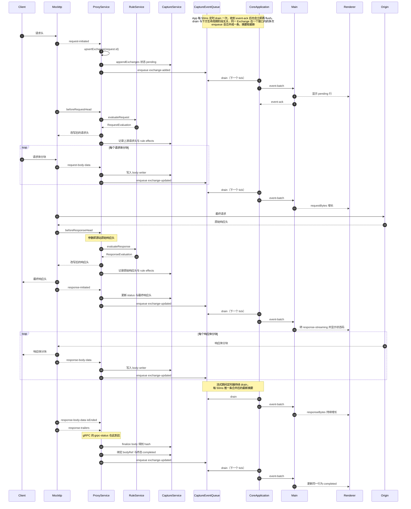

**逐步说明：**

1. **请求头到达**：`ProxyService` 在 `request-initiated` 回调内检查 `recording` 与 capture generation，通过后分配 `exchangeId`，写入 `ExchangeInput{ state: 'pending' }`，立即 enqueue `exchange-added`。UI 在一个 flush 周期内看到该行。
2. **请求规则**：`beforeRequestHead` 与步骤 1 并行，不保证先后。`ProxyService` 用同一 `request.id` 找到（或暂存到孤儿表等待）Exchange 记录，附加 `ruleIds` 与 header effects。钩子**不等请求正文**。
3. **请求体**：每个 `request-body-data` 把 `content` 追加进该 Exchange 的 request body writer，更新 `requestBytes`。`isEnded` 时 finalize 得到 hash 并绑定 `requestBodyId`。
4. **源站响应头**：`beforeResponseHead` 的参数就是 Origin 原始响应头，作为 response Rule 效果的对照。钩子**不缓冲响应正文**。
5. **最终响应头**：`response-initiated` 提供实际写回客户端的值，更新 `statusCode`、`responseMime`、`responseStartedAt`，状态转 `response-streaming`。
6. **响应体**：同请求体，写入 response body writer。
7. **trailer**：`response-trailers` 追加记录；gRPC 的 `grpc-status` 由此路径获得。
8. **终态**：响应体 `isEnded` 后写入 `completedAt` 与 `state: 'completed'`。

### 5.2 CONNECT 隧道（未解密）[已实现]

未配置 CA 或用户未开启解密时，HTTPS 走字节直通，只记录有限元数据。

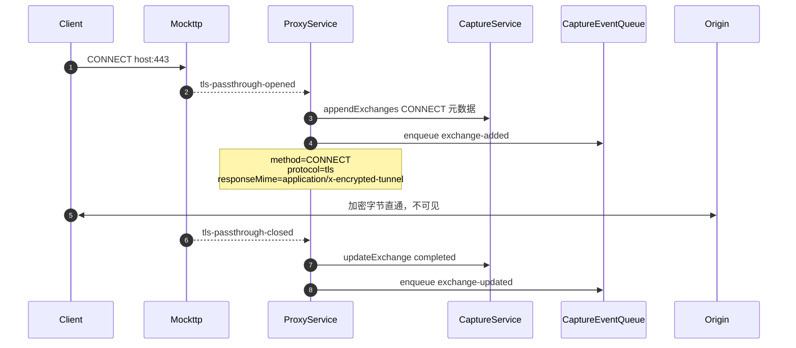

`pendingTunnels` 保存 `Promise<PendingTunnelCapture | null>`，确保 closed 事件等待 opened 落库后才更新。隧道内不读取任何 header 或 body。

**Rule 对未解密隧道完全不生效**，因此上图没有 RuleService 参与。原因在 TLS 层就已决定：

未配置 CA 时 `startServer()` 用 `getLocal({ https: { ...tlsPassthroughIdentity, tlsInterceptOnly: [] } })`。
Mockttp 的 `shouldPassThrough()` 在 `interceptOnlyPatterns` 非 undefined 时返回
`!interceptOnlyPatterns.some(...)`，空数组必然得到 `true`，于是 `analyzeAndMaybePassThroughTls`
读完 ClientHello 就把 socket 交给 passthrough listener 并 `return`，**不再继续 TLS 握手**。

后果是隧道内的字节从未被解密、从未被解析成 HTTP 请求，`forAnyRequest().thenPassThrough()`
这条规则链根本不会被触发，`beforeRequestHead` / `beforeResponseHead` 自然也不会调用。
换言之：**要让 Rule 作用于 HTTPS，必须先安装并信任 CA 且开启 MITM**，此时流量走 5.1 的常规路径，
隧道记录不再产生。

### 5.3 WebSocket [已实现]

101 Exchange 由 `websocket-accepted` 完成。不能依赖 completed `response`，因为订阅它会
触发全量正文缓冲（见 3.2）。

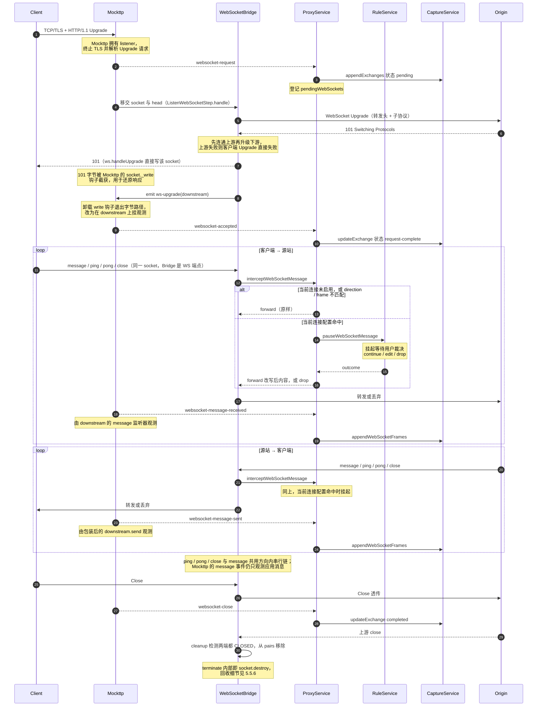

**客户端连接的归属分层**（容易误解，单独说明）：

| 层 | 归属 |
| --- | --- |
| TCP/TLS 接入、HTTP Upgrade 请求解析、WebSocket 规则匹配 | Mockttp |
| 101 握手响应与之后全部 WebSocket 帧 | Bridge（`ws`）直接读写 Mockttp 移交的同一 socket |
| `websocket-accepted` / `message-received` / `message-sent` / `close` 观测 | Mockttp，但**不在字节路径上** |

Mockttp 在 Upgrade 阶段给 socket 装 `_write` / `_writev` 钩子，因此 Bridge 调
`downstreamServer.handleUpgrade()` 写出的 101 字节会被它截获并 `parseRawHttpResponse` 还原成
响应对象。随后 Bridge `socket.emit('ws-upgrade', downstream)`，Mockttp 收到后**立刻卸载钩子**，
转而在 `downstream` 这个 WebSocket 对象上挂 `on('message')` 并包装 `send()`，靠对象级 hook 观测
消息。也就是说：**连接是 Mockttp 接的，WebSocket 协议端点是 Bridge 的，Mockttp 升级完成后退化为观察者。**

约束：

- **Rule 的适用范围与 HTTP 不同**，这是 WebSocket 最容易误解的一点：

  | 对象 | 是否经过 Rule |
  | --- | --- |
  | Upgrade 请求（header 改写、block、map local/remote 等） | **否**。Bridge 经 `addWebSocketRule` 注册独立的 WebSocket 规则链（`WildcardMatcher` + 自定义 step），不走 `forAnyRequest().thenPassThrough()`，因此 `beforeRequestHead` / `beforeResponseHead` 不会触发 |
    | 帧 | **仅当前连接临时断点**。`interceptWebSocketMessage` 按 `exchangeId` / `direction` / `frames` 检查 `WebSocketBreakpointSettings` 后调用 `ruleService.pauseWebSocketMessage`；message / ping / pong / close 各有明确 `ruleName`，**不做 matcher 匹配，也不执行 Rules action** |

    即 WebSocket 帧断点由 `websocket.breakpoint.enable` / `websocket.breakpoint.disable` 控制，只作用于配置中的当前 exchange；命中后挂起等待 continue / edit / drop，与 Rules 工作区里的 HTTP breakpoint action 正交。
- **上游先于下游**：`handle()` 先 `new WebSocket(url)` 并 `waitForOpen(upstream)`，成功后才 `handleUpgrade` 回客户端 101。上游握手失败时 upstream 被 terminate 并抛出，客户端拿不到 101，因此不存在「已升级但无上游」的中间态。子协议以上游 `sec-websocket-protocol` 回填，`sec-websocket-extensions` 被删除（bridge 关闭 permessage-deflate，两侧均传明文帧）。
- **配置方向才过断点**：client-to-server 与 server-to-client 都接入 `intercept()`，是否挂起由当前连接配置的 `direction` 决定。两个方向各自维护 `clientTail` / `serverTail` Promise 链，互不阻塞但各自保序；message / ping / pong / close 共用该方向的同一条链。
- **观测依赖 Bridge 走 `send()`**：Mockttp 的 `message-sent` 来自被包装的 `downstream.send()`。控制帧走 `ws.ping` / `ws.pong` / `close`，会经过 Bridge 断点，但不产生 Mockttp message 事件，因此当前不作为普通 message frame 落库；close 仍由 `websocket-close` 更新连接终态。
- **两个方向的记录语义不对称**：Mockttp 与 Bridge 各自在**同一个** `downstream` 对象上挂 `on('message')`，一帧到达同步触发两者（`socket.emit('ws-upgrade')` 是同步的，Mockttp 先注册也先执行）。但转发目标不同导致：

  | 方向 | 观测点 | 记录到的内容 |
  | --- | --- | --- |
  | client → server | `downstream.on('message')`，帧一到就捕获 | 断点**前**的原始内容，被 drop 的消息**仍会**记一条 |
  | server → client | 被包装的 `downstream.send()`，断点决策**后**才调用 | 断点**后**的最终内容，被 drop 的消息**不落库** |

  原因是 client→server 转发调 `upstream.send()`，而 upstream 由 Bridge 自行 `new WebSocket()` 创建、未被 Mockttp 包装，不产生事件。因此「断点改写是否体现在 Capture 记录里」两个方向相反。
- 消息按 `streamId` 串行 `writeTail` Promise 链，保证顺序且等待 101 Exchange 先落库。
- payload 复用 `BodyStore`，按 hash 去重。
- 仅支持 HTTP/1.1 Upgrade，H2 Extended CONNECT 未实现。


### 5.4 早期响应（HTTP）

**终态场景总览**（5.4 与 5.5 合并对照）：

| 场景 | Mockttp 发出的事件 | Capture 结果 |
| --- | --- | --- |
| HTTP 413拒绝上传 | `response-initiated` → `response-body-data isEnded` | 完整413响应后`completed`，保留收尾时已捕获上传正文 |
| 其他HTTP早期响应 | 两侧`*-body-data isEnded`，或实际`abort` | 双向结束后`completed`；真实中断则`aborted`并保留已捕获正文 |
| HTTP 请求中断 | `abort` | `aborted` + `errorCode` |
| HTTP 上游连接失败（DNS/TCP/TLS） | `abort`（`simulateConnectionErrors` 镜像为客户端连接错误） | `aborted` + 真实 `errorCode` |
| WebSocket 升级前连接直接断开 | `abort`（`data` 为空分支） | `aborted` |
| WebSocket 非正常关闭（closeCode 1006） | `abort` | `aborted` |
| WebSocket 上游升级失败 | 无（`response` 未订阅，`announceResponseAsync` 直接 return） | `aborted`，由 Bridge 显式判终态 |
| 未解密 CONNECT 隧道异常断开 | 仅 `tls-passthrough-closed` | 一律 `completed`，**永远不会是 `aborted`** |

本节只针对 HTTP/HTTPS（MITM 后）：Origin 可能在请求体传完前就返回 401/413/417。
WebSocket 没有等价场景（不存在请求体流式上传），未解密隧道也不适用。

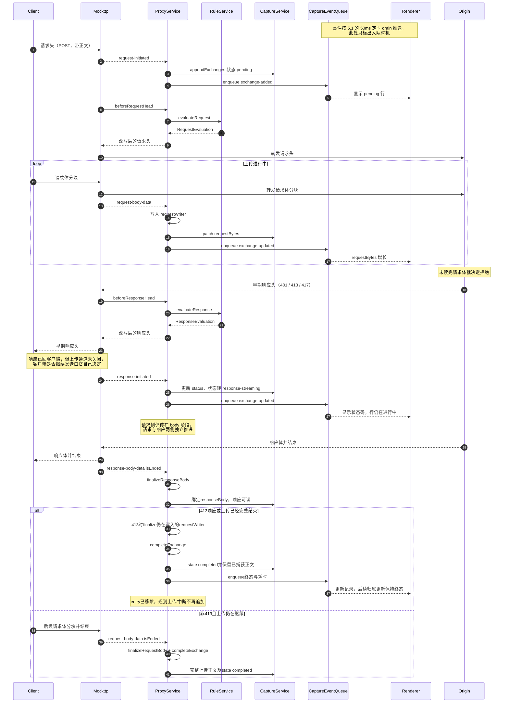

**响应与上传是并行的两条通道。** 早期响应头一到就会被 Mockttp 转发给客户端，Capture 也立刻
`patch` 出 `response-streaming` 并入队推给 Renderer——**不需要等上传结束**。此时客户端的上传通道
仍然开着，继续发还是放弃完全由客户端决定（很多 HTTP 客户端收到 4xx 后仍会把已排队的分块发完）。
413完整响应后Capture按用户确认范围收尾，后续事件不再追加；其他状态码保留仍在上传的entry，直至上传结束或收到真实中断事件。

**终态不会因迟到事件回退。** `completeExchange`与`finishExchange`都会保存收尾时间并移除entry。
普通请求必须等两侧正文结束；413例外只要求完整响应及当时已捕获上传保存完毕。它表示Capture记录已结束，
不表示客户端全部上传都到达origin，也不主动关闭真实连接。后续应用归属摘要仍保留终态和同一耗时。

**关键修复点**：早期实现只在 completed `request` 事件建立 `pending` 映射，若 `response` 先到会找不到请求而**直接丢弃整条记录**。改用 `request-initiated` 后，Exchange 在请求头阶段就已存在，早期响应可以正常合并。

**[已修复] 早期响应保留已上传的请求正文**：`completeExchange` 原先只取 `entry.responseWriter`
去 finalize，对仍在写入的 `entry.requestWriter` 既不 `finalize()` 也不 `abort()`，随后
`entries.delete(requestId)` 让它彻底失去引用，导致：

1. 已上传的那部分请求正文不绑定 `requestBodyId`，Inspector 里出现「有字节数但没有正文」。
2. 跳过 `BodyWriter.abort()` 会把 spill 临时文件留到 Core 代际结束（`tracker.reset()` 只遍历 `entries`，此时已删除，也兜不住）。

现由两侧独立finalize；413响应完整结束时补finalize仍在写入的请求writer。真实socket回归用例：
`proxy/tests/integration/service.test.ts` 的 *finishes an early 413 capture with the observed upload before the client disconnects*；
正常继续上传与迟到事件另由`early-response.test.ts`验证。

### 5.5 中断（abort）

由全局 `server.on('abort')` 驱动，**覆盖 HTTP 与 WebSocket**，不覆盖未解密隧道。
五种触发场景的前置流程互不相同，各画一张从客户端发起请求开始的完整时序。

无论哪一种，收尾都汇聚到 `finishExchange`：两个 writer 都 finalize（已接收的部分正文保留并绑定
body 引用），写入 `state`、`completedAt`、`errorCode`，`terminal` 置真并从 `entries` 移除，
最后 `resolveExchangeReady`。

#### 5.5.1 HTTP 客户端主动中断

用户取消、请求超时或客户端进程退出，连接在上传或等待响应期间断开。

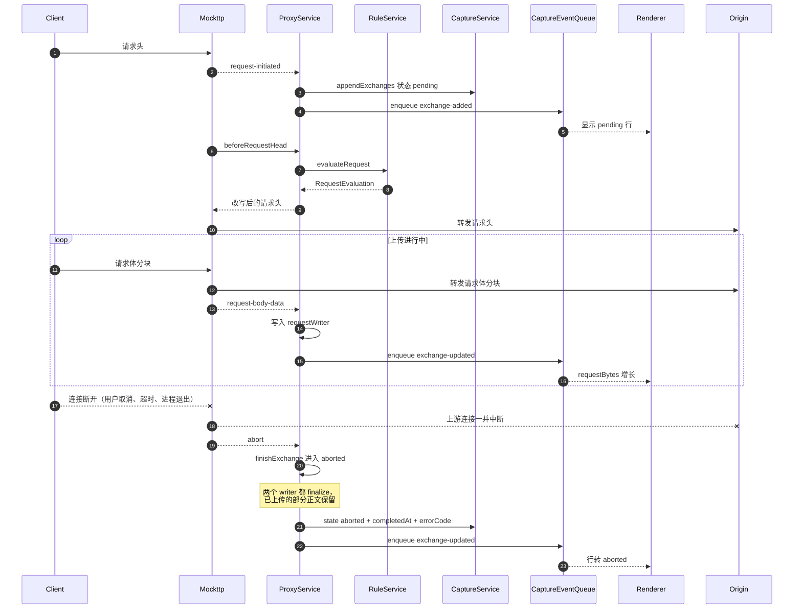

#### 5.5.2 HTTP 上游连接失败

DNS 解析失败、TCP 被拒或 TLS 握手失败，请求从未到达源站。

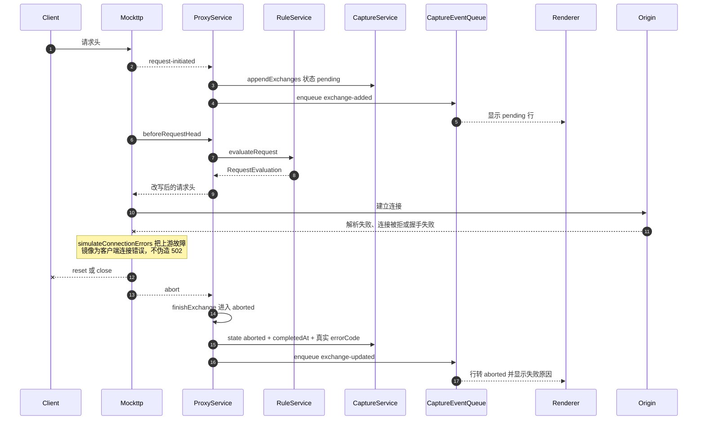

**上游失败语义**：passthrough 固定 `simulateConnectionErrors: true`，因此客户端看到的是与不挂代理时一致的失败形态（连接被重置/关闭），而不是一个伪造的 502 响应。Capture 里也是一条带真实 `errorCode` 的 `aborted` 记录，而不是一条假响应。

#### 5.5.3 WebSocket 升级完成前客户端断开

客户端发出 Upgrade 后、握手完成前就断开，此时还没有任何响应字节写回。

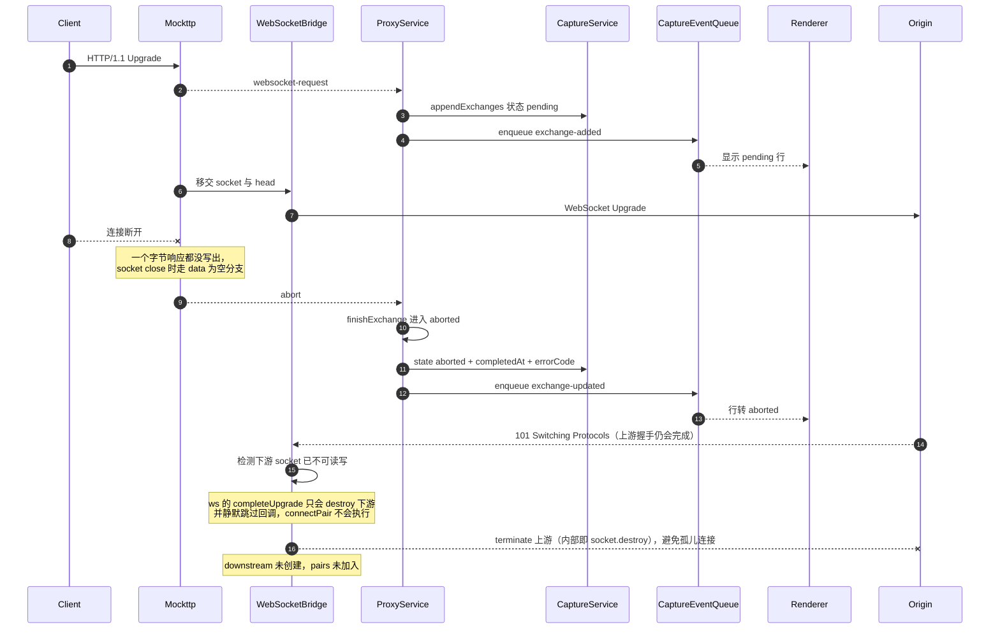

**Bridge 必须自己收尾上游。** 上游握手是异步的：客户端断开时 `await waitForOpen(upstream)` 往往仍在
等待，之后源站照样会回 101，于是出现「下游已死、上游刚活」的错配。此时 `ws` 的 `completeUpgrade`
第一件事就是 `if (!socket.readable || !socket.writable) return socket.destroy()`——**它只销毁下游
socket，并且不调用回调**，因此 `connectPair` 永远不执行、上游既进不了 `pairs` 也无人 `terminate`，
`bridge.close()` 同样兜不住（它只遍历 `pairs`）。

`handle()` 现在在 `handleUpgrade` 前先检查下游是否仍可读写，并额外注册一次 `socket.once('close')`
守卫：只要配对未完成就 `upstream.terminate()`。回归用例：
*closes the upstream websocket when the client disconnects during the upgrade*。

被移交的下游 socket 不需要 Bridge 额外处理——`completeUpgrade` 已经 `destroy()` 了它。

#### 5.5.4 WebSocket 上游升级失败

上游拒绝升级或连接不通，Bridge 的 `waitForOpen(upstream)` 失败。

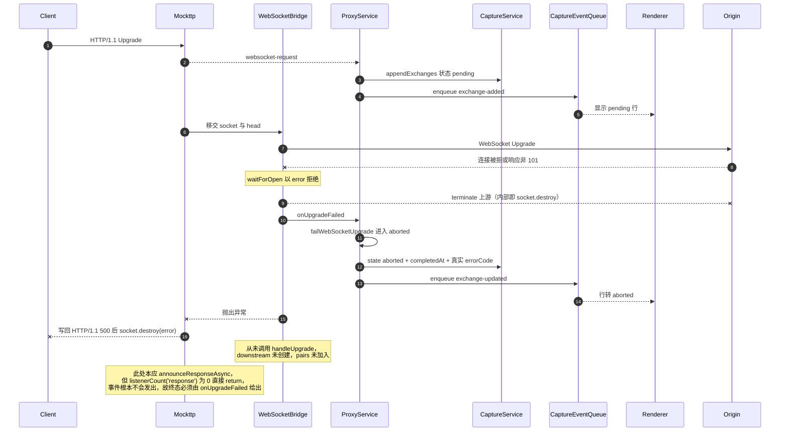

**这里没有「收不到的事件」，而是压根不发。** `announceResponseAsync` 的第一行就是
`if (emitter.listenerCount('response') === 0) return`，Capture 从不订阅 `response`，因此
Mockttp 连 `waitForCompletedResponse()` 都不会调用——既不会有事件投递，也不会触发 3.2 说的全量正文
缓冲。代价是这条路径**没有任何 Mockttp 事件可用**，终态只能由 Bridge 的 `onUpgradeFailed` 补上。

#### 5.5.5 WebSocket 已建立后非正常关闭

握手成功、消息通道已经工作，之后连接异常中断（`closeCode` 1006，非 clean close）。

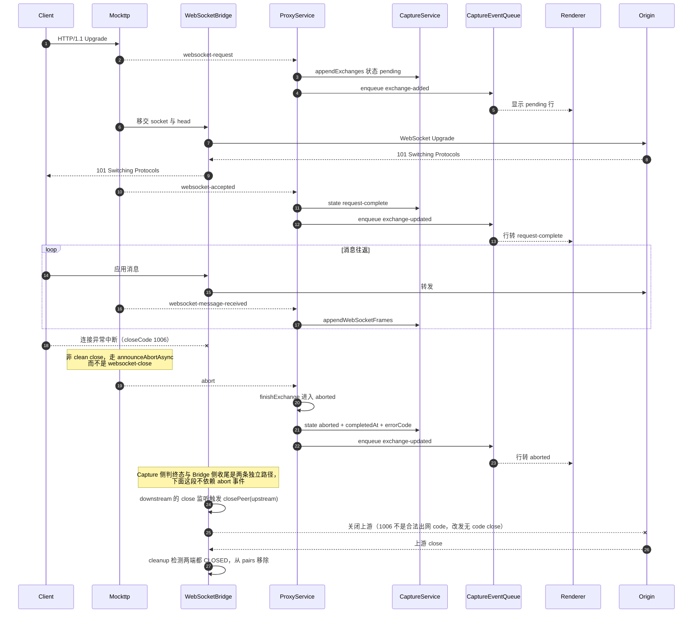

**Bridge 的收尾与 abort 事件互不依赖。** `abort` 只驱动 Capture 判终态；连接回收由 `connectPair`
注册的监听器完成：任一端 `close` → `closePeer` 把关闭传播给对端 → 两端都 `CLOSED` 时 `cleanup`
把 pair 从 `pairs` 移除。`ws` 的 `close()` 会发关闭帧并挂一个 30s `closeTimer`，对端不回应也会
`socket.destroy()` 兜底，因此不会无限挂起。

**WebSocket 复用同一模型**：`beginWebSocketRequest` 内部就是 `beginRequest`，条目同样落在 `entries` 里，因此 `abortExchange` 能正常命中。正常关闭（clean close）走的是 `websocket-close` → `closeWebSocket` → `completed`，不在本节范围内。

#### 5.5.6 资源回收对照

WebSocket 路径上 Bridge 实际持有的对象只有三类，逐场景的回收责任如下（HTTP 路径见本表末尾）。

| 对象 | 谁创建 | 回收方式 |
| --- | --- | --- |
| `upstream: WebSocket`（到源站） | Bridge `new WebSocket(url)` | 见下表逐场景 |
| `downstream: WebSocket`（到客户端） | `ws` 的 `handleUpgrade`，包装 Mockttp 移交的 socket | 与 upstream 成对，随 pair 一同回收 |
| `pairs: Set<WebSocketPair>` | Bridge | `cleanup` / `failPair` / `close()` 移除 |

| 场景 | upstream 回收 | downstream / socket 回收 | pairs |
| --- | --- | --- | --- |
| 上游升级失败（5.5.4） | `waitForOpen` catch 中 `terminate()` | Mockttp `sendWebSocketErrorResponse` 写 500 后 `socket.destroy(error)` | 从未加入 |
| 升级期间客户端断开（5.5.3） | 预检查或 `socket.once('close')` 守卫 `terminate()` | `ws` 的 `completeUpgrade` 已 `socket.destroy()` | 从未加入 |
| 已建立后任一端关闭（5.5.5 与正常关闭） | `closePeer` 传播关闭，30s `closeTimer` 兜底 `socket.destroy()` | 同左，对称处理 | `cleanup` 在两端 `CLOSED` 后移除 |
| 消息转发或连接报错 | `failPair` 直接 `terminate()` | `failPair` 直接 `terminate()` | `failPair` 立即移除 |
| Proxy 停止 / TLS 重配 | `bridge.close()` 遍历 `pairs` 全部 `terminate()` | 同左 | `pairs.clear()` |

`terminate()` 在 `ws` 内部就是 `this._socket.destroy()`，因此上表的每条路径最终都会销毁底层 TCP/TLS
socket，不存在只丢引用不关连接的情况。`connectPair` 注册的监听器都挂在这两个 WebSocket 对象上，
pair 移除后对象即可回收，监听器随之释放。

**HTTP 路径没有需要 Bridge 收尾的连接对象**：客户端与上游 socket 全部由 Mockttp 拥有和销毁，
Capture 只订阅事件。Capture 自己持有的可释放资源仅有 `BodyWriter`（可能已 spill 到临时文件），
其回收点是 `completeExchange` / `finishExchange` 的 finalize，以及 `tracker.reset()` 对在途条目的
`abort()`——正是 5.4 那条已修复缺陷所覆盖的范围。

**[已修复] WebSocket 上游升级失败的终态**：Bridge 的 `handle()` 在
`waitForOpen(upstream)` 失败时直接抛出，Mockttp 的 `handleWebSocket` catch 到非 `AbortError`
后调 `sendWebSocketErrorResponse()`，向客户端 socket 写入 `HTTP/1.1 500`。这段字节被
`trackWebSocketEvents` 的 `_write` 钩子收进 `data`，于是 socket close 时走的是
`data.length` 非空分支，即 `announceResponseAsync`——**这条路径唯一可用的终态信号是 completed `response`**。

而 Capture 为避免全量正文缓冲（见 3.2）**刻意退订了 `response`**，`announceResponseAsync` 首行的
`listenerCount('response') === 0` 判断因此直接 return，事件根本不发出。结果是这条 Exchange 拿不到
任何终态信号，会一直停在 `pending`。现已改为 Bridge 在抛出前经 `onUpgradeFailed` 回调
`tracker.failWebSocketUpgrade()` 显式判终态（`aborted` + 真实 `errorCode`），不再依赖
`response` 事件。回归用例：*marks the exchange aborted when the upstream websocket upgrade fails*。

**[已知限制] 未解密隧道没有中断语义**：`completeTunnel` 固定写 `state: 'completed'`。这不是实现疏漏，
而是上游事件契约所限：`TlsPassthroughEvent` 只带 destination / remoteIpAddress / timingEvents /
`tlsMetadata`，**没有任何关闭原因字段**（带 `failureCause` 的是另一个事件
`TlsHandshakeFailure`，只覆盖握手失败）。因此隧道记录无法区分正常关闭与连接重置，永远不会出现 `aborted`。


### 5.6 已登录 HTTPS 页面透明刷新

HTTPS MITM 只改变传输链路，不得改变客户端与 Origin 之间的身份语义。客户端发送的
身份 Cookie 必须完整到达 Origin，Origin 返回的 `Set-Cookie` 必须到达客户端。Capture
只能观察这条链路，不能改变登录语义。

Bilibili 登录回归以真实 Edge 当前 profile 和完整页面为验收对象，不注入 Cookie、不修改
浏览器 profile，也不调用站点内部 API 代替页面：

1. 接管系统代理前，从当前已登录页面读取右上角身份入口的 UI Automation 控件结构作为
    测试自产基线；判据只使用控件类型、层级、可见性与几何关系，不依赖中英文文案、CSS
    class 或站点私有接口路径。
2. 通过 Interceptor UI 完成 Generate、Install、开启 MITM 与 Recording；leaf 必须由本次
    UI 生成的 root CA 签发。
3. 通过 Edge 公开的刷新按钮 AutomationId 连续刷新三次。每轮先证明本轮出现新的 Bilibili
    主文档解密 Exchange，再要求身份入口恢复到基线结构；旧 DOM、CONNECT tunnel 和单独
    API 请求都不能替代完整页面刷新。
4. 每轮只保存 host / protocol 汇总、主文档 status、Cookie 名称及页头截图；失败后正常关闭
    Interceptor，由产品退出路径恢复系统代理、8888、CA 与 MITM 副作用。

该 flow 的用户可见契约是三轮刷新后仍保持登录。具体登录接口属于站点实现细节，只用于
失败取证，不作为 Green 条件。

2026-08-19 使用真实 Edge Default profile 连续运行六次独立 workflow，共完成 18 次原生
刷新：每轮 `www.bilibili.com/` 主文档均以 H2 / 200 经 8888 解密，均携带 `DedeUserID`、
`SESSDATA` 与 `bili_jct`，且右上角身份入口保持。当前实现未复现通用 Cookie 转发缺陷，
因此没有修改 Proxy Core 转发行为；该 workflow 作为外部站点回归保护保留。

## 6. 正文存储

### 6.1 增量写入 [已实现]

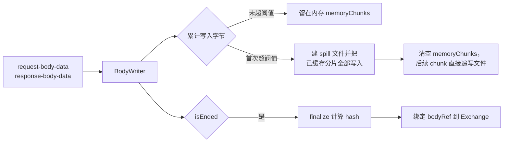

**spill 是全量迁移，不是只写超出部分。** `consume()` 在首次发现
`writtenBytes > memoryThresholdBytes`（即 `BODY_MEMORY_THRESHOLD_BYTES`，3 MiB）时才创建 spill 文件，紧接着把 **已经放在
`memoryChunks` 里的全部分片按顺序写进文件**，然后 `memoryChunks.length = 0` 清空内存，
当前 chunk 也直接追写文件。此后 `output` 非空，所有 chunk 一律走文件。

因此一份正文要么**完全在内存**、要么**完全在文件**，不存在一半内存一半文件的拆分状态。
`finalize()` 里的 `const memory = this.spillPath ? null : Buffer.concat(...)` 也体现了这一点：
一旦 spill 过，内存侧就是 `null`。

**内容寻址的必然约束**：`BodyStore` 按内容 hash 去重，因此 **hash 只有写完才能确定**。传输过程中 Exchange 只能记录 observed bytes，`requestBodyId` / `responseBodyId` 必须在 `isEnded` 后绑定。

UI 表现为：大小实时增长，但预览与保存要等传输完成。

### 6.2 阈值语义 [已实现]

两个阈值都定义在 `proxy-core/constants.ts`，作用于**单个正文**（非全局）：

| 常量 | 值 | 含义 |
| --- | --- | --- |
| `BODY_MEMORY_THRESHOLD_BYTES` | `3 * 1024 * 1024` = **3 MiB** | 累计写入超过它就建 spill 文件，并把已缓存内容全量迁移进去 |
| `BODY_WRITER_PENDING_LIMIT_BYTES` | `128 * 1024 * 1024` = **128 MiB** | 待落盘积压的**病态兜底**，正常流量不会触及 |

两者职责不同：**3 MiB 决定“存在哪里”**（内存还是文件），**128 MiB 决定“什么时候放弃”**
（只在磁盘持续远慢于接收速度时才触发）。写入是异步串行的，因此即使已经 spill，排队中的
chunk 仍占内存，128 MiB 上限正是给这段队列封顶。

**设计意图是完整保留正文。** 128 MiB 取值远高于真实流量的积压水位，包括大文件下载在内的
常规场景都不会丢弃内容；它只在磁盘异常或极端本地源站这类病态情况下生效，避免 Core 因内存
无界增长而被重启。

**两个阀值都是“每条正文”而非全局上限**，因此峰值内存会乘上并发数。

判断依据也变了：

| | 改造前 | 现在 |
| --- | --- | --- |
| 判断依据 | 完整 buffer 的总大小 | 累计写入字节 `writtenBytes` |
| spill 时机 | 拿到完整 buffer 后 | 累计跨过阈值立即 |

差别关键：增量场景下每个 chunk 都小于阈值，只有累计后才跨过。若仍按完整大小判断，
67 MB 视频会先在内存里攒满再 spill，改造就失去意义。

### 6.3 背压

`write()` 由 Mockttp 的 `body-data` 回调同步调用，而 Mockttp **不等待**消费者（见 3.6，body-data 是
旁路复制流）。因此 `write()` 必须立刻返回，不能 `await` 磁盘——每个 chunk 只能先复制进内存、挂到串行
Promise 链上排队，真正落盘在后台进行。`pendingBytes` 就是「已收下但尚未落盘」的字节数。

**上限约束的是这段积压，而不是正文大小。** 若不设限，当到达速度持续快于磁盘写入速度时队列只进不出，
排队的 Buffer 全部驻留 RAM，Core 内存会无界增长。反过来，60 MB 正文只要任一时刻积压不超过上限就毫无
问题——它限制的是瞬时落差，不是总量。

无法做真正的背压：Mockttp 的 `emitBodyDataEvents` **忽略回调返回值**，且在 `'data'` 事件里无条件
累积 `pendingContent`，无任何接口可以告知“慢一点”；旁路流也不影响转发管线，唯一能减速的方式是
拖慢真实流量。Interceptor 是透明调试代理，**不能因为记录器跟不上就拖慢用户的流量**，
因此只能给队列封顶。

1. [已实现] 每个 body writer 维护有界待写队列，上限为 `BODY_WRITER_PENDING_LIMIT_BYTES`（128 MiB）。
   该上限是**病态兜底**，不是常规限制：正常流量（含大文件下载）下磁盘远快于网络，积压接近于零，
   正文完整保留。它是**每个 writer** 的，一条 Exchange 有请求/响应两个 writer。
2. [已实现] 只有磁盘持续远慢于接收速度（磁盘异常、极端本地源站）才会超限并降级：停止保存内容，
   仅累计 observed bytes（因此 UI 上的大小仍然准确），`finalize()` 返回 `null` 不绑定 bodyRef。
   降级是 **整条丢弃而非截断**：`discardCollected()` 会清空内存分片并删除已写的 spill 文件。
   原因是 Body Store 按内容 hash 寻址，截断的正文会算出与真实内容对不上的 hash，
   让用户看到一份与实际传输不符的「正文」，比没有更危险。
3. [待做] 降级状态必须在 UI 明示，不得让用户误以为正文为空。
4. [待做] **两个阈值改为 Settings 可配置并持久化**。当前 `BODY_MEMORY_THRESHOLD_BYTES`（3 MiB）与
   `BODY_WRITER_PENDING_LIMIT_BYTES`（128 MiB）是编译期常量，只能靠改代码重新发版调整。
   极端场景（超大响应必须完整保留、或低内存机器需要收紧）应由用户自行权衡：
   - 暴露为「正文内存阈值」与「单条正文最大积压」两项设置，改动后对**新建**的 writer 生效，
     不影响在途正文，避免中途改变阈值导致已收集内容语义不一致。
   - 需要 Renderer → Main → Core 的窄意图传递（形如现有 `tls.useCertificate`），并在 Core 侧做范围校验。
   - **一并处理 10.2 的预览侧阈值**（`BODY_PREVIEW_MAX_BYTES` / `IMAGE_PREVIEW_MAX_BYTES` /
     `FORMAT_AUTO_MAX_BYTES` / `FORMAT_MAX_BYTES`）：给 `BodyReadRangeCommand` 加 `maxOutput`，
     由调用方传上限，Core 不再 import「预览上限」这种纯 UI 概念。
   - **入口引导**：在 Inspector 的 BodyView（预览区）加一个问号按钮，用 Tooltip 说明当前的预览上限
     与正文保留阈值，并引导用户到 Settings 修改。做法可参照 Rules 编辑器顶部已有的
     `HelpCircle` + antd `Tooltip`（多行文本）模式。预览被截断或正文因降级丢弃时尤其需要它，
     否则用户无法区分「正文本来就空」与「被阈值卡掉」（与上面第 3 项合并实现）。
   - UI 上需说明代价：调大积压上限会抬高 Core 峰值内存（该值是**每个 writer** 的，会乘以并发数）。

   与之同类的还有 Proxy Core 心跳/启动超时的可配置化，两者可以合并为一组「高级/性能」设置。

磁盘写入失败只跳过该正文，绝不影响转发、RPC 或进程状态。

#### 待写上限验证

- 2026-09-15在既有`capture/tests/integration/body-writer.test.ts`补充四writer并发受阻的`finalize/abort`两种结束方式。沿用fixture的1 MiB内存阈值、8 MiB待写上限，受控挂起`fs.open`，后续仍使用真实临时文件；生产3 MiB/128 MiB常量未修改。
- 每条队列恰好接受8 MiB时不降级，四条输入分片共复制32 MiB；再各送32 MiB后只累计到40 MiB observed，不再复制输入。另一条2 MiB spill仍能独立提交、核对hash并完整读取，证明一个writer阻塞不串行阻塞所有正文。
- `finalize/abort`在spill gate释放前均不结束；释放后降级正文不可读、没有已提交正文或半成品文件，仅保留独立成功正文。新增2/2及相邻BodyWriter/BodyStore 20/20、Core typecheck通过，TEMP前缀`interceptor-capture-writer-pressure-20260915-`保存`baseline/regression/regression-final/types/types-final.log`。最终完整正文比较使用`Buffer.equals()`，同组20/20用时497ms，未缩减字节断言。现有产品行为未变，因此记录Green基线，不制造Red。
- 这是缩小阈值后的队列边界、spill打开受阻与清理时序证据，不是生产128 MiB并发规模、全Core RSS峰值、磁盘耗尽、event ACK阻塞或10万行验收；总内存、磁盘、session容量策略仍待设计。

### 6.4 正文按线上编码保存，解码元数据随 bodyRef [已实现]

`body-data` 事件给出的是**线上原始字节**：`gzip` / `br` / `deflate` 压缩的响应体在这里就是压缩流。
Capture 原样落 Body Store，**不在数据面解压**——解压需要完整输入，会毁掉流式，也会让内容寻址
hash 与真实传输内容对不上。

代价是渲染端必须知道怎么还原，因此 `BodyRefInput` 必须同时携带两项元数据，请求侧与响应侧对称：

| 字段 | 来源 | 用途 |
| --- | --- | --- |
| `contentEncoding` | 该方向 headers 的 `content-encoding` | `body.read-range{decode:true}` 时选择解码链 |
| `mediaType` | 该方向 headers 的 `content-type` | Inspector 判定文本/二进制，决定 Auto 走文本还是 Hex |

`ExchangeTracker` 在 `beginRequest` / `beginResponse` 的头部阶段就把两个值读进 `TrackedExchange`，
再在三个收尾点（`finalizeRequestBody`、`completeExchange`、`finishExchange`）绑定到 bodyRef 上。
必须在头部阶段取：正文结束时 Mockttp 的 headers 对象已不在手边。

**漏掉 `contentEncoding` 的后果是静默的**：正文字节完好、逐字节可还原，但 Renderer 不会请求解码，
于是把压缩流当 UTF-8 渲染成乱码，HAR 导出也会把压缩字节写成 `text`。回归用例按 H1 / H2 / HTTPS MITM
三条链路各自断言 origin 收到的请求正文、客户端收到的响应正文、以及落库正文三者逐字节一致，
并校验 bodyRef 上的 `mediaType` + `contentEncoding` 能把正文还原成明文。

WebSocket 不走这条路径：bridge 两端都关掉 `permessage-deflate` 并剥掉 `sec-websocket-extensions`，
帧 payload 永远是未压缩字节，只按 opcode 记 `text/plain; charset=utf-8` 或 `application/octet-stream`。

## 7. Recording、Pause 与 Clear

### 7.1 三种状态

| 操作 | 命令 | 效果 |
| --- | --- | --- |
| Start | `proxy.start` | 启动 listener（若未启动），`recording = true` |
| Stop | `proxy.setRecording{false}` | **只暂停记录**。listener 与系统代理保持运行，流量继续转发 |
| Clear | `capture.cleanup{all}` | 没有在途Capture文件任务时推进generation、Exchange与正文归零，保留活动Session壳；否则返回conflict（见7.2） |

Stop 不停止转发，也不恢复系统代理。系统代理只在应用退出、Core 故障恢复、用户显式 Restore 或紧急修复时恢复。

### 7.2 Capture generation [已实现]

Core先检查Body导出及HAR/Archive导入导出是否仍持有Capture数据，包含取消后的清理阶段；存在时返回`conflict`、`retryable: true`，不执行下方reset流程。Clear执行期间也禁止新Capture文件任务和重复Clear，结束或失败后释放，Diagnostics导出不受影响。UI遮罩、MCP及Agent入口遵守同一Core检查，详见[文件任务互斥](transfer.md#clear与文件任务)。

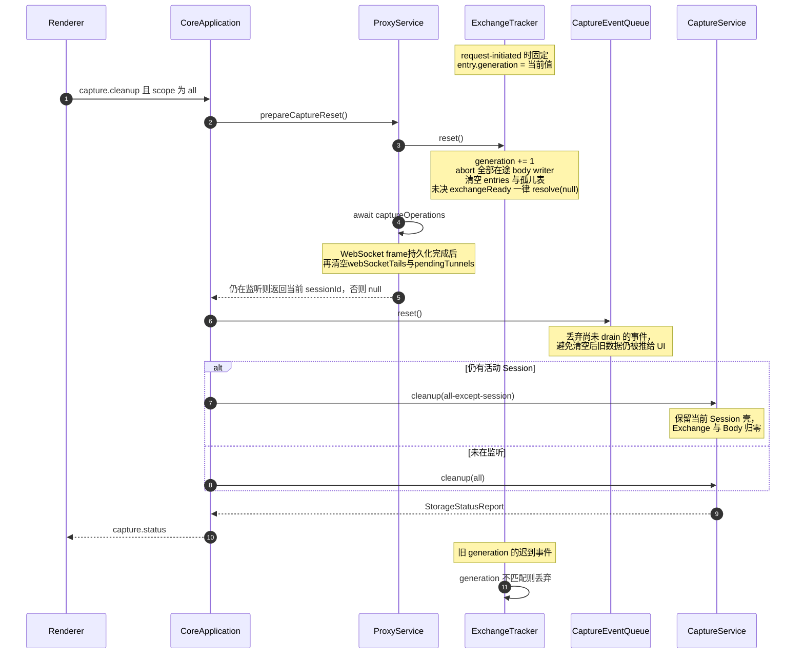

**Clear 由 CoreApplication 编排，不是 ProxyService 自己完成。** 三步顺序不可换：先
`prepareCaptureReset()`先建立切面（推进generation，让在途Tracker事件立即失效），再等待统一登记的
`captureOperations`完成。WebSocket frame写入与HTTP/tunnel写入使用同一排空边界，不得在Storage cleanup后
继续写入旧exchange/body。随后`captureEventQueue.reset()`丢弃已入队但未推送的事件，最后才真正执行
`capture.cleanup`；三步顺序不可换。

**活动 Session 会被保留。** `prepareCaptureReset()` 在代理仍在监听时返回当前 `sessionId`，
scope 随之收窄为 `all-except-session`——Exchange 与 Body 全部归零，但 Session 壳保留，
录制得以无缝继续。只有未在监听时才是真正的 `cleanup(all)`。

**判定规则：以请求开始时的状态为准。**

- 录制中开始、暂停后完成的长请求：继续完整记录。
- 暂停期间开始、恢复后完成的请求：始终不记录。
- 暂停期间建立的WebSocket没有Capture exchange；`whenExchangeReady`立即返回`null`，不得创建会阻塞
    Clear或Core退出的无主waiter。
- Clear 后旧 generation 的所有 request/body/response/trailer/rule hit 全部拒绝，不得重新创建行。

### 7.3 Pause/Resume验证证据

- 2026-09-09本地HTTP上传、下载和SSE跨Pause/Resume的六个新增集成用例通过，流量完整转发且录制决定以开始时状态为准。
- 修复前WebSocket在Resume后通过`exchangeIdFor()`预留不存在的Exchange ID，先写BodyStore再被真实ExchangeStore拒绝，留下孤立正文。干净集成Red为8通过/1失败，owner Red为10通过/1失败；真实UI Red的Exchange/Body引用数未变，正文占用151增加到191字节。
- 修复后消息只通过`whenExchangeReady()`关联握手时已录制的Exchange，未录制连接立即返回null；暂停期间建立的连接始终不记录，Resume后的新连接正常记录，Pause前已记录连接继续保存双向消息。HTTP Rule钩子提前预留ID保持原行为。
- Proxy模块12文件122/122、Core/Desktop typecheck通过；真实`capture.recording.pause-resume`1/1（19.1s）和既有`breakpoints.queue-isolation`1/1（19.0s）Green。Storage恢复前后均2 Exchange、5正文引用、151字节。Storage只补现有控件/计数的公开automation属性，无外观或业务变化。
- 两轮Main/Core `45884/37752`、`20252/28136`正常退出，host guard在workflow结束时确认全部登记进程、8888、WinINet/journal恢复。录制流程Main日志仍有非目标`rules:get internal`和退出阶段`breakpoint:list`拒绝，不声明日志零错误。gRPC streaming边界和压力场景未扩展。
- TEMP三层Red归档`interceptor-websocket-recording-valid-red-20260909-234524.zip`，SHA256 `08093659DECF1D4A20519161FD897DED4BF0DBF04B642964C74BE520797D824B`；包含owner、真实socket、真实UI失败、源码hash与trace，Red Main/Core `31924/42384`正常退出。
- TEMP Green归档`interceptor-recording-boundary-green-20260909-235505.zip`，SHA256 `937C238B078DB278DE6A637D28CBD8CD528F2BDEDD8ECD3BAC9FF8B5153B85C4`；相邻队列回归归档`interceptor-recording-queue-green-20260909-235735.zip`，SHA256 `2C25226D68A26E914E200A77371124D6FC95DA80FD2426782A96B5E34E85E131`。

## 8. 客户端应用归属 [已实现·仅 Windows]

Capture 在创建 Exchange 时同时记录**发起这条请求的本机应用**，用于列表图标与 Inspector 展示。

### 8.1 解析链路

| 环节 | 数据源 | 说明 |
| --- | --- | --- |
| 连接 → PID | `GetExtendedTcpTable` | `request-initiated` 给出客户端源端口，在系统 TCP 表里查 owning PID |
| PID → 可执行文件 | `QueryFullProcessImageName` | — |
| 进程 → 应用 | 见 8.2 | 容器进程需沿进程树上溯 |
| 应用 → 图标 | `IShellItemImageFactory` | 与资源管理器同源。**不能**用 `SHGetFileInfo` / `app.getFileIcon`：MSIX/UWP 应用的 exe 只是 stub，图标在包的 Assets 里，后者只能拿到通用图标 |

全部经 `client-app-helper`（Windows C# 单文件，`apps/desktop/src/main/client-app/`）完成，Main 在 fork Core 时以 `--client-app-helper` 注入路径。其他平台 `ClientAppService.supported` 为 false，列表不显示图标。只有 loopback 客户端才反查；远程设备（手机经代理）不存在本地进程。

helper 四个子命令：`<proxyPort>` 输出 TSV `sourcePort/PID/displayName/identity`（捕获路径用），`--icon <path>` 输出 base64 PNG，`--resolve <pid>` 与 `--apps` 是排查用途。Main 自己取图标时复用同一个 exe。

一条请求从到达到图标上屏的完整链路：

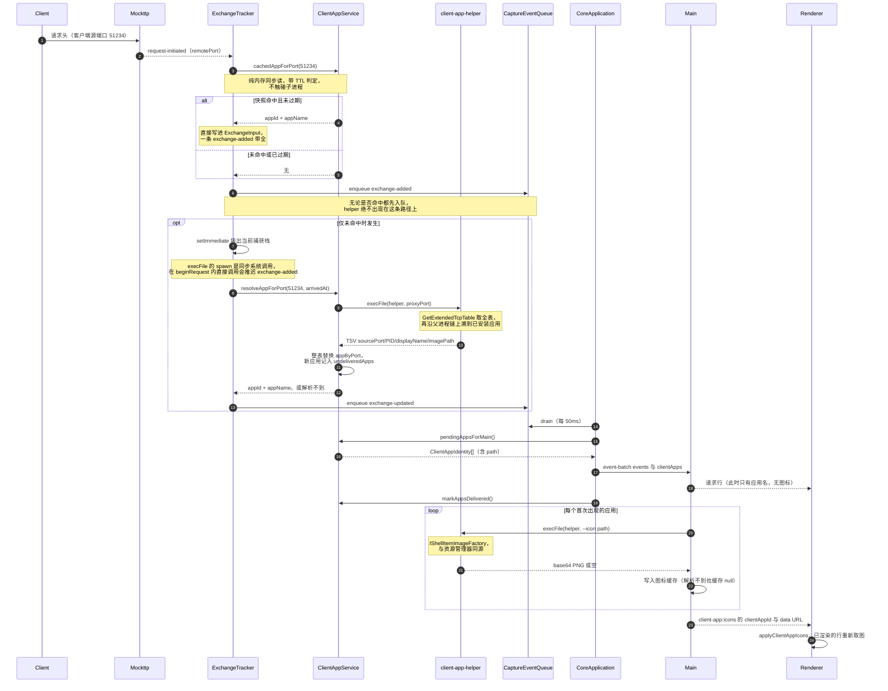

### 8.2 容器进程归属

WebView2 宿主、微信小程序容器这类进程自己不是用户心目中的应用，因此沿进程树一路向上追溯，**一旦命中系统已安装应用就停**。不设层数上限：层数拦不住认错，反而会把真正的长链归属（实测 `Microsoft.CodeAnalysis.LanguageServer.exe → Visual Studio Code`）截断。

“已安装应用”是一张**安装目录 → 系统登记名**的索引，四个来源合起来正好覆盖“设置 → 应用 → 安装的应用”（实测该机 56 项 = 卸载表 19 + MSIX 包 37）：

| 来源 | 取值 | 补的是什么 |
| --- | --- | --- |
| MSIX/UWP 包登记表 | `PackageRootFolder` + `DisplayName` | 全部打包应用（Teams、Outlook、Windows App、Widgets、SearchHost） |
| 卸载登记表 | `SystemComponent != 1` 条目的 `InstallLocation` / `DisplayIcon` | 传统桌面应用 |
| `App Paths` | 主程序所在目录 | 卸载表没写 `InstallLocation` 的 |
| 开始菜单快捷方式 | `.lnk` 目标所在目录 + 快捷方式名 | MSI 安装（OneDrive、Logitech G HUB 等） |

`SystemComponent = 1` 是 Windows 标记运行时组件的官方标志（WebView2 Runtime 即属此列），因此它不会成为归属终点。

**MSIX 来源迁移候选 [研究完成，未实现]。** 当前 `CollectPackagedApps()` 直接读取 AppModel
Package Repository 注册表；可改用官方 `PackageManager.FindPackagesForUser("")`，获得当前用户注册包
的 identity、安装路径、版本与状态，并正确覆盖非默认 PackageVolume。收益是摆脱内部注册表结构、
强类型语义更稳定；代价是不会返回只为其他用户注册或仅 staged/provisioned 的包。

对“当前用户发起的网络连接”，当前用户范围通常正是正确语义；但 SYSTEM/其他用户真正运行的
packaged process 仍需单独处理。全用户 `FindPackages()` 要管理员权限，不应放入抓包热路径。因此实施前
必须比较当前 registry 索引、`FindPackagesForUser` 与实际运行 PID 三组结果，不做盲目一换一。详见
[研究备忘](../backlog/research.md) § 3.3。

AppContainer exemption UI 不使用这张索引；它由 `NetworkIsolationEnumAppContainers` 直接提供候选
AppContainer、SID、package、display name 与 binaries。把 exemption 枚举与 Capture 运行时归属分成
两个模块，避免为了授权一个 SID 引入整套启发式应用识别。

五个边界条件：

- **一律按可执行文件路径判定，绝不按 AUMID**。MSIX 宿主派生的 `msedgewebview2.exe` **会继承宿主的包身份**，`GetApplicationUserModelId` 对它同样成功；按 AUMID 判会让上溯在 WebView2 进程处停住，Teams / Outlook / Windows App / Widgets 的流量在 UI 里会一律显示成 `Microsoft Edge WebView2`。
- **父进程必须经创建时间校验**。`ParentProcessId` 是创建时的快照，父进程退出后 PID 会被系统复用，“父进程”可能指向毫不相干的新进程，甚至沿复用形成的环兑圈子。因此父进程的创建时间晚于子进程就停——这才是防环与防认错的真正手段，比层数上限精确。
- **索引未命中不等于起始进程就是应用**。MSI 安装常常不登记安装目录（实测 GlobalProtect 的 `InstallLocation`、`DisplayIcon` 全空，开始菜单快捷方式还指向 `C:\Windows\Installer\{GUID}\` 的广告 stub），因此一路没命中时停在**最后一个可信祖先**上。
- **不比较发布者**。宿主应用经常使用别家的运行时（实测中 GlobalProtect 用微软的 WebView2），按发布者限制会直接误伤。
- **系统目录下只有打包应用才算应用**。否则 `App Paths` 与开始菜单里大量指向 `System32` 的条目会把整个系统目录变成应用目录，`svchost.exe` 会立刻命中；反过来，`C:\Windows\SystemApps` 下的 MSIX 包（SearchHost）仍能正确归属。

实测（`--resolve`，另有 `--apps` 可导出整张索引）：全系统进程逐个跑一遍，无死循环、无超时（均 ~55 ms）。`msedgewebview2 → Microsoft Teams / Outlook for Windows / Microsoft OneNote / Windows App / Windows Web Experience Pack / Windows 功能体验包 / GlobalProtect client`、`WeChatAppEx → 微信`、`Microsoft.CodeAnalysis.LanguageServer → Visual Studio Code`、`msedge` / `Code` 保持自身、`explorer` / `svchost` 不被误认成应用。

### 8.3 显示名的分层选取

同一个进程有好几个"名字"，它们描述的**不是同一层东西**：

| 来源 | 描述的是 | 粒度 | 例子 |
| --- | --- | --- | --- |
| 主程序登记名（开始菜单快捷方式名、卸载表 `DisplayIcon` 指向的主程序） | 用户会去点的那个入口 | per-入口 | `WINWORD.EXE → Word`、`Weixin.exe → 微信` |
| 目录登记名（MSIX 包 `DisplayName`、卸载表 `InstallLocation` 的 `DisplayName`） | 一个打包应用 / 一次安装 | per-包、per-安装包 | `Microsoft Teams`、`Microsoft 365 Apps for enterprise - en-us` |
| exe 版本资源 `FileDescription` | 这个可执行文件是什么 | per-exe | `OneDrive.Sync.Service.exe → Microsoft OneDrive Sync Service` |

按优先级依次尝试：**主程序登记名 → 目录登记名 → `FileDescription` → 不含扩展名的文件名**。

登记名优先于 `FileDescription`，因为这一列的语义是"哪个应用发出的请求"，而 `FileDescription` 描述的是进程/组件（`Microsoft OneDrive Sync Service`、`G HUB`、`LGHUB Agent`），不是用户心目中的应用。主程序又必须优先于目录：套件类安装（Office）在卸载表里只有一个条目，只按目录会把 Word、OneNote 一律叫成 `Microsoft 365 Apps for enterprise`。

**不按 `ProductName` 校验目录登记名**。曾试过"目录登记名要与 exe 的 `ProductName` 同源才采信"，实测 7 个受影响的进程里只修好 `node.exe`（它落在版本管理器 nvm 的登记目录 `C:\nvm4w\nodejs\` 下，会显示成 `NVM for Windows 1.2.2`），却误伤了 `OpenConsole.exe`（VS Code 自带的 conpty 终端宿主，归给 VS Code 本来就对）与 `lghub_agent.exe`（本就属于 Logitech G HUB）——为修一个错两个，不划算。

实测 51 个进程的命中分布：主程序登记名 7、目录登记名 23、`FileDescription` 21。已知唯一偏差：`node.exe` 展示为 `NVM for Windows 1.2.2`。

**代表标识决定 `appId` 与图标。** 归属结果的 `path` 会被换成应用的代表标识——卸载表 `DisplayIcon` 指向的主程序，或包只有一个应用时的 `shell:AppsFolder\<AUMID>`——让名称、图标、`appId` 三者同源。否则 OneDrive 的 `FileCoAuth.exe`、Outlook 的 `olkexthost.exe` 这类没有图标资源的后台组件会拿到通用图标，并在 UI 里裂成独立条目。代表标识只取自权威来源：App Paths 与快捷方式只代表单个入口，拿它们代表整个目录会把 OneNote 显示成 Excel。

**系统权限进程的兜底**。helper 以普通用户权限运行，对 SYSTEM 下的服务进程 `OpenProcess` 会被拒绝（实测 89 个 `svchost.exe` 里 80 个打不开），而 NCSI 探测、Windows Update 这类流量正是它们发的。句柄打不开时退到 `CreateToolhelp32Snapshot` 的 `ExeFile`（只有文件名，不需句柄）：能给出 `svchost` 这个名字，但没有路径就取不到图标。Core 仍然登记这类条目（以显示名代替路径算 `appId`），不再丢弃。

### 8.4 不阻塞捕获管线 [已实现]

`resolveAppForPort` 会拉起 helper 子进程，而 `execFile` 的 spawn 是**同步系统调用**。因此 `beginRequest` 只做纯内存的快照命中：

- 命中 → 同步写入 entry，`exchange-added` 一次带全，不产生额外事件
- 未命中 → `setImmediate` 排出当前栈后再解析，结果以 `exchange-updated` 补齐

这保证 helper 慢、挂起或失败都不会延后 `exchange-added` 与转发。解析失败只记 `client-app.lookup-failed` 诊断；孤儿 Promise 带 `catch`，Node 默认 `unhandled-rejections=throw` 会终止 Core 进程并中断抓包。

**异步窗口要显式表达，否则 Application 分栏会闪。** 反查在飞行中时 `appId` 为空，若直接按「无归属」处理，分栏里会先冒出一个 Unknown 再消失。因此排队反查的 entry 带 `appPending: true`（只在为真时进摘要），Renderer 的 `facetValuesOf` 对这些行返回空数组、不计入任何取值。**成功、查不到、helper 异常三种终态都必须清除该位**：查不到与异常没有字段变化，仍要补推一次 `exchange-updated`，否则该行会永久停在解析中、从此不出现在分栏里。

### 8.5 快照与缓存

`ClientAppService` 持有两张表：

| 字段 | 内容 | 生命周期 |
| --- | --- | --- |
| `appByPort` | 源端口 → 应用 | 每次 helper 调用整表替换，`CLIENT_APP_SNAPSHOT_TTL_MS`（15s）后作废 |
| `undeliveredApps` | 尚未交给 Main 的应用身份 | 随 event-batch 下发成功后清除 |

TTL 防的是端口复用错认：连接关闭后源端口会被系统重新分配给其它进程，过期快照会把请求归给错误的应用。

并发解析共享同一次 helper 调用；解析时每一轮都先 `await` 快照再判断，**绝不在快照飞行中直接放弃**（请求到达时 TCP 连接必然已建立，只需一张采样时刻不早于此刻的快照）。helper 失败后在同一窗口内退避，避免反复拉起子进程。

### 8.6 身份与图标的传递边界

- Core 只把 `appId`（应用标识 sha256 前 16 位）与 `appName` 放进 `CaptureExchangeSummary`
- 完整身份（含 `path`）随 `event-batch` 的 `clientApps` 字段一次性交给 Main，**每个应用一次**；Main 无需再按 id 回问 Core
- Main 读取图标后经 `client-app:icons` 主动推给 Renderer，Renderer 从不发起索取
- Renderer 全程只见 `appId` 与 PNG data URL，拿不到可执行文件路径

图标按应用而非按请求去重，因此不会随每条 Exchange 重复传输（一张 data URL 2–4 KB，`appId` 只有 16 字符）。Renderer 侧 `clientAppIcons` 是响应式 map，且靠“有无该键”天然区分出图标三态，不需额外状态字段：

| `clientAppIcons.get(appId)` | 含义 | 展示 |
| --- | --- | --- |
| `string` | 已取到 | 真实图标 |
| `undefined` | 还在路上（图标总是晚于 Exchange 到达） | 占位方块 |
| `null` | 取不到（系统权限进程没有路径，或 shell 返回失败） | 未知应用图标 |

批次发送失败时身份留在 `undeliveredApps` 里下一轮继续带上；Renderer 重新加载会丢失已推送的图标，Main 在 `did-finish-load` 时补发一次已知集合。

## 9. 数据契约

### 9.1 Core 内部接口

`CaptureService`（`capture/entry.ts`）向 Proxy 暴露的写入面 [已实现]：

```ts
class CaptureService {
  ensureSession(session: CaptureSessionInput): Promise<void>;
  appendExchanges(exchanges: ExchangeInput[]): Promise<{ id: string; seq: number }[]>;
  updateExchange(patch: ExchangePatch): Promise<void>;
  writeBody(source: AsyncIterable<Uint8Array>): Promise<BlobWriteResult>;
  createBodyWriter(): BodyWriter;
  appendRuleHits(exchangeId: string, hits: readonly RuleHitRecord[]): Promise<void>;
  appendWebSocketFrames(exchangeId: string, frames: readonly WebSocketFrameInput[]): Promise<void>;
}
```

`ProxyService` 与 `ExchangeTracker` 直接持有这个具体类，不再经由窄化接口；测试替身
`extends CaptureService` 并只 `override` 被断言的方法。

`ExchangePatch` 除 `id` 外全部可选，未提供的字段保持原值，覆盖：

- 请求侧：`requestBytes`、`requestBodyId`、`requestMime`、`requestSentAt`、`requestBody`
- 响应侧：`statusCode`、`statusText`、`responseMime`、`responseStartedAt`、`responseBytes`、`responseBodyId`、`responseBody`
- 通用：`headers`（追加）、`ruleIds`（去重合并）、`errorCode`、`state`、`completedAt`

`writeBody` 是 pull 式、可背压，用于 WebSocket 单条消息；`createBodyWriter` 是 push 式、
不可阻塞，用于 HTTP 正文的 body-data 事件。两者语义不同，不能互相替代。

### 9.2 事件契约

```ts
interface CaptureEventSink {
  enqueue(kind: CaptureExchangeEventKind, summary: CaptureExchangeSummary): void;
}
```

`CaptureExchangeSummary` 需支持 pending 表达：`statusCode` 与 `durationMs` 可缺省，Renderer 据此渲染进行中状态。`appId` / `appName` 同样可缺省（非 Windows、远程客户端、反查失败）；反查排队期间额外带 `appPending: true`（见 8.4）。

事件批次 `CoreEventBatch` 除 `events` 外带可选 `clientApps: ClientAppIdentity[]`，只携带本批新出现的应用身份（见 8.5）。

队列合并行为：同 id 事件就地合并，**保留首次 sequence、摘要取最新、kind 不更新**。因此 `exchange-added` 尚未 drain 时到来的 `exchange-updated` 会被正确压成一条 added。

推送节奏与背压：`CoreApplication` 用 `EVENT_FLUSH_INTERVAL_MS`（50ms）定时器持续 `drain`，并在收到 `event-ack` 后立即再 flush 一次，**与 Exchange 的生命周期阶段无关**。单批上限 `EVENT_DRAIN_BATCH`（200 条），未 ack 批次上限 `EVENT_INFLIGHT_WINDOW_SIZE`（8 批），窗口满或无 RPC 连接时本轮跳过、事件留在队列里继续合并。

由此产生的可见语义：每次 `patch()`（含每个 body chunk）都会同步 enqueue，但 UI 收到的是**每 50ms 一帧的最新快照**，而不是每个 chunk 一帧。中间值会被跳过（例如 `responseBytes` 不会逐块呈现），这是保护数据面与限制 IPC 频率的有意取舍。

### 9.3 Renderer 命令

| 命令 | 用途 |
| --- | --- |
| `sessions.query` | keyset 分页拉取 summary |
| `sessions.detail` | 单条完整 headers 与 body 引用 |
| `body.read-range` | 按 hash + offset + length 读取正文片段 |
| `body.export.start` | Save body：把完整正文流式写到用户选定文件，不受预览上限限制 |
| `websocket.frames` | WebSocket 帧分页 |
| `websocket.breakpoint.enable` | 为当前 exchange 启用 direction / frames 配置 |
| `websocket.breakpoint.disable` | 停用当前 WebSocket 帧断点 |
| `grpc.messages` | gRPC envelope 分页 |
| `proxy.start` / `proxy.status` / `proxy.setRecording` | 生命周期；Renderer 的 Stop 映射为 `setRecording{false}` |
| `capture.cleanup` | Clear |

`proxy.stop` 不对 Renderer 开放常规入口，仅在 Main 的紧急修复路径中调用。

**按需解码**：`sessions.detail` 返回 `CaptureExchangeDetail`，正文经 `body.read-range` 按 hash 分块。带 `decode` 的请求由 `proxy/utils/index.ts` 按 gzip / deflate / brotli **多层且容错**地流式延迟解压，再按明文字节 `offset + length` 返回range并回传`end`与`decodeStatus`——正文本身始终按线上编码保存（见 6.4）。

**gRPC framing 不读整段正文**：`grpc/entry.ts` 的 `GrpcService` 通过 `grpc/utils/index.ts` 解析 5 字节 envelope——每条只从 Blob 读 5B header，再按 payload length 跳到下一个 offset。payload 继续走既有的 range 读取，不需要新的存储结构。

**BodyViewer嵌套滚动契约**：正文pane内容溢出时由pane自身滚动；到达顶部/底部后继续同方向wheel必须交给Inspector外层scroll，不能由Monaco永久消费。产品`CodeViewer`与design-vite `MonacoFixture`都必须显式使用`alwaysConsumeMouseWheel:false`。外框可用`overflow:hidden`裁切圆角，但不得关闭Monaco内部scrollbar或阻断边界后的scroll chaining。

**Compact正文高度待确认**：2026-09-11浏览器直接测量规则替换的Request/Response，三行正文的Monaco contentHeight为86px、Renderer外框96px；`CodeViewer.COMPACT_FRAME_HEIGHT=10`显式预留8px滚动条槽和2px边框，设计`MonacoFixture`则直接用contentHeight作为带边框外框高度。一次性缩到设计86px的对照中，内部viewport84px、scrollHeight86px，产生2px垂直滚动；不能把全部10px都说成必需，也不应为尺寸一致隐藏滚动。当前短正文额外8px并非内容所需，设计又少算2px边框；共享WebSocket/gRPC查看器的高度约定需要设计确认后统一，产品/正式设计/PNG均未修改。TEMP `interceptor-compact-body-20260911/evidence.json`和两张原尺寸截图保存实际测量，不是E2E或新的parity Green。

**BodyViewer高度与滚动证据**：`BodySection`通过grow Section把正文pane贯通到Inspector剩余高度。现行`capture.detail-body-fill` workflow字节级移植到修复前`039dd42`后，response pane高度与18px底部padding先通过，但Monaco到达底部后的wheel使外层`scrollTop`保持`8.666666984558105`，取得真实Electron retrospective Red；`800bbca`加入`alwaysConsumeMouseWheel:false`后，当前同一workflow为`1/1` Green并完成Main/Core销毁、8888释放与系统代理恢复。

**Inspector分组折叠契约**：General、headers/trailers、request line、query、body、timing与cookies各自持有独立展开状态。标题是实际接收点击的button，使用`aria-expanded`表达状态、`aria-controls`指向由`useId()`生成的唯一正文id；正文折叠时保持挂载，只切`hidden`，避免BodyViewer等内部状态因收起而销毁。稳定automation ID由调用处按业务语义传给共享`SectionHeader`，共享primitive不硬编码feature ID。

WebSocket 与 gRPC 的意图 API 把 payload 原样转交，Core protocol 只校验 RPC 信封 / version / 关联字段，不对 payload 做运行时语义校验。

## 10. Renderer 数据层


**分层规则：**

- Zustand 只保存全部 `CaptureExchangeSummary` 与视图状态（filter、selection、scrollTop、tab、宽度）。
- 完整 headers、body、WebSocket/gRPC payload **不进入全局状态**，按需拉取。
- `useCaptureData` 常驻 App，跨 feature 持续接收事件。
- bootstrap 与重连以 **500 条分页批次**同步当前 Core 的全量 summary。
- Stop/Start **保留已有行**；只有 Core generation 变化或 Clear 才清空。
- 列表用固定 52px 行的 TanStack Virtual 虚拟化。
- 过滤完全在 Renderer 派生。

### 10.1 结构化筛选分栏 [已实现]

筛选是列表左侧可收起的 `CaptureFilterPanel`（宽度可拖，160–360px，存于 `captureStore.filterPanelWidth`），
不再是列表上方的下拉。`CaptureListbar` 只保留分栏开关、Recording、Clear、搜索与 Import/Export。

七个 facet 分组，**顺序严格跟随列表表头**：

| facet | `CaptureFilter` 字段 | 取值来源 | 排序 |
| --- | --- | --- | --- |
| `application` | `apps` | `summary.appId`，无归属归入哨兵值；`appPending` 进入永久显示的 Pending bucket（见 8.4） | 首次出现顺序，Pending固定置尾 |
| `method` | `methods` | `summary.method` 大写 | 首次出现顺序 |
| `host` | `hosts` | `summary.host` | 首次出现顺序 |
| `status` | `statuses` | 状态码十进制串；无码时按 `failed` / `pending` 哨兵值 | 码值升序，Failed后接永久Pending |
| `protocol` | `protocols` | `protocolFacetValue()` | 固定版本序 |
| `type` | `types` | response headers未到时进入永久Pending；headers到达后由`typeLabel(responseMime)`决定 | 首次出现顺序，Pending固定置尾 |
| `rule` | `ruleIds` | `summary.ruleIds`，一条可命中多个 | 首次出现顺序 |

- **组内 OR、组间 AND，搜索与所有 facet 之间也是 AND**。`matchesCoreFilter` 同时供列表派生与实时事件使用，
  保证新到流量与已有行走同一判定。
- **分组展开状态与筛选值正交**。选择或取消 option 只更新对应 `CaptureFilter` 字段，保持该组和其他组
  当前的展开状态；只有分组标题或 chevron 可以调用 `toggleFacetExpanded`。设计稿 fixture 必须遵守同一
  交互契约，不能在筛选状态同步时重置用户手动展开的分组。
- **Protocol facet 比列表 Proto 列更细**：列表列把 `HTTP/1.x` 收敛为 `h1`，facet 则区分 `HTTP/1.1` 与 `HTTP/1.0`，
  另有 `HTTP/2`、`HTTP/3`、`WebSocket`、`TLS tunnel`。
- 值与计数由 `allFacetOptions` **一次遍历**派生全部 facet；实时流量下每条摘要只扫一遍，
    并经 `useThrottledRows(FACET_REFRESH_MS)` 节流。Application / Method / Host / Type / Rule 保持
    当前 Capture 中的首次出现顺序，计数变化只更新数字，不再按 count 动态换位；Status / Protocol
    继续使用各自的固定语义顺序。
- 真实 Electron `capture.facet-stable-ordering` 必须先捕获 GET、再捕获 POST，随后让 POST count
    反超 GET；Method option 的 DOM 顺序在两次读取中都必须保持 GET、POST。该 workflow 只验收
    稳定排序，不能由同时覆盖 Pending、Clear 或右键菜单的组合测试代替。
- 该workflow已完成真实Electron retrospective Red→Green：`89d8dda`在POST反超后得到POST、GET，
    当前实现保持GET、POST；Green证据含Main/Core退出、8888释放与系统代理恢复。
- Application / Status / Content type 的 Pending option在count=0时也始终渲染并可选择；新进入加载态的request会自动命中已选bucket。请求完成后count回0但option不增删，避免facet高度与DOM抖动。Method / Host / Protocol在request headers阶段已确定，不提供虚假的loading项；Rule当前没有独立“计算中”字段，也不编码无法区分的状态。
- Clear 成功把 `rows` 置空时，facet snapshot 必须立即同步为空；节流只约束非空实时更新，不能让列表
    已显示 `0 of 0` 时分栏仍短暂保留旧 app id、选项与计数。
- 产品按钮、Agent和MCP的Clear都在Main取得清理开始时间，并只在`capture.cleanup{all}`成功后广播
    `capture:reset { clearedBefore }`。Renderer统一以该时间边界清空rows、selection与Rules hits；旧分页和
    `startedAt <= clearedBefore`的迟到事件不得回填，清理开始后到达的新流量仍可进入当前视图。并发Clear乱序完成时
    cutoff只允许单调增加；旧reset不得再次删除较新cutoff之后已经进入Store的rows。
- 2026-08-20 TDD证据：专用`capture.clear-facets`最终源码在`89d8dda`仅回植公开automation探针与driver helper后，原始DOM精确Red为`rows=0 / inspector=0 / method count=1 / GET option=1`；当前同一workflow原始DOM为`0/0/0/0`并`1/1` Green。Main PID `20116`、Core PID `35120`均退出，`gracefulDestroyVerified=true`且8888释放、系统代理恢复。
- 哨兵值用 `\u0000` 前缀（`UNKNOWN_FACET_VALUE` / `FAILED_FACET_VALUE` / `PENDING_FACET_VALUE`），
  与真实 host、状态码字符串不可能碰撞。
- 搜索仍只匹配 `host + path`，是独立维度，不计入 `hasActiveFilter` 的 badge。

#### 10.1.1 Body effect evidence [已实现]

存在`requestBodyEffect/responseBodyEffect`时，Inspector Body section标题行依次显示标题、可点击`Rule replaced` marker、`Text/File`来源与chevron；marker点击沿用Header effect的Rules导航，MIME/大小只在BodyViewer工具栏显示。展开区顶部使用独立`Body version · Original / Final`证据栏并默认Final：Request Original为客户端入站正文，Response Original因header-stage流式替换不可观测而disabled，正文区显示明确不可用提示，不伪造diff。

主`requestBody/responseBody`始终指向Final；effect内的`originalBody`只在`originalState:'available'`时存在，`empty`与`unavailable`必须区分。BodyViewer读取、Copy、Save、Fullscreen都只作用于当前Original/Final选择，MIME/大小标签同步所选ref。Header effect marker与Body effect marker都只表达真实证据，不从rule hit反推。

**列顺序：Path 在前、Host 在后。** 列表主列渲染为 `path · host` 而非 `host · path`——host 在筛选分栏里
一点即达，path 才是同一 host 下区分请求的信息。窄宽度下依次隐藏 Time、Size、Type、Proto 四列
（这些维度筛选分栏里都有），Path · Host 主列永不隐藏。

### 10.2 源站证书失败的就地出口 [已实现]

TLS 有两类失败，能做的事完全不同：

- **TLS①（客户端不认我们的 CA）**：整个 app 不可用，由 App 壳的全局 compatibility dialog 处理，
   出口是加 TLS passthrough。
- **TLS②（源站证书本身不可信）**：只影响单个 host，失败的 exchange 本来就躺在 Capture 列表里，
   因此不再加第二个全局弹窗，改为在 Inspector 的 Connection / TLS 面板里就地给出口。

判据是 detail 的 `errorCode` 落在证书校验错误集合内（`UNABLE_TO_VERIFY_LEAF_SIGNATURE`、
`SELF_SIGNED_CERT_IN_CHAIN`、`CERT_HAS_EXPIRED`、`ERR_TLS_CERT_ALTNAME_INVALID` 等）。协议协商类失败
（`EPROTO`、`ECONNREFUSED`）不显示，因为加 per-host 例外并不能解决。点 `Trust this host` 写入
`tls.replaceInsecureHosts`，Core 在同一条命令里完成持久化与生效。

### 10.3 正文预览渲染矩阵 [已实现]

正文查看器是共享内核 `components/BodyViewer/`，Capture / Composer / WebSocket / gRPC 用同一实现。

**外壳与内核分离**：内核只吃 `(bytes, mediaType, truncated)`，不认识 hash、IPC 与 Save；
`RequestInspector/BodyView.tsx` 是 Capture 侧外壳，负责按需拉字节、跟踪解码与截断状态、驱动 Save body。
Composer 的 `ResponseBodyPane` 直接用内核。

**内容类型（`kind`）与查看档位（`mode`）是两个独立维度。** `kind` 由 MIME + 内容探测决定并锁定工具行的
MIME/体积标签，`mode` 只决定渲染方式。合成单一枚举会直接出 bug（在 JSON 上点 Hex 跳到另一条请求、
HTML 点 Raw 变成 JSON）。原先的 `auto` 档已删除，但探测逻辑保留——它降级为「未知 MIME 是文本还是二进制」
的默认档选择器，并把探测结果追加进候选档位以容忍 MIME 谎报。

| `kind` | 默认档 | 候选档 |
| --- | --- | --- |
| `json`（含 `+json`、ndjson） | Pretty | Tree · Raw · Hex |
| `code`（HTML / CSS / JS / XML / SVG） | Code | Raw · Hex |
| `image`（非 SVG） | Preview | Hex |
| `markdown` | Preview | Split · Source · Hex |
| `form`（`x-www-form-urlencoded`） | Form | Raw · Hex |
| `text` | Text | Hex |
| `binary` | Hex | Text · Hex |
| `media`（`video/*`、`audio/*`） | 元信息 + Save body | 无档位，零读取 |

档位名是技术术语（Pretty / Raw / Hex…），与 JSON、Hex 同类，**不进 i18n catalog**。

**各档实现要点：**

- **Hex**：逐行虚拟化。它是最重的渲染路径（5 MiB ≈ 35 万行），不虚拟化会在拖动 Inspector 分栏时因
  `ResizeObserver` 重算整份 dump。
- **JSON Tree**：自建 + `@tanstack/react-virtual`，可右键复制 value / object / path。Monaco 是编辑器，
  **折叠 ≠ 树**，没有 tree view 这种 UI 形态，自建才能套设计 token 并挂右键菜单。
- **Code 的 Format**：HTML/CSS直接调用Monaco language WorkerManager，JavaScript使用公开worker getter，
    XML由`xml-formatter`补。worker返回的edits先在只读model外按offset倒序合并，再一次替换model；不加载
    `formatActions` contribution，也不临时解除read-only。JSON美化仍用`JSON.parse/stringify`（V8原生，
    快于绕一趟worker）。任一formatter失败都恢复调用前原文；诊断全部关闭，避免白烧worker CPU。
- **Image**：`Blob` → ``，`onload` 读 `naturalWidth/Height` 显示尺寸，`onerror` 统一兜住
  破图/不支持格式，cleanup 里 `revokeObjectURL`。用 blob URL 而非 data URL——字节本来就是 `Uint8Array`，
  data URL 要多一次 base64（+33% 字节 + 一份字符串）。SVG 是可执行 XML，按 `code` 展示，默认不渲染。
- **Markdown**：`react-markdown` + `remark-gfm` 做元素级组件映射，默认不渲染裸 HTML（天然防 XSS，
  也因此不需要放宽 CSP）。Split 为上下分栏（Inspector 横向不够宽），不做滚动同步。

**阈值**（全部定义在 `packages/core-protocol/src/messages.ts`）：

| 常量 | 值 | 作用 |
| --- | --- | --- |
| `BODY_PREVIEW_MAX_BYTES` | 5 MiB | 文本 / WebSocket / gRPC payload / Core decode 输出四处共用的单次读取上限 |
| `IMAGE_PREVIEW_MAX_BYTES` | 16 MiB | 超过则连 IPC 都不发，直接给元信息 + Save body |
| `FORMAT_AUTO_MAX_BYTES` | 2 MiB | 及以下自动格式化 |
| `FORMAT_MAX_BYTES` | 8 MiB | 2–8 MiB 需手动点 Format（带 loading，结果可丢弃）；超过则禁用并提示 Save body |

阈值作用是**防用户干等**，不是防卡：Monaco 在 worker 里跑不阻塞主线程，但 TS parser 处理超大 min.js
仍是几十秒。图片上限的作用也不是防崩溃，而是**防半张图**（截断字节喂给 `` 比不显示更糟）并省下 IPC。
已知边界：Core 的 decode 分支硬编码 `BODY_PREVIEW_MAX_BYTES`，所以**被 gzip 的图片有效上限仍是 5 MiB**
（图片几乎不被 gzip，可接受）；未完整拿到字节时 `decodeStatus === 'limited'` 兜底为元信息 + Save body。

**卡顿只可能发生在 Renderer 主线程**，Main 与 Core 全程只搬字节，全链路传 `Uint8Array`，
没有任何 base64/dataURL 转换：

| 工作 | 执行位置 | 卡 UI |
| --- | --- | --- |
| Core 读字节、gzip 解压（zlib 在 libuv 线程池） | Core 进程 | 否 |
| IPC 搬运（两次 memcpy） | Main 进程 | 否 |
| Hex 拼字符串与排版 | **Renderer 主线程** | **是（故虚拟化）** |
| JS formatter 的 parse | Monaco worker | 否（故不需 Prettier） |
| 图片解码 | Chromium 图片解码线程 | 否 |

**预览截断不等于数据丢失。** 上限只作用于 Inspector 单次拉取的字节数，Core 侧始终保留完整正文。
超出时 UI 明确显示预览大小与完整大小，用户可经 **Save body**（`body.export.start`）把完整编码正文
流式写到自选文件，该路径不受预览上限限制。

## 11. 与当前实现的差异

阶段一已落地：

| 项 | 改造前 | 现在 |
| --- | --- | --- |
| Exchange 创建时机 | completed `request` + `response` 配对后 | `request-initiated` 立即 |
| completed 事件订阅 | 已订阅，触发全量缓冲 | 已退订 |
| 正文写入 | 拿到完整 buffer 后一次写 | body-data 增量写 |
| 早期响应 | `response` 先到会丢弃记录 | 按 request.id 合并 |
| WebSocket 101 | 依赖 completed `response` | 改用 `websocket-accepted` |
| trailer | 来自 completed 事件 | 专用 trailer 事件（patch） |
| `updateExchange` | `{id, completedAt, state}` | 全字段 patch |
| body 阈值 | 按总大小 | 按累计字节 |
| generation | 仅 `captureCutoff` 时间切面 | 显式 generation |

阶段二已落地：

| 项 | 改造前 | 现在 |
| --- | --- | --- |
| 请求规则预筛选 | `.matching(callback)` 等完整 body | `beforeRequestHead` 头部阶段判定 |
| 响应规则执行 | 一律 `beforeResponse` 全量缓冲 | `beforeResponseHead` 流式 |
| Rule evidence | 需要从前后快照反推 | `RuleService` 执行时直接记录 `previousValues` |
| 客户端应用 | `processName` 字段保留但从未写入 | Windows 上反查真实发起应用，列表与 Inspector 展示名称与系统图标（见 8） |

仍待完成：

| 项 | 当前 | 目标 |
| --- | --- | --- |
| 正文阈值可配置 | `BODY_MEMORY_THRESHOLD_BYTES`（3 MiB）与 `BODY_WRITER_PENDING_LIMIT_BYTES`（128 MiB）为编译期常量，10.2 的四个预览阈值同为常量且由 Core import | 全部可在 Settings 动态设置并持久化，对新建 writer 生效；`BodyReadRangeCommand` 加 `maxOutput` 让 Core 不再 import 预览上限；BodyView 加问号按钮说明限制并引导跳转（详见 6.3 第 4 项） |
| `multipart/form-data` 预览 | 落到 `binary`，只能看 Hex | 独立一档：part 列表 + 对选中 part 递归套用同一个 BodyViewer 内核 |
| `readRange` 内存分支放大 IPC | `body-store.ts` 内存分支返回 `subarray` **视图**，V8 序列化 TypedArray 会连整块底层 ArrayBuffer 一起写——从 3 MiB 内存 body 读 64 KB 实际传 3 MiB | 返回真实拷贝；分块读取变多会放大此问题 |
| Breakpoint 正文 | 快照不带正文 | 带入 Capture 已接收的增量片段 |
| Clear 与文件任务 | 无 lease 保护 | snapshot / lease 语义 |
| 进行中状态展示 | Renderer 仅按状态码占位 | 明示 pending / streaming 与已接收字节 |

## 12. 验收要点

- [x] 规则命中时的慢上传：Origin 在第二块正文发出前收到 headers。
- [x] 规则命中时的下载：响应头先于源站正文结束到达客户端。
- [x] 早期 401/413/417：Exchange 完整保留。
- [x] 早期响应时仍在上传的请求正文被 finalize 并绑定 bodyRef（回归用例 *keeps the uploaded request body when the origin responds early*）。
- [x] WebSocket 上游升级失败判为 `aborted` 而非停在 `pending`（回归用例 *marks the exchange aborted when the upstream websocket upgrade fails*）。
- [x] WebSocket 升级期间客户端断开时，已建立的上游连接被关闭（回归用例 *closes the upstream websocket when the client disconnects during the upgrade*）。
- [x] Clear 后旧 generation 的迟到事件被全部丢弃。
- [x] WebSocket 捕获在退订 completed 事件后仍完整。
- [x] gRPC `grpc-status` trailer 在退订 completed 事件后仍可读。
- [x] H1 / H2 / HTTPS MITM 三条链路上压缩正文双向逐字节保真，且 bodyRef 记录了还原所需的 `mediaType` 与 `contentEncoding`（回归用例 *forwards compressed bodies byte-for-byte …*）。
- [x] WebSocket 文本（多字节 UTF-8）与二进制（全 256 字节值）消息回显与落库逐字节一致，未编辑的断点不做 hex/utf8 回转（回归用例 *forwards and stores websocket text and binary payloads byte-for-byte*、*keeps binary websocket payloads intact through an unedited breakpoint*）。
- [ ] 67 MB Range 视频：全程流式，Core 内存峰值不随文件大小线性增长。
- [ ] SSE 与无限 chunked 响应：行立即出现，字节持续增长。
- [ ] Pause 前开始、Pause 后完成的请求继续记录。
- [ ] 四组 headers 在 Inspector 中可区分展示。
