# Feature: Capture

> 最后更新：2026-08-17
> Core 模块：`apps/proxy-core/src/proxy-core/proxy/`、`apps/proxy-core/src/proxy-core/capture/`、`apps/proxy-core/src/proxy-core/client-app/`
> Renderer 模块：`apps/desktop/src/renderer/features/capture/`；正文查看器内核 `apps/desktop/src/renderer/components/BodyViewer/`

## 1. 职责与边界

Capture 负责**观察并记录**经过代理的全部流量事实，不参与转发决策。

| 归属 | 内容 |
| --- | --- |
| Capture 负责 | Exchange 生命周期、正文落盘、WebSocket 帧、CONNECT 隧道元数据、事件推送 |
| Capture 不负责 | 转发、改写、阻断、断点挂起（属于 Rules） |

**核心原则 [已实现]**

> 收到 request headers 的瞬间就创建 Exchange、写入存储、推送 Renderer。此后的 request body、Rule 效果、response headers、response body、trailer、abort 全部是对**同一个 Exchange** 的增量更新。

Capture 绝不等待请求或响应完成才建立记录。实现位于 `proxy/internal/exchange-tracker.ts` 的 `ExchangeTracker`。

## 2. 参与者

| 参与者 | 归属 | 职责 |
| --- | --- | --- |
| Client | 外部 | 浏览器或应用，经系统代理指向 `127.0.0.1:8888` |
| Mockttp | Core 内库 | 接入连接、TLS/H2 协商、上游转发、生命周期事件 |
| `ProxyService` | `proxy/entry.ts` | 拥有 Mockttp server，订阅事件，协调规则与存储 |
| `RuleService` | `rules/entry.ts` | 计算规则决策（详见 feature-rules） |
| `CaptureService` | `capture/entry.ts` | Exchange 记录、正文内容寻址存储 |
| `ClientAppService` | `client-app/entry.ts` | 把客户端源端口反查成发起流量的本机应用（见 8） |
| `CaptureEventQueue` | `proxy/internal/capture-event-queue.ts` | 按 Exchange 合并的非阻塞事件队列 |
| `CoreApplication` | `core-application.ts` | 定时 drain 队列，按背压窗口推送 |
| Main | Desktop | 转发 event batch，不持有正文 |
| Renderer | Desktop | 应用事件到 Zustand，按需拉详情 |
| Origin | 外部 | 真实源站 |

**ProxyService 是每个请求的唯一协调者**，因为只有它同时处在事件订阅和规则执行两条路径上。

`ProxyService` 用 `mockttp` 的 `getLocal()` 作显式代理，**只绑 loopback**，由 `proxy.start` / `proxy.stop` / `proxy.status` 三个命令显式控制；Renderer 的 Capture bootstrap 在 Core running 后自动调用 `proxy.start(8888)`。未配置解密时 CONNECT 走字节直通（见 5.2）。Core 运行时依赖（Mockttp 的 WASM / 原生插件、`ws`）不内联进 bundle，随包策略见 [../platform/release.md](../platform/release.md)。

## 3. Mockttp 事件语义

这是整个 Capture 设计的事实基础。以下均已通过阅读 `node_modules/mockttp/dist/` 源码确认。

### 3.1 事件清单

| 事件 | 载荷 | 代表 | 已被规则改写 |
| --- | --- | --- | --- |
| `request-initiated` | `InitiatedRequest` | 客户端原始请求头 | 否 |
| `request-body-data` | `BodyData` | 客户端请求体增量 | 否 |
| `request` | `CompletedRequest` | 完整请求 | 否 |
| `response-initiated` | `InitiatedResponse` | 写回客户端的响应头 | **是** |
| `response-information` | `InformationalResponse` | 1xx 中间响应 | — |
| `response-body-data` | `BodyData` | 写回客户端的响应体增量 | **是** |
| `response` | `CompletedResponse` | 完整响应 | 是 |
| `abort` | `AbortedRequest` | 请求中断 | — |
| `request-trailers` / `response-trailers` | `TrailerData` | trailer（**本仓库 patch 新增**） | 响应侧为是 |
| `rule-event` | `RuleEvent<T>` | 转发过程内部细节（Mockttp 原生，**当前未订阅**） | 见 3.3 |
| `websocket-request` / `websocket-accepted` / `websocket-message-received` / `websocket-message-sent` / `websocket-close` | — | WebSocket 生命周期 | — |
| `tls-passthrough-opened` / `tls-passthrough-closed` | `TlsPassthroughEvent` | 未解密 CONNECT 隧道 | — |
| `tls-client-error` / `client-error` | — | 握手与协议错误 | — |

### 3.2 completed 事件会强制全量缓冲 [必须规避]

`mockttp-server.js` 的 `handleRequest`：

```js
const hasResponseListener = emitter.listenerCount('response') > 0;
if (hasResponseListener) {
    // Start buffering response body if there's somebody who might want to hear about it later
    response.body.asBuffer().catch(() => { });
}
```

`announceCompletedRequestAsync` 同理调用 `waitForCompletedRequest(request)`。

**结论：只要订阅 `request` 或 `response`，Mockttp 就会无条件把完整正文缓冲进内存。** Mockttp 默认 `maxBodySize = Infinity`，因此 67 MB 视频会完整驻留内存。

Capture 必须**退订这两个事件**，改用 initiated + body-data 组合。

### 3.2.1 trailer 需要 patch [已实现]

**什么是 trailer**：HTTP 允许在 chunked 正文**结束之后**再发一组 header，叫 trailer。它存在的
理由是有些值只有传完正文才知道——校验和、签名、以及最重要的 **gRPC 状态**。

gRPC 的调用结果不在响应头里，而在 trailer：

```text
:status: 200
content-type: application/grpc+proto
<...gRPC 消息帧...>
grpc-status: 0        ← trailer，正文之后才发出
grpc-message: OK
```

也就是说，**没有 trailer 就读不到 gRPC 的成功/失败状态**。请求侧 trailer 在实践中极少使用
（客户端上传完再附校验和），但响应侧 trailer 是 gRPC 的必需品。

**为什么需要 patch**：Mockttp 只在 `CompletedRequest.rawTrailers` / `CompletedResponse.rawTrailers`
暴露 trailer，而拿到 completed 对象就意味着全量缓冲正文（见 3.2）。阶段一退订 completed 事件后，
trailer 会随之丢失，gRPC 面板的状态列会坏掉。

因此仓库维护 patch（`patches/mockttp+4.5.0.patch`）给 Mockttp 增加独立的
`request-trailers` / `response-trailers` 事件，让 trailer 与正文缓冲解耦：

- `request-utils.js` 的 `rawTrailers` setter 与 `addTrailers` override 中回调 `options.onTrailers`
- `mockttp-server.js` 增加 `announceTrailersAsync`，仅在有 listener 时启用
- `mockttp.d.ts` / `types.d.ts` 补齐 `TrailerData` 与事件签名

代理转发上游 trailer 时走的正是 `clientRes.addTrailers()`，而 `trackResponse` 已经 override 了
该方法，因此这个 patch 点能覆盖 H1 与 H2 两条路径。

patch 经 `patch-package` + 根 `postinstall` 自动重放，升级 Mockttp 时若不适用会直接报错。

### 3.3 `rule-event`：Mockttp 原生能力，当前未使用

`rule-event` 是 Mockttp **自带**的公开事件（不是本仓库 patch 新增的），`request-step-impls.js`
在转发过程中发出：

| `eventType` | 内容 | 位置 |
| --- | --- | --- |
| `passthrough-request-head` | 发往 Origin 的**最终** wire 请求头 | L922 |
| `passthrough-request-body` | `{ overridden, rawBody? }` | L931 |
| `passthrough-response-head` | Origin **原始**响应头 | L562 |
| `passthrough-response-body` | `{ overridden, rawBody? }` | L682/762/769 |
| `passthrough-abort` | 上游中断 | L847 |

设计早期曾打算用它采集四组 headers，**因为那时假设规则改写由 Mockttp 内部的
`transformResponse` 执行，我们看不到执行过程**，只能靠对比前后快照反推。

阶段二引入 `beforeRequestHead` / `beforeResponseHead` 后这个前提不成立了：规则改写回到
`RuleService` 自己手中，所以**不再需要 `rule-event`**，当前代码也没有订阅它。

仍然只有 `rule-event` 能提供、但当前不需要的两项：

- **wire 级精确的上游请求头**。钩子返回值之后，Mockttp 还会自己调整 host 与 content-length，因此 `passthrough-request-head` 与钩子返回值可能有细微差异。
- **区分上游中断与客户端中断**。`abort` 事件只代表客户端侧。

如果将来需要这两项，再订阅即可；启用成本为零：

```js
emitEventCallback: (emitter.listenerCount('rule-event') !== 0) ? ... : undefined
```

### 3.4 四组 headers 全部零缓冲 [已实现]

| Evidence | 来源 |
| --- | --- |
| 客户端原始请求头 | `request-initiated` |
| 发往 Origin 的最终请求头 | `beforeRequestHead` 返回值（由 RuleService 构造） |
| Origin 原始响应头 | `beforeResponseHead` 参数 |
| 回客户端的最终响应头 | `response-initiated` |

四者均不缓冲正文。Rule 效果 marker（生效值、被替代旧值、被删除值）由 `RuleService` 在
执行每个 header action 时直接记录 `previousValues` 产出，不需要从前后快照反推。

### 3.5 顺序不保证

`handleRequest` 内部：

```js
this.announceInitialRequestAsync(emitter, request);          // L527，setImmediate
let nextRulePromise = this.findMatchingRule(...);            // L553，matcher
await nextRule.handle(request, response, {...});             // L566，beforeRequest
```

`announceInitialRequestAsync`、`announceBodyDataAsync`、`announceRuleEventAsync` 全部用 `setImmediate` 延迟 emit，而规则执行走独立 Promise 链。

**因此所有 Capture 逻辑必须按 `request.id` 做幂等 upsert，谁先到谁创建记录，不得假定顺序。**

### 3.6 body-data 是旁路且自带攒批

`trackResponse` 建立独立 `PassThrough` 复制数据，`emitBodyDataEvents` 按 `CHUNK_BUFFER_INTERVAL_MS`（20ms，Mockttp 内置）合并 chunk 后回调。

```js
bodyStream.on('data', (d) => {
    pendingContent = pendingContent ? Buffer.concat([pendingContent, d]) : d;
    if (!pendingContentTimer) {
        pendingContentTimer = setTimeout(() => flushPendingContent(false), CHUNK_BUFFER_INTERVAL_MS);
    }
});
```

Mockttp **不等待**我们处理完成，因此背压责任在 Capture 侧。

### 3.7 HTTP/2 与 ALPN [已实现]

有 CA（MITM）时使用 Mockttp `http2:true`，双协议浏览器与 H2-only / gRPC 客户端均可协商 H2；**上游按源站 ALPN 独立协商 h2/h1**，下游用什么协议不决定上游用什么。

Mockttp 4.5 的 `beforeRequest` / `beforeResponse` 会分别等待完整请求与 `streamToBuffer` 完整响应，因此 Proxy 改用 patch 提供的 `beforeRequestHead` / `beforeResponseHead`——**全部规则在头部阶段执行，正文任何情况下都不缓冲**。这样 67 MB Range 视频被取消时不会全量缓冲，也不会污染复用的 H2 session，同时保留浏览器的 H2 pseudo-header 与 trailer。

覆盖证据：真实站点 MITM 下两个页面各首载 + 连续两次刷新，以及双协议 / H2-only / gRPC 集成测试。stream 级健壮性（streamId、GOAWAY、RST、settings、背压）Mockttp 未暴露，见 [../backlog/research.md](../backlog/research.md)。

## 4. Exchange 状态机

请求侧与响应侧独立推进，因为 Origin 可能在请求体传完前就返回（401/413/417）。

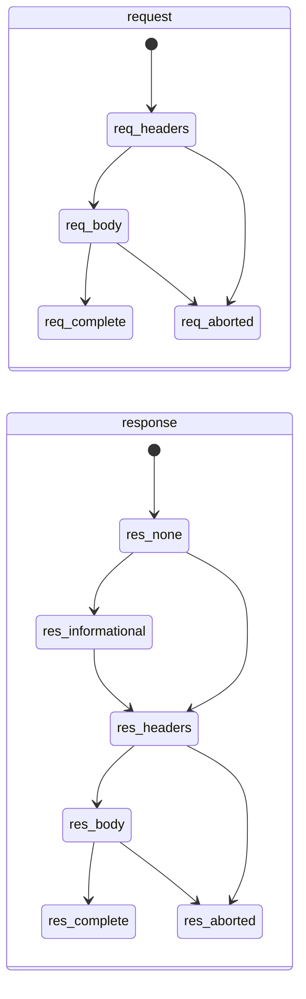

对外暴露的聚合状态：

| `state` | 含义 |
| --- | --- |
| `pending` | 已收到请求头，尚无响应头 |
| `request-complete` | 请求已完整，等待响应（WebSocket 101 后也用此值） |
| `response-streaming` | 已收到响应头，正文传输中 |
| `completed` | 双向完成 |
| `aborted` | 客户端中断，或上游连接失败（DNS/TCP/TLS）被镜像为客户端连接错误 |
| `failed` | Capture 持久化失败或协议错误 |

**迁移规则：**

1. 终态（`completed`/`aborted`/`failed`）不可回退。
2. 迟到或重复事件不得重复累加 bytes，使用 observed 计数覆盖而非累加。
3. `abort` 可以从任意非终态直接进入。

## 5. 调用流程

### 5.1 HTTP/HTTPS 常规请求（主路径）

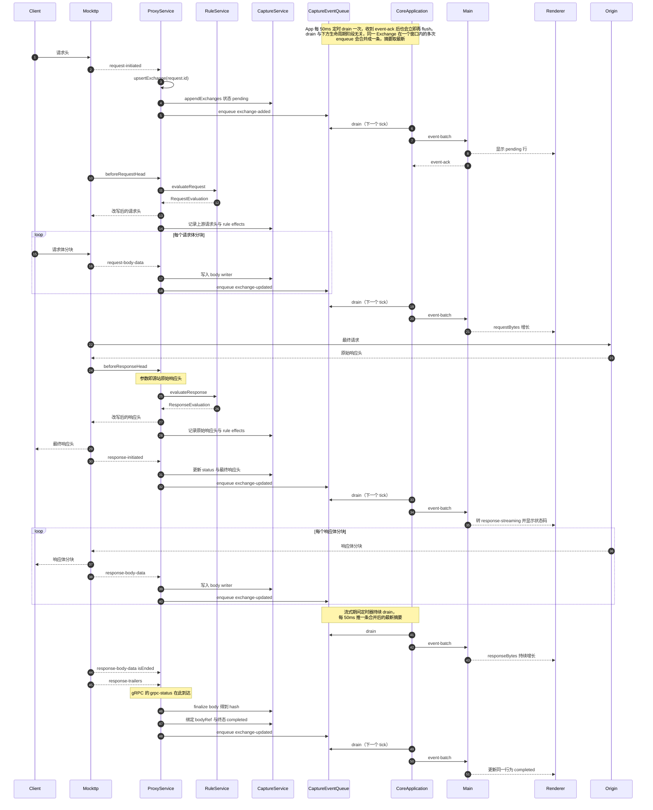

**逐步说明：**

1. **请求头到达**：`ProxyService` 在 `request-initiated` 回调内检查 `recording` 与 capture generation，通过后分配 `exchangeId`，写入 `ExchangeInput{ state: 'pending' }`，立即 enqueue `exchange-added`。UI 在一个 flush 周期内看到该行。
2. **请求规则**：`beforeRequestHead` 与步骤 1 并行，不保证先后。`ProxyService` 用同一 `request.id` 找到（或暂存到孤儿表等待）Exchange 记录，附加 `ruleIds` 与 header effects。钩子**不等请求正文**。
3. **请求体**：每个 `request-body-data` 把 `content` 追加进该 Exchange 的 request body writer，更新 `requestBytes`。`isEnded` 时 finalize 得到 hash 并绑定 `requestBodyId`。
4. **源站响应头**：`beforeResponseHead` 的参数就是 Origin 原始响应头，作为 response Rule 效果的对照。钩子**不缓冲响应正文**。
5. **最终响应头**：`response-initiated` 提供实际写回客户端的值，更新 `statusCode`、`responseMime`、`responseStartedAt`，状态转 `response-streaming`。
6. **响应体**：同请求体，写入 response body writer。
7. **trailer**：`response-trailers` 追加记录；gRPC 的 `grpc-status` 由此路径获得。
8. **终态**：响应体 `isEnded` 后写入 `completedAt` 与 `state: 'completed'`。

### 5.2 CONNECT 隧道（未解密）[已实现]

未配置 CA 或用户未开启解密时，HTTPS 走字节直通，只记录有限元数据。

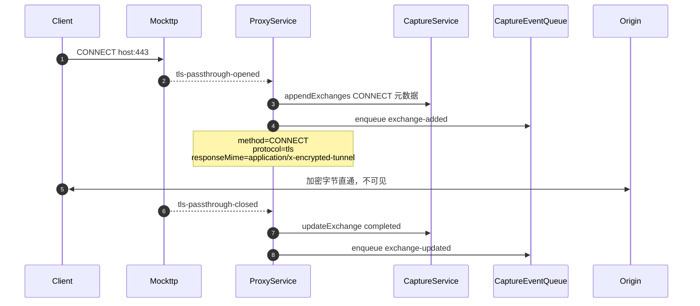

`pendingTunnels` 保存 `Promise<PendingTunnelCapture | null>`，确保 closed 事件等待 opened 落库后才更新。隧道内不读取任何 header 或 body。

**Rule 对未解密隧道完全不生效**，因此上图没有 RuleService 参与。原因在 TLS 层就已决定：

未配置 CA 时 `startServer()` 用 `getLocal({ https: { ...tlsPassthroughIdentity, tlsInterceptOnly: [] } })`。
Mockttp 的 `shouldPassThrough()` 在 `interceptOnlyPatterns` 非 undefined 时返回
`!interceptOnlyPatterns.some(...)`，空数组必然得到 `true`，于是 `analyzeAndMaybePassThroughTls`
读完 ClientHello 就把 socket 交给 passthrough listener 并 `return`，**不再继续 TLS 握手**。

后果是隧道内的字节从未被解密、从未被解析成 HTTP 请求，`forAnyRequest().thenPassThrough()`
这条规则链根本不会被触发，`beforeRequestHead` / `beforeResponseHead` 自然也不会调用。
换言之：**要让 Rule 作用于 HTTPS，必须先安装并信任 CA 且开启 MITM**，此时流量走 5.1 的常规路径，
隧道记录不再产生。

### 5.3 WebSocket [已实现]

101 Exchange 由 `websocket-accepted` 完成。不能依赖 completed `response`，因为订阅它会
触发全量正文缓冲（见 3.2）。

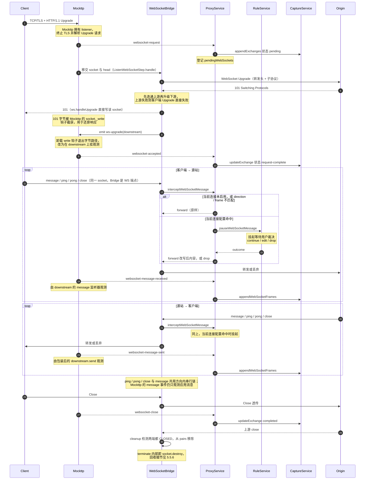

**客户端连接的归属分层**（容易误解，单独说明）：

| 层 | 归属 |
| --- | --- |
| TCP/TLS 接入、HTTP Upgrade 请求解析、WebSocket 规则匹配 | Mockttp |
| 101 握手响应与之后全部 WebSocket 帧 | Bridge（`ws`）直接读写 Mockttp 移交的同一 socket |
| `websocket-accepted` / `message-received` / `message-sent` / `close` 观测 | Mockttp，但**不在字节路径上** |

Mockttp 在 Upgrade 阶段给 socket 装 `_write` / `_writev` 钩子，因此 Bridge 调
`downstreamServer.handleUpgrade()` 写出的 101 字节会被它截获并 `parseRawHttpResponse` 还原成
响应对象。随后 Bridge `socket.emit('ws-upgrade', downstream)`，Mockttp 收到后**立刻卸载钩子**，
转而在 `downstream` 这个 WebSocket 对象上挂 `on('message')` 并包装 `send()`，靠对象级 hook 观测
消息。也就是说：**连接是 Mockttp 接的，WebSocket 协议端点是 Bridge 的，Mockttp 升级完成后退化为观察者。**

约束：

- **Rule 的适用范围与 HTTP 不同**，这是 WebSocket 最容易误解的一点：

  | 对象 | 是否经过 Rule |
  | --- | --- |
  | Upgrade 请求（header 改写、block、map local/remote 等） | **否**。Bridge 经 `addWebSocketRule` 注册独立的 WebSocket 规则链（`WildcardMatcher` + 自定义 step），不走 `forAnyRequest().thenPassThrough()`，因此 `beforeRequestHead` / `beforeResponseHead` 不会触发 |
    | 帧 | **仅当前连接临时断点**。`interceptWebSocketMessage` 按 `exchangeId` / `direction` / `frames` 检查 `WebSocketBreakpointSettings` 后调用 `ruleService.pauseWebSocketMessage`；message / ping / pong / close 各有明确 `ruleName`，**不做 matcher 匹配，也不执行 Rules action** |

    即 WebSocket 帧断点由 `websocket.breakpoint.enable` / `websocket.breakpoint.disable` 控制，只作用于配置中的当前 exchange；命中后挂起等待 continue / edit / drop，与 Rules 工作区里的 HTTP breakpoint action 正交。
- **上游先于下游**：`handle()` 先 `new WebSocket(url)` 并 `waitForOpen(upstream)`，成功后才 `handleUpgrade` 回客户端 101。上游握手失败时 upstream 被 terminate 并抛出，客户端拿不到 101，因此不存在「已升级但无上游」的中间态。子协议以上游 `sec-websocket-protocol` 回填，`sec-websocket-extensions` 被删除（bridge 关闭 permessage-deflate，两侧均传明文帧）。
- **配置方向才过断点**：client-to-server 与 server-to-client 都接入 `intercept()`，是否挂起由当前连接配置的 `direction` 决定。两个方向各自维护 `clientTail` / `serverTail` Promise 链，互不阻塞但各自保序；message / ping / pong / close 共用该方向的同一条链。
- **观测依赖 Bridge 走 `send()`**：Mockttp 的 `message-sent` 来自被包装的 `downstream.send()`。控制帧走 `ws.ping` / `ws.pong` / `close`，会经过 Bridge 断点，但不产生 Mockttp message 事件，因此当前不作为普通 message frame 落库；close 仍由 `websocket-close` 更新连接终态。
- **两个方向的记录语义不对称**：Mockttp 与 Bridge 各自在**同一个** `downstream` 对象上挂 `on('message')`，一帧到达同步触发两者（`socket.emit('ws-upgrade')` 是同步的，Mockttp 先注册也先执行）。但转发目标不同导致：

  | 方向 | 观测点 | 记录到的内容 |
  | --- | --- | --- |
  | client → server | `downstream.on('message')`，帧一到就捕获 | 断点**前**的原始内容，被 drop 的消息**仍会**记一条 |
  | server → client | 被包装的 `downstream.send()`，断点决策**后**才调用 | 断点**后**的最终内容，被 drop 的消息**不落库** |

  原因是 client→server 转发调 `upstream.send()`，而 upstream 由 Bridge 自行 `new WebSocket()` 创建、未被 Mockttp 包装，不产生事件。因此「断点改写是否体现在 Capture 记录里」两个方向相反。
- 消息按 `streamId` 串行 `writeTail` Promise 链，保证顺序且等待 101 Exchange 先落库。
- payload 复用 `BodyStore`，按 hash 去重。
- 仅支持 HTTP/1.1 Upgrade，H2 Extended CONNECT 未实现。


### 5.4 早期响应（HTTP）

**终态场景总览**（5.4 与 5.5 合并对照）：

| 场景 | Mockttp 发出的事件 | Capture 结果 |
| --- | --- | --- |
| HTTP 早期响应（401/413/417） | `response-initiated` → `response-body-data isEnded` | `completed`，已上传正文保留 |
| HTTP 请求中断 | `abort` | `aborted` + `errorCode` |
| HTTP 上游连接失败（DNS/TCP/TLS） | `abort`（`simulateConnectionErrors` 镜像为客户端连接错误） | `aborted` + 真实 `errorCode` |
| WebSocket 升级前连接直接断开 | `abort`（`data` 为空分支） | `aborted` |
| WebSocket 非正常关闭（closeCode 1006） | `abort` | `aborted` |
| WebSocket 上游升级失败 | 无（`response` 未订阅，`announceResponseAsync` 直接 return） | `aborted`，由 Bridge 显式判终态 |
| 未解密 CONNECT 隧道异常断开 | 仅 `tls-passthrough-closed` | 一律 `completed`，**永远不会是 `aborted`** |

本节只针对 HTTP/HTTPS（MITM 后）：Origin 可能在请求体传完前就返回 401/413/417。
WebSocket 没有等价场景（不存在请求体流式上传），未解密隧道也不适用。

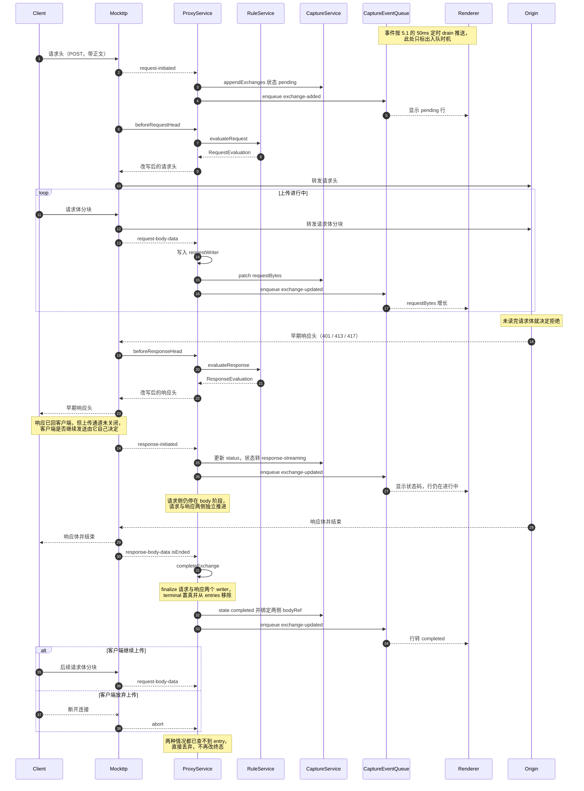

**响应与上传是并行的两条通道。** 早期响应头一到就会被 Mockttp 转发给客户端，Capture 也立刻
`patch` 出 `response-streaming` 并入队推给 Renderer——**不需要等上传结束**。此时客户端的上传通道
仍然开着，继续发还是放弃完全由客户端决定（很多 HTTP 客户端收到 4xx 后仍会把已排队的分块发完）。
两种选择在 Capture 侧结果相同：`completeExchange` 已把 entry 移除，后续事件一律丢弃。

**终态由先到达的一侧决定。** 请求侧与响应侧独立推进，但 `completeExchange` 与 `finishExchange`
都会把 `entry.terminal` 置真并从 `entries` 移除，之后同 `request.id` 的任何事件都查不到 entry
而被丢弃。因此早期响应场景下，响应体先结束就把整条 Exchange 定为 `completed`，客户端后续的
停止上传或 `abort` **不会**再把它改成 `aborted`。

**关键修复点**：早期实现只在 completed `request` 事件建立 `pending` 映射，若 `response` 先到会找不到请求而**直接丢弃整条记录**。改用 `request-initiated` 后，Exchange 在请求头阶段就已存在，早期响应可以正常合并。

**[已修复] 早期响应保留已上传的请求正文**：`completeExchange` 原先只取 `entry.responseWriter`
去 finalize，对仍在写入的 `entry.requestWriter` 既不 `finalize()` 也不 `abort()`，随后
`entries.delete(requestId)` 让它彻底失去引用，导致：

1. 已上传的那部分请求正文不绑定 `requestBodyId`，Inspector 里出现「有字节数但没有正文」。
2. 跳过 `BodyWriter.abort()` 会把 spill 临时文件留到 Core 代际结束（`tracker.reset()` 只遍历 `entries`，此时已删除，也兜不住）。

现已改为与 `finishExchange` 一致地收尾两个 writer。回归用例：
`proxy/tests/integration/service.test.ts` 的 *keeps the uploaded request body when the origin responds early*。

### 5.5 中断（abort）

由全局 `server.on('abort')` 驱动，**覆盖 HTTP 与 WebSocket**，不覆盖未解密隧道。
五种触发场景的前置流程互不相同，各画一张从客户端发起请求开始的完整时序。

无论哪一种，收尾都汇聚到 `finishExchange`：两个 writer 都 finalize（已接收的部分正文保留并绑定
body 引用），写入 `state`、`completedAt`、`errorCode`，`terminal` 置真并从 `entries` 移除，
最后 `resolveExchangeReady`。

#### 5.5.1 HTTP 客户端主动中断

用户取消、请求超时或客户端进程退出，连接在上传或等待响应期间断开。

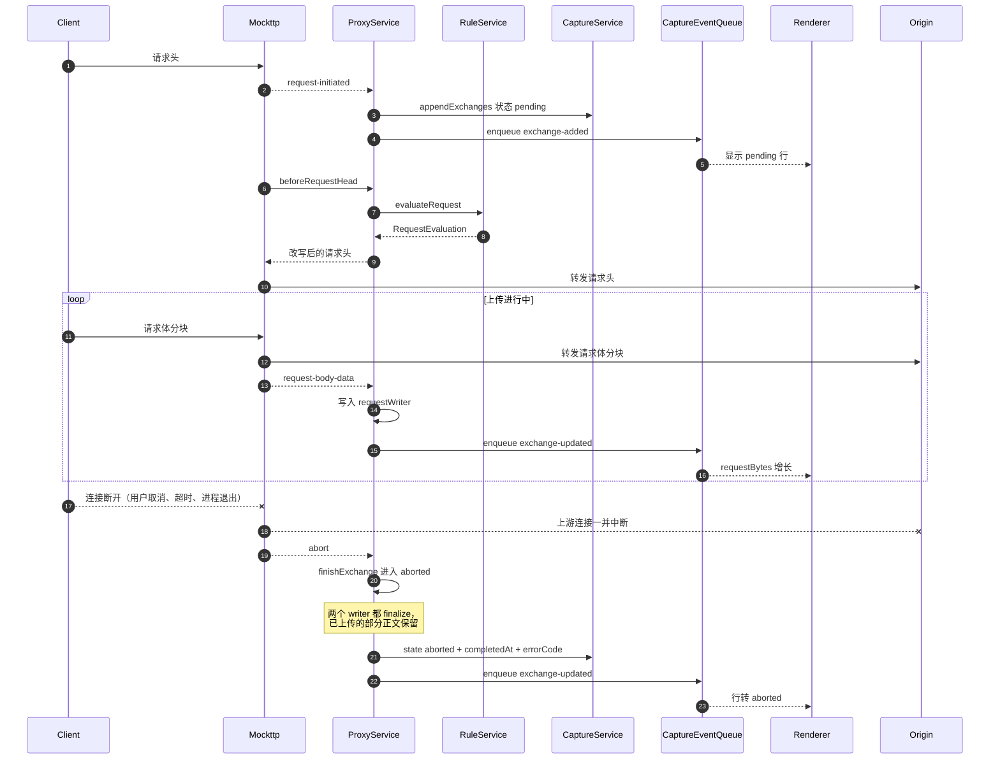

#### 5.5.2 HTTP 上游连接失败

DNS 解析失败、TCP 被拒或 TLS 握手失败，请求从未到达源站。

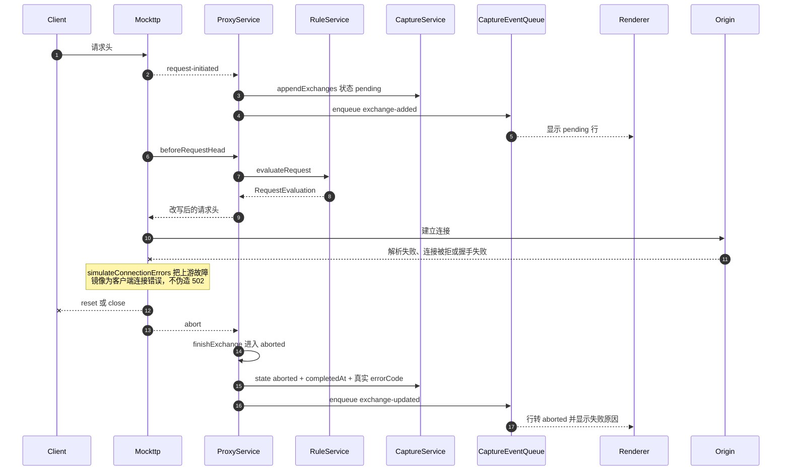

**上游失败语义**：passthrough 固定 `simulateConnectionErrors: true`，因此客户端看到的是与不挂代理时一致的失败形态（连接被重置/关闭），而不是一个伪造的 502 响应。Capture 里也是一条带真实 `errorCode` 的 `aborted` 记录，而不是一条假响应。

#### 5.5.3 WebSocket 升级完成前客户端断开

客户端发出 Upgrade 后、握手完成前就断开，此时还没有任何响应字节写回。

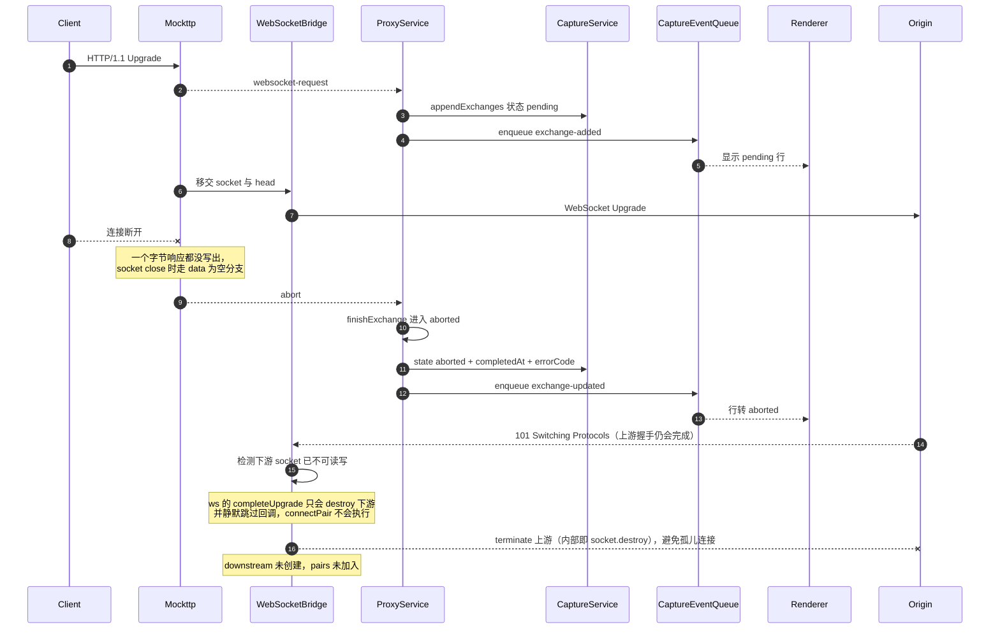

**Bridge 必须自己收尾上游。** 上游握手是异步的：客户端断开时 `await waitForOpen(upstream)` 往往仍在
等待，之后源站照样会回 101，于是出现「下游已死、上游刚活」的错配。此时 `ws` 的 `completeUpgrade`
第一件事就是 `if (!socket.readable || !socket.writable) return socket.destroy()`——**它只销毁下游
socket，并且不调用回调**，因此 `connectPair` 永远不执行、上游既进不了 `pairs` 也无人 `terminate`，
`bridge.close()` 同样兜不住（它只遍历 `pairs`）。

`handle()` 现在在 `handleUpgrade` 前先检查下游是否仍可读写，并额外注册一次 `socket.once('close')`
守卫：只要配对未完成就 `upstream.terminate()`。回归用例：
*closes the upstream websocket when the client disconnects during the upgrade*。

被移交的下游 socket 不需要 Bridge 额外处理——`completeUpgrade` 已经 `destroy()` 了它。

#### 5.5.4 WebSocket 上游升级失败

上游拒绝升级或连接不通，Bridge 的 `waitForOpen(upstream)` 失败。

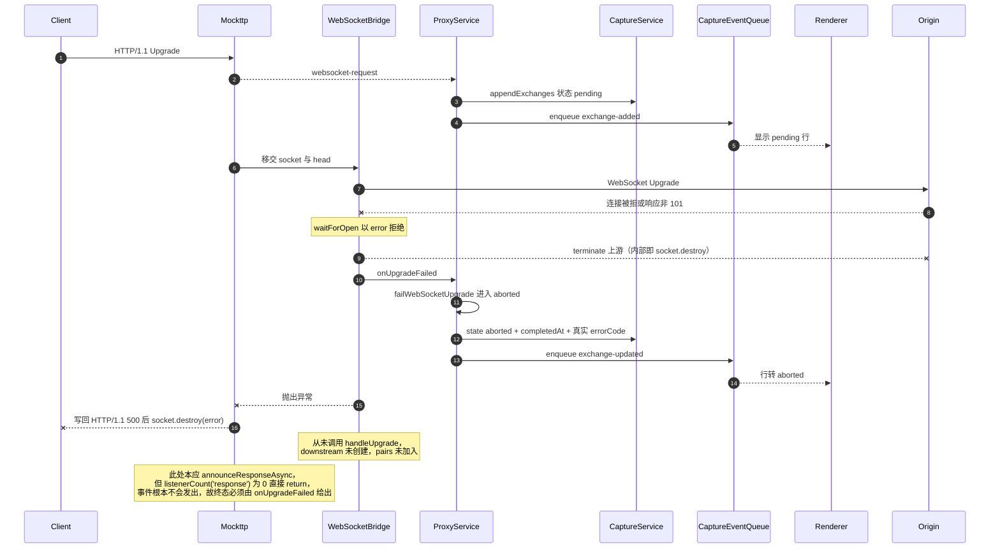

**这里没有「收不到的事件」，而是压根不发。** `announceResponseAsync` 的第一行就是
`if (emitter.listenerCount('response') === 0) return`，Capture 从不订阅 `response`，因此
Mockttp 连 `waitForCompletedResponse()` 都不会调用——既不会有事件投递，也不会触发 3.2 说的全量正文
缓冲。代价是这条路径**没有任何 Mockttp 事件可用**，终态只能由 Bridge 的 `onUpgradeFailed` 补上。

#### 5.5.5 WebSocket 已建立后非正常关闭

握手成功、消息通道已经工作，之后连接异常中断（`closeCode` 1006，非 clean close）。

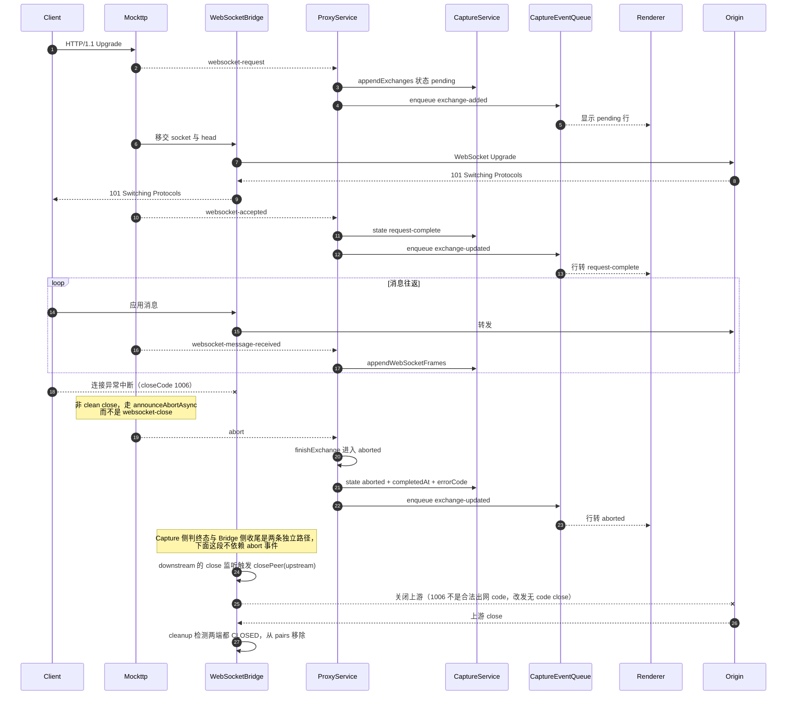

**Bridge 的收尾与 abort 事件互不依赖。** `abort` 只驱动 Capture 判终态；连接回收由 `connectPair`
注册的监听器完成：任一端 `close` → `closePeer` 把关闭传播给对端 → 两端都 `CLOSED` 时 `cleanup`
把 pair 从 `pairs` 移除。`ws` 的 `close()` 会发关闭帧并挂一个 30s `closeTimer`，对端不回应也会
`socket.destroy()` 兜底，因此不会无限挂起。

**WebSocket 复用同一模型**：`beginWebSocketRequest` 内部就是 `beginRequest`，条目同样落在 `entries` 里，因此 `abortExchange` 能正常命中。正常关闭（clean close）走的是 `websocket-close` → `closeWebSocket` → `completed`，不在本节范围内。

#### 5.5.6 资源回收对照

WebSocket 路径上 Bridge 实际持有的对象只有三类，逐场景的回收责任如下（HTTP 路径见本表末尾）。

| 对象 | 谁创建 | 回收方式 |
| --- | --- | --- |
| `upstream: WebSocket`（到源站） | Bridge `new WebSocket(url)` | 见下表逐场景 |
| `downstream: WebSocket`（到客户端） | `ws` 的 `handleUpgrade`，包装 Mockttp 移交的 socket | 与 upstream 成对，随 pair 一同回收 |
| `pairs: Set<WebSocketPair>` | Bridge | `cleanup` / `failPair` / `close()` 移除 |

| 场景 | upstream 回收 | downstream / socket 回收 | pairs |
| --- | --- | --- | --- |
| 上游升级失败（5.5.4） | `waitForOpen` catch 中 `terminate()` | Mockttp `sendWebSocketErrorResponse` 写 500 后 `socket.destroy(error)` | 从未加入 |
| 升级期间客户端断开（5.5.3） | 预检查或 `socket.once('close')` 守卫 `terminate()` | `ws` 的 `completeUpgrade` 已 `socket.destroy()` | 从未加入 |
| 已建立后任一端关闭（5.5.5 与正常关闭） | `closePeer` 传播关闭，30s `closeTimer` 兜底 `socket.destroy()` | 同左，对称处理 | `cleanup` 在两端 `CLOSED` 后移除 |
| 消息转发或连接报错 | `failPair` 直接 `terminate()` | `failPair` 直接 `terminate()` | `failPair` 立即移除 |
| Proxy 停止 / TLS 重配 | `bridge.close()` 遍历 `pairs` 全部 `terminate()` | 同左 | `pairs.clear()` |

`terminate()` 在 `ws` 内部就是 `this._socket.destroy()`，因此上表的每条路径最终都会销毁底层 TCP/TLS
socket，不存在只丢引用不关连接的情况。`connectPair` 注册的监听器都挂在这两个 WebSocket 对象上，
pair 移除后对象即可回收，监听器随之释放。

**HTTP 路径没有需要 Bridge 收尾的连接对象**：客户端与上游 socket 全部由 Mockttp 拥有和销毁，
Capture 只订阅事件。Capture 自己持有的可释放资源仅有 `BodyWriter`（可能已 spill 到临时文件），
其回收点是 `completeExchange` / `finishExchange` 的 finalize，以及 `tracker.reset()` 对在途条目的
`abort()`——正是 5.4 那条已修复缺陷所覆盖的范围。

**[已修复] WebSocket 上游升级失败的终态**：Bridge 的 `handle()` 在
`waitForOpen(upstream)` 失败时直接抛出，Mockttp 的 `handleWebSocket` catch 到非 `AbortError`
后调 `sendWebSocketErrorResponse()`，向客户端 socket 写入 `HTTP/1.1 500`。这段字节被
`trackWebSocketEvents` 的 `_write` 钩子收进 `data`，于是 socket close 时走的是
`data.length` 非空分支，即 `announceResponseAsync`——**这条路径唯一可用的终态信号是 completed `response`**。

而 Capture 为避免全量正文缓冲（见 3.2）**刻意退订了 `response`**，`announceResponseAsync` 首行的
`listenerCount('response') === 0` 判断因此直接 return，事件根本不发出。结果是这条 Exchange 拿不到
任何终态信号，会一直停在 `pending`。现已改为 Bridge 在抛出前经 `onUpgradeFailed` 回调
`tracker.failWebSocketUpgrade()` 显式判终态（`aborted` + 真实 `errorCode`），不再依赖
`response` 事件。回归用例：*marks the exchange aborted when the upstream websocket upgrade fails*。

**[已知限制] 未解密隧道没有中断语义**：`completeTunnel` 固定写 `state: 'completed'`。这不是实现疏漏，
而是上游事件契约所限：`TlsPassthroughEvent` 只带 destination / remoteIpAddress / timingEvents /
`tlsMetadata`，**没有任何关闭原因字段**（带 `failureCause` 的是另一个事件
`TlsHandshakeFailure`，只覆盖握手失败）。因此隧道记录无法区分正常关闭与连接重置，永远不会出现 `aborted`。


## 6. 正文存储

### 6.1 增量写入 [已实现]

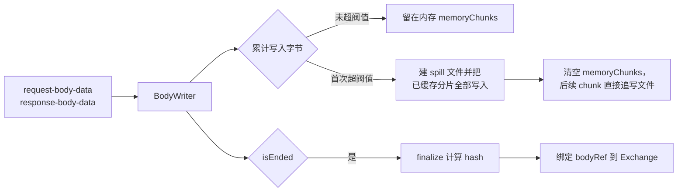

**spill 是全量迁移，不是只写超出部分。** `consume()` 在首次发现
`writtenBytes > memoryThresholdBytes`（即 `BODY_MEMORY_THRESHOLD_BYTES`，3 MiB）时才创建 spill 文件，紧接着把 **已经放在
`memoryChunks` 里的全部分片按顺序写进文件**，然后 `memoryChunks.length = 0` 清空内存，
当前 chunk 也直接追写文件。此后 `output` 非空，所有 chunk 一律走文件。

因此一份正文要么**完全在内存**、要么**完全在文件**，不存在一半内存一半文件的拆分状态。
`finalize()` 里的 `const memory = this.spillPath ? null : Buffer.concat(...)` 也体现了这一点：
一旦 spill 过，内存侧就是 `null`。

**内容寻址的必然约束**：`BodyStore` 按内容 hash 去重，因此 **hash 只有写完才能确定**。传输过程中 Exchange 只能记录 observed bytes，`requestBodyId` / `responseBodyId` 必须在 `isEnded` 后绑定。

UI 表现为：大小实时增长，但预览与保存要等传输完成。

### 6.2 阈值语义 [已实现]

两个阈值都定义在 `proxy-core/constants.ts`，作用于**单个正文**（非全局）：

| 常量 | 值 | 含义 |
| --- | --- | --- |
| `BODY_MEMORY_THRESHOLD_BYTES` | `3 * 1024 * 1024` = **3 MiB** | 累计写入超过它就建 spill 文件，并把已缓存内容全量迁移进去 |
| `BODY_WRITER_PENDING_LIMIT_BYTES` | `128 * 1024 * 1024` = **128 MiB** | 待落盘积压的**病态兜底**，正常流量不会触及 |

两者职责不同：**3 MiB 决定“存在哪里”**（内存还是文件），**128 MiB 决定“什么时候放弃”**
（只在磁盘持续远慢于接收速度时才触发）。写入是异步串行的，因此即使已经 spill，排队中的
chunk 仍占内存，128 MiB 上限正是给这段队列封顶。

**设计意图是完整保留正文。** 128 MiB 取值远高于真实流量的积压水位，包括大文件下载在内的
常规场景都不会丢弃内容；它只在磁盘异常或极端本地源站这类病态情况下生效，避免 Core 因内存
无界增长而被重启。

**两个阀值都是“每条正文”而非全局上限**，因此峰值内存会乘上并发数。

判断依据也变了：

| | 改造前 | 现在 |
| --- | --- | --- |
| 判断依据 | 完整 buffer 的总大小 | 累计写入字节 `writtenBytes` |
| spill 时机 | 拿到完整 buffer 后 | 累计跨过阈值立即 |

差别关键：增量场景下每个 chunk 都小于阈值，只有累计后才跨过。若仍按完整大小判断，
67 MB 视频会先在内存里攒满再 spill，改造就失去意义。

### 6.3 背压

`write()` 由 Mockttp 的 `body-data` 回调同步调用，而 Mockttp **不等待**消费者（见 3.6，body-data 是
旁路复制流）。因此 `write()` 必须立刻返回，不能 `await` 磁盘——每个 chunk 只能先复制进内存、挂到串行
Promise 链上排队，真正落盘在后台进行。`pendingBytes` 就是「已收下但尚未落盘」的字节数。

**上限约束的是这段积压，而不是正文大小。** 若不设限，当到达速度持续快于磁盘写入速度时队列只进不出，
排队的 Buffer 全部驻留 RAM，Core 内存会无界增长。反过来，60 MB 正文只要任一时刻积压不超过上限就毫无
问题——它限制的是瞬时落差，不是总量。

无法做真正的背压：Mockttp 的 `emitBodyDataEvents` **忽略回调返回值**，且在 `'data'` 事件里无条件
累积 `pendingContent`，无任何接口可以告知“慢一点”；旁路流也不影响转发管线，唯一能减速的方式是
拖慢真实流量。Interceptor 是透明调试代理，**不能因为记录器跟不上就拖慢用户的流量**，
因此只能给队列封顶。

1. [已实现] 每个 body writer 维护有界待写队列，上限为 `BODY_WRITER_PENDING_LIMIT_BYTES`（128 MiB）。
   该上限是**病态兜底**，不是常规限制：正常流量（含大文件下载）下磁盘远快于网络，积压接近于零，
   正文完整保留。它是**每个 writer** 的，一条 Exchange 有请求/响应两个 writer。
2. [已实现] 只有磁盘持续远慢于接收速度（磁盘异常、极端本地源站）才会超限并降级：停止保存内容，
   仅累计 observed bytes（因此 UI 上的大小仍然准确），`finalize()` 返回 `null` 不绑定 bodyRef。
   降级是 **整条丢弃而非截断**：`discardCollected()` 会清空内存分片并删除已写的 spill 文件。
   原因是 Body Store 按内容 hash 寻址，截断的正文会算出与真实内容对不上的 hash，
   让用户看到一份与实际传输不符的「正文」，比没有更危险。
3. [待做] 降级状态必须在 UI 明示，不得让用户误以为正文为空。
4. [待做] **两个阈值改为 Settings 可配置并持久化**。当前 `BODY_MEMORY_THRESHOLD_BYTES`（3 MiB）与
   `BODY_WRITER_PENDING_LIMIT_BYTES`（128 MiB）是编译期常量，只能靠改代码重新发版调整。
   极端场景（超大响应必须完整保留、或低内存机器需要收紧）应由用户自行权衡：
   - 暴露为「正文内存阈值」与「单条正文最大积压」两项设置，改动后对**新建**的 writer 生效，
     不影响在途正文，避免中途改变阈值导致已收集内容语义不一致。
   - 需要 Renderer → Main → Core 的窄意图传递（形如现有 `tls.useCertificate`），并在 Core 侧做范围校验。
   - **一并处理 10.2 的预览侧阈值**（`BODY_PREVIEW_MAX_BYTES` / `IMAGE_PREVIEW_MAX_BYTES` /
     `FORMAT_AUTO_MAX_BYTES` / `FORMAT_MAX_BYTES`）：给 `BodyReadRangeCommand` 加 `maxOutput`，
     由调用方传上限，Core 不再 import「预览上限」这种纯 UI 概念。
   - **入口引导**：在 Inspector 的 BodyView（预览区）加一个问号按钮，用 Tooltip 说明当前的预览上限
     与正文保留阈值，并引导用户到 Settings 修改。做法可参照 Rules 编辑器顶部已有的
     `HelpCircle` + antd `Tooltip`（多行文本）模式。预览被截断或正文因降级丢弃时尤其需要它，
     否则用户无法区分「正文本来就空」与「被阈值卡掉」（与上面第 3 项合并实现）。
   - UI 上需说明代价：调大积压上限会抬高 Core 峰值内存（该值是**每个 writer** 的，会乘以并发数）。

   与之同类的还有 Proxy Core 心跳/启动超时的可配置化，两者可以合并为一组「高级/性能」设置。

磁盘写入失败只跳过该正文，绝不影响转发、RPC 或进程状态。

### 6.4 正文按线上编码保存，解码元数据随 bodyRef [已实现]

`body-data` 事件给出的是**线上原始字节**：`gzip` / `br` / `deflate` 压缩的响应体在这里就是压缩流。
Capture 原样落 Body Store，**不在数据面解压**——解压需要完整输入，会毁掉流式，也会让内容寻址
hash 与真实传输内容对不上。

代价是渲染端必须知道怎么还原，因此 `BodyRefInput` 必须同时携带两项元数据，请求侧与响应侧对称：

| 字段 | 来源 | 用途 |
| --- | --- | --- |
| `contentEncoding` | 该方向 headers 的 `content-encoding` | `body.read-range{decode:true}` 时选择解码链 |
| `mediaType` | 该方向 headers 的 `content-type` | Inspector 判定文本/二进制，决定 Auto 走文本还是 Hex |

`ExchangeTracker` 在 `beginRequest` / `beginResponse` 的头部阶段就把两个值读进 `TrackedExchange`，
再在三个收尾点（`finalizeRequestBody`、`completeExchange`、`finishExchange`）绑定到 bodyRef 上。
必须在头部阶段取：正文结束时 Mockttp 的 headers 对象已不在手边。

**漏掉 `contentEncoding` 的后果是静默的**：正文字节完好、逐字节可还原，但 Renderer 不会请求解码，
于是把压缩流当 UTF-8 渲染成乱码，HAR 导出也会把压缩字节写成 `text`。回归用例按 H1 / H2 / HTTPS MITM
三条链路各自断言 origin 收到的请求正文、客户端收到的响应正文、以及落库正文三者逐字节一致，
并校验 bodyRef 上的 `mediaType` + `contentEncoding` 能把正文还原成明文。

WebSocket 不走这条路径：bridge 两端都关掉 `permessage-deflate` 并剥掉 `sec-websocket-extensions`，
帧 payload 永远是未压缩字节，只按 opcode 记 `text/plain; charset=utf-8` 或 `application/octet-stream`。

## 7. Recording、Pause 与 Clear

### 7.1 三种状态

| 操作 | 命令 | 效果 |
| --- | --- | --- |
| Start | `proxy.start` | 启动 listener（若未启动），`recording = true` |
| Stop | `proxy.setRecording{false}` | **只暂停记录**。listener 与系统代理保持运行，流量继续转发 |
| Clear | `capture.cleanup{all}` | 推进 generation，Exchange 与正文归零；仍在监听时保留当前 Session 壳（见 7.2） |

Stop 不停止转发，也不恢复系统代理。系统代理只在应用退出、Core 故障恢复、用户显式 Restore 或紧急修复时恢复。

### 7.2 Capture generation [已实现]

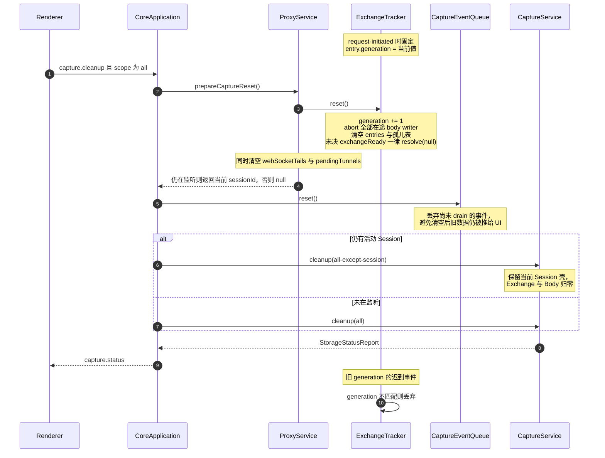

**Clear 由 CoreApplication 编排，不是 ProxyService 自己完成。** 三步顺序不可换：先
`prepareCaptureReset()` 建立切面（推进 generation，让在途事件立即失效），再 `captureEventQueue.reset()`
丢弃已入队但未推送的事件，最后才真正 `capture.cleanup`。否则会出现「库已清空但队列里还有旧行」被推给
Renderer 的窗口。

**活动 Session 会被保留。** `prepareCaptureReset()` 在代理仍在监听时返回当前 `sessionId`，
scope 随之收窄为 `all-except-session`——Exchange 与 Body 全部归零，但 Session 壳保留，
录制得以无缝继续。只有未在监听时才是真正的 `cleanup(all)`。

**判定规则：以请求开始时的状态为准。**

- 录制中开始、暂停后完成的长请求：继续完整记录。
- 暂停期间开始、恢复后完成的请求：始终不记录。
- Clear 后旧 generation 的所有 request/body/response/trailer/rule hit 全部拒绝，不得重新创建行。

## 8. 客户端应用归属 [已实现·仅 Windows]

Capture 在创建 Exchange 时同时记录**发起这条请求的本机应用**，用于列表图标与 Inspector 展示。

### 8.1 解析链路

| 环节 | 数据源 | 说明 |
| --- | --- | --- |
| 连接 → PID | `GetExtendedTcpTable` | `request-initiated` 给出客户端源端口，在系统 TCP 表里查 owning PID |
| PID → 可执行文件 | `QueryFullProcessImageName` | — |
| 进程 → 应用 | 见 8.2 | 容器进程需沿进程树上溯 |
| 应用 → 图标 | `IShellItemImageFactory` | 与资源管理器同源。**不能**用 `SHGetFileInfo` / `app.getFileIcon`：MSIX/UWP 应用的 exe 只是 stub，图标在包的 Assets 里，后者只能拿到通用图标 |

全部经 `client-app-helper`（Windows C# 单文件，`apps/desktop/src/main/client-app/`）完成，Main 在 fork Core 时以 `--client-app-helper` 注入路径。其他平台 `ClientAppService.supported` 为 false，列表不显示图标。只有 loopback 客户端才反查；远程设备（手机经代理）不存在本地进程。

helper 四个子命令：`<proxyPort>` 输出 TSV `sourcePort/PID/displayName/identity`（捕获路径用），`--icon <path>` 输出 base64 PNG，`--resolve <pid>` 与 `--apps` 是排查用途。Main 自己取图标时复用同一个 exe。

一条请求从到达到图标上屏的完整链路：

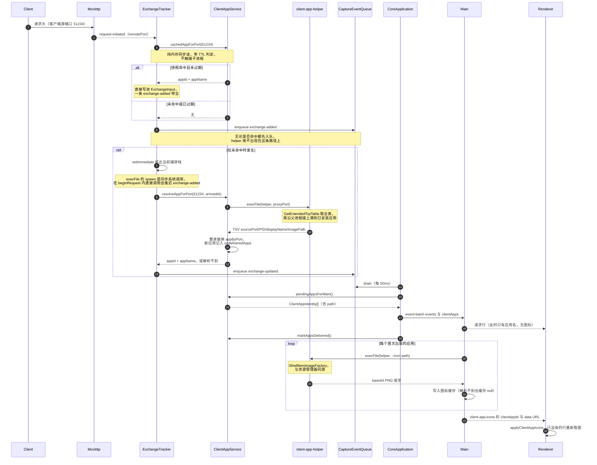

### 8.2 容器进程归属

WebView2 宿主、微信小程序容器这类进程自己不是用户心目中的应用，因此沿进程树一路向上追溯，**一旦命中系统已安装应用就停**。不设层数上限：层数拦不住认错，反而会把真正的长链归属（实测 `Microsoft.CodeAnalysis.LanguageServer.exe → Visual Studio Code`）截断。

“已安装应用”是一张**安装目录 → 系统登记名**的索引，四个来源合起来正好覆盖“设置 → 应用 → 安装的应用”（实测该机 56 项 = 卸载表 19 + MSIX 包 37）：

| 来源 | 取值 | 补的是什么 |
| --- | --- | --- |
| MSIX/UWP 包登记表 | `PackageRootFolder` + `DisplayName` | 全部打包应用（Teams、Outlook、Windows App、Widgets、SearchHost） |
| 卸载登记表 | `SystemComponent != 1` 条目的 `InstallLocation` / `DisplayIcon` | 传统桌面应用 |
| `App Paths` | 主程序所在目录 | 卸载表没写 `InstallLocation` 的 |
| 开始菜单快捷方式 | `.lnk` 目标所在目录 + 快捷方式名 | MSI 安装（OneDrive、Logitech G HUB 等） |

`SystemComponent = 1` 是 Windows 标记运行时组件的官方标志（WebView2 Runtime 即属此列），因此它不会成为归属终点。

**MSIX 来源迁移候选 [研究完成，未实现]。** 当前 `CollectPackagedApps()` 直接读取 AppModel
Package Repository 注册表；可改用官方 `PackageManager.FindPackagesForUser("")`，获得当前用户注册包
的 identity、安装路径、版本与状态，并正确覆盖非默认 PackageVolume。收益是摆脱内部注册表结构、
强类型语义更稳定；代价是不会返回只为其他用户注册或仅 staged/provisioned 的包。

对“当前用户发起的网络连接”，当前用户范围通常正是正确语义；但 SYSTEM/其他用户真正运行的
packaged process 仍需单独处理。全用户 `FindPackages()` 要管理员权限，不应放入抓包热路径。因此实施前
必须比较当前 registry 索引、`FindPackagesForUser` 与实际运行 PID 三组结果，不做盲目一换一。详见
[研究备忘](../backlog/research.md) § 3.3。

AppContainer exemption UI 不使用这张索引；它由 `NetworkIsolationEnumAppContainers` 直接提供候选
AppContainer、SID、package、display name 与 binaries。把 exemption 枚举与 Capture 运行时归属分成
两个模块，避免为了授权一个 SID 引入整套启发式应用识别。

五个边界条件：

- **一律按可执行文件路径判定，绝不按 AUMID**。MSIX 宿主派生的 `msedgewebview2.exe` **会继承宿主的包身份**，`GetApplicationUserModelId` 对它同样成功；按 AUMID 判会让上溯在 WebView2 进程处停住，Teams / Outlook / Windows App / Widgets 的流量在 UI 里会一律显示成 `Microsoft Edge WebView2`。
- **父进程必须经创建时间校验**。`ParentProcessId` 是创建时的快照，父进程退出后 PID 会被系统复用，“父进程”可能指向毫不相干的新进程，甚至沿复用形成的环兑圈子。因此父进程的创建时间晚于子进程就停——这才是防环与防认错的真正手段，比层数上限精确。
- **索引未命中不等于起始进程就是应用**。MSI 安装常常不登记安装目录（实测 GlobalProtect 的 `InstallLocation`、`DisplayIcon` 全空，开始菜单快捷方式还指向 `C:\Windows\Installer\{GUID}\` 的广告 stub），因此一路没命中时停在**最后一个可信祖先**上。
- **不比较发布者**。宿主应用经常使用别家的运行时（实测中 GlobalProtect 用微软的 WebView2），按发布者限制会直接误伤。
- **系统目录下只有打包应用才算应用**。否则 `App Paths` 与开始菜单里大量指向 `System32` 的条目会把整个系统目录变成应用目录，`svchost.exe` 会立刻命中；反过来，`C:\Windows\SystemApps` 下的 MSIX 包（SearchHost）仍能正确归属。

实测（`--resolve`，另有 `--apps` 可导出整张索引）：全系统进程逐个跑一遍，无死循环、无超时（均 ~55 ms）。`msedgewebview2 → Microsoft Teams / Outlook for Windows / Microsoft OneNote / Windows App / Windows Web Experience Pack / Windows 功能体验包 / GlobalProtect client`、`WeChatAppEx → 微信`、`Microsoft.CodeAnalysis.LanguageServer → Visual Studio Code`、`msedge` / `Code` 保持自身、`explorer` / `svchost` 不被误认成应用。

### 8.3 显示名的分层选取

同一个进程有好几个"名字"，它们描述的**不是同一层东西**：

| 来源 | 描述的是 | 粒度 | 例子 |
| --- | --- | --- | --- |
| 主程序登记名（开始菜单快捷方式名、卸载表 `DisplayIcon` 指向的主程序） | 用户会去点的那个入口 | per-入口 | `WINWORD.EXE → Word`、`Weixin.exe → 微信` |
| 目录登记名（MSIX 包 `DisplayName`、卸载表 `InstallLocation` 的 `DisplayName`） | 一个打包应用 / 一次安装 | per-包、per-安装包 | `Microsoft Teams`、`Microsoft 365 Apps for enterprise - en-us` |
| exe 版本资源 `FileDescription` | 这个可执行文件是什么 | per-exe | `OneDrive.Sync.Service.exe → Microsoft OneDrive Sync Service` |

按优先级依次尝试：**主程序登记名 → 目录登记名 → `FileDescription` → 不含扩展名的文件名**。

登记名优先于 `FileDescription`，因为这一列的语义是"哪个应用发出的请求"，而 `FileDescription` 描述的是进程/组件（`Microsoft OneDrive Sync Service`、`G HUB`、`LGHUB Agent`），不是用户心目中的应用。主程序又必须优先于目录：套件类安装（Office）在卸载表里只有一个条目，只按目录会把 Word、OneNote 一律叫成 `Microsoft 365 Apps for enterprise`。

**不按 `ProductName` 校验目录登记名**。曾试过"目录登记名要与 exe 的 `ProductName` 同源才采信"，实测 7 个受影响的进程里只修好 `node.exe`（它落在版本管理器 nvm 的登记目录 `C:\nvm4w\nodejs\` 下，会显示成 `NVM for Windows 1.2.2`），却误伤了 `OpenConsole.exe`（VS Code 自带的 conpty 终端宿主，归给 VS Code 本来就对）与 `lghub_agent.exe`（本就属于 Logitech G HUB）——为修一个错两个，不划算。

实测 51 个进程的命中分布：主程序登记名 7、目录登记名 23、`FileDescription` 21。已知唯一偏差：`node.exe` 展示为 `NVM for Windows 1.2.2`。

**代表标识决定 `appId` 与图标。** 归属结果的 `path` 会被换成应用的代表标识——卸载表 `DisplayIcon` 指向的主程序，或包只有一个应用时的 `shell:AppsFolder\<AUMID>`——让名称、图标、`appId` 三者同源。否则 OneDrive 的 `FileCoAuth.exe`、Outlook 的 `olkexthost.exe` 这类没有图标资源的后台组件会拿到通用图标，并在 UI 里裂成独立条目。代表标识只取自权威来源：App Paths 与快捷方式只代表单个入口，拿它们代表整个目录会把 OneNote 显示成 Excel。

**系统权限进程的兜底**。helper 以普通用户权限运行，对 SYSTEM 下的服务进程 `OpenProcess` 会被拒绝（实测 89 个 `svchost.exe` 里 80 个打不开），而 NCSI 探测、Windows Update 这类流量正是它们发的。句柄打不开时退到 `CreateToolhelp32Snapshot` 的 `ExeFile`（只有文件名，不需句柄）：能给出 `svchost` 这个名字，但没有路径就取不到图标。Core 仍然登记这类条目（以显示名代替路径算 `appId`），不再丢弃。

### 8.4 不阻塞捕获管线 [已实现]

`resolveAppForPort` 会拉起 helper 子进程，而 `execFile` 的 spawn 是**同步系统调用**。因此 `beginRequest` 只做纯内存的快照命中：

- 命中 → 同步写入 entry，`exchange-added` 一次带全，不产生额外事件
- 未命中 → `setImmediate` 排出当前栈后再解析，结果以 `exchange-updated` 补齐

这保证 helper 慢、挂起或失败都不会延后 `exchange-added` 与转发。解析失败只记 `client-app.lookup-failed` 诊断；孤儿 Promise 带 `catch`，Node 默认 `unhandled-rejections=throw` 会终止 Core 进程并中断抓包。

**异步窗口要显式表达，否则 Application 分栏会闪。** 反查在飞行中时 `appId` 为空，若直接按「无归属」处理，分栏里会先冒出一个 Unknown 再消失。因此排队反查的 entry 带 `appPending: true`（只在为真时进摘要），Renderer 的 `facetValuesOf` 对这些行返回空数组、不计入任何取值。**成功、查不到、helper 异常三种终态都必须清除该位**：查不到与异常没有字段变化，仍要补推一次 `exchange-updated`，否则该行会永久停在解析中、从此不出现在分栏里。

### 8.5 快照与缓存

`ClientAppService` 持有两张表：

| 字段 | 内容 | 生命周期 |
| --- | --- | --- |
| `appByPort` | 源端口 → 应用 | 每次 helper 调用整表替换，`CLIENT_APP_SNAPSHOT_TTL_MS`（15s）后作废 |
| `undeliveredApps` | 尚未交给 Main 的应用身份 | 随 event-batch 下发成功后清除 |

TTL 防的是端口复用错认：连接关闭后源端口会被系统重新分配给其它进程，过期快照会把请求归给错误的应用。

并发解析共享同一次 helper 调用；解析时每一轮都先 `await` 快照再判断，**绝不在快照飞行中直接放弃**（请求到达时 TCP 连接必然已建立，只需一张采样时刻不早于此刻的快照）。helper 失败后在同一窗口内退避，避免反复拉起子进程。

### 8.6 身份与图标的传递边界

- Core 只把 `appId`（应用标识 sha256 前 16 位）与 `appName` 放进 `CaptureExchangeSummary`
- 完整身份（含 `path`）随 `event-batch` 的 `clientApps` 字段一次性交给 Main，**每个应用一次**；Main 无需再按 id 回问 Core
- Main 读取图标后经 `client-app:icons` 主动推给 Renderer，Renderer 从不发起索取
- Renderer 全程只见 `appId` 与 PNG data URL，拿不到可执行文件路径

图标按应用而非按请求去重，因此不会随每条 Exchange 重复传输（一张 data URL 2–4 KB，`appId` 只有 16 字符）。Renderer 侧 `clientAppIcons` 是响应式 map，且靠“有无该键”天然区分出图标三态，不需额外状态字段：

| `clientAppIcons.get(appId)` | 含义 | 展示 |
| --- | --- | --- |
| `string` | 已取到 | 真实图标 |
| `undefined` | 还在路上（图标总是晚于 Exchange 到达） | 占位方块 |
| `null` | 取不到（系统权限进程没有路径，或 shell 返回失败） | 未知应用图标 |

批次发送失败时身份留在 `undeliveredApps` 里下一轮继续带上；Renderer 重新加载会丢失已推送的图标，Main 在 `did-finish-load` 时补发一次已知集合。

## 9. 数据契约

### 9.1 Core 内部接口

`CaptureService`（`capture/entry.ts`）向 Proxy 暴露的写入面 [已实现]：

```ts
class CaptureService {
  ensureSession(session: CaptureSessionInput): Promise<void>;
  appendExchanges(exchanges: ExchangeInput[]): Promise<{ id: string; seq: number }[]>;
  updateExchange(patch: ExchangePatch): Promise<void>;
  writeBody(source: AsyncIterable<Uint8Array>): Promise<BlobWriteResult>;
  createBodyWriter(): BodyWriter;
  appendRuleHits(exchangeId: string, hits: readonly RuleHitRecord[]): Promise<void>;
  appendWebSocketFrames(exchangeId: string, frames: readonly WebSocketFrameInput[]): Promise<void>;
}
```

`ProxyService` 与 `ExchangeTracker` 直接持有这个具体类，不再经由窄化接口；测试替身
`extends CaptureService` 并只 `override` 被断言的方法。

`ExchangePatch` 除 `id` 外全部可选，未提供的字段保持原值，覆盖：

- 请求侧：`requestBytes`、`requestBodyId`、`requestMime`、`requestSentAt`、`requestBody`
- 响应侧：`statusCode`、`statusText`、`responseMime`、`responseStartedAt`、`responseBytes`、`responseBodyId`、`responseBody`
- 通用：`headers`（追加）、`ruleIds`（去重合并）、`errorCode`、`state`、`completedAt`

`writeBody` 是 pull 式、可背压，用于 WebSocket 单条消息；`createBodyWriter` 是 push 式、
不可阻塞，用于 HTTP 正文的 body-data 事件。两者语义不同，不能互相替代。

### 9.2 事件契约

```ts
interface CaptureEventSink {
  enqueue(kind: CaptureExchangeEventKind, summary: CaptureExchangeSummary): void;
}
```

`CaptureExchangeSummary` 需支持 pending 表达：`statusCode` 与 `durationMs` 可缺省，Renderer 据此渲染进行中状态。`appId` / `appName` 同样可缺省（非 Windows、远程客户端、反查失败）；反查排队期间额外带 `appPending: true`（见 8.4）。

事件批次 `CoreEventBatch` 除 `events` 外带可选 `clientApps: ClientAppIdentity[]`，只携带本批新出现的应用身份（见 8.5）。

队列合并行为：同 id 事件就地合并，**保留首次 sequence、摘要取最新、kind 不更新**。因此 `exchange-added` 尚未 drain 时到来的 `exchange-updated` 会被正确压成一条 added。

推送节奏与背压：`CoreApplication` 用 `EVENT_FLUSH_INTERVAL_MS`（50ms）定时器持续 `drain`，并在收到 `event-ack` 后立即再 flush 一次，**与 Exchange 的生命周期阶段无关**。单批上限 `EVENT_DRAIN_BATCH`（200 条），未 ack 批次上限 `EVENT_INFLIGHT_WINDOW_SIZE`（8 批），窗口满或无 RPC 连接时本轮跳过、事件留在队列里继续合并。

由此产生的可见语义：每次 `patch()`（含每个 body chunk）都会同步 enqueue，但 UI 收到的是**每 50ms 一帧的最新快照**，而不是每个 chunk 一帧。中间值会被跳过（例如 `responseBytes` 不会逐块呈现），这是保护数据面与限制 IPC 频率的有意取舍。

### 9.3 Renderer 命令

| 命令 | 用途 |
| --- | --- |
| `sessions.query` | keyset 分页拉取 summary |
| `sessions.detail` | 单条完整 headers 与 body 引用 |
| `body.read-range` | 按 hash + offset + length 读取正文片段 |
| `body.export.start` | Save body：把完整正文流式写到用户选定文件，不受预览上限限制 |
| `websocket.frames` | WebSocket 帧分页 |
| `websocket.breakpoint.enable` | 为当前 exchange 启用 direction / frames / timeout 配置 |
| `websocket.breakpoint.disable` | 停用当前 WebSocket 帧断点 |
| `grpc.messages` | gRPC envelope 分页 |
| `proxy.start` / `proxy.status` / `proxy.setRecording` | 生命周期；Renderer 的 Stop 映射为 `setRecording{false}` |
| `capture.cleanup` | Clear |

`proxy.stop` 不对 Renderer 开放常规入口，仅在 Main 的紧急修复路径中调用。

**按需解码**：`sessions.detail` 返回 `CaptureExchangeDetail`，正文经 `body.read-range` 按 hash 分块。带 `decode` 的请求由 `proxy/utils/index.ts` 的 `decodeBody` 按 gzip / deflate / brotli **多层且容错**地延迟解压，并回传 `decodeStatus`——正文本身始终按线上编码保存（见 6.4）。

**gRPC framing 不读整段正文**：`grpc/entry.ts` 的 `GrpcService` 通过 `grpc/utils/index.ts` 解析 5 字节 envelope——每条只从 Blob 读 5B header，再按 payload length 跳到下一个 offset。payload 继续走既有的 range 读取，不需要新的存储结构。

**BodyViewer嵌套滚动契约**：正文pane内容溢出时由pane自身滚动；到达顶部/底部后继续同方向wheel必须交给Inspector外层scroll，不能由Monaco永久消费。产品`CodeViewer`与design-vite `MonacoFixture`都必须显式使用`alwaysConsumeMouseWheel:false`。外框可用`overflow:hidden`裁切圆角，但不得关闭Monaco内部scrollbar或阻断边界后的scroll chaining。

**BodyViewer高度与滚动证据**：`BodySection`通过grow Section把正文pane贯通到Inspector剩余高度。现行`capture.detail-body-fill` workflow字节级移植到修复前`039dd42`后，response pane高度与18px底部padding先通过，但Monaco到达底部后的wheel使外层`scrollTop`保持`8.666666984558105`，取得真实Electron retrospective Red；`800bbca`加入`alwaysConsumeMouseWheel:false`后，当前同一workflow为`1/1` Green并完成Main/Core销毁、8888释放与系统代理恢复。

**Inspector分组折叠契约**：General、headers/trailers、request line、query、body、timing与cookies各自持有独立展开状态。标题是实际接收点击的button，使用`aria-expanded`表达状态、`aria-controls`指向由`useId()`生成的唯一正文id；正文折叠时保持挂载，只切`hidden`，避免BodyViewer等内部状态因收起而销毁。稳定automation ID由调用处按业务语义传给共享`SectionHeader`，共享primitive不硬编码feature ID。

WebSocket 与 gRPC 的意图 API 把 payload 原样转交，Core protocol 只校验 RPC 信封 / version / 关联字段，不对 payload 做运行时语义校验。

## 10. Renderer 数据层


**分层规则：**

- Zustand 只保存全部 `CaptureExchangeSummary` 与视图状态（filter、selection、scrollTop、tab、宽度）。
- 完整 headers、body、WebSocket/gRPC payload **不进入全局状态**，按需拉取。
- `useCaptureData` 常驻 App，跨 feature 持续接收事件。
- bootstrap 与重连以 **500 条分页批次**同步当前 Core 的全量 summary。
- Stop/Start **保留已有行**；只有 Core generation 变化或 Clear 才清空。
- 列表用固定 52px 行的 TanStack Virtual 虚拟化。
- 过滤完全在 Renderer 派生。

### 10.1 结构化筛选分栏 [已实现]

筛选是列表左侧可收起的 `CaptureFilterPanel`（宽度可拖，160–360px，存于 `captureStore.filterPanelWidth`），
不再是列表上方的下拉。`CaptureListbar` 只保留分栏开关、Recording、Clear、搜索与 Import/Export。

七个 facet 分组，**顺序严格跟随列表表头**：

| facet | `CaptureFilter` 字段 | 取值来源 | 排序 |
| --- | --- | --- | --- |
| `application` | `apps` | `summary.appId`，无归属归入哨兵值；`appPending` 进入永久显示的 Pending bucket（见 8.4） | 首次出现顺序，Pending固定置尾 |
| `method` | `methods` | `summary.method` 大写 | 首次出现顺序 |
| `host` | `hosts` | `summary.host` | 首次出现顺序 |
| `status` | `statuses` | 状态码十进制串；无码时按 `failed` / `pending` 哨兵值 | 码值升序，Failed后接永久Pending |
| `protocol` | `protocols` | `protocolFacetValue()` | 固定版本序 |
| `type` | `types` | response headers未到时进入永久Pending；headers到达后由`typeLabel(responseMime)`决定 | 首次出现顺序，Pending固定置尾 |
| `rule` | `ruleIds` | `summary.ruleIds`，一条可命中多个 | 首次出现顺序 |

- **组内 OR、组间 AND，搜索与所有 facet 之间也是 AND**。`matchesCoreFilter` 同时供列表派生与实时事件使用，
  保证新到流量与已有行走同一判定。
- **分组展开状态与筛选值正交**。选择或取消 option 只更新对应 `CaptureFilter` 字段，保持该组和其他组
  当前的展开状态；只有分组标题或 chevron 可以调用 `toggleFacetExpanded`。设计稿 fixture 必须遵守同一
  交互契约，不能在筛选状态同步时重置用户手动展开的分组。
- **Protocol facet 比列表 Proto 列更细**：列表列把 `HTTP/1.x` 收敛为 `h1`，facet 则区分 `HTTP/1.1` 与 `HTTP/1.0`，
  另有 `HTTP/2`、`HTTP/3`、`WebSocket`、`TLS tunnel`。
- 值与计数由 `allFacetOptions` **一次遍历**派生全部 facet；实时流量下每条摘要只扫一遍，
    并经 `useThrottledRows(FACET_REFRESH_MS)` 节流。Application / Method / Host / Type / Rule 保持
    当前 Capture 中的首次出现顺序，计数变化只更新数字，不再按 count 动态换位；Status / Protocol
    继续使用各自的固定语义顺序。
- 真实 Electron `capture.facet-stable-ordering` 必须先捕获 GET、再捕获 POST，随后让 POST count
    反超 GET；Method option 的 DOM 顺序在两次读取中都必须保持 GET、POST。该 workflow 只验收
    稳定排序，不能由同时覆盖 Pending、Clear 或右键菜单的组合测试代替。
- 该workflow已完成真实Electron retrospective Red→Green：`89d8dda`在POST反超后得到POST、GET，
    当前实现保持GET、POST；Green证据含Main/Core退出、8888释放与系统代理恢复。
- Application / Status / Content type 的 Pending option在count=0时也始终渲染并可选择；新进入加载态的request会自动命中已选bucket。请求完成后count回0但option不增删，避免facet高度与DOM抖动。Method / Host / Protocol在request headers阶段已确定，不提供虚假的loading项；Rule当前没有独立“计算中”字段，也不编码无法区分的状态。
- Clear 成功把 `rows` 置空时，facet snapshot 必须立即同步为空；节流只约束非空实时更新，不能让列表
    已显示 `0 of 0` 时分栏仍短暂保留旧 app id、选项与计数。
- 哨兵值用 `\u0000` 前缀（`UNKNOWN_FACET_VALUE` / `FAILED_FACET_VALUE` / `PENDING_FACET_VALUE`），
  与真实 host、状态码字符串不可能碰撞。
- 搜索仍只匹配 `host + path`，是独立维度，不计入 `hasActiveFilter` 的 badge。

**列顺序：Path 在前、Host 在后。** 列表主列渲染为 `path · host` 而非 `host · path`——host 在筛选分栏里
一点即达，path 才是同一 host 下区分请求的信息。窄宽度下依次隐藏 Time、Size、Type、Proto 四列
（这些维度筛选分栏里都有），Path · Host 主列永不隐藏。

### 10.2 源站证书失败的就地出口 [已实现]

TLS 有两类失败，能做的事完全不同：

- **TLS①（客户端不认我们的 CA）**：整个 app 不可用，由 App 壳的全局 compatibility dialog 处理，
   出口是加 TLS passthrough。
- **TLS②（源站证书本身不可信）**：只影响单个 host，失败的 exchange 本来就躺在 Capture 列表里，
   因此不再加第二个全局弹窗，改为在 Inspector 的 Connection / TLS 面板里就地给出口。

判据是 detail 的 `errorCode` 落在证书校验错误集合内（`UNABLE_TO_VERIFY_LEAF_SIGNATURE`、
`SELF_SIGNED_CERT_IN_CHAIN`、`CERT_HAS_EXPIRED`、`ERR_TLS_CERT_ALTNAME_INVALID` 等）。协议协商类失败
（`EPROTO`、`ECONNREFUSED`）不显示，因为加 per-host 例外并不能解决。点 `Trust this host` 写入
`tls.replaceInsecureHosts`，Core 在同一条命令里完成持久化与生效。

### 10.3 正文预览渲染矩阵 [已实现]

正文查看器是共享内核 `components/BodyViewer/`，Capture / Composer / WebSocket / gRPC 用同一实现。

**外壳与内核分离**：内核只吃 `(bytes, mediaType, truncated)`，不认识 hash、IPC 与 Save；
`RequestInspector/BodyView.tsx` 是 Capture 侧外壳，负责按需拉字节、跟踪解码与截断状态、驱动 Save body。
Composer 的 `ResponseBodyPane` 直接用内核。

**内容类型（`kind`）与查看档位（`mode`）是两个独立维度。** `kind` 由 MIME + 内容探测决定并锁定工具行的
MIME/体积标签，`mode` 只决定渲染方式。合成单一枚举会直接出 bug（在 JSON 上点 Hex 跳到另一条请求、
HTML 点 Raw 变成 JSON）。原先的 `auto` 档已删除，但探测逻辑保留——它降级为「未知 MIME 是文本还是二进制」
的默认档选择器，并把探测结果追加进候选档位以容忍 MIME 谎报。

| `kind` | 默认档 | 候选档 |
| --- | --- | --- |
| `json`（含 `+json`、ndjson） | Pretty | Tree · Raw · Hex |
| `code`（HTML / CSS / JS / XML / SVG） | Code | Raw · Hex |
| `image`（非 SVG） | Preview | Hex |
| `markdown` | Preview | Split · Source · Hex |
| `form`（`x-www-form-urlencoded`） | Form | Raw · Hex |
| `text` | Text | Hex |
| `binary` | Hex | Text · Hex |
| `media`（`video/*`、`audio/*`） | 元信息 + Save body | 无档位，零读取 |

档位名是技术术语（Pretty / Raw / Hex…），与 JSON、Hex 同类，**不进 i18n catalog**。

**各档实现要点：**

- **Hex**：逐行虚拟化。它是最重的渲染路径（5 MiB ≈ 35 万行），不虚拟化会在拖动 Inspector 分栏时因
  `ResizeObserver` 重算整份 dump。
- **JSON Tree**：自建 + `@tanstack/react-virtual`，可右键复制 value / object / path。Monaco 是编辑器，
  **折叠 ≠ 树**，没有 tree view 这种 UI 形态，自建才能套设计 token 并挂右键菜单。
- **Code 的 Format**：HTML/CSS直接调用Monaco language WorkerManager，JavaScript使用公开worker getter，
    XML由`xml-formatter`补。worker返回的edits先在只读model外按offset倒序合并，再一次替换model；不加载
    `formatActions` contribution，也不临时解除read-only。JSON美化仍用`JSON.parse/stringify`（V8原生，
    快于绕一趟worker）。任一formatter失败都恢复调用前原文；诊断全部关闭，避免白烧worker CPU。
- **Image**：`Blob` → ``，`onload` 读 `naturalWidth/Height` 显示尺寸，`onerror` 统一兜住
  破图/不支持格式，cleanup 里 `revokeObjectURL`。用 blob URL 而非 data URL——字节本来就是 `Uint8Array`，
  data URL 要多一次 base64（+33% 字节 + 一份字符串）。SVG 是可执行 XML，按 `code` 展示，默认不渲染。
- **Markdown**：`react-markdown` + `remark-gfm` 做元素级组件映射，默认不渲染裸 HTML（天然防 XSS，
  也因此不需要放宽 CSP）。Split 为上下分栏（Inspector 横向不够宽），不做滚动同步。

**阈值**（全部定义在 `packages/core-protocol/src/messages.ts`）：

| 常量 | 值 | 作用 |
| --- | --- | --- |
| `BODY_PREVIEW_MAX_BYTES` | 5 MiB | 文本 / WebSocket / gRPC payload / Core decode 输出四处共用的单次读取上限 |
| `IMAGE_PREVIEW_MAX_BYTES` | 16 MiB | 超过则连 IPC 都不发，直接给元信息 + Save body |
| `FORMAT_AUTO_MAX_BYTES` | 2 MiB | 及以下自动格式化 |
| `FORMAT_MAX_BYTES` | 8 MiB | 2–8 MiB 需手动点 Format（带 loading，结果可丢弃）；超过则禁用并提示 Save body |

阈值作用是**防用户干等**，不是防卡：Monaco 在 worker 里跑不阻塞主线程，但 TS parser 处理超大 min.js
仍是几十秒。图片上限的作用也不是防崩溃，而是**防半张图**（截断字节喂给 `` 比不显示更糟）并省下 IPC。
已知边界：Core 的 decode 分支硬编码 `BODY_PREVIEW_MAX_BYTES`，所以**被 gzip 的图片有效上限仍是 5 MiB**
（图片几乎不被 gzip，可接受）；未完整拿到字节时 `decodeStatus === 'limited'` 兜底为元信息 + Save body。

**卡顿只可能发生在 Renderer 主线程**，Main 与 Core 全程只搬字节，全链路传 `Uint8Array`，
没有任何 base64/dataURL 转换：

| 工作 | 执行位置 | 卡 UI |
| --- | --- | --- |
| Core 读字节、gzip 解压（zlib 在 libuv 线程池） | Core 进程 | 否 |
| IPC 搬运（两次 memcpy） | Main 进程 | 否 |
| Hex 拼字符串与排版 | **Renderer 主线程** | **是（故虚拟化）** |
| JS formatter 的 parse | Monaco worker | 否（故不需 Prettier） |
| 图片解码 | Chromium 图片解码线程 | 否 |

**预览截断不等于数据丢失。** 上限只作用于 Inspector 单次拉取的字节数，Core 侧始终保留完整正文。
超出时 UI 明确显示预览大小与完整大小，用户可经 **Save body**（`body.export.start`）把完整编码正文
流式写到自选文件，该路径不受预览上限限制。

## 11. 与当前实现的差异

阶段一已落地：

| 项 | 改造前 | 现在 |
| --- | --- | --- |
| Exchange 创建时机 | completed `request` + `response` 配对后 | `request-initiated` 立即 |
| completed 事件订阅 | 已订阅，触发全量缓冲 | 已退订 |
| 正文写入 | 拿到完整 buffer 后一次写 | body-data 增量写 |
| 早期响应 | `response` 先到会丢弃记录 | 按 request.id 合并 |
| WebSocket 101 | 依赖 completed `response` | 改用 `websocket-accepted` |
| trailer | 来自 completed 事件 | 专用 trailer 事件（patch） |
| `updateExchange` | `{id, completedAt, state}` | 全字段 patch |
| body 阈值 | 按总大小 | 按累计字节 |
| generation | 仅 `captureCutoff` 时间切面 | 显式 generation |

阶段二已落地：

| 项 | 改造前 | 现在 |
| --- | --- | --- |
| 请求规则预筛选 | `.matching(callback)` 等完整 body | `beforeRequestHead` 头部阶段判定 |
| 响应规则执行 | 一律 `beforeResponse` 全量缓冲 | `beforeResponseHead` 流式 |
| Rule evidence | 需要从前后快照反推 | `RuleService` 执行时直接记录 `previousValues` |
| 客户端应用 | `processName` 字段保留但从未写入 | Windows 上反查真实发起应用，列表与 Inspector 展示名称与系统图标（见 8） |

仍待完成：

| 项 | 当前 | 目标 |
| --- | --- | --- |
| 正文阈值可配置 | `BODY_MEMORY_THRESHOLD_BYTES`（3 MiB）与 `BODY_WRITER_PENDING_LIMIT_BYTES`（128 MiB）为编译期常量，10.2 的四个预览阈值同为常量且由 Core import | 全部可在 Settings 动态设置并持久化，对新建 writer 生效；`BodyReadRangeCommand` 加 `maxOutput` 让 Core 不再 import 预览上限；BodyView 加问号按钮说明限制并引导跳转（详见 6.3 第 4 项） |
| `multipart/form-data` 预览 | 落到 `binary`，只能看 Hex | 独立一档：part 列表 + 对选中 part 递归套用同一个 BodyViewer 内核 |
| `readRange` 内存分支放大 IPC | `body-store.ts` 内存分支返回 `subarray` **视图**，V8 序列化 TypedArray 会连整块底层 ArrayBuffer 一起写——从 3 MiB 内存 body 读 64 KB 实际传 3 MiB | 返回真实拷贝；分块读取变多会放大此问题 |
| Breakpoint 正文 | 快照不带正文 | 带入 Capture 已接收的增量片段 |
| Clear 与文件任务 | 无 lease 保护 | snapshot / lease 语义 |
| 进行中状态展示 | Renderer 仅按状态码占位 | 明示 pending / streaming 与已接收字节 |

## 12. 验收要点

- [x] 规则命中时的慢上传：Origin 在第二块正文发出前收到 headers。
- [x] 规则命中时的下载：响应头先于源站正文结束到达客户端。
- [x] 早期 401/413/417：Exchange 完整保留。
- [x] 早期响应时仍在上传的请求正文被 finalize 并绑定 bodyRef（回归用例 *keeps the uploaded request body when the origin responds early*）。
- [x] WebSocket 上游升级失败判为 `aborted` 而非停在 `pending`（回归用例 *marks the exchange aborted when the upstream websocket upgrade fails*）。
- [x] WebSocket 升级期间客户端断开时，已建立的上游连接被关闭（回归用例 *closes the upstream websocket when the client disconnects during the upgrade*）。
- [x] Clear 后旧 generation 的迟到事件被全部丢弃。
- [x] WebSocket 捕获在退订 completed 事件后仍完整。
- [x] gRPC `grpc-status` trailer 在退订 completed 事件后仍可读。
- [x] H1 / H2 / HTTPS MITM 三条链路上压缩正文双向逐字节保真，且 bodyRef 记录了还原所需的 `mediaType` 与 `contentEncoding`（回归用例 *forwards compressed bodies byte-for-byte …*）。
- [x] WebSocket 文本（多字节 UTF-8）与二进制（全 256 字节值）消息回显与落库逐字节一致，未编辑的断点不做 hex/utf8 回转（回归用例 *forwards and stores websocket text and binary payloads byte-for-byte*、*keeps binary websocket payloads intact through an unedited breakpoint*）。
- [ ] 67 MB Range 视频：全程流式，Core 内存峰值不随文件大小线性增长。
- [ ] SSE 与无限 chunked 响应：行立即出现，字节持续增长。
- [ ] Pause 前开始、Pause 后完成的请求继续记录。
- [ ] 四组 headers 在 Inspector 中可区分展示。
