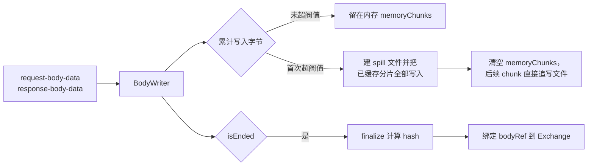

> 返回 [Capture 索引](README.md)

## 6. 正文存储

### 6.1 增量写入

**spill 是全量迁移，不是只写超出部分。** `consume()` 在首次发现
`writtenBytes > memoryThresholdBytes`（即 `BODY_MEMORY_THRESHOLD_BYTES`，3 MiB）时才创建 spill 文件，紧接着把 **已经放在
`memoryChunks` 里的全部分片按顺序写进文件**，然后 `memoryChunks.length = 0` 清空内存，
当前 chunk 也直接追写文件。此后 `output` 非空，所有 chunk 一律走文件。

因此一份正文要么**完全在内存**、要么**完全在文件**，不存在一半内存一半文件的拆分状态。
`finalize()` 里的 `const memory = this.spillPath ? null : Buffer.concat(...)` 也体现了这一点：
一旦 spill 过，内存侧就是 `null`。

**内容寻址的必然约束**：`BodyStore` 按内容 hash 去重，因此 **hash 只有写完才能确定**。传输过程中 Exchange 只能记录 observed bytes，`requestBodyId` / `responseBodyId` 必须在 `isEnded` 后绑定。

普通HTTP正文的大小实时增长，按bodyId预览与保存须等待提交；gRPC的在途消息读取使用writer快照，不伪造内容hash，见4.1。

### 6.2 阈值语义

两个阈值都定义在 `proxy-core/constants.ts`，作用于**单个正文**（非全局）：

| 常量 | 值 | 含义 |
| --- | --- | --- |
| `BODY_MEMORY_THRESHOLD_BYTES` | `3 * 1024 * 1024` = **3 MiB** | 累计写入超过它就建 spill 文件，并把已缓存内容全量迁移进去 |
| `BODY_WRITER_PENDING_LIMIT_BYTES` | `128 * 1024 * 1024` = **128 MiB** | 待落盘积压的**病态兜底**，正常流量不会触及 |

两者职责不同：**3 MiB 决定“存在哪里”**（内存还是文件），**128 MiB 决定“什么时候放弃”**
（只在磁盘持续远慢于接收速度时才触发）。写入是异步串行的，因此即使已经 spill，排队中的
chunk 仍占内存，128 MiB 上限正是给这段队列封顶。

**设计意图是完整保留正文。** 128 MiB 取值远高于真实流量的积压水位，包括大文件下载在内的
常规场景都不会丢弃内容；它只在磁盘异常或极端本地源站这类病态情况下生效，避免 Core 因内存
无界增长而被重启。

**两个阀值都是“每条正文”而非全局上限**，因此峰值内存会乘上并发数。

spill判断使用累计`writtenBytes`，不是单个chunk大小，也不等待完整buffer；累计跨过阈值时立即迁移。

### 6.3 背压

`write()` 由 Mockttp 的 `body-data` 回调同步调用，而 Mockttp **不等待**消费者（见 3.6，body-data 是
旁路复制流）。因此 `write()` 必须立刻返回，不能 `await` 磁盘——每个 chunk 只能先复制进内存、挂到串行
Promise 链上排队，真正落盘在后台进行。`pendingBytes` 就是「已收下但尚未落盘」的字节数。

**上限约束的是这段积压，而不是正文大小。** 若不设限，当到达速度持续快于磁盘写入速度时队列只进不出，
排队的 Buffer 全部驻留 RAM，Core 内存会无界增长。反过来，60 MB 正文只要任一时刻积压不超过上限就毫无
问题——它限制的是瞬时落差，不是总量。

无法做真正的背压：Mockttp 的 `emitBodyDataEvents` **忽略回调返回值**，且在 `'data'` 事件里无条件
累积 `pendingContent`，无任何接口可以告知“慢一点”；旁路流也不影响转发管线，唯一能减速的方式是
拖慢真实流量。Interceptor 是透明调试代理，**不能因为记录器跟不上就拖慢用户的流量**，
因此只能给队列封顶。

1. 每个body writer维护有界待写队列，上限为`BODY_WRITER_PENDING_LIMIT_BYTES`（128 MiB）。
   该上限是**病态兜底**，不是常规限制：正常流量（含大文件下载）下磁盘远快于网络，积压接近于零，
   正文完整保留。它是**每个 writer** 的，一条 Exchange 有请求/响应两个 writer。
2. 超限时停止保存内容，
   仅累计 observed bytes（因此 UI 上的大小仍然准确），`finalize()` 返回 `null` 不绑定 bodyRef。
   降级是 **整条丢弃而非截断**：`discardCollected()` 会清空内存分片并删除已写的 spill 文件。
   原因是 Body Store 按内容 hash 寻址，截断的正文会算出与真实内容对不上的 hash，
   让用户看到一份与实际传输不符的「正文」，比没有更危险。
3. 缺少bodyRef不能解释为正文为空；UI没有独立的积压降级提示，observed bytes与可读正文必须分别判断。

可配置阈值属于候选方案，Settings没有对应配置项。若引入，存储阈值只对新建writer生效，Core校验范围；预览上限与存储阈值分开，由调用方通过读取命令指定解码输出上限。提示需区分空正文、预览截断和积压丢弃，不能把三者混成一种状态。
调大积压上限会按writer并发数抬高Core峰值内存，配置提示需要说明这一代价。

磁盘写入失败只跳过该正文，绝不影响转发、RPC 或进程状态。

各writer独立排队，一个writer受阻不串行阻塞其他正文；`finalize/abort`必须等待已接受写入结束，再提交或清除spill文件。单writer上限不构成全Core RSS、磁盘总量或Session容量上限。

### 6.4 正文按线上编码保存，解码元数据随 bodyRef

`body-data` 事件给出的是**线上原始字节**：`gzip` / `br` / `deflate` 压缩的响应体在这里就是压缩流。
Capture 原样落 Body Store，**不在数据面解压**——解压需要完整输入，会毁掉流式，也会让内容寻址
hash 与真实传输内容对不上。

代价是渲染端必须知道怎么还原，因此 `BodyRefInput` 必须同时携带两项元数据，请求侧与响应侧对称：

| 字段 | 来源 | 用途 |
| --- | --- | --- |
| `contentEncoding` | 该方向 headers 的 `content-encoding` | `body.read-range{decode:true}` 时选择解码链 |
| `mediaType` | 该方向 headers 的 `content-type` | Inspector 判定文本/二进制，决定 Auto 走文本还是 Hex |

`ExchangeTracker` 在 `beginRequest` / `beginResponse` 的头部阶段就把两个值读进 `TrackedExchange`，
再在三个收尾点（`finalizeRequestBody`、`completeExchange`、`finishExchange`）绑定到 bodyRef 上。
必须在头部阶段取：正文结束时 Mockttp 的 headers 对象已不在手边。

**漏掉 `contentEncoding` 的后果是静默的**：正文字节完好、逐字节可还原，但 Renderer 不会请求解码，
于是把压缩流当 UTF-8 渲染成乱码，HAR 导出也会把压缩字节写成 `text`。回归用例按 H1 / H2 / HTTPS MITM
三条链路各自断言 origin 收到的请求正文、客户端收到的响应正文、以及落库正文三者逐字节一致，
并校验 bodyRef 上的 `mediaType` + `contentEncoding` 能把正文还原成明文。

WebSocket 不走这条路径：bridge 两端都关掉 `permessage-deflate` 并剥掉 `sec-websocket-extensions`，
帧 payload 永远是未压缩字节，只按 opcode 记 `text/plain; charset=utf-8` 或 `application/octet-stream`。
