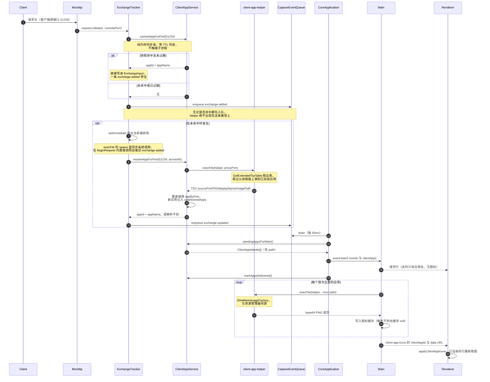

> 返回 [Capture 索引](README.md)

## 8. 客户端应用归属（Windows）

Capture 在创建 Exchange 时同时记录**发起这条请求的本机应用**，用于列表图标与 Inspector 展示。

### 8.1 解析链路

| 环节 | 数据源 | 说明 |
| --- | --- | --- |
| 连接 → PID | `GetExtendedTcpTable` | `request-initiated` 给出客户端源端口，在系统 TCP 表里查 owning PID |
| PID → 可执行文件 | `QueryFullProcessImageName` | — |
| 进程 → 应用 | 见 8.2 | 容器进程需沿进程树上溯 |
| 应用 → 图标 | `IShellItemImageFactory` | 与资源管理器同源。**不能**用 `SHGetFileInfo` / `app.getFileIcon`：MSIX/UWP 应用的 exe 只是 stub，图标在包的 Assets 里，后者只能拿到通用图标 |

全部经`client-app-helper`（Windows C#单文件，属于`packages/platform-capabilities/src/client-app/`）完成，Main在fork Core时以`--client-app-helper`注入路径。Core从`@interceptor/platform-capabilities/client-app`使用原生查询和TSV解析，缓存、Capture关联及增量事件继续由Core的ClientAppService负责。其他平台`ClientAppService.supported`为false，列表不显示图标。只有loopback客户端才反查；远程设备不存在对应的本机进程。

helper四个子命令：`<proxyPort>`输出TSV `sourcePort/PID/displayName/identity`（捕获路径用），`--icon <path>`输出base64 PNG，`--resolve <pid>`与`--apps`用于排查。Main通过平台对象的Client App模块复用同一个exe读取并缓存图标。

一条请求从到达到图标上屏的完整链路：

### 8.2 容器进程归属

WebView2宿主、微信小程序容器这类进程自己不是用户心目中的应用，因此沿进程树向上追溯，**一旦命中系统已安装应用就停**。不设层数上限，避免截断真正的长链归属，例如`Microsoft.CodeAnalysis.LanguageServer.exe → Visual Studio Code`。

“已安装应用”是一张**安装目录 → 系统登记名**的索引，组合以下四类来源：

| 来源 | 取值 | 补的是什么 |
| --- | --- | --- |
| MSIX/UWP 包登记表 | `PackageRootFolder` + `DisplayName` | 全部打包应用（Teams、Outlook、Windows App、Widgets、SearchHost） |
| 卸载登记表 | `SystemComponent != 1` 条目的 `InstallLocation` / `DisplayIcon` | 传统桌面应用 |
| `App Paths` | 主程序所在目录 | 卸载表没写 `InstallLocation` 的 |
| 开始菜单快捷方式 | `.lnk` 目标所在目录 + 快捷方式名 | MSI 安装（OneDrive、Logitech G HUB 等） |

`SystemComponent = 1` 是 Windows 标记运行时组件的官方标志（WebView2 Runtime 即属此列），因此它不会成为归属终点。

**MSIX来源迁移候选。** `CollectPackagedApps()`直接读取AppModel
Package Repository 注册表；可改用官方 `PackageManager.FindPackagesForUser("")`，获得当前用户注册包
的 identity、安装路径、版本与状态，并正确覆盖非默认 PackageVolume。收益是摆脱内部注册表结构、
强类型语义更稳定；代价是不会返回只为其他用户注册或仅 staged/provisioned 的包。

对“当前用户发起的网络连接”，当前用户范围通常正是正确语义；但 SYSTEM/其他用户真正运行的
packaged process 仍需单独处理。全用户 `FindPackages()` 要管理员权限，不应放入抓包热路径。因此实施前
必须比较当前 registry 索引、`FindPackagesForUser` 与实际运行 PID 三组结果，不做盲目一换一。

AppContainer exemption UI 不使用这张索引；它由 `NetworkIsolationEnumAppContainers` 直接提供候选
AppContainer、SID、package、display name 与 binaries。把 exemption 枚举与 Capture 运行时归属分成
两个模块，避免为了授权一个 SID 引入整套启发式应用识别。

五个边界条件：

- **一律按可执行文件路径判定，绝不按 AUMID**。MSIX 宿主派生的 `msedgewebview2.exe` **会继承宿主的包身份**，`GetApplicationUserModelId` 对它同样成功；按 AUMID 判会让上溯在 WebView2 进程处停住，Teams / Outlook / Windows App / Widgets 的流量在 UI 里会一律显示成 `Microsoft Edge WebView2`。
- **父进程必须经创建时间校验**。`ParentProcessId` 是创建时的快照，父进程退出后 PID 会被系统复用，“父进程”可能指向毫不相干的新进程，甚至沿复用形成的环兑圈子。因此父进程的创建时间晚于子进程就停——这才是防环与防认错的真正手段，比层数上限精确。
- **索引未命中不等于起始进程就是应用**。MSI安装可能不登记`InstallLocation`或`DisplayIcon`，开始菜单快捷方式也可能指向`C:\Windows\Installer\{GUID}\`的广告stub；一路未命中时停在**最后一个可信祖先**上。
- **不比较发布者**。宿主应用可以使用其他发布者的运行时，按发布者限制会误判归属。
- **系统目录下只有打包应用才算应用**。否则 `App Paths` 与开始菜单里大量指向 `System32` 的条目会把整个系统目录变成应用目录，`svchost.exe` 会立刻命中；反过来，`C:\Windows\SystemApps` 下的 MSIX 包（SearchHost）仍能正确归属。

### 8.3 显示名的分层选取

同一个进程有好几个"名字"，它们描述的**不是同一层东西**：

| 来源 | 描述的是 | 粒度 | 例子 |
| --- | --- | --- | --- |
| 主程序登记名（开始菜单快捷方式名、卸载表 `DisplayIcon` 指向的主程序） | 用户会去点的那个入口 | per-入口 | `WINWORD.EXE → Word`、`Weixin.exe → 微信` |
| 目录登记名（MSIX 包 `DisplayName`、卸载表 `InstallLocation` 的 `DisplayName`） | 一个打包应用 / 一次安装 | per-包、per-安装包 | `Microsoft Teams`、`Microsoft 365 Apps for enterprise - en-us` |
| exe 版本资源 `FileDescription` | 这个可执行文件是什么 | per-exe | `OneDrive.Sync.Service.exe → Microsoft OneDrive Sync Service` |

按优先级依次尝试：**主程序登记名 → 目录登记名 → `FileDescription` → 不含扩展名的文件名**。

登记名优先于 `FileDescription`，因为这一列的语义是"哪个应用发出的请求"，而 `FileDescription` 描述的是进程/组件（`Microsoft OneDrive Sync Service`、`G HUB`、`LGHUB Agent`），不是用户心目中的应用。主程序又必须优先于目录：套件类安装（Office）在卸载表里只有一个条目，只按目录会把 Word、OneNote 一律叫成 `Microsoft 365 Apps for enterprise`。

**不按`ProductName`校验目录登记名**。应用内的运行时组件可以有不同的产品名，例如VS Code的`OpenConsole.exe`；要求同源会错误拆分所属应用。这个取舍也意味着，落在nvm登记目录下的`node.exe`可能显示为NVM，而不是Node.js。

**代表标识决定 `appId` 与图标。** 归属结果的 `path` 会被换成应用的代表标识——卸载表 `DisplayIcon` 指向的主程序，或包只有一个应用时的 `shell:AppsFolder\<AUMID>`——让名称、图标、`appId` 三者同源。否则 OneDrive 的 `FileCoAuth.exe`、Outlook 的 `olkexthost.exe` 这类没有图标资源的后台组件会拿到通用图标，并在 UI 里裂成独立条目。代表标识只取自权威来源：App Paths 与快捷方式只代表单个入口，拿它们代表整个目录会把 OneNote 显示成 Excel。

**系统权限进程的兜底**。helper以普通用户权限运行，对SYSTEM服务进程的`OpenProcess`可能被拒绝。此时使用`CreateToolhelp32Snapshot`的`ExeFile`提供文件名；没有路径就无法取图标。Core仍登记这类条目，以显示名代替路径计算`appId`。

### 8.4 不阻塞捕获管线

`resolveAppForPort` 会拉起 helper 子进程，而 `execFile` 的 spawn 是**同步系统调用**。因此 `beginRequest` 只做纯内存的快照命中：

- 命中 → 同步写入 entry，`exchange-added` 一次带全，不产生额外事件
- 未命中 → `setImmediate` 排出当前栈后再解析，结果以 `exchange-updated` 补齐

这保证 helper 慢、挂起或失败都不会延后 `exchange-added` 与转发。解析失败只记 `client-app.lookup-failed` 诊断；孤儿 Promise 带 `catch`，Node 默认 `unhandled-rejections=throw` 会终止 Core 进程并中断抓包。

**反查中的条目与无归属条目分开。** 排队反查的entry带`appPending: true`（只在为真时进摘要），Renderer将其归入10.1节的Pending bucket，而不是Unknown。**成功、查不到、helper异常三种终态都必须清除此字段**；即使没有其他字段变化，也要补推`exchange-updated`，避免永久显示解析中。

### 8.5 快照与缓存

`ClientAppService` 持有两张表：

| 字段 | 内容 | 生命周期 |
| --- | --- | --- |
| `appByPort` | 源端口 → 应用 | 每次 helper 调用整表替换，`CLIENT_APP_SNAPSHOT_TTL_MS`（15s）后作废 |
| `undeliveredApps` | 尚未交给 Main 的应用身份 | 随 event-batch 下发成功后清除 |

TTL 防的是端口复用错认：连接关闭后源端口会被系统重新分配给其它进程，过期快照会把请求归给错误的应用。

并发解析共享同一次 helper 调用；解析时每一轮都先 `await` 快照再判断，**绝不在快照飞行中直接放弃**（请求到达时 TCP 连接必然已建立，只需一张采样时刻不早于此刻的快照）。helper 失败后在同一窗口内退避，避免反复拉起子进程。

### 8.6 身份与图标的传递边界

- Core 只把 `appId`（应用标识 sha256 前 16 位）与 `appName` 放进 `CaptureExchangeSummary`
- 完整身份（含 `path`）随 `event-batch` 的 `clientApps` 字段一次性交给 Main，**每个应用一次**；Main 无需再按 id 回问 Core
- Main 读取图标后经 `client-app:icons` 主动推给 Renderer，Renderer 从不发起索取
- Renderer 全程只见 `appId` 与 PNG data URL，拿不到可执行文件路径

图标按应用而非按请求去重，因此不会随每条 Exchange 重复传输（一张 data URL 2–4 KB，`appId` 只有 16 字符）。Renderer 侧 `clientAppIcons` 是响应式 map，且靠“有无该键”天然区分出图标三态，不需额外状态字段：

| `clientAppIcons.get(appId)` | 含义 | 展示 |
| --- | --- | --- |
| `string` | 已取到 | 真实图标 |
| `undefined` | 还在路上（图标总是晚于 Exchange 到达） | 占位方块 |
| `null` | 取不到（系统权限进程没有路径，或 shell 返回失败） | 未知应用图标 |

批次发送失败时身份留在 `undeliveredApps` 里下一轮继续带上；Renderer 重新加载会丢失已推送的图标，Main 在 `did-finish-load` 时补发一次已知集合。
