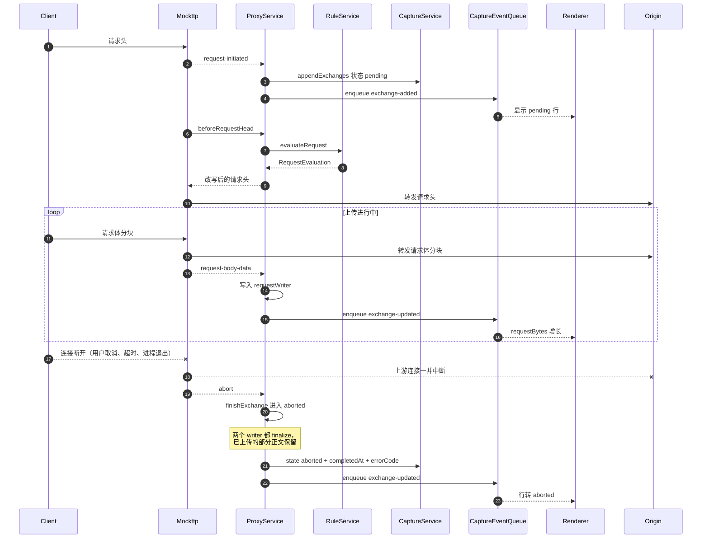
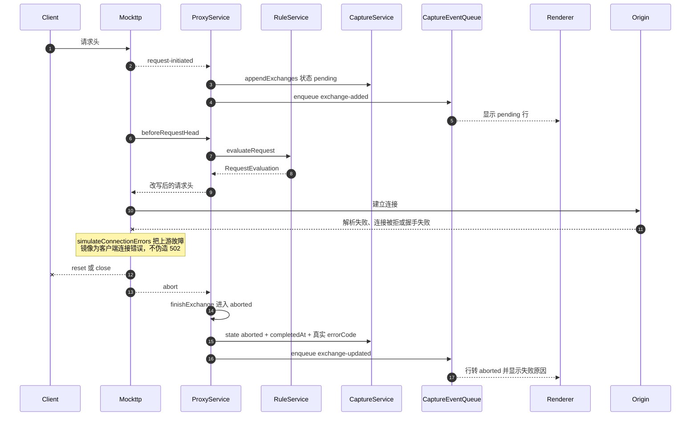
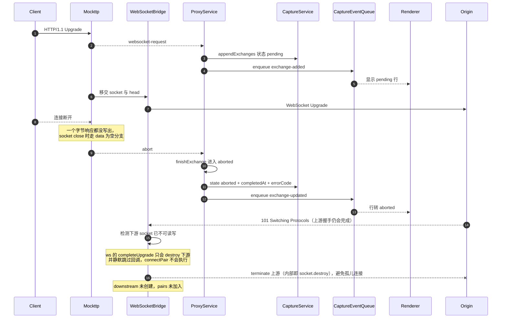
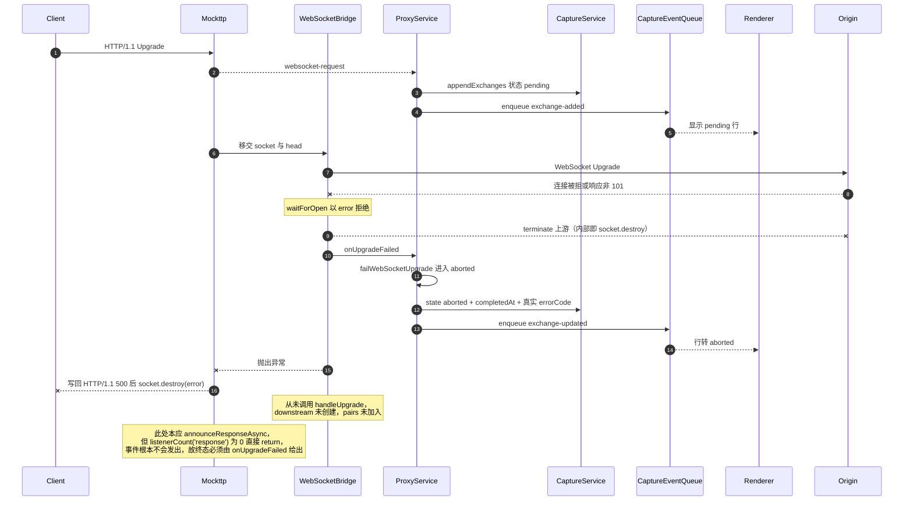
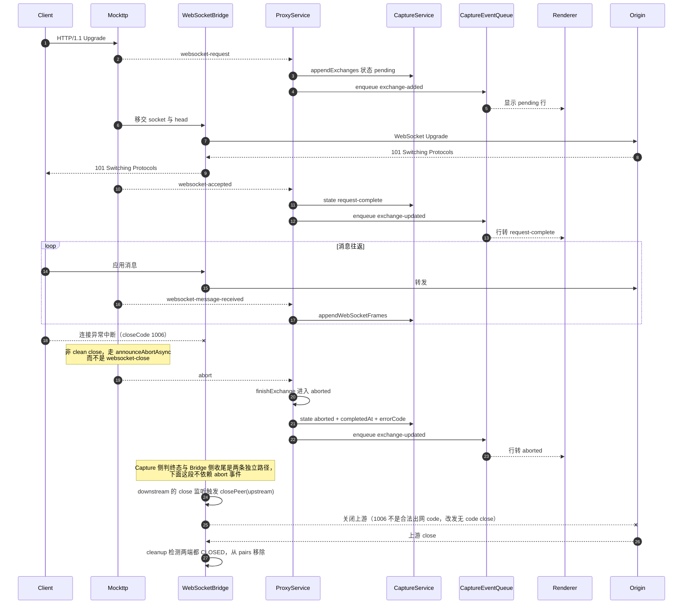

> 返回 [Capture 索引](../README.md)｜[调用流程](../README.md)

### 5.5 中断（abort）

由全局 `server.on('abort')` 驱动，**覆盖 HTTP 与 WebSocket**，不覆盖未解密隧道。
五种触发场景的前置流程互不相同，各画一张从客户端发起请求开始的完整时序。

无论哪一种，收尾都汇聚到 `finishExchange`：两个 writer 都 finalize（已接收的部分正文保留并绑定
body 引用），写入 `state`、`completedAt`、`errorCode`，`terminal` 置真并从 `entries` 移除，
最后 `resolveExchangeReady`。

#### 5.5.1 HTTP 客户端主动中断

用户取消、请求超时或客户端进程退出，连接在上传或等待响应期间断开。

#### 5.5.2 HTTP 上游连接失败

DNS 解析失败、TCP 被拒或 TLS 握手失败，请求从未到达源站。

**上游失败语义**：passthrough 固定 `simulateConnectionErrors: true`，因此客户端看到的是与不挂代理时一致的失败形态（连接被重置/关闭），而不是一个伪造的 502 响应。Capture 里也是一条带真实 `errorCode` 的 `aborted` 记录，而不是一条假响应。

#### 5.5.3 WebSocket 升级完成前客户端断开

客户端发出 Upgrade 后、握手完成前就断开，此时还没有任何响应字节写回。

**Bridge 必须自己收尾上游。** 上游握手是异步的：客户端断开时 `await waitForOpen(upstream)` 往往仍在
等待，之后源站照样会回 101，于是出现「下游已死、上游刚活」的错配。此时 `ws` 的 `completeUpgrade`
第一件事就是 `if (!socket.readable || !socket.writable) return socket.destroy()`——**它只销毁下游
socket，并且不调用回调**，因此 `connectPair` 永远不执行、上游既进不了 `pairs` 也无人 `terminate`，
`bridge.close()` 同样兜不住（它只遍历 `pairs`）。

`handle()`在`handleUpgrade`前检查下游是否仍可读写，并注册一次`socket.once('close')`守卫：配对未完成时调用`upstream.terminate()`。

被移交的下游 socket 不需要 Bridge 额外处理——`completeUpgrade` 已经 `destroy()` 了它。

#### 5.5.4 WebSocket 上游升级失败

上游拒绝升级或连接不通，Bridge 的 `waitForOpen(upstream)` 失败。

**这里没有「收不到的事件」，而是压根不发。** `announceResponseAsync` 的第一行就是
`if (emitter.listenerCount('response') === 0) return`，Capture 从不订阅 `response`，因此
Mockttp 连 `waitForCompletedResponse()` 都不会调用——既不会有事件投递，也不会触发 3.2 说的全量正文
缓冲。代价是这条路径**没有任何 Mockttp 事件可用**，终态只能由 Bridge 的 `onUpgradeFailed` 补上。

#### 5.5.5 WebSocket 已建立后非正常关闭

握手成功、消息通道已经工作，之后连接异常中断（`closeCode` 1006，非 clean close）。

**Bridge 的收尾与 abort 事件互不依赖。** `abort` 只驱动 Capture 判终态；连接回收由 `connectPair`
注册的监听器完成：任一端 `close` → `closePeer` 把关闭传播给对端 → 两端都 `CLOSED` 时 `cleanup`
把 pair 从 `pairs` 移除。`ws` 的 `close()` 会发关闭帧并挂一个 30s `closeTimer`，对端不回应也会
`socket.destroy()` 兜底，因此不会无限挂起。

**WebSocket 复用同一模型**：`beginWebSocketRequest` 内部就是 `beginRequest`，条目同样落在 `entries` 里，因此 `abortExchange` 能正常命中。正常关闭（clean close）走的是 `websocket-close` → `closeWebSocket` → `completed`，不在本节范围内。

#### 5.5.6 资源回收对照

WebSocket 路径上 Bridge 实际持有的对象只有三类，逐场景的回收责任如下（HTTP 路径见本表末尾）。

| 对象 | 谁创建 | 回收方式 |
| --- | --- | --- |
| `upstream: WebSocket`（到源站） | Bridge `new WebSocket(url)` | 见下表逐场景 |
| `downstream: WebSocket`（到客户端） | `ws` 的 `handleUpgrade`，包装 Mockttp 移交的 socket | 与 upstream 成对，随 pair 一同回收 |
| `pairs: Set<WebSocketPair>` | Bridge | `cleanup` / `failPair` / `close()` 移除 |

| 场景 | upstream 回收 | downstream / socket 回收 | pairs |
| --- | --- | --- | --- |
| 上游升级失败（5.5.4） | `waitForOpen` catch 中 `terminate()` | Mockttp `sendWebSocketErrorResponse` 写 500 后 `socket.destroy(error)` | 从未加入 |
| 升级期间客户端断开（5.5.3） | 预检查或 `socket.once('close')` 守卫 `terminate()` | `ws` 的 `completeUpgrade` 已 `socket.destroy()` | 从未加入 |
| 已建立后任一端关闭（5.5.5 与正常关闭） | `closePeer` 传播关闭，30s `closeTimer` 兜底 `socket.destroy()` | 同左，对称处理 | `cleanup` 在两端 `CLOSED` 后移除 |
| 消息转发或连接报错 | `failPair` 直接 `terminate()` | `failPair` 直接 `terminate()` | `failPair` 立即移除 |
| Proxy 停止 / TLS 重配 | `bridge.close()` 遍历 `pairs` 全部 `terminate()` | 同左 | `pairs.clear()` |

`terminate()` 在 `ws` 内部就是 `this._socket.destroy()`，因此上表的每条路径最终都会销毁底层 TCP/TLS
socket，不存在只丢引用不关连接的情况。`connectPair` 注册的监听器都挂在这两个 WebSocket 对象上，
pair 移除后对象即可回收，监听器随之释放。

**HTTP 路径没有需要 Bridge 收尾的连接对象**：客户端与上游 socket 全部由 Mockttp 拥有和销毁，
Capture 只订阅事件。Capture 自己持有的可释放资源仅有 `BodyWriter`（可能已 spill 到临时文件），
其回收点是 `completeExchange` / `finishExchange` 的 finalize，以及 `tracker.reset()` 对在途条目的
`abort()`。

**未解密隧道没有中断语义**：`completeTunnel`固定写`state: 'completed'`。`TlsPassthroughEvent`只带destination / remoteIpAddress / timingEvents /
`tlsMetadata`，**没有任何关闭原因字段**（带 `failureCause` 的是另一个事件
`TlsHandshakeFailure`，只覆盖握手失败）。因此隧道记录无法区分正常关闭与连接重置，永远不会出现 `aborted`。
