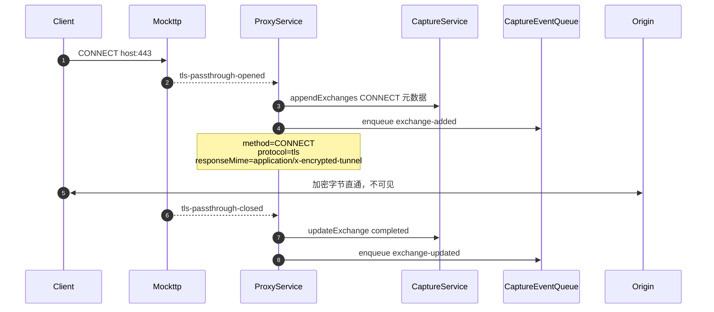

> 返回 [Capture 索引](../README.md)｜[调用流程](../README.md)

### 5.2 CONNECT 隧道（未解密）

未配置 CA 或用户未开启解密时，HTTPS 走字节直通，只记录有限元数据。

`pendingTunnels` 保存 `Promise<PendingTunnelCapture | null>`，确保 closed 事件等待 opened 落库后才更新。隧道内不读取任何 header 或 body。

**Rule 对未解密隧道完全不生效**，因此上图没有 RuleService 参与。原因在 TLS 层就已决定：

未配置 CA 时 `startServer()` 用 `getLocal({ https: { ...tlsPassthroughIdentity, tlsInterceptOnly: [] } })`。
Mockttp 的 `shouldPassThrough()` 在 `interceptOnlyPatterns` 非 undefined 时返回
`!interceptOnlyPatterns.some(...)`，空数组必然得到 `true`，于是 `analyzeAndMaybePassThroughTls`
读完 ClientHello 就把 socket 交给 passthrough listener 并 `return`，**不再继续 TLS 握手**。

后果是隧道内的字节从未被解密、从未被解析成 HTTP 请求，`forAnyRequest().thenPassThrough()`
这条规则链根本不会被触发，`beforeRequestHead` / `beforeResponseHead` 自然也不会调用。
换言之：**要让 Rule 作用于 HTTPS，必须先安装并信任 CA 且开启 MITM**，此时流量走 5.1 的常规路径，
隧道记录不再产生。
