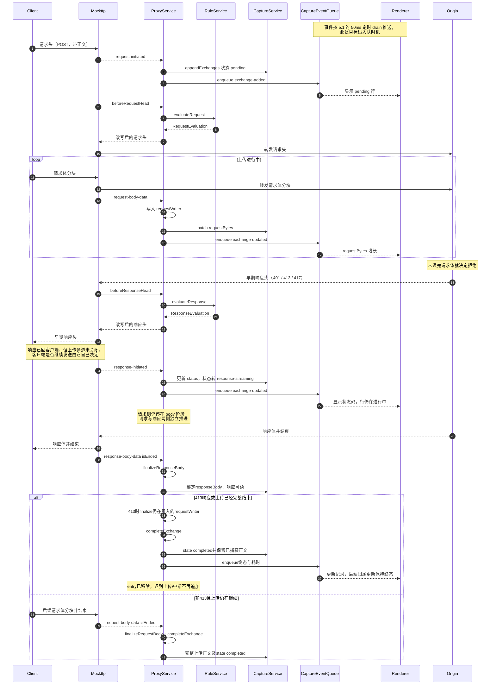

> 返回 [Capture 索引](../README.md)｜[调用流程](../README.md)

### 5.4 早期响应（HTTP）

**终态场景总览**（5.4 与 5.5 合并对照）：

| 场景 | Mockttp 发出的事件 | Capture 结果 |
| --- | --- | --- |
| HTTP 413拒绝上传 | `response-initiated` → `response-body-data isEnded` | 完整413响应后`completed`，保留收尾时已捕获上传正文 |
| 其他HTTP早期响应 | 两侧`*-body-data isEnded`，或实际`abort` | 双向结束后`completed`；真实中断则`aborted`并保留已捕获正文 |
| HTTP 请求中断 | `abort` | `aborted` + `errorCode` |
| HTTP 上游连接失败（DNS/TCP/TLS） | `abort`（`simulateConnectionErrors` 镜像为客户端连接错误） | `aborted` + 真实 `errorCode` |
| WebSocket 升级前连接直接断开 | `abort`（`data` 为空分支） | `aborted` |
| WebSocket 非正常关闭（closeCode 1006） | `abort` | `aborted` |
| WebSocket 上游升级失败 | 无（`response` 未订阅，`announceResponseAsync` 直接 return） | `aborted`，由 Bridge 显式判终态 |
| 未解密 CONNECT 隧道异常断开 | 仅 `tls-passthrough-closed` | 一律 `completed`，**永远不会是 `aborted`** |

本节只针对 HTTP/HTTPS（MITM 后）：Origin 可能在请求体传完前就返回 401/413/417。
WebSocket 没有等价场景（不存在请求体流式上传），未解密隧道也不适用。

**响应与上传是并行的两条通道。** 早期响应头一到就会被 Mockttp 转发给客户端，Capture 也立刻
`patch` 出 `response-streaming` 并入队推给 Renderer——**不需要等上传结束**。此时客户端的上传通道
仍然开着，继续发还是放弃完全由客户端决定（很多 HTTP 客户端收到 4xx 后仍会把已排队的分块发完）。
413完整响应后Capture收尾，后续事件不再追加；其他状态码保留仍在上传的entry，直至上传结束或收到真实中断事件。

**终态不会因迟到事件回退。** `completeExchange`与`finishExchange`都会保存收尾时间并移除entry。
普通请求必须等两侧正文结束；413例外只要求完整响应及当时已捕获上传保存完毕。它表示Capture记录已结束，
不表示客户端全部上传都到达origin，也不主动关闭真实连接。后续应用归属摘要仍保留终态和同一耗时。

Exchange在请求头阶段建立，早期响应合并到同一记录。移除entry前，两侧writer必须分别finalize或abort，不能只移除引用而遗留正文或spill临时文件。
