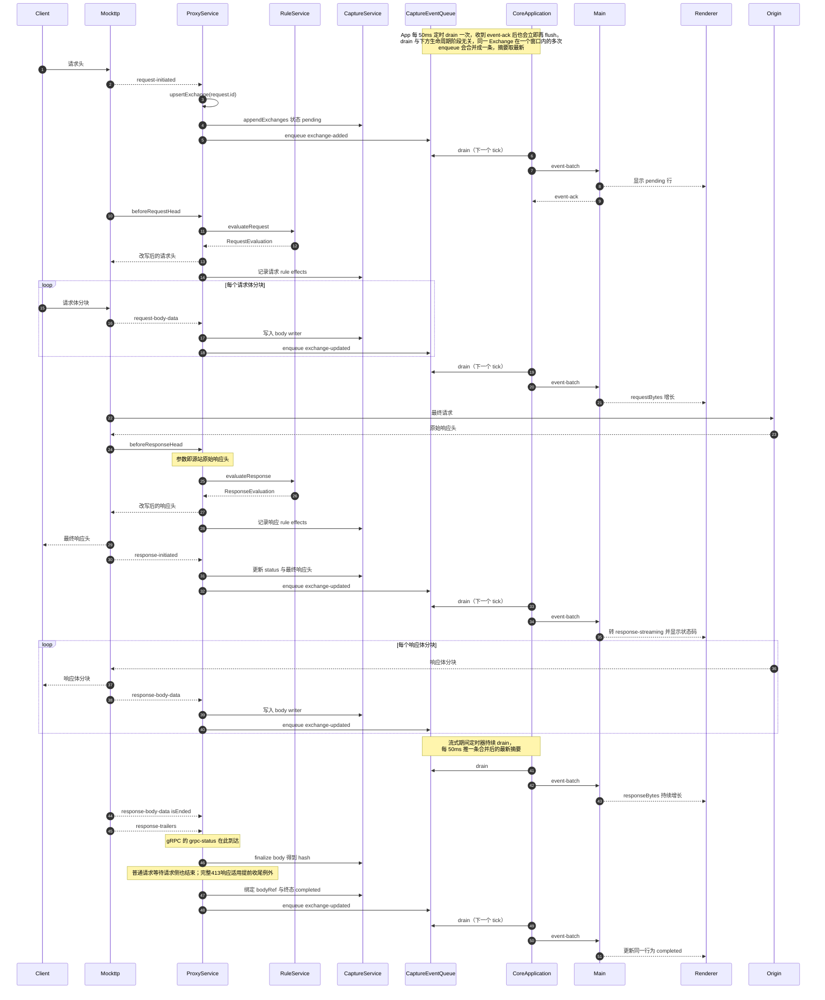

> 返回 [Capture 索引](../README.md)｜[调用流程](../README.md)

### 5.1 HTTP/HTTPS 常规请求（主路径）

**逐步说明：**

1. **请求头到达**：`ProxyService` 在 `request-initiated` 回调内检查 `recording` 与 capture generation，通过后分配 `exchangeId`，写入 `ExchangeInput{ state: 'pending' }`，立即 enqueue `exchange-added`。UI 在一个 flush 周期内看到该行。
2. **请求规则**：`beforeRequestHead` 与步骤 1 并行，不保证先后。`ProxyService` 用同一 `request.id` 找到（或暂存到孤儿表等待）Exchange 记录，附加 `ruleIds` 与 header effects。钩子**不等请求正文**。
3. **请求体**：每个 `request-body-data` 把 `content` 追加进该 Exchange 的 request body writer，更新 `requestBytes`。`isEnded` 时 finalize 得到 hash 并绑定 `requestBodyId`。
4. **源站响应头**：`beforeResponseHead` 的参数就是 Origin 原始响应头，作为 response Rule 效果的对照。钩子**不缓冲响应正文**。
5. **最终响应头**：`response-initiated` 提供实际写回客户端的值，更新 `statusCode`、`responseMime`、`responseStartedAt`，状态转 `response-streaming`。
6. **响应体**：同请求体，写入 response body writer。
7. **trailer**：`response-trailers` 追加记录；gRPC 的 `grpc-status` 由此路径获得。
8. **终态**：两侧正文结束后写入`completedAt`与`state: 'completed'`；完整413响应适用4节的提前收尾例外，中断则保留部分正文并进入`aborted`。
