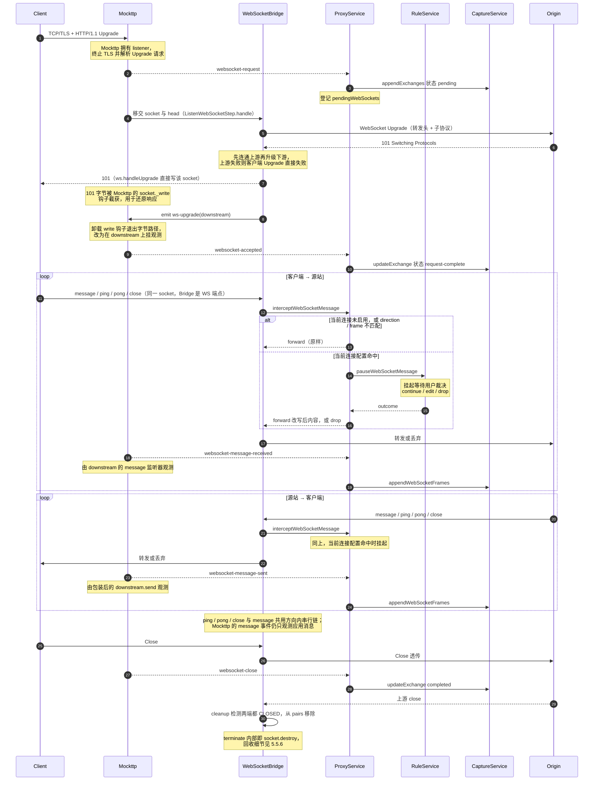

> 返回 [Capture 索引](../README.md)｜[调用流程](../README.md)

### 5.3 WebSocket

101 Exchange 由 `websocket-accepted` 完成。不能依赖 completed `response`，因为订阅它会
触发全量正文缓冲（见 3.2）。

**客户端连接的归属分层**（容易误解，单独说明）：

| 层 | 归属 |
| --- | --- |
| TCP/TLS 接入、HTTP Upgrade 请求解析、WebSocket 规则匹配 | Mockttp |
| 101 握手响应与之后全部 WebSocket 帧 | Bridge（`ws`）直接读写 Mockttp 移交的同一 socket |
| `websocket-accepted` / `message-received` / `message-sent` / `close` 观测 | Mockttp，但**不在字节路径上** |

Mockttp 在 Upgrade 阶段给 socket 装 `_write` / `_writev` 钩子，因此 Bridge 调
`downstreamServer.handleUpgrade()` 写出的 101 字节会被它截获并 `parseRawHttpResponse` 还原成
响应对象。随后 Bridge `socket.emit('ws-upgrade', downstream)`，Mockttp 收到后**立刻卸载钩子**，
转而在 `downstream` 这个 WebSocket 对象上挂 `on('message')` 并包装 `send()`，靠对象级 hook 观测
消息。也就是说：**连接是 Mockttp 接的，WebSocket 协议端点是 Bridge 的，Mockttp 升级完成后退化为观察者。**

约束：

- **Rule 的适用范围与 HTTP 不同**，这是 WebSocket 最容易误解的一点：

  | 对象 | 是否经过 Rule |
  | --- | --- |
  | Upgrade 请求（header 改写、block、map local/remote 等） | **否**。Bridge 经 `addWebSocketRule` 注册独立的 WebSocket 规则链（`WildcardMatcher` + 自定义 step），不走 `forAnyRequest().thenPassThrough()`，因此 `beforeRequestHead` / `beforeResponseHead` 不会触发 |
    | 帧 | **仅当前连接临时断点**。`interceptWebSocketMessage` 按 `exchangeId` / `direction` / `frames` 检查 `WebSocketBreakpointSettings` 后调用 `ruleService.pauseWebSocketMessage`；message / ping / pong / close 各有明确 `ruleName`，**不做 matcher 匹配，也不执行 Rules action** |

    即 WebSocket 帧断点由 `websocket.breakpoint.enable` / `websocket.breakpoint.disable` 控制，只作用于配置中的当前 exchange；命中后挂起等待 continue / edit / drop，与 Rules 工作区里的 HTTP breakpoint action 正交。
- **上游先于下游**：`handle()` 先 `new WebSocket(url)` 并 `waitForOpen(upstream)`，成功后才 `handleUpgrade` 回客户端 101。上游握手失败时 upstream 被 terminate 并抛出，客户端拿不到 101，因此不存在「已升级但无上游」的中间态。子协议以上游 `sec-websocket-protocol` 回填，`sec-websocket-extensions` 被删除（bridge 关闭 permessage-deflate，两侧均传明文帧）。
- **配置方向才过断点**：client-to-server 与 server-to-client 都接入 `intercept()`，是否挂起由当前连接配置的 `direction` 决定。两个方向各自维护 `clientTail` / `serverTail` Promise 链，互不阻塞但各自保序；message / ping / pong / close 共用该方向的同一条链。
- **观测依赖 Bridge 走 `send()`**：Mockttp 的 `message-sent` 来自被包装的 `downstream.send()`。控制帧走 `ws.ping` / `ws.pong` / `close`，会经过 Bridge 断点，但不产生 Mockttp message 事件，因此当前不作为普通 message frame 落库；close 仍由 `websocket-close` 更新连接终态。
- **两个方向的记录语义不对称**：Mockttp 与 Bridge 各自在**同一个** `downstream` 对象上挂 `on('message')`，一帧到达同步触发两者（`socket.emit('ws-upgrade')` 是同步的，Mockttp 先注册也先执行）。但转发目标不同导致：

  | 方向 | 观测点 | 记录到的内容 |
  | --- | --- | --- |
  | client → server | `downstream.on('message')`，帧一到就捕获 | 断点**前**的原始内容，被 drop 的消息**仍会**记一条 |
  | server → client | 被包装的 `downstream.send()`，断点决策**后**才调用 | 断点**后**的最终内容，被 drop 的消息**不落库** |

  原因是 client→server 转发调 `upstream.send()`，而 upstream 由 Bridge 自行 `new WebSocket()` 创建、未被 Mockttp 包装，不产生事件。因此「断点改写是否体现在 Capture 记录里」两个方向相反。
- 消息按 `streamId` 串行 `writeTail` Promise 链，保证顺序且等待 101 Exchange 先落库。
- payload 复用 `BodyStore`，按 hash 去重。
- 仅支持HTTP/1.1 Upgrade，不支持H2 Extended CONNECT。
