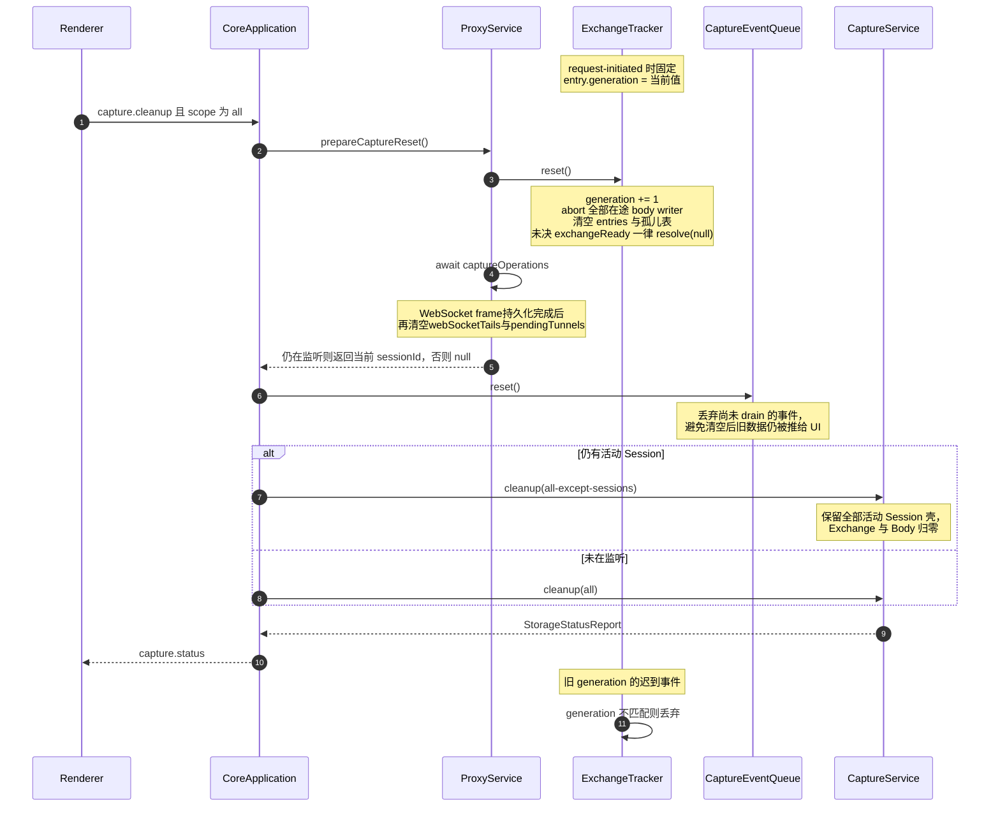

> 返回 [Capture 索引](README.md)

## 7. Recording、Pause 与 Clear

### 7.1 三种状态

| 操作 | 命令 | 效果 |
| --- | --- | --- |
| Start | `proxy.start` | 启动 listener（若未启动），`recording = true` |
| Stop | `proxy.setRecording{false}` | **只暂停记录**。listener 与系统代理保持运行，流量继续转发 |
| Clear | `capture.cleanup{all}` | 没有在途Capture文件任务时推进generation、Exchange与正文归零，保留活动Session壳；否则返回conflict（见7.2） |

Stop 不停止转发，也不恢复系统代理。系统代理只在应用退出、Core 故障恢复、用户显式 Restore 或紧急修复时恢复。

### 7.2 Capture generation

Core先检查Body导出及HAR/Archive导入导出是否仍持有Capture数据，包含取消后的清理阶段；存在时返回`conflict`、`retryable: true`，不执行下方reset流程。Clear执行期间也禁止新Capture文件任务和重复Clear，结束或失败后释放，Diagnostics导出不受影响。UI遮罩、MCP及Agent入口遵守同一Core检查，详见[文件任务互斥](../transfer.md#clear与文件任务)。

**Clear 由 CoreApplication 编排，不是 ProxyService 自己完成。** 三步顺序不可换：先
`prepareCaptureReset()`先建立切面（推进generation，让在途Tracker事件立即失效），再等待统一登记的
`captureOperations`完成。WebSocket frame写入与HTTP/tunnel写入使用同一排空边界，不得在Storage cleanup后
继续写入旧exchange/body。随后`captureEventQueue.reset()`丢弃已入队但未推送的事件，最后才真正执行
`capture.cleanup`；三步顺序不可换。

**活动 Session 会被保留。** `prepareCaptureReset()`在代理仍在监听时返回当前`sessionId`，
Core同时收集Android入口拥有的独立Session，使用`all-except-sessions { sessionIds }`——Exchange与
Body全部归零，但所有活动Session壳保留。没有活动入口时才使用`cleanup(all)`。保留壳也必须撤销
尚未收到请求头的旧采集，迟到请求不能重建记录；`scope: session`若命中入口仍拥有的Session，返回
`conflict`且不删除数据。入口启停与Clear串行，退出先等待已接受的Clear，再释放存储。

**判定规则：以请求开始时的状态为准。**

- 录制中开始、暂停后完成的长请求：继续完整记录。
- 暂停期间开始、恢复后完成的请求：始终不记录。
- 暂停期间建立的WebSocket没有Capture exchange；`whenExchangeReady`立即返回`null`，不得创建会阻塞
    Clear或Core退出的无主waiter。
- Clear 后旧 generation 的所有 request/body/response/trailer/rule hit 全部拒绝，不得重新创建行。

### 7.3 WebSocket录制边界

消息通过`whenExchangeReady()`关联握手时已录制的Exchange；未录制连接立即返回`null`，不得先保存payload再等待不存在的Exchange。暂停期间建立的连接始终不记录，Resume后的新连接正常记录，Pause前已记录连接继续保存双向消息。HTTP Rule钩子的提前预留ID与这条消息关联路径分开。
