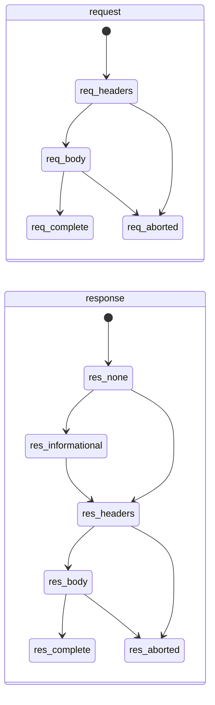

> 返回 [Capture 索引](README.md)

## 4. Exchange 状态机

请求侧与响应侧独立推进，因为 Origin 可能在请求体传完前就返回（401/413/417）。

对外暴露的聚合状态：

| `state` | 含义 |
| --- | --- |
| `pending` | 已收到请求头，尚无响应头 |
| `request-complete` | 请求已完整，等待响应（WebSocket 101 后也用此值） |
| `response-streaming` | 已收到响应头，正文传输中 |
| `completed` | 双向完成；413拒绝上传时，完整响应结束后保存当时已捕获正文并收尾记录 |
| `aborted` | 客户端中断，或上游连接失败（DNS/TCP/TLS）被镜像为客户端连接错误 |
| `failed` | Capture 持久化失败或协议错误 |

**迁移规则：**

1. 终态（`completed`/`aborted`/`failed`）不可回退。
2. 迟到或重复事件不得重复累加 bytes，使用 observed 计数覆盖而非累加。
3. `abort` 可以从任意非终态直接进入。
4. 413仅在`response-body-data.isEnded`后结束Capture记录，不在响应头到达时结束，不关闭真实请求或连接；此后迟到的上传/中断事件不再改写该记录。其他状态码保持双向结束规则。
5. 应用归属异步解析可以补充已结束记录的应用信息，但必须保留原终态和耗时；不得将413完成记录推回`response-streaming`或丢失正常/中断请求的耗时。

### 4.1 流式记录边界

- 响应头到达前已有唯一请求行；收到响应头后更新同一Exchange的状态码、MIME，正文到达时更新实际累计字节。
- 中断时保留真实响应头及已捕获正文，不把已有200改成伪造错误码，也不把部分正文标成完整成功。
- Pause不截断已接受的流量；Clear只移除记录并推进generation，剩余网络字节继续转发，旧行不得恢复。
- Android响应replacement完整消费后，可以停止未结束的源站原文而正常完成最终响应。`HttpRecording`按`response-replaced`保留已观察Original前缀及truncated；零字节停止时Original为unavailable，不冒充完整空正文。Final仅取实际applied副本，字节、完整性和trailers独立结算；已有正常原文end仍保留完整结果。此约定不改变本机Mockttp流量，组件与native联调不代替Android用户流程验收。
- 各协议的用户操作和独立断言见[Capture规格](../../../apps/desktop/tests/e2e-workflow-tests/docs/capture.md)。

#### H2 Range与多stream集成

- 同一H2 session的各stream分别记录headers、正文、trailer和终态。Range、Content-Range与Content-Length保持协议原值，不因另一stream的进度而合并。
- 单stream的`NGHTTP2_CANCEL`只结束该stream，保留已捕获字节和`aborted`，不影响同session的其他stream。
- Clear移除已有记录但不阻断stream；同连接上的后续新请求仍可录制。
- SETTINGS以真实ACK确认生效；session的`closed`与`destroyed`不同，正常GOAWAY后的在途stream仍需独立收尾，不能仅凭session关闭标记判定正文完成。

##### 源站正常GOAWAY与TLS EOF

`CoreApplication`唯一拥有[Http2ClientService](../../../apps/proxy-core/src/proxy-core/http2-client/README.md)，
通过Node公开的`http2.client.stream.created`、`session.socket.allowHalfOpen`和生命周期事件管理本进程的
Proxy/Composer出站TLS/H2；明文H2、入站session和TLS探测保持原路径，不修改依赖、重放请求或全量复制正文。
收到TLS EOF后拒绝新stream，保留已经收到但暂停消费的缓冲；不立即把`closed=false`判为截断。
消费者排空后仍未正常结束，或EOF发生在最终响应头之前，以`ERR_H2_UPSTREAM_INCOMPLETE`显式失败。
完整响应须保持字节/hash、trailer、completed及新请求使用新连接；真实截断不得长期streaming或伪装成功。
Core停止时注销订阅、取消排空检查并等待session关闭，不影响其他进程或留下跨代监听。

#### H2错误GOAWAY

- 源站或客户端发出非零GOAWAY导致stream中断时，保留真实响应头、已收正文和耗时，记录`aborted/failed`，不得把部分正文当作完整成功。
- 客户端事件可能同时出现reset与end；EOF不是完整成功的充分条件。后续新连接可以继续录制，但不能把旧Exchange回退为completed，也不自动重放POST。
- Mockttp可能先发`abort`，再发其批处理缓冲中尚未通知的`response-body-data`（`isEnded:false`）；客户端已收到正文不代表Capture已收到全部观测。网络终态与正文采集收尾独立，这与正文编辑framing或源站正常GOAWAY排空不同。
- `ExchangeTracker`收到第一个`abort`立即发布`aborted`、错误和原网络结束时间，并为该Exchange保留固定1000ms的迟到观测窗口；重复abort和正文通知不延长窗口。定时器到期后将封口排入下一次`setImmediate`，先让已经排队的观测回调执行；封口后不再接受追加，再排空已接受写入并提交正文/hash。调度延迟可能使实际回收晚于1秒，该窗口是有界、尽力保留策略，不代表精确证明Mockttp通知已全部到齐。
- 请求和响应独立处理：已正常结束的正文不重新打开；尚未创建writer的一侧可以在窗口内按首批数据创建。迟到`isEnded:true`也不把Exchange改回completed，网络结束时间不因采集收尾延长。正文始终是一份已观察的部分数据，不新增“中断后正文”副本或网络读取、重放、转发。
- `CaptureService`的writer读取/清理所有权与Exchange网络终态分开；窗口内可读范围继续增长，尚未提交hash的正文快照保持`complete:false`，明确空Final不回退到Original。采集封口且写入结束后才解除writer关联；这里的complete表示采集快照不再增长，不表示中断的HTTP消息完整。
- 暂停录制只拒绝新Exchange，已有窗口继续收尾；Clear、删除所属Session和Dispose优先取消等待并放弃相应writer，不允许迟到通知复活记录或绑定正文。Proxy退出/重建取消定时器并按既定丢弃/保留语义排空已接受写入；正常完成路径不增加1秒延迟。不修改第三方补丁、网络取消/转发或产品UI布局。

Playground手动入口：Capture Lab的HTTP分组提供`h2-error-goaway-client`与`h2-error-goaway-origin`。默认POST接收256 KiB、响应声明512 KiB；收到首段后立即由指定一端发送`NGHTTP2_INTERNAL_ERROR`，不等待Capture先收齐。Response Detail保留实际响应、GOAWAY方向/错误码、接收字节/hash、源站请求次数及独立新连接恢复结果；预期网络失败不能自动算人工Pass。用户通过产品UI启用Recording、HTTPS解密和localhost源站例外，运行后检查原Capture行在约1秒收尾后仍保留200/256 KiB与部分正文、结束耗时不再增长，没有补全或重放；后续独立请求正常完成。页面布局与产品UI不变，操作步骤见[Playground说明](../../../apps/playground/README.md#手动复现h2中断正文)。

#### gRPC在途正文

- 当前Capture按Exchange/side提供正文快照与有限range读取，复用BodyWriter的内存/spill及串行队列，不额外缓存完整stream或伪造在途hash。Final正文优先；等待writer快照期间绑定Final或删除Exchange时重新读取当前状态，显式空Final也不得退回原文。原writer继续保留清理所有权。
- `grpc.messages`通过`GrpcService.query()`只以5-byte header跳读，独立返回`bodyAvailable`、`bodyComplete`和可读`bodySize`。未结束的半个header/payload等待补齐，结束后才报告真实malformed/truncated；不把HTTP200当gRPC成功或提前制造trailers。Renderer经既有Preload入口每350ms沿游标续读，按`grpc.read-range`预览/Copy已有完整消息，切换方向后忽略旧结果。
- 游标offset可等于当前`bodySize`，在途保留该游标，结束后停止续读；超过可读长度抛`InvalidGrpcCursorError`，Core映射为不可重试的`invalid-message`。正文提交失败时BodyWriter快照结束且不可读，保留observed计数并抛出原错误；ExchangeTracker将请求提交、响应提交和终态写入分开排入现有队列，逐次记录失败而不跳过成功正文或实际终态。
- `ExchangeTracker`以待完成写入集合承担排空，不因终态记录移出活动Map或reset而漏等；`settle()`只等待调用时已接受的操作。`ProxyService.stop()`及`prepareCaptureReset()`都先排空Exchange存储，再让后续关闭/Clear清理正文；正常Recording暂停及网络转发保持。

#### 正文视图隔离

- BodyViewer按模式给CodeViewer独立身份，Code自动格式化不能污染Raw；CodeViewer仅调用`editor.dispose()`，不提前销毁仍绑定的隐式模型。

#### HTTP收尾

- 请求和响应分别finalize；提前响应的正文可立即读取，Exchange按双向完成规则收尾。中断时保留已捕获字节并进入`aborted`。
- 413例外只影响记录：完整接收413响应后保存当时的上传片段并以`completed`收尾，不等待或阻断真实上传；后续片段不追加，也不声称已捕获完整上传。
- `TrackedExchange.completedAt`保留收尾时间，后续summary沿用终态和耗时。

#### 中断响应的错误正文边界

- 已中断的SSE保留实际观察到的事件正文，不把代理在连接关闭后生成、未发出的错误文字混入正文。
- Mockttp通用异常入口对原`AbortError`及`response.destroyed && !response.writableFinished`沿用中断收尾，不对已销毁且未正常写完的响应调用`end("Error: aborted")`。正常连接的错误回包保持原行为；新增条件排除已正常写完的响应。
- 不能依赖错误字符串过滤或直接关闭1秒窗口：正常迟到片段仍须保留，观测批次也可能同时含有先前缓冲的数据。
- 客户端取消与origin reset均须保留原行、已接收的200和实际正文；真实客户端收到72字节时，Capture同样保持72字节，不能追加14字节错误文字。正常SSE结束仍按完整响应收尾。
- 对应产品回归在[Proxy集成测试](../../../apps/proxy-core/src/proxy-core/proxy/tests/integration/service.test.ts)，真实流程沿用[HTTP workflow](../../../apps/desktop/tests/e2e-workflow-tests/workflows/capture/http-scenarios.workflow.ts)的客户端中断与源站reset断言，不降低字节预期。

### 4.2 Inspector与正文布局

#### WebSocket与gRPC消息

- WebSocket加载、空结果和错误信息使用116px最小高度的flex居中区域、12px字体和`--text-3`，长信息换行。只有控制帧时，数据消息数为0。
- WebSocket消息行使用38px高度、五列、10.5px mono和自然行高；gRPC消息行同为38px高度、10.5px字号及`line-height: normal`。
- gRPC的1px底边保留在虚拟行外层，消息按钮自身高38px；Capture工具栏也保留原底边。WebSocket暂停编辑器的“原消息保持不变”提示保留17px行高，不为消除设计微差改变原App排版。
- WebSocket载荷由外层消息行展开/收起，保留方向、Text/Binary类型、大小、消息序号和Copy元数据行；内部不再增加独立折叠标题。
- `BodyViewer`仅在`compact && !fullscreen`时让`JsonTreeView`按内容定高，普通和全屏Tree填充容器；Tree行高22px，长内容可滚到末行。
- Tree Copy与Raw使用原文，Pretty使用格式化JSON，Hex Copy生成完整16字节dump。Hex显示按容器及实际`1ch`排布并保留滚动；全屏仍提供MIME与Save。

#### HTTPS设置连接示意

普通定位验收使用已经受信任的共享CA和fresh业务profile：HTTPS Setup不显示Generate/Install按钮，Start decrypting可用但不执行。打开、截图和Cancel不得改变共享CA、MITM或系统信任；逐帧居中和退出恢复要求见[定位规格](../../../apps/desktop/tests/e2e-workflow-tests/docs/capture.md#capture-https-setup-position)。

- `HttpsConnectionChain`位于说明段落前，展示Client apps、Interceptor、Internet、流向箭头及TLS锁，示意高71px、下方间距16px。
- 锁颜色和图标取自弹窗读取的有效MITM状态；图标复用Lucide，节点、标签和图标分别由Grid/Flex居中，不使用基线或位移补偿。

#### 公共分组标题最小高度

- `SectionHeader`与设计`CollapsibleSection`默认最小高度36px，flex居中、自然行高，内容可增高。HTTP/WebSocket Replacement不设置更小的局部下限。
- 计数标签保留MIME和单位的大小写，使用normal字距及`text-transform: none`，不继承标题的uppercase。
- 空Query提示的`KvSection.empty`使用正文行高token；标题、空提示和正文容器各自负责排版，不用增加padding补偿文字度量。

#### Timing正文行高

- `RequestInspector.timelineRow`使用flex及`align-items: center`，标签150px、时长58px、比例条占剩余宽度；gap12px、上下padding7px、比例条高6px。
- 比例条依据真实时间段计算；各分组独立折叠并保留ARIA状态，不用字形边界或位移调整同行对齐。

#### 受限正文提示行高

- `BodyViewer.note`使用11.5px字体、`var(--interceptor-line-height)`行高、9px/11px padding及8px gap，图标由flex居中。
- 提示允许换行，切换Hex不隐藏截断或解码失败信息；编辑器文字为12px/21px，不继承外壳的字号。

#### 媒体正文占位布局

- `UnavailableBody`使用40px图标框、13px MIME、11.5px大小、12px说明和28px `Button sm`。`content/details`两层flex分别设置图标到详情10px、详情内7px、说明到Save 13px；MIME使用自然行高，大小使用正文token。
- 音视频和超限图片不读取正文来预览；损坏图片尝试解码后显示不可预览原因。占位页保留Save，不创建音视频播放器。

#### TLS Tunnel元数据与方法标签

- TLS与普通Inspector `Kv.key/value`均为11.5px mono、18px单行高度，`gap: 9px 16px`；长值换行或带控件的行按内容增高。
- `RequestInspector.methodChip`使用自然行高；详情元数据行不套用gRPC消息列表的38px高度。

#### Inspector POST配色

- `RequestInspector`根据实际method给POST标签附加局部class，使用`--yellow`与14%黄色背景，不复用列表徽标的16%底色。

#### Request Method详情值

- General中的Request Method显示完整大写协议值和accent文字，不是方法标签；Copy复制完整大写值。列表、筛选、断点和Composer中的方法标签复用`MethodBadge`。

#### Inspector标题行高

- 标题仍显示host/path，使用自然行高，不用字体替换或文字位移补偿布局。
- 完整URL仅取当前选中Exchange的详情；尚未就绪时不显示标题Copy，General的Request URL也不提供短标题复制。切换请求时，上一条详情不能让新请求的Copy提前显示。
- 当前请求URL就绪后才显示Copy，复制原始完整URL（含协议、实际端口和query）；同一请求刷新详情期间已有URL保持可用，不增加额外的详情请求。

#### Compact正文高度

- Compact CodeViewer与设计Monaco的box/message使用`getContentHeight()`加宿主实际上下边框，不重复预留横向滚动条空间；字号12px、行高20px、上下padding13px。
- 初次挂载仍同步确定高度；后续内容尺寸与ResizeObserver通知合并到下一动画帧再改写宿主高度和调用Monaco layout，避免在观察器交付中再次触发布局。卸载取消未执行的帧；限高、用户拖拽恢复和字体/换行后的重算规则不变。
- PayloadEditor的Original body和WebSocket暂停容器按内容定高，不额外增加底部预留或固定最小高度；普通查看器仍填充容器。

##### 普通消息正文限高与拖拽

- 普通gRPC/WebSocket展开消息的Monaco视图支持可调整高度；HTTP Original/File、断点编辑、Composer、Tree、Hex及全屏遵循各自的布局契约。
- `FramePayload/GrpcMessagePayload → BodyView → BodyViewer → CodeViewer`显式传`resizable`，只有`compact && resizable && !fullscreen`启用。gRPC虚拟列表跟随Inspector外层滚动并使用scrollMargin；WebSocket列表填充剩余空间，队首/排队断点仍使用各自既有布局，不以固定360px高度限制普通消息。
- 初始高度为`min(完整显示内容高度, 所属滚动容器内正文起点至底边的可用高度)`，至少保留一行、原上下padding和实际边框。短内容贴合，不固定为441px或360px；隐藏状态不决定初始高度，字体加载和换行重排仍重新计算。
- 用户可通过正文右下角向上/下拖拽；窗口缩小时按当前容器收缩，恢复空间后还原用户拖拽高度。只改变显示高度，Monaco模型、消息字节、Copy、Save及转发不裁剪。
- 滚轮、触控板和键盘可到达正文首尾；Monaco保持`alwaysConsumeMouseWheel: false`，正文到边界后继续滚动消息列表/Inspector。长消息内部滚动时消息标题及工具栏不被一并滚走。

##### 正文预览与完整数据边界

- 文本预览最多2 MiB，完整且不超过1 MiB自动格式化，完整1–2 MiB手动格式化；截断正文禁止格式化。图片使用独立16 MiB上限。
- Original/File与普通消息限高并可拖拽，Text保留完整编辑值，Composer继续填充容器。File仅预览前2 MiB，Forward edited仍发送完整文件。
- 界面预览限制不截断Core正文、网络发送、Save或Archive；Copy使用当前视图定义的预览范围。
- chunked编辑的framing缺陷和源站正常GOAWAY的旧stream丢尾段是独立限制，不能由常规正文显示正确推导为已解决。

#### Header值与Copy

- `KvValue`保留文字可用宽度和自然换行，逐行inline-flex居中；Rule marker与共享18px按钮、14px图标放末行，gap4px，marker不继承失效值的删除线。
- 浏览器临时测量换行并按grapheme边界二分定位，不拆字素、不改变文本或字体。原生选择、完整Copy和hover必须保留，不用trim、剪贴板拦截或隐藏副本修饰结果。
- `Kv`只选择IconButton档位和hover状态，不覆盖共享按钮及图标尺寸。

#### Capture状态栏列间距

- `CaptureStatusbar.bar`高30px，三列之间`gap: 16px`。

#### Capture列表列轨道

- `RequestList`表头与`RequestRow`使用`20/66/minmax(0,1fr)/52/40/44/48/52px`列轨道、gap10px、左右padding14px；表头补偿实际scrollbar宽度。文字使用自然行高，表头34px、请求行52px。
- 容器500px档隐藏Proto/Type，380px档再隐藏Size/Time并将Method列设为62px；Path可缩小和省略，不设置撑破列表的最小宽度。
- `CaptureListbar`清除筛选按钮使用`--text-3`，禁用opacity0.35，hover沿用共享IconButton。清除筛选不清除记录或Inspector；Clear记录才同时清空列表、Inspector及facet计数。

#### UTF-8预览截断

- 完整正文中的非法UTF-8以及预览内部的非法字节仍显示替换字符，不能删除所有替换字符来掩盖坏数据。
- 截断事实由读取正文的调用点通过`previewTruncated`明确传入`BodyViewer`，区分未压缩预览上限和Core解压输出`limited`；`decodeUtf8`使用标准TextDecoder的`stream`选项，文本、Raw及文本Copy使用同一解码结果。未知MIME的内容探测同步识别预览边界，实际坏字节与二进制控制字节仍走Hex。
- WebSocket帧行、FramePayload Copy和gRPC JSON payload Copy复用同一解码，按各自消息长度判断是否超出预览上限，不用整个gRPC body是否结束推断消息边界。捕获数据本身残缺不等同预览上限，不因此隐藏真实坏字节。
- Hex、Body Store、Save及导出仍使用原始字节，预览大小和既有截断提示不变；未新增非UTF-8字符集支持，未改Core或网络协议。Composer等没有传截断标记的完整正文调用保留原行为。

#### 正文全屏

- Fullscreen使用1060x660共享弹层，Header Copy复制原文；Close和Escape退出后保留Raw/Hex模式。
- 再次打开仍使用同一份捕获内容，不同时挂载两份正文视图。
