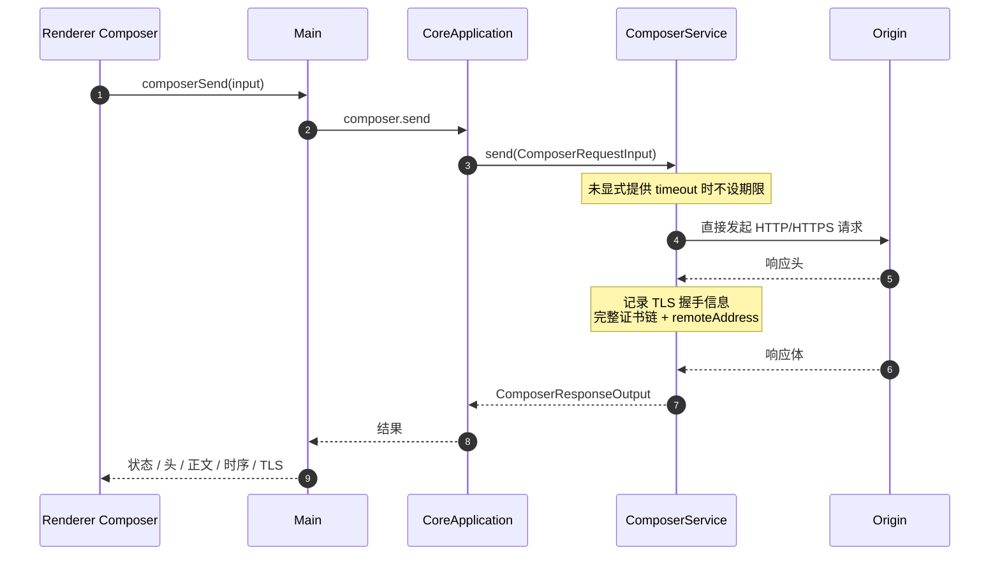
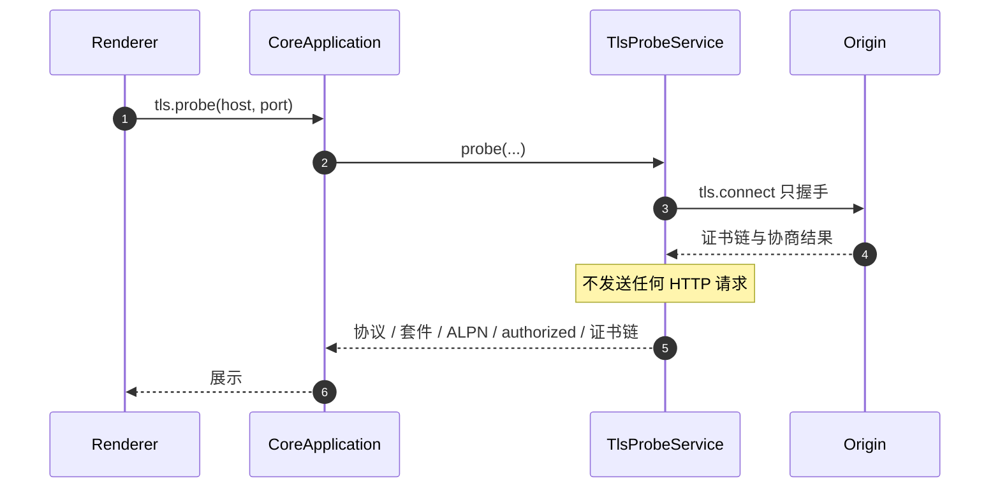
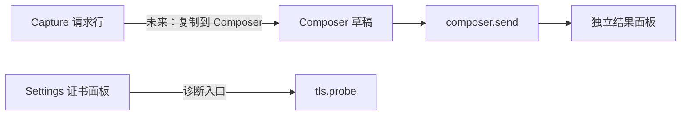

# Feature: Composer

> Composer 发送时的 HTTP header/body KEEP/UPDATE、编码与 framing 契约统一见 [http-message-editing.md](http-message-editing.md)。

> Core 模块：`apps/proxy-core/src/proxy-core/composer/`、`apps/proxy-core/src/proxy-core/tls-probe/`
> Renderer 模块：`apps/desktop/src/renderer/features/composer/`
> UI设计：`design-vite/`的Composer视图与`design-vite/design-system/README.md`的「Composer工作区」。

## 1. 职责与边界

Composer 让用户手工构造并发送请求，Connection 提供独立的 TLS 握手探测。

| 归属 | 内容 |
| --- | --- |
| Composer 负责 | 构造请求、直接发出、采集完整响应与时序 |
| Connection 负责 | 只握手不发请求，读取协议/套件/ALPN/证书链 |
| 两者都不负责 | 经过代理监听端口、写入 Capture、应用 Rules |

**关键边界：Composer 请求不经过代理数据面。** 它由 `ComposerService` 直接发起，因此：

- 不出现在 Capture 列表中。
- 不受 Rules 影响。
- 不受 Recording 开关影响。

这是刻意设计：Composer 是调试工具，需要可预期的纯净行为。

## 2. 调用流程

### 2.0 Collection查询与替换Tool

`composer_get_collection`为严格空参数query，经正式`collection.get`读取已保存的版本化集合；
`composer_replace_collection`为独立change，接受`baseRevision`与完整节点树，只经正式`collection.replace`
原子替换。两项共用Agent/MCP registry、独立授权和既有Ask/Auto，不发出网络请求或向Capture写流量。
替换经typed `composer.collection.replace` Main命令复用UI的Core写入方法，并在成功后发布窄Collection变化事件；
不在Agent和MCP分别复制界面同步逻辑。

- Main共享保存：IPC、MCP、Agent共用`replaceCollection`保存和`collectionChanged`通知。
    - 保存成功后通知其他Renderer；失败或取消不发送成功通知。
    - IPC不把通知回送给发起保存的Renderer，它继续使用IPC返回值确认实际保存的快照。
    - MCP/Agent仍通知所有Renderer；不改现有revision冲突、自动保存和后续编辑保护。
- 集合继续采用现有自动保存模型，不引入Rules式Apply或第二份草稿。外部替换成功后已挂载界面同步Core结果，
    revision冲突沿用Core权威重载；旧节流任务和迟到响应不能把较新替换静默覆盖或标成已保存。
    Collection公开`data-save-state`/`data-revision`反映真实写回状态，不靠固定等待时间验证已保存快照。
    常驻同步hook在现有启动遮罩完成后首次读取集合，避免在Core业务初始化前查询失败后永久停留未加载状态；
    不改变冷启动自动接管或把代理行为改为手动。
- 快速输入正文并切换请求时，CodeEditor由Monaco按隐式Model所有权完成detach与销毁；包装器不得提前销毁仍被
    编辑器观察的Model。
- 输出保留节点身份、目录层级、顺序、完整请求编辑字段和revision；Auth凭据、敏感Header/Query及URL凭据
    必须在共享Tool边界脱敏。读取/替换往返不能把遮罩文本写成凭据，保留操作只作用于相同request/字段身份；
    不存在的原字段不得靠遮罩凭空创建。错误和审批不泄露凭据或请求正文。
- 替换前严格验证递归节点结构、唯一树ID、三级目录上限、protocol/body/auth联合、字段类型及revision；
    校验不把尚在编辑的空URL等合法集合状态误当作发送请求。空节点树明确表示替换为空集合。
- Ask审批展示当前/目标请求与目录计数；Deny无替换，stale revision无写入；Allow/Auto成功后UI、Core和重启
    持久化结果一致。两个命令都沿原AbortSignal，在取消或授权关闭时不执行迟到的写入。

### 2.0.1 Collection导出/导入Tool

`composer_export_collection`与`composer_import_collection`各自是严格空参数change。导出读取Core已保存Collection，
与UI草稿导出共用Main序列化/Save Dialog方法；Model只得到`exported`，不收到文件名、路径或请求内容。
导入的UI与Tool共用单请求生命周期，Main传请求ID，Renderer统一读取、预览和确认，复用现有
`parseImportedCollection`/`importCollection`，不复制第二套领域解析或存储逻辑。

- `exportSavedCollection`在Collection导出文件中读取Core树，再调用IPC也使用的`exportCollection`。
    - Main Tool分派只转换`exported`结果；原生Dialog、取消检查、序列化和写入只有一份。
    - 保留“导出当前编辑树”和“导出已保存树”这两个明确来源，不把导出变成隐式保存。

- Ask Deny不打开文件Dialog；Allow/Auto都保留真实Save/Open。导入还必须经过现有预览确认，Auto不能绕过确认。
    原生取消或预览取消不写入，返回`exported=false`或`imported=false`。
- 导出始终区分来源：UI保存其当前编辑树，Tool保存Core已落盘树，不把导出变成隐式自动保存或Send。
    迟到文件选择在调用取消后不能写文件，已开始的正式写入完成原路径。
- 导入只读一次文件，保持三级目录和节点顺序，重新生成全部node及字段row ID；确认把当前集合与导入节点一起
    原子追加并更新revision。自动保存中的变化必须先完成，不能让导入与旧节流写入互相覆盖。
- 结果仅含导入成功标记、revision、requestCount、folderCount、skippedCount；不返回Auth、Header、正文或本机路径。
    同一时刻只允许运行一个实际导入预览，取消/退出后旧请求不能干扰下一请求。
- `CollectionImportService.startImport()`允许不传signal，普通UI直接调用；Agent/MCP传自己的真实AbortSignal，不创建无人持有的占位controller。窗口关闭/退出仍调用`cancelImport()`，与调用方signal是否存在无关。
typed Main命令为`composer.collection.export/import`。
Main `CollectionImportService`拥有唯一pending请求；App常驻`CollectionImportDialog`复用原确认组件，
Renderer `CollectionImportActions`管理读取/预览/保存并按请求ID拒绝迟到结果。原生读取、解析、节点身份重生成
仍由既有函数负责。确认先等待已发出的自动保存，再以最新revision原子追加；取消发生在等待期间则不再写入，
正式写入已开始则完成原路径。Main退出、窗口关闭或Renderer退出时释放pending，不留下悬挂的Action Gate。

### 2.1 发送请求



采集内容：

| 类别 | 字段 |
| --- | --- |
| 响应 | statusCode、statusText、headers、body |
| 时序 | `ComposerTiming` 六阶段：dnsMs、tcpMs、tlsMs、requestMs、waitingMs、downloadMs |
| TLS | protocol、cipher、ALPN、authorized、完整去重证书链 |
| 网络 | remoteAddress、remotePort |

分阶段时序由 `TimingRecorder` 从 socket 事件推导，支撑 Timing 页签的分阶段条。
**未发生的阶段为 0**：明文请求没有 `tlsMs`，复用连接没有 `dnsMs` / `tcpMs`。

Renderer 历史记录不淘汰。

### 2.2 连接探测



用于诊断 MITM 兼容性、证书链问题、ALPN 协商结果。

### 2.3 Agent / MCP Composer Tool

共享registry将现有两个正式命令投影为`composer_send_request`与`composer_probe_connection`，两者均为`openWorld` change Tool，
Agent/MCP只负责Settings过滤与Ask/Auto，不拥有第二套网络实现。

- `composer_send_request`接受method、绝对HTTP(S) URL、name/value headers、可选文本body、protocol与显式timeout；结果经
    共享redactor遮罩凭据header并限制正文预览。它继续直连origin，不经过代理、Capture或Rules。
- `composer_probe_connection`接受host、1..65535端口与可选timeout，只返回TLS握手事实，不发送应用数据。
- Tool调用的AbortSignal必须穿过Core RPC进入`ComposerService.send`与`TlsProbeService.probe`。取消时主动销毁
    HTTP/1.1 request、HTTP/2 stream/session或TLS socket；仅忽略late RPC response不算取消网络副作用。
- Renderer的Composer Send与Capture TLS Probe使用同一Core命令，不增加兼容入口。

## 3. 数据契约

```ts
interface ComposerRequestInput {
  method: string;
  url: string;
  headers: readonly RuleHeaderPair[];
  body?: string;
  timeoutMs?: number;          // 缺省时不设期限
  ignoreCertificateErrors?: boolean;
}
```

命令：

| 命令 | 用途 |
| --- | --- |
| `composer.send` | 发送构造的请求 |
| `tls.probe` | TLS 握手探测 |

## 4. 与其他 feature 的关系



当前 Composer 与 Capture 之间没有直接联动。若未来支持"从 Capture 复制到 Composer"，必须明确复制的是客户端原始请求还是发往 Origin 的最终请求。

## 5. UI 与 Collection

Composer布局为`Collection分栏 / splitter / 工作区`，工作区纵向排列文档标签条、URL行、请求编辑区、splitter和响应区；请求集合跨启动持久化。

### 5.1 Collection 分层

| 层 | 职责 |
| --- | --- |
| Core | `workspace/entry.ts` 的 `WorkspaceService.loadCollection` / `saveCollection`，与 RuleSet 完全同构：`collection_tree` 单行表 + 整棵树存一个 JSON + 乐观锁 revision |
| Protocol | 只有 `collection.get` 与 `collection.replace` 两条命令 |
| Preload | `getCollection()` / `replaceCollection(expectedRevision, tree)` / `exportCollection(nodes, title)` |
| Renderer | 目录树、行内重命名、选中目录作为新建目标、多请求文档 tab |

**为什么不做树形表和增量命令**：Collection 只有几十到几百条，整棵树序列化成 JSON 的开销可以忽略。做成 `collection_tree` 单行表后，父子关系、排序字段、`upsert`/`remove`/`move` 三条增量命令与它们各自的并发语义全部不需要存在，读写只有"读整棵树"和"写整棵树"两条路径。

**编辑即生效**：文档 tab 就是 Collection 里的条目，改动直接写回，没有保存动作、没有未保存标记、没有 Save 按钮；Send 用的就是当前状态。`+` 新建时直接在选中目录下创建一条 `Untitled`。写入由 Renderer 节流，避免每次按键都落库。

**共享目录树与拖拽**：Collection 与 Rules 直接复用 `packages/core-protocol/src/tree.ts` 和
`components/share/useTreeDrag.ts`。请求与目录整行可拖，目录悬停自动展开，移动是
`removeNode + insertNode`；目录最多 3 级，拖拽不给超深落点，第三级目录的 New subfolder
和工具栏 New folder 同时禁用，store 也拒绝越界写入。Collection 不保留自己的
`findRequest` / `replaceRequest` / `removeNode` 等重复实现。

**选择与菜单契约**：`targetFolderId`只表达新建落点，`activeRequestId`只表达右侧正在编辑的请求。
点击目录或Collection空白不得关闭当前文档；点击请求会清除目录落点并保持唯一active document。
目录More与行右键复用同一菜单命令，rename进入同一行内input；第三层目录的New subfolder在UI禁用，
store继续作为深度约束的最终边界。Collection同步owner常驻App shell，不随Composer workspace卸载，
因此600ms节流timer能继续把最新树写入Core；重新进入Composer不得被旧Core快照覆盖。Collection
splitter只改变左栏宽度，不改变树选择或打开文档。

**导出**：工具栏的 `Export collection` 走 `collection:export`，由 Main 弹系统保存对话框并把整棵树写成 JSON。集合数据本来就在 Renderer 手上，这条路径不经过 Core。

**导入**：与[Rules导入](rules.md)采用相同语义：纯新增，节点与字段行`id`全部重新生成，保持文件内层级并整体追加到根末尾；文件级失败整体拒绝，节点级失败逐项跳过并报告路径与原因；深度不得超过`MAX_FOLDER_DEPTH`。

分层同样是 Main 只做 IO、Renderer 做解析与装配：两个 feature 共用 Main 的 `readImportFile(title)`，各自在 Renderer 解析自己的领域结构，确认后复用**已有的** `collection.replace` 整棵树写回，不新增增量 add 命令。

节点级失败情景对应到集合领域：节点不是对象或缺 `kind`/`name`/`id`、`kind` 未知、`folder` 的 `children` 不是数组、请求的 `method`/`url` 不是字符串、`query`/`headers`/`bodyForm` 不是数组、`bodyType` 或 `protocol` 不在已知取值内、`auth.type` 未知、深度超限。

两处差异来自领域本身：`CollectionRequest` 没有 `enabled` 字段，请求只在用户点 Send 时执行，导入不会自动产生任何网络行为，因此确认 Dialog 只报告将导入的请求数、目录数与被跳过项，不需要 Rules 那条「已启用规则立即参与匹配」的警告；集合也没有 `priority`，追加顺序就是最终顺序。请求内部的 `ComposerFieldRow.enabled` 是请求内容的一部分，原样保留。

Import / Export 使用与 Rules 相同的不可关闭文件操作遮罩；确认后直接复用 `collection.replace` 原子持久化，成功后同时推进 `nodes`、`savedNodes` 与 revision，不再等待600ms节流，也不会被 `useCollection` 重复保存。

### 5.2 Recent sends

URL行的`Recent sends`是独立于Collection的内存重放记录，两者不互相写入；列表显示method、URL、状态码和相对时间，点击恢复为请求。

发送失败（非法URL或网络错误）时Core返回`ok=false`，响应区按错误态显示原因，不生成响应tab或伪成功正文；失败仍以status=0进入Recent sends，下一次成功发送清除错误。URL行只显示scheme之后的部分，粘贴完整URL时整体替换，不重复拼接scheme。

### 5.3 请求 Body 的四档

| 档位 | 形态 | 协议影响 |
| --- | --- | --- |
| None | 占位文案，无编辑器 | `body` 不传 |
| JSON | 可编辑 Monaco，Format 调 Monaco 自带格式化 | 无 |
| Text | 同上，语言为 plaintext，Format 禁用 | 无 |
| Form | 第三张 KV 表 | Renderer 编码成 `a=1&b=2` 字符串，**协议不变** |

`ComposerRequestInput.body`只接受`string`；`multipart/form-data`文件和其他二进制输入需要独立的协议定义。

### 5.4 响应 Body 复用 Capture 的查看器内核

`ResponsePane/ResponseBodyPane` 直接渲染共享内核 `components/BodyViewer/`，与 Capture Inspector 是**同一实现**：
档位由响应 MIME 派生（JSON `Pretty/Tree/Raw/Hex`、代码 `Code/Raw/Hex`、图片 `Preview/Hex` …），
Format、JSON Tree 右键复制、Hex 虚拟化与四个阈值常量全部一致。完整矩阵见
[capture.md 10.2](capture/README.md)，此处不重复。

Composer 与 Capture 的差别只在**外壳**：Capture 侧的 `BodyView` 要按需拉字节、跟踪解码与截断状态、驱动
Save body；Composer 的响应正文随 `composer.send` 一次性返回，外壳只把字节交给内核。因此内核签名是
`(bytes, mediaType, truncated)`，不认识hash或IPC。

**格式化契约**：响应只读预览最多2 MiB，仍在填充容器中显示；完整响应字节保留在原runtime，不改变发送/复制请求的完整编辑值。JSON和code/default在完整且不超过`FORMAT_AUTO_MAX_BYTES`（1 MiB）时自动格式化，
更大但不超过`FORMAT_MAX_BYTES`（2 MiB）时只响应用户点击Format；截断预览禁止格式化。HTML/CSS/JavaScript走Monaco language worker，
XML走`xml-formatter`。任一formatter失败都必须恢复调用前原文、保持read-only、结束busy状态且不产生
未处理Renderer error；格式化失败显示原文保留提示。Raw/Hex等非default模式不显示Format；Copy复制当前model中用户实际看到的预览内容。
原始`response.body`始终保持Core返回的字节；格式化文本只是`DocumentRuntime`按request/response隔离的
内存view cache。切换文档后再返回应恢复该response的格式化视图；新response替换、关闭文档或删除request
时释放cache。worker结果无论当前正在显示哪个文档，都写回发起它的request runtime；只有该request已经
换成另一个response，或request runtime已被关闭/删除时，才丢弃无可恢复入口的旧结果。

### 5.5 Renderer 组成

`features/composer/` 下每个组件一个文件、各配同名 CSS Module：`ComposerMain`（两处 splitter 与响应式 clamp）、`CollectionPanel` + `CollectionTreeNode` / `RenameRow` / `CollectionRowMenu`、`DocumentTabs`、`RequestUrlBar` + `RecentSends`、`ComposerTabBar`（请求区与响应区共用）、`KeyValueTable`（Query / Headers / Form 三处共用）、`RequestPane` + `BodyPane` / `AuthPane`、`ResponsePane` + `ResponseBodyPane` / `ResponseHeadersPane` / `ResponseCookiesPane` / `ResponseTimingPane` / `ResponseSection` / `ResponsePlaceholder`。

`ResponseSection`负责Headers、Cookies、Timing与Connection中的详情分组。每个实例独立持有展开状态，标题button以`aria-expanded`和`aria-controls`关联保持挂载的正文；折叠只切`hidden`，不销毁内部内容。业务automation ID由各Response pane传入，共享`SectionHeader`不反向依赖Composer。

**设计稿的 216px / 368px 只是初始值**：Collection 宽度与响应区高度都可拖拽，上限由对侧最小尺寸推导（`总宽 − MIN_WORK_WIDTH − 轨道宽`），`ResizeObserver` 在窗口缩放时重新 clamp；行高、控件尺寸、弹层宽度这类结构尺寸沿用设计稿固定值。

## 6. 验收要点

- Composer 请求不出现在 Capture 列表。
- Composer 请求不受启用的 Rules 影响。
- 未设 timeout 的长请求不被强制中断。
- TLS 证书链完整且已去重。
- `tls.probe` 不产生任何 HTTP 流量。
- Collection 整行拖拽保留完整子树，且移动/新建均不能超过 3 级目录。

### Collection目录选中与缩进

- 首层嵌套缩进30px，后续每层26px；根目录缩进0px、根请求8px，行高30px。
- 选中目录的名称、计数和箭头使用accent；目录落点与正在编辑的请求是独立状态。

### 方法标签

- GET/POST文字在标签内居中，标签与右侧名称由父flex容器设置`align-items: center`；不使用基线、字形包围框、负margin或位移。
- `MethodBadge`管理md20px、sm17px、xs16px高度和对应字号/padding。Collection使用xs、保留40px列宽且不收缩；DocumentTabs使用sm。调用方不覆盖内部字号或padding。

### Collection请求行

请求名称字号12.5px、行高30px；长名称单行省略，选中目录不改变正在打开的请求。
