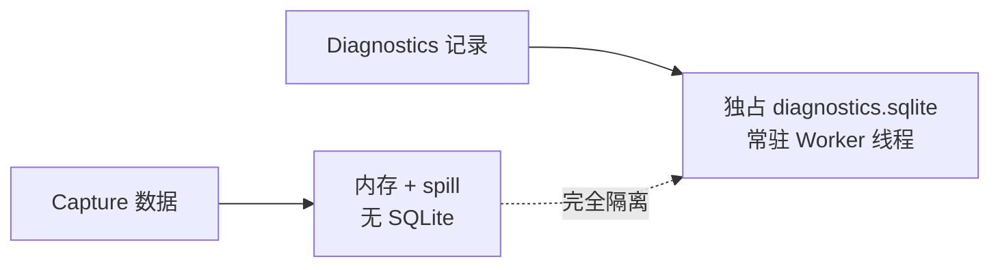
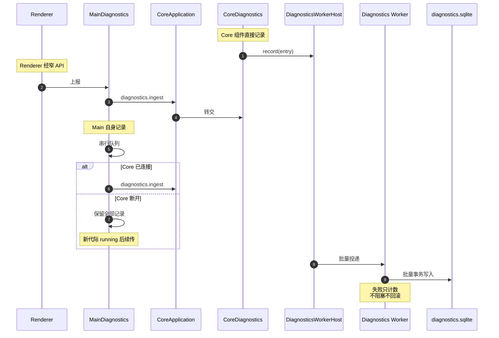
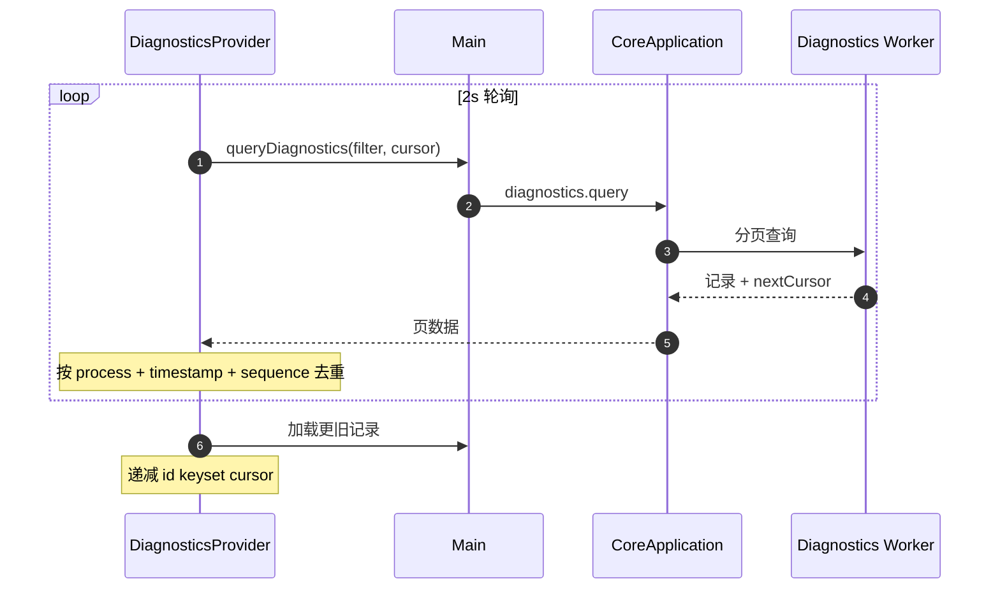
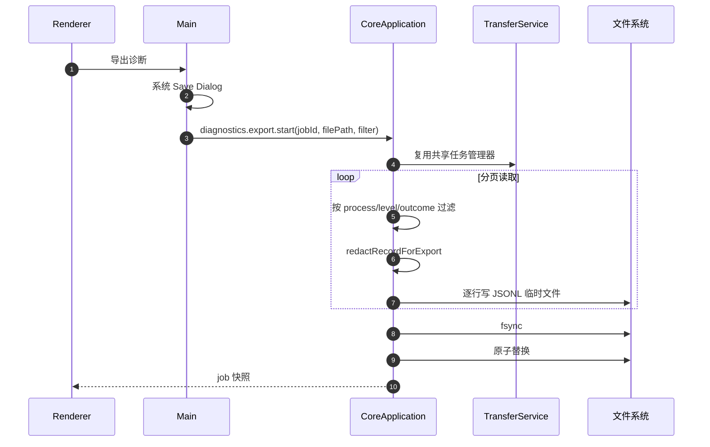

# Feature: Diagnostics

> 最后更新：2026-09-07
> Core 模块：`apps/proxy-core/src/proxy-core/core-diagnostics.ts`、`apps/proxy-core/src/proxy-core/diagnostics/`
> Renderer 模块：`apps/desktop/src/renderer/features/diagnostics/`

## 1. 职责与边界

Diagnostics 把 Core、Main、Renderer 三个进程的结构化记录汇入同一持久化存储，提供查询、分析与脱敏导出。

| 归属 | 内容 |
| --- | --- |
| Diagnostics 负责 | Trace/Action 结构化记录、持久化、分页查询、脱敏导出 |
| Diagnostics 不负责 | 业务正确性判断、告警、远程上报 |

**硬约束：日志失败绝不阻塞业务。** Diagnostics 写入失败只计数，不阻塞或回滚 Capture 写入，也不递归回灌同一 sink。

## 2. 存储隔离



Capture 与 Diagnostics 使用完全独立的存储路径与线程，互不影响。

## 3. 三进程汇入



`MainDiagnostics` 是完整串行队列。Core 断开期间不丢弃记录，等新代际 Core 进入 running 后续传。

## 4. 记录模型

### 4.1 DiagnosticsRecorder

各组件通过注入的 `DiagnosticsRecorder` 记录关键节点，`CoreDiagnostics` 是唯一实现：

```ts
interface DiagnosticsRecorder {
  info(phase: string, fields?: DiagnosticsFields): void;
  warn(phase: string, fields?: DiagnosticsFields): void;
  error(phase: string, fields?: DiagnosticsFields): void;
}
```

未注入时降为 no-op，便于单测直接 `new`。

### 4.2 关键节点

| 组件 | phase |
| --- | --- |
| `CoreRpcServer` | `rpc.connected`、`rpc.connection-failed`、每命令一条 `command.completed` |
| `CoreApplication` | `core.started`、`core.stopping`、`storage.ready`、`diagnostics.ready` |
| `ProxyService` | `proxy.listening`、`proxy.stopped`、`tls.reconfigured`、`tls.client-error`、`capture.persist-failed`、`exchange.aborted`、`exchange.server-error` |
| `CaptureService` | `storage.ready`、`storage.error` |

命令级精简为单条 `command.completed`。`diagnostics.recent` 与 `diagnostics.query` 本身静默，避免轮询自污染。

### 4.3 Trace 与 Action

`CoreDiagnostics` 用 `AsyncLocalStorage` 维护当前 Trace 上下文，命令执行期间的 Action 自动归属该 Trace，形成可展开的时间线。

## 5. 查询流程



支持的过滤条件：`process`（core/main/renderer）、`trace`、`command`、`level`、`outcome`、`duration`。

默认拉取 200 条，过滤变化时重查首页。

## 6. 保留策略

**不按数量、字节或时长淘汰。** Core 内存、待写队列与 SQLite 均无淘汰逻辑。

这是刻意选择：调试工具的日志一旦被淘汰就失去排障价值。容量管理交给用户显式清理。

## 7. 脱敏

双层脱敏：


脱敏对象：敏感键名、凭据片段、URL query。

**绝不序列化完整 Command payload 或 Body 到日志。**

## 8. 导出



Renderer 只拿到 job 快照，没有路径。

## 9. Agent / MCP 查询 Tool

`diagnostics_query`是Diagnostics feature的持久化分页查询Tool，复用正式`diagnostics.query`命令与共享registry
schema，不增加Agent专用IPC、第二份日志存储或Renderer后门。它是只读query，在Agent Session的Ask与Auto模式下
都直接执行，不显示change审批。

- 支持`cursor`、`limit`、`process`、`level`、`outcome`、`traceId`、`command`、`minDurationMs`与
    `maxDurationMs`过滤；参数边界只由共享Tool schema校验；
- 结果保持Core返回的稳定顺序、`nextCursor`、`hasMore`与`droppedCount`，不在Agent层重新排序或补造记录；
- `diagnostics.query`继续属于静默命令，Tool查询自身不得生成新的Diagnostics记录；
- Model只能看到已由Core入库前脱敏的结构化记录。命令payload、请求URL、header与正文不得因Tool接入而进入结果；
- Transcript使用typed摘要显示记录数、是否还有更早记录与丢弃数，不展开完整attributes。

真实`agent.tools.diagnostics` workflow先经Composer UI发送两次带敏感query值的真实请求，等待Diagnostics UI
确认两组`composer.send`成功记录，再由Agent discovery与`diagnostics_query`按`core + composer.send + success`
过滤读取四条action/command记录。验收结果最新优先、敏感URL/query不进入Model结果、Ask模式无审批、Settings关闭后返回
`unknown_tool`、恢复后可重新发现，并在同profile重启时保持Model与Tool零重放。

### 9.1 当前快照与导出Tool（已实现）

三项与`diagnostics_query`共用唯一registry、Agent/MCP独立授权和正式Diagnostics/Transfer owner。

- `diagnostics_get_trace`为query，仅接受非空`traceId`，复用`diagnostics.recent { limit: 200, traceId }`；
    返回原traceId、records与droppedCount，不宣称这是超过200条的完整trace，不改顺序或补造记录。
    Recent/Trace只读当前Core代际的内存记录，保持原有从旧到新的顺序；持久化历史与最新优先分页仍由
    `diagnostics_query`负责，不能把两者当成同一种快照。
- `diagnostics_get_recent`为query，仅接受可选1..200整数limit，默认200；复用`diagnostics.recent`并返回
    records与droppedCount。两项在Ask/Auto都不审批，查询本身保持静默，调用预取消不触达Core。
- 两项只返回正式脱敏记录，沿用Core入库前处理；参数不接受本地路径或任意日志文件读取。未知trace返回
    正式空列表，不查询其他trace作为fallback；断连/错误不伪造成功记录。
- `diagnostics_export`为独立change，仅接受正式`process`、`level`、`outcome`可选过滤，不接受文件路径、
    jobId、cursor或模型提供的JSONL内容。Ask Deny不打开Save Dialog，Allow/Auto仍使用真实原生选择。
- UI和Tool复用同一Main导出入口；选择前后检查取消，迟到选择不能启动写入。Core继续使用现有分页、
    双层脱敏与原子JSONL写入，不复制第二套导出器。已启动任务沿用正式Transfer lifecycle，不由断开聊天
    隐式取消；后续显式任务取消使用独立`capture_cancel_transfer_job`意图。
- 原生取消返回`started:false`；启动后返回`started:true`与公开job快照，只包含正式身份、状态、进度/计数
    和警告数量，不包含路径、文件名、正文或可变message/warnings内容。任务启动不等于文件导出成功，摘要必须明确区分。
- 先更新本节及`diagnostics.tools.queries-export`规格，取得executor unit Red和真实Electron discovery Red，
    再复用正式入口实现。真实输入由同workflow通过Composer/Settings操作产生，查询验证静默与脱敏，导出
    验证Deny、原生Cancel、Allow/Auto、实际JSONL过滤/脱敏、独立撤权和同profile重启零重放/完整销毁。

2026-09-06至07：executor28项缺失Tool Red→Green，Main导出6/6；摘要unit7项与真实页面value Red后35/35。
最终带摘要的真实Agent/MCP workflow1/1（36.0秒），两代Main/Core `3244/23680`、`14016/25676`；
四条关联流程4/4，合计十代正常销毁、8888及WinINet/journal恢复。暂停前原生Cancel焦点失败证据独立保留，
不计产品Red；四个实际JSONL文件满足过滤且不含测试秘密，Recent/Trace静默、撤权及重启零重放通过。
详见[真实规格](../../apps/desktop/tests/e2e-workflow-tests/docs/diagnostics.md#diagnostics-tools-queries-export)。
全workspace类型、Desktop592/592、Tools243/243、MCP32/32、Runtime122/122、Protocol25/25、Playground67/67及
设计82/82通过；Core329/331保留既有两项framing债务。完整parity286视图1,964目标，本组62/62、0 missing/flagged、
最大0.5px；全量30 missing/304 flagged仍是待修复视觉债务。标准package/产物审计（1,294 files / 392,896,554 bytes）、
生产依赖0漏洞、最终smoke1/1（41.8秒）通过，Preload公开面不变。导出摘要先显示状态再显示长jobId，避免关键信息
被尾部省略。486张设计输入归档，提交只保留六张新导出图和两张查询更新，478张其他基线不变。

## 10. 性能约束

- 结构化日志的对象分配与 IPC 批次有成本，必须限制 attributes 数量。
- 低优先级记录可采样。
- 记录必须非阻塞。

## 11. 验收要点

- [ ] Core 断开期间 Main 记录不丢，恢复后完整续传。
- [ ] Diagnostics 写入失败不影响 Capture。
- [ ] 敏感 attribute 与 URL query 在库中与导出文件中均已脱敏。
- [ ] 轮询查询自身不产生新记录。
- [ ] keyset 分页在大数据量下稳定，无重复无遗漏。
- [x] Agent只通过共享`diagnostics_query`读取真实记录；过滤、稳定顺序、脱敏、撤权与重启零重放均通过真实Electron验收。

2026-09-05验收：最终`agent.tools.diagnostics`在父提交`401af972`精确Red于Diagnostics schema缺失，Main/Core
`11540/18252`优雅销毁；当前同一workflow `1/1` Green，两代Main/Core为`11444/35300`、`42312/18808`，
均`gracefulDestroyVerified=true`且释放8888，宿主guard恢复系统副作用。Model与origin重启请求增量均为0，
返回四条记录、两个trace、严格递减sequence；完整敏感文本审计通过。明暗parity共18个目标全部0px。
