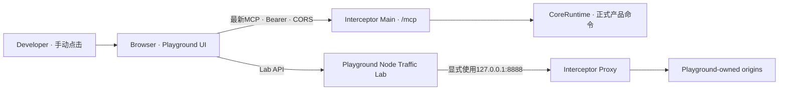

# Feature: Manual Acceptance Playground

> 最后更新：2026-09-01
> 状态：**[改造中] 架构、UI设计、Browser CORS、`apps/playground`与自动防回归已完成；24项Tool待Developer逐项人工验收。**
> 代码所有者：`apps/playground/`

## 1. 目标

Playground 是仓库内的人工验收 Web App。Developer 通过真实点击完成两类工作：

1. 产生可控的HTTP、流式、WebSocket与gRPC流量，在Interceptor中人工检查Capture、Rules、Breakpoint、
   Composer与Diagnostics；
2. 以固定最新MCP协议连接正在运行的Interceptor，人工浏览完整Tool目录、填写参数、调用Tool，并查看协议、
   结果、审批与产品副作用。

Playground不接LLM。LLM只负责在真实Host里选择Tool和生成参数，不属于产品Tool正确性的验收边界。
Playground也不是自动化测试Runner；界面只展示事实，Pass / Fail / Blocked由Developer手工记录。

## 2. 非目标

- 不进入Interceptor安装包、更新包或产品导航；
- 不复制`packages/interceptor-tools/`的Tool名称、schema或执行逻辑；
- 不支持`2025-11-25`或更早MCP协议，不提供版本选择、兼容层或fallback；
- 不绕过Interceptor的Bearer、Tool开关、`ask` / `auto`、原生Dialog、UAC或系统权限；
- 不用Playground结果替代真实VS Code / Claude / Cursor Host canary；
- 不自动判定业务是否通过，不自动修改Interceptor状态以准备测试。

## 3. 目录与运行方式

Playground放在独立workspace：

```text
apps/playground/
├── package.json
├── tsconfig.json
├── vite.config.ts
├── server/
│   ├── entry.ts                 # 一个本地Node进程：Vite + Lab API + 流量源
│   ├── traffic-lab.ts           # 场景生命周期与显式代理客户端
│   └── interfaces.ts            # Browser可见的Lab DTO
├── src/
│   ├── main.tsx
│   ├── App.tsx
│   ├── App.module.css
│   ├── acceptance/              # 24项人工recipe与脱敏报告
│   ├── components/              # 一个组件一个文件与同名CSS Module
│   ├── mcp/                     # 最新协议Client、配置解析、fetch观测与脱敏
│   └── styles/                  # Playground局部tokens与reset
└── tests/
  ├── unit/                    # 配置解析、脱敏、recipe与报告
  └── integration/             # 真实socket Traffic Lab
```

根命令最终为：

```powershell
npm run playground
```

命令启动一个Node进程并只绑定`127.0.0.1`。同一进程提供Vite页面、Lab API和按需创建的本地流量源；
不引入Electron、Preload、IPC、安装器或第二套生命周期。关闭该进程时必须关闭全部origin、socket和在途请求。

## 4. 拓扑



MCP必须由Browser直接请求Interceptor，确保人工验收覆盖真实preflight、CORS、Bearer和最新协议。
Traffic场景由Node发起，因为Browser不能精确控制代理、H1/H2 framing、trailers、gRPC或中途断开。

## 5. Browser MCP契约

### 5.1 最新协议

- 使用官方`@modelcontextprotocol/client`；
- Client固定pin到仓库当前协议`2026-07-28`；
- 连接时先执行官方discovery，再执行`tools/list`；
- 收到不支持版本错误时完整展示错误，不尝试`initialize`、legacy SSE或其他协议；
- 升级SDK或协议版本时，Server、Playground和文档在同一work item同步。

### 5.2 配置导入

Developer在Interceptor `Settings > Agent > MCP Server`点击Copy config，再粘贴完整JSON到Playground。
Playground只接受：

```jsonc
{
  "servers": {
    "interceptor": {
      "type": "http",
      "url": "http://127.0.0.1:<port>/mcp",
      "headers": {
        "Authorization": "Bearer <token>"
      }
    }
  }
}
```

解析后URL可见；Token只保存在当前页面内存。页面刷新、关闭或Clear configuration后清除Token，不写入
`localStorage`、`sessionStorage`、IndexedDB、URL、日志、截图状态或证据文件。UI只显示`configured`、尾号与
SHA-256摘要，永不重新显示明文。

### 5.3 CORS

Origin和Host都不代表Client身份，Bearer才是唯一调用方认证。Main删除Origin与Host拒绝分支，并对任意Origin
提供标准CORS；listener仍只绑定loopback。

| 请求 | 行为 |
| --- | --- |
| `OPTIONS /mcp` | 不要求Bearer；目标path为`/mcp`时返回`204` |
| 实际`/mcp`请求，无或错误Bearer | 返回`401`，Browser可读错误状态，不进入SDK handler |
| 实际`/mcp`请求，正确Bearer | 进入当前最新协议handler |
| 非`/mcp`path | 保持`404`，不扩大CORS表面 |

Preflight不维护method/header白名单，而是原样返回Browser声明的`Access-Control-Request-Method`与
`Access-Control-Request-Headers`：

```http
Access-Control-Allow-Origin: *
Access-Control-Allow-Methods: <Access-Control-Request-Method>
Access-Control-Allow-Headers: <Access-Control-Request-Headers>
Access-Control-Max-Age: 600
```

所有`/mcp`实际响应，包括`401`、协议`4xx`、JSON与SSE，都附加：

```http
Access-Control-Allow-Origin: *
Access-Control-Expose-Headers: MCP-Protocol-Version, WWW-Authenticate
```

不返回`Access-Control-Allow-Credentials`，不使用Cookie认证。CORS只允许Browser读取响应，不替代Bearer，
也不改变Tool开关和change Tool审批。Main在Bearer通过后不再检查Host、method、content-type、协议版本或
JSON-RPC内容；这些协议判断全部交给官方SDK，并原样返回SDK结果。

## 6. 页面结构

Playground第一屏就是验收工作台，不做Landing page。

### 6.1 顶部连接栏

- 配置状态、endpoint、固定协议、Connect / Reconnect / Clear configuration；
- Server identity、discovery结果、连接耗时和最后错误；
- Paste config只在未配置时显示，配置后只能Clear后重贴。

### 6.2 左侧目录

两个一级Tab：

- `MCP Tools`：完全来自当前连接的`tools/list`，支持搜索与query/change筛选；
- `Traffic Lab`：来自Playground Node的场景目录。

Tool行显示名称、title、类型annotations与最近一次人工状态。不得import共享registry来补缺项；Server漏返回的
Tool必须在Playground中真实表现为缺失。

### 6.3 中间操作区

选择Tool后显示：

- title、description、完整input schema、annotations；
- Raw JSON编辑器；
- Call与Abort；
- query/change、当前Interceptor Client模式以及预期审批说明。

Playground不从schema猜默认值；Developer直接编辑完整arguments JSON，服务端负责参数校验。

### 6.4 右侧详情

每次操作生成不可变记录，按时间线展示：

1. Browser CORS成功或失败事实；原始preflight header由integration test记录，页面脚本不能读取浏览器内部preflight；
2. MCP HTTP request method、URL、可见headers、JSON-RPC body与发送时间；
3. HTTP status、Browser可见headers、content type与完成耗时；
4. JSON/SSE原始body和SDK解析结果；
5. Tool result、structured content与错误；
6. 人工填写的产品前态、产品后态、Origin事实与备注。

Authorization固定显示为`Bearer <redacted>`加摘要。其余Playground自造流量默认完整展示；连接真实用户数据时
证据导出必须再次确认。

### 6.5 人工验收状态

每个Tool由Developer手工选择`Not run / Pass / Fail / Blocked`并填写备注。状态只存在当前页面内存；可导出
脱敏JSON报告，不能导入后冒充本轮事实。报告包含协议版本、Tool schema hash、调用时间线、人工结论和环境版本，
不包含Token。

## 7. Traffic Lab

### 7.1 首个纵向切片

先实现四个足以验收当前Traffic query与Recording Tool的场景：

| 场景 | Node行为 | 人工可见事实 |
| --- | --- | --- |
| H1 JSON | 经`8888`向本地origin发送GET并返回JSON | method、URL、headers、status、body |
| H1 upload | 分块发送有限正文 | origin已收字节、Capture request body |
| H1 stream | 分段返回有限响应 | TTFB、chunk时间线、Capture streaming状态 |
| H1 failure | origin reset或client abort | 错误归属、Capture终态 |

场景输入由Developer在Playground填写；Node返回client结果与origin观测。它不直接读取Core或Renderer状态，
Developer在Interceptor UI和MCP Tool结果中对照事实。

### 7.2 后续场景

在首个切片稳定后依次增加H2、SSE、WebSocket text/binary、gRPC unary/streaming、large upload/download、
trailers、early response和TLS。每种场景先满足对应产品work item，不提前搭建通用网络模拟框架。

## 8. 24项Tool人工矩阵

Playground动态列出当前24项Tool。每项至少手工执行：

| 类型 | 人工步骤 |
| --- | --- |
| query | 准备真实产品状态 → Call → 对照UI / Origin → 记录结论 |
| change / Ask | Call → 在Interceptor检查完整问询 → Deny并确认无副作用 → 再Call并Allow → 检查副作用 |
| change / Auto | 在Interceptor手动切Auto → Call → 确认无问询且业务结果相同 |
| disabled | 在Settings手动关闭MCP开关 → Refresh Tools → 确认目录缺失且调用不可达 |
| invalid | 手工提交缺字段、额外字段或越界值 → 查看完整结构化错误 |
| cancellation | Call后手工Abort或Clear configuration → 检查请求、审批与产品状态收敛 |

每个新增共享Tool必须在同一work item补充Playground中的人工recipe元数据；recipe只描述前置条件和观察点，
不复制schema、不自动执行产品动作。

## 9. 自动防回归与人工验收边界

仓库自动测试只保护基础设施：

- CORS preflight、实际响应header、Bearer `401`与`/mcp`路由；
- 最新官方Browser Client可connect、discover和`tools/list`；
- Token解析与日志/报告脱敏；
- Node Traffic Lab启动、端口释放和单个H1纵向场景；
- build、typecheck与关闭后无listener。

自动测试不得把Tool标记为人工Pass，也不替代Developer逐项点击、查看完整详情和验证产品副作用。
真实Electron workflow仍负责证明Browser → Main → Core链路和退出销毁；Playground自身不伪装成产品E2E。

## 10. 实现顺序

1. **[已完成]** 确定本文架构、MCP CORS契约与人工证据模型；
2. **[已完成]** 在`design-vite`完成连接、Tool目录、调用详情、Traffic Lab和人工状态的明暗设计；
3. **[已完成]** unit/integration Red：把Origin `403`契约改为preflight + authenticated Browser CORS；
4. **[已完成]** 真实Electron E2E Red：产品UI创建Client后，真实Browser因Origin分支无法connect；
5. **[已完成]** Main实现CORS并只保留Bearer认证与path路由，官方SDK继续拥有最新协议边界，同组测试Green；
6. **[已完成]** 创建`apps/playground`，完成Paste config → Connect → Refresh Tools → query/change Call纵向流程；
7. **[已完成]** 增加Ask等待、Abort和完整HTTP/JSON/SSE详情；Deny/Allow/Auto继续在Interceptor人工操作；
8. **[已完成]** 增加首批四个H1 Traffic Lab场景；
9. **[已完成]** 增加24项人工recipe、手工状态与脱敏证据导出；
10. **[已完成]** 完成typecheck/build、Browser CORS integration、真实Electron E2E与销毁检查；
11. **[已完成]** 同步platform现状、Inventory、Handover和根README命令；
12. **[待Developer人工验收]** 按页面recipe逐项执行24项Tool并导出脱敏报告。

## 11. 与当前实现的差异

- 24项Tool尚未由Developer逐项完成Ask/Auto、invalid、disabled、cancellation与产品副作用人工矩阵；
- H2、SSE、WebSocket、gRPC、large body、trailers、early response与TLS Traffic场景仍按后续产品item增加；
- 当前VS Code `1.135.0`仍使用`2025-11-25`，产品决定不支持legacy；真实Host canary等待Host升级，
  不阻塞最新协议Playground建设。