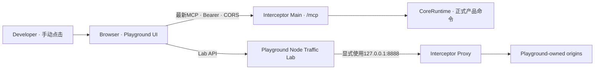

# Feature: Manual Acceptance Playground

> 代码所有者：`apps/playground/`

## 1. 目标

Playground 是仓库内的人工验收 Web App。Developer 通过真实点击完成两类工作：

1. 产生可控的HTTP、流式、WebSocket与gRPC流量，在Interceptor中人工检查Capture、Rules、Breakpoint、
   Composer与Diagnostics；
2. 以固定最新MCP协议连接正在运行的Interceptor，人工浏览完整Tool目录、填写参数、调用Tool，并查看协议、
   结果、审批与产品副作用。

Playground不接LLM。LLM只负责在真实Host里选择Tool和生成参数，不属于产品Tool正确性的验收边界。
Playground也不是自动化测试Runner；界面只展示事实，Pass / Fail / Blocked由Developer手工记录。

## 2. 非目标

- 不进入Interceptor安装包、更新包或产品导航；
- 不复制`packages/interceptor-tools/`的Tool名称、schema或执行逻辑；
- 不支持`2025-11-25`或更早MCP协议，不提供版本选择、兼容层或fallback；
- 不绕过Interceptor的Bearer、Tool开关、`ask` / `auto`、原生Dialog、UAC或系统权限；
- 不用Playground结果替代真实VS Code / Claude / Cursor Host canary；
- 不自动判定业务是否通过，不自动修改Interceptor状态以准备测试。

## 3. 目录与运行方式

Playground放在独立workspace：

```text
apps/playground/
├── package.json
├── tsconfig.json
├── vite.config.ts
├── server/
│   ├── entry.ts                 # 唯一启动文件：Vite + Lab API
│   ├── api/                     # HTTP API输入解析
│   ├── scenarios/               # 场景、调度、生命周期与协议DTO
│   ├── http/                    # 明文HTTP流量
│   ├── tls/                     # TLS、HTTPS/H1、H2与gRPC
│   ├── websocket/               # WS origin与共用客户端
│   └── shared/                  # 跨协议网络工具
├── src/
│   ├── main.tsx                 # 唯一启动文件
│   ├── app/                     # 页面外壳、共享界面、样式与状态类型
│   ├── capture/                 # 协议Draft与Capture工作区辅助逻辑
│   ├── mcp/                     # 连接界面、Client、配置与交换观测
│   └── acceptance/              # 人工recipe与脱敏报告
└── tests/
  ├── unit/                     # 历史辅助测试保留，不扩充设施测试
  └── integration/              # 历史网络/Browser测试保留
```

启动命令：

```powershell
npm run playground
```

命令启动一个Node进程并只绑定`127.0.0.1`。同一进程提供Vite页面、Lab API和按需创建的本地流量源；
不引入Electron、Preload、IPC、安装器或第二套生命周期。关闭该进程时必须关闭全部origin、socket和在途请求。

## 4. 拓扑



MCP必须由Browser直接请求Interceptor，确保人工验收覆盖真实preflight、CORS、Bearer和最新协议。
Traffic场景由Node发起，因为Browser不能精确控制代理、H1/H2 framing、trailers、gRPC或中途断开。

## 5. Browser MCP契约

### 5.1 最新协议

- 使用官方`@modelcontextprotocol/client`；
- Client固定pin到仓库当前协议`2026-07-28`；
- 连接时先执行官方discovery，再执行`tools/list`；
- 收到不支持版本错误时完整展示错误，不尝试`initialize`、legacy SSE或其他协议；
- 升级SDK或协议版本时，Server、Playground和文档在同一work item同步。

### 5.2 配置导入

Developer在Interceptor `Settings > Agent > MCP Server`点击Copy config，再粘贴完整JSON到Playground。
Playground只接受：

```jsonc
{
  "servers": {
    "interceptor": {
      "type": "http",
      "url": "http://127.0.0.1:<port>/mcp",
      "headers": {
        "Authorization": "Bearer <token>"
      }
    }
  }
}
```

解析后URL可见；Token只保存在当前页面内存。页面刷新、关闭或Clear configuration后清除Token，不写入
`localStorage`、`sessionStorage`、IndexedDB、URL、日志、截图状态或证据文件。UI只显示`configured`、尾号与
SHA-256摘要，永不重新显示明文。

### 5.3 CORS

Origin和Host都不代表Client身份，Bearer才是唯一调用方认证。Main对任意Origin
提供标准CORS；listener仍只绑定loopback。

| 请求 | 行为 |
| --- | --- |
| `OPTIONS /mcp` | 不要求Bearer；目标path为`/mcp`时返回`204` |
| 实际`/mcp`请求，无或错误Bearer | 返回`401`，Browser可读错误状态，不进入SDK handler |
| 实际`/mcp`请求，正确Bearer | 进入当前最新协议handler |
| 非`/mcp`path | 保持`404`，不扩大CORS表面 |

Preflight不维护method/header白名单，而是原样返回Browser声明的`Access-Control-Request-Method`与
`Access-Control-Request-Headers`：

```http
Access-Control-Allow-Origin: *
Access-Control-Allow-Methods: <Access-Control-Request-Method>
Access-Control-Allow-Headers: <Access-Control-Request-Headers>
Access-Control-Max-Age: 600
```

所有`/mcp`实际响应，包括`401`、协议`4xx`、JSON与SSE，都附加：

```http
Access-Control-Allow-Origin: *
Access-Control-Expose-Headers: MCP-Protocol-Version, WWW-Authenticate
```

不返回`Access-Control-Allow-Credentials`，不使用Cookie认证。CORS只允许Browser读取响应，不替代Bearer，
也不改变Tool开关和change Tool审批。Main在Bearer通过后不再检查Host、method、content-type、协议版本或
JSON-RPC内容；这些协议判断全部交给官方SDK，并原样返回SDK结果。

## 6. 页面结构

Playground第一屏就是验收工作台，不做Landing page。整体复用Interceptor的App式信息架构，但不是产品壳：

```text
220px一级导航 / 页面专属Header + 页面内容
```

一级导航固定顺序为`Capture Lab`、`MCP`，默认进入`Capture Lab`。两者是两个独立页面，不是同一个目录栏内的
tab；切页只保留当前进程内状态，刷新页面后全部恢复默认。

### 6.1 左侧一级导航

- 顶部显示Interceptor Playground品牌；
- `Capture Lab`为第一项与默认项，显示当前场景数；
- `MCP`为第二项，显示未连接、连接中、已连接或错误状态；
- 底部只显示`Manual acceptance · local only`，不放产品Settings、Agent或窗口控制。

### 6.2 页面专属顶部栏

`Capture Lab`顶部栏只显示：当前页名称、显式代理`127.0.0.1:8888`、Run、Reset request和详情显示状态。
不得显示MCP endpoint、协议、Token摘要、Reconnect或Clear configuration。

`MCP`顶部栏只显示：

- 配置状态、endpoint、固定协议、Connect / Reconnect / Clear configuration；
- Server identity、discovery结果、连接耗时和最后错误；
- Paste config只在未配置时显示，配置后只能Clear后重贴。

### 6.3 页面内部目录

`Capture Lab`页面的第二列是场景目录，按`HTTP / Bodies / Encoding / WebSocket / gRPC / TLS`分组。
`MCP`页面的第二列是实时Tool目录，按query/change分组，支持搜索。

Tool行显示名称、title、类型annotations与最近一次人工状态。MCP页面不得import共享registry来补缺项；Server漏返回的
Tool必须在Playground中真实表现为缺失。

### 6.4 Capture Request Draft

选择Capture场景后，中间区显示该场景的可编辑Request Draft。字段由场景种类决定，但统一包含完整Raw JSON：

- HTTP：method、path、headers、body与响应场景参数；
- WebSocket：path、headers、client→server / server→client的text/binary messages与control frame动作；
- gRPC：path、request/response envelope payload、compressed flag与trailers；
- TLS：target host、CONNECT headers、是否只建立tunnel或继续TLS/H2。

Run只读取点击瞬间的Draft并发送，不自动写回场景默认值。`Reset request`恢复当前场景默认Draft；切换场景加载
目标场景默认Draft；页面刷新后所有Draft、结果、人工状态和splitter宽度全部重置，不使用任何Browser持久化。

### 6.5 MCP Tool操作区

选择Tool后显示：

- title、description、完整input schema、annotations；
- Raw JSON编辑器；
- Call与Abort；
- query/change、当前Interceptor Client模式以及预期审批说明。

Playground不从schema猜默认值；Developer直接编辑完整arguments JSON，服务端负责参数校验。

### 6.6 右侧Response Detail与splitter

Response Detail属于当前页面：Capture显示origin request、client response、frame/envelope/timing与错误；MCP显示
Browser HTTP/JSON/SSE、SDK result与错误。详情默认宽`560px`，由中间与详情之间的真实splitter拖拽调整：

- splitter轨道占`1px`，命中抓手为同轴普通子项；
- 下限`360px`；上限由`总宽 - 220px一级导航 - 260px目录 - 440px操作区 - 轨道宽`实时推导；
- 不使用固定max，不靠margin/padding硬凑；
- 拖动只改变当前页面内存，刷新恢复默认；
- 窄窗口不隐藏详情，容器在最小尺寸下允许页面整体水平滚动，Developer仍能访问完整证据。

每次操作生成不可变记录，按时间线展示：

1. Browser CORS成功或失败事实；原始preflight header由integration test记录，页面脚本不能读取浏览器内部preflight；
2. MCP HTTP request method、URL、可见headers、JSON-RPC body与发送时间；
3. HTTP status、Browser可见headers、content type与完成耗时；
4. JSON/SSE原始body和SDK解析结果；
5. Tool result、structured content与错误；
6. 人工填写的产品前态、产品后态、Origin事实与备注。

Authorization固定显示为`Bearer <redacted>`加摘要。其余Playground自造流量默认完整展示；连接真实用户数据时
证据导出必须再次确认。

### 6.7 人工验收状态

每个Tool由Developer手工选择`Not run / Pass / Fail / Blocked`并填写备注。状态只存在当前页面内存；可导出
脱敏JSON报告，不能导入后冒充本轮事实。报告包含协议版本、Tool schema hash、调用时间线、人工结论和环境版本，
不包含Token。

## 7. Traffic Lab

### 7.1 场景目录

| 分组 | 场景 | 覆盖能力 |
| --- | --- | --- |
| HTTP | H1 JSON、H1 upload、H1 streaming、H1 early response、H1 abort、H2 JSON | H1/H2、上传、response-streaming、request-complete、completed、aborted |
| Bodies | JSON、plain text、HTML、CSS、JavaScript、XML、YAML、SVG、Markdown、form、PNG、binary、audio、video、unknown text、unknown binary | BodyViewer当前所有格式与默认模式 |
| Encoding | gzip、deflate、br、corrupt gzip、invalid image | 解码成功、decode failed与image unavailable |
| WebSocket | text echo、binary echo、bidirectional messages、control frames | WS协议、两方向、opcode 1/2、ping/pong/close断点入口 |
| gRPC | unary proto、unary JSON、trailers error、compressed envelope、malformed envelope | H2 gRPC识别、request/response、trailers、compressed/truncated/malformed |
| TLS | passthrough tunnel、MITM H1、MITM H2 | CONNECT tunnel、passthrough、解密后的H1/H2 |

每个场景在目录中只强调一个主观察点，但可组合覆盖同一次请求的多个真实事实。场景是否需要MITM、TLS insecure
host或Breakpoint设置必须在页面Setup中明确显示；Playground不得静默修改这些产品设置。

场景输入由Developer在Playground填写；Node返回client结果与origin观测。它不直接读取Core或Renderer状态，
Developer在Interceptor UI和MCP Tool结果中对照事实。

### 7.2 目录边界

目录只收录具备真实产品入口和客户端能力的场景。HTTP/3或H2 Extended CONNECT等协议需要独立支持，不能用其他协议的成功结果代替，也不预建不可执行入口。

### 7.3 与E2E共用协议库

Capture协议流量的唯一实现归`apps/playground/server/`，共享Node流量库为`scenarios/traffic-lab.ts`，`entry.ts`只负责启动网页服务。
E2E不再维护独立的HTTP、WebSocket或TLS origin lab；`trafficLab` fixture统一拥有协议实例，
按需提供`httpTrafficRunner`、`webSocketTrafficRunner`、`tlsTrafficRunner`。

场景运行和细粒度控制共用同一协议服务：

| 协议服务 | 场景之外保留的控制与证据 |
| --- | --- |
| HTTP | 默认echo/cookies、精确status/header/body、自定义二进制与重复headers、外部客户端、响应hold/release、主动取消、origin原始收包和断开事实 |
| WebSocket | 持续连接、多个独立客户端、origin广播、跨UI步骤发帧、指定关闭码、消息和关闭证据 |
| TLS | 自签名origin、H1/H2 ALPN、只握手探测、握手次数、活跃与已关闭连接的实际应用字节 |

`TlsTrafficRunner`按TLS传输边界命名：HTTPS/H1、HTTPS/H2和gRPC共享一个origin，TLS-only场景只CONNECT和握手。
H2原生parser直接消费TLS stream，应用字节从`TLSSocket.bytesRead`汇总，不能依赖`data`事件。

`WebSocketTrafficRunner`拥有唯一origin和场景编排，普通场景与断点都使用`ProxiedWebSocketClient`。
同一客户端使用`ws`的`Sender/Receiver`处理text/binary/ping/pong与分片，不维护手写帧编解码。
`sendCloseFrame()`只发送Close而不改变连接状态，`closeGracefully()`执行完整关闭，两种操作不需要两套客户端。
Node解析HTTP Upgrade并校验真实握手响应；原有持续连接、广播、消息证据与清理能力保持。完整职责见
[协议服务说明](../../apps/playground/server/README.md)。

E2E可以直接调用Node流量API，不要求每个workflow启动Browser；验证Playground页面或Browser MCP时仍使用真实页面。
Node API只操作外部流量，不能绕过Interceptor真实UI执行产品业务。fixture按`runtime/ui/safety/agent`分类，
OpenAI模型模拟由Agent fixture拥有，不加入Playground。

## 8. Tool人工检查

Playground按服务端目录动态列出Tool。人工检查流程为：

| 类型 | 人工步骤 |
| --- | --- |
| query | 准备真实产品状态 → Call → 对照UI / Origin → 记录结论 |
| change / Ask | Call → 在Interceptor检查完整问询 → Deny并确认无副作用 → 再Call并Allow → 检查副作用 |
| change / Auto | 在Interceptor手动切Auto → Call → 确认无问询且业务结果相同 |
| disabled | 在Settings手动关闭MCP开关 → Refresh Tools → 确认目录缺失且调用不可达 |
| invalid | 手工提交缺字段、额外字段或越界值 → 查看完整结构化错误 |
| cancellation | Call后手工Abort或Clear configuration → 检查请求、审批与产品状态收敛 |

每个新增共享Tool必须在同一work item补充Playground中的人工recipe元数据；recipe只描述前置条件和观察点，
不复制schema、不自动执行产品动作。

## 9. 验证边界

验证应分别核对以下事实：

- CORS preflight、实际响应header、Bearer `401`与`/mcp`路由；
- 最新官方Browser Client可connect、discover和`tools/list`；
- Token解析与日志/报告脱敏；
- Node Traffic Lab启动、端口释放，以及HTTP/Body/Encoding/WebSocket/H2/gRPC/TLS全部39项场景；
- Browser默认Capture页、39项目录、页面专属Header、原生Draft、Reset、splitter与窄窗访问；
- WebSocket与CONNECT详情只返回两端实际握手事实；TLS runner并发首跑复用同一实例，关闭Lab会取消停滞CONNECT；
- 场景transport与Draft discriminator保持一致；切场景/Tool会使旧操作代际失效，Capture与MCP各自保存Detail宽度；
- build、typecheck与关闭后无listener。

自动测试不得把Tool标记为人工Pass，也不替代Developer逐项点击、查看完整详情和验证产品副作用。
真实Electron workflow仍负责证明Browser → Main → Core链路和退出销毁；Playground自身不伪装成产品E2E。

Capture验证按HTTP、Bodies、Encoding、WebSocket、gRPC、TLS六组复用Playground的场景目录和流量库，不强制每条workflow经过Browser。
验证Playground页面时通过公开UI运行；其余可直接使用Node流量API。E2E复用场景ID、默认Draft与流量发生器，
但独立断言Capture结果；不得把Playground自己的origin/client断言复用成产品预期，也不建立一个39项巨型workflow。
HTTP和H2的收尾规则由[Capture契约](capture.md)定义；不为Playground新增“测试的测试”。

### 9.1 `capture.playground-traffic`真实E2E

该workflow从fresh profile启动真实Electron和系统Edge，所有业务输入都由Developer可见的Playground UI产生：

1. 通过Interceptor产品UI开启Recording；
2. 系统Edge打开真实`apps/playground`，确认默认页为Capture Lab且目录为39项；
3. 在Playground点击H1 JSON的Run，不直接调用Lab API；
4. 在Interceptor Capture中选择自产exchange，验证h1、`/playground/h1-json`和`ord_42`响应正文；
5. 回到Playground选择WebSocket text并点击Run；
6. 在Interceptor Capture中选择自产WebSocket exchange，进入Messages并验证text message；
7. 关闭Edge与Playground，正常Close Electron；验证Main/Core退出、8888和Playground端口释放、系统代理恢复。

测试定位Interceptor只使用公共`data-automation-id`、协议path和本workflow自产payload；定位Playground使用公开
`data-section`、`data-scenario-id`、ARIA role与运行状态，不依赖翻译文案。evidence必须包含Electron trace、最终截图、
Main/Renderer日志、PID/listener销毁metadata，以及Playground子进程输出与端口释放事实。
