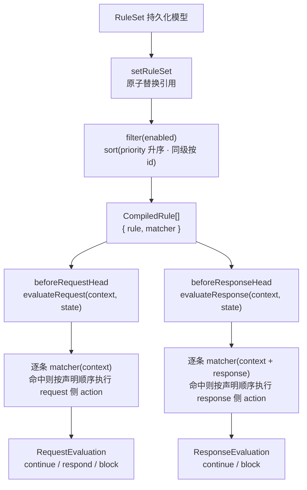
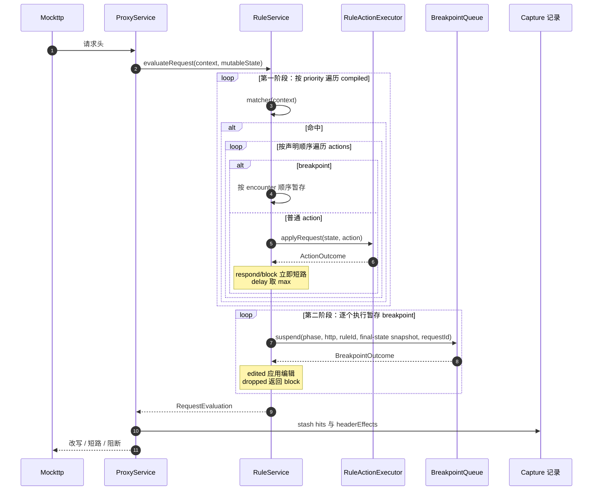
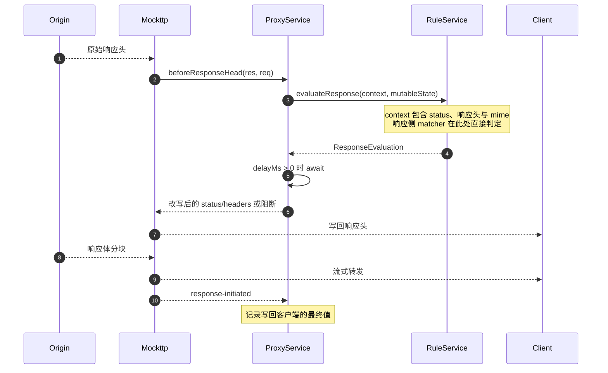
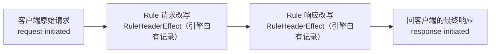
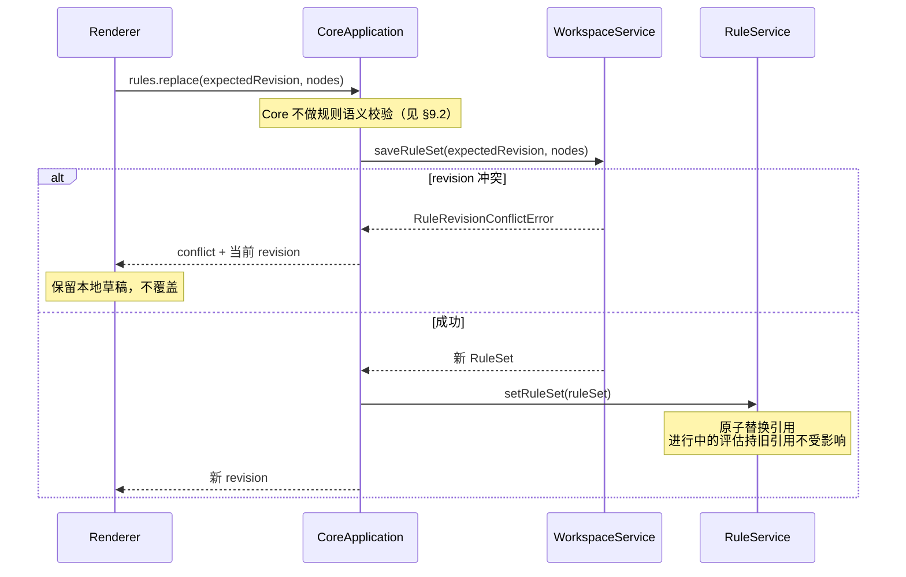
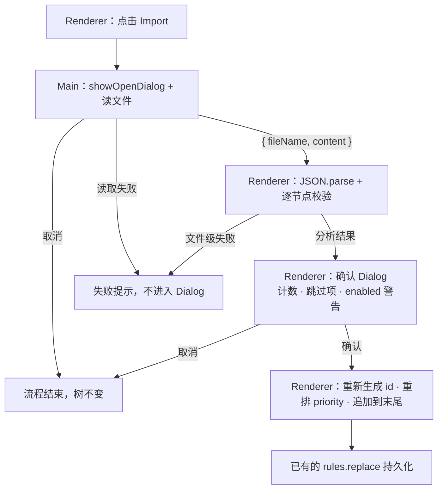
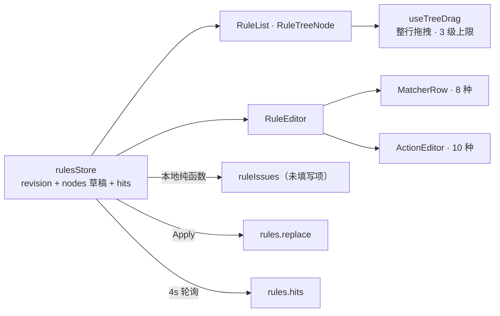

# Feature: Rules

> HTTP header/body action 的 KEEP/UPDATE、编码与 framing 契约统一见 [http-message-editing.md](http-message-editing.md)，本文件只描述规则编译与执行。

> Core 模块：`apps/proxy-core/src/proxy-core/rules/`
> 协议模型：`packages/core-protocol/src/rules.ts`、`packages/core-protocol/src/tree.ts`
> Renderer 模块：`apps/desktop/src/renderer/features/rules/`

## 1. 职责与边界

Rules 负责在真实转发路径上**干预**流量，并向 Capture 提供可审计证据。

| 归属 | 内容 |
| --- | --- |
| Rules 负责 | 匹配判定、改写、短路、阻断、延迟、断点挂起、证据产出 |
| Rules 不负责 | 网络 I/O、Exchange 生命周期、正文落盘、事件推送 |

**关键边界：**

- `RuleService` 只计算决策，返回 `RequestEvaluation` / `ResponseEvaluation`，**不发起任何网络操作**（唯一的本地 I/O 是 `map-local` 读取磁盘文件）。
- `ProxyService` 是唯一执行者，把决策转换为 Mockttp 的转发行为，包括 `delay` 的实际 await。
- Rules 的执行**不受 Recording 开关影响**。暂停记录时规则依然作用于真实流量，只是不产生 Capture 记录。
- 规则不提供throttle：头部阶段不能控制正文流的传输速率，限速需要独立的流控制能力。

### Android协议副本接入（Core已接线，待App验收）

Android持有真实HTTP(S)/WS(S)连接，PC通过`HttpInterceptionService`复用同一`RuleService`
与`HttpMessageService`返回协议级决定，不连接源站或修改Mockttp。决定明确区分bypass、
intercept、respond、abort与本地已取消；delay交由Android执行，正文为keep或编码后的replacement。
该入口不改桌面`ProxyService`现有执行路径，停止Recording也不能省略规则决定。
双端schema及应用确认以[通信协议](../../../Interceptor-Android/architecture/features/inspection-protocol.md)为准。
请求和响应求值都必须在取消后拒绝创建后续断点；仅解除当前pending而允许下一断点挂起不算完成取消。

## 2. 领域模型

### 2.0 Rules Export Tool

`rules_export`是独立change意图，严格接受空对象；Agent/MCP共享registry，按各自Ask/Auto执行。
Tool读取Core已保存的完整RuleSet，经与UI共用的Main导出方法打开真实Save Dialog并写入`{ nodes }` JSON。
UI继续导出当前Renderer草稿，不把导出变成Apply；Tool不读取或覆盖用户未保存草稿。

- Main共享导出方法：`exportSavedRules`负责读取Core树，再调用IPC也使用的`exportRules`。
    - 两个方法均放在Rules导出文件；Main Tool分派只转换`exported`返回值，不另外编排文件步骤。
    - UI当前树与Core已保存树仍是两个明确来源，不用缺失参数或调用来源暗中切换。

- Ask前只提供已保存规则/目录数量，Deny不打开Save Dialog、不读写文件；Auto仅省略应用审批。
- 目标路径只由原生Dialog选择，Tool不接受路径、文件名、节点内容或任意Main/Core命令。
- 执行结果只返回`exported`，不含规则正文、凭据、Map Local路径、目标路径或文件内容；异常输出脱敏。
- 原生Dialog取消返回`exported=false`且不产生文件。调用在Dialog完成前被取消时，选择结束后必须在
    写文件前再次检查AbortSignal，不能因迟到的选择写入文件；已开始的文件写入按正式路径完成。
- UI与Tool复用同一JSON序列化和Save Dialog编排，不复制第二套导出器，不改变已有Rules Import确认后
    立即追加并持久化的语义。`rules_import`的独立入口见下节。
- MCP使用相同正式命令与原生Dialog。Agent关闭不影响MCP；MCP的Ask Deny/Allow和Auto分别验证不写、
    正常保存与原生取消，关闭MCP授权后当前连接也必须停止披露/执行该Tool。

### 2.1 Rules Import Tool

`rules_import`是严格空参数的独立change意图，Agent/MCP共享同一个正式Main命令。Main只发起受类型约束的
导入请求并等待结果，文件选择、解析预览、确认和追加仍复用Renderer owning导入控制器；UI Import按钮也
调用该控制器，不保留第二套预览/导入实现。Main与Renderer之间的请求ID只表达生命周期，Model不能提交ID、
路径、文件正文、Rule节点或任意命令。

- Ask Deny不打开文件Dialog、不读文件也不写Core；Allow/Auto都经真实Open Dialog与现有ImportConfirmDialog。
    Auto只省略Tool审批，不省略用户选择文件和确认导入。取消任一Dialog返回`imported=false`，不修改规则。
- 文件只读取一次，复用`parseImportedRules`校验和预览；确认采用预览持有的同一批节点，全部生成新ID，
    保留目录、enabled和顺序；被跳过节点仍在现有预览中列出，不向Model返回节点内容或文件名。
- 确认沿用原UI语义：把当前草稿与导入节点一起按树顺序规范化priority，并通过正式`replaceRules`原子持久化；
    不把Import改为仅写草稿，不丢弃用户已有草稿。外部revision变化仍进入既有conflict，不覆盖较新Core状态。
- 从其他workspace发起时先确保规则基线已加载，保留已有dirty草稿；共享确认Dialog全局可用，不强制改变导航。
- 结果只含`imported`及成功后的revision、ruleCount、folderCount、enabledCount、skippedCount；不含路径、
    文件名、Rule正文或Map Local材料。Main桥接和Tool错误均脱敏。
- 取消必须沿请求生命周期传至控制器：晚到的文件选择不能再展示预览或写入；预览取消后不能被旧确认重放。
    已开始的原子保存完成原路径，不把取消变成回滚；同一时刻只允许一个实际导入流程，避免串用预览。
- `RulesImportService.startImport()`允许不传signal，普通UI直接调用，Agent/MCP保留真实AbortSignal；窗口关闭/退出仍通过`cancelImport()`结束pending，不为无取消来源的调用创建占位controller。

实现由Main `RulesImportService`维护单请求生命周期，经`rules:import-requested`/`rules:import-canceled`驱动
Renderer `RulesImportActions`，UI和Tool都发起同一Main入口。`RulesImportDialog`在App作用域复用原确认组件；
RuleList不再维护第二套导入状态。完成响应经`rules:import-completed`返回，Main校验严格结构和非负安全整数计数，
丢弃迟到请求，不向Tool转发原始错误。App退出前取消未决请求，再排空IPC；Renderer销毁同样取消请求。

`RuleSet` 是可序列化纯数据，绝不包含 callback 或运行时句柄。

```ts
interface RuleSet {
  revision: number;
    nodes: readonly RuleNode[];
}

interface RuleDefinition {
    kind: 'rule';
  id: string;
  name: string;
  enabled: boolean;
  priority: number;
  matchers: readonly RuleMatcher[];   // AND 关系
  actions: readonly RuleAction[];     // 按声明顺序执行
}

interface RuleFolder {
    kind: 'folder';
    id: string;
    name: string;
    children: readonly RuleNode[];
}
```

目录只组织规则，不参与匹配。Rules 与 Composer Collection 共用 `tree.ts` 的
`TreeNode`、`findNode`、`appendNode`、`removeNode`、`insertNode`、`collectLeaves`、
`folderDepth` 与 `fitsDepth`，目录最多嵌套 3 级。

规则执行顺序是 `nodes` 的深度优先叶子顺序。Renderer 每次新增、删除或移动节点后用
`normalizePriorities` 把叶子 priority 重排为 `(index + 1) * 10`；Core 仍以 priority 排序编译，
因此 priority 是可持久化的顺序镜像，树的可见顺序与实际执行顺序始终一致。

### 2.1 Matcher（8 种）

| type | 判定阶段 | 说明 |
| --- | --- | --- |
| `method` | 请求 | 精确方法名 |
| `host` | 请求 | contains / exact / regex，可选大小写敏感 |
| `path` | 请求 | 同上 |
| `url` | 请求 | 同上 |
| `query` | 请求 | key + 可选 value |
| `header` `phase: 'request'` | 请求 | name + 可选 value |
| `header` `phase: 'response'` | **响应** | 需要响应头才能判定 |
| `status` | **响应** | min/max 区间 |
| `mime` `phase: 'request'` | 请求 | 精确或 `*` 通配，大小写不敏感 |
| `mime` `phase: 'response'` | **响应** | 需要响应头才能判定 |

三种只能在响应阶段判定的 matcher（`status`、`header` response、`mime` response）在请求阶段一律返回 false，由引擎按阶段调度；它们**不会**导致正文缓冲，见第 5 节。

### 2.2 Action（10 种 type）

`RuleActionType` 共 10 个；`header` 的三种 `op` 与 `query` 的两种 `op` 是同一 type 下的字段。

| type | 阶段 | 头部阶段能否完整执行 |
| --- | --- | --- |
| `header` (`set`) | 双向 | 能 |
| `header` (`remove`) | 双向 | 能（旧值在头部即可见） |
| `header` (`append`) | 双向 | 能（头部即可读到原值拼接） |
| `query` | 请求 | 能 |
| `body` | 双向 | 能（整体替换，`content` 为固定字符串） |
| `status` | 响应 | 能 |
| `synthetic` | 请求 | 能（短路） |
| `map-local` | 请求 | 能（短路，读本地文件） |
| `map-remote` | 请求 | 能（改写目标） |
| `block` | 请求 | 能（短路） |
| `delay` | 双向 | 能（由 ProxyService await） |
| `breakpoint` | 双向 | 能挂起，但**看不到正文**（见 §11） |

**重要事实**：`body` action 是整体替换，不依赖源站原文：

```ts
{ type: 'body'; phase: RulePhase; format: 'text' | 'json'; content: string }
```

因此它可以流式执行，**不需要缓冲**。同理 `header append` 在 `beforeRequestHead` / `beforeResponseHead`
里已经拿到了完整头部，也不需要缓冲正文。

**`map-local` 必须防路径穿越**。路径先规范化，再校验它落在允许根之内；否则一条带 `../` 的规则就能把任意本地文件当响应发回。

## 3. 与 Mockttp Rule 的关系

两者表面相似，但语义不同，**不能直接用 Mockttp Rule 替代产品 Rule 模型**。

| 能力 | Mockttp Rule | 产品 Rule |
| --- | --- | --- |
| 基础 matcher | 有 | 有 |
| 多条规则累积执行 | **首个匹配胜出** | **目录树 DFS 映射 priority，按 priority 执行全部匹配** |
| 响应侧 matcher | 只能进 callback 后判断 | 原生模型 |
| 持久化与 revision | 无 | `workspace.sqlite` 单行 JSON |
| UI 草稿与语义诊断 | 无 | 有 |
| Rule hit 与历史证据 | 极有限 | 产品核心能力 |
| 断点与用户编辑 | 无 | 有状态机 |
| Archive 保真 | 无 | 有 |

**分层结论**：产品 `RuleDefinition` 是控制面、持久化与 UI 的唯一来源；全部 matcher 判定与 action 执行都在
`RuleService` 内完成，Mockttp **只提供头部阶段的两个钩子与转发能力**，不承担任何规则语义。
产品规则**不会**被编译成 Mockttp Rule 或 `transformRequest` / `transformResponse` 下推。

## 4. 执行路径

Mockttp 提供四种介入形态，代价差异极大。

| 路径 | 机制 | 是否等 request body | 是否等 response body |
| --- | --- | --- | --- |
| A 纯 passthrough | 无 hook | 否 | 否 |
| B 静态转换 | `transformRequest` / `transformResponse` | 否 | 否 |
| C headers 钩子 | `beforeRequestHead` / `beforeResponseHead`（**本仓库 patch**） | 否 | 否 |
| D 完整回调 | `beforeRequest` / `beforeResponse` | **是** | **是** |

**当前实现只用路径 C。** 单一 `forAnyRequest().thenPassThrough({ beforeRequestHead, beforeResponseHead })`，
既不使用 `.matching(callback)`（CallbackMatcher 会 `waitForCompletedRequest`），也不使用
`beforeRequest` / `beforeResponse`（分别等待完整请求与响应正文），**也不使用路径 B**。
所有规则在头部阶段执行，正文始终流式。

路径 C 不是 Mockttp 原生能力，由 [`patches/mockttp+4.6.3.patch`](../../patches/mockttp+4.6.3.patch) 提供。该 patch 当前给 `PassThroughStep` 增加三组能力：

| 能力 | 用途 |
| --- | --- |
| `beforeRequestHead` / `beforeResponseHead` | 头部到达时**同步**执行且从不缓冲正文；可改写 method/url/status/headers、短路、close/reset，以及不等原文的整体 body 替换（上游流被 `resume()` 倒掉） |
| `request-trailers` / `response-trailers` | Mockttp 只在 completed 事件里给 trailer，而 gRPC 的 `grpc-status` 正是 response trailer（见 feature-capture §3.2.1） |
| `passthroughProxyConfig` | 未解密直通也能走上游 CONNECT 隧道（见 feature-settings §3.4） |

升级 Mockttp 必须人工 review 这份 patch 并重跑真实 Core / package 测试。

### 4.1 为什么路径 D 昂贵

`request-step-impls.js`：

```js
else if (this.beforeResponse) {
    originalBody = await streamToBuffer(serverRes);   // 等 Origin 响应体全部下载
    modifiedRes = await this.beforeResponse({ ... });
}
```

顺序是：源站正文全部落内存 → 调回调 → `writeHead` 写回客户端。**客户端自身也在等**，不只是 UI 延迟。

`beforeRequest` 与 `.matching(callback)` 同理会 `waitForCompletedRequest()`，阻塞所有上传。

### 4.2 路径 B 的边界

`ResponseTransform` 字段代价分两类：

| 字段 | 等完整 body |
| --- | --- |
| `replaceStatus` | 否 |
| `updateHeaders` | 否 |
| `replaceHeaders` | 否 |
| `replaceBody` | 否 |
| `replaceBodyFromFile` | 否 |
| `updateJsonBody` | 是 |
| `patchJsonBody` | 是 |
| `matchReplaceBody` | 是 |

`replaceBody` 的写回逻辑证明它完全不等：

```js
if (resBodyOverride) {
    clientRes.end(resBodyOverride);
    serverRes.resume();      // 源站数据直接倒掉，不缓冲
    resolve();
}
```

**限制**：`updateHeaders` 是 merge/replace 语义（`undefined` 表示删除），**无法表达 append**，因为请求阶段拿不到源站响应原值。这正是本仓库选择路径 C 而非路径 B 的原因之一。

## 5. 评估流水线



编译产物只有一件事：把 `RuleMatcher[]` 变成 `CompiledMatcher`（正则预构建，非法正则退化为恒不匹配）。
**没有任何规则被下推到 Mockttp**，也没有任何"能否流式"的判定。

### 5.1 头部阶段的能力边界

各类规则在头部阶段的处理方式：

| 能力 | 为什么不需要缓冲 |
| --- | --- |
| `status` / response `header` / response `mime` matcher | `beforeResponseHead` 已拿到 status 与完整响应头，直接判定 |
| `header append` | 头部阶段即可读到原值再拼接 |
| `header remove` / `set` | 需要的旧值就在头部 |
| `body` 替换 | 整体替换，patch 支持不读原文直接写回 |
| `delay` | 只返回 `delayMs`，由 `ProxyService` await，不碰正文流 |
| `breakpoint` | 在头部阶段挂起，快照 `bodyAvailable: false` 如实告知正文未到；**不为它缓冲正文** |

因此代码里**没有** `requiresResponseBuffering` 之类的判定函数，也没有"整个请求进入缓冲路径"的分支。
断点快照不为展示原文而等待或缓冲完整正文，原文可用性必须单独表达。

### 5.2 多规则按序执行，不折叠

`evaluateRequest` / `evaluateResponse` 遍历 `compiled`（已按 priority 升序、同级按 id 稳定排序），
命中则按 action 声明顺序改写同一份 `MutableRequestState` / `MutableResponseState`。Breakpoint 是最终
调试门：第一阶段只收集它并执行全部普通 action；若未被 `respond` / `block` 短路，第二阶段再按原 encounter
顺序逐个挂起。暂停快照因此包含所有 Rule 的最终改写，Breakpoint 编辑也不会再被后续 Rule 覆盖：

| 语义 | 实现 |
| --- | --- |
| 后写覆盖先写 | 顺序改写同一份 state 的自然结果，无需折叠声明 |
| 短路 | `respond` / `block` 立即 return，后续规则不再执行 |
| `delay` | `Math.max` 累积，最后由 `ProxyService` 一次 await |
| 证据 | 每次生效的 header action 追加 `RuleHeaderEffect`，带具体 `ruleId` |
| `breakpoint` | 普通 action 全部完成后按原 encounter 顺序挂起；短路流量不挂起 |

请求评估第一阶段可能包含异步普通 action。客户端若在 suspension 创建前 abort，RuleService 会记录该
request ID 的活动评估已中止，第二阶段直接返回 `aborted`，不得在请求消失后再创建孤立 pending
breakpoint；评估 `finally` 清理这份瞬时状态。

## 6. 调用流程

### 6.1 请求阶段



`RequestEvaluation` 的三种形态：

| `kind` | 含义 | Mockttp 行为 |
| --- | --- | --- |
| `continue` | 继续转发 | 返回改写后的 method/url/headers/body |
| `respond` | 短路 | 返回合成响应 |
| `block` | 阻断 | 返回 `'close'` 或 `'reset'` |

### 6.2 响应阶段

只有一条路径：`beforeResponseHead` 在响应头到达时同步求值，正文从不进入代理内存。



## 7. Evidence 采集

### 7.1 采集层次



因为改写完全由 `RuleService` 自己执行，每一步的新旧值都在引擎内可见，**不需要反推**。

Rule effect记录引擎改写，不等同于“发往Origin的最终请求头”或“Origin原始响应头”。这两组wire headers不在上述存储模型中；Mockttp的`passthrough-request-head`/`passthrough-response-head`需要独立采集和请求关联，不能由effect反推。

### 7.2 Header effect

`RuleService` 在每个真实生效的 header action 后产出（`rules/interfaces/index.ts`）：

```ts
interface RuleHeaderEffect {
  ruleId: string;
  phase: 'request' | 'response';
  effect: 'set' | 'append' | 'replace' | 'remove';
  name: string;
  value: string;
}
```

**一次 action 可能展开成多条记录**（`buildHeaderEffects`），旧值不是挂在同一条上的数组：

| `op` | 产出 |
| --- | --- |
| `set` | 每个旧值一条 `effect:'replace'`，再加一条 `effect:'set'` 新值 |
| `append` | 一条 `effect:'append'` 新值 |
| `remove` | 每个被删旧值一条 `effect:'remove'` |

Breakpoint `Execute edited` 复用同一证据模型，但来源是 `BreakpointEdit.editedHeaderNames`：对每个显式
编辑字段比较断点前后的值，旧值记录 `replace` / `remove`，最终值记录 `set`，`ruleId` 使用承载该
breakpoint action 的规则 id。提交时携带的完整 headers 不代表全部字段都被编辑，body-only 不产出
header effect。重复同名 header 以保序最长公共子序列保留未变实例，只标真实删除/新增值。

暂停快照的当前 header marker 按 effect 时序重放：后续 `set` 淘汰该字段较早的 set/append marker，
remove/replace 淘汰被覆盖实例；原始同值后又 append 同值时从最终列表末端匹配，确保 marker 落在新增
实例而非原始实例上。因此 `ruleId` 始终指向仍对最终值负责的最后写入规则。

Renderer marker 语义（`RequestInspector.module.css`）：

| 颜色 | 含义 |
| --- | --- |
| 绿 | `set` 新增 |
| 蓝 | `append` 追加 |
| 黄 | `replace` 替代（旧值加删除线） |
| 红 | `remove` 删除（旧值加删除线） |

`headersWithRuleEffects` 合并 wire header 与 effect 行：request wire 是规则前原值，response wire 是规则后终值，
精确重复的行从 wire 集合移除。

### 7.3 Body effect

正文是单一最终值，不像header可保留多个并列实例，因此一次request/response只保留**最终写入者**：后执行的普通body action覆盖前者，Breakpoint Text/File replacement再覆盖此前普通Rule effect；Breakpoint未替换正文时保留此前普通Rule effect。

公开协议使用独立字段，不把正文证据塞进`CaptureBodyRef`：

```ts
type CaptureBodyRuleEffectSource = 'text' | 'file';
type CaptureBodyOriginalState = 'available' | 'empty' | 'unavailable';

interface CaptureBodyRuleEffect {
    ruleId: string;
    effect: 'replace';
    source: CaptureBodyRuleEffectSource;
    originalState: CaptureBodyOriginalState;
    originalBody?: CaptureBodyRef;
}
```

`CaptureExchangeDetail.requestBody/responseBody`在存在effect时一律表示**Final**。Request的入站`request-body-data`是客户端原始stream，因此原文非空时放入`requestBodyEffect.originalBody`，空正文记`originalState:'empty'`；最终replacement另写BodyStore并作为`requestBody`。Response的`response-body-data`来自写给客户端的最终stream，原始origin body在headers-stage replacement下不会进入Capture且不能为取证而缓冲，固定记`originalState:'unavailable'`，`responseBody`继续表示Final。

普通Rule的Text/JSON action都映射为`source:'text'`；Breakpoint `body`映射Text，`bodyFilePath`映射File，绝不把绝对路径写入effect。空Final正文保留`encodedSize:0`且无`bodyHash`，仍是有效替换证据。标准HAR只导出Final且不带effect/original历史；Native Archive必须保真保存effect、Request Original与Final引用。

### 7.4 Rule hit

```ts
interface RuleHitRecord {
  ruleId: string;
  ruleRevision: number;      // 命中时版本，非当前版本
  phase: 'request' | 'response';
  action: string;
  summary: string;
}
```

**计数语义**：命中数按`Rule × Exchange`去重，语义是“这条规则拦到了多少个请求”，
而不是“执行了多少个 action”。`ExchangeStore.appendRuleHits` 用
`ruleHitsByExchange: Map<exchangeId, Set<ruleId>>` 去重，`countRuleHits` 按 ruleId 聚合。

`RuleHitCount.count`不表示action执行次数或短路/阻断次数，不能用同一字段推导这两种指标。

## 8. 热更新与 revision

### 8.1 Agent Rules Tool边界

`rules_get_tree`、`rules_get_hits`和`rules_replace_tree`由`@interceptor/tools`唯一拥有descriptor、schema与executor，内置Agent和
MCP共用同一实现。`rules_replace_tree`接收完整替换树与`baseRevision`；不可信Model输入必须先通过严格递归Rule schema，
再读取当前revision并执行`rules.replace`。目录最多三级，节点ID全树唯一，folder/rule及全部matcher/action字段
拒绝额外属性；非法树与过期revision在生成审批摘要前即拒绝，且不得触达replace。

Map Local路径属于本机文件边界：`rules_get_tree`只返回`<preserve-existing-local-path>`，`rules_replace_tree`只在同Rule ID、
同action索引仍为Map Local且Rule自身其余内容完全不变时从当前Core树恢复路径。Tool不能读取、新建或改写路径，也不能
借保留路径改变matcher、enabled、priority或其他action；整个未变Rule仍可在folder间移动，因为目录不参与执行。
Agent/MCP提交成功后Main发布revision事件；clean Renderer重载，
dirty/saving草稿保留并进入conflict；普通Apply与Import都以实际提交快照更新applied，保存/重载异步返回不得把期间编辑
误判clean、覆盖或清除更高外部revision冲突。

`loadRules`同时以当前和最高外部revision为响应下限；过旧响应保留草稿、结束loading并标记conflict。`describeChange`和`execute`共用revision守卫，stale调用不进入用户审批；审批状态通过`data-approval-status`表达。



**revision边界**：`evaluateRequest`与`evaluateResponse`各自读取`this.compiled`，`toHit`读取`this.ruleSet.revision`，因此热更新窗口内同一请求的两个阶段可能对应不同revision，不能把它们视为同一不可变快照。

## 9. 持久化与校验

### 9.1 存储

`WorkspaceService` 使用 `workspace.sqlite` 的 `rule_set` 单行表：`revision` + `json`。乐观并发通过 `expectedRevision` 比对实现。

Capture 数据完全不使用 SQLite，两者强隔离。

### 9.2 未填写的规则

Core信任Main/Renderer传递的数据，不重复规则语义校验。未填写完整的规则不能影响真实流量，由以下边界保证：

| 边界 | 位置 | 行为 |
| --- | --- | --- |
| 未填写的条件恒不匹配 | `rules/utils/index.ts` 的 `compileStringMatch` / `compileRuleMatchers` | 空值条件与空条件集编译为恒 false，而不是 `includes('')` / 空 regex 的恒 true |
| 不完整的规则不能启用 | Renderer `rulesStore.toggleRule` + `RuleRow` 开关 | 字段未填完时开关置灰并拒绝启用；已启用的规则任何时候都可关掉 |
| 含未填写项的RuleSet不能Apply | Renderer `RuleEditor` + `applyRules` | Statusbar显示validation errors，Apply禁用，命令入口也不调用`rules.replace` |
| 引擎只执行已启用规则 | `RuleService.setRuleSet` | `filter(rule => rule.enabled)` 后才编译 |

未填写项的提示由 Renderer 本地纯函数 `ruleIssues(rule)` 即时派生（不入状态、不往返 Core），驱动 RuleEditor 的问题列表、Statusbar 计数和启用开关的可用性。新建规则与 Capture 右键草稿都默认 `enabled: false`。

非空但无法编译的regex由`safeRegExp`降为恒不匹配，UI不提供对应诊断；JSON body解析和Map Local文件读取也不是上述未填写校验的一部分。

### 9.3 导入与导出

**文件格式**：`{ "nodes": RuleNode[] }`，UTF-8 JSON，两空格缩进。没有版本字段——文件内容就是 `RuleNode` 树本身，与 Core 存的结构同构。

**导出**：`rules:export`由Main弹`showSaveDialog`并写盘。UI导出Renderer草稿，Tool导出Core保存态。

**导入语义：纯新增，不做冲突检测。**

导入把文件里的规则**整体追加**到当前树末尾，不比较、不覆盖、不合并。合并是用户用既有树操作（拖拽、重命名、删除）完成的事，产品不为导入再造一套冲突消解 UI。

| 项目 | 契约 |
| --- | --- |
| 节点 `id` | **全部重新生成**。文件里的 id 只是导出机器的本地身份，导入后不再有意义；复用它会让两台机器的树产生同 id 不同内容的节点 |
| `enabled` | **沿用文件内的值**。规则的启用状态是内容的一部分，导入不篡改 |
| `priority` | **重排到本地现有规则之后**。沿用文件内 priority 会与本地规则交错，执行顺序不可预期 |
| 层级 | **保持文件内结构**，整体追加到根末尾。不套 `Imported` 目录——`MAX_FOLDER_DEPTH = 3`，套一层会让 3 层的文件溢出上限 |
| 失败 | **部分导入**：合法节点照常导入，非法节点逐项跳过并报告原因与位置 |

**为什么不按 id 或 name 检测冲突**：`renameNode` / `addRule` 都不做唯一性校验，产品允许同目录同名规则，name 不是唯一键；而 id 是本机生成的，跨机器分享时永不碰撞。两种键都无法支撑一个有意义的冲突列表。

#### 失败分层

导入文件是不可信外部输入。失败按**能否定位到具体节点**分成两层，这不是产品取舍而是物理限制——解析不出节点时无处可指。

**文件级失败：整体失败，不进入确认 Dialog**

| 情景 | 判定 |
| --- | --- |
| 选中的不是 `.json` 文件 | Main 校验扩展名 |
| 文件超过 `IMPORT_FILE_MAX_BYTES` | Main 读取前检查大小 |
| 文件不存在、无读取权限、被占用 | 读取抛错 |
| 内容不是合法 UTF-8 或 JSON 解析失败 | `JSON.parse` 抛错 |
| 顶层不是对象，或 `nodes` 不是数组 | 结构检查 |

这些情况一个节点都解析不出来，没有"部分"可言。直接给失败提示，树不发生任何变化。

**只接受 JSON**：配置本身就是 JSON，导入导出都固定这一种格式。系统对话框的扩展名过滤只影响默认显示，用户仍可手选任意文件，因此 Main 用 `isJsonImportPath` 做硬性校验；它取最后一段扩展名，因此 `payload.json.exe` 这类双扩展名文件同样被拒绝。

**节点级失败：跳过该节点，其余继续导入**

| 情景 | 处理 |
| --- | --- |
| 节点不是对象，或缺少 `kind` / `name` / `id` | 跳过该节点 |
| `kind` 既不是 `folder` 也不是已知叶子类型 | 跳过该节点 |
| `folder` 的 `children` 不是数组 | 跳过该目录及其子树 |
| rule 的 `matchers` / `actions` 不是数组 | 跳过该规则 |
| matcher / action 的 `type` 不在已知集合内 | 跳过该规则 |
| matcher / action 字段类型不符（如 Map Local 的路径不是字符串） | 跳过该规则 |
| 节点所在深度超过 `MAX_FOLDER_DEPTH` | 跳过该节点及其子树 |

**子树语义**：目录本身合法、只有某个子节点非法时，目录照常导入，只跳过那个子节点。目录本身非法时整个子树一起跳过——否则子节点会被静默提升一层，无声改变用户的结构。深度超限同理选择跳过而非提升。

**定位方式**：每个失败项报告**路径 + 名称 + 原因**，例如 `Ads / Block trackers · 未知的 action 类型`。路径由祖先目录名拼成，用户在文件里能直接对应。`name` 本身缺失或非字符串时退化为该层的序号（`第 3 项`），因为此时没有任何可读身份。

**确认 Dialog 必须在写入之前。** 因为 `enabled` 沿用文件值，文件里已启用的规则一旦写入就立即参与匹配；导入后才提示等于用户没有选择余地。Dialog 给出即将导入的规则数、目录数、**其中已启用的条数**，以及**被跳过的项数与逐项原因**，并说明已启用规则会立即参与匹配、可能与现有规则重复命中（[执行路径](#5-评估流水线) 遍历全部启用规则，不是命中即止）。用户取消则树不发生任何变化；全部节点都失败时 Import 按钮禁用，只展示失败列表。

#### 导入流程



| 步骤 | 归属 | 说明 |
| --- | --- | --- |
| 选文件与读盘 | Main | 只做 IO。Main 对 RuleSet 一贯是纯转发（`toCoreRuleNodes` 不校验），不应在此获得 matcher/action 的 schema 知识 |
| 解析与校验 | Renderer | Rules 的完整性判断已经由 Renderer 的 `ruleIssues` 拥有，解析放在这里才不会把同一套 schema 知识劈成两份 |
| 装配 | Renderer | 只有 Renderer 知道本地树的 `priority` 上界与节点身份 |
| 持久化 | 既有 `rules.replace` | **不新增 add 命令**。RuleSet 的写入语义就是整棵树替换 + 乐观并发，增量命令会造出第二套写入与并发处理 |

Main提供不包含规则语义的IO命令，由Rules与Composer共用：

```text
readImportFile(title) → { fileName, content } | null
```

`null` 表示用户在系统对话框取消。命令**不接受路径参数**，路径只能由用户在原生对话框选择，因此不构成被禁止的任意文件路径 API；Main 侧需要文件大小上限，避免选中超大文件阻塞读取。

**忙碌边界**：点击 Import / Export 后立即显示不可关闭遮罩，原生 Open / Save Dialog 存续期间及后续读写/解析期间保持。遮罩没有关闭入口并阻断鼠标、右键、Escape、Tab 与快捷键穿透；文件分析完成后才切换到确认 Dialog。确认写入期间 Dialog 自身禁用关闭、Cancel 与遮罩点击，直到 `rules.replace` 成功或失败。用户在原生文件 Dialog 中取消仍是合法出口，此时不读写数据。

## 10. Renderer 交互



RuleList 递归渲染目录与规则。目录行只有折叠、名称和操作菜单；规则行保留开关、匹配摘要、
action chips 与命中数。整行是拖拽源，目录中间区域表示移入、上下四分之一表示前后插入，
收起目录悬停 500ms 自动展开；搜索结果拍平成一层并禁用拖拽，避免用不完整列表重排整棵树。

Rule row 最多内联显示按 action 原顺序派生的前两个 chips。存在更多 action 时，第二个 chip 后显示
可聚焦的省略入口；hover 或 focus 均打开 Tooltip，并按原顺序展示该规则的全部 chips。省略入口不改变
rule selection、open editor、drag 或右侧 hit count；行在三级目录等窄宽度下仍必须为名称/匹配摘要保留
可收缩空间，chips 与 hit count 不得溢出或互相遮挡。

Action chips与省略按钮由父flex容器设置`align-items: center`，各自保持控件高度，不能用默认stretch拉高tag。

Rule Collection 顶栏提供搜索以及 New rule / New folder / Export 三个图标命令；根级右键菜单保留
New rule / New folder / Import / Export 作为辅助入口。Import 与 Export 对称出现在工具栏与根菜单。
新建命令沿用当前 selection 计算落点，空树时
Export 禁用。目录与规则各自的右键菜单只承载该节点语义。RuleSet 的 Save 固定在选中 rule 的 detail header，
不在 Collection 顶栏重复提供。选中 rule 的 compile / validation 提示显示在 Rules statusbar，滚动区
只保留可编辑的 Match 与 Actions 内容。

`selectedId`只表达树上的落点，`openRuleId`只表达右侧editor；选择目录不得关闭已打开rule。目录和rule
的More/右键菜单共享同一节点命令，第三层目录禁用New subfolder。Statusbar以公共DOM状态暴露
invalid/dirty/applied、revision、enabled/total和selected validation；rule row命中数与show-requests菜单
使用同一Core hit count。Apply成功后Renderer reload必须从Core恢复相同树、revision和rule身份。

**与 Capture 的双向联动：**

| 方向 | 交互 |
| --- | --- |
| Capture → Rules | 请求行右键，按10种action创建scheme + host + path的exact matcher草稿，丢弃query与fragment；只打开Rules，不自动Apply |
| Rules → Capture | 漏斗按钮清空旧条件，过滤该规则命中的请求 |
| Capture Inspector → Rules | Header marker 点击跳转仍存在的规则详情 |

`useRulesData` 常驻 App，`ensureRulesLoaded()` 防止并发初始加载覆盖新草稿。

**冲突处理**：Apply遇conflict时`applyRules`调用`saveFailed(message, true)`，保留本地草稿
与conflict提示，不自动reload；用户可显式Reload放弃草稿、取回最新规则集。
冲突处理不做base/local/remote三方合并。

## 11. 验收要点

- 无规则、request-only、response-only、request+response 四条路径均不阻塞上传。
- 只改 status/header 的规则命中大响应时全程流式。
- SSE 与无限响应在命中 header 规则时仍有首字节。
- 未填写条件与空条件集恒不匹配；不完整的规则无法在 UI 启用。
- 检查8种matcher与10种action的合法组合，区分请求阶段与响应阶段。
- 目录树DFS顺序规范化为连续priority，移动不得超过三级目录。
- priority 短路行为、多规则改同一 header 的最终值可审计。
- 一条规则多个 action 命中同一请求时，hit 只计 1。
- 热更新时分别核对request与response阶段实际使用的revision，不假定二者相同。
- 双实例并发 Apply 产生 conflict 且本地草稿不丢。
- 暂停 Recording 时规则仍作用于真实流量。
- Rule删除后的历史marker不应指向无关新Rule；`ruleIds`与effect `ruleId`不包含命中时的完整定义，不能把当前Rule当成历史证据。保存revision、名称与action摘要的历史snapshot及缺失目标提示仍是候选方案。
