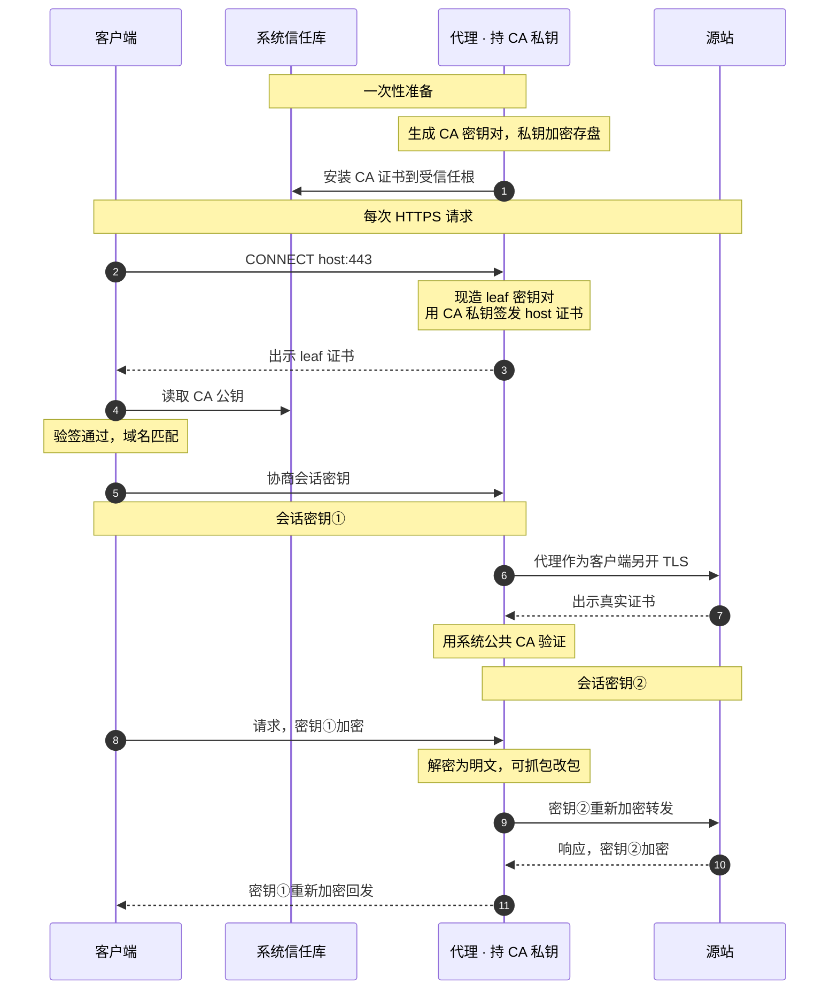
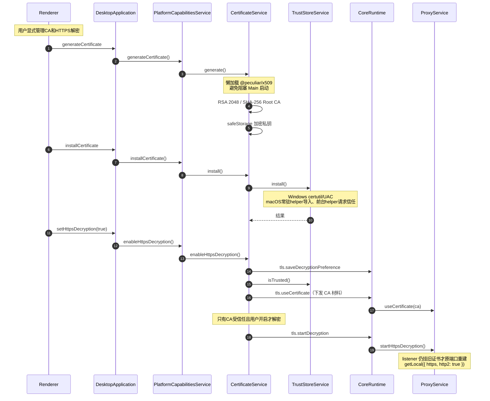
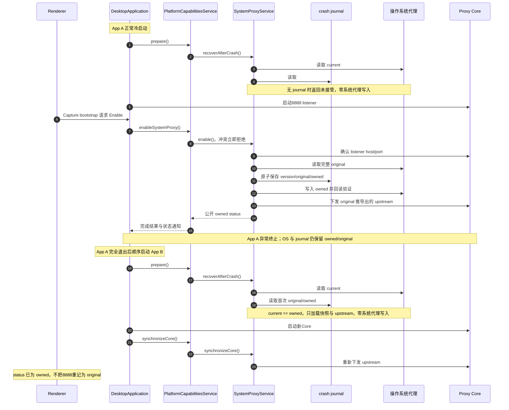
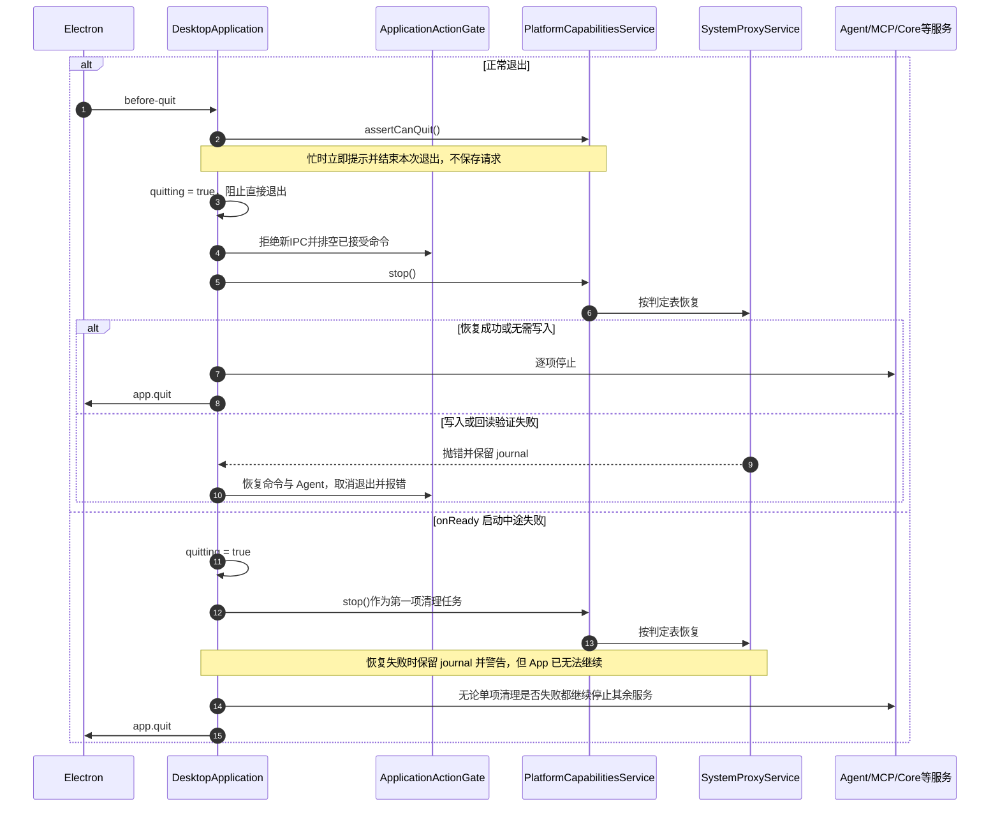
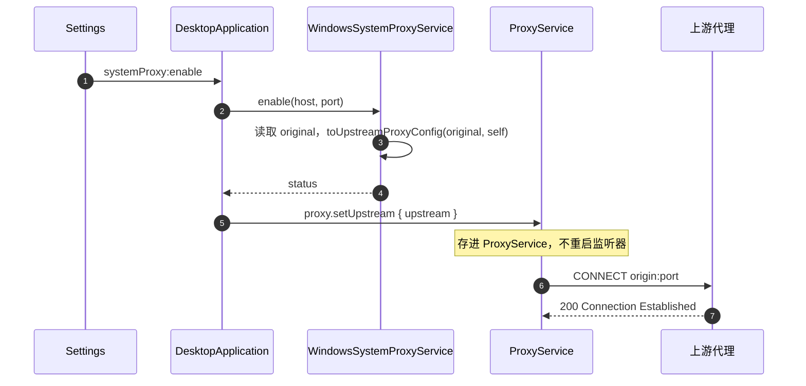
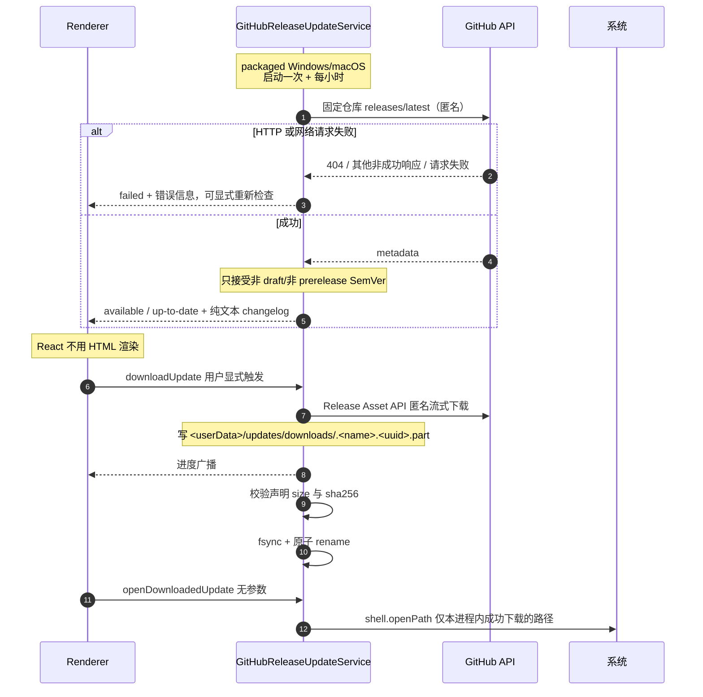
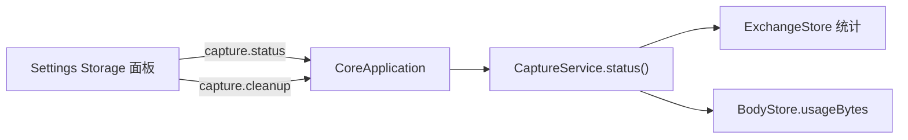

# Feature: Settings

> Main模块：`@interceptor/platform-capabilities`（`packages/platform-capabilities/`）、`updates/`
> Core 模块：`apps/proxy-core/src/proxy-core/capture/entry.ts`
> Renderer 模块：`apps/desktop/src/renderer/features/settings/`

## 1. 职责与边界

Settings 聚合所有需要**操作系统权限**或**跨会话持久化**的配置。

| 子域 | 归属进程 | 内容 |
| --- | --- | --- |
| 证书与 MITM | Main | CA 生成、信任库安装、解密开关、不安全例外 |
| 系统代理 | Main | 接管、恢复、紧急修复、ownership 展示 |
| 更新 | Main | 检查、changelog、手动下载、打开安装器 |
| 存储 | Core | 用量状态、清理 |
| 语言、主题与导出隐私 | Main + Renderer | Main管理设置请求；Renderer应用15种语言、4套主题和3项默认值并保存到localStorage |
| Agent | Main + Renderer | Provider/Credential、持久化Chat、Streaming、Usage、恢复与Tool capability双列配置 |

**核心边界：所有 OS 级操作只在 Main。** Core 不读写系统设置，Renderer 只表达意图。

Settings rail 的最后访问 section 由 App shell 持有。切换到 Capture / Rules / Composer / Diagnostics
不会重置该值，返回 Settings 时仍打开离开前的 section；TLS compatibility、Proxy readiness 等明确的
跨 feature 跳转可以覆盖它，直接打开对应目标 section。面板内未提交的瞬态 dialog 不跨 feature 保留。

Settings rail 的每项都是原生 button，当前项必须通过 `aria-current="page"` 暴露，不以 CSS class 或翻译文案作为状态契约。
Proxy readiness与TLS入口在App shell先设置目标section，再切换workspace。

Capture 的 TLS tunnel Inspector 允许从已确认的`TLS passthrough`连接跳到当前配置项。跳转前读取
TLS passthrough settings，并从当前host的所有覆盖项中选择最具体pattern：exact优先，其次选择suffix
最长的leading wildcard；没有覆盖项时不伪造目标。App一次性切到Settings / TLS passthrough并携带该
pattern，列表加载后将目标滚入可见区域，以accent背景和边框高亮3秒；重复跳转重新计时。高亮只是
Renderer瞬态导航反馈，不写workspace、不进入URL，也不由Main/Core持有。

### 1.1 语言、主题与导出隐私Tool

- `settings_set_language`接受`{ language }`，只允许既有15个语言ID；`settings_set_theme`接受`{ theme }`，只允许`warm/light/ember/dark`。
    - 不增加`auto/system`等模式，不改变首次启动的系统语言匹配、默认主题或现有`localStorage`键。
    - UI与Tool共用明确的Main方法，不在Tool里执行JavaScript、写Renderer Store或直接访问存储。
- `settings_set_export_privacy_defaults`要求显式提供`maskAuthorization`、`maskCookies`、`warnBeforeUnmasked`三个boolean。
    - 只改变后续导出的默认值，不修改已经打开的导出草稿、运行中的任务或既有文件；Archive仍保留完整原生存档。
    - UI单项Switch继续只改变自己的字段，连续操作不能因异步确认丢掉另一个字段。
- Main通过有类型的Preload请求关联一次设置操作，Renderer常驻订阅应用并确认；界面导航不决定是否接收变更。
    - Main处理参数校验、取消、Renderer退出及完成通知；结果只含已应用设置，不含存储路径、请求内部ID或任意错误内容。
    - `UiPreferencesService`登记请求；`UiPreferencesActions`常驻订阅，串行领取并应用，成功写入原localStorage后确认，Main再广播给其他Renderer。
    - 不新建配置文件、双写副本或迁移路径。App只把语言/主题映射到DOM，不再晚于确认重复写存储；持久化失败返回安全失败响应。
    - Deny与预取消无写入；未开始的请求被取消后不能迟到应用。已开始提交的设置完成原操作，不用取消回滚用户状态。
- 三项均为独立Settings change，Agent/MCP各自授权并遵守Ask/Auto。

## 2. 证书与 HTTPS MITM

证书面板使用Renderer的Inter字体，按400/450/500/600/700离散字重注册已有本地资源，不增加外部字体请求；其余排版沿用[Renderer规范](../platform/renderer.md)和[设计系统](../../design-vite/design-system.md)。

### 2.1 三对密钥

| 密钥对 | 持有者 | 用途 |
| --- | --- | --- |
| CA 密钥对 | 本应用生成 | 私钥签发 leaf，公钥装信任库验签 |
| leaf 密钥对 | Mockttp 按 host 现造并缓存 | 与客户端的会话 |
| 源站真实密钥对 | 真实网站 | 代理与源站的会话 |

**CA 私钥经 `safeStorage`（DPAPI/Keychain）加密存盘，只在 Main 与 Core 内存中流转，绝不进 Renderer、日志或导出。**

### 2.2 握手时序

> 密钥交换细节：TLS 1.2 + RSA 时客户端用 leaf 公钥加密预主密钥、代理用 leaf 私钥解密；TLS 1.3 / ECDHE 时会话密钥由临时 DH 生成（前向保密），leaf 私钥只用来签握手、客户端用 leaf 公钥验签。**两种情况下客户端信任 leaf 都取决于用信任库里的 CA 公钥验签成功。**

### 2.3 启用流程

**证书与解密开关正交**：`tls.useCertificate` 只记录当前可用的 CA 材料，`tls.startDecryption` /
`tls.stopDecryption` 只切换是否 MITM。停止解密时全部 host 退回隧道、证书永不出示，因此
卸载信任或删除 CA 都不必立刻换 listener。CertificateService只有CA已安装信任**且** `mitmEnabled`开启时
才发 `tls.startDecryption`，否则发 `tls.stopDecryption`。

CertificateService从Core读回`tls.getDecryptionPreference`，再按「CA已信任且用户开启」决定是否真的
解密。持久化的是**用户意图**，不是运行态：`tls.saveDecryptionPreference` 只在用户拨开关时写，
CA 不可用而发出的 `tls.stopDecryption` 不会擦掉它。

源站证书例外的增加和撤销必须从下一笔请求生效，包括启动时已加载共享CA、从未转发过HTTP的listener。`ProxyService.replaceInsecureHosts()`需替换整组HTTP转发规则，不追加等待首笔匹配的旧规则；不重启listener、不清Capture会话、不改WebSocket规则。

信任作用于Windows LocalMachine Root或macOS System Keychain/admin trust。Windows通过共用`commandRunner.runElevated()`执行固定certutil命令，macOS通过native helper分开执行公开证书存取和系统信任确认；检测不需提权。

| 操作 | Windows | macOS |
| --- | --- | --- |
| 安装 | `certutil -addstore -f Root`（不带`-user`） | 常驻helper导入System Keychain，再由普通用户前台helper请求admin trust |
| 检测 | `certutil -verifystore Root <sha1>` | `security find-certificate -a -p`精确匹配SHA-1后，`security verify-cert -p basic -L`查询根CA的系统信任链结果 |

按SHA-1 thumbprint精确定位；只读命令通过`execFile`传递固定参数，不经shell。

macOS只将匹配的公开证书经stdin交给系统验证，不生成临时证书文件、不传入`-r`强制信任锚点、不读取私钥；未安装或系统评估拒绝均不报告trusted。此处检查根CA的基本系统信任，不以CA本身代替服务器叶证书执行SSL域名/用途验证，真实HTTPS握手仍需相应workflow验收。

浏览器验收必须使用默认HTTPS校验访问真实Proxy listener，并核对叶证书由当前共享CA签名。Playground协议客户端的`rejectUnauthorized: false`仅用于协议流量，不构成浏览器信任证据；`capture.scenarios.tls`使用`/playground/tls/browser-trust`固定本地响应，保存Edge security state、证书错误及公开指纹。

### 2.4 窄 API

#### macOS 信任入口

- 代理与公开CA导入/删除使用常驻root服务；trust/untrust由同一helper的普通用户前台入口执行。CA生成和私钥加密属于Main中的CertificateService，私钥不交helper。
- `certificate.trust`与`certificate.untrust`的stdin参数为`{ certificate: <公开DER base64>, sha256: <大写SHA-256> }`，回复为`{ sha256, trusted: true | false }`；不接受路径、私钥、任意命令或调用方指定的信任域。
- 前台helper在登录用户GUI会话中调用`SecTrustSettingsSetTrustSettings`/`SecTrustSettingsRemoveTrustSettings`，只修改`.admin`并回读；系统确认由用户处理。这些API不接收`AuthorizationRef`，[系统实现](https://github.com/apple-oss-distributions/Security/blob/main/OSX/libsecurity_keychain/lib/TrustSettings.cpp)为信任写入单独创建授权，不能复用helper安装授权。
- CertificateService先核对目标CA是否已存在，再经helper导入和授信。明确拒绝或取消只撤回此次新增的精确DER；已有CA与结果未知的CA保持，回滚失败同时报告。卸载先撤销信任，成功后才删除公开证书。
- 不修改SIP、授权规则或用户信任域，不提供后台root自动授信、版本兼容或失败回退分支。
- 不能假定root身份可以代替admin trust授权；不尝试修改`com.apple.trust-settings.admin`来绕过系统确认。

#### CA与profile生命周期

- 首窗顺序：App首窗和启动页先显示，再调用`PlatformCapabilitiesService.prepare()`准备系统组件/证书。平台对象通知`platform/certificate`，Main通过`startup:get-stage`及`startup:stage-changed`转发，全部服务可用后发布`ready`。Renderer `ApplicationStartup`准备期间仅挂载BootScreen及窗口控制，ready后才挂载业务订阅；迟到查询不得使进度倒退。Main在ready前拒绝业务IPC；helper、证书或代理操作忙时拒绝本次退出并提示当前操作，不保存延后退出。平台API不接受`AbortSignal`，已开始的操作完整收尾。Core/listener/自动接管顺序与MITM意图保持。
- 材料为`root-cert.pem`、safeStorage加密的`root-key.enc`、`ca-meta.json`。Windows路径为`%LOCALAPPDATA%/Interceptor/certificates`；macOS路径为`~/Library/Application Support/Interceptor Platform/certificates`，均独立于默认及自定义profile。
- 启动顺序：安装安全Renderer协议与IPC → 显示启动页 → 准备原生组件 → 加载系统代理恢复记录 → 检查共享材料及精确指纹的真实信任 → 缺失才生成、未信任才安装/授信 → 其余Main服务/Core准备 → Renderer业务页面。只在App启动做初始化，Core重启与普通退出不重复授信或删除。
- 已生成且受信任：不改文件、不调用安装、不重复系统确认。已有未信任：保留同一CA，只走原系统安装/授权，之后回读真实信任，仍未信任则报错。残缺、损坏、指纹/密钥不匹配、无法解密或过期材料保留并报错，不隐式换CA；取消/失败沿Main启动失败路径恢复代理并退出。新目录0700、材料0600；私钥仍仅以safeStorage密文保存。
- `CertificateService`属于Main进程中的平台模块，统一拥有材料、加密、内部TrustStore、MITM意图和Core配置同步。Main只持有一个`PlatformCapabilitiesService`，直接调用业务方法并接收结果/error和状态通知，不持有各module实例。私钥只在Main/Core内存，不交root helper。Windows保留certutil/UAC，macOS保留前台helper系统确认；MITM开关仍按profile且不因CA初始化自动开启。
- 现有Generate/Regenerate、Uninstall、Delete作用于共享CA；仍须显式用户操作，受信任时不能直接Regenerate。Uninstall保留本地材料，Delete先撤销信任再删材料；下次启动按缺失步骤初始化。普通退出和普通业务workflow不能撤销/删除共享CA。
- 不迁移或复制旧profile材料，不增加测试专用路径/开关，不分发跨用户共用私钥。业务配置、凭据和Tool授权仍隔离，测试不放宽零seed要求。
- 删除已退出App的业务profile不删除或改写共享CA。共享启动workflow须在真实删除测试profile后再次核对公开指纹、三份文件的size/mtime和系统信任，不能只靠目录不同或退出前的查询推断。
- 专项验收只清理本轮由产品首次创建的共享CA；已存在的共享CA不作为破坏性测试输入。普通协议workflow以已通过产品初始化的CA为基线，保持指纹/信任和材料不变；初次初始化与后续复用分别保存证据。

#### 证书操作

`getCertificateStatus`、`generateCertificate`、`installCertificate`、`uninstallCertificate`、`deleteCertificate`、`revealCertificate`、`viewCertificate`、`openCertificateManager`、`getInsecureHosts`、`setInsecureHosts`、`setHttpsDecryption`。

macOS View：固定前台`certificate.view`只接公开DER与SHA-256，使用系统`SFCertificatePanel`显示详情，`SFCertificateView`关闭信任编辑。面板真正显示后才回复requested，普通用户运行且不经root socket；调用App退出时关闭。Windows继续原系统证书查看方式。View不负责导入、安装或trust，不能把只读查看变成第二条授权写入路径。

### 平台模块操作互斥

- platform-capabilities中的证书、系统代理、AppContainer和helper部署模块分别管理自己的在途状态和互斥；Main只持有一个readonly平台对象，直接调用方法，处理error并转发通知，不实现平台步骤或保存组内busy状态。ApplicationActionGate只管理通用命令接收与退出收尾，不维护全量平台操作表；也不把该表原样搬到PlatformCapabilitiesService。
- 证书材料与TrustStore属于同一证书模块；PlatformCapabilitiesService对外提供证书业务方法，内部唯一CertificateService完成生成/加密、安装、回滚、撤销、删除和Core同步。各module实例private，不暴露给Main；材料存在与系统受信任仍是独立事实，私钥不交helper。
- helper只执行固定原生操作并回复结果，保留鉴权、参数校验、原子写入和回读，不增加业务队列。共享系统确认及维护资源只做必要的跨组协调，不重复存储各组状态。
- macOS常驻helper同步服务Main的启动与系统操作，launchd使用`ProcessType=Interactive`，不能按无人等待的`Background`任务限制CPU和I/O；Unix socket不具备Adaptive所需的XPC activity。完整App资源、内嵌代码、全部架构和运行时校验及客户端30秒期限保持，不用缓存、跳过校验或延长期限替代调度修正。
- 部署发现与准入分开：`deployment-status`只比较组件部署、应用签名身份和主可执行文件，不是授权结论；正常启动仍必须通过常驻helper的完整资源/内嵌代码/全部架构及运行时检查才进入证书阶段。`inspect-application`、请求安装和root安装继续完整验证，不因部署发现结果而跳过验证；不得缓存历史信任结果。
- 不排队。冲突立即返回`operation_in_progress`和当前操作标识；UI沿用现有提示并显示本地化操作名，Agent/MCP返回相同原因。被拒绝的请求不触发helper、写文件或Core变更，也不在当前操作结束后自动执行。
- 证书组包括启动补齐、生成/重生成、安装/授信、撤销/卸载、删除、回滚、MITM启停和Core证书同步。操作开始前由模块占用，保护覆盖材料、系统信任、回读和Core同步；module使用Main注入的typed `requestCore`回调，不能导入CoreRuntime或Electron，通知回调不承担业务步骤，内部调用不再次争抢同组。
- 系统代理组包括接管、恢复、journal恢复、归属状态更新和上游结果应用；探测可并行，提交时检查当前配置与Core代际。Windows AppContainer单项/批量写入共用一组，因为底层写整份豁免名单。
- 不同组可以并行。helper维护与使用该helper的操作互斥；需要原生确认的操作之间互斥，冲突在产生写入前返回。只读查询不长期占用修改组，不能用中间状态决策后续写入。
- 平台API不接受外部AbortSignal。Agent/MCP在进入Main业务前检查取消；调用开始后等待平台操作完成或失败收尾，调用方停止等待不解除模块占用。helper超时/断线同样不证明原生写入已停止；未取得明确结束或可靠核验前保留冲突状态，不自动重试。启动与退出的必要依赖是单次操作内部顺序，不是保存用户请求的队列。
- helper部署前的`deployment-status / development-deployment-status / inspect-application / inspect-helper`只读检查不产生系统写入；命令结束后报告不可用、非法回复或拒绝时，必须保留错误并释放准备占用，不能把这些失败记为未知写入、永久阻止Quit。`system-proxy.read-effective`完整回复的value非法时，同样标明completed及只读operation。真正已发出的写入按原请求结束证据收尾，不能用普通status解除。
- 用户退出会打断系统写入时拒绝本次退出并提示，不等任务完成后自动退出；允许退出后先阻止新修改、恢复代理，再停止Core。Core故障恢复与失败回滚是必要收尾，不因普通冲突而丢弃。

#### 失联写入收尾契约

- 仅`system-proxy.replace`、`certificate.import`、`certificate.remove`在已发送后超时、断线或无法关联回复时，typed client发起一次只读`request.get-completion`，参数为`{ requestId: <原请求ID> }`，查询自身使用新的envelope requestId。正常成功、正式失败回复、只读失败和未发送请求不增加查询。
- 结果为`{ requestId, state: "completed", operation }`或`{ requestId, state: "unknown" }`。原ID和原操作都匹配才证明调用已结束，不证明系统状态符合预期；仍返回原失败，由Certificate/SystemProxy既有业务收尾回读、同步Core和发布通知后释放占用。
- helper在发送终态回复前记录结束元数据，生产/开发socket互不读取对方记录；每个实例只保留最近128个写请求ID及操作名，不保存参数、结果正文或授权结论。查无记录、实例重启、记录淘汰、非法回复及查询失败均不能解锁，也不能自动重放写入。
- 原请求与确认请求分别遵守既有30秒传输期限；确认属于失败收尾，期间原业务保持占用。前台信任进程的异常结束不属于socket记录，不能凭无关记录或普通status解除。
- 安装CA的import失联后若已确认结束，且安装前不存在该精确CA，在请求trust之前撤回本次可能新增的公开证书；已有CA、未发送或未确认的import不删。内部`requestSent`与`executionState`分别表达是否发出帧和是否结束，原错误与回滚错误都保留。

#### 启动完整资源校验的进程隔离

- 常驻helper核验socket audit身份、固定App路径和运行时保护；每次完整资源校验启动同一受保护helper的只读`verify-code-signature <absolute-code-path> <cdhash-requirement>`子进程，避免长期进程的校验慢路径。
- 子进程执行原Security API的身份、strict、nested、all-architectures及no-network检查，正常退出码0才可继续；失败或异常退出拒绝请求，不将CLI开放为socket命令。
- 原请求保持占用，完成记录晚于校验子进程退出及真实系统写入收尾；30秒期限、128条结束记录、不重放、Windows与开发UID入口不变，不保存签名或信任缓存。

Certificate module组装的`CertificateInfo`含`path`与`mitmEnabled`，不含私钥；解密材料只经内部Core RPC发送。

## 3. 系统代理

### 3.1 参与者、快照与不变量

| 参与者 | 负责什么 | 不负责什么 |
| --- | --- | --- |
| Renderer | 通过窄 Desktop API 请求 Enable、Restore 和只读 Status | 不访问 WinINet、SystemConfiguration 或 journal |
| `DesktopApplication`（Main） | 调用唯一PlatformCapabilitiesService，捕获error并转发状态，管理App/Core生命周期 | 不管理平台module实例、操作状态、upstream或恢复步骤 |
| `PlatformCapabilitiesService` | 私有组装各module，提供完整业务方法和启动/退出入口 | 不维护集中平台操作表或用户请求队列 |
| 平台 `SystemProxyService` | 拥有操作状态、listener检查、upstream同步/探活及必要恢复；所属Windows/macOS实现比较完整快照并执行native写入/回读 | 不启动或停止Core进程，不访问Renderer |
| Proxy Core UtilityProcess | 监听 `127.0.0.1:8888`，接收 Main 下发的 upstream 并转发流量 | 不读取或修改系统代理，不读 journal |
| crash journal | 保存崩溃恢复需要的 `version/original/owned` | 不保存 owner、PID、启动时间、instance ID 或阶段状态 |
| 操作系统 | 保存当前实际生效的代理配置 `current` | 不知道哪个 App “拥有”代理 |

三个比较值的含义：

| 值 | 产生时间 | 内容 |
| --- | --- | --- |
| `original` | Interceptor 接管前 | Windows 为 flags、Proxy Server、Bypass、PAC、Auto Detect 等完整 WinINet 快照；macOS 为全部活动 network service 的完整代理字典 |
| `owned` | 写系统代理前 | 根据 `original` 计算出的 Interceptor loopback 配置，目标为当前 Core listener |
| `current` | 每次恢复判定时 | Main 通过平台 helper 当场读取的操作系统实际配置 |

文档中的 `current == owned`、`current == original` 都表示完整快照逐字段相等，不表示 PID、进程或文件的所有权。
network service的增加或删除也属于完整快照的外部变化；恢复与跨代journal加载都不得只比较仍存在的service或覆盖新配置。ClashX系统代理的真实改写、App退出及跨profile恢复由独立用户流程验收，不以状态机测试代替。

Windows journal 固定为 `%LOCALAPPDATA%/Interceptor/system-proxy/journal.json`，不随 Electron
`userData`、开发模式、packaged App 或 E2E `--user-data-dir` 改变；macOS journal 为
`~/Library/Application Support/Interceptor Platform/system-proxy/journal.json`，也避开默认profile。两平台都先把临时文件完整写入并同步，再原子 rename。
产品前提是同一时间只运行一个 Interceptor App，不处理两个 App 的竞争。

启动用户级journal路径前必须确认旧实例已正常退出、系统代理已恢复、没有待处理旧journal；不能遗弃仍拥有OS代理的恢复记录。不增加旧profile迁移或回退读取，Windows原路径、原生命令和`version/original/owned`契约保持。

### 3.2 生命周期流程

#### 正常启动与崩溃重启

#### 正常退出与启动失败

正常退出可以在代理恢复失败后继续运行，因此取消退出且不先停止 Core；启动失败表示 App 已经无法继续，
所以即使代理恢复失败也会保留 journal、警告用户并继续销毁其余服务。这是两条流程最重要的差异。

Core状态通知经PlatformCapabilitiesService交给SystemProxyService；从`running`进入`unresponsive/restarting`时，
module合并一份必要Restore，等待已开始的操作明确结算后恢复。用户Enable/Restore发生冲突时立即拒绝，不保存、
不重试、不延后执行。恢复前仍当场读取完整`current`；原生结果不确定时不能仅凭Promise失败释放占用。
这些状态仅协调单Main进程，产品仍要求同一时间只运行一个App。

所有启动恢复、用户 Restore、Core 故障恢复和退出恢复最终使用同一判定表：

| 当场比较结果 | 启动 `recoverAfterCrash()` | Restore、Core 故障或退出 |
| --- | --- | --- |
| 无 journal | 返回未接管，零系统代理写入 | 若内存也无快照则返回未接管，零系统代理写入 |
| `current == owned` | 加载 `original/owned`，保留 journal，零系统代理写入 | 写回 `original`，回读验证成功后删除 journal |
| `current == original` | 只删除已完成使命的 journal | 只删除 journal，不重复写 `original` |
| `current` 与两者都不同 | 视为用户或外部程序已修改；零系统代理写入并删除失效 journal | 同样零系统代理写入并删除失效 journal，报告 `externally-modified` |
| helper 写入或回读验证失败 | 抛错；不把恢复当作成功 | 抛错并保留 journal；正常退出因此取消，启动失败清理则继续退出 |

**窄 Desktop API**：`getSystemProxyStatus`、`enableSystemProxy`、`restoreSystemProxy`。Main 日志不包含 snapshot。

### 3.3 平台实现

| 平台 | 机制 |
| --- | --- |
| Windows | `windows/helper.cs`，当前用户 WinINet per-connection API，读写 flags/Proxy Server/Bypass/PAC URL/Auto Detect，广播 settings changed |
| macOS | `macos/helper.swift`，Authorization Services + SystemConfiguration，枚举当前 Network Set 全部活动 service，单 session 内 set/commit/apply |

只允许 loopback listener。

#### macOS 同包原生服务

Main通过同包helper执行macOS代理和System Keychain公开证书操作。

- 配置明确`protocolVersion`、`socketPath`、`clientUserId`、`clientExecutablePath`和精确`cdhash` requirement；配置和endpoint目录必须由服务账户拥有且不能被其他用户写入，root运行还检查整个父目录链。
- 本地Unix socket通过内核`LOCAL_PEERTOKEN`读取audit token；校验实际peer用户、`SecCodeCheckValidity`、静态代码和固定可执行文件路径，不接收客户端自报身份，不维护私钥或Apple付费身份。
- 协议为单连接单条newline JSON，校验协议版本和严格字段集合；`status`返回服务进程ID、是否root、客户端写资格和当前实际能力。未知命令、额外字段、未核准进程都明确拒绝。
- 证书目标命令`certificate.import / certificate.remove`仅接受`parameters: { certificate, sha256 }`，certificate为公开X.509 DER的base64，sha256为64位大写十六进制。原生侧核对编码、大小、指纹和Interceptor自颁发主题，固定System.keychain；不接受路径、私钥、任意keychain或按模糊名称删除。
- Main进程中的CertificateService拥有CA生成、私钥safeStorage和TLS同步。公开证书导入/删除使用常驻helper，admin trust添加/移除使用普通用户前台helper；信任失败不报成功，移除trust失败不删除证书。helper导入不等于受信任，不能替代系统独立授权。
- 普通`system-proxy.read`保留内核进程、UID、canonical路径与精确CDHash检查，不需要特权的公开查询不再扫描整包资源；`status`和所有写命令仍严格校验完整App资源、内嵌代码及运行时。该区分用于避免只读查询排队拖延代理退出恢复，不能让篡改App获得写资格。
- Recording就绪：Core重启时`CaptureStatus.recording=true`只说明Core正在记录，Renderer等支持平台的系统代理实际owned且未ownershipLost才显示Recording。迟到状态不能覆盖Stop、代理失权或Core代际变化，journal预写不代表代理已接管。
- 代理命令：`system-proxy.read`无参数，返回全部活动network service的原始快照；`system-proxy.replace`仅接收`parameters: { expectedSnapshot, replacementSnapshot }`，两个快照均为`{ services: [{ id, name, settings }] }`，不接收路径、shell或Authorization凭据。协议帧上限为256KiB以容纳双快照，过大数据明确拒绝，不截断或省略服务。
- 条件写入只在原生进程具备root权限且客户端通过所选入口的鉴权时执行；在同一`SCPreferencesLock`事务内读取current、比较完整expected快照、commit/apply并回读replacement。普通权限返回`authorization-required`，快照冲突返回`snapshot-conflict`，不新建Authorization窗口、不覆盖外部修改。SystemProxyService持有journal和恢复流程，helper不保存第二份original。
- 生产入口在写入前校验实际SecCode的Hardened Runtime、动态有效状态及未被调试状态，拒绝DYLD环境注入、get-task-allow和关闭执行页保护的entitlements。只读客户端身份不能自动取得写权限。
- 服务重启只清理崩溃遗留的自有socket，保留活跃socket和普通文件；忽略SIGPIPE，避免客户端断连终止服务。

#### macOS 首次启动部署 Helper

##### 开发与生产双入口

- 本机开发和业务E2E共用一个常驻helper；开发入口信任获准的本机UID，不绑定项目源码、App构建CDHash、Electron签名或调试状态。首次部署确认后，HMR、rs、Main/Core重编译、新profile均复用，不重装或重复申请开发授权。
- 同一个原生服务提供两个本地socket：生产使用`service.sock`及`service.json`，开发使用`development.sock`及`development.json`。开发配置仅记录`protocolVersion / socketPath / clientUserId`，由root保护；生产配置保留精确App路径/CDHash及完整运行时检查。请求不能自报环境来改变当前socket的鉴权。
- 两入口共用固定代理/公开证书协议与条件写入实现，不接收任意shell或私钥。开发授权明确允许该UID的本地程序使用这些能力，不宣称隔离同用户恶意代码；其他UID、损坏或可写配置仍拒绝。证书admin trust保持独立权限。
- Main按真实`app.isPackaged`选择入口：未打包的Forge与业务E2E走开发入口，签名产物走生产入口；无测试专用产品参数。helper仅在自身配套组件改变或缺失时更新，开发App重新构建不改变部署身份；安装另一入口不删除既有授权。
- 开发首次授权将同一份已验签helper复制到当前用户的私有系统临时目录（目录0700、文件0500）后执行固定授权命令，成功/取消/失败均清除；root阶段仍复制到root私有暂存目录并核对预先读取的helper CDHash。避免authd无法读取Desktop源码目录中的原生代码身份，不复制App或仓库、不改系统隐私权限或node_modules。

- App留在用户原位置，helper随App打包；平台prepare在代理恢复/接管前检查helper部署，缺失或所选入口的配套身份改变才请求系统管理员授权。后续启动只读核对并复用；不要求`.pkg`、不移动或更改App所有权，不下载独立helper。
- 只将原生组件部署到`/Library/PrivilegedHelperTools/com.zhxmt.interceptor.platform-capabilities`，配置和socket位于`/Library/Application Support/Interceptor/PlatformHelper/`。配置由root拥有且不可被其他用户写入，记录实际登录UID、App canonical路径及精确CDHash；launchd服务与配套helper一起更新。
- 授权后先在root私有暂存目录复制单个helper并核验精确签名，再执行固定`install-helper`。原生实现再次核验App/同包helper，按文件事务替换并注册服务；失败恢复原组件，不执行旧一次性写入路径。
- `deployment-status`只读返回`missing / outdated / ready / stopped / invalid`；损坏/未知状态不触发覆盖安装，取消不重试。`status`将服务root权限与`clientAuthorizedForWrites`分别表达，运行中App须通过内核身份、完整签名与Hardened Runtime校验，不以root拥有整个App代替鉴权。
- 原生`uninstall-helper`仅在用户明确批准的root操作中移除固定组件，不删除App、profile或CA；卸载前先经App恢复代理。

### 3.4 上游代理链式转发

接管后，遵循系统代理的应用将请求交给Interceptor。原有HTTP/SOCKS代理或PAC需要继续作为上游，否则可能绕过指定代理或导致访问失败。Main读取接管前的生效代理配置并交给Core使用；系统路由不由该配置转换过程修改。

转换规则（`windows/system-proxy-upstream.ts`）：

| 原配置 | 上游 `proxyUrl` |
| --- | --- |
| PAC 脚本（`PROXY_TYPE_AUTO_PROXY_URL` + `pacUrl`） | `pac+<pacUrl>`，PAC 求值交给 Mockttp 内置的 `pac-proxy-agent` |
| 显式代理 `host:port` | `http://host:port` |
| 分方案列表 `http=a;https=b` | 取 https，缺失回退 http |
| 仅 `socks=host:port` | `socks5://host:port` |
| 仅 Auto Detect（WPAD） | 无（没有可传给 proxy-agent 的 URL），按直连处理 |

`bypassList` 转成 curl 风格 `noProxy`；Windows 专有的 `<local>` 展开为 `localhost` / `127.0.0.1`。**不能展开出裸 `::1`**：`matchesNoProxy` 按 `host:port` 切分候选项，裸 IPv6 会被切成空 host，而空 host 匹配一切，结果是每个请求都判定为 bypass，上游形同虚设。

`toUpstreamAuthority(upstream)` 从同一份配置里取出 `host:port`（丢弃凭据）供状态栏展示。

#### 三条出网路径都必须接上游

上游不是一个开关，而是三条彼此独立的代码路径，漏掉任何一条，对应流量就会绕过公司代理直连：

| 流量 | 出网点 | 接上游的方式 |
| --- | --- | --- |
| MITM 已解密的 HTTP/HTTPS | Mockttp 规则 | `thenPassThrough({ proxyConfig })` |
| MITM 未解密的 TLS 直通（`tlsInterceptOnly` 未命中） | Mockttp `passthroughSocket` | `passthroughProxyConfig`，见下 |
| WebSocket 转发 | `websocket-bridge.ts` 的 `ws` 客户端 | `HttpsProxyAgent`，命中 `matchesNoProxy` 时不注入 |

Mockttp 的 `passthroughSocket` 把 `net.connect(port, host)` 写死，`proxyConfig` 完全不参与，因此**只要关闭 MITM，全部 HTTPS 都绕过上游**。`patches/mockttp+4.5.0.patch` 为它补一条 `passthroughProxyConfig` 路径：用 proxy-agent 家族建立 CONNECT 隧道，再把客户端连接与隧道对接。改动是纯增量的——`passthroughSocket` 自身保持同步、原有直连分支一行未动，只有配置了上游才转入新的异步分支。PAC 上游需要一个请求桩才能选出正确的 agent，桩的 `upgrade` 头固定为 `websocket`，`PacProxyAgent` 才会选隧道模式而不是明文转发。

#### bypass 要双向维护

- **读**：接管前的 `bypassList` 转成 `noProxy` 下发 Core，命中则直连不进上游。
- **写**：接管时写回系统的 bypass 必须并入 `localhost` / `127.*` / `[::1]` / `<local>`（`withRequiredBypass`），否则本机与内网流量被推进代理。`<local>` 不匹配 IP 字面量，所以三条都要显式列出；`::1` 必须带方括号，裸写会让 `InternetSetPerConnectionOption` 整体写入失败。
- **AVD / Dev Box**：Windows owned bypass 不注入产品域名。拒绝 MITM 的 gateway 应由 Core per-host TLS passthrough 处理，使流量仍经过 Capture 并保留 tunnel metadata；默认 passthrough 列表为空。

#### 上游不可达时自动降级

上游代理进程退出（用户关掉 Clash 之类）后，Interceptor 仍指着一个死端口，全部流量立刻失败。`UpstreamProbe` 在接管期间每 `UPSTREAM_PROBE_INTERVAL_MS`（1s）对上游 `host:port` 做一次 `UPSTREAM_PROBE_TIMEOUT_MS`（500ms）的 TCP 连接：

- 探到不可达：清空 Core 的上游改为直连，Capture 状态栏的 `upstream host:port` 转黄并给出提示。
- 探到恢复：重新下发上游，状态栏复原。

只在状态翻转时才下发与广播。PAC 上游没有单一 `host:port` 可探，不纳入监控。状态经 `system-proxy:status-changed` 主动推给 Renderer（`SystemProxyStatus.upstreamProxy` / `upstreamReachable`），状态栏据此显示 `upstream host:port` 或 `direct`。

三个边界条件：

- **绝不把自己当上游**。崩溃残留会让系统代理仍指向 `127.0.0.1:8888`，此时接管前读到的"原有配置"就是我们自己，直接视为无上游，否则形成无限自环。
- **`proxyConfig` 用回调而非固定值**。Mockttp 每次请求求值，因此切换上游不需要重注册规则或重启监听器。
- **Core 重启后必须重新下发**。上游保存在 Core 进程内，`onCoreProcessReady` 与 TLS 材料一同重新下发，否则重启即断网。

Clash 等本机代理应在 Interceptor 接管前启动并启用系统代理，Interceptor 才能把它的 loopback 地址读作上游。若 Clash 在 Interceptor 已 owned 后启动并主动改写 WinINet，guarded ownership 会按外部修改处理并进入 ownership lost；两边不会反复抢写系统设置。

Mockttp经上游时统一使用CONNECT隧道，包括目标为明文HTTP的请求。

- HTTP、HTTPS passthrough、HTTPS MITM和WebSocketBridge均通过带userinfo的`proxyUrl`向上游CONNECT发送Basic认证，包含密码中的URL转义字符。
- HTTP和WebSocket在缺失或错误凭据时被上游拒绝，源站未收到请求，没有直连回退；`noProxy`命中时仍直连且不携带上游认证头。
- 上游凭据不进入源站请求或Capture记录。

### 3.5 Windows AppContainer 与 TLS passthrough

Windows owned `ProxyOverride` 不再加入 `*.wvd.microsoft.com`，避免 RDP gateway 完全跳过
Interceptor。拒绝 MITM 的 host 改由 Mockttp TLS passthrough 建立原始 tunnel。

Windows App有两个独立的网络边界：

1. `Microsoft.AAD.BrokerPlugin` 无 loopback exemption 时，WAM token/authorize 请求在 Windows
    网络隔离层失败，无法稳定到达 8888；仅靠 Mockttp host 名单无效。
2. WVD gateway 进入 MITM 后客户端主动 reset；应在 Mockttp 内走原始 TLS tunnel，而不是长期留在
    system `ProxyOverride`。

产品流程是：Settings 通过官方 Network Isolation API 枚举 AppContainer 与 SID，让用户显式开启
loopback exemption；Core 通过 Mockttp `tlsPassthrough` 管理持久化 host patterns；TLS 错误按 TLS
generation + host 去重并广播。App 壳按规范化 host 累积事件，无论当前工作区都显示一个可滚动列表
dialog。dialog 为每个 host 列出多层级候选（精确 host + 逐级父域 wildcard，最宽只到二级域，
不提供 `*.com` 这种一次放掉整个后缀的选项），精确 host 默认勾选、wildcard 默认不选；
哪一级安全取决于站点，产品不替用户判断，只把候选摆出来。主按钮以一次 revision replace 批量
保存未被现有 wildcard 覆盖的 pattern，并导航到
TLS Settings。Store 同时推进 settings change sequence，使已经挂载的 TLS 面板立即重读，旧请求晚返回
也不能覆盖新名单。默认列表为空，WVD badge 只是建议，不会自动保存。
技术选型见[backlog/research.md](../backlog/research.md) § 3.3。Mockttp的`tlsPassthrough`接受getter，
名单每连接求值，因此**保存即对新连接生效**，既不重建共享 listener也不需要重启；在途连接不受
影响。增加后删除、删除后加回、顺序或大小写变化同样不需要额外动作。

AppContainer 面板同时提供单项开关、`Enable all` 与对称的 `Disable all`。两个批量命令各自先显示
目标数量、系统范围和后果明确的确认 dialog，再分别发送一条 `enableAllAppContainers()` 或
`disableAllAppContainers()` Preload 意图；Main 每次只启动一次提权 helper。Enable all 将当前枚举的全部
AppContainer SID 与已有 exemption 并集，Disable all 只从已有 exemption 中移除当前枚举 SID；两者都保留
当前枚举之外的既有 exemption，并在一次写回后读回校验。Renderer 不循环调用单项命令，避免多次 UAC 和
中途只成功一部分的状态，也不允许批量启用成为不可逆操作。

工具栏的两个批量按钮为不可压缩的单行命令，28px盒高，内容不得溢出。

AppContainer 列表保持 Main 按名称提供的原始相对顺序，只在 Renderer 做一层稳定分组：所有
`exempt=true` 项置于 `exempt=false` 项之前，同组内不重排。搜索在该稳定分组之后执行，因此过滤结果必须是
完整列表的有序子序列，清空搜索后恢复同一顺序。

`NetworkIsolationEnumAppContainers`可以为不同用户返回同一AppContainer SID的多条
记录；公开 package identity 相同，但 `userSid`、working directory 或 binaries 不同。exemption 命令和 UI
身份都只以 AppContainer SID 为目标，因此 native helper 在枚举边界按 SID 保留一个稳定代表；Main 仍拒绝
重复SID。

#### AppContainer列表行高

- 列表头由父flex容器设置`align-items: center`，文字使用自然行高。
- 名称字号12.5px、行高15px；包名字号11.5px、行高14px；推荐标签字号10.5px、框高20px，通过inline-flex双轴居中，不用位移补偿。

#### TLS列表与兼容性弹窗行高

- `TlsPassthroughPanel`的host/说明行高14px、文字组gap为2px、推荐标签框高20px，标签以flex双轴居中；行最小高度66px，说明样式只作用于`.hostCopy > span`。
- `TlsCompatibilityDialog`的`.hostCopy > code`使用自然行高，候选列表高度264px并可滚动；精确host默认勾选、wildcard默认不选，全不选时禁止保存，Not now不写配置。

### 3.6 已知兼容风险

macOS接管前读取系统生效代理，并通过`detectedUpstream()`下发Core。各network service的完整快照只用于恢复，不任意合并Wi-Fi、以太网和VPN的配置。

#### macOS生效上游

- helper提供只读`system-proxy.read-effective`，无参数，返回`SCDynamicStoreCopyProxies`的生效代理字典；不从network service顺序猜测上游。
- 接管前读取原生效配置；全部service的`original/owned`仍用于条件恢复，不把上游选择写回原系统快照。
- journal保存接管前生效配置，崩溃重启保持原上游；Windows journal与命令不变。
- macOS用Mockttp公开`withProtocol()`区分HTTP/HTTPS，WebSocket按配置复用现有PAC/SOCKS agent；Windows单规则及单上游WebSocket路径不变，不修改第三方patch。
- 同一固定上游沿用探活；不同协议上游及PAC不使用单一探活结论，避免一条路失败就把全部请求改为直连。
- macOS下发`{ httpProxyUrl, httpsProxyUrl, exceptions, excludeSimpleHostnames }`；单个协议的`null`明确表示该协议直连。Windows原`{ proxyUrl, noProxy }`契约保持。
- macOS journal只保存`original / owned / effectiveProxies`；不含`version`，不保留旧实现、兼容读取或迁移。切换前确认宿主没有未恢复journal。
- macOS上游先经URL规范化，再用Node `BlockList`检查回环地址与listener端口；拒绝回环简写/IPv6映射造成自环，其他端口的本地代理保留。
- 只有Auto Detect而无PAC URL、无效代理地址或不支持的PAC scheme，在写系统代理前拒绝，不能当作直连成功。

覆盖范围限制：Windows 只接管 WinINet，自带网络栈、WinHTTP、Java、curl、容器、WSL 可能不走 Capture。`<local>` bypass 会让 localhost 绕过。

上游配置自动沿用系统原有代理或PAC，HTTP Basic转发规则见§3.4。产品没有独立的代理账号密码设置，WinINet快照也不提供凭据。

### 3.7 Proxy 与 MITM 跨进程恢复契约

系统代理 ownership 与 TLS 用户配置使用两种不同的恢复语义：

- Windows系统代理journal在异常退出后保留首次`original/owned`。产品只支持同一时间一个App；平台准备阶段比较`current`，等于`owned`时加载快照，等于`original`时清journal，其他值保持零WinINet写入并清除失效journal。正常退出时精确恢复首次`original`。
- TLS passthrough、源站证书例外与 HTTPS 解密开关是跨会话用户配置。新 Core 从 `workspace.sqlite` 读回配置；Main 在 Core ready 后读回解密意图，并按「CA 仍受信任且用户开启」重新下发 CA 与解密状态。

原始proxy server、bypass、PAC和完整journal快照不写入trace、日志或导出附件。

## 4. 更新

Updates仅保留现有产品UI和Main更新流程，不注册为Agent/MCP Tool，也不列入Tool开发计划。

**匿名请求**：产品不包含GitHub登录、Device Flow、Client ID、token读取/刷新/持久化或授权状态。检查和下载使用固定来源，`credentials: omit`且不发送`Authorization`；个人Git/CI凭据和仓库可见性不变。HTTP 404、其他非成功响应或网络错误均进入`failed`，不显示无更新或要求登录；失败后可从现有Check按钮显式重试。

**安全校验**：SemVer、draft/prerelease、固定 `api.github.com/repos/zhxmt-xm/Interceptor`、asset ID/name/basename、平台扩展名、显式架构、声明 size、SHA-256。拒绝路径编码逃逸、外域、重复候选；用户只能打开本进程内完整校验并原子保存成功的安装包。

**Renderer 永远拿不到 URL 或 path。**

八态：`unsupported` / `idle` / `checking` / `available` / `downloading` / `downloaded` / `up-to-date` / `failed`。

`UpdateStatus`只含`supported` / `state` / `currentVersion` / `latestVersion` / `progress` / `downloadedBytes` / `totalBytes` / `releaseNotes` / `message` / `lastCheckedAt`。Preload保留`getUpdateStatus`、`checkForUpdates`、`downloadUpdate`、`openDownloadedUpdate`及`onUpdateStatusChange`，没有GitHub账号API。

**生命周期**：`DesktopApplication`初始化updater并广播`update:status`；packaged Windows/macOS启动一次检查，此后每小时检查，正在下载或已下载时不自动覆盖结果。退出停止timer并取消检查/下载，已取消请求的迟到响应不能发布新状态或保留安装器，临时`.part`清理。未打包目标为`unsupported`。packaged Renderer从受保护ASAR经`interceptor://app`加载，不存在远程代码覆盖层。

**UI**：Updates从Version开始，Delivery保留固定来源、检查/下载策略、进度和显式Check/Download/Open installer，GitHub access、Private及账号文案已移除。公开`settings.updates.status`只反映`data-state`、`data-supported`和`data-last-checked-at`，不增加业务接口。Main safeStorage仍用于CA及Agent/MCP等原有功能；macOS Keychain访问许可不是GitHub登录。

### 更新通知按钮

- `UpdatesPanel`通过共享Button的icon参数传入RefreshCw、Download和ExternalLink图标，label只放文字；装饰图标和spinner使用`aria-hidden`。
- `UpdateNotification`使用`Button size="compact"`：高32px、水平padding为11px；字号12.5px、字重550、图标15px、gap为7px，不在通知CSS覆盖共享按钮样式。
- `available`仍调用`UpdateActions.download()`，`downloaded`仍调用`UpdateActions.openDownloaded()`；busy时禁用动作，Dismiss独立可用，其余状态不显示通知。没有新增IPC、下载或安装步骤。
- button和独立label使用`inline-flex`与`align-items: center`；图标固定且不收缩，内容间距来自gap，不以字形测量、位移或独立行高补偿。

## 5. 存储状态

报表字段：`sessionCount`、`exchangeCount`、`bodyCount`、`databaseBytes`（Capture 无 SQLite 恒为 0）、`blobBytes`、`totalBytes`。

### Storage面板

- 标题右侧使用30px Refresh图标按钮及Tooltip，刷新时旋转并阻止重复操作；不自动轮询，不提供预算、配额或保留期限输入。
- Usage只展示一次`blobBytes`，名称为`Captured body data`，包含内存与临时文件中的已保存正文；另外显示Session、Exchange和正文数量，不把正文总量称为Core RSS或磁盘占用。
- Settings与Capture列表共用`clearCapture()`，清理请求记录、正文和选中详情；Settings二次确认，Cancel不清理，已保存文件、当前Session及录制状态保持。文件任务互斥和系统代理恢复遵守Core/Main的同一业务规则。
- Storage清理行可换行并显示第二行提示，适应不同语言的完整说明。

Capture没有全局内存/磁盘配额；小正文驻内存，未确认事件队列没有总容量上限，不以静默丢弃数据控制用量。

## 6. 语言与主题

| 项 | 实现 |
| --- | --- |
| 语言 | 15 种完整本地 catalog，英语默认与回退 |
| 同步范围 | Ant Design `ConfigProvider.locale`、`html lang`、`localStorage`、`Intl` 格式 |
| Main 同步 | UiPreferencesService通过语义单一的intent请求Renderer应用、保存并确认 |
| 主题 | light / warm / dark / ember 四套时段主题 |
| 驱动 | `theme/theme.ts` ConfigProvider token + `:root[data-theme]` CSS 变量 |

语言设置不开放路径或通用IPC。

## 7. Agent

`Settings > Agent`是全局Agent配置的唯一入口，提供`Configured models`、Provider Add/Edit/Test/Save/
Remove与新Chat默认Model；Provider registry和API Key由Main内`AgentRuntime`经`safeStorage`加密，Renderer只见
脱敏snapshot。

能力与执行策略分别配置：

- `Tool capabilities`：从`packages/interceptor-tools/`已实现registry渲染；每行提供Agent与MCP两个Switch，
    默认全部开启，关闭后只停止向对应入口注册；
- `Execution mode`：Agent按Session、MCP按Client选择`ask`或`auto`，默认`ask`。query Tool开启后直接执行，
    change Tool才读取该模式。
- `MCP Server`标题与Endpoint之间提供只读版本说明：支持`2026-07-28`并兼容`2025-11-25`、
    `2025-06-18`，由Client与SDK自动处理协议，不提供手动版本开关。Server关闭、运行和端口冲突时均显示；
    文案按当前语言显示，窄窗口自然换行，不改变Client凭据或Ask/Auto。

页面只显示可执行registry中的Tool。完整名称与契约见
[tool-capabilities.md](tool-capabilities.md)；Provider/Session/Tool Loop所有权见[agent.md](agent.md)，MCP接入见
[mcp.md](mcp.md)。

### 7.1 Settings 只读 Tool 契约

提供六项query：`settings_get_core_process_status`、`settings_get_system_proxy_status`、
`settings_get_certificate_status`、`settings_get_tls_insecure_hosts`、`settings_get_tls_passthrough`、
`settings_list_app_containers`。六项共用唯一 registry，归 `settings` capability，均只接受空对象；
Agent 与 MCP 默认开放，独立开关立即控制披露与执行，query 不进入 Ask 审批。

- Core 进程状态、系统代理、证书与 AppContainer 查询复用 Main 的正式 owner；TLS 名单复用现有 Core 查询。
    Main 查询不得为接入 Tool 下沉到 Core，也不得扩大 Renderer API 或调用通用 IPC。
- Core 状态只描述进程生命周期，不把 `running` 解释为 listener、TLS 或上游健康。
- 结果只包含公开状态、公开证书身份、配置 host 与 AppContainer SID/名称/豁免状态；不得包含私钥、
    本机文件路径、完整系统代理快照、上游凭据或原生 helper 原始输出。错误同样经过脱敏。
- 查询不得生成或安装证书、修改代理/TLS/豁免、写入配置、打开原生窗口或触发 UAC；AppContainer
    的平台支持状态沿用正式产品契约，不伪造跨平台能力。
- Main在调用前检查Agent/MCP的`AbortSignal`，已取消请求不进入owner；Core业务仍使用自己的取消契约，
    Platform Capabilities不接收signal，已开始操作完整收尾。关闭Tool后的新调用返回`unknown_tool`，不触达owner。
- Settings 增加来自 registry 的第六个 feature 分组；名称、query 类型、说明、Agent/MCP 双开关与
    Transcript 摘要同步设计稿、15 种语言、截图及 parity，不维护第二份能力清单。

### 7.2 系统代理 Tool 契约

`settings_enable_system_proxy`与`settings_restore_system_proxy`是两个独立change意图，只接受空对象。
UI与Tool经Main调用同一PlatformCapabilitiesService方法，由SystemProxyService完成流程；不接收Model提供的host、
port、proxy snapshot或路径，不改变冷启动自动接管，Windows/macOS journal格式保持各自现有契约。

- Enable先确认Core listener可用，再接管系统代理、同步检测到的upstream与探活；Restore按现有ownership
    比较恢复首次original并同步直连状态。未owned或外部修改仍返回正式`restored/reason`，不反抢系统设置。
- Ask执行前以公开supported/enabled/owned生成动态影响；Deny不执行写命令。Auto只省略应用审批，保留
    OS权限。Agent/MCP开关分别控制披露与执行，关闭后旧披露不能绕过授权。
- 结果沿用只读Tool的状态白名单；Restore额外返回`restored`与可选`reason`。审批、结果、错误、日志及
    trace不记录完整WinINet、代理地址/凭据、bypass或PAC。
- 不保留排队请求；冲突立即返回`operation_in_progress`及当前操作。调用前取消不得进入平台，开始后必须完成
    正式流程，不能在半途留下代理与Core upstream不一致。忙时拒绝本次退出；允许退出后最终Restore在停止Core前完成。
- Restore之后再次Enable沿同一产品路径重建journal。

### 7.3 TLS 配置与解密 Tool 契约

四项独立change意图为`settings_replace_tls_insecure_hosts`、`settings_replace_tls_passthrough`、
`settings_enable_https_decryption`、`settings_disable_https_decryption`。前两项只接受完整`hosts`数组，
passthrough额外要求`expectedRevision`；空数组仅表示清空该名单，不表示停用解密。后两项只接受空对象。

- 修改统一经Main正式意图进入Core持久化和即时生效；host规范化及passthrough乐观并发由现有Core owner
    决定。Tool边界拒绝多余字段、非字符串名单和非法revision，不开放路径或任意RPC。
- Main必须在passthrough成功后重读缓存；四项成功后发布窄`tls:settings-changed`事件，使已挂载的证书与
    passthrough面板重读正式查询。UI和Tool复用同一意图，不能各自维护第二套配置或伪造TLS错误事件。
- 解密启用只保存用户意图，实际生效仍要求CA已生成且受信任；不为Tool自动生成或安装CA。返回公开证书
    身份及`mitmEnabled`，并复用Core正式启停返回的`decrypting`，两者不得混淆。停用不删除证书或更改信任库。
- Ask展示当前/目标名单数量和解密状态，Deny不写配置；Auto只省略应用审批。取消在持久变更前拒绝，
    已开始的配置持久化必须完成Core同步，不能留下Main缓存/用户意图和Core不一致。
- 返回值沿正式查询形状，错误不泄露路径或私钥；revision冲突必须显式保留`conflict`，不覆盖新版本。

### 7.4 证书 Tool 契约

七项均为`change`，只接受空对象，拒绝路径、证书字节、私钥、指纹覆盖或任意外部程序参数。

| Tool | Main命令与共用方法 | 结果 |
| --- | --- | --- |
| `settings_generate_certificate` | `settings.certificate.generate` / `generateCertificate()` | 公开证书状态 |
| `settings_install_certificate` | `settings.certificate.install` / `installCertificate()` | 公开证书状态 |
| `settings_uninstall_certificate` | `settings.certificate.uninstall` / `uninstallCertificate()` | 公开证书状态 |
| `settings_delete_certificate` | `settings.certificate.delete` / `deleteCertificate()` | 公开证书状态 |
| `settings_reveal_certificate` | `settings.certificate.reveal` / `revealCertificate()` | `{ requested: true }` |
| `settings_view_certificate` | `settings.certificate.view` / `viewCertificate()` | `{ requested: true }` |
| `settings_open_certificate_manager` | `settings.certificate-manager.open` / `openCertificateManager()` | `{ requested: true }` |

- 公开证书状态固定为`present/trusted/supported/mitmEnabled/fingerprint/subject/createdAt/expiresAt`；不返回`path`、私钥或helper输出。
- IPC、Agent与MCP调用同一个Main业务方法；四项状态操作完成后同步Core并广播既有`tlsSettingsChanged`，已挂载Certificates面板必须即时更新。
- Generate与UI保持一致：受信任时拒绝重新生成，旧身份和信任不变；未受信任时允许生成或重新生成，不自动安装、不改解密意图。
- Install要求证书已生成，不隐式生成；Uninstall只移除当前共享CA的信任；Delete在仍受信任时先卸载，再删除本地材料，避免孤立信任。
- Reveal/View要求当前证书存在；Manager不依赖当前CA。三项只请求正式系统窗口，`requested`不冒充已完成窗口交互或信任修改。
- Generate与Delete标记为destructive；七项均不开放任意网络或程序执行。Ask摘要只使用操作名和公开状态，Deny、审批前取消及撤权不产生副作用。
- Windows UAC或macOS Authorization沿产品现有路径；不改授权策略。开始写入前检查取消，已开始的操作完成Core同步与通知，不伪造回滚成功。

#### 系统证书管理器

- 职责仅为通过`openCertificateManager()`请求打开外部系统管理器；Windows为`certmgr.msc`，macOS为Keychain Access。`{ requested: true }`表示启动请求成功，不表示读写证书或窗口清理成功。
- 生产保持`asInvoker`，不修改UAC或token、不自动提权；管理器中的后续操作由用户直接控制。
- 验收范围排除管理员MMC原生打开、关闭和进程清理专项；Tool、Main/IPC/Agent/MCP接线、逻辑、UI与recipe保留，排除不代表通过。
- 其他证书操作、Reveal/View原生关窗及通用授权、取消、持久化和重启检查不变，见[Manager规格](../../apps/desktop/tests/e2e-workflow-tests/docs/settings-updates.md#settings-tools-certificate-manager)。

### 7.5 AppContainer Tool 契约

- 四项均为独立`change`，复用`AppContainerService`及现有helper，不改Windows权限策略。

| Tool | Main命令 | 参数 |
| --- | --- | --- |
| `settings_enable_app_container` | `settings.app-container.enable` | `{ appContainerSid: string }` |
| `settings_disable_app_container` | `settings.app-container.disable` | `{ appContainerSid: string }` |
| `settings_enable_all_app_containers` | `settings.app-containers.enable-all` | `{}` |
| `settings_disable_all_app_containers` | `settings.app-containers.disable-all` | `{}` |

- 单项SID必须是`S-1-15-2-...`数字子项格式；拒绝非容器SID、任意命令或额外`enabled`字段。启用/停用不是同一条Tool的boolean参数。
- Tool返回`{ supported, containers: [{ appContainerSid, packageFamilyName, displayName, exempt }] }`，不返回helper路径、原始完整exemption集合、binaries或workingDirectory。
- IPC、Agent和MCP调用同一Main方法；Main完成后统一发`app-container:changed`，所有已挂载面板重读正式列表，不只刷新调用方弹窗。
- Ask展示目标数、当前已豁免数及允许访问全部本机loopback、退出后仍保留的影响；Deny、审批前取消和撤权不请求UAC、不写OS。
- Auto只省略应用内审批，仍经正式原生授权。开始写入前检查取消，写入开始后完成helper读回与状态通知，不伪造撤销。
- 批量启停各调用一次helper，保留当前枚举之外的既有SID；单项只修改所选SID。系统状态必须由真实workflow在finally经产品UI恢复到测试前完整集合。

## 8. 安全边界汇总

| 边界 | 保证 |
| --- | --- |
| CA 私钥 | 只在 Main 与 Core 内存，safeStorage 加密存盘 |
| 文件路径 | Main/Core负责本地文件访问，Renderer只有窄API公开字段，不能调用通用readFile/writeFile |
| 更新 URL | 只在 Main，Renderer 无法提交任意 URL |
| 系统代理 | 只在 Main，guarded 写入，日志不含 snapshot |
| Renderer origin | 生产固定 `interceptor://app/index.html` |
| Fuses | Electron 九项 strict 锁定 |

## 9. 已知风险

- Root CA 安装到 local-machine 信任库会影响本机全部用户与进程，安装提示必须明确范围。
- 证书 pinning、mTLS、独立 trust store 的应用会拒绝 MITM，需要 per-host passthrough。
- QUIC/HTTP3 不在当前捕获范围。
- 更换CA可能要求在原端口重建listener，中断活动下载、WebSocket、SSE或gRPC；仅切换解密开关不必更换listener。
- `ignoreHostHttpsErrors` 会关闭指定 origin 的证书校验，必须逐 host 明示且避免通配。
- 强杀或 OS crash 会让系统代理暂时停在 8888，直到 journal recovery 或紧急修复。

## 10. 验收要点

- CA 私钥不出现在 Renderer、日志、导出、packaged smoke 的 API 白名单中。
- Windows App A强杀后，跨profile App B加载首次`original/owned`，正常退出恢复宿主并完整销毁。
- Windows外部程序改写代理后保持零系统写入并清除失效journal，由owning unit/integration验证。
- Windows Core故障自动Restore、重新接管及第二次故障与Close竞争的真实Electron证据。
- macOS真实Electron crash/relaunch、Authorization与系统副作用恢复证据。
- 更新下载的 SHA-256 与 size 校验失败时不保留文件。
- 15 种语言切换后无页面溢出，持久化生效。
- 存在 PAC 或上游代理时 Enable 有明确提示而非静默断网。
